# C++ 开发与面试：从语言规则到真实项目

> 基线为 C++17；C++20 或 Linux 专属能力会显式标注。本文是一份单文件学习笔记，适合在 Obsidian 大纲中按标题折叠阅读。代码示例有完整程序，也有为解释规则而截取的片段；只把标注为“完整示例”的代码当作可独立编译程序。

## 阅读方式与岗位能力地图

先按篇学习，再用“为什么、语言规则、代码证据、边界、工程选择”五步复述。求职要求不是一张固定题库：当前公开岗位里，[Optiver 的 C++ 软件工程岗位](https://www.optiver.com/join-us/jobs/technology/singapore/c-plus-plus-software-engineer/)提到现代 C++、性能特征、操作系统、数据结构、算法与并发；[IMC 的 C++ 岗位](https://www.imc.com/in/careers/jobs/4673650101)提到低延迟系统、生产代码优化与硬件协作；[Jane Street 的低延迟岗位](https://www.janestreet.com/join-jane-street/position/6254435002/)强调系统编程、网络、高吞吐、硬件计数器和缓存层次。它的主要语言并非 C++，因此这里借它确认系统能力方向，不把它说成纯 C++ 岗位通用要求。以下是根据这些招聘方原文归纳的学习映射，不代表面试频率统计（核对日期：2026-10-26）。

| 工作中会做的事 | 对应笔记 | 能拿出来讲的证据 |
| --- | --- | --- |
| 修改已有 C++ 库和服务 | 第一、三、八篇 | 找到构建目标、公开头文件、实现文件和测试入口 |
| 避免悬垂、泄漏和错误复制 | 第二、四篇 | 解释对象寿命、所有权、RAII、复制与移动 |
| 选择容器与算法 | 第五篇 | 给出访问模式、复杂度、失效规则和基准条件 |
| 看懂可扩展接口 | 第三、六篇 | 读懂模板、虚函数、类型擦除、依赖关系 |
| 排查竞态与性能问题 | 第七、八篇 | 说明不变量、同步边界、测试与测量方法 |


## 单文件目录

- [[#第一篇：工程入口、编译链接与项目组织|第一篇：工程入口、编译链接与项目组织]]
- [[#第二篇：类型、表达式、函数与值类别|第二篇：类型、表达式、函数与值类别]]
- [[#第三篇：类、对象与接口设计|第三篇：类、对象与接口设计]]
- [[#第四篇：所有权、复制移动与异常安全|第四篇：所有权、复制移动与异常安全]]
- [[#第五篇：容器、算法、模板与现代标准库|第五篇：容器、算法、模板与现代标准库]]
- [[#第六篇：继承、多态与运行时分派|第六篇：继承、多态与运行时分派]]
- [[#第七篇：并发、测试与性能正确性|第七篇：并发、测试与性能正确性]]
- [[#第八篇：Linux 网络与真实项目阅读|第八篇：Linux 网络与真实项目阅读]]
- [[#第九篇：面试表达与可操作练习|第九篇：面试表达与可操作练习]]

每篇的三级标题是一个知识单元，四级及以下标题是该单元内部展开。图只画关系与流程；代码仍用 `cpp`、`cmake` 或 `bash` 代码块，便于复制验证。

## 第一篇：工程入口、编译链接与项目组织

### 编译、链接、CMake 与调试

> 基线：C++17。先区分“编译器能看见声明”和“链接器能找到定义”，再使用工具定位实际错误。CLion 快捷键会随键位方案变化。

#### 一个 `.cpp` 怎样变成程序

每个源文件连同它包含的头文件一起形成**翻译单元**。预处理处理 `#include` 和条件编译；编译器检查 C++ 语义并生成目标文件；链接器把多个目标文件与库中的定义组合成可执行程序。头文件通常放接口声明，`.cpp` 放非模板实现；这是一种常见工程组织方式，不是语言强制的文件扩展名规则。

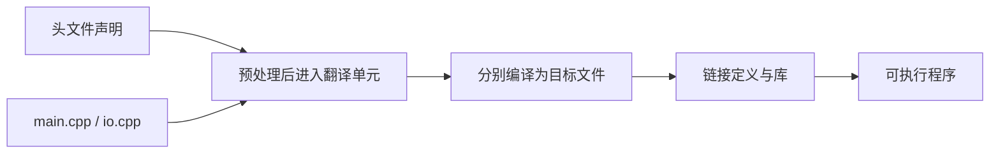

`#include` 让预处理器读取另一个文件，效果近似把其令牌放到当前位置。它不负责链接。`#define` 是宏替换，不检查 C++ 类型；常量优先考虑 `constexpr`，函数优先考虑普通/模板函数。`#` 开头**只有符合预处理指令语法的行**才是预处理指令，不能说源码中任意以 `#` 开头的文本都有效。

`#include <x>` 常用于标准库或配置的包含路径，`#include "x"` 常用于项目头文件；具体搜索顺序受编译器和构建配置影响。头文件保护防止同一翻译单元重复包含同一声明/定义：

```cpp
#ifndef PROJECT_IO_H
#define PROJECT_IO_H
int read_number(); // 声明：告诉调用方接口
#endif
```

`#pragma once` 被主流编译器支持，简洁，但不是 C++17 标准规定的预处理指令。无论使用哪一种保护，它都不能把“一个普通非 inline 函数定义放进头文件并被多个 `.cpp` 包含”变成合法的单一定义。

#### 把声明、定义、调用接起来

```cpp
// io.h
#ifndef PROJECT_IO_H
#define PROJECT_IO_H
int double_value(int value); // 声明
#endif

// io.cpp
#include "io.h"
int double_value(int value) { return value * 2; } // 定义

// main.cpp
#include "io.h"
int main() { return double_value(21) == 42 ? 0 : 1; } // 调用
```

**读代码**：编译 `main.cpp` 时，头文件让编译器知道函数参数与返回类型；编译 `io.cpp` 时产生函数定义；链接时，调用点与定义才接上。把三个注释段分别保存为三个文件。用 `g++ -std=c++17 main.cpp io.cpp -o demo` 可一次编译并链接；若漏掉 `io.cpp`，常见结果是链接阶段报告未定义引用。若声明与定义签名不一致，问题可能出现在编译阶段，也可能表现为链接找不到对应符号，取决于具体代码。

**面试口述**：预处理展开包含关系；每个翻译单元独立编译；链接器解析跨文件引用。头文件保护处理的是单翻译单元的重复包含，ODR（单一定义规则）另管跨翻译单元的定义。见 [[#作用域、存储期、链接与 ODR|作用域、链接与 ODR]]。

#### CMake 管目标与依赖

CMake 描述目标、源文件、库依赖及编译要求，再生成对应构建系统。一个最小项目可以写：

```cmake
cmake_minimum_required(VERSION 3.16)
project(io_demo LANGUAGES CXX)
add_executable(io_demo main.cpp io.cpp)
target_compile_features(io_demo PRIVATE cxx_std_17)
```

`io_demo` 是目标名，`main.cpp` 与 `io.cpp` 都归它编译；`target_compile_features` 要求至少 C++17。运行 `cmake -S . -B build` 配置，再运行 `cmake --build build` 构建。IDE 中要选择包含两个源文件的目标；若只单独编译 `main.cpp`，当然不会自动把 `io.cpp` 的定义链接进去。CMake 很适合多目标、多平台和依赖管理，但小练习也可以直接用编译器命令，不存在“所有正式项目必须用 CMake”的语言规则。

#### 调试器先看状态，再决定走哪一步

| 动作 | 做了什么 | 什么时候用 |
| --- | --- | --- |
| 继续 | 运行到下个断点、停止或结束 | 当前状态已检查完 |
| 暂停 | 中断正在运行的程序 | 怀疑卡死或想取样状态 |
| 步过 | 执行当前源代码步，不进入调用内部 | 先看调用后的结果 |
| 步入 | 尝试进入当前调用 | 怀疑被调用函数内部有错 |
| 步出 | 跑到当前函数返回 | 已进入但无需继续细看 |
| 条件断点 | 满足条件时才停 | 只在 `i == 100` 时观察 |
| 求值/监视 | 读取当前作用域中的表达式 | 检查变量与不变量 |

调试器显示的“单步一行”受优化、内联、宏展开和调试信息影响，不一定严格等于一次 C++ 语句执行。**对表达式求值可能调用函数并产生副作用**，不要默认它只是被动观察。排查崩溃可先用带调试信息、较低优化的构建复现，再结合调用栈与局部变量判断；不要只凭断点处看到的一个值就推断根因。

**核对依据**：[GCC `#include` 行为](https://gcc.gnu.org/onlinedocs/cpp/Include-Operation.html)、[GCC 包含路径语法](https://gcc.gnu.org/onlinedocs/cpp/Include-Syntax.html)、[CMake `add_executable`](https://cmake.org/cmake/help/latest/command/add_executable.html)；阅读日期 2026-10-25。

### 作用域、存储期、链接与 ODR


#### 代码块与作用域（Blocks & Scope）

代码块用 `{}` 包裹，形成一个独立的作用域。块内定义的变量，离开 `}` 后自动销毁。

```cpp
void demo() {
    int x = 10;               // 外层作用域

    if (true) {
        int x = 20;           // 内层 x 遮蔽外层 x
        std::cout << x;       // 输出 20
    } // 内层 x 在这里销毁

    std::cout << x;           // 输出 10（外层 x 还在）
}
```

**关键点**
- `if` / `for` / `while` 默认只控制后面**一条**语句，多条必须加 `{}`。
- 变量遮蔽（Shadowing）应尽量避免，可读性差且易出 bug。
- 局部变量遮蔽局部变量时，**无法**用任何语法访问被遮蔽的外层变量。

#### 三大存储期（Storage Duration）

| 存储期 | 生命周期 | 内存位置 | 典型代表 |
|--------|----------|----------|----------|
| 自动（Automatic） | 进入块创建，离开块销毁 | 栈 | 普通局部变量、函数参数 |
| 静态（Static） | 程序启动创建，程序结束销毁 | 数据段 | 全局变量、`static` 局部变量 |
| 动态（Dynamic） | `new` 创建，`delete` 销毁 | 堆 | 后续章节 |

```cpp
void storage_demo() {
    int auto_var = 1;             // 自动存储期：每次调用都重新创建

    static int static_var = 1;    // 静态存储期：只初始化一次，值会保留

    std::cout << auto_var << " " << static_var << '\n';
    ++auto_var;
    ++static_var;
}

// 调用两次结果：
// 1 1
// 1 2
```

#### 静态局部变量（Static Local）

**特点**：作用域是局部的，寿命却是全局的（只初始化一次）。

```cpp
int accumulate(int x) {
    static int sum = 0;    // 第一次调用时初始化为 0，之后保留上次的值
    sum += x;
    return sum;
}

// accumulate(5);  → 5
// accumulate(10); → 15
// accumulate(3);  → 18
```

**局限性**
- 无法重置（除非重启程序）
- 无法同时拥有多个独立的累加器
- 多线程下修改不是线程安全的

**更好的替代**：用类封装状态（每个对象一份独立数据）。

#### 链接属性（Linkage）

链接属性决定**多个文件中的同名标识符是否是同一个东西**。

| 链接类型 | 可见范围 | 实现方式 |
|----------|----------|----------|
| 无链接 | 仅当前块 | 普通局部变量 |
| 内部链接 | 仅当前 `.cpp` | 全局加 `static`，或放进**无名命名空间** |
| 外部链接 | 整个程序 | 普通全局变量、非静态函数（其他文件用 `extern` 声明） |

```cpp
// 内部链接（推荐现代写法）
namespace {
    int file_only = 0;     // 只有当前文件能用
}

// 外部链接
int global_value = 100;    // 整个程序共享，其他文件可用 extern 声明
```

#### 命名空间（Namespaces）

用来解决大型项目中的**命名冲突**。

```cpp
namespace Math {
    inline constexpr double PI = 3.1415926535;
    int add(int a, int b) { return a + b; }
}

namespace Physics {
    inline constexpr double PI = 3.1416;   // 同名也不冲突
}

// 使用
std::cout << Math::PI;
std::cout << Physics::PI;
std::cout << Math::add(3, 4);
```

**无名命名空间**（现代替代 `static` 全局）
```cpp
namespace {
    int only_in_this_file = 0;
}
```

**using 声明 vs using 指令**

| 写法 | 效果 | 风险 |
|------|------|------|
| `using std::cout;` | 只引入一个名字 | 较低 |
| `using namespace std;` | 引入整个命名空间 | 极高，容易冲突 |

**最佳实践**：不要在头文件中使用 `using namespace`，函数内部谨慎使用 `using` 声明。

#### inline 与 ODR（单一定义规则）

**ODR 核心**：非内联函数/变量在整个程序中只能定义一次。

如果把普通函数定义写在头文件里，被多个 `.cpp` 包含 → 链接报错（multiple definition）。

**现代 `inline` 的真正意义**：  
允许在多个翻译单元中存在**完全相同的定义**，且不违反 ODR。

```cpp
// constants.h（可被多个 .cpp 包含）
#pragma once
namespace Constants {
    inline constexpr int maxClassSize = 35;   // C++17 内联变量
}
```

**C++17 内联变量**解决了以前头文件定义全局常量的麻烦。

#### 全局变量最佳实践

**为什么少用非常量全局变量？**
1. 任何函数都能修改 → Bug 极难追踪
2. 破坏可测试性
3. 命名污染
4. 初始化顺序不确定（Static Initialization Order Fiasco）

**正确替代**
- 只读全局数据 → `inline constexpr` 放在命名空间里
- 需要全局状态 → 单例 或 依赖注入（显式传引用）
- 简单状态 → 静态局部变量（有封装）

### 在真实仓库里，从构建目标而不是 `main()` 开始

一个仓库可以同时构建库、命令行工具、测试程序和性能基准。先看根目录的 `README`、`CMakeLists.txt` 或其他构建文件，再找“我要修改的功能属于哪个 target”。头文件里的声明让其他翻译单元知道接口，`.cpp` 里的定义提供实现；编译器单独处理各个翻译单元，链接器再把符号与库接起来。报错 `undefined reference` 时，除了检查函数签名，还要确认定义所在源文件或库是否被编进目标。

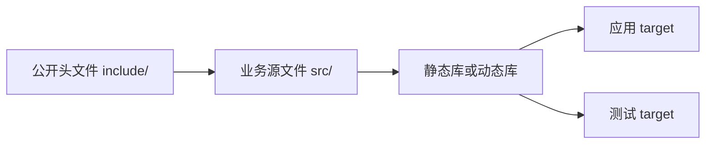

```cmake
cmake_minimum_required(VERSION 3.16)
project(example LANGUAGES CXX)

add_library(pricing src/pricing.cpp)
target_include_directories(pricing PUBLIC include)
target_compile_features(pricing PUBLIC cxx_std_17)

add_executable(app src/main.cpp)
target_link_libraries(app PRIVATE pricing)
```

逐行理解：`pricing` 是库目标，`src/pricing.cpp` 属于它；`PUBLIC include` 表示库自身及使用者都需要公开头文件目录；`app` 链接该库，但它不把 `pricing` 当作自己的公开使用要求继续传播。`PUBLIC/PRIVATE/INTERFACE` 是 CMake 的**使用要求传播范围**，不是 C++ 类的访问控制。大型项目还会有生成代码、平台条件编译和第三方依赖；读目标图能比在几千个源文件里盲搜更快定位问题。依据：[CMake `target_include_directories`](https://cmake.org/cmake/help/latest/command/target_include_directories.html)、[CMake `target_link_libraries`](https://cmake.org/cmake/help/latest/command/target_link_libraries.html)。

**静态库与动态库**：静态库通常在链接时把所需目标代码合入产物；动态库在程序装载或运行时由装载器参与解析，带来部署、版本与符号可见性问题。库类型不决定对象是否在堆上。跨库边界传递 C++ 对象时还要考虑编译器、标准库、编译选项与 ABI 的兼容性；不要把“头文件能编过”当成“二进制一定兼容”。

**排错顺序**：先看报错阶段。头文件找不到，查 include 路径和 target 依赖；重定义，查同一翻译单元重复包含与 ODR；未定义引用，查定义和链接目标；只在 Release 出问题，查未定义行为、优化依赖、断言被关闭和数据竞争。打开 `compile_commands.json` 能看到实际传给编译器的命令，但支持范围取决于生成器。依据：[CMake 编译数据库](https://cmake.org/cmake/help/latest/variable/CMAKE_EXPORT_COMPILE_COMMANDS.html)。

**面试回答**：“我先定位失败在哪个阶段，再看目标和使用要求。编译错误常是可见性或类型问题，链接错误常是定义缺失、签名不一致或库没连上；运行时问题再沿对象寿命和调用链排查。”

## 第二篇：类型、表达式、函数与值类别

### 基础类型、`const`、`constexpr` 与 `string_view`

> 基线：C++17。本章先判断“一个值是什么、活多久、谁拥有它”，再谈优化。示例为教学片段，独立编译时需补齐 `#include` 和 `main`。

#### 字节、对象与基础类型

C++ 程序操作的是**对象**：对象有类型、存储、生命周期和值。类型决定可进行哪些操作；不要把“内存里的一串比特”直接等同于某个有效对象。C++ 的 `byte` 是可寻址的基本存储单位；它由 `CHAR_BIT` 个 bit 组成，`CHAR_BIT` 至少为 8，常见平台是 8。`sizeof(T)` 的单位是 C++ 字节，不保证每个平台的字节都恰好 8 bit。`void` 表示没有值，也用于 `void*` 这种不携带具体对象类型的指针。

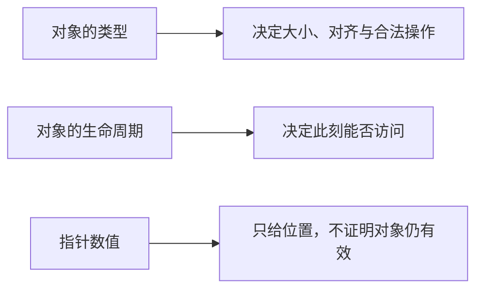

整数要分清**范围、转换和溢出**。`int` 的位宽由实现决定；`std::int32_t` 仅在实现提供恰好 32 位、无填充的对应类型时存在。`std::size_t` 是无符号类型，通常用于对象大小和容器长度。无符号算术按模运算回绕；有符号整数溢出是未定义行为。混合有符号与无符号运算会经过通常算术转换，不能笼统记成“有符号一定变无符号”，应看参与类型的等级与可表示范围。

```cpp
std::size_t count = values.size();
if (count > 0) {
    auto last = count - 1; // 先确认非零，再减一，避免无符号回绕
}
```

浮点数通常有舍入误差，但“永远不能用 `==`”也不对：与自己、精确表示的哨兵值或协议明确定义的值比较可以有意义。比较计算结果时，容差要按业务单位、数值尺度和误差模型选择；固定的 `1e-9` 并非通用答案。财务金额一般还要考虑以整数最小货币单位或十进制定点方式表达，不能仅靠任意容差补救模型问题。

`char` 是字符类型，也是整数类型，但字符编码不由 C++ 固定为 ASCII；例如 `'A'` 的数值不能跨所有执行字符集都背成 65。`static_cast<int>(ch)` 是显式转换，不代表它总安全或没有信息损失。`if (x = 5)` 是合法的赋值表达式，容易误写成比较；开启编译器警告并写清条件意图。

#### `const` 管修改，`constexpr` 管常量表达式

`const` 约束通过这个名字或访问路径修改对象，适合表达“初始化后不再改”。它不保证额外优化，也不等于对象一定在编译期有值。`constexpr` 变量必须用常量表达式初始化；`constexpr` 函数**允许**在满足条件时用于常量表达式，但普通运行时调用仍可发生。声明 `constexpr` 不是对所有调用作“提前计算”的性能承诺。

```cpp
constexpr int square(int x) { return x * x; }
constexpr int fixed = square(4); // 此处要求常量表达式
static_assert(fixed == 16);

int runtime = read_number();     // 假设函数返回运行时输入
const int frozen = runtime;      // 合法：此后不能通过 frozen 修改
int result = square(runtime);    // 合法：constexpr 函数也能在运行时调用
```

**读代码**：`fixed` 的初始化和 `static_assert` 必须在编译时满足常量表达式规则；`frozen` 的值来自运行时，只是之后不可改；`result` 用相同的 `square` 函数处理运行时输入。某些 `const` 整型变量本身也可用于常量表达式，不能把 `const` 与“只在运行时”画等号。`consteval` 是 C++20 的立即函数，本章 C++17 示例不使用。

#### `std::string` 拥有字符，`std::string_view` 借用字符

`std::string` 管理字符串存储；`std::string_view` 通常保存指向字符序列的指针和长度，**不拥有**字符。按值传 `string_view` 可以让只读函数接受字面量、`std::string` 或子视图而不复制字符；但 view 的构造方式也可能先产生临时 `std::string`，所以不能声称每种调用都“零分配”。

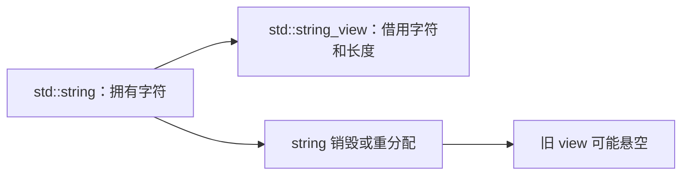

```cpp
void print(std::string_view text); // 只读借用，不保存 text

std::string name = "Alice";
print(name);                    // 直接借用已有字符
print(std::string_view{name}.substr(0, 3)); // 子视图仍借用 name
print(name.substr(0, 3));      // 先创建临时 string，不能称为零分配
```

**读代码**：`std::string_view{name}` 只观察 `name`，`substr` 产生的是子视图；`name.substr` 先产生新的 `std::string`，其内部是否实际分配取决于实现和长度。函数调用期间使用临时字符串通常可以，但绝不能把借到的 view 保存到临时字符串寿命之后。

```cpp
std::string_view bad() {
    std::string local = "Alice";
    return local; // 返回后 local 被销毁，view 悬空
}
```

还要注意：view 不保证末尾有 `\0`，不能随便把 `view.data()` 当作 C 字符串传给需要零结尾的接口。若接口要长期持有文本，返回或保存 `std::string`；若调用方明确保证底层数据活得更久，才适合保存 view。

#### 面试时怎样说

- **基础类型**：C++ 类型、对象生命周期、大小和对齐是不同维度；`sizeof` 按字节计，整数转换与溢出要写明类型和前提。
- **`const` / `constexpr`**：前者约束修改，后者让变量或函数参与常量表达式；`constexpr` 函数也可能在运行时执行。
- **`string_view`**：这是非拥有的只读字符视图，传参方便且避免字符复制，但不能比底层字符活得更久，也不保证零结尾。

**核对依据**：[C++17 基础类型](https://timsong-cpp.github.io/cppwp/std17/basic.types)、[C++17 常量表达式与 `constexpr`](https://timsong-cpp.github.io/cppwp/std17/dcl.constexpr)、[C++17 `string_view`](https://timsong-cpp.github.io/cppwp/n4659/string.view)；阅读日期 2026-10-25。

### 指针上的 const、断言与视图生命周期

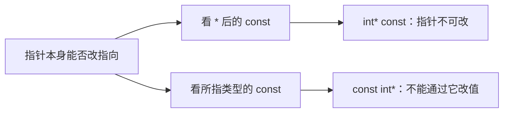

#### 指针的四种 const 组合（彻底讲清楚）

先记住两个角色：
- **指针本身**：就像“门牌号”
- **指向的内容**：就像“房子里的东西”

`const` 可以分别锁这两个东西。

```cpp
int a = 10;
int b = 20;
```

##### ① `const int* p`（最常见）
```cpp
const int* p = &a;
```
- 锁的是**房子里的东西**（不能通过 p 修改 a 的值）
- **门牌号可以换**（p 可以指向别的变量）

```cpp
*p = 99;     // ❌ 不能改内容
p = &b;      // ✅ 可以改指向
```

##### ② `int* const p`
```cpp
int* const p = &a;
```
- 锁的是**门牌号**（p 不能再指向别人）
- **房子里的东西可以改**

```cpp
*p = 99;     // ✅ 可以改内容
p = &b;      // ❌ 不能改指向
```

##### ③ `const int* const p`
```cpp
const int* const p = &a;
```
- 门牌号和房子里的东西**都锁死**

```cpp
*p = 99;     // ❌
p = &b;      // ❌
```

##### ④ `int const* p`
和第一种完全一样，只是写法不同（`const` 放左边或右边都行）。

**记忆口诀（再简化）：**
- `const` 离 `*` 近 → 锁内容
- `const` 离指针名近 → 锁指针本身

#### `static_assert` 是干什么的？

它是**编译期的断言**（检查）。

```cpp
constexpr int N = 100;
static_assert(N > 0, "N must be positive");
```

意思是：
> “在编译的时候就检查一下，如果 N 不大于 0，直接编译失败，并显示错误信息。”

**和普通 assert 的区别：**
- 普通 `assert`：程序运行时才检查
- `static_assert`：程序还没运行，编译时就检查

好处：错误发现得更早，不会等到运行才崩。

#### `string_view` 的“零拷贝”和“悬空”

##### 先理解“拷贝”有多贵

```cpp
void print(std::string s) { ... }  // 会把整个字符串复制一份
```

如果字符串很长（比如几万个字符），复制会：
- 多占用一份内存
- 多花时间去复制字符

##### `string_view` 怎么做到零拷贝？

它**不复制字符**，只是记录两样东西：
1. 字符串从哪里开始（指针）
2. 有多长（长度）

就像你给别人说：“从这本书的第 10 页开始，看 5 页”，而不是把这 5 页重新复印一份给他。

```cpp
void print(std::string_view sv);  // 只传递“从哪开始 + 多长”，非常轻
```

所以传递已有字符串的视图通常无需复制字符。若构造视图前先调用返回新字符串的 `substr`，临时字符串本身仍可能分配；不能把整个表达式都称为零分配。

##### “悬空”是什么意思？（最重要）

悬空 = **你手里的“指示”已经失效了**。

举个生活例子：
- 你朋友说：“去我家客厅看书”
- 然后你朋友把房子拆了
- 你还按地址去找 → 就出问题了（悬空）

代码对应：

```cpp
std::string_view bad() {
    std::string s = "hello";   // s 是局部变量，函数结束就会被销毁
    return s;                  // 返回了一个指向 s 的 view
}  // 函数结束，s 被销毁了，返回的 view 就指向了已经不存在的内存 → 悬空
```

使用悬空的 `string_view` 是**未定义行为**，程序可能崩溃，也可能出现奇怪结果。

**安全原则：**
`string_view` 只能指向比它活得更久的字符串（比如字符串字面量，或者调用它的函数里还活着的字符串）。

### 类型转换、类型别名与 auto


#### 类型转换总览

**定义**：把一个值从一种数据类型转换成另一种数据类型。

| 方式 | 谁发起 | 例子 | 风险 |
|------|--------|------|------|
| **隐式转换** | 编译器自动 | `double d = 5;` | 隐蔽，可能悄悄丢精度 |
| **显式转换** | 程序员用 cast 明确请求 | `static_cast<int>(5.4)` | 明确，代码里看得见 |

**类比**：  
隐式转换像自动挡——方便但你未必察觉换了什么挡；  
显式转换像手动挡——换挡动作写在代码里，清清楚楚。

**触发条件**：预期一种类型、提供了另一种类型时，编译器知道怎么转就自动转，不知道就报错。

```cpp
double d { 5 };          // int → double，隐式转换
print(3.14);             // double → int，隐式截断（危险）
std::string s { 5 };     // 编译错误！编译器不知道怎么转
```

#### 标准转换（三大类）

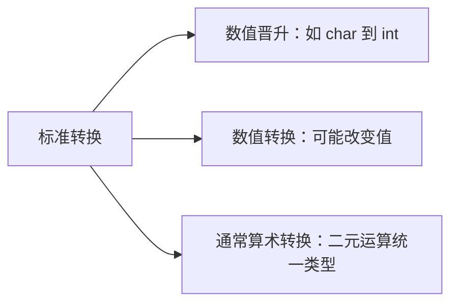

##### 数值晋升（Numeric Promotion）

**定义**：把较小的数值类型转成较大的类型（通常是 `int` 或 `double`），让 CPU 在自然数据大小上运算。

**两大类**：

| 晋升类型 | 转换方向 | 例子 |
|----------|----------|------|
| 整型晋升 | `bool` / `char` / `short` → `int` | `'a'` → 97 |
| 浮点晋升 | `float` → `double` | `1.5f` → `1.5` |

**关键特性：保值（Value-preserving）**  
晋升**不损失任何值和精度**。

**记忆口诀**：  
晋升只有两个方向——**整型奔着 int 去，浮点奔着 double 去**。其他一律不算晋升。

```cpp
char ch { 'a' };
int i { ch };           // 整型晋升：char → int

float f { 1.5f };
double d { f };         // 浮点晋升：float → double
```

**注意**：并非所有“变宽”的转换都是晋升！

```cpp
int i { 5 };
long l { i };           // int → long 是数值转换，不是晋升！
```

##### 数值转换（Numeric Conversion）

**定义**：基本类型之间**不是晋升**的转换。

**窄化转换（Narrowing Conversion）**：可能导致值或精度损失的转换。

| 转换 | 会丢失什么 | 例子 |
|------|------------|------|
| `double` → `int` | 小数部分被**截断**（不是四舍五入） | `int(5.9)` → 5 |
| `double` → `float` | 精度降低 | 大 double 可能溢出 |
| `long long` → `int` | 高位被丢弃 | 大数变小数 |
| `int` → `char` | 只保留低 8 位 | 300 → 44 |
| `int` → `bool` | 非 0 变 1 | 5 → 1 |

**对比晋升与转换**：

| 对比 | 数值晋升 | 数值转换 |
|------|----------|----------|
| 方向 | 小 → 大（int/double） | 各种方向 |
| 值损失 | **无**（保值） | **可能有**（窄化） |
| 编译器态度 | 放心自动做 | 可能丢值时报警告/错误 |

##### 窄化转换与列表初始化

C++11 的**花括号初始化**禁止隐式窄化转换（安全网）：

```cpp
int a { 5.4 };          // ❌ 编译错误！窄化
int b = 5.4;            // ✅ 能编译，但有警告（拷贝初始化）
```

**例外**：常量表达式且值能被精确表示时允许：

```cpp
int a { 5 };            // ✅ 本身就是 int
int b { 5.0 };          // ✅ 常量表达式，转成 5 无损失
float f { 5.0 };        // ✅ 5.0 能被 float 精确表示
float g { 5.1 };        // ❌ 5.1 在 double 里就不精确
float h { f };          // ❌ f 是运行期变量，无法证明安全
```

**核心区别**：常量表达式 vs 运行期变量。

##### 算术转换（Usual Arithmetic Conversions）

**定义**：二元运算符（`+ - * / % < > ==` 等）要求两个操作数类型相同。不同类型时，编译器按固定规则配平。

**简化规则**：
1. 有浮点参与 → 结果是浮点（向更大的浮点靠拢）
2. 全是整型 → 按宽度和符号性排优先级
3. 有符号与无符号混算时，有符号常被转成无符号（**经典陷阱**）

```cpp
int i { 3 };
double d { 2.5 };
auto r1 { i + d };      // i 转成 double，结果 5.5

unsigned int u { 1 };
int k { -1 };
auto r3 { u + k };      // k 被转成 unsigned！-1 变成巨大的正数
```

**危险陷阱**：
```cpp
int a { -1 };
unsigned int b { 1 };
if (a < b)              // ❌ a 转成 unsigned，条件为 false！
```

**建议**：尽量避免有符号与无符号混算。

#### 显式转换（五种 cast）

| cast | 用途 | 建议 |
|------|------|------|
| C 风格 `(int)x` | 老式万能转换 | **避免** |
| `static_cast<T>` | 一般的值类型转换 | **首选，最常用** |
| `const_cast<T>` | 加/去 const | **避免**（除非对接旧 API） |
| `dynamic_cast<T>` | 多态类型的安全向下转换 | 需要时用（有开销） |
| `reinterpret_cast<T>` | 位模式重新解释 | **避免**（底层编程除外） |

##### C 风格转换为什么被嫌弃
- 意图模糊（可能是值转换、去 const、位重解释）
- 搜索困难
- 危险动作和普通转换长得一样

##### static_cast（最常用）
```cpp
int i { static_cast<int>(5.4) };     // double → int，截断为 5
double d { static_cast<double>(5) }; // int → double
char c { static_cast<char>(65) };    // 数值转换；是否表示字符 'A' 依执行字符集而定
```
编译器会检查转换合法性，但不做运行时检查。

##### const_cast
唯一能加/去 const 的 cast。去掉 const 后**修改**本来就是 const 的对象是**未定义行为**。

##### dynamic_cast
用于多态继承体系的安全向下转换，**运行时检查**。失败返回 `nullptr`（指针）或抛异常（引用）。需要虚函数，有性能开销。

##### reinterpret_cast
可做某些底层指针/整数转换，但不等于安全地“把对象位模式重解释成另一类型”。转换后的指针能否解引用还受对齐、对象生命周期和类型访问规则限制；做二进制处理时优先使用受规则支持的字节视图或复制。

#### 类型别名（typedef / using）

```cpp
using Distance = double;     // 现代推荐写法
typedef double Distance;     // C 老式写法（等价）
```

**核心性质：别名不是新类型！**

```cpp
using Degrees = double;
using Radians = double;

Degrees deg { 90.0 };
Radians rad { 1.57 };
rad = deg;                   // ✅ 完全合法！都是 double
```

**类比**：别名像人的小名——“张伟”和“小伟”是同一个人，编译器眼里只有 `double`。

**真正价值**：
1. **可读性**：`Distance` 比 `double` 更能表达意图
2. **可维护性**：改一行类型，全程序跟着变
3. **简化复杂类型**：给又长又丑的类型起短名

**想要真正的类型安全** → 用强类型封装（`struct` 包装或 `enum class`）。

#### auto 关键字

**核心**：类型推导（从初始化表达式推导类型）。

```cpp
auto a { 5 };        // int
auto b { 5.0 };      // double
auto c { 'a' };      // char
```

**必须初始化**，否则无法推导。

##### 最重要的坑：会丢弃顶层 const 和引用

```cpp
const int ci { 5 };
auto a { ci };       // a 是 int（const 被丢掉了！）

int x { 5 };
int& r { x };
auto b { r };        // b 是 int（引用被丢掉了，b 是副本）
```

**想保留就手动加回来**：
```cpp
const auto d { ci };     // const int
auto& e { x };           // int&
const auto& f { ci };    // const int&
```

##### 何时用 auto
- 类型冗长复杂时（迭代器、复杂模板类型）
- 类型由表达式决定、写出来反而啰嗦时
- 范围 for：`for (const auto& item : container)`

##### 何时不用
- 类型一目了然时（`auto x { 5 };` 不如直接写 `int`）

##### 函数返回类型的三种写法

| 写法 | 返回类型何时确定 | 建议 |
|------|------------------|------|
| `int add(...)` | 写代码时定死 | **常规函数首选** |
| `auto add(...) -> int` | 写在后面（尾置） | 模板中需要用参数推导时 |
| `auto add(...)` | 从 return 推导 | 返回类型冗长时可用，普通函数避免 |

### constexpr 函数与编译期求值

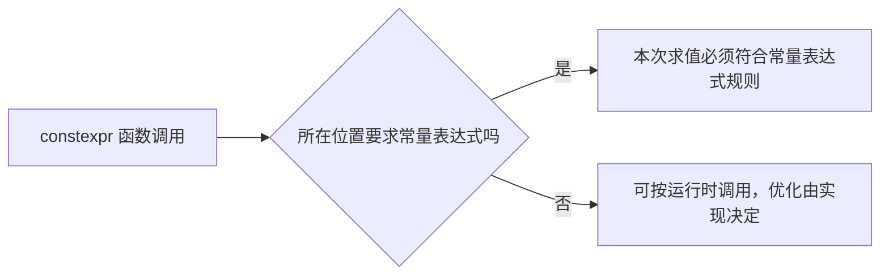

#### 什么是 constexpr 函数？

**定义**：一个被 `constexpr` 修饰的函数，**允许**在需要常量表达式（constant expression）的上下文中被调用。

写法很简单：
```cpp
constexpr 返回类型 函数名(参数列表)
{
    // 函数体
}
```

**关键性质**：
- **不是强制编译期执行**。只有当你把它用在“必须是编译期常量”的地方时，编译器才**保证**在编译期计算它。
- 如果用在普通运行时上下文，编译器可以选择在编译期计算（如果参数都是常量），也可以选择生成普通运行时代码。
- 函数参数本身**永远不是** `constexpr` 的（即使函数是 `constexpr`）。参数值是否是常量表达式，取决于调用时传入的实参。

**为什么需要它？**
以前想在编译期做计算，只能用宏、模板元编程，或者手写一堆 `enum`/`static const`。`constexpr` 让普通函数也能参与编译期计算，代码可读性大幅提升。

**对比**：

| 特性                  | 普通函数          | constexpr 函数                  | consteval 函数（后面讲） |
|-----------------------|-------------------|---------------------------------|--------------------------|
| 能否在常量表达式中调用 | 否                | 是（当参数满足条件时）          | 必须                     |
| 运行时能否调用         | 是                | 是                              | 否（编译错误）           |
| 是否隐式 inline        | 否                | 是                              | 是                       |
| 定义是否必须可见       | 可以只声明        | 编译期调用时必须看到完整定义    | 必须看到完整定义         |

#### constexpr 函数的“保证”与“可能”

这是最容易混淆的点：

- **保证编译期执行**的情况：用在需要常量表达式的地方  
  例如：
  ```cpp
  constexpr int x = someConstexprFunc(5);     // 必须编译期
  int arr[someConstexprFunc(3)];              // 数组大小必须是常量表达式
  static_assert(someConstexprFunc(10) > 0);   // 必须编译期
  ```

- **可能编译期，也可能运行时**的情况：普通赋值或函数调用  
  ```cpp
  int y = someConstexprFunc(someRuntimeValue); // 运行时执行
  constexpr int z = someConstexprFunc(5);      // 编译期执行
  ```

普通上下文中是否做常量折叠由实现和优化决定；需要语言层面保证时，应把结果放进常量表达式上下文。C++20 的 `consteval` 是另一种强制要求。

#### constexpr 函数的规则与限制（C++11 → C++14 → C++20 逐步放宽）

早期（C++11）限制非常严：
- 只能有一个 `return` 语句
- 不能有局部变量
- 不能有循环、`if` 等

C++14 起逐步放宽，但规则随版本变化。对于本笔记的 **C++17** 基线，可先用纯计算、可常量求值的操作写示例；一个 `constexpr` 函数的某条运行时路径并不要求每次调用都成为常量表达式。C++20 又允许某些受约束的动态分配与虚调用参与常量求值，因此“`constexpr` 绝不能出现 `new`/虚函数”不能当作跨版本规则。实际能否用于常量表达式，要看**这次调用所执行的路径**以及所用标准版本。

**重要提醒**：函数参数即使在 `constexpr` 函数里，本身也不是常量表达式。你不能在函数内部写：
```cpp
constexpr double calculate(...) {
    constexpr double x = towerHeight; // 错误！参数不是 constexpr
}
```

#### constexpr 函数是隐式 inline，且定义必须可见

因为编译器要在编译期“展开并计算”这个函数，所以：
- 它被隐式声明为 `inline`（可以放在头文件里多次包含而不违反 ODR）。
- 调用它做编译期计算时，编译器必须能看到**完整定义**（不能只看到声明）。

这和普通函数可以只声明、实现放在 `.cpp` 里形成鲜明对比。

#### consteval 函数（C++20）

**定义**：用 `consteval` 修饰的函数，**必须**在编译期求值。如果用在运行时上下文，直接编译错误。

```cpp
consteval int square(int x) {
    return x * x;
}

constexpr int a = square(5);   // OK
int b = square(5);             // OK（因为 5 是常量）
int c = square(someRuntimeVar); // 编译错误！
```

**与 constexpr 的对比**：
- `constexpr` = “可以在编译期”
- `consteval` = “必须在编译期”（也叫 immediate function）

适用场景：
- 你希望强制用户只能在编译期使用这个函数（比如生成编译期唯一 ID、做强约束的计算）。
- 或者你想明确表达“这个函数只为编译期服务”。

`consteval` 函数同样隐式 `inline`，定义必须可见，规则基本和 `constexpr` 相同。

#### 实际代码详解（练习 中的小球落地程序）

原程序模拟从塔顶落下的小球高度。我们需要尽可能加上 `const` / `constexpr`。

##### 修改后的关键部分解释

```cpp
// 1. getTowerHeight() —— 不能加 constexpr
double getTowerHeight()
{
    std::cout << "Enter the height of the tower in meters: ";
    double towerHeight{};
    std::cin >> towerHeight;   // 输入只能运行时做
    return towerHeight;
}
```
原因：涉及 `std::cin` / `std::cout`，这些操作符重载目前不支持 `constexpr`。任何做 I/O 的函数都不能是 `constexpr`。

```cpp
// 2. calculateBallHeight() —— 可以（也应该）加 constexpr
constexpr double calculateBallHeight(double towerHeight, int seconds)
{
    constexpr double gravity{ 9.8 };  // 重力加速度是编译期常量，用 constexpr

    // 注意：下面这两个变量不能写 constexpr
    // 因为它们的值依赖函数参数，而参数不是常量表达式
    const double distanceFallen{ (gravity * (seconds * seconds)) / 2.0 };
    const double currentHeight{ towerHeight - distanceFallen };

    return currentHeight;
}
```
为什么可以加 `constexpr`？
- 函数只做算术运算
- 没有调用任何非 `constexpr` 函数
- 没有 I/O、没有动态内存

为什么内部变量用 `const` 而不是 `constexpr`？
- `seconds` 和 `towerHeight` 是参数 → 不是常量表达式
- 所以依赖它们的计算结果也不能是 `constexpr` 变量
- 但用 `const` 仍然是好习惯（防止后面被修改）

```cpp
// 3. printBallHeight() 和 printCalculatedBallHeight() —— 不能加 constexpr
void printBallHeight(double ballHeight, int seconds)
{
    // 里面有 std::cout，只能运行时
    ...
}

void printCalculatedBallHeight(double towerHeight, int seconds)
{
    // 这里 ballHeight 只能是 const，不能是 constexpr
    // 因为 calculateBallHeight 的实参 towerHeight 来自运行时输入
    const double ballHeight{ calculateBallHeight(towerHeight, seconds) };
    printBallHeight(ballHeight, seconds);
}
```

```cpp
int main()
{
    // towerHeight 来自用户输入 → 只能是 const
    const double towerHeight{ getTowerHeight() };

    printCalculatedBallHeight(towerHeight, 0);
    // ... 后面同理
}
```

**为什么有些地方用 const，有些地方用 constexpr？**
- `constexpr` 变量 = 编译期常量（值必须在编译期就能确定）
- `const` 变量可由运行时值初始化；某些满足规则的 `const` 整型变量也能用于常量表达式，不能把两者绝对对立

在这个程序里，塔高是用户输入的，所以只能是 `const`。而重力加速度 `9.8` 是写死的字面量，可以（也应该）写成 `constexpr`。

#### 额外扩展与最佳实践

1. **能加 constexpr 就尽量加**  
   现代 C++ 建议：只要函数满足条件，就标成 `constexpr`。这样既不影响运行时使用，又给编译期计算留了机会。

2. **constexpr 变量 vs const 变量**  
   - 局部 `constexpr` 变量必须初始化为常量表达式
- 全局/静态 `constexpr` 变量的具体程序段与存储表示由实现决定，不能作为语言保证回答

3. **与 if constexpr 的配合**（C++17）  
   `constexpr` 函数经常和 `if constexpr` 一起用，实现编译期分支。

4. **性能影响**  
   常量表达式可把工作移到编译期，但会增加编译成本，最终运行时成本还受是否实际使用对象、生成代码和内存访问影响。是否收益大需测量。

5. **常见错误**  
   - 以为加了 `constexpr` 就一定编译期执行 → 错  
   - 在 `constexpr` 函数里对参数使用 `constexpr` → 错  
   - 不标版本就声称 `constexpr` 函数永远不能涉及动态内存或虚调用 → 错；C++17 与 C++20 的规则不同

### 值类别、引用、指针与传参


（酒店模型贯穿：变量 = 客房，指针 = 门牌号纸条，引用 = 房间外号）

#### 复合数据类型

由基本类型（int、double 等）组合构建出来的类型：数组、指针、引用、类、枚举等。本章主角是**引用**和**指针**——它们不存数据本身，存“数据在哪”的信息。

#### 值范畴：lvalue 与 rvalue

**值类别描述表达式**，不是变量类型。入门可把 lvalue 想成能标识一个对象/函数的表达式，把 prvalue 想成按值计算出的结果；C++ 还有 xvalue（可复用资源的将亡值），以后学习移动语义时再细分。不能把“有没有名字”或“是否一定临时”当作完整判据。

```cpp
x;        // lvalue：变量，&x 合法
5;        // rvalue：字面量
x + 1;    // rvalue：临时计算结果
foo();    // 按值返回 → rvalue；按引用返回 → lvalue
++x;      // lvalue（返回 x 本身）；x++ 是 rvalue（返回旧值副本）
"hi";     // 特例：字符串字面量是 lvalue（匿名数组对象）
```

**检查方法**：看表达式的语言规则与函数返回类型。取地址只是辅助直觉，位域等 lvalue 也不能直接取地址，类还能重载 `operator&`。

**为什么重要**：决定能绑定什么引用、哪些操作合法，也是将来移动语义的地基。

#### 引用 = 外号

```cpp
int x { 5 };
int& ref { x };   // 给 x 起外号（声明里的 & = 外号标志）
ref = 10;         // 就是 x = 10，对外号做啥就是对本体做啥
&ref == &x;       // true，同一间房
```

**四条铁律**：

| 规则 | 说明 |
|------|------|
| 必须初始化 | 外号不能悬空起，必须说给谁起 |
| 不可重置 | 一生锁定一人；`ref = y` 是**赋值**（x = y），不是换绑 |
| 不创建被引用对象的副本 | 引用在实现中仍可能占存储，不能背“绝不占内存” |
| 会悬垂 | 本体先销毁，外号就指向废墟 → 未定义行为 |

**绑定能力对比**：

| 绑定目标 | `int&` 非 const 引用 | `const int&` const 引用 |
|----------|----------------------|-------------------------|
| 可修改 lvalue | ✅ | ✅ |
| const lvalue | ❌ | ✅ |
| rvalue（字面量/临时值） | ❌ | ✅（还附赠临时对象续命） |

**工程铁律**：不需要改本体就用 `const int&`（防误改 + 万能插座）。

#### 指针 = 纸条

```cpp
int x { 5 };
int* p { &x };   // 声明里的 * = "这是指针"，& = 查门牌号
*p = 10;         // 语句里的 * = 按号找房换客人 → x 变 10
p = &y;          // 纸条可以重写（重新指向）——引用做不到这点
```

**& 和 \* 的两个身份**（口诀：看是不是在声明新变量）：

| 写法 | 声明里 | 语句里 |
|------|--------|--------|
| `&` | 引用标志 | 取地址（查门牌号） |
| `*` | 指针标志 | 解引用（按号找房） |

**三个危险 + 铁律**：

```cpp
int* p;               // 野指针：纸条留白 = 垃圾地址，用它 = 未定义行为
int* q { nullptr };   // 空指针：纸条写"无"
if (q) *q = 1;        // 铁律：要么有效地址，要么 nullptr，用前判空
```

| 坑 | 成因 | 后果 |
|----|------|------|
| 野指针 | 未初始化 | 摸黑闯随机房间 |
| 悬垂指针 | 对象已销毁 | 找到废墟 |
| 空解引用 | `*nullptr` | 硬闯 0 号禁房，崩溃 |

**空指针输出不固定**：流或调试器怎样显示空指针由实现决定，不能把输出字符 `0` 当作语言保证。判断空靠 `p == nullptr` 或 `if (p)`。

#### const 锁谁 —— 一条规则通杀

> **看 const 左边紧挨的是谁**：类型名（int）→ **锁值**；`*` → **锁指针**。  
> 速判：const 和变量名之间隔没隔着 `*`。隔了 → 锁值；没隔 → 锁指针。

| 写法 | 锁什么 | 能改指向？ | 能改值？ |
|------|--------|-----------|---------|
| `const int* p` | 锁值 | ✅ | ❌ |
| `int const* p` | 锁值（和上行同一个东西，换写法） | ✅ | ❌ |
| `int* const p` | 锁指针 | ❌ | ✅ |
| `const int* const p` | 双锁 | ❌ | ❌ |
| `const int& r` | 锁值（引用天生锁指向） | ❌ | ❌ |

#### 传参三姿势

```cpp
void f1(int x) {}    // 按值：给复印件，改了白改
void f2(int& x) {}   // 按引用：给外号，改的就是本体
void f3(int* x) {}   // 按地址：给纸条，判空后按号改
```

| | 按值 | 按引用 | 按地址 |
|--|------|--------|--------|
| 复制实参？ | 是 | 否 | 否（只复制地址） |
| 能改实参？ | ❌ | ✅ | ✅（解引用） |
| 能传“无”？ | — | ❌ | ✅ nullptr |
| 要判空？ | 否 | 否 | 是 |

**选择**：小对象只读 → 按值；大对象只读 → `const int&`；要改实参 → `int&`；需要“可能没有” → 指针。

#### 函数返回三姿势

| 方式 | 返回什么 | 陷阱 |
|------|----------|------|
| 按值 | 副本（rvalue） | 大对象浪费 |
| 按引用 | 本体的外号（**lvalue**，可被赋值） | **本体必须比函数长寿**；返回局部变量 = 悬垂 = 未定义行为 |
| 按地址 | 纸条 | 同上的悬垂问题；可返回 nullptr 表示“没有” |

**两个易错点**：

```cpp
int v { getMax(x, y) };    // 接收方是非引用 → 复制，改 v 不影响本体
int& r { getMax(x, y) };   // 接收方是引用 → 真外号

auto a { getMax(x, y) };   // auto 丢引用 → a 是副本
auto& b { getMax(x, y) };  // 想要外号必须写 auto&
```

**安全来源**：按引用/地址传进来的参数、static/全局对象（别返回局部变量）。

### 函数重载、模板推导与泛型


#### 函数重载（Function Overloading）

**定义**  
同一作用域内，允许定义多个**同名函数**，只要它们的**参数列表**（参数个数、类型、顺序）不同，这些函数就构成重载关系。调用时编译器根据实参自动选择最合适的那个。

**核心规则**  
- 区分依据**只看参数列表**，**返回类型不参与区分**。  
- 参数列表相同但返回类型不同 → 编译错误。  
- 参数列表不同（个数、类型或顺序任一不同）即可重载。

**代码详解**

```cpp
#include <iostream>

void print(int x) {
    std::cout << "int " << x << '\n';
}

void print(double x) {
    std::cout << "double " << x << '\n';
}

void print(int x, int y) {          // 参数个数不同，合法重载
    std::cout << "int int " << x << ' ' << y << '\n';
}

// 下面这行是错误的！只差返回类型
// int  foo(int x);
// double foo(int x);   // 编译错误：无法区分

int main() {
    print(5);       // 精确匹配 int 版本
    print(5.0);     // 精确匹配 double 版本
    print(1, 2);    // 匹配两参数版本
}
```

**为什么返回类型不能区分？**  
调用时可以完全忽略返回值（`foo(5);`），编译器无法知道你想要哪个版本。如果允许只靠返回类型区分，就会产生歧义。

**没有重载 vs 有重载对比**

| 场景              | 没有重载（C 风格）                  | 有重载（C++）                     |
|-------------------|-------------------------------------|-----------------------------------|
| 名字设计          | `print_int`、`print_double`、`print_int_int` | 全部叫 `print`                    |
| 调用处清晰度      | 必须暴露类型细节                    | 意图清晰，类型由编译器处理        |
| 维护成本          | 每增加一种类型就要新函数名          | 只增加参数列表不同的新版本        |
| 类比              | 每种菜都起一个完全不同的动词        | 同一个动词“打印”，宾语不同就不同 |

**类比**  
“打印”这个动作：打印文档、打印照片、打印发票，动词一样，具体行为看后面的宾语（参数）。

**扩展**  
- 标准库大量使用：`std::abs`（int/long/float/double 各版本）、`std::max`/`std::min`、流插入运算符 `operator<<`。  
- 构造函数重载是最常见的应用（默认构造、拷贝构造、带参数构造）。  
- 运算符重载本质上是函数重载的特殊语法糖（`operator+` 等）。

**常见陷阱**  
1. 只改返回类型就想重载 → 编译错误。  
2. 参数类型通过 typedef/using 起了别名，但实际是同一类型 → 不算不同参数列表。  
3. 在不同命名空间或类里的同名函数不是重载（是隐藏或覆盖）。

#### 重载解析（Overload Resolution）

**定义**  
当调用一个被重载的函数时，编译器根据实参的类型，在候选函数中选出**最佳匹配**的过程。

**匹配质量梯队（从高到低）**

1. **精确匹配（Exact Match）**  
   - 类型完全相同  
   - 或仅有极微小的调整（数组→指针、函数→函数指针、非 const → const 引用等）

2. **数值晋升（Numeric Promotion）**  
   - `char`/`short`/`bool` → `int`  
   - `float` → `double`  
   - 晋升**不丢失信息**

3. **数值转换（Numeric Conversion）**  
   - `int` → `long`/`double`  
   - `double` → `int`（可能丢精度）  
   - 任何整型↔浮点之间的转换

4. **用户定义转换**（类的转换构造函数或转换运算符）

**重载排序**：在可行候选中，标准规定的晋升转换序列通常优于一般转换序列；还要结合引用绑定、模板/非模板及其它重载规则判断，不能只背一句口号。

**代码详解**

```cpp
void print(int x);      // A
void print(double x);   // B

print('a');     // char → 晋升到 int → 选 A（第2梯队）
print(1.5f);    // float → 晋升到 double → 选 B
print(5);       // int 精确匹配 A（第1梯队）
```

**完整决策过程示例（对应练习 1a）**

```cpp
void print(int x) { std::cout << "int " << x << '\n'; }
void print(double x) { std::cout << "double " << x << '\n'; }

int main() {
    short s{5};
    print(s);   // 输出 int 5
}
```

推理步骤：  
1. `s` 是 `short`，既不是 `int` 也不是 `double`，没有精确匹配。  
2. `short → int` 是**整型晋升**（第2梯队）。  
3. `short → double` 属于数值转换（先晋升再转，第3梯队）。  
4. 第2梯队优于第3梯队 → 选 `print(int)`。

**为什么晋升优先？**  
整数晋升有自己的可表示范围规则，例如某些无符号小整数可能晋升为 `unsigned int`。重载选择按标准转换序列的等级进行，不应解释成编译器在所有候选里自动选择“业务上最安全”的函数。

**扩展**  
- 引用、指针、const 修饰也会影响匹配质量。  
- 可变参数函数（`...`）匹配质量最低。  
- 模板函数参与重载解析时有额外规则（见后面 Q4）。

#### 歧义匹配（Ambiguous Match）

**定义**  
多个重载函数都能匹配，且匹配质量完全相同，编译器无法决定选哪个 → **编译错误**。

**典型例子**

```cpp
void print(long x);
void print(double x);

print(5);   // 编译错误：歧义
```

推理：  
- `5` 是 `int`。  
- `int → long` 是数值转换。  
- `int → double` 也是数值转换。  
- 同属第3梯队，没有谁更优 → 歧义。

**类比**  
你说“随便来点辣的”，菜单上有“微辣牛肉”和“中辣鸡肉”，服务员无法判断你要哪个，只能回来问。编译器不会问，直接报错。

**避免歧义的三种方法**

```cpp
// 方法1：增加精确匹配版本
void print(int x);      // 现在 print(5) 精确匹配这个
void print(long x);
void print(double x);

// 方法2：调用时显式转换
print(5L);              // 明确要 long
print(static_cast<double>(5));

// 方法3：重新设计重载集，避免转换路径重叠
```

**扩展**  
歧义也会出现在：  
- 运算符重载  
- 模板与非模板函数混合  
- 默认参数与重载混用（见下一节）

**设计原则**  
重载集的本质是设计一套“任意合法调用都有唯一最佳匹配”的参数类型集合。转换路径重叠是歧义的根源。

#### 默认参数（Default Argument）

**定义**  
在函数声明中为参数提供默认值。调用时如果省略该参数，编译器自动填入默认值。

**两条铁律**

**规则1：有默认值的参数必须全部在最右边，且连续。**

```cpp
void foo(int a = 1, int b);          // 错误：a 有默认，b 没有
void foo(int a, int b = 1, int c);   // 错误：c 没有默认却在右边
void foo(int a, int b = 1, int c = 2); // 正确
```

原因：实参按位置从左到右匹配。中间有默认、右边没有默认时，编译器无法判断省略的是哪个。

**规则2：默认参数不参与重载区分。**

```cpp
void print();               // A
void print(int x = 0);      // B

print();    // 歧义！A 精确匹配0个参数，B 用默认值也能接受0个参数
```

从调用视角看，两个函数都能接受 `print()`，默认参数只影响“能不能省略”，不影响函数签名的身份。

**声明与定义的写法**

```cpp
// 头文件（声明处写默认值）
void print(int x, int y = 10);

// 源文件（定义处不要再写默认值）
void print(int x, int y) {
    std::cout << x << ' ' << y << '\n';
}
```

重复写默认值会报错。

**其他要点**  
- 默认实参不要求一定是常量表达式；例如可写调用表达式，实际求值发生在调用处。定义默认值时仍要注意名字查找、类型检查和副作用。  
- 默认参数与重载是替代关系，混用容易产生歧义。  
- 建议：能用一个带默认参数的函数搞定的，就不要再写多个重载。

**与 Python 对比**  
Python 默认参数更灵活（支持关键字参数），但有可变默认对象只求值一次的经典坑。C++ 更严格，换来的是无歧义。

#### 函数模板（Function Template）

**定义**  
一个“函数样的蓝图”，用**类型模板参数**作为占位符。编译器根据实际使用的类型生成具体函数。

```cpp
template <typename T>   // 模板参数声明
T max(T x, T y) {
    return (x < y) ? y : x;
}
```

- `template <typename T>` 告诉编译器这是模板，并声明类型参数 `T`。  
- `typename` 和 `class` 在这里完全等价，现代习惯用 `typename`。  
- 可以有多个模板参数：`template <typename T, typename U>`。

**没有模板 vs 有模板**

```cpp
// 没有模板：每种类型手写一遍
int    max(int x, int y)    { return (x < y) ? y : x; }
double max(double x, double y) { return (x < y) ? y : x; }
// 还要写 long、float、自定义类型……

// 有模板：写一次，处处生成
template <typename T>
T max(T x, T y) { return (x < y) ? y : x; }
```

**类比**  
模板像印章：刻一次（模板），盖在不同颜色的印泥上（不同类型），得到不同颜色的印痕（具体函数）。印章本身不能直接盖（模板不能直接调用）。

#### 模板的实例化（Instantiation）

**定义**  
从函数模板生成具体函数的过程。

**两种触发方式**

1. **隐式实例化**：由函数调用自动触发。  
2. **显式实例化**：程序员明确指定类型。

```cpp
max(1, 2);          // 隐式：T = int，生成 max<int>
max(1.0, 2.0);      // 隐式：T = double
max<int>(1.5, 2.5); // 显式：强制 T = int（会发生截断）
```

**重要性质：每个实例是独立的函数**

```cpp
template <typename T>
void foo() {
    static int counter = 0;
    ++counter;
    // 每个 T 都有自己独立的 counter
}

foo<int>();     // counter 从 0 → 1
foo<double>();  // 另一个 counter 从 0 → 1
foo<int>();     // 同一个 int 实例的 counter → 2
```

模板特化通常在被需要时实例化。没有用到某个 `T` 并不表示必须为它生成机器码；但最终是否生成、合并或内联代码受实现和链接优化影响，不能据此承诺“零开销”。

#### 模板实参推导（Template Argument Deduction）

**定义**  
编译器从函数调用的实参推导出模板参数的实际类型。

**铁律：推导不做类型转换！**

```cpp
template <typename T>
T max(T x, T y);

max(3, 4);      // OK，T = int
max(3.0, 4.0);  // OK，T = double
max(3, 4.0);    // 错误！一个推导出 int，一个推导出 double，冲突
```

**与重载解析的对比**

| 项目         | 重载解析                     | 模板实参推导                 |
|--------------|------------------------------|------------------------------|
| 匹配方式     | 在候选集中找最佳匹配         | 从实参推导唯一类型           |
| 允许隐式转换 | 是（分梯队）                 | **否**（要求类型一致）       |
| 失败表现     | 歧义错误或无匹配             | 推导冲突错误                 |

**突破推导限制的三种办法**

```cpp
// 1. 显式指定模板实参（跳过推导，允许后续转换）
max<int>(3, 4.0);               // T=int，4.0 转成 4

// 2. 显式转换实参
max(static_cast<double>(3), 4.0);

// 3. 使用两个独立的模板参数
template <typename T, typename U>
auto sub(T x, U y) { return x - y; }

sub(4, 1.5);    // T=int, U=double，各自推导，互不冲突
```

#### 泛型编程（Generic Programming）

**核心思想**  
算法与具体类型解耦。写 `max`、`sort`、`swap` 时只关心类型**支持什么操作**（能比较、能相加……），而不关心它是 int 还是自定义类型。

**三种编程范式对比**

| 范式           | 复用手段                   | 典型例子                     | 运行时取舍 |
|----------------|----------------------------|------------------------------|------------|
| 面向对象（OOP）| 运行时多态（虚函数）       | 基类引用调用派生类实现       | 可能有间接调用；编译器也可能去虚化 |
| 泛型编程（GP） | 编译时模板实例化           | `std::sort`、`std::vector<T>`| 常便于内联，但不保证零成本 |
| 过程式接口     | 函数与回调                 | C 语言的 `qsort`             | 取决于接口、比较器和实现 |

泛型能在编译期检查类型并生成针对类型的实现；运行时成本是否低，要看具体算法、实例化与优化结果。

**扩展**  
C++20 的 **concepts** 给泛型加了“契约”：

```cpp
template <typename T>
requires std::integral<T>
T add(T x, T y) { return x + y; }
```

明确声明“T 必须是整型”，推导失败时错误信息也更友好。

#### 缩写函数模板（Abbreviated Function Template，C++20）

**定义**  
参数类型写成 `auto` 时，编译器自动把函数变成模板，每个 `auto` 成为**独立的模板类型参数**。

```cpp
// C++20 缩写形式
auto add(auto x, auto y) {
    return x + y;
}

// 完全等价于
template <typename T, typename U>
auto add(T x, U y) {
    return x + y;
}
```

**注意“独立”二字**  
两个 `auto` 是两个不同的模板参数，允许不同类型。这与单参数模板的“同一个 T 必须一致”不同。

**想要两个参数同类型的缩写？**  
没有直接写法，必须用传统模板：

```cpp
template <typename T>
auto add(T x, T y);   // 只能这样
```

**风格建议**  
- 简短工具函数、泛型 lambda → 用缩写很清爽。  
- 正式库接口 → 用传统模板更明确。

**扩展**  
泛型 lambda（C++14）其实更早支持 `auto` 参数：

```cpp
auto add = [](auto x, auto y) { return x + y; };  // 也是模板
```

#### 非类型模板参数（Non-type Template Parameter）

**定义**  
模板参数有固定类型，占位的不是类型，而是一个**编译期常量值**。

```cpp
template <typename T, int N>   // N 是非类型模板参数
T pow(T x) {
    T result{1};
    for (int i{0}; i < N; ++i)
        result *= x;
    return result;
}

std::cout << pow<double, 3>(2.0);  // 8.0
std::cout << pow<int, 5>(2);       // 32
```

**类型参数 vs 非类型参数对比**

| 项目         | 类型模板参数                  | 非类型模板参数                          |
|--------------|-------------------------------|-----------------------------------------|
| 占位什么     | 一个类型（`typename T`）      | 一个编译期常量值（`int N`）             |
| 调用时传     | `add<int>(1,2)` 传类型        | `pow<int,5>(2)` 传值                    |
| 能用什么     | 任意类型                      | 整型、指针、引用、枚举、`auto` 等（浮点受限） |
| 典型用途     | 泛型容器/算法                 | 数组大小、编译期配置                    |

**为什么需要它？**  
1. 值参与类型签名：`pow<int,3>` 和 `pow<int,5>` 是两个不同的函数。  
2. 编译器知道 `N`，有机会做常量传播或展开；是否展开、是否更快要看实现和代码规模。  
3. 标准库实例：`std::array<int,5>` 的 5 就是非类型模板参数（对比 `std::vector` 的容量是运行期的）。

**扩展**  
- C++17 支持 `template <auto N>`。  
- C++20 支持更多类类型作为非类型参数。  
- 编译期多态（值变则类型变）是它与类型参数最有趣的区别。

#### 练习逐题深度解析

**Q1a）short 调用 print(int)/print(double)**  
`short → int` 是晋升（第2梯队），`short → double` 是转换（第3梯队）。晋升优先 → 选 `print(int)`，输出 `int 5`。

**Q1b）为什么不编译？**  
`print()` 与 `print(int x=0)` 从调用视角看都能接受零参数调用，默认参数不参与重载区分 → 歧义。  
修复：去掉默认值或删除零参数版本。

**Q1c）为什么不编译？**  
`int → long` 和 `int → double` 都是数值转换，同梯队无优劣 → 歧义。  
修复：增加 `print(int)`，或调用时写 `5L` / `5.0`。

**Q2 三个模板练习的递进**  
- Step1：单 T，强制同类型。  
- Step2：部分参数固定为普通类型（只在需要泛型的地方用模板参数）。  
- Step3：双模板参数 + `auto` 返回，完全独立，覆盖不同类型。

**Q3）static 局部变量与实例独立性**  
每个模板实例是独立函数，各有各的 static。  
- `count(1)` 两次 → 同一个 `count<int>`，输出 1 然后 2。  
- `count(2.3)` → 新的 `count<double>`，输出 1。  
- `count<double>(1)` → 复用已有 `count<double>`，输出 2。

**Q4）普通函数与模板函数的优先级**  
完整规则：  
1. 先比匹配质量（精确 > 晋升 > 转换）。  
2. 质量打平时，非模板优先于模板。  
3. 写了 `<...>` 或 `<>` 时，非模板被排除出候选集。

| 调用写法       | 候选集          | 结果说明                     |
|----------------|-----------------|------------------------------|
| `foo(1)`       | 非模板 + 模板   | 精确匹配打平，选非模板 → 11  |
| `foo(s)`       | 非模板 + 模板   | 模板精确匹配更优 → 2         |
| `foo<int>(4)`  | **只有模板**    | 显式指定，返回 4             |
| `foo<int>(s)`  | **只有模板**    | 允许转换，返回 2             |
| `foo<>(6)`     | **只有模板**    | 推导，返回 6                 |

**F 章核心要点：constexpr 与 consteval 函数（逐点详解）**

前文已介绍 `constexpr` 与 C++20 的 `consteval`：先辨别常量表达式上下文，再讨论可能的编译期求值，避免把 `constexpr` 当成性能保证。

### 函数参数、返回值、Lambda 与调用栈


#### 参数传递的三种方式：值、引用、地址

##### 按值传递（Pass by Value）

```cpp
void printValue(int x)   // x 是实参的一份完整拷贝
{
    std::cout << x << '\n';
    x = 100;             // 只改了拷贝，不影响外面
}

int main()
{
    int a{ 5 };
    printValue(a);       // 传入 a 的拷贝
    // a 仍然是 5
}
```

**机制**：调用时，编译器把实参的值**完整复制**一份到形参的内存空间。函数结束后，这份拷贝被销毁。

**优缺点**：
- 优点：绝对安全，函数不可能“误伤”调用者的变量。
- 缺点：有拷贝开销。对 `int`、`double`、`bool`、枚举、小型结构体几乎可忽略；对大型 `struct`/`class`（尤其是含有动态内存的对象）开销明显。

**适用场景**：基本类型、枚举、小型只读对象。

##### 按引用传递（Pass by Reference）

```cpp
void addOne(int& x)      // x 是 a 的别名（alias）
{
    ++x;                 // 直接修改了实参本身
}

int main()
{
    int a{ 5 };
    addOne(a);           // a 变成 6
}
```

**机制**：形参不是新变量，而是实参的**另一个名字**。底层实现上引用通常就是指针，但语言层面你不需要写 `*` 和 `&`。

**关键特性**：
- 零拷贝。
- 可以修改实参（这是 `std::swap` 必须用引用的原因）。
- 必须初始化，且**不能重新绑定**到别的对象（这点和指针不同）。
- 不能绑定 `nullptr`。

**适用场景**：结构体、类对象（避免大对象拷贝）、需要函数修改实参的场景。

##### 按地址传递（Pass by Address）

```cpp
void printArray(const int* array, int length)
{
    for (int i{ 0 }; i < length; ++i)
        std::cout << array[i] << ' ';
}

void setToNull(int* ptr)
{
    ptr = nullptr;       // 注意：这只改了 ptr 这份拷贝！调用者的指针不变
}
```

**机制**：传的是指针（地址）的**拷贝**。通过解引用（`*ptr`）可以修改指向的对象，但修改指针变量本身不影响调用者的指针。如果要让函数改变指针本身，必须传“指针的引用” `int*&`。

**内置数组的退化**：
```cpp
// 下面三种写法在形参里是完全等价的！
void f(int arr[]);
void f(int arr[10]);     // 10 会被忽略
void f(int* arr);        // 真实类型
```
这就是为什么必须额外传 `length`：数组形参拿不到自身长度。

**对比表（更完整版）**

| 维度              | 按值                  | 按引用                          | 按地址                          |
|-------------------|-----------------------|---------------------------------|---------------------------------|
| 是否拷贝          | 是（完整拷贝）        | 否                              | 只拷贝一个指针                  |
| 能否修改实参      | 否                    | 能                              | 能（通过解引用）                |
| 能否传 nullptr    | —                     | 不能                            | 能，必须判空                    |
| 能否重新绑定      | —                     | 不能                            | 可改指针本身（需 `int*&`）      |
| 大对象开销        | 大                    | 小                              | 小                              |
| 典型用途          | 小类型、枚举          | 大对象、需修改的参数            | 指针、内置数组、可选参数        |
| 空值安全性        | 天然安全              | 天然非空                        | 需要程序员自己判空              |

##### const 的正确用法（重点）

```cpp
void print(const std::string& s);   // ✅ 推荐：不改 s，也不拷贝 s
void print(std::string s);          // 拷贝，浪费
void print(std::string& s);         // 不改却没 const，语义误导
```

**口诀**：引用/地址参数“只要不需要改，一律加 `const`”。

好处有三：
1. **语义清晰** —— 读者一眼看出函数不会动这个参数。
2. **安全** —— 防止手滑修改。
3. **能接受更多实参** —— 不加 `const` 的引用参数反而更受限（不能绑定 `const` 对象和右值临时量）。

推论：`const int&` 可以绑定临时量（右值），普通 `int&` 不行。这是现代 C++ 里大量使用 `const T&` 的根本原因。

#### 返回值的三种方式

##### 返回值（最常用、最安全）

```cpp
int add(int x, int y)
{
    return x + y;   // 返回的是表达式结果的拷贝
}
```

绝大多数情况这样就够了。

##### 返回引用 —— 以及它的致命雷

```cpp
int& doSomething()
{
    int array[]{ 1, 2, 3, 4, 5 };
    return array[3];   // ❌ 致命错误！
}
```

**问题**：`array` 是局部变量，分配在**栈**上。函数结束时栈帧弹出，变量销毁。返回它的引用后，调用者拿到的是**悬空引用（dangling reference）**——指向已死亡的内存。读写它是未定义行为。

**合法返回引用的来源只有四种**：
1. 全局/静态变量
2. 动态分配且由调用者负责释放的内存
3. 调用者传进来的引用/指针所指的对象
4. `static` 局部变量（要小心多次调用共享同一份的语义）

##### 什么时候值得返回引用？—— getLargestElement 案例

```cpp
int& getLargestElement(int* array, int length)
{
    assert(array);
    int maxIndex{ 0 };
    for (int i{ 1 }; i < length; ++i)
        if (array[i] > array[maxIndex])
            maxIndex = i;
    return array[maxIndex];   // 引用的是调用者的数组元素，生命周期没问题
}

int main()
{
    int array[]{ 3, 7, 2, 9, 5 };
    getLargestElement(array, 5) = 10;   // ✅ 可以直接当左值赋值
    // 现在数组是 { 3, 7, 2, 10, 5 }
}
```

**逐行解释**：
1. `int* array, int length` —— 内置数组退化成指针，长度必须单独传。
2. `int&` 返回类型 —— 返回元素本身的别名，而不是拷贝。
3. 返回的是 `array[maxIndex]`，即**调用者的内存**，不是局部变量，所以安全。
4. `getLargestElement(...) = 10` —— 因为返回的是非 const 引用，可以直接当左值赋值。如果只想让调用者“读”，就返回 `const int&`。

**扩展**：`std::vector` 的 `operator[]` 就是这么实现的：
```cpp
T& operator[](size_type index);                 // 可读可写
const T& operator[](size_type index) const;     // 只读
```
这也是为什么 `v[0] = 5` 能成立。同样的思想你可以在自己的类里复用。

#### 函数指针（Function Pointers）

函数也有地址，可以存进指针、传给别的函数——这就是**回调（callback）**机制。

##### 基本语法

```cpp
int add(int a, int b) { return a + b; }
int multiply(int a, int b) { return a * b; }

int main()
{
    // 声明一个函数指针：(*ptr) 的括号不能省！
    int (*ptr)(int, int);   // ptr 指向“接受两个 int、返回 int”的函数

    ptr = add;              // 函数名即地址，写 &add 也一样
    std::cout << ptr(2, 3); // 5

    ptr = multiply;
    std::cout << ptr(2, 3); // 6
}
```

**易错点对比**：
```cpp
int (*f1)(int);   // 函数指针：指向返回 int 的函数
int* f2(int);     // 函数声明：返回 int* 的函数，f2 根本不是指针！
```
括号 `(f1)` 改变了结合优先级，这是识别的关键。

##### 让函数接受函数指针 —— 行为可定制

```cpp
using ArithmeticFcn = int(*)(int, int);   // C++11 起更推荐 using

int arithmetic(int x, int y, ArithmeticFcn fcn)
{
    return fcn(x, y);   // 由调用者决定具体运算
}

int main()
{
    std::cout << arithmetic(5, 3, add);      // 8
    std::cout << arithmetic(5, 3, subtract); // 2
}
```

**价值**：`arithmetic` 本身不知道具体运算，**调用者注入行为**。这是 `std::sort` 自定义比较器的原理。

**扩展**：现代 C++ 中，能用函数指针的地方通常也能用 lambda（见第九节），语法更轻。但理解函数指针是理解一切回调、事件系统、`std::function` 的基础。

#### 自动存储期与动态分配

##### 生命周期与常见实现

```cpp
int main()
{
    int localArray[5]{};                 // 自动存储期，离开作用域时生命周期结束
    int* dynamicArray{ new int[5]{} };   // 动态存储期，需配对释放
    delete[] dynamicArray;
}
```

| 维度 | 自动存储期对象 | `new` 创建的对象 |
| --- | --- | --- |
| 生命周期 | 通常随所在作用域结束 | 从成功构造到匹配的 `delete` |
| 资源责任 | 编译器安排析构 | 原始指针所有者负责释放；优先交给 RAII 类型 |
| 常见实现 | 调用栈，也可能被优化进寄存器等 | 自由存储区，由分配器管理 |

“栈”和“堆”是理解常见实现的模型，不是 C++ 对每个对象存放位置或固定容量的保证。特别是 `new` 不等于每次都向操作系统直接申请内存。

##### 原始指针的三项提醒

```cpp
int* p{ new int[100] };   // 教学示例：此处持有所有权
delete[] p;               // new[] 必须匹配 delete[]
p = nullptr;              // 仅把这个指针置空，其他别名仍可能悬空
```

**实际开发**：动态数组优先用 `std::vector<int>`，独占对象优先用 `std::unique_ptr<T>`。它们用 RAII 在正常退出和异常传播时释放资源，但仍需避免悬垂引用、所有权循环等错误。详见 [[#所有权、RAII、智能指针与移动|所有权与 RAII]]。

#### 调用栈（Call Stack）

```cpp
int g() { int z{ 3 }; return z; }   // 栈帧 3
int f() { int y{ 2 }; return g(); } // 栈帧 2
int main() { int x{ 1 }; f(); }     // 栈帧 1
```

**调用栈**是常见实现中记录活动函数及返回位置的结构；编译器可能内联函数、优化局部对象或调整栈帧，不能把示意图当作固定内存布局。

**关键推论**：
1. **自动局部对象的生命周期**通常在离开作用域时结束；返回对它的引用或指针会悬空，无论编译器如何存储它。
2. **空间有限**：大型局部数组或深递归可能耗尽调用栈；需要动态大小的数组时优先考虑 `std::vector`。
3. **递归需要终止条件**；无限递归没有定义好的正常结束方式，实际程序可能耗尽资源。
4. `std::vector` 的元素由分配器管理；容量仍受内存、分配器和容器上限约束。

#### 递归（Recursion）

##### 两个必要条件

```cpp
int factorial(int n)
{
    if (n <= 1)                     // ① 终止条件（base case）——必须有！
        return 1;
    return n * factorial(n - 1);    // ② 递归调用，向终止条件收敛
}
```

1. **终止条件**：不再递归的出口。
2. **收敛性**：每次递归都必须更接近终止条件。

##### 反面教材

```cpp
int sumTo(int value)
{
    return value + sumTo(value - 1);   // ❌ 没有终止条件
}
```
最终栈溢出，程序崩溃。正确写法要加 `if (value <= 0) return 0;`。

##### 递归 vs 迭代

| 维度    | 递归           | 迭代       |
| ----- | ------------ | -------- |
| 代码可读性 | 与数学定义同构，简洁   | 需要显式循环变量 |
| 性能    | 有栈帧开销，可能重复计算 | 通常更快、省内存 |
| 风险    | 栈溢出          | 循环变量错误   |
| 适用    | 树/图/分治/回溯    | 线性累加、遍历  |

**经验**：能写迭代就写迭代，递归留给**结构本身就是递归**的问题。

#### 命令行参数

```cpp
int main(int argc, char* argv[])
{
    if (argc >= 2)                       // ① 先检查参数是否存在！
    {
        int age{ std::atoi(argv[1]) };   // ② C 字符串 → int
        std::cout << "The user's age is " << age << '\n';
    }
    else
    {
        std::cout << "Please provide an age.\n";
    }
}
```

运行 `./a.out 25` 输出 `The user's age is 25`。

**常见错误**：
```cpp
int age{ argv[1] };   // ❌ 双重错误
```
1. 越界风险：用户可能没传参数。
2. 类型错误：`argv` 是 `char*` 数组，不能直接赋给 `int`。

**要点**：命令行参数**永远是 C 风格字符串**，哪怕用户敲的是数字 `"25"`，程序拿到的也是字符 `'2'`、`'5'`、`'\0'`。

#### 省略号（Ellipsis，可变参数）

```cpp
double average(int count, ...)
{
    va_list args;
    va_start(args, count);
    double sum{ 0 };
    for (int i{ 0 }; i < count; ++i)
        sum += va_arg(args, double);
    va_end(args);
    return sum / count;
}
```

**三大缺陷**（本节重点是批判，而不是会写）：
1. **类型检查被暂停** —— 传错了类型编译器不报错。
2. **不知道传了几个** —— 必须由调用者额外传 `count`。
3. **不可移植的细节** —— 默认提升规则复杂，取值类型写错即未定义行为。

**扩展**：现代 C++ 用**变参模板**（`Args...`）或 `std::initializer_list` 替代，保留类型安全。

#### Lambda 函数

##### 语法逐段拆解

```cpp
auto isEven{
    [](int x) -> bool   // ① 捕获列表 ② 参数 ③ 返回类型（可省略）
    {
        return x % 2 == 0;
    }
};
```

**捕获列表**：
- `[]`：不捕获
- `[=]`：按值捕获全部（拷贝，只读）
- `[&]`：按引用捕获全部（能修改外层变量）
- `[x, &y]`：精确控制

##### 与算法库配合

```cpp
std::sort(v.begin(), v.end(),
    [](int a, int b) { return a > b; });   // 降序
```

**对比函数指针**：

| 维度         | 函数指针                  | lambda                              |
|--------------|---------------------------|-------------------------------------|
| 定义位置     | 必须是独立函数            | 可就地内联定义                      |
| 访问外层变量 | 不能（需全局/传参）       | 能（捕获）                          |
| 类型         | 有具体函数签名类型        | 每个 lambda 有唯一匿名类型          |
| 转换         | —                         | 无捕获的 lambda 可隐式转函数指针    |

**记忆点**：lambda 让“定制函数行为”变得轻量——凡是需要把一段小逻辑当参数传出去的场合，lambda 是首选。

#### 练习代码逐行解释（binarySearch）

##### 迭代版

```cpp
int binarySearch(const int* array, int target, int min, int max)
{
    assert(array);

    while (min <= max)
    {
        int midpoint{ std::midpoint(min, max) };
        // 为什么不是 (min + max) / 2？因为可能整数溢出

        if (array[midpoint] > target)
            max = midpoint - 1;   // 关键：必须 -1，否则可能死循环
        else if (array[midpoint] < target)
            min = midpoint + 1;
        else
            return midpoint;
    }
    return -1;
}
```

**要点**：
- `const int*` —— 只读数组。
- `min`/`max` 传值 —— 函数内部自由调整，不影响调用者。
- `midpoint - 1` / `midpoint + 1` —— 保证区间严格收缩。
- 复杂度 O(log n)。

##### 递归版

```cpp
int binarySearch(const int* array, int target, int min, int max)
{
    if (min > max)
        return -1;

    int midpoint{ std::midpoint(min, max) };

    if (array[midpoint] > target)
        return binarySearch(array, target, min, midpoint - 1);
    else if (array[midpoint] < target)
        return binarySearch(array, target, midpoint + 1, max);

    return midpoint;
}
```

**与迭代版的对应关系**：`while (min <= max)` 对应递归的 `if (min > max)`；循环里改 `min`/`max` 对应递归用新区间调用自身。

**取舍**：迭代版无栈帧开销、无栈溢出风险，工程上优先；递归版思路与算法描述一致，适合教学和分治类问题。

### 读函数签名时，先找数据流和寿命约束

项目接口中的类型往往已经告诉你很多事。`const T&` 常表示只读借用，`T&` 常表示可修改的借用，`T*` 可以为空但是否拥有对象必须看契约；`std::unique_ptr<T>` 表示所有权可转移，`std::shared_ptr<T>` 表示共享拥有，`std::string_view` 只是借用字符。它们不是“快慢排行榜”，选择取决于调用方与被调用方谁负责对象寿命。

```cpp
#include <memory>
#include <string>
#include <string_view>

struct Request { std::string payload; };

void inspect(const Request& request);             // 只读借用
void normalize(Request& request);                  // 可修改借用
std::string summarize(std::string_view text);      // 借用输入，返回拥有数据
void enqueue(std::unique_ptr<Request> request);    // 接收独占所有权
```

`summarize` 返回 `std::string`，调用者可以安全持有结果；若返回输入的 `string_view`，就必须把底层字符的寿命约束写明。`enqueue` 的参数按值接收 `unique_ptr`，调用方要用 `std::move` 明确交出所有权。真实项目里还要看函数是否可能抛异常、是否跨线程保存参数、是否有 `noexcept` 契约。不要只凭 `const` 断定线程安全，它不阻止其他访问路径修改同一个对象。

**读码练习**：看到 `auto&&` 时先判断它是转发引用、右值引用，还是范围循环对元素的引用；看到返回引用时确认返回对象的寿命。`std::move` 只是一个强制转换，不是移动操作本身；是否调用移动构造/赋值要看重载选择。相关基础在本篇值类别、模板推导和第四篇复制移动部分。

## 第三篇：类、对象与接口设计

### 枚举、结构体、聚合与类模板

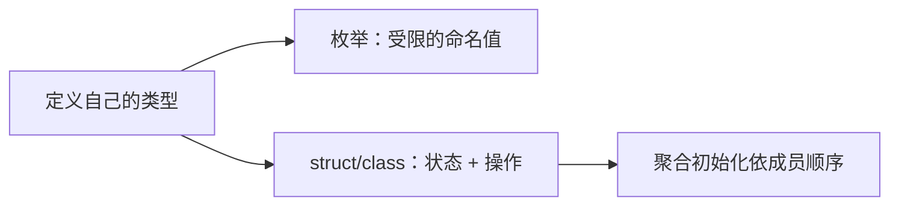

#### 程序定义类型（Program-defined type）与类型定义

##### 是什么
C++ 的类型分两大阵营：
- **基本类型**：`int`、`double`、`char`、`bool`、指针……语言自带。
- **程序定义类型**（也叫用户自定义类型）：你自己用代码“发明”的类型。

能创造程序定义类型的工具主要有两类：
1. 枚举类型（`enum` / `enum class`）
2. 类类型（`struct`、`class`、`union`）

创建一个程序定义类型的过程就叫**类型定义**。

```cpp
struct Point   // 这一整块就是“类型定义”
{
    int x{};
    int y{};
};
```

##### 为什么需要
基本类型只能表达简单数字。现实世界的“怪物、员工、坐标、状态”都是多个数据的组合，必须自己造类型。

##### 关键规则
1. **必须先定义、后使用**  
   编译器在看到 `Point p;` 之前必须知道 `Point` 长什么样（要决定占多少内存）。这和函数“先声明后使用”不同——类型必须看到完整定义。

```cpp
Point p;                 // 错误：Point 还没定义
struct Point { int x; int y; };
Point p2;                // 正确
```

2. **类型定义不受一次定义规则（ODR）严格约束**  
   同一个类定义可以通过头文件出现在多个翻译单元中，但跨翻译单元的定义必须满足 ODR 要求，例如相同的词法记号序列与一致的名字查找结果；不能只凭“看起来字段一样”判断合法。普通非 `inline` 函数的定义通常不能这样重复放进被多处包含的头文件；`inline` 函数和模板另有允许多重定义的规则。

##### 横向比较

| 项目     | 函数定义          | 类型定义                  | 变量定义                     |
|----------|-------------------|---------------------------|------------------------------|
| 可否重复 | 不可（违反 ODR）  | 可以，但必须逐字相同      | 不可                         |
| 常见放哪 | `.cpp`            | 头文件                    | `.cpp`（头文件只 `extern`）  |
| 使用前   | 需声明即可        | **必须看到完整定义**      | 需声明                       |

#### 枚举（Enumeration）——给一组合法值发名牌

##### 是什么（用大白话）
`enum` 就是把“你允许的那几个值”写成一个个有名字的符号，并把它们圈成一种**新类型**。

没有 enum 时的困境：
```cpp
int day = 1;   // 1 代表星期一
int day = 8;   // 编译器说：合法，我不管
```
编译器不知道你心里的规则是“只能填 1~7”，错误一路溜到运行时。

有了 enum：
```cpp
enum Day { mon, tue, wed, thu, fri, sat, sun };
Day d = mon;   // 直接写名字，不用写数字
```

##### 为什么需要
1. **可读性**：`if (t == orc)` 比 `if (t == 2)` 好懂一百倍。
2. **类型安全**：编译器能拦住把苹果塞进怪物类型这种低级错误。

##### 本质
内存里就是一个整数，只是给每个合法值发了名牌：
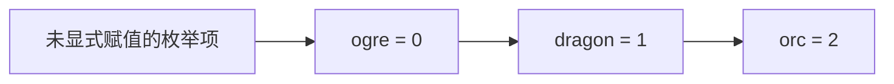

也可以手动指定数字：
```cpp
enum ErrorCode { ok = 0, notFound = 404, serverError = 500 };
```

##### 完整示例
```cpp
#include <iostream>

enum Animal { cat, dog, pig };

int main()
{
    Animal a{ dog };          // 用名字初始化，比写 1 可读
    std::cout << a << '\n';   // 输出 1（底层还是整数）
    return 0;
}
```

#### 无作用域 enum vs 作用域 enum class（最容易晕的地方）

##### 裸 enum（无作用域）——老式写法
```cpp
enum Color { red, green, blue };
Color c = red;        // 直接写名字
int x = c;            // 可以，自动变成整数
```

**坑**：名字会“跑”到外面去，容易撞名。
```cpp
enum Color { red, green, blue };
enum TrafficLight { red, yellow, green };  // 报错！red 被定义两次
```

##### enum class（作用域枚举）——现代推荐
```cpp
enum class Color { red, green, blue };
enum class TrafficLight { red, yellow, green };  // 不报错！各管各的

Color c = Color::red;                    // 必须带前缀
// int x = c;                            // 报错！不会自动转
int x = static_cast<int>(c);             // 必须显式转换
```

##### 横向比较

| 特性         | 裸 `enum`              | `enum class`                |
|--------------|------------------------|-----------------------------|
| 写名字       | `red`                  | `Color::red`                |
| 会不会撞名   | 会                     | 不会                        |
| 自动变整数   | 会（方便但危险）       | 不会（要显式转换）          |
| 推荐度       | 读旧代码时认识即可     | **以后写代码都用它**        |

一句话记住：  
**裸 enum = 方便但危险；enum class = 多写几个字，换来安全。**

#### 结构体（struct）——把多个变量打包

##### 是什么
把多个变量塞进一个“盒子”，这个盒子就是一种新类型。盒子里的变量叫**数据成员**（或成员变量）。

```cpp
struct Employee
{
    int id{};
    int age{};
    double salary{};
};
```

##### 成员访问
- 普通对象 / 引用 → 用 `.`
- 指针 → 用 `->`

```cpp
Employee joe{1, 34, 60000.0};
joe.age = 35;                 // 对象用 .

Employee* ptr = &joe;
ptr->age = 36;                // 指针用 ->
(*ptr).age = 37;              // 等价但啰嗦

Employee& ref = joe;
ref.age = 38;                 // 引用用 .
```

记忆法：`->` 等价于 `(*ptr).`。

##### 扩展
函数传参时常用 `const Employee& e`，仍然用 `.`。`->` 只留给真正的指针。

#### 聚合与聚合初始化

##### 是什么
**聚合** = 能装多个数据成员的类型。在 C++ 里，数组和“只有数据成员的结构体”都是聚合。

**聚合初始化** = 用大括号按声明顺序逐个给成员赋值。

```cpp
Employee joe{1, 34, 60000.0};   // id=1, age=34, salary=60000
Employee anon{2};               // 其余成员自动变成 0
Employee none{};                // 全部变成 0
```

##### 三个易错点
1. **顺序就是语义**：写反了编译器不报错，逻辑却错了。
2. 类型必须匹配。
3. 窄化转换会被拒绝（`{1.5, 34, 60000}` 给 `int` 会报错）。

##### 和数组比较
```cpp
int arr[3]{1, 2, 3};            // 数组也是聚合，机制完全一样
```

#### 指定初始化器（C++20）——给成员“点名”

```cpp
Employee joe{.id = 1, .age = 34, .salary = 60000.0};
```

**硬性规则**：必须按声明顺序写，否则编译错误。

```cpp
Employee bad{.age = 34, .id = 1};   // 错误
Employee good{.id = 1, .age = 34};  // 正确
```

省略的成员会做值初始化（通常是 0）。

##### 横向比较

| 方式           | 语法                        | 可读性   | 错误风险                  | 标准版本 |
|----------------|-----------------------------|----------|---------------------------|----------|
| 聚合初始化     | `{1, 34, 60000.0}`          | 顺序靠猜 | 顺序颠倒不报错            | 一直有   |
| 指定初始化器   | `{.id=1, .age=34}`          | 一目了然 | 顺序错→报错               | C++20    |
| 逐行赋值       | `e.id=1; ...`               | 最啰嗦   | 可能漏初始化              | 一直有   |

**实践建议**：成员多于两个时优先用指定初始化器。以后如果中间插了新成员，旧代码不会悄悄错位。

#### 默认成员初始化器（NSMI）

在定义结构体时就给成员写默认值：

```cpp
struct Player
{
    int health{100};
    std::string name{"Hero"};
    double x{0.0};
    double y{0.0};
};

Player p1;                    // 全部用默认值
Player p2{50, "Bob"};         // 显式值覆盖默认值
```

##### 优先级
1. 初始化时显式给了值 → 用显式值
2. 没给 → 用默认成员初始化器
3. 连默认都没有 → 默认初始化（基本类型是垃圾值，危险！）

**建议**：给适合默认初始化的成员写 `{}`，避免意外读未初始化值；引用、`const` 成员及有业务约束的成员仍需明确提供合适的初值。

#### 填充（Padding）——结构体大小的秘密

编译器为了性能（对齐访问更快）会在成员之间插“空隙”，所以 `sizeof(结构体)` 可能大于各成员大小之和。

```cpp
struct A { char c; int i; };   // 通常 sizeof = 8，而不是 5
```

把大成员放前面通常能减少填充：

```cpp
struct Wasteful { char a; double b; char c; double d; };  // 通常 32 字节
struct Packed   { double b; double d; char a; char c; };  // 通常 24 字节
```

实践注意：
- 不要 `memcpy` 整个 struct 发网络（padding 内容不确定 + 端序问题）
- 不要假设 `sizeof == 成员之和`
- 用 `offsetof` 可以查偏移量

#### 类模板与 CTAD

##### 是什么
类模板 = “生成类类型的模具”。写一次，按需生成不同类型。

```cpp
template <typename T>
struct Triad
{
    T first{};
    T second{};
    T third{};
};

Triad<int> t1{1, 2, 3};
Triad<double> t2{1.2, 3.4, 5.6};
```

`Triad<int>` 和 `Triad<double>` 是两个完全不同的类型。

##### CTAD（C++17）
编译器可以从初始化器自动推导模板参数，不用手写尖括号：

```cpp
Triad t1{1, 2, 3};          // 自动推导为 Triad<int>
Triad t2{1.2, 3.4, 5.6};    // 自动推导为 Triad<double>
```

##### 推导指引（C++17 需要）
纯聚合在 C++17 下需要显式告诉编译器怎么推导：

```cpp
template <typename T>
Triad(T, T, T) -> Triad<T>;
```

C++20 对聚合有隐式规则，这条通常可省略。

#### 练习三题完整讲解

##### 问题1：Monster
```cpp
struct Monster
{
    enum Type { ogre, dragon, orc, giant_spider, slime };  // 内嵌枚举
    Type type{};
    std::string name{};   // 拥有名字，安全
    int health{};
};

constexpr std::string_view getMonsterTypeString(Monster::Type type)
{
    switch (type)
    {
        case Monster::ogre:         return "Ogre";
        case Monster::dragon:       return "Dragon";
        case Monster::orc:          return "Orc";
        case Monster::giant_spider: return "Giant Spider";
        case Monster::slime:        return "Slime";
    }
    return "Unknown";   // 防御性兜底
}

void printMonster(const Monster& monster)  // const 引用传参
{
    std::cout << "This " << getMonsterTypeString(monster.type)
              << " is named " << monster.name
              << " and has " << monster.health << " health.\n";
}

int main()
{
    Monster ogre{Monster::ogre, "Torg", 145};
    Monster slime{Monster::slime, "Blurp", 23};
    printMonster(ogre);
    printMonster(slime);
}
```

设计要点：
- 枚举内嵌让相关名字聚在一起。
- 用 `std::string` 而不是 `const char*`：Monster 拥有自己的名字。
- 每个成员都有 `{}`，防止未初始化。
- `printMonster` 用 `const &`，符合问题2的结论。

##### 问题2：Triad
```cpp
template <typename T>
struct Triad
{
    T first{};
    T second{};
    T third{};
};

// C++17 需要，C++20 对聚合通常可省略
template <typename T>
Triad(T, T, T) -> Triad<T>;

template <typename T>
void print(const Triad<T>& t)
{
    std::cout << '[' << t.first << ", " << t.second << ", " << t.third << ']';
}

int main()
{
    Triad t1{1, 2, 3};          // CTAD → Triad<int>
    print(t1);
    Triad t2{1.2, 3.4, 5.6};    // CTAD → Triad<double>
    print(t2);
}
```

### 类、构造与封装


> 面向对象的核心：把「数据 + 行为 + 不变量」捆成一个类型，让对象**生而有效，且只能以合法方式改变**。

#### 过程式 vs 面向对象

| 维度 | 过程式 | 面向对象 |
|------|--------|----------|
| 组织轴 | 按「动作」 | 按「数据类型」 |
| 数据安全 | 谁都能改 | 私有成员 + 接口守卫 |
| 不变量 | 靠调用者自觉 | 构造函数/成员函数强制维护 |
| 扩展 | 加新函数 | 加新类（旧类不动） |

- **过程式**：数据被动传给函数。
- **OOP**：对象自己知道如何维护自己。

C++ 两者混用是常态。自由函数（`std::sqrt`、`std::sort`）用过程式；有状态、有不变量的实体用类。**不要为了 OOP 而 OOP**。

#### 类不变量（Class Invariant）

对象在可观察的稳定状态下应满足的条件。破坏不变量会使类的语义出错；是否构成未定义行为，还要看随后执行的具体操作，不能一概而论。

```cpp
class Fraction {
private:
    int m_num{0};
    int m_den{1};   // 不变量：m_den ≠ 0
public:
    explicit Fraction(int n, int d = 1)
        : m_num{n}, m_den{d != 0 ? d : 1} {}  // 构造时守门
};
```

- 访问控制只是手段，**维护不变量才是目的**。
- 设计类的第一步：先想清楚「什么状态必须恒真」，再写接口。

#### 类的基本构成

```cpp
class Point2d {
private:
    double m_x{0.0};   // 数据成员 + 默认成员初始化器
    double m_y{0.0};
public:
    Point2d() = default;
    Point2d(double x, double y) : m_x{x}, m_y{y} {}
    void print() const;
};
```

- **类** = 程序自定义的复合类型，捆绑数据与操作这些数据的函数。
- 成员函数**不占对象内存**，所有对象共享同一份代码。
- 无数据成员的「类」→ 改用 `namespace`（语义更诚实）。

#### 成员函数 / 隐式对象 / 非成员函数

```cpp
Point2d p{3.0, 4.0};
p.print();          // 成员函数：隐式对象是 p（即 this）
```

编译器把 `p.print()` 翻译成 `Point2d::print(&p)`。成员函数内部写 `m_x` 实际是 `this->m_x`。

| | 成员函数 | 非成员函数 |
|--|----------|------------|
| 能直接访问私有成员 | ✅ | ❌ |
| 有隐藏 `this` | 有 | 无 |
| 调用语法 | `obj.f(x)` | `f(obj, x)` |
| 适合 | 操作单个对象自身 | 跨对象、I/O、工具函数 |

#### const 成员函数

```cpp
void print() const;   // 实际签名：void print(const Point2d* this)
```

- `const` 修饰隐藏的 `this`，保证不修改对象、不调用非 const 成员函数。
- **不修改状态的成员函数一律加 `const`**，否则无法在 const 对象/const 引用上调用。

```cpp
void foo(const Point2d& p) {
    p.print();   // 只有 const 成员函数能调
}
```

#### 访问级别（Access Levels）

访问控制是**按类**判断，不是按对象。

```cpp
class Wallet {
    int m_money{0};
public:
    void stealFrom(Wallet& other) {
        m_money += other.m_money;  // ✅ 同类对象的私有成员可访问
    }
};
```

- **public**：任何人都能访问（接口）。
- **private**：只有本类成员函数能访问（实现）。
- 保护的是「类的不变量不被类外代码破坏」，而不是对象之间互相防贼。

##### struct vs class

| | struct | class |
|--|--------|-------|
| 默认访问 | public | private |
| 惯例 | 纯数据聚合 | 有不变量、有行为 |

有私有成员 → 不再是聚合 → **不能使用聚合初始化**，必须靠构造函数。

建议：`public` 成员写在前面（接口先行），`private` 写在后面。

私有成员命名惯例：`m_` 前缀，一眼区分成员与局部变量/参数。

#### 访问函数（Getters / Setters）

```cpp
double getX() const { return m_x; }          // getter：只读，必须 const
void setX(double x) { if (x >= 0) m_x = x; } // setter：守卫不变量
```

- 返回引用时要小心：`int& getX()` 等于把私有成员裸奔出去。
- 不是每个字段都需要 getter/setter。真正语义是 `push/pop` 的类，不要暴露内部数组。

#### 接口 vs 实现 / 数据隐藏 / 封装

- **接口** = 全部 public 成员 = 用户能做什么（合同，慎改）。
- **实现** = 数据成员 + 成员函数体 = 怎么做（可随时换）。

**数据隐藏**（信息隐藏 / 数据抽象）：把实现藏起来，强制接口与实现分离。

**封装**一词有两义：
1. 数据 + 函数捆在一起（struct 也满足）。
2. 接口/实现分离 + 访问控制（真正的数据隐藏）。

好接口标准：小、语义完整、不泄漏实现、难误用。

#### 构造函数

特殊成员函数，名字与类名相同，无返回类型，对象创建时自动调用。

##### 成员初始化列表

```cpp
Point2d(double x, double y) : m_x{x}, m_y{y} {}  // 推荐
```

为什么优于函数体赋值？
1. 效率更高（直接初始化 vs 先默认再赋值）。
2. const / 引用成员**只能**用初始化列表。
3. 实际初始化顺序永远是**声明顺序**，与列表书写顺序无关。

##### 默认构造函数

- 无参数（或全部参数有默认值）的构造函数。
- 类没有任何用户声明构造函数时，编译器生成**隐式默认构造函数**。
- 写了其他构造函数后，编译器不再自动生成 → 需要时显式写 `= default`。

```cpp
Point2d() = default;   // 推荐：保持可能的 trivial 性质
```

##### 委托构造函数

```cpp
Fraction() : Fraction{0, 1} {}           // 委托给另一个构造
Fraction(int n) : Fraction{n, 1} {}
```

初始化列表里**要么委托，要么初始化成员**，不能混用。链不能成环。

#### 临时对象（Temporary / Anonymous Object）

没有名字、只活到完整表达式结束的对象。

```cpp
print(Fraction{1, 2});           // 临时对象，用完即毁
const Fraction& r = Fraction{1, 2};  // 绑定 const 引用可延长寿命
```

不要保存指向临时对象的指针或非 const 引用（会悬空）。

#### 复制构造函数

```cpp
ClassName(const ClassName& other);   // 惯例签名
```

- 用已有对象初始化新对象、按值传参、按值返回时调用。
- 编译器默认生成「逐成员复制」版本。
- 成员能正确管理自身资源时优先用默认特殊成员函数（规则零）；持有**独占资源**时要明确禁止复制、实现独立复制或改用 `unique_ptr` 等管理对象。裸指针若只表示借用，不必自动做深拷贝。

#### as-if 规则与复制省略

**as-if 规则**：编译器可任意优化，只要不影响「可观察行为」（I/O、volatile 等）。

**复制省略**是 as-if 的唯一例外：即使复制构造有副作用，编译器也可以合法去掉它。

- RVO / NRVO：返回临时对象或具名局部对象时的省略。
- C++17 起部分场景**保证**省略（prvalue 直接构造目标）。

工程结论：放心按值返回局部对象；不要在复制构造里做「必须发生」的事（日志、计数等可能被省略）。

#### 转换构造函数与 explicit

默认所有构造函数都是**转换构造函数**，可用于隐式转换。

```cpp
explicit Fraction(int n, int d = 1);  // 禁止隐式转换
```

- 单参数（含全默认参数）构造函数**默认加 explicit**。
- 复制/移动构造函数**绝不加 explicit**。
- 收益：把 `f.multiply(true)` 这类荒唐代码提前成编译错误。

```cpp
Fraction f{5};        // ✅ 直接初始化（explicit 也允许）
// Fraction f = 5;    // ❌ 复制初始化（需要隐式转换）
// print(5);          // ❌ 函数参数需要隐式转换
```

#### constexpr 成员函数

```cpp
constexpr Point2d(double x, double y) : m_x{x}, m_y{y} {}
constexpr double getX() const { return m_x; }
```

- 可在编译期求值，也可在运行期调用。
- C++11：constexpr 成员函数隐式 const。
- C++14 起：不再隐式 const，需要只读时必须显式写 `const`。

### this、成员、友元与类的组织

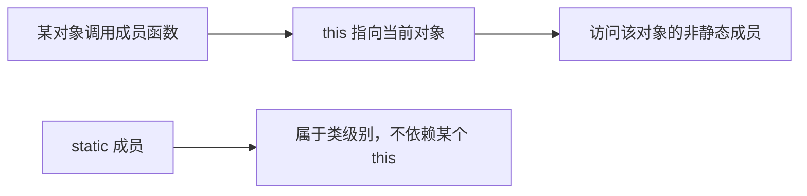

#### `this` 指针（彻底版）

##### 本质：编译器偷偷塞进来的隐藏参数

在任何**非静态**成员函数里，编译器都会在参数列表最前面插入一个隐藏参数 `this`。  
你写的：

```cpp
void Point::set(int x, int y)
{
    m_x = x;
    m_y = y;
}
```

编译器实际看到的大致是：

```cpp
void Point::set(Point* const this, int x, int y)
{
    this->m_x = x;
    this->m_y = y;
}
```

关键类型：

- 普通成员函数：`Point* const this`  
  （指针本身是 const，不能改指向；指向的对象可以改）
- const 成员函数：`const Point* const this`  
  （既不能改指针，也不能改对象）

因此：

```cpp
void print() const
{
    // m_x = 5;          // 错误：this 是 const Point* const
    std::cout << m_x;    // 可以读
}
```

##### 什么时候必须显式写 `this->`

只有当**形参或局部变量与成员同名**时才会发生遮蔽：

```cpp
class Point
{
    int x{};          // 故意不加 m_ 前缀
public:
    void set(int x)   // 形参 x 遮蔽了成员 x
    {
        // x = x;     // 把形参赋给形参，毫无作用（经典 bug）
        this->x = x;  // 左边是成员，右边是形参
    }
};
```

现代惯例：成员统一加 `m_` 前缀，基本可以消灭这种遮蔽，从而少写 `this->`。

##### 五大常见用途 + 完整例子

```cpp
class Point
{
    int m_x{}, m_y{};
public:
    // 1. 解决命名冲突
    void set(int x, int y) { this->m_x = x; this->m_y = y; }

    // 2. 返回自身实现方法链
    Point& move(int dx, int dy)
    {
        m_x += dx; m_y += dy;
        return *this;               // 返回当前对象的引用
    }

    // 3. 把自己传给别的函数
    void registerCallback(void (*cb)(Point*))
    {
        cb(this);                   // 把当前对象地址传出去
    }

    // 4. 判断是否同一个对象
    bool isSame(const Point& other) const
    {
        return this == &other;      // 比较地址
    }

    // 5. 在 lambda 中捕获自身（C++11 起）
    auto makeGetter()
    {
        return [this]{ return m_x; }; // 捕获 this，才能访问成员
    }
};
```

#### 方法链与返回 `*this` 的引用

##### 正确写法 vs 错误写法

```cpp
class Calculator
{
    int m_value{};
public:
    // 正确：返回引用
    Calculator& add(int x)
    {
        m_value += x;
        return *this;               // 返回原对象
    }

    // 错误示范：返回值
    Calculator addWrong(int x)
    {
        m_value += x;
        return *this;               // 返回的是副本！
    }

    int value() const { return m_value; }
};

int main()
{
    Calculator c;
    c.add(2).add(3).add(4);         // 正确：c 最终是 9
    // c.addWrong(2).addWrong(3);   // 只改了临时副本，c 还是 0
}
```

##### 为什么返回引用安全

`*this` 不是局部变量，它就是调用者手里的那个对象。只要调用者还活着，返回它的引用就安全。  
绝不能返回局部变量的引用（悬空引用），但 `*this` 不存在这个问题。

##### 标准库里的同款技巧

```cpp
std::cout << a << b << c;           // operator<< 返回 ostream&
std::string s;
s.append("hello").append(" world"); // append 返回 string&
```

#### 类定义的文件组织（工程实践）

##### 推荐布局

| 内容                    | 位置          | 原因 |
|-------------------------|---------------|------|
| 类声明（class 本体）    | `.h`          | 多个翻译单元共享同一份声明（ODR） |
| 平凡成员函数            | 类内直接写    | 方便内联，性能更好 |
| 非平凡成员函数          | 同名 `.cpp`   | 改实现只重编译一个文件 |

##### 什么叫“平凡”

- 一行 getter/setter
- 只用成员初始化列表的构造函数
- 空析构函数

非平凡：有循环、switch、复杂逻辑、超过 3～5 行。

##### 类外定义的正确写法

```cpp
// Monster.h
class Monster
{
public:
    void print() const;             // 只声明
};

// Monster.cpp
#include "Monster.h"
#include <iostream>

void Monster::print() const         // 必须写 Monster::
{
    std::cout << m_name << '\n';
}
```

忘记 `Monster::` 会变成全局函数，链接时找不到定义。

#### 嵌套类型（nested type）

##### 可以嵌套的东西

```cpp
class Monster
{
public:
    enum Type { dragon, skeleton, maxTypes };   // 嵌套枚举
    using Name = std::string;                   // 嵌套别名
    class Helper { /* ... */ };                 // 嵌套类
    struct Stats { int hp, atk; };              // 嵌套结构体
};
```

使用时必须带外层作用域：

```cpp
Monster::Type t = Monster::dragon;
Monster::Name n = "Bones";
```

##### 嵌套 vs 独立定义对比

| 维度         | 独立 `enum class MonsterType` | 嵌套 `Monster::Type` |
|--------------|-------------------------------|----------------------|
| 作用域       | 全局                          | 限定在类内           |
| 语义清晰度   | 松散                          | 明确“专属于 Monster” |
| 命名冲突风险 | 高                            | 低                   |
| 访问写法     | `MonsterType::dragon`         | `Monster::dragon` 或 `Monster::Type::dragon` |

原则：**只服务于某一个类的类型，就嵌套进那个类**。

##### 练习选 unscoped 的原因

练习故意用 `enum Type`（无作用域）而不是 `enum class`，是为了让 `Monster::skeleton` 可以直接当整数用，调用更短。工程上更推荐 `enum class`，安全性更高。

#### 类模板的成员函数

##### 模板内定义（最简单）

```cpp
template <typename T>
class Array
{
    T m_data[10]{};
public:
    void set(int i, const T& v) { m_data[i] = v; }  // 直接用 T
    T    get(int i) const       { return m_data[i]; }
};
```

##### 模板外定义（两个语法点缺一不可）

```cpp
template <typename T>                    // ① 必须再写一遍 template
void Array<T>::set(int i, const T& v)    // ② 类名后必须带 <T>
{
    m_data[i] = v;
}

template <typename T>
T Array<T>::get(int i) const
{
    return m_data[i];
}
```

##### 为什么模板几乎不能分离编译

模板实例化发生在“看到使用点”的时候。编译器必须当场看到完整定义才能生成代码。  
因此惯例是：类模板 + 所有成员函数定义都放在同一个头文件里，外置定义紧跟在类定义后面。

| 对比           | 普通类                     | 类模板 |
|----------------|----------------------------|--------|
| 定义位置       | `.cpp` 可以                | 几乎必须在头文件 |
| 类外定义前缀   | `void Monster::print()`    | `template<typename T> void Array<T>::set(...)` |
| 分离编译       | 支持                       | 默认不支持（除非显式实例化） |

#### 静态成员变量

##### 本质

- 所有对象共享**一份**
- 静态存储期（程序启动创建，结束销毁）
- 即使一个对象都没创建，它也存在

```cpp
class Monster
{
public:
    static inline int s_alive{0};   // C++17 起可类内直接初始化

    Monster()  { ++s_alive; }
    ~Monster() { --s_alive; }
};

int main()
{
    std::cout << Monster::s_alive << '\n'; // 0（还没有任何对象）
    {
        Monster a, b;
        std::cout << Monster::s_alive << '\n'; // 2
    }
    std::cout << Monster::s_alive << '\n'; // 0
}
```

##### 访问方式

推荐：`Monster::s_alive`  
通过对象访问 `m.s_alive` 也能编译，但语义误导（它不属于某个对象）。

##### C++17 前后对比

C++17 之前必须类外定义：

```cpp
// .h
class Monster { public: static int s_alive; };
// .cpp
int Monster::s_alive = 0;
```

C++17 起 `static inline` 一步到位，且满足 ODR。

##### 静态成员 vs 全局变量

| 维度     | 全局变量       | 静态成员变量          |
|----------|----------------|-----------------------|
| 作用域   | 全局，易冲突   | 限定在类内            |
| 访问控制 | 无             | 可 private            |
| 与类关系 | 无归属         | 明确是类的一部分      |
| 封装性   | 差             | 好                    |

结论：与类相关的共享数据，优先用静态成员。

#### 静态成员函数

##### 核心特点

```cpp
class Monster
{
    static inline int s_alive{0};
    std::string m_name;
public:
    static int getAlive()
    {
        return s_alive;          // 可以访问静态成员
        // return m_name;        // 错误：没有 this，不能访问非静态成员
    }
};

// 调用不需要对象
int n = Monster::getAlive();
```

三个关键限制：

1. 没有 `this` → 不能访问非静态成员、不能调用非静态成员函数
2. 不能是 `const` 成员函数（const 修饰的是 this）
3. 通常用来提供“与具体对象无关的服务”（工厂、统计、工具函数）

##### 对比表

| 维度           | 非静态成员函数     | 静态成员函数       |
|----------------|--------------------|--------------------|
| this 指针      | 有                 | 无                 |
| 访问非静态成员 | 可以               | 不可以             |
| 访问静态成员   | 可以               | 可以               |
| 调用方式       | 必须通过对象       | 通过类名即可       |
| 语义           | 操作某个对象       | 服务于整个类       |

#### 友元（friend）

##### 一句话

`friend` 是编译期的“精确开后门”：让某个外部函数或另一个类可以直接访问私有成员。

##### 友元函数

```cpp
class Monster
{
    std::string m_name;
    int m_hp;
public:
    Monster(std::string_view n, int hp) : m_name{n}, m_hp{hp} {}

    friend void printMonster(const Monster& m);  // 声明友元
};

void printMonster(const Monster& m)              // 普通全局函数
{
    // 因为是 friend，可以直接读私有成员
    std::cout << m.m_name << " has " << m.m_hp << " hp\n";
}
```

注意：

- `friend` 声明写在类内，但声明的函数**不是成员函数**（没有 this）
- 关系是**单向**的：A 说 B 是朋友，B 并不因此成为 A 的朋友
- **不传递、不继承**

##### 友元类

```cpp
class Engine;                     // 前向声明

class Car
{
    int m_speed{};
    friend class Engine;          // Engine 的所有成员函数都能访问 Car 私有成员
};

class Engine
{
public:
    void boost(Car& c) { c.m_speed += 100; }  // 合法
};
```

##### 典型场景

1. 非成员运算符重载（尤其是 `operator<<`）
2. 两个紧耦合的类（Monster 与 MonsterGenerator）
3. 需要极致性能、避免一堆 getter 时

原则：**少用、精确用**。它是“精确制导开后门”，不是把墙拆了。

#### 练习代码逐段深度讲解

##### 嵌套枚举 + 哨兵值

```cpp
class Monster
{
public:
    enum Type
    {
        dragon, goblin, ogre, orc, skeleton, troll, vampire, zombie,
        maxMonsterTypes          // 哨兵：数值正好等于种类数量
    };
    // ...
};
```

`maxMonsterTypes` 永远放最后。以后加新怪物，只要插在它前面，范围自动正确。

##### 构造函数用成员初始化列表 + string_view

```cpp
Monster(Type type, std::string_view name, std::string_view roar, int hitPoints)
    : m_type{type}
    , m_name{name}          // 用 string_view 构造 string，只拷贝一次
    , m_roar{roar}
    , m_hitPoints{hitPoints}
{
}
```

- 成员初始化列表直接构造，避免“先默认构造再赋值”
- `string_view` 接受字面量、`const char*`、`string`，零额外拷贝
- 空函数体表示所有工作都在初始化列表完成

##### getTypeString + print（const + string_view + constexpr）

```cpp
constexpr std::string_view getTypeString() const
{
    switch (m_type)
    {
        case dragon:   return "dragon";
        // ...
        case zombie:   return "zombie";
        default:       return "???";
    }
}

void print() const
{
    std::cout << m_name << " the " << getTypeString();
    if (m_hitPoints <= 0)
        std::cout << " is dead.\n";
    else
        std::cout << " has " << m_hitPoints
                  << " hit points and says " << m_roar << ".\n";
}
```

- 两个函数都是 `const`：只读承诺
- 返回 `string_view`：字面量寿命永久，零拷贝
- `constexpr`：编译期可求值
- `default` 兜底，防御式编程

##### MonsterGenerator 命名空间

```cpp
namespace MonsterGenerator
{
    std::string_view getName(int n) { /* switch 0~5 */ }
    std::string_view getRoar(int n) { /* switch 0~5 */ }

    Monster generate()
    {
        return Monster{
            static_cast<Monster::Type>(Random::get(0, Monster::maxMonsterTypes - 1)),
            getName(Random::get(0, 5)),
            getRoar(Random::get(0, 5)),
            Random::get(1, 100)
        };
    }
}
```

- 无状态 → 用命名空间而不是类
- `static_cast` 必须写：即使 unscoped enum，从 int 转到枚举也不隐式
- `maxMonsterTypes - 1` 正是哨兵的价值

#### 易错点清单（再强化）

1. `this` 在 const 函数里是 `const T* const`，不能改成员。
2. 方法链必须返回 `T&`，返回值会断链。
3. 类外定义模板成员函数，`template<...>` 和 `Class<T>::` 两样都别忘。
4. 静态成员函数没有 `this`，不能碰非静态成员，也不能标 `const`。
5. C++17 前静态成员必须类外定义；现在用 `static inline`。
6. friend 单向、不传递、不继承。
7. `enum class` 不能隐式转 int，反向必须 `static_cast`。
8. 不要返回指向局部 `string` 的 `string_view`（悬空）。
9. 成员初始化通常优先写在初始化列表中，尤其是 `const`、引用或无默认构造的成员。
10. 通过对象访问静态成员能编译，但语义错误，应写 `类名::成员`。

#### 扩展对比补充

##### enum vs enum class

| 特性             | unscoped `enum`          | scoped `enum class`      |
|------------------|--------------------------|--------------------------|
| 访问             | `Monster::dragon`        | `Monster::Type::dragon`  |
| 隐式转 int       | 可以                     | 不可以（更安全）         |
| 作用域污染       | 会                       | 不会                     |
| 推荐程度         | 仅当需要整数特性时       | 默认推荐                 |

##### 三种共享数据方案

| 方案         | 作用域 | 封装 | 适用场景                     |
|--------------|--------|------|------------------------------|
| 全局变量     | 全局   | 无   | 几乎不推荐                   |
| 静态成员变量 | 类内   | 可控 | 与类相关的共享计数/配置      |
| 单例类       | 类内   | 强   | 需要复杂初始化或生命周期管理 |

##### 打破封装的三种手段

1. public 访问器（最安全、最啰嗦）
2. friend（精确授权，适合运算符和紧耦合）
3. 整体 public 数据（只适合纯数据聚合 struct）

### 真实项目里常见的边界：公开 API、实现细节和不变量

类不仅是把字段包起来。公开方法承诺“调用者可以依赖什么”，私有部分可以变更实现。**不变量**是对象处于可用状态时必须满足的条件，例如订单数量非负、资源句柄要么有效要么明确为空。构造函数要建立它，修改操作要保持它，错误路径不能把对象留在半成品状态。

```cpp
#include <stdexcept>

class OrderQuantity {
    int value_{};
public:
    explicit OrderQuantity(int value) : value_(value) {
        if (value <= 0) throw std::invalid_argument("quantity must be positive");
    }
    int value() const noexcept { return value_; }
};
```

**读代码**：`explicit` 阻止把普通整数无意地隐式变成业务数量；构造时验证使后续 `value()` 不必反复检查。这里用异常表示非法构造请求，实际项目也可能用工厂返回错误对象。选择要与项目现有错误模型一致。`const` 成员函数保证不能通过这个接口直接修改非 `mutable` 成员，但不意味着全局线程安全。

**工程取舍**：先确认是否需要继承，是否只需一个值类型。公开头文件应尽量暴露稳定的必要声明，减少不必要的依赖；前置声明、Pimpl 可隔离实现，但也会带来间接访问与维护成本。不要为了“设计模式”增加虚基类。复杂项目中还要区分线程安全契约、异常保证与 ABI 稳定性，它们是不同承诺。

## 第四篇：所有权、复制移动与异常安全

### 动态内存、new 与 delete


#### 使用 new 和 delete 进行动态内存分配

C++ 应先区分**存储期**：
- **静态存储期**：对象的存储覆盖程序执行期，初始化时机仍可能有不同规则。
- **自动存储期**：局部对象通常随作用域进入/退出而建立/销毁；“栈”是常见实现，不是标准唯一机制。
- **动态存储期**：可通过分配函数取得存储；`new` 表达式还会构造对象。实现不保证每次 `new` 都直接向操作系统请求内存。

存储期与“数据逻辑长度何时知道”是两件事：局部 `std::vector` 对象具有自动存储期，却可在运行时管理任意合适长度的元素。很大的局部数组可能超出实际线程栈资源，但固定“默认 1MB”不具有跨平台保证。

动态分配给对象寿命和容量更多选择，但受可用内存、分配器与平台限制，不能承诺某个固定可分配规模。

**分配单个变量**（标量形式）：
```cpp
int* ptr{ new int };          // 分配，未初始化
int* ptr1{ new int(5) };      // 直接初始化
int* ptr2{ new int{6} };      // 统一初始化（推荐）
*ptr = 7;                     // 解引用使用
```

**释放**：
```cpp
delete ptr;
ptr = nullptr;  // 只清空这个变量；别的别名仍可能悬空
```

**关键点**：
- `new` 返回分配内存的地址；必须保存到指针，否则无法访问/释放。
- 堆对象分配/释放**不自动**，程序员负责。
- **悬空指针**：`delete` 后指针仍指向已释放内存，解引用或再次 `delete` 是未定义行为。多个指针指向同一块内存时更危险——明确“所有权”。
- 分配失败通常抛 `std::bad_alloc`；若无人处理，程序会终止。`new (std::nothrow)` 的分配失败路径可返回空指针，仍要核对对象构造异常等条件。
- 空指针（`nullptr`）表示“未分配”，便于条件分配或判断。

**拓展**：默认先用容器或 [[#所有权、RAII、智能指针与移动|RAII 与智能指针]] 管资源。原始 `new`/`delete` 主要用于理解机制或实现特定资源封装。

#### 动态分配数组

固定数组大小必须是编译期常量；动态数组可在运行时决定长度。

**分配**：
```cpp
std::size_t length{};
std::cin >> length;
int* array{ new int[length]{} };  // 值初始化为0；length 不必是常量
// 或带初始化列表（C++11+）：
auto* array{ new int[5]{9, 7, 5, 3, 1} };
```

数组长度可以是运行时整数表达式；若来自可能为负的有符号输入，先验证范围，再转换到合适的无符号大小类型，不能仅靠 `static_cast` 修复负值。

**释放**：
```cpp
delete[] array;  // 必须用数组形式！用标量 delete 是未定义行为
```

动态数组本质上是指向首元素的指针，行为类似“衰减后的固定数组”（不知长度、`sizeof` 无用），但程序员必须手动释放。

**注意**：
- C++ 没有内置“调整已分配数组大小”的方法。手动做法（分配新数组 → 复制 → 删除旧）易错（尤其涉及类对象），推荐直接用 `std::vector`。
- 能否分配大数组取决于可用地址空间、内存、配额与分配器，必须处理失败。

**练习 风格示例**（原站有）：读入名字数量 → 动态分配 `std::string` 数组 → 输入 → `std::sort` → 输出排序结果。

#### 析构函数

析构函数是特殊成员函数，在对象销毁时自动调用（离开作用域，或 `delete` 动态对象时），用于清理资源。

**规则**：
- 名称：`~ClassName`
- 无参数、无返回类型
- 一个类只能有一个

**示例**（管理动态数组的简单类）：
```cpp
class IntArray {
private:
    int* m_array{};
    int m_length{};
public:
    IntArray(int length) {
        assert(length > 0);
        m_array = new int[static_cast<std::size_t>(length)]{};
        m_length = length;
    }
    ~IntArray() {
        delete[] m_array;  // 自动清理
    }
    // ... 访问函数
};
```

当 `IntArray` 对象离开作用域时，析构函数自动释放内部动态内存。

**RAII（Resource Acquisition Is Initialization）**：资源获取即初始化。构造函数获取资源，析构函数释放。这是 C++ 防止资源泄漏的核心惯用法。`std::string`、`std::vector` 等都遵循 RAII。

**时机**：栈对象在作用域结束时销毁；动态对象在 `delete` 时销毁。全局对象在 `main` 前后构造/销毁。`std::exit()` 不会调用析构函数，需小心。

**拓展**：有动态资源的类通常还需自定义拷贝构造/赋值（深拷贝），否则会浅拷贝导致双重释放。现代做法是“三/五法则”或直接用智能指针成员。

#### 指针到指针与动态多维数组（可选进阶）

指针到指针（`int**`）保存另一个指针的地址。

**常见用途**：
1. 动态分配指针数组。
2. 实现动态多维数组。

**动态二维数组的两种主要方式**：

- **右维为常量**（部分固定）：
  ```cpp
  int (*array)[5]{ new int[x][5] };  // x 运行时，列必须 constexpr
  ```

- **完全动态（推荐理解指针到指针）**：
  ```cpp
  int** array{ new int*[rows] };  // 行指针数组
  for (int i{}; i < rows; ++i)
      array[i] = new int[cols];   // 每行独立分配

  array[r][c] = value;            // 使用

  // 释放（顺序相反）
  for (int i{}; i < rows; ++i)
      delete[] array[i];
  delete[] array;
  ```

优点：可做成不规则（jagged）数组。缺点：复杂、易漏释放、性能稍差（非连续）。更高维更复杂，实际几乎不用。

**最佳实践**：尽量避免多级指针和手动动态多维数组；优先 `std::vector<std::vector<T>>` 或扁平化一维 + 计算索引，或 C++23 `std::mdspan`。

#### 空指针（void pointers）

`void*` 是“通用指针”，可指向任意类型对象：
```cpp
void* ptr{};
int n{}; float f{};
ptr = &n;  // 合法
ptr = &f;  // 合法
```

但：
- **不能直接解引用**（编译器不知类型和大小）。
- 必须先 `static_cast` 回具体类型再解引用。
- 不能对 `void*` 做指针算术。
- 删除 `void*` 是未定义行为（需先转回原类型）。

用途：旧式泛型编程、C 兼容接口、某些底层 API。现代 C++ 更推荐模板、`std::any`、`std::variant` 或类型擦除，避免失去类型安全。

**结论**：除非绝对必要，避免使用 `void*`。

### 所有权、RAII、智能指针与移动

> 基线：C++17。本章补上原笔记分散且不足的资源管理主线。先问“谁负责释放”，再问“怎样传递”，最后讨论性能。

#### 生命周期和所有权是两件事

对象的**生命周期**是它作为某个类型的对象实际存在的时间；**所有权**是程序中谁负责结束它的生命周期或释放资源的约定。一个裸指针可以指向对象，却不说明它是否拥有对象。函数参数 `T*` / `T&` 通常表示临时借用；跨函数交接资源时应把所有权写进类型或接口契约。

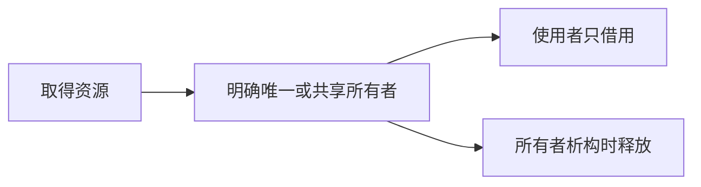

RAII 把资源的获取和释放绑到一个对象的构造、析构。资源不只有堆内存，还包括文件、锁、socket。`std::vector` 管元素存储，`std::lock_guard` 管互斥锁，智能指针管动态对象。异常或提前返回时，局部 RAII 对象仍会按规则析构，所以清理不必散落在每条分支。**优先规则零**：类若只由能自管理资源的成员组成，尽量不用自己写析构、复制和移动函数。

#### `unique_ptr`：一个明确的所有者

`std::unique_ptr<T>` 不可复制，可移动；移动把所有权交给另一对象，原指针变空。`std::make_unique<T>(...)` 创建对象并直接放进所有者。`get()` 给裸指针用于临时借用，不能拿它再构造第二个独立 `unique_ptr`；`release()` 放弃所有权后，调用方必须接手释放责任。

```cpp
#include <memory>
#include <string>

struct Order { std::string symbol; };

void inspect(const Order& order); // 只读借用，不保存所有权

void example() {
    auto owner = std::make_unique<Order>(Order{"IF2601"});
    inspect(*owner);
    auto next = std::move(owner); // 转移所有权；owner 之后为空
    if (next) inspect(*next);
}
```

**逐行读**：`make_unique` 创建资源并返回唯一所有者；`*owner` 只是把对象借给函数；`std::move(owner)` 本身是转换表达式，使移动构造能被选中，真正的转移由 `unique_ptr` 的移动构造完成。不要把 `std::move` 解释成“把内存字节立即搬走”。返回 `unique_ptr` 时通常直接按值返回，让语言的移动或复制省略规则工作。

#### `shared_ptr` / `weak_ptr`：共享与观察

`std::shared_ptr<T>` 表示多个句柄共同拥有对象，最后一个强所有者离开时销毁所管对象。实现通常有控制块记录强/弱引用计数及删除方式；这是常见实现模型，标准不规定它的确切内存布局。`make_shared` 通常便于集中分配，但对象和控制块何时释放、弱引用仍在时的内存留存都要考虑。

`std::weak_ptr<T>` 不延长所指对象的生命周期。`lock()` 尝试取得一个临时 `shared_ptr`，成功才能安全访问；它适合观察缓存项，或打断 `shared_ptr` 之间的所有权环。

```cpp
#include <memory>

struct Node { std::shared_ptr<Node> child; std::weak_ptr<Node> parent; };

void link() {
    auto p = std::make_shared<Node>();
    auto c = std::make_shared<Node>();
    p->child = c;
    c->parent = p; // 若这里也是 shared_ptr，就可能形成强引用环
    if (auto parent = c->parent.lock()) {
        // parent 是本作用域里的临时强所有者
    }
}
```

不同的 `shared_ptr` 实例可并发共享同一个控制块，但这**不使 `Node` 的普通成员自动线程安全**。同一个 `shared_ptr` 变量本身若被多个线程无同步地修改也有规则限制。`use_count()` 是诊断信息，不应拿它做“我现在是唯一用户”的并发判断。共享所有权有计数和生命周期复杂度，默认先问能否用 `unique_ptr`、值对象或借用引用。

#### 复制、移动与 Rule of Zero/Five

复制通常产生独立的新值；移动允许从可被转移的源取得资源。移动后的标准库对象通常仍有效，但具体值可能未指定，应只做该类型允许的操作。`std::move` 不能把 `const` 对象强行变成可移动对象；若类型只有接受非 `const` 右值的移动构造，`std::move(const T&)` 往往仍会走复制。

若类手写析构管理裸资源，就必须仔细设计复制构造、复制赋值、移动构造、移动赋值和析构的契约，这就是 Rule of Five 的背景。更稳妥的做法是用 `std::vector`、`std::string`、`unique_ptr` 等成员托管资源，尽量让编译器生成正确的特殊成员函数。可把这作为读 [[#运算符重载、复制与赋值|复制与赋值]] 时的主线。

#### 完美转发只在转发接口中使用

模板中的 `T&&` 在特定推导情形下是**转发引用**，可保留调用方实参的左值/右值性质。`std::forward<T>(arg)` 按推导出的 `T` 条件地转发；它与无条件把表达式转成右值的 `std::move` 不同。普通函数参数 `Widget&&` 没有发生模板参数推导，就只是右值引用。不要到处加 `forward`：如果函数准备长期保存参数，还须明确复制、移动和悬垂风险。

```cpp
#include <memory>
#include <utility>

template<class T, class... Args>
std::unique_ptr<T> make_owned(Args&&... args) {
    return std::unique_ptr<T>(new T(std::forward<Args>(args)...));
}
```

这个片段演示参数传递机制；实际创建普通对象优先使用标准库 `std::make_unique`。面试回答“完美转发”时，先说推导、引用折叠和 `forward<T>` 保留值类别，再说明它不自动解决所有权和生命周期。

#### 一分钟口述

RAII 用对象析构管理资源；裸指针/引用一般表示借用。能独占就用 `unique_ptr`，确实需要多方共同延长生命周期才用 `shared_ptr`，观察或断环用 `weak_ptr`。`std::move` 是转换，移动行为由目标类型实现。优先让成员自己管理资源，避免为了简单类手写五个特殊成员函数。

**核对依据**：[C++17 `unique_ptr`](https://timsong-cpp.github.io/cppwp/std17/unique.ptr)、[C++17 `shared_ptr`](https://timsong-cpp.github.io/cppwp/std17/util.smartptr.shared)、[C++ Core Guidelines 资源管理](https://isocpp.github.io/CppCoreGuidelines/CppCoreGuidelines#S-resource)、[C++ Core Guidelines Rule of Zero](https://isocpp.github.io/CppCoreGuidelines/CppCoreGuidelines#Rc-zero)；阅读日期 2026-10-25。

### 运算符重载、复制与赋值

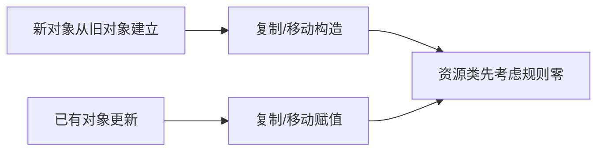

#### 运算符重载的本质

##### 是什么
运算符重载 = **函数重载的语法糖**。  
写 `a + b` 时，编译器自动去找名字叫 `operator+` 的函数。  
两种写法完全等价：

```cpp
Point c = a + b;               // 语法糖
Point d = operator+(a, b);     // 普通函数调用（同一个函数）
```

`operator+`、`operator<<`、`operator[]` 这些**就是函数名**。

##### 为什么要有这个机制
让自定义类型也能用 `+`、`<<`、`[]` 这种直观写法，代码更像自然语言。  
如果不重载，就只能写 `a.add(b)`、`a.print()`，可读性差很多。

##### 硬性限制（为什么不能随便发明）

| 限制 | 为什么必须限制 |
|------|----------------|
| 不能发明新运算符 | 语言解析器只认识已有的符号，新符号无法被识别 |
| 不能改优先级/结合性 | 否则 `a + b * c` 的含义会因人而异，代码无法统一理解 |
| 不能改操作数个数 | `+` 永远是二元，`-` 可以是一元或二元，编译器靠参数个数区分 |
| 不能重载 `.` `::` `?:` 等 | 这些是语言最核心的语法，改了整个语言就崩了 |
| 至少有一个自定义类型 | 防止有人重载 `int + int`，导致基础类型行为被改乱 |

##### 核心设计原则
**语义必须直观**。  
如果 `+` 用在你的类上让人看不懂，就别重载，改用普通函数名（`push_back`、`concat`）。

反例：
```cpp
Vector operator+(const Vector& v, int x);  // 谁知道 + 是追加？
```
正例：
```cpp
void Vector::push_back(int x);             // 一目了然
```

#### 三种重载形式（普通 / 友元 / 成员）

##### 是什么
同一个运算符可以写成三种函数：

```cpp
class Point {
    int m_x{}, m_y{};
public:
    // 形式3：成员函数（左操作数是 *this，只写1个参数）
    Point operator+(const Point& p) const {
        return Point{m_x + p.m_x, m_y + p.m_y};
    }

    // 形式2：友元函数（能访问私有，参数对称）
    friend Point operator-(const Point& a, const Point& b) {
        return Point{a.m_x - b.m_x, a.m_y - b.m_y};
    }
};

// 形式1：普通函数（只能用公有接口）
Point operator*(const Point& p, int s) {
    return Point{p.x() * s, p.y() * s};
}
```

调用时：
- 成员：`p1 + p2` → `p1.operator+(p2)`
- 普通/友元：`p1 + p2` → `operator+(p1, p2)`

##### 对比表（最重要）

| 维度 | 普通函数 | 友元函数 | 成员函数 |
|------|----------|----------|----------|
| 参数个数（二元） | 2 | 2 | **1**（左操作数是 *this） |
| 能否访问私有 | 否 | **是** | **是** |
| 左操作数类型 | 任意 | 任意 | **必须是本类** |
| 封装破坏 | 无 | 有一点 | 无 |
| 典型用途 | 对称运算（`int * Point`） | `<<` `>>`、对称运算 | `=` `[]` `()` `->`、一元、`+=` |

##### 四条经验法则 + 为什么

**法则1：`=` `[]` `()` `->` 必须是成员**  
语言硬性规定。  
原因：这些运算符语义是“对自身动手”，左操作数必须是类对象。  
写成普通函数会直接编译报错。

**法则2：一元运算符优先成员**  
只有一个操作数，让它当 `*this` 最自然。  
`++` `--` 还会修改自身，成员函数直接改私有数据最干净。

前置/后置的经典区别：
```cpp
Fixed& operator++() {          // 前置：先加再返回自己（引用，高效）
    ++value;
    return *this;
}
Fixed operator++(int) {        // 后置：int是哑元，只用来区分
    Fixed old{*this};          // 先保存旧值
    ++value;
    return old;                // 返回旧值副本
}
```

**法则3：修改左操作数的二元（`+=` `-=`）→ 成员 + 返回引用**  
```cpp
Average& operator+=(int num) {
    m_total += num;
    ++m_numbers;
    return *this;              // 必须返回引用！
}
```
为什么返回引用？  
`(avg += 6) += 10` 时，第一次 `+=` 的结果还要当左值继续 `+=`。  
如果返回值（副本），第二次就作用在临时对象上，`avg` 不变。

**法则4：不修改左操作数的二元（`+` `-` `==` `<<`）→ 普通或友元**  
两个原因：
1. **对称性**：成员函数左操作数必须是本类，写不出 `2 * Point`。
2. **左操作数是别人的类**：`std::cout << p` 的左操作数是 `ostream`，你改不了标准库，只能写成普通/友元。

记忆口诀：  
`= [] () ->` 和一元看成员；`+=` 类修改型看成员；`+ << ==` 对称型看普通/友元。

##### 普通 vs 友元怎么选
- 优先普通函数（封装最好）。
- 需要读私有又不想写一堆 getter 时，才用友元。
- `operator<<` 常写为非成员函数；只有确实需要直接访问私有状态时才声明为友元，也可以通过公开接口实现。

#### 类型转换重载

##### 两个方向

| 方向 | 机制 | 写法 |
|------|------|------|
| 别的类型 → 我的类 | 转换构造函数 | `FixedPoint2(double)` |
| 我的类 → 别的类型 | 转换函数 | `operator double() const` |

##### 转换函数语法要点
```cpp
explicit operator double() const {
    return m_base + m_decimal / 100.0;
}
```
- **没有返回类型**（写了反而错）。
- 通常加 `const`（转换不该改对象）。
- 强烈建议加 `explicit`，防止隐式转换引发二义性。

##### explicit 的价值
```cpp
void print(double d);
FixedPoint2 fp{3.14};

print(fp);                       // 非explicit：偷偷转成double，可能不是你想要的
print(static_cast<double>(fp));  // explicit：必须显式写，意图清晰
```
`explicit` 让每次转换都是你亲手写下的、可审计的。

#### 复制构造函数

##### 是什么
用**已有同类型对象**初始化一个**新对象**的特殊构造函数：
```cpp
ClassName(const ClassName& other);
```

##### 什么时候会调用（高频考点）

| 场景 | 例子 | 是否调用 |
|------|------|----------|
| 直接初始化 | `Fraction f2{f1};` | 是 |
| 拷贝初始化 | `Fraction f2 = f1;` | 是（注意：这是复制构造，不是赋值！） |
| 按值传参 | `void f(Fraction x); f(a);` | 是 |
| 按值返回 | `return Fraction{};` | C++17 同类型纯右值可直接构造结果对象，不应假定调用复制构造 |
| 按引用传参/返回 | `void f(Fraction&);` | **否** |
| 创建全新对象 | `Fraction f{5,3};` | 否（走普通构造） |

##### 编译器默认行为
在可生成复制构造的条件下，隐式复制会逐成员复制；若成员本身不可复制，复制构造可能被删除。裸指针的逐成员复制只复制地址，若它表达独占所有权就有风险；非拥有指针不必然需要“深拷贝”。

##### 拷贝消除（重要陷阱）
C++17 起，很多情况下复制构造会被**直接省略**，即使有副作用也不执行。  
所以**不要把计数、日志放在复制构造里指望它一定执行**。

#### 转换构造 + explicit + = delete

##### 转换构造函数
单参数构造函数默认可以隐式转换：
```cpp
Fraction(int n);          // print(5) 会偷偷变成 Fraction{5}
explicit Fraction(int n); // 禁止隐式，必须写 Fraction{5}
```

##### = delete
```cpp
NonCopyable(const NonCopyable&) = delete;
```
编译期直接禁止调用，比老式“声明为 private 不实现”更清晰。  
用于独占资源类（文件句柄、unique_ptr 等）。

#### 赋值运算符 operator=

##### 签名与返回值
```cpp
ClassName& operator=(const ClassName& other);
```
返回引用是为了支持 `a = b = c`。

##### 自赋值：必须保证正确，不一定单独判断
```cpp
if (this == &other) return *this;
```
若赋值实现先释放旧资源再读取源对象，`a = a` 会读到已失效内容；但先构造新资源再提交、copy-and-swap 或使用标准库成员时，可以自然正确处理自赋值，无须固定写这一行。

##### copy-and-swap 惯用法（更现代）
```cpp
IntArray& operator=(IntArray other) {  // 按值传参，已经完成深拷贝
    swap(*this, other);
    return *this;                      // other 析构时带走旧资源
}
```
若复制临时对象失败不修改原对象，且 `swap` 不抛异常，就能自然处理自赋值并提供强异常保证；这是有前提的设计，不是所有 `swap` 都自动满足。

#### 复制构造 vs 赋值运算符（最易混）

判断法则：
- **新对象诞生** → 复制构造
- **对象已存在** → 赋值运算符

| 代码 | 走哪个 | 原因 |
|------|--------|------|
| `Fraction f2{f1};` | 复制构造 | f2 是新的 |
| `Fraction f2 = f1;` | 复制构造 | 拷贝初始化，不是赋值！ |
| `f2 = f1;` | 赋值 | f2 已存在 |
| `void g(Fraction f); g(f1);` | 复制构造 | 形参是新对象 |

形象记忆：
- 复制构造 = “出生时就是别人的复制品”
- 赋值 = “把已有的东西改造成别人的样子”（要先清理旧资源）

#### 浅拷贝 vs 深拷贝

##### 浅拷贝（默认行为）
只拷指针地址。  
两个对象指向同一块内存 → 一个改另一个跟着变，析构时 double free 崩溃。

##### 深拷贝
自己重新分配内存，把**内容**一个个拷过去。

##### Rule of Three / Five
只要你自定义了析构、复制构造、赋值中的任意一个，通常三个都要写。  
C++11 后又加了移动构造和移动赋值 → Rule of Five。

##### 更好的做法
能用 `std::vector`、`std::string`、智能指针就别自己管理内存。

### 异常、栈展开与 noexcept

```mermaid
flowchart LR
  A["throw"] --> B["寻找匹配的处理器"]
  B --> C["离开作用域时析构已完成构造的对象"]
  C --> D["进入 catch 或按规则终止"]
```

#### 异常处理的核心思想：把“错误处理”从“正常流程”中剥离

##### 返回错误码的老办法有什么问题（再展开）

###### 问题 1：返回值通道被占用

```cpp
int parseInt(const std::string& s)
{
    if (s.empty())
        return -1;   // -1 既可能是错误码，也可能是合法结果
    // ...
    return result;
}
```

如果业务上 -1 本身是合法值（比如解析负整数），你就得改成：

- 魔法值（另一个更大的负数）
- 输出参数（`bool parseInt(const std::string&, int& out)`）
- `std::optional<int>`（C++17）
- `std::expected<int, Error>`（C++23）

这些方案都能用，但接口立刻变复杂，调用方也要多写一行。异常把返回值彻底解放出来，函数可以专心返回“正常结果”。

###### 问题 2：调用者可以视而不见

```cpp
parseInt("abc");   // 返回 -1，但没人检查
```

错误被静默吞掉，后面可能以完全不相关的形态崩溃。`[[nodiscard]]`（C++17）只能“提醒”，编译器不会强制你处理。异常则是强制的：不 catch 就会 `terminate`。

###### 问题 3：错误必须就地处理或层层转发

```cpp
int low()  { return -1; }
int mid()  { int r = low();  if (r == -1) return -1; /* 业务 */ }
int high() { int r = mid();  if (r == -1) return -1; /* 业务 */ }
```

每一层都要写“检查 + 转发”的样板代码，真正的业务逻辑被淹没。异常直接“穿透”中间层，中间函数完全不用知道错误的存在。

###### 问题 4：构造函数无法报告错误

构造函数没有返回值。对象构造到一半失败时，用返回码根本没法通知调用者。这是异常机制被引入 C++ 的重要动机之一（另一动机是把错误处理从正常路径剥离）。

##### 异常如何解决这些问题

- 发现错误的地方只负责 `throw`，不关心谁处理。
- 关心错误的地方用 `try/catch` 接住，中间所有函数自动被穿透。
- 返回值通道被解放。
- 构造函数可以抛异常。

一句话：**错误处理代码与正常控制流解耦（decouple）**。

对比表：

| 维度           | 错误码 / 返回值              | 异常                          |
|----------------|-----------------------------|-------------------------------|
| 返回值通道     | 被占用                      | 解放                          |
| 强制处理       | 否（可被忽略）              | 是（不 catch → terminate）    |
| 中间层代码     | 必须层层转发                | 完全透明                      |
| 构造函数       | 无法报告错误                | 可以直接 throw                |
| 性能（正常路径）| 通常更快                    | 略慢（但现代编译器差距很小）  |
| 性能（错误路径）| 很快                        | 极慢（栈展开 + 析构）         |

#### throw：抛出异常

```cpp
throw std::runtime_error("Invalid denominator");
throw 42;                    // 合法但不推荐
throw "something bad";       // 更不推荐
```

要点再展开：

1. **可以抛出任意类型**  
   基本类型、指针、结构体、类都可以。但真实项目几乎只抛继承自 `std::exception` 的类。

2. **立即中断当前函数**  
   `throw` 之后的语句永远不会执行。当前函数的局部对象按构造逆序析构，然后控制权开始向外寻找匹配的 `catch`。

3. **异常对象是拷贝**  
   抛出的是原表达式的一份拷贝，存放在实现定义的异常存储区。所以：
   - 抛大对象有拷贝成本（通常用移动构造缓解）。
   - 抛局部变量的引用/指针是未定义行为：

```cpp
void bad()
{
    int x = 5;
    throw &x;   // 函数返回后 x 已销毁，悬垂指针
}
```

正确做法是抛值（或 `std::make_exception_ptr` 等更高级用法）。

扩展：`throw` 本身是表达式，可以出现在更复杂的上下文中，但几乎没人这么写。

#### try 块与 catch 块

##### 基本语法

```cpp
try
{
    Fraction f{numerator, denominator};
    std::cout << f << '\n';
}
catch (const std::exception& e)
{
    std::cerr << e.what() << '\n';
}
```

- `try` 监视块内代码（包括间接调用的任何函数）。
- 异常被路由到紧随其后的 `catch`。
- 类型匹配才会进入。
- 被 catch 住后默认视为已处理，程序从最后一个 `catch` 之后继续执行。

##### 栈展开（stack unwinding）——本章最核心机制

流程：

1. `throw` 发生 → 当前函数立即停止。
2. 运行时从内向外沿调用栈查找最近的、能匹配该异常类型的 `try/catch`。
3. 找到后执行**栈展开**：从 `throw` 点到 `catch` 点之间的所有栈帧被销毁，局部对象按构造逆序调用析构函数。
4. 控制权跳到匹配 `catch` 块的开头。

图示：

```mermaid
flowchart LR
  A["low 抛出异常"] --> B["销毁 low 的已构造局部对象"]
  B --> C["退出 mid 并析构局部对象"]
  C --> D["main 中匹配 catch"]
```

中间函数 `mid()` 完全不需要写任何错误处理代码，这就是异常相对错误码的最大优势。

注意：如果某个析构函数在栈展开过程中又抛出异常，运行时直接调用 `std::terminate`（两个异常同时“在飞”无法处理）。

##### 没有找到处理器 → std::terminate

一路找到最外层都没有匹配的 `catch`，就调用 `std::terminate`（声明在 `<exception>`）。默认行为是终止程序。

扩展：

```cpp
#include <exception>
#include <cstdlib>

void my_terminate()
{
    // 写日志、弹崩溃报告……
    std::abort();   // 必须结束程序，不能返回
}

std::set_terminate(my_terminate);
```

#### 可以抛出任何类型（实践建议）

```cpp
throw 3.14;
throw std::string{};
throw MyError{"oops"};
```

真实项目几乎总是抛出类类型，且继承自 `std::exception`：

- 类可以携带丰富错误信息（错误码、上下文、消息）。
- 可以用基类引用统一捕获。
- 基本类型和字符串字面量无法被 `catch (const std::exception&)` 接住，只能靠 `catch(...)` 或精确类型匹配，容易漏接。
- 不要抛指针（尤其是指向局部变量的指针），所有权和生命周期问题极容易出错。

#### catch 块的匹配规则（重点）

##### 按类型捕获 + 顺序匹配

```cpp
try { ... }
catch (int x) { ... }
catch (double d) { ... }
```

多个 `catch` 按书写顺序依次尝试，第一个匹配的执行，后面的不再尝试（类似 `switch` 的 `break`）。

因此**派生类的 catch 必须写在基类之前**，否则会被基类抢先截获：

```cpp
catch (const MyDerivedError& e) { ... }  // 先写派生类
catch (const std::exception& e) { ... }  // 再写基类
```

##### catch-all：省略号

```cpp
catch (...)
{
    std::cout << "Unknown exception\n";
}
```

作用：捕获进入这个 `try` 块、且此前处理器未匹配的任意异常。它不能保证程序不会 `terminate`：异常从 `noexcept` 函数逸出、栈展开时再次抛出异常等情况仍可能终止程序。通常只在边界层兜底记录、清理后重抛或退出。

##### 按引用捕获 vs 按值捕获（关键）

```cpp
catch (const std::exception& e)  // 正确
catch (std::exception e)         // 不推荐
```

按值捕获会发生**对象切片**：派生类异常被拷贝进基类形参时，派生类特有部分被切掉。`e.what()` 可能不再返回你构造时的那条消息。

按 `const` 引用捕获不会复制异常对象，也避免按基类值捕获导致的切片；异常机制整体并非“零开销”。这是捕获多态异常的常见做法。

##### 基类引用捕获派生类异常

C++ 的 catch 匹配规则与函数参数绑定相同：派生类对象可以绑定到基类引用。所以：

```cpp
catch (const std::exception& e)  // 能接住所有继承自 std::exception 的异常
```

标准库异常家族（常用）：

| 异常类                     | 头文件        | 典型来源                     |
|---------------------------|---------------|------------------------------|
| `std::exception`          | `<exception>` | 基类                         |
| `std::runtime_error`      | `<stdexcept>` | 运行时才能发现的错误         |
| `std::logic_error`        | `<stdexcept>` | 程序逻辑错误（本可避免）     |
| `std::invalid_argument`   | `<stdexcept>` | 参数非法                     |
| `std::out_of_range`       | `<stdexcept>` | 越界（如 `vector::at()`）    |
| `std::bad_alloc`          | `<new>`       | 内存分配失败                 |
| `std::bad_cast`           | `<typeinfo>`  | 错误的 `dynamic_cast`        |

##### what()

```cpp
virtual const char* what() const noexcept;
```

返回描述错误的 C 字符串。`std::runtime_error("Invalid denominator")` 构造时传入的字符串，之后可通过 `e.what()` 取回。返回 `const char*` 而不是 `std::string`，是为了不抛异常、不分配内存。

#### catch 块内抛出新异常与重抛

##### 在 catch 里 throw 新异常

```cpp
try
{
    try { throw std::runtime_error("inner"); }
    catch (const std::exception& e)
    {
        throw std::logic_error("converted");  // 换一种异常向外传播
    }
}
catch (const std::exception& e)
{
    std::cout << e.what() << '\n';  // 输出 "converted"
}
```

因为这个 `throw` 发生在对应 `try` 块之外，所以不会被同一个 `catch` 再次捕获。典型用途：异常转换、补充上下文。

##### 重抛：单独使用 throw

```cpp
catch (const std::exception& e)
{
    log(e.what());
    throw;   // 原样重抛，类型与内容完整保留
}
```

**错误写法：`throw e;`**  
这会把 `e` 作为新异常对象抛出。由于 `e` 的静态类型是基类引用，拷贝出来的是基类对象，派生类部分被切片丢失。外层若想按派生类捕获就接不到了。

对比：

| 写法       | 效果                                      |
|------------|-------------------------------------------|
| `throw;`   | 原样重抛，类型、内容完整保留（正确）      |
| `throw e;` | 重新抛出 e 的拷贝，发生对象切片（错误）   |

#### 函数 try 块（function try block）

```cpp
class Derived : public Base
{
public:
    Derived(int x)
    try : Base{x}          // try 必须出现在初始化列表之前
    {
        // 构造函数体
    }
    catch (const std::exception& e)
    {
        std::cerr << "Derived ctor failed: " << e.what() << '\n';
        // 这里无法挽救对象——构造已失败，this 不可用
        throw;   // 通常只能重抛或吞掉
    }
};
```

要点：

1. 语法特殊：`try` 出现在成员初始化列表之前。
2. 主要用途是捕获**基类构造函数或成员对象构造函数**抛出的异常——这些代码发生在构造函数体开始执行之前，普通 `try` 罩不住。
3. 在构造函数的函数 try 块中，对象已经构造失败，`this` 指向的对象不可用（不能访问成员、不能调用成员函数）。
4. 普通函数用函数 try 块几乎没有额外好处，一般只在派生类构造函数中真正需要。

#### 绝不要从析构函数中抛出异常

规则：析构函数必须不抛异常（C++11 起默认隐式 `noexcept`）。

原因：

1. 析构函数经常在栈展开过程中被调用（正在处理另一个异常）。如果此时再抛新异常，等于两个异常同时在飞，运行时直接 `std::terminate`。
2. 即使不在异常传播期间，容器（如 `std::vector`）在批量析构元素时，如果某个析构函数抛异常，剩余元素就无法正确清理，标准库也选择终止程序。

```cpp
class Bad
{
public:
    ~Bad() { throw std::runtime_error("oops"); }  // 永远不要这样写
};
```

正确做法：
- 析构函数内部用 `try/catch` 自己吞掉异常；
- 或把可能失败的清理工作提前到普通成员函数（如 `close()`），让调用者有机会处理。

#### noexcept：标记“不抛异常”的函数

##### 基本用法

```cpp
void swap(Widget& a, Widget& b) noexcept;
```

向编译器和调用者承诺：这个函数不会让异常逃逸。

##### 好处

1. **契约**：表达异常不会从函数逃逸；实现可以据此优化，但不保证“没有展开元数据”或固定提速。
2. **容器与算法的取舍**：`std::vector` 重新分配时常会考虑移动是否 `noexcept` 以及元素是否可复制，以便满足其异常保证；不能把标准要求简化成“否则必须拷贝”。
3. **接口文档化**：读者一眼知道这个函数是“无失败”的。

##### 违约后果

如果一个 `noexcept` 函数真的抛出了异常，程序立即调用 `std::terminate`，没有商量余地。所以只给真正不会失败的函数加（如 `swap`、移动构造、析构函数）。

对比：

|                | 不加 noexcept       | 加 noexcept              |
|----------------|---------------------|--------------------------|
| 抛异常         | 正常传播、可被 catch| 直接 `std::terminate`    |
| 编译器优化     | 依实现与调用环境决定 | 可提供优化信息，但不承诺固定代码大小或速度 |
| vector 扩容时  | 依元素操作及异常保证选路径 | `noexcept` 移动通常更利于选择移动 |

#### std::move_if_noexcept：只在“安全”时才移动

`std::move_if_noexcept(x)` 返回一个引用：当移动构造可能抛异常而复制构造可用时倾向返回 `const T&`，否则返回 `T&&`。它本身不执行复制或移动；真正调用构造函数的是使用这个表达式的代码。

背景（强异常保证）：

- **移动**通常“偷资源”。如果移动构造中途抛异常，源对象可能已被掏空一半，数据就丢了。
- **拷贝**不动源对象。如果拷贝构造抛异常，源对象完好，可以安全回退。

因此：

- 如果 T 的移动构造是 `noexcept` → `move_if_noexcept` 返回右值 → 走移动（快）。
- 若移动可能抛异常且类型可复制 → 通常返回左值以允许复制；若类型不可复制，仍可返回右值尝试移动，因此不能省略这个条件。

```cpp
class Widget
{
public:
    Widget() = default;
    Widget(Widget&&) noexcept { /* 转移资源 */ }
};

std::vector<Widget> v(1000);
v.reserve(2000);  // 扩容时实现可用 noexcept 移动构造转移元素
```

`noexcept` 在这里表达真实的“不抛异常”契约，可能帮助容器保留异常保证并选择移动路径；具体性能仍要测量。

#### 异常的代价与使用准则

##### 代价

1. **常态成本**：即使没抛异常，使用异常的代码也可能比纯返回码版本略慢（需要维护展开信息、阻碍某些优化）。现代编译器下差距通常很小。
2. **异常路径成本极高**：真正抛出一次异常的开销非常大（查找处理器、栈展开、销毁对象、可能构造异常对象），比一次函数返回慢几个数量级。

##### 使用准则

> **只在“异常情况”使用异常，不要把异常当普通错误处理机制用。**

判断标准：

| 场景                                         | 推荐方式                     |
|----------------------------------------------|------------------------------|
| 用户输入 0 作为分母（可预见、经常发生）      | 返回值 / 错误码 / 参数校验   |
| 文件找不到、网络断开、内存耗尽、违反不变式   | 异常                         |
| 程序逻辑 bug（越界、空指针）                 | 异常（或断言）               |
| 内层函数无法就地处理、需要穿透多层调用的错误 | 异常（发挥穿透优势）         |

经验法则：  
“这个错误会在正常运行中经常发生吗？会不会应该由调用者立刻处理？”  
如果是 → 用返回值；如果否、且错误意味着“这条路走不通了” → 用异常。

### 组合、聚合、关联与依赖

```mermaid
flowchart LR
  A["类 A 使用类 B"] --> B{"A 是否拥有 B 的生命周期"}
  B -->|是| C["组合或显式所有权"]
  B -->|否| D["借用/关联，写明寿命契约"]
```

#### 为什么要区分对象关系

前面章节教你“怎么把一个类写好”，这一章教你“怎么把一堆类拼成系统”。

关键影响：
- **生命周期**：谁创建、谁销毁 → 直接决定内存泄漏、悬空指针、double-delete 的概率。
- **耦合度**：改一个类会不会牵连一大片 → 可维护性。
- **复用方式**：成员组合常能减少继承耦合；需要可替换的公共接口时仍可能使用继承。

这里的“组合、聚合、关联”是**设计建模术语**，不是 C++ 语法分类。最有用的判断是：谁拥有对象、谁控制寿命、借用者是否会悬空。一个类使用指针并不能单独证明它是聚合或关联。

#### 对象组合（Object Composition）—— 大概念

**定义**：用更简单的对象构建复杂对象的过程。

类比：
- 汽车 = 发动机 + 变速箱 + 车轮
- 游戏角色 = 姓名 + 等级 + 背包 + 位置

它关注的是 **whole-part（整体-部分）** 关系。后面所有细分关系都围绕这个展开。

#### 组合（Composition）—— 最强的整体-部分关系（同生共死）

##### 建模时怎样判断

当成员随整体构造与析构、由整体独占，称为组合很自然。若整体只引用由外部管理的对象，通常称为聚合或关联。UML 术语的边界在项目里可能有不同约定；代码评审时应优先写清**所有权和生命周期契约**。共享所有权是第三种情况，不能简单地按“两个整体共享”推成聚合。

##### 最常见实现：值成员（推荐）

```cpp
#include <iostream>
#include <string>

class Point2D {
private:
    int m_x{};
    int m_y{};
public:
    Point2D(int x = 0, int y = 0) : m_x{x}, m_y{y} {}
    void print() const {
        std::cout << "(" << m_x << ", " << m_y << ")";
    }
};

class Creature {
private:
    std::string m_name;   // 组合：string 是 Creature 的一部分
    int         m_health; // 基本类型也算“部分”
    Point2D     m_position; // 组合：位置是 Creature 的一部分
public:
    Creature(const std::string& name, int health, int x, int y)
        : m_name{name}, m_health{health}, m_position{x, y} // 部件随整体一起构造
    {}

    void moveTo(int x, int y) {
        m_position = Point2D{x, y}; // 局部临时对象也是组合思想
    }

    void print() const {
        std::cout << m_name << " has " << m_health << " hp at ";
        m_position.print();
        std::cout << '\n';
    }
};

int main() {
    Creature orc{"Orc", 40, 3, 5};
    orc.print();          // Orc has 40 hp at (3, 5)
    orc.moveTo(10, 20);
    orc.print();          // Orc has 40 hp at (10, 20)
} // orc 销毁时，m_name、m_position 自动析构，零手动内存管理
```

**代码逐点解释**：
- `Point2D m_position;` 是**值语义**。对象本身存在于 Creature 内部，不是指针。
- 构造函数初始化列表里直接初始化部件 → 部件生命周期与整体完全绑定。
- 离开作用域时自动调用成员的析构函数；成员若使用 RAII，资源也跟着释放。仍需正确处理非 RAII 资源及外部引用。
- `Point2D` 类里完全看不到 `Creature` → 满足“部分不知道整体”。
- 默认复制 `Creature` 时，值成员 `Point2D` 也按值复制；若成员本身拥有指针资源，则还要检查该成员自己的复制语义。

##### 用智能指针表达独占所有权

需要多态拥有对象时，可把 `std::unique_ptr` 放进容器。指针表达“访问路径”，所有权则由智能指针类型表达：

```cpp
#include <vector>
#include <string>
#include <memory>

class Injury {
public:
    std::string where;
    Injury(const std::string& w) : where{w} {}
};

class Patient {
private:
    std::vector<std::unique_ptr<Injury>> m_injuries;
public:
    void addInjury(const std::string& location) {
        m_injuries.push_back(std::make_unique<Injury>(location));
    }

    // 无需手写析构；unique_ptr 使复制自动不可用，移动可用
};
```

**关键点**：
- `Patient` 拥有每个 `Injury`；对象被销毁时，`vector` 与 `unique_ptr` 自动完成清理。
- 如果业务确实需要复制 `Patient`，应明确写出是复制每个 `Injury`，还是共享它们，不能把默认复制当作既定需求。

##### 组合特性小结 + 扩展

| 特性 | 表现 |
|------|------|
| 强度 | 最强类关系 |
| 耦合度 | 较高（整体改动常牵连部件），但换来强封装 |
| 典型实现 | 值成员，或 `unique_ptr` 表达独占所有权 |
| 动词 | part-of |
| 现实例子 | 人-心脏、订单-订单行、`std::string`-字符数组 |

**扩展警示**：共享同一对象时，要明确是共同拥有（例如 `shared_ptr`）、由一方拥有而另一方借用，还是外部统一管理。不同选择带来不同的寿命和循环引用风险。

#### 聚合（Aggregation）—— 松散的整体-部分（借用，不负责生死）

##### 与拥有关系的关键差异

1. 仍然是 part-of（整体-部分）。
2. **被借用对象可同时被多个整体引用**（例如一名学生选修多门课）。
3. **生命周期不由整体管理**（整体销毁后部件还活着）。
4. 部件不知道整体（单向）。

一句话：**组合 = 拥有并负责生死；聚合 = 借用，不负责生死。**

##### 经典代码示例

```cpp
#include <iostream>
#include <string>
#include <vector>

class Student {
private:
    std::string m_name;
public:
    Student(const std::string& name) : m_name{name} {}
    const std::string& getName() const { return m_name; }
};

class Course {
private:
    std::string m_name;
    std::vector<Student*> m_students; // 只存指针，不拥有
public:
    Course(const std::string& name) : m_name{name} {}

    void addStudent(Student* s) {
        m_students.push_back(s); // 只是登记，不 new
    }

    // 析构函数里没有任何 delete！—— 聚合的标志
    ~Course() = default;

    void printRoster() const {
        std::cout << m_name << " roster:\n";
        for (Student* s : m_students)
            std::cout << "  " << s->getName() << '\n';
    }
};

int main() {
    Student alice{"Alice"}, bob{"Bob"}; // 学生在外部独立创建

    Course math{"Math 101"};
    Course physics{"Physics 201"};

    math.addStudent(&alice);
    math.addStudent(&bob);
    physics.addStudent(&alice); // 同一个学生可以属于多门课

    math.printRoster();
    physics.printRoster();
} // 销毁顺序：physics → math → bob → alice
  // 课程先死，学生还活着 → 典型聚合
```

**代码解释**：
- `m_students` 是指针容器，学生对象本身由 `main` 管理。
- `Course` 析构时**不 delete 学生** → 课程解散后学生还可以去别的班。
- 同一个 `alice` 同时挂在两门课下 → 满足“可属于多个整体”。
- **最大风险**：如果学生比课程先销毁，`m_students` 里就会留下**悬空指针**。使用聚合时必须约定“部件必须比整体活得久”。

##### 组合 vs 聚合 完整对比

| 维度 | Composition | Aggregation |
|------|-------------|-------------|
| 关系强度 | 强（同生共死） | 弱（借用） |
| 关系动词 | part-of | has-a |
| 部件可属于多个整体？ | 否 | **是** |
| 整体管理生命周期？ | **是** | 否 |
| 典型实现 | 值成员或 `unique_ptr` | 非拥有指针、引用或稳定 ID |
| 整体销毁后部件 | 一起销毁 | **仍然存活** |
| 代码特征 | 看所有权和生命周期契约 | 看借用关系与寿命约束 |
| 现实例子 | 人-心脏、订单-订单行 | 班级-学生、车队-司机、部门-员工 |
| 主要风险 | 手动管理时可能重复释放；共享时可能形成环 | 借用对象先结束会悬空 |
| UML 符号 | ◆ 实心菱形 | ◇ 空心菱形 |

**记忆技巧**：组合像把部件“焊死”在整体上；聚合像插槽，部件可以拔出来给别人用。

#### 关联（Association）—— “使用”关系（既非整体也非部分）

##### 四个判定条件

1. **不是**整体-部分关系（这是与聚合的分水岭）。
2. 可同时关联多个对象。
3. 生命周期不由关联方管理。
4. 可以是**单向或双向**；双向不是关联独有的语言特征。

关键区分：聚合还说“学生是班级的一部分”（虽然不管理生死）；关联说“铁匠使用铁砧”——铁砧不是铁匠的一部分，只是工作关系。

##### 单向关联示例

```cpp
class Car {
private:
    std::string m_model;
public:
    Car(const std::string& model) : m_model{model} {}
    void drive() const { std::cout << m_model << " is driving\n"; }
};

class Driver {
private:
    std::string m_name;
    Car* m_car{}; // 可以没有车（nullptr）
public:
    Driver(const std::string& name) : m_name{name} {}

    void assignCar(Car* car) { m_car = car; } // 关联可建立也可解除

    void commute() const {
        if (m_car)
            m_car->drive();
        else
            std::cout << m_name << " takes the bus\n";
    }
};
```

**解释**：
- 司机和车**不是**整体-部分 → 不是聚合。
- 司机使用车，但不拥有车（公司车、租来的车都可以）。
- 关联可以是 `nullptr`，可以动态改变（换车）——组合的成员变量做不到这一点。

##### 双向关联（关联独有）

```cpp
class Student; // 前置声明，打破循环依赖

class Teacher {
private:
    std::string m_name;
    std::vector<Student*> m_students;
public:
    Teacher(const std::string& n) : m_name{n} {}
    void addStudent(Student* s);
};

class Student {
private:
    std::string m_name;
    std::vector<Teacher*> m_teachers; // 学生也知道老师
public:
    Student(const std::string& n) : m_name{n} {}
    void addTeacher(Teacher* t) { m_teachers.push_back(t); }
};

void Teacher::addStudent(Student* s) {
    m_students.push_back(s);
    s->addTeacher(this); // 维护双向一致性
}
```

**注意**：
- 双向关联需要**两边同时维护一致性**，否则数据会乱。
- 实践中很多设计师把双向拆成两个单向，降低复杂度。

##### 间接关联（用 ID / 索引代替指针）

```cpp
class Character {
private:
    std::string m_name;
    int m_partyId{-1}; // 用 ID 指向公会，而不是存指针
public:
    void joinParty(int id) { m_partyId = id; }
};
```

**好处**：解耦更彻底，适合序列化、跨模块、数据库场景（持有 user_id 而不是 User 对象）。

#### 依赖（Dependency）—— 用完即走的临时关系

##### 核心特征

- 不是整体-部分。
- **不是成员变量**（这是与关联的核心区别）。
- 临时创建使用，或作为参数传入，用完即销毁/归还。
- 单向。

三种典型形态：
1. 函数参数传入对象（最常见）。
2. 函数内部局部创建对象，用完即销毁。
3. 调用另一个类的静态方法。

##### 代码示例

```cpp
#include <fstream>
#include <string>

class File {
public:
    void write(const std::string& content) {
        std::ofstream fout{"save.txt"};
        fout << content;
        std::cout << "Saved to disk.\n";
    }
};

class TextEditor {
private:
    std::string m_content{"Hello, world!"};
public:
    // 形式 1：File 作为参数从外部传入 —— 依赖
    void save(File& f) {
        f.write(m_content);
    }

    // 形式 2：局部创建、用完即销毁 —— 也是依赖
    void saveToTemp() {
        File temp;          // 临时对象
        temp.write(m_content);
    } // temp 在此析构，与 TextEditor 完全无关
};
```

**一句话区分依赖与关联**：
- 关联 = **长期持有**的使用（成员变量）。
- 依赖 = **临时**的使用（参数或局部对象）。

#### 四种关系总对比表（加强版）

| 属性 \ 类型 | Composition | Aggregation | Association | Dependency |
|-------------|-------------|-------------|-------------|------------|
| 关系类型 | 整体/部分 | 整体/部分 | 无关 | 无关 |
| 关系动词 | part-of | has-a | uses-a | depends-on |
| 成员可属多个类 | 否 | 是 | 是 | 是 |
| 生命周期由类管理 | **是** | 否 | 否 | 否 |
| 方向性 | 单向 | 单向 | 单向或双向 | 单向 |
| 常见表示 | 值成员 / `unique_ptr` | 非拥有指针/引用/ID | 指针/引用/索引 | 函数参数或局部对象 |
| UML 符号 | ◆ 实心菱形 | ◇ 空心菱形 | → 箭头 | → 虚线箭头 |
| 强度排序 | 最强 | 强 | 弱 | 最弱 |
| 现实例子 | 人-心脏 | 班级-学生 | 铁匠-铁砧 | 玩家-神殿（祈祷一次） |

**练习例子对照**：
- `Animal` 含 enum + string → **组合**
- 编辑器 `save(File&)` → **依赖**
- Adventurer 携带可丢弃/被他人拾取的 Item → **关联**
- Player 在 Shrine 祈祷 → **依赖**
- Computer 含 CPU 但 CPU 可拆下单独测试 → **聚合**
- 铁匠与特定铁砧 → **关联**

#### 容器类（Container Classes）

**定义**：一个类内部提供“容器”来持有**多个**另一个类型的对象。

##### 值容器（Value Container）—— 组合的一种

```cpp
class NameList {
private:
    std::vector<std::string> m_names; // 存副本 → 值容器 → 组合
public:
    void add(const std::string& n) { m_names.push_back(n); }
    void print() const {
        for (const auto& n : m_names)
            std::cout << n << '\n';
    }
};

int main() {
    std::string s{"Alice"};
    NameList list;
    list.add(s);      // 存的是 s 的副本
    s = "changed";    // 修改原对象不影响容器
    list.print();     // 仍是 Alice
}
```

容器销毁时副本全部销毁 → 完全符合组合的全部条件。

##### 引用容器（Reference Container）—— 聚合的一种

```cpp
class Registry {
private:
    std::vector<Widget*> m_widgets; // 约定为借用；指针类型本身不说明所有权
public:
    void add(Widget* w) { m_widgets.push_back(w); } // 不 new，不 delete
};
```

##### 现代折中写法（推荐）

```cpp
std::vector<std::unique_ptr<Shape>> shapes; // 组合 + 多态，且自动 delete
```

适合需要运行时多态且由容器独占对象的场景；若并不需要多态或间接存储，值容器通常更简单。

| | 值容器 | 引用容器 |
|--|--------|----------|
| 存什么 | 对象副本 | 指针/引用 |
| 所有权 | 容器拥有元素 | 此示例约定容器只借用对象 |
| 容器析构时 | 副本全部销毁 | 对象不受影响 |
| 优点 | 安全、无悬空指针 | 省拷贝、可共享、支持多态 |
| 缺点 | 拷贝开销、切片问题 | 生命周期需外部保证 |

#### `std::initializer_list` 与花括号初始化

`std::initializer_list<T>` 是一段只读元素序列的轻量视图。它让构造函数或赋值函数接受 `{...}`。元素通常放在编译器创建的临时底层数组中；不要保存视图并假设其元素能长期存活。

```cpp
#include <initializer_list>
#include <vector>

class IntArray {
    std::vector<int> data_;  // 资源交给容器，免写析构和复制逻辑
public:
    IntArray(std::initializer_list<int> values) : data_(values) {}
    void assign(std::initializer_list<int> values) {
        data_.assign(values.begin(), values.end());
    }
    const std::vector<int>& data() const { return data_; }
};

int main() {
    IntArray a{1, 2, 3};  // 调用 initializer_list 构造函数
    a.assign({4, 5});     // 复制两个元素进自己的 vector
}
```

**读代码**：构造和 `assign` 都复制元素，`IntArray` 自己拥有 `vector` 内的元素，因此临时底层数组结束后仍安全。初始化列表元素是 `const`，不适合直接装入只能移动、不能复制的对象。花括号初始化遇到可行的 `initializer_list` 构造函数时会优先考虑它；具体是否能改用圆括号，要看该类实际还有哪些构造函数。`std::array` 的 `{...}` 属于聚合初始化，不是依赖 `initializer_list` 构造函数。

### 从对象所有权走到系统资源：RAII 管理的不只是内存

文件描述符、互斥锁、数据库连接和临时文件都有“获取、使用、释放”的流程。RAII 的核心是让**对象析构**承担释放责任，而不让每个返回路径手写清理。`unique_ptr` 管内存，`lock_guard` 管锁；系统句柄可用专门的句柄类。析构中通常不能把错误抛给调用者，因此关闭失败的报告方式要由接口设计明确。

```mermaid
flowchart LR
  A["获取资源"] --> B["构造拥有者"]
  B --> C["正常执行或抛异常"]
  C --> D["离开作用域"]
  D --> E["析构释放资源"]
```

读真实 API 时，画三条线：谁创建对象、谁最后释放、是否跨线程或回调保存借用。原始指针不是所有权标记，`shared_ptr` 的引用计数安全也不自动保护被指向对象的并发修改。若接口允许调用方传入视图、迭代器或引用，要特别检查容器扩容、对象析构和异步执行导致的悬垂。

### 错误路径如何影响接口设计

异常、返回状态、`optional`/`expected`（`std::expected` 从 C++23 起）是不同的错误表达。异常适合不易就地处理的失败，但跨 ABI、禁异常项目或实时路径可能选返回状态；`optional` 表示“可能没有值”，不适合承载需要解释原因的复杂错误。关键是**不要忽略错误，也不要让资源清理依赖调用方记得执行**。

```cpp
#include <optional>
#include <string_view>

std::optional<int> parse_digit(std::string_view text) {
    if (text.size() != 1 || text[0] < '0' || text[0] > '9') return std::nullopt;
    return text[0] - '0';
}
```

这是完整函数：合法单个十进制数字返回值，其余返回“无值”。调用方应先检查 `if (auto n = parse_digit(input))`，再使用 `*n`。若业务需要区分“空输入”和“非数字”，该返回类型不够，应换有错误码或诊断信息的结果类型。异常安全面试题可按三个层级说：基本保证保持不变量且不泄漏，强保证失败后状态不变，不抛保证操作不让异常逃逸；具体能达到哪级取决于成员操作和实现。

## 第五篇：容器、算法、模板与现代标准库

### vector 与容器基础

```mermaid
flowchart LR
  A["size：已有元素数"] --> B["capacity：当前容纳能力"]
  B --> C["reserve 只预留容量"]
  C --> D["超容量插入可重新分配"]
  D --> E["原元素引用可能失效"]
```

#### 容器基础概念

##### 什么是容器（Container）

**定义**：容器是一种**专门用来存储一组同类型对象（元素）**的数据类型。

- 标量（scalar）：`int x = 90;` → 只能存一个值。
- 容器：`std::vector<int> scores {90, 85, 70};` → 存一组值。

**为什么需要容器？**
- 现实问题几乎都是“一组数据”：100 个学生成绩、一串字符、一张图片的像素、游戏里所有怪物……
- 如果用 100 个独立变量，代码会变成噩梦（无法循环、无法传参、无法动态增减）。

**扩展**：
- 容器本身也是对象，有自己的大小、生命周期、成员函数。
- 容器可以嵌套：`std::vector<std::vector<int>>`（二维）、`std::vector<std::string>` 等。

##### 长度（length / count / size）

- **length / count / size**：容器当前拥有的元素个数。
- C++ 标准库统一用 `size()` 表示元素个数（**不是字节数**）。

**新手最常踩的坑**：
```cpp
std::vector<int> v {1, 2, 3};
std::cout << sizeof(v);   // 只得到容器对象本身大小，不包含另行取得的元素存储
std::cout << v.size();    // 3（元素个数）
```
`sizeof(vector)` 只看容器对象本身；许多实现用若干指针管理元素存储，但标准不规定恰好三个指针或固定字节数。元素通常由分配器另行取得存储。

##### 同质性（homogeneous）

C++ 容器的元素**必须是同一类型**。

```cpp
std::vector<int> v;        // 只能放 int
// v.push_back(3.14);      // 编译错误
// v.push_back("hello");   // 编译错误
```

**为什么强制同质？**
- 内存布局完全连续、每个元素大小固定 → 地址计算极快（O(1) 随机访问）。
- 缓存友好、向量化（SIMD）友好。

**想混类型怎么办？**（扩展）

| 方案 | 适用场景 | 代价 |
|------|----------|------|
| `std::tuple` | 固定几种类型 | 编译期 |
| `std::variant` | 运行时几种类型之一 | 有开销 |
| 结构体 / 类 | 业务相关字段 | 最常用 |
| 基类指针 + 多态 | 真正运行时多态 | 虚表开销 |
| `std::any` | 任意类型 | 很重，少用 |

Python list 能混类型是因为它内部全是指针，牺牲了性能和缓存局部性。

##### 容器库概览

| 容器 | 类别 | 核心特点 | 典型使用场景 |
|------|------|----------|--------------|
| `std::vector` | 序列 | 动态数组，尾部增删均摊 O(1) | **最常用** |
| `std::array` | 序列 | 固定大小，可 constexpr | 编译期已知长度 |
| `std::deque` | 序列 | 两端增删都快 | 队列、双端操作 |
| `std::list` | 序列 | 双向链表 | 频繁中间插入删除 |
| `std::map` / `std::set` | 关联 | 有序、按 key 查找 O(log n) | 字典、去重有序 |
| `std::unordered_map` | 关联 | 哈希，平均 O(1) | 高速查找 |

#### 数组与三种数组类型

##### 数组的本质：连续存储 + 随机访问

内存里元素一个挨一个，无空隙：
```mermaid
flowchart LR
  A["vector 元素：连续存储"] --> B["索引 0：10"]
  B --> C["索引 1：20"]
  C --> D["索引 2：30"]
  D --> E["索引 3：40"]
```

访问 `arr[i]` 的地址计算：

$$
\text{地址} = \text{基地址} + i \times \text{sizeof}(T)
$$
这是真正的 **O(1) 随机访问**。

**局部性**：连续扫描有机会复用同一缓存行中邻近元素；缓存行大小和命中率依赖硬件、数据规模及访问模式，不能保证“几乎全命中”。

##### C++ 的三种数组对比（强烈推荐记住）

| 特性 | C 风格数组 `int a[5]` | `std::array<T,N>` | `std::vector<T>` |
|------|-----------------------|-------------------|------------------|
| 头文件 | 无 | `<array>` | `<vector>` |
| 大小 | 固定（编译期） | 固定（编译期） | **动态** |
| 内存位置 | 随数组对象的存储期而定 | 元素通常随 `array` 对象本体存放 | `vector` 对象可在局部/静态/动态存储中，元素通常由分配器另行取得存储 |
| 边界检查 | 无 | `at()` 有 | `at()` 有 |
| 可 constexpr | 有限制 | **完全支持** | 不行（C++20 前） |
| 传参 | 退化成指针 | 按值/引用都安全 | 推荐 const 引用 |
| 推荐度 | 仅底层/兼容 C | 固定大小首选 | **日常最常用** |

**记忆口诀**：
- 大小运行时才知道或会变 → `std::vector`
- 大小编译期固定 → `std::array`
- C 风格数组基本被前两者取代

##### std::vector 是类模板

```cpp
#include <vector>

std::vector<int>    v1;   // 元素类型 int
std::vector<double> v2;   // 元素类型 double
std::vector<std::string> v3;
```

`std::vector` 本身不是完整类型，必须指定模板参数（元素类型）后才是。

##### 列表构造器（list constructor）

几乎所有标准容器都接受 `std::initializer_list`：

```cpp
std::vector v {1, 2, 3, 4};   // CTAD 自动推导为 vector<int>
```

这是最常用、最清晰的初始化方式。

##### 下标访问与零基索引

```cpp
std::vector v {10, 20, 30};
std::cout << v[0];   // 10（第一个）
std::cout << v[2];   // 30（第三个）
```

- 非空时有效下标是 **[0, size()-1]**；空容器没有任何有效下标，别计算 `size()-1`。
- 零基的数学优势：地址 = 基址 + i × 元素大小，无需 ±1 修正（Dijkstra 经典文章论证过）。

##### operator[] 不做边界检查 → 未定义行为（UB）

```cpp
std::vector v {1, 2, 3};
std::cout << v[5];   // 编译通过！运行时 UB
```

UB 可能表现：
- 读到垃圾值
- 程序崩溃
- **看起来正常**（最危险，因为下次可能就炸）

这是 C++ 最常见的 bug 来源之一。

##### 随机访问（Random Access）

数组支持真正的 O(1) 任意位置访问。链表只能 O(n) 逐个走。  
这是 C++ 容器分类里的重要概念（RandomAccessContainer）。

#### 初始化的最大陷阱：`{5}` vs `(5)`

##### 列表初始化 vs 直接初始化（本章最重要的坑）

```cpp
std::vector v1 {5};          // 1 个元素，值为 5
std::vector v2 (5);          // 编译错误！CTAD 推不出元素类型
std::vector<int> v3 (5);     // 5 个元素，全部为 0
std::vector<int> v4 {5};     // 1 个元素，值为 5
std::vector<int> v5 (5, 42); // 5 个元素，全部为 42
```

**规则**：
- 想放“这些具体值” → 用 `{}`（列表初始化）
- 想“构造 n 个默认值” → 用 `()` + **必须写元素类型**

**对比记忆表**：

| 写法 | 含义 |
|------|------|
| `std::vector v {5}` | 1 个元素：5 |
| `std::vector<int> v(5)` | 5 个元素：0,0,0,0,0 |
| `std::vector v {1,2,3}` | 3 个元素：1,2,3 |
| `std::vector<int> v(5, 99)` | 5 个元素：全部 99 |

##### vector 可以 const，不能 constexpr

```cpp
const std::vector<int> v {1, 2, 3};     // ✓
// constexpr std::vector<int> v {1,2,3}; // ✗（需要堆分配）
```

对比：
```cpp
constexpr std::array<int, 3> a {1, 2, 3}; // ✓ 完全编译期
```

#### 长度与索引类型

##### size_type

```cpp
std::vector<int>::size_type n = v.size(); // 精确但冗长
auto n = v.size();                        // 实务推荐
```

几乎总是 `std::size_t`（无符号）。

##### 三种获取长度的方式

```cpp
v.size();          // 成员函数，返回 size_type（无符号）
std::size(v);      // C++17，对 C 风格数组也适用
std::ssize(v);     // C++20，返回有符号（推荐用于循环）
```

**为什么需要 ssize？**  
因为 `int i` 和 `size_t` 比较会产生符号转换警告。

##### at()：带边界检查的访问

```cpp
v.at(5);   // 抛出 std::out_of_range
v[5];      // UB
```

| | `operator[]` | `at()` |
|--|--------------|--------|
| 边界检查 | 无 | 有 |
| 越界后果 | UB | 抛异常 |
| 性能 | 更快 | 稍慢 |
| 推荐场景 | 索引绝对安全 | 索引来自外部/不确定 |

##### 符号转换问题

```cpp
for (int i = 0; i < v.size(); ++i) // 警告：有符号 vs 无符号
```

**最佳实践（按优先级）**：
1. 优先用 range-based for（根本不需要索引）
2. 需要索引时用 `std::size_t` 或 `auto`
3. C++20 用 `std::ssize(v)` 做有符号比较

#### 把 vector 传给函数

##### 传参先表达是否借用或取得所有权

```cpp
void print(const std::vector<int>& v); // ✓ 零拷贝
void print(std::vector<int> v);        // 按值取得自己的副本；调用者传右值时也可能移动
```

只读且不保存时常用 `const&`，避免复制元素；函数需要独立持有一份数据时按值传参也合理。不能把所有按值传递都判错。

##### 函数模板支持任意元素类型

```cpp
template <typename T>
void print(const std::vector<T>& v)
{
    for (const auto& e : v)
        std::cout << e << ' ';
}
```

一次写好，`int`、`double`、`string` 都能用。

#### 复制语义与移动语义（核心）

##### 复制语义（Copy Semantics）

```cpp
std::vector<int> a {1, 2, 3};
std::vector<int> b {a};   // 深拷贝，b 独立
b[0] = 99;                // a 不受影响
```

##### 移动语义（Move Semantics）

```cpp
std::vector<int> a {1, 2, 3};
std::vector<int> b {std::move(a)}; // 调用移动构造；常见实现转移缓冲所有权
// 此后 a 处于有效但未指定状态（通常为空）
```

##### 何时自动用移动？

- 来源是**右值**（临时对象、`std::move` 的结果）→ 可以选择移动构造；若无可用移动操作也可能复制
- 来源是**左值** → 复制

```cpp
std::vector<int> v = makeVector();           // C++17 中相关临时构造可直接完成；函数内部 return 局部对象还可能 NRVO
std::vector<int> v2 = someVector;            // 左值 → 复制
std::vector<int> v3 = std::move(someVector); // 提供右值表达式；实际选择仍由重载决定
```

##### 按值返回可移动类型是安全的

```cpp
std::vector<int> makeVector()
{
    std::vector<int> v {1, 2, 3};
    return v;   // 可发生 NRVO；未发生时再考虑移动，勿保证固定零成本
}
```

#### 遍历容器

##### 三种遍历方式 + 最佳实践

```cpp
// 1. 索引（需要下标时用）
for (std::size_t i = 0; i < v.size(); ++i)
    std::cout << v[i];

// 2. range-based for（最推荐）
for (const auto& e : v)
    std::cout << e;

// 3. 迭代器（后续章节）
for (auto it = v.begin(); it != v.end(); ++it)
    std::cout << *it;
```

**强烈建议**：
- 默认写 `for (const auto& e : v)`
- 只有需要修改时才用 `auto&`
- 只有需要副本时才用 `auto`

##### 用枚举做索引 + max_ 断言

```cpp
namespace Animal {
    enum Type { chicken, dog, cat, max_animals };
}

std::vector legs {2, 4, 4};
assert(std::size(legs) == Animal::max_animals);

std::cout << legs[Animal::dog]; // 比 legs[1] 清晰太多
```

以后加新动物却忘改数组，断言立刻爆炸——把 bug 消灭在最早阶段。

#### 动态数组与内存管理

##### size vs capacity、resize vs reserve

| 操作 | 改变 size？ | 改变 capacity？ | 新元素 | 典型用途 |
|------|-------------|-----------------|--------|----------|
| `resize(n)` | 是 | 必要时是 | 值初始化 | 想用 `v[i]` 写入 |
| `reserve(n)` | 否 | 必要时是 | 不创建 | 想用 `push_back` 前预留 |
| `shrink_to_fit()` | 否 | 请求缩小 | — | 大量删除后释放内存 |

**致命错误**：
```cpp
std::vector<int> v;
v.reserve(10);
v[0] = 5;   // UB！size 还是 0
```

**正确写法**：
```cpp
// 场景 A：想用下标写
v.resize(10);
for (int i = 0; i < 10; ++i) v[i] = i;

// 场景 B：想用 push_back
v.reserve(10);
for (int i = 0; i < 10; ++i) v.push_back(i);
```

##### 重新分配（reallocation）非常昂贵

当 capacity 不够时：
1. 分配更大新内存
2. 把**所有元素**搬过去
3. 释放旧内存
4. **所有指针、引用、迭代器全部失效**

若已知合理上界，可在热路径前 `reserve` 以减少重新分配；预留过多也占内存，先测量。

#### 栈式操作：push_back / emplace_back

##### push_back vs emplace_back

```cpp
std::vector<std::string> v;
std::string s = "hello";

v.push_back(s);          // 已有对象 → 拷贝/移动
v.push_back("world");    // 先构造临时 string，再搬入
v.emplace_back("world"); // 在容器中按参数构造；是否更快要看参数与类型
```

**经验法则**：
- 已有对象 → `push_back`
- 临时构造 → `emplace_back`

##### std::vector\<bool\> 的坑

它是**特化版本**，可采用压缩位存储；具体每个字节放几个值由实现决定：
- 不是真正的连续容器
- `&v[i]` 拿不到 `bool*`
- 很多算法和模板会出问题

**结论**：尽量避免。替代方案：
- `std::vector<char>`
- `std::bitset`
- `std::array<bool, N>`（固定大小时）

### array、C 数组与数组退化

```mermaid
flowchart LR
  A["长度是否在类型中固定"] -->|是| B["std::array<T,N>"]
  A -->|否| C["std::vector<T>"]
  B --> D["对象本体与元素一起管理"]
  C --> E["元素存储通常另行分配"]
```

#### 总纲：固定大小数组 vs 动态数组

| 对比维度 | 固定大小数组 | 动态数组 |
|----------|--------------|----------|
| 长度何时确定 | **实例化时**就必须是编译期常量表达式 | 运行时随时可以决定 |
| 长度能否改变 | 不能（编译期定死） | 可以 `resize`、`push_back` |
| 代表 | C 风格数组 `int a[5]`、`std::array<int,5>` | `std::vector<int>` |
| 长度写在哪 | **类型的一部分**（非类型模板参数或数组类型本身） | 对象的一个运行时成员 |
| 内存位置 | 元素随数组对象本体存放，数组对象可有不同存储期 | `vector` 对象可有不同存储期，元素通常另由分配器取得存储 |
| 额外开销 | 没有动态容量管理；仍要看元素类型 | 管理大小与容量，可能重新分配 |
| 类型是否相同 | `std::array<int,5>` 和 `std::array<int,10>` 是**完全不同的类型** | 不管存几个元素，都是同一个 `std::vector<int>` 类型 |

**关键理解与扩展**：  
类型不同意味着：你不能写一个普通函数同时接受任意长度的 `std::array`（必须模板化），也不能用运行时变量当长度。  
这是后面所有“传参要写函数模板”“不能用运行时变量当长度”“C 数组会衰减丢长度”现象的根源。

固定大小数组适合“长度编译期已知且永不改变”的场景（查表、牌堆、库存槽位、配置数据等）；动态数组适合长度运行时才知道或会频繁变化的场景。

#### std::array 详解

##### 长度必须是常量表达式

```cpp
std::array<int, 5> a;                    // OK：整数字面量
constexpr int len { 5 };
std::array<int, len> b;                  // OK：constexpr 变量
enum { max = 5 };
std::array<int, max> c;                  // OK：无作用域枚举器

int n {};
std::cin >> n;
std::array<int, n> d;                    // 编译错误！n 是运行时变量
```

**为什么？**  
长度是非类型模板参数（NTTP），必须在编译期完全确定，否则类型本身都无法生成。

**正确替代**：
```cpp
std::size_t n {};
std::cin >> n;
std::vector<int> v(n);                   // 完全合法，运行时决定长度
```

**对比扩展**：  
C 风格数组同样要求长度是常量表达式（`int a[n];` 在标准 C++ 里是错误的，GCC 的 VLA 是扩展，不可移植）。  
所以“长度必须编译期已知”是**所有固定数组**的共同约束，不是 `std::array` 独有的。

##### std::array 是聚合体（aggregate），没有用户提供的构造函数

```cpp
std::array<int, 3> a { 1, 2, 3 };        // 聚合初始化，不是调用构造函数
```

对比 `std::vector`：
```cpp
std::vector<int> v { 1, 2, 3 };          // 调用 initializer_list 构造函数
std::vector<int> v2(3, 0);               // 调用 (count, value) 构造函数
std::array<int, 3> a2(3, 0);             // 错误！std::array 没有这种构造函数
```

**聚合初始化含义**：按顺序把初始化列表的值逐个塞进成员。`std::array` 内部只有一个原生数组成员，所以本质是给“包着原生数组的壳”做初始化。

##### 尽可能定义为 constexpr

```cpp
constexpr std::array<int, 4> cost { 20, 30, 12, 50 };  // 首选
```

三层理由：
1. **语义**：初始化必须满足常量表达式规则，可在需要编译期值的场合使用；对象最终放在哪个程序段及运行成本由实现决定。
2. **安全**：constexpr 对象隐式 const，不可能被意外修改。
3. **选择**：运行时才能填值、但长度固定时仍可用普通 `std::array`；只有需要动态长度或扩容时才倾向 `vector`。

##### CTAD：让编译器推导类型和长度（C++17）

```cpp
std::array arr { 1, 2, 3, 4 };           // 推导出 std::array<int, 4>
```

对比老写法：
```cpp
std::array<int, 4> arr { 1, 2, 3, 4 };   // 手动写类型和长度
std::array<int, 3> arr2 { 1, 2, 3, 4 };  // 编译错误：4 个值装进 3 个坑
```

**坑**：所有元素必须同一类型：
```cpp
std::array arr { 1, 2.5 };               // 错误：int 和 double 冲突
```

CTAD 在推导成功时由编译器得到元素类型和长度，减少手工填写类型参数的错误。

##### 模板声明长什么样

```cpp
template<typename T, std::size_t N>      // N 是非类型模板参数
struct array;
```

- `T`：元素类型  
- `N`：长度，类型是 `std::size_t`（无符号）→ 解释了为什么不能是负数、不能是运行时值  

**扩展**：非类型模板参数是 C++ 元编程的基石。C++20 后 NTTP 还能是类类型（`std::array` 自己甚至可以当 NTTP）。

##### 获取长度的三种方式

```cpp
constexpr std::array<int, 4> arr { 1, 2, 3, 4 };

arr.size();                              // 成员函数，返回 size_type（std::size_t）
std::size(arr);                          // C++17 非成员，内部就是调 size()
std::ssize(arr);                         // C++20 非成员，返回有符号类型（通常 ptrdiff_t）
```

**为什么要 std::ssize？** 以下第二种写法是 **C++20**，不可直接放进 C++17 构建：
```cpp
for (int i { 0 }; i < arr.size(); ++i)   // 警告！有符号 vs 无符号比较
for (int i { 0 }; i < std::ssize(arr); ++i) // 干净
```

有符号循环计数可以避免 `-Wsign-compare`，也让 `size() - 1` 在空数组时不会下溢成巨大正数。

在 C++17 的模板中，若要编译期使用长度，直接使用模板参数 `N`，例如 `static_assert(N > 0);`；不必为了这一点从函数参数 `a` 取长度。`std::ssize` 是 C++20 库接口，涉及编译期求值的细节还要按所用标准版本核对。

##### 索引的三种方式（重要对比表）

| 方式 | 边界检查 | 检查时机 | 越界后果 | 推荐度 |
|------|----------|----------|----------|--------|
| `arr[i]` | 无 | — | 未定义行为 | 日常用，**自己保证合法** |
| `arr.at(i)` | 有 | 运行时 | 抛 `std::out_of_range` | 下标来自外部输入、尚未校验时有用 |
| `std::get<i>(arr)` | 有 | **编译时** | 编译不过 | 索引是编译期常量时用 |

```cpp
std::array<int, 4> arr { 1, 2, 3, 4 };
std::cout << arr[2];                     // 3，最快
std::cout << arr.at(99);                 // 运行时抛异常
std::cout << std::get<2>(arr);           // 3，越界会在编译期报错
// std::get<9>(arr);                     // 编译错误
```

**怎么选？** 若循环条件已证明下标合法，`[]` 简洁；若下标来自运行时且需要明确的越界异常，`at()` 正合适；索引本来就是编译期常量时，`std::get<I>` 可检查范围。不能把运行时边界检查一律视为浪费。

**C 风格数组对比**：两者的 `[]` 都不自动做边界检查。编译器能否对有符号/无符号下标发出警告与表达式及警告选项有关，不能依赖它判断安全性。

##### 传给函数：需要函数模板

因为不同长度是不同类型，想写“任意长度”的函数必须模板化：

```cpp
template <typename T, std::size_t N>
void print(const std::array<T, N>& arr) { // 按 const 引用传，避免拷贝
    for (auto e : arr)
        std::cout << e << ' ';
    std::cout << '\n';
}

// C++20 简写
template <typename T, auto N>
void print20(const std::array<T, N>& arr) { /* ... */ }
```

**对比 std::vector**：`void print(const std::vector<int>& v)` 一个签名通吃所有长度——这是动态数组在接口上的天然优势。

##### 返回 std::array：按值 vs 输出参数

```cpp
// 按值返回（小数组 + 便宜拷贝时推荐）
std::array<int, 3> makeArray() {
    return { 1, 2, 3 };                  // 可能被 RVO 优化掉真实拷贝
}

// 输出参数（大数组或元素贵时）
void fillArray(std::array<int, 1000>& out) { /* ... */ }
```

判断标准：数组小 + 元素便宜拷贝（int 等）→ 按值返回；数组大或元素贵（string 等）→ 输出参数或直接返回 `std::vector`。现代编译器 RVO 很强，小数组按值返回非常普遍且安全。

##### 双大括号问题（聚合初始化的“遗症”）

`std::array` 内部是“一个成员的结构体，成员是原生数组”，严格写法要两层花括号：

```cpp
struct Point { int x; int y; };
std::array<Point, 2> a { { {1, 2}, {3, 4} } };  // 外层初始化 array，内层初始化底层数组
```

对比 `std::vector`（用 list 构造函数，干净）：
```cpp
std::vector<Point> v { {1, 2}, {3, 4} };
```

这是保持静态类型与固定长度信息的一项语法取舍。

##### 大括号省略（brace elision）

C++ 允许在很多情况下省略内层花括号：

```cpp
std::array<int, 3> a { 1, 2, 3 };                    // 标量，随便省
std::array<Point, 2> b { Point{1,2}, Point{3,4} };   // 显式写类型名可省
std::array arr { 1.5, 2.5, 3.5 };                    // CTAD + 标量最好用
```

**经验法则**：
- 标量元素 → 直接一排值 + CTAD  
- 类类型元素且不写类型名 → 多加一对花括号，或每个元素显式写 `Type{...}`  
- 用 `static_assert(std::size(arr) == N)` 守门  

##### std::reference_wrapper：让数组能“存引用”

C++ 不允许真正的引用数组：
```cpp
int x { 1 }, y { 2 };
int& refs[2] { x, y };                               // 编译错误
```

用 `std::reference_wrapper` 曲线救国：
```cpp
#include <functional>
#include <array>

int x { 1 }, y { 2 };
std::array<std::reference_wrapper<int>, 2> refs { x, y };

refs[0].get() = 10;                                  // 修改 x
int& r = refs[1];                                    // 隐式转换
r = 20;                                              // 修改 y

refs[0] = y;                                         // 重新绑定！现在 refs[0] 指向 y
```

四个要点：
1. `operator=` 是**重新绑定**（reseat），不是赋值给被引用对象  
2. 可以隐式转换成 `T&`  
3. `.get()` 显式拿 `T&`（改值时最清晰）  
4. `std::ref(x)` / `std::cref(x)` 是创建快捷方式  

**扩展**：最常见战场是 `std::thread`、`std::bind`、想在容器里存“引用”的场景。本质是“可拷贝、可重新绑定的裸引用”。

##### static_assert 守门

```cpp
constexpr std::array cost { 20, 30, 12, 50 };
static_assert(std::size(cost) == Potion::max_potions);
```

配合 CTAD 特别值钱：少写或多写一个值，编译期就炸，而不是运行时错位。这是“把 bug 消灭在编译期”思想的典型应用。

#### C 风格数组详解

##### 声明语法

```cpp
int a[5];                                // 5 个 int
int b[] {1,2,3};                         // 长度可省略，编译器数（推荐）
const int c[2] {1, 2};
constexpr int d[2] {1, 2};
```

`[]` 是核心语言特性（从 C 继承），不是类，没有成员函数。对比 `std::array` 是标准库类模板，有完整接口。

##### 初始化与聚合初始化

```cpp
int a[5] { 1, 2, 3, 4, 5 };
int b[5] { 1, 2 };                       // 剩余补 0
int c[5] {};                             // 全 0
int d[] { 1, 2, 3 };                     // 推荐：省长度
```

**最佳实践**：能省长度就省长度。写死长度容易和初始化列表失同步。

##### 索引与符号问题（C 数组的隐藏优势）

C 风格数组下标接受有符号、无符号、无作用域枚举，几乎没有符号转换警告。`std::array` 的 `[]` 参数是无符号，传 `int` 会警告。这是 C 数组为数不多的舒适区。

##### 获取长度

```cpp
int arr[] { 1, 2, 3 };

// C++17
for (std::size_t i { 0 }; i < std::size(arr); ++i) ...

// C++20（推荐）
for (int i { 0 }; i < std::ssize(arr); ++i) ...

// 老办法（丑陋易错）
sizeof(arr)/sizeof(arr[0])
```

注意：C 风格数组**没有 `.size()` 成员**。`std::size` / `std::ssize` 是通用武器，对原生数组、`std::array`、容器都有效。

##### 数组衰减（decay）——本章最重要概念之一

```cpp
int arr[] { 1, 2, 3 };
int* p = arr;                            // 等价于 &arr[0]

sizeof(arr);                             // 12（3 个 int），少数不衰减场合
sizeof(p);                               // 4 或 8（指针大小），长度彻底丢失

void f(int a[]) {                        // 实际是 int* a
    // for (int e : a) {}                // 编译错误：不知道长度
}
```

**对比记忆表**：

| 特性 | std::array | C 风格数组 |
|------|------------|------------|
| 传参 | 是类对象，值传递会整个拷贝；用 `const&` | 衰减为指针，轻量但丢长度 |
| range-for | 直接可用 | 只能在**定义处**（还没衰减）使用 |
| 长度信息 | 编译期在类型里 | 传参后彻底丢失 |

**衰减例外**（值得记）：`sizeof`、`&arr`（类型是 `int(*)[N]`）、`decltype(arr)`、字符串字面量初始化等。

这就是练习里“`void printArray(int array[])` 里跑 range-for 必然失败”的根源。解法：传长度、或换成 `std::array` / `std::vector`。

##### 指针算术与相对寻址

```cpp
int arr[] { 10, 20, 30, 40 };
int* p { arr };

*(p + 1)                                 // 20（步长是 sizeof(int)）
p[2]                                     // 30，语法糖
```

经验法则：
- 从头（下标 0）开始 → 用下标 `arr[i]`  
- 以某个元素为基准做相对定位 → 用指针算术 `p + 3`  

##### C 风格字符串

```cpp
char s[] { "hello" };                    // char[6]，隐含 \0
const char* p { "hi" };                  // 衰减为 const char*
```

本质就是 `char` / `const char` 的 C 风格数组，同样会衰减。现代 C++ 优先 `std::string_view`（不衰减、带长度、更安全）。

##### 多维数组

```cpp
int a[3][4];                             // 二维：数组的数组
int b[2][3][4];                          // 三维
```

- 维度 = 选择一个元素需要的下标个数  
- 展平（flatten）：`a[i][j]` → `flat[i * COLS + j]`，内存连续、缓存友好  
- C++23 `std::mdspan`：给一段连续内存套上多维访问接口（`m[i, j]`），本身不拥有内存，是数值计算/图像处理的利器

### STL 容器、迭代器、算法与失效

> 基线：C++17。本章补齐原笔记“列了容器名称，却没有把访问模式、复杂度与迭代器有效性连起来”的部分。先选择正确的数据结构，再谈微观优化。

#### 按操作选容器

| 常见需求 | 先考虑 | 为什么 | 还要问什么 |
| --- | --- | --- | --- |
| 顺序扫描、按下标访问、尾部追加 | `vector<T>` | 元素连续，随机访问常数时间 | 会不会扩容？是否频繁中间插删？ |
| 编译期固定长度 | `array<T, N>` | 大小写进类型 | `N` 是否真固定？ |
| 按 key 排序并做范围查询 | `map<K,V>` | 有序，查找/插入/删除通常对数复杂度 | 比较器是否满足严格弱序？ |
| 按 key 查找，不要求有序 | `unordered_map<K,V>` | 平均常数复杂度 | 哈希冲突、rehash、内存占用怎样？ |
| 已知节点后频繁拼接/移动节点 | `list<T>` | 节点操作有特定迭代器稳定性 | 查找仍需遍历，缓存局部性怎样？ |

不要把 `map` 的**典型红黑树实现**或 `unordered_map` 的**典型桶式哈希实现**说成 C++ 标准规定的唯一布局。标准主要约束可观察行为与复杂度。低延迟服务通常先用真实访问模式做基线；“哈希表平均 O(1)”也不保证某次查询一定快。

```mermaid
flowchart LR
  A["先列操作：遍历/查找/插入"] --> B["选容器与复杂度"]
  B --> C["检查所有权和迭代器失效"]
  C --> D["真实数据测内存、吞吐和尾延迟"]
```

#### 迭代器是访问位置，不是永久门牌

迭代器让算法在容器提供的范围上工作。`begin()` 指首元素，`end()` 指尾后位置，不能解引用。`vector` 迭代器支持随机访问；`list` 迭代器不支持直接 `it + 3`，所以 `std::sort` 不能直接对 `list` 调用，可用其成员 `list::sort`。

最常问的失效规则：

- `vector::reserve(n)` 只有在要求的容量超过当前容量、发生重分配时才使所有元素引用/迭代器失效；它不改变 `size()`。
- `vector` 尾部插入若发生重分配，原元素的引用/迭代器全部失效；即使不重分配，旧的 `end()` 也失效。
- `vector::erase(pos)` 使被删位置及其后的迭代器和引用失效；返回的迭代器指向后继元素。
- `unordered_map` 的 rehash 会使迭代器失效，但对元素的引用/指针通常仍有效；删除某元素则使指向该元素的引用失效。

这些规则要按**具体操作**查标准条款，不能归纳成“vector 一改动指针都失效”或“list 指针永远有效”。

#### 算法操作的是范围，删除元素还要靠容器

```cpp
#include <algorithm>
#include <vector>

void erase_negative(std::vector<int>& values) {
    auto new_end = std::remove_if(values.begin(), values.end(),
                                  [](int x) { return x < 0; });
    values.erase(new_end, values.end());
}
```

**逐行读**：`remove_if` 将保留的元素移到范围前部，返回新的逻辑终点，但此时 `vector::size()` 尚未变；`erase` 才移除后半段，使容器大小改变。若 `values={3,-1,4}`，前部变成 `{3,4}`，最后的元素在 `erase` 后才不再属于容器。对需要保持顺序的删除场景可用这种写法；若需求是删除某个 key，直接用对应关联容器接口。

`std::sort(first,last)` 对随机访问迭代器排序，比较器必须形成严格弱序。`std::lower_bound` 需要范围相对于比较条件已分区；在普通升序数组里可理解为找到第一个“不小于目标”的位置。算法能否用，先看迭代器要求和前置条件，不要只看名字。

#### 复杂度与工程成本一起答

`vector::push_back` 的均摊常数复杂度不意味着每次都是常数：扩容时可能搬动已有元素。`reserve` 可以在已知容量上限时减少这类事件，却可能提前占用更多内存。`unordered_map::reserve` 与 vector 的含义不同：它按目标元素数调整桶数，可能触发 rehash，不能把同名接口当成同一物理动作。

容器选择还受异常安全、内存布局、分配次数和并发访问影响。标准容器并不会因为“一个线程只读、一个线程只写不同下标”就自动解决所有同步问题；要先确认具体对象、操作和失效风险。面试时可按“工作负载 → 复杂度 → 失效规则 → 测量”四步回答。

**核对依据**：[C++17 `vector` 容量与失效](https://timsong-cpp.github.io/cppwp/std17/vector.capacity)、[C++17 `vector` 修改操作](https://timsong-cpp.github.io/cppwp/std17/vector.modifiers)、[C++17 算法库](https://timsong-cpp.github.io/cppwp/std17/algorithms.general)、[C++17 无序容器要求](https://timsong-cpp.github.io/cppwp/std17/unord.req)；阅读日期 2026-10-25。

### 模板特化与泛型设计

```mermaid
flowchart LR
  A["模板 + 实参"] --> B["推导与替换"]
  B --> C["选特化/重载"]
  C --> D["需要时实例化"]
```

#### 模板的本质：用“占位类型”写一次代码

##### 为什么需要模板

没有模板时，相同逻辑只能靠函数重载重复写：

```cpp
int max(int a, int b) { return a > b ? a : b; }
double max(double a, double b) { return a > b ? a : b; }
char max(char a, char b) { return a > b ? a : b; }
```

问题：
- 逻辑完全一样，只是类型不同 → 代码重复。
- 新增类型就要再写一份，容易漏。
- 维护成本高（改一处逻辑要改多处）。

模板的解决方式：

```cpp
template <typename T>
T max(T a, T b) {
    return a > b ? a : b;
}
```

`T` 是占位符。编译器在真正调用时，根据实参类型“复印”出具体版本：
- `max(3, 5)` → 生成 `int` 版本
- `max(3.1, 2.5)` → 生成 `double` 版本

这就是**泛型编程**的核心：写一份通用代码，编译器负责生成具体类型的实现。

##### 实例化（Instantiation）与实例（Instance）

三个必须分清的概念：

| 概念 | 含义 | 例子 |
|------|------|------|
| 模板（Template） | 带占位符的“图纸” | `template <typename T> class Pair1 { ... };` |
| 实例化（Instantiation） | 编译器根据图纸 + 具体类型生成真实代码的过程 | 写了 `Pair1<int> p;` 时，编译器生成 `Pair1<int>` 的完整类 |
| 实例（Instance） | 实例化后真正存在的类/函数 | `Pair1<int>`、`Pair1<double>` 是两个不同的类 |

关键性质：
1. **`Pair1<int>` 和 `Pair1<double>` 是完全无关的两个类**。它们只是碰巧由同一份模板生成，在编译器眼里和你手写两个类没有区别。
2. **按需实例化**。具体何时需要完整定义、何时生成机器码，还要看使用方式与编译链接过程。
3. **代码体积**：不同特化可能生成不同代码，链接器也可能合并；模板不会自动保证“零运行时开销”或每种类型一定多一份最终机器码。

对比其他方案：

| 方案 | 类型安全 | 调试友好 | 能力 | 典型问题 |
|------|----------|----------|------|----------|
| 宏 `#define MAX(a,b)` | 无（纯文本替换） | 极差 | 万能 | 括号陷阱、不检查类型、无法重载 |
| 函数重载 | 有 | 好 | 每种类型写一份 | 代码重复，漏写就报错 |
| 泛型 lambda 的 `auto` 参数（C++14）/缩写函数模板（C++20） | 有 | 视代码而定 | 简化写法 | 仍遵守模板推导和重载规则 |
| **模板** | 有 | 视代码而定 | 通用且可定制 | 定义通常要在实例化点可见，也可显式实例化 |

模板是 C++ 处理泛型的标准答案。

#### 模板参数声明

##### 基本语法

```cpp
template <typename T>   // 必须紧贴在类/函数前面
class Pair1 {
    // ...
};
```

规则：
1. 所有模板必须以 `template <...>` 开头，告诉编译器“接下来是模板”。
2. `typename T` 声明一个**类型参数**（占位类型）。习惯用 `T`、`U`、`S`、`T1`、`T2`。
3. `typename` 和 `class` 在这里**完全等价**：

```cpp
template <typename T> class A {};
template <class T>    class B {};   // 完全相同
```

社区惯例：类型参数用 `typename`，读起来更清楚“这只是个类型”。

##### 多个模板参数

```cpp
template <typename T, typename S>
class Pair {
    T m_x;
    S m_y;
};
```

使用时写成 `Pair<int, double>`。两个参数独立，可以相同也可以不同。

注意：类模板**不能**像函数那样按参数个数“重载”同名：

```cpp
template <typename T> class Pair {};
template <typename T, typename S> class Pair {};  // 错误：重定义
```

函数模板可以按参数个数重载，类不行，所以练习 1 用 `Pair1`，练习 2 用 `Pair`。

##### 非类型模板参数（表达式参数）

模板参数不一定是类型，还可以是**编译期常量值**：

```cpp
template <typename T, int N>
class Array {
private:
    T m_data[N];   // N 必须在编译期已知
};
```

特点：
- 通常是整型（`int`、`std::size_t`、`bool`、枚举）。
- 也可以是指针或引用（较少用）。
- 传入的必须是编译期常量：
  - `Array<int, 5> a;` 合法
  - `int n = 5; Array<int, n> a;` 不合法（普通可变局部变量不是常量表达式，C++20 也一样）
- 参与类型识别：`Array<int, 5>` 和 `Array<int, 6>` 是**不同类型**。

标准库经典例子：`std::array<T, N>`。

对比：

| | `std::array<int, 5>` | `std::vector<int>` |
|--|----------------------|--------------------|
| 大小信息 | 编译期（模板参数 N） | 运行期（成员变量） |
| 能否改变大小 | 不能 | 能 |
| 存储位置 | 元素随 `array` 对象本体存放；对象可有不同存储期 | `vector` 元素通常由分配器另行取得存储 |
| 性能 | 无动态扩容成本，复制仍按元素进行 | 可能有动态分配与扩容，具体依工作负载 |

##### 默认模板参数（C++11）

```cpp
template <typename T, typename Alloc = std::allocator<T>>
class vector { ... };
```

常见情况可以少写参数。类模板和函数模板都支持。

#### 模板类与成员函数定义为什么不能拆分

##### 普通类的做法

```cpp
// Pair.h
class Pair {
public:
    int first() const;   // 只有声明
};

// Pair.cpp
int Pair::first() const { return m_x; }  // 定义放 .cpp
```

编译 `Pair.cpp` 生成目标文件，链接器再拼起来。

##### 模板为什么不行

核心区别：普通类的代码编译一次就固定了；模板类的代码要等**实例化点**才知道生成什么。

```cpp
// main.cpp
Pair1<int> p{1, 2};   // 实例化点在这里，T = int
```

编译 `main.cpp` 时，编译器必须看到 `Pair1<int>` 的**全部**代码（包括成员函数体），才能生成。如果成员函数体在另一个 `.cpp` 里，编译器根本看不到 → 报“未定义引用”或链接错误。

一句话：**模板是图纸，实例化是按图纸造机器，造机器时图纸必须全部摊开在眼前。**

##### 正确做法

把模板类定义 + 成员函数定义**全部放进头文件**：

```cpp
// Pair.h
template <typename T>
class Pair {
private:
    T m_x{};
public:
    T first() const { return m_x; }   // 写在类体内
};

// 也可以写在类体外（仍在头文件）：
template <typename T>
T Pair<T>::first() const {
    return m_x;
}
```

注意类体外定义的语法：
- 必须再写一遍 `template <typename T>`
- 类名要写成 `Pair<T>::`

对比表：

| | 普通类 | 模板类 |
|--|--------|--------|
| 定义位置 | 头文件 | 头文件 |
| 成员函数定义位置 | 可放 .cpp | **必须可见**（头文件/内联） |
| 编译次数 | 类代码只编译一次 | 每个用到的类型各实例化一次 |
| 链接需求 | 需要链接 .cpp 的目标文件 | 只需包含头文件 |

#### 模板特化（Specialization）

##### 为什么需要特化

模板默认对所有类型一视同仁，但某些类型需要特殊处理。例如：
- 通用 `print(T)` 打印值，但 `const char*` 想打印字符串内容而不是地址。
- 通用 `Storage<T>` 用值语义，但指针类型想做深拷贝。

##### 全特化（Full Specialization）

把**所有**模板参数都指定为具体类型：

```cpp
template <typename T>
T max(T a, T b) {
    return a > b ? a : b;
}

// 全特化：针对 const char*
template <>
const char* max(const char* a, const char* b) {
    return std::strcmp(a, b) > 0 ? a : b;
}
```

`template <>` 后面是空的参数表，函数签名里全部是具体类型。调用 `max(cstr1, cstr2)` 时编译器优先用这个版本。

类模板同理：

```cpp
template <typename T>
class Storage {
    T m_value;
public:
    Storage(T v) : m_value{v} {}
    void print() { std::cout << m_value << '\n'; }
};

template <>
class Storage<double> {   // double 全特化
    double m_value;
public:
    Storage(double v) : m_value{v} {}
    void print() {
        std::cout << std::fixed << std::setprecision(2) << m_value << '\n';
    }
};
```

##### 部分特化（Partial Specialization）

只固定**部分**参数，或对参数加约束：

```cpp
template <typename T, typename S>
class Pair { ... };

// 两个类型相同时
template <typename T>
class Pair<T, T> { ... };

// 第一个类型固定为 std::string
template <typename S>
class Pair<std::string, S> { ... };

// 指针类型
template <typename T>
class Pair<T*, T*> { ... };
```

特点：`template <...>` 里**还有参数**（没写空），但类名 `Pair<...>` 里已经出现了具体类型或模式。

##### 关键限制：函数模板不能部分特化

```cpp
template <typename T, typename S>
void foo(Pair<T, S> p);

// 这不是合法的“部分特化”：
template <typename T>
void foo(Pair<T, T> p);   // 编译器把它当成一个【新模板重载】，而不是特化！
```

原因：C++ 规定函数模板只有全特化（`template <>`）。任何带 `template <...>` 且参数表非空的“特化”都会被当作另一个模板重载处理。

对函数来说，“部分定制”的正确手段是**写重载**：

```cpp
template <typename T> void print(T);
template <typename T, typename S> void print(Pair<T, S>);  // 重载，不是特化
void print(int);   // 普通函数重载
```

对比总结：

| | 类模板 | 函数模板 |
|--|--------|----------|
| 全特化 `template <>` | 支持 | 支持 |
| 部分特化 `template <剩余参数>` | 支持 | **不支持**（会被解析为重载） |
| 替代方案 | — | 用重载实现类似效果 |

另一个微妙点：**函数的全特化不参与重载决议**。编译器先做重载决议挑中主模板，才会检查有没有对应特化。所以特化不会改变“选哪个函数”，只改变“选中后用哪个实现”。实践中更推荐写重载而不是特化函数模板。

##### 特化 vs 重载的直觉

- 类模板特化 = “给这个模式换个完全不同的类定义”。
- 函数模板特化 = “同一个函数，给某个类型换个实现”（容易踩坑，慎用）。
- 需要“部分定制”时：类用部分特化，函数用重载。

#### 标准库中的模板

`std::array`、`std::vector`、`std::pair`、`std::map`、`std::optional`……全都是模板。

意义：
1. **写一次，到处用**：`std::vector<int>`、`std::vector<std::string>`、`std::vector<Pair<int,double>>` 都由同一份模板生成。
2. **类型检查**：`std::vector<int>` 的接口要求可构造 `int`；传入 `double` 在某些写法中仍可能隐式转换并丢精度，不能把模板当成自动禁止窄化。
3. **抽象成本要测量**：模板让类型相关操作可在编译期确定，给优化提供机会；最终机器码大小和运行速度取决于实现与用法。
4. **嵌套组合**：模板实例本身是类型，可以继续当模板参数用——`std::vector<std::vector<int>>`（C++11 起 `>>` 不再需要空格）。

### C++17 常用工具与 C++20 阅读边界

> 本笔记的可运行示例默认 C++17。老资料中的建议有历史语境：Scott Meyers《Effective C++》第 3 版出版于 2005 年，读它时要把设计原则与之后加入标准库的设施对照，不能把旧时代手工资源管理写法当作今天的默认方案。

#### 用类型表达“可能没有”和“可能是几种之一”

`std::optional<T>` 表示有一个 `T` 或没有值，适合“查找可能未命中”这类正常分支；它不包含失败原因。`std::variant<A,B,...>` 表示当前持有列出的某一种类型，适合状态种类有限且需要编译器检查穷尽处理的设计；它也不是所有错误处理场景的统一答案。

```cpp
#include <optional>
#include <string>
#include <unordered_map>

std::optional<int> find_price(const std::unordered_map<std::string, int>& prices,
                              const std::string& symbol) {
    auto it = prices.find(symbol);
    if (it == prices.end()) return std::nullopt;
    return it->second;
}
```

**逐行读**：`find` 返回迭代器；只有它不等于 `end()` 时才可读取 `it->second`。`std::nullopt` 与合法价格 0 不混淆。若需要说明“网络超时”“权限不足”等不同原因，单纯 optional 不够，应定义错误类型或采用项目约定的结果类型。

```mermaid
flowchart LR
  A["一次查找"] --> B{"是否命中"}
  B -->|是| C["optional 有值"]
  B -->|否| D["nullopt"]
  D --> E["若要失败原因，另设计错误类型"]
```

#### 结构化绑定和 `if constexpr`

C++17 结构化绑定能把 pair、tuple 或合适的聚合对象拆成具名变量：

```cpp
#include <string>
#include <unordered_map>

void update_price(std::unordered_map<std::string, int>& prices) {
    auto [it, inserted] = prices.emplace("IF2601", 100);
    if (!inserted) {
        it->second = 101;
    }
}
```

`it` 指向对应元素；`inserted` 表示这次是否新插入。`auto [a,b]` 与 `auto& [a,b]` 的复制/借用语义不同，修改绑定变量是否影响原对象，要看绑定形式和被绑定类型。模板里 `if constexpr` 可以按编译期条件丢弃不适用分支，常用于类型特征分派；它不等于普通 `if` 的运行时判断。

#### C++20 的 `span`、ranges、concepts 放在进阶层

C++20 的 `std::span<T>` 是对连续序列的非拥有视图，作用与 `string_view` 对字符序列的借用类似；它**不延长**数组或 vector 的生命周期，也不阻止 vector 扩容导致悬空。ranges 让算法接口更直接，concepts 可表达模板类型约束。但这些都不是 C++17 设施，面试时先说明项目使用的标准版本，不要在 C++17 示例里无标注地写 `std::span` 或 `requires`。

#### 怎样读《Effective C++》与并发书

读《Effective C++》时，把条目按“接口设计、资源管理、构造析构、继承多态、模板”分类。遇到显式 `new/delete` 的示例，先理解它想避免的错误，再问今天是否可以用 `vector`、`unique_ptr`、`shared_ptr` 或规则零更直接地表达。读《C++并发编程》时，先掌握 [[#并发基础与性能测量|线程、锁、条件变量、原子与测量]]，再进入内存序、无锁结构和回收问题。书是深入学习材料，不替代项目当前编译器与标准版本的核对。

**面试口述**：C++17 中常用 optional 表达可缺失值，variant 表达有限类型集合，结构化绑定让 pair/tuple 结果更易读；C++20 的 span、ranges、concepts 要按版本声明。设计仍要先说所有权、生命周期和错误语义。

**核对依据**：[C++17 标准目录](https://timsong-cpp.github.io/cppwp/std17/)、[C++ Core Guidelines](https://isocpp.github.io/CppCoreGuidelines/CppCoreGuidelines)、[Pearson《Effective C++》第 3 版信息](https://www.pearson.com/en-gb/subject-catalog/p/effective-c-55-specific-ways-to-improve-your-programs-and-designs/P200000000473/9780132702065)；阅读日期 2026-10-25。

### 模板代码在项目中为什么难读，以及怎么读

先找“调用点”和“实际类型”，再回到模板定义，最后看实例化约束。`template<class T>` 只是声明一个类型参数；函数体用到 `T` 的哪些操作，才是真正的要求。C++20 的 concept 能把要求显式写成约束；C++17 常靠 `static_assert`、类型萃取或替换失败表达。错误信息很长时先找第一个从项目源文件进入模板栈的位置，再找最底层未满足的操作。

```cpp
#include <iterator>
#include <numeric>

template<class Range>
int sum_ints(const Range& values) {
    return std::accumulate(std::begin(values), std::end(values), 0);
}
```

`std::begin/end` 让数组和标准容器都能作为范围；初值 `0` 是 `int`，所以累加器也按 `int` 工作。若元素或总和可能超过 `int` 范围，应重新设计返回类型及初值。模板“能编译”不代表数值语义正确，也不保证生成代码没有膨胀。真实项目中大量模板用于**保持类型信息**和避免重复实现，而不只是面试中的 `max<T>`。

**容器选择**：先写访问模式和失效条件，例如连续扫描多、尾插多用 `vector` 起步；按 key 查找再比较 `unordered_map` 与 `map` 的语义、复杂度、迭代顺序和内存成本。性能敏感场景用真实数据测量。不要把 `reserve` 当作创建元素，也不要在扩容后继续使用旧元素指针。库接口若持有迭代器或 `span`（C++20），必须说明底层容器修改和寿命约束。

## 第六篇：继承、多态与运行时分派

### 继承与对象构造顺序

```mermaid
flowchart LR
  A["构造基类部分"] --> B["构造成员"]
  B --> C["执行派生类构造体"]
  C --> D["析构大体按相反次序"]
```

#### 继承的本质：建模 “is-a” 关系

**核心定义**  
继承用来表达 **“X 是一种 Y”**（is-a）的关系。语法上通过冒号 `:` 声明派生关系：

```cpp
class Fruit { /* ... */ };
class Apple : public Fruit { /* ... */ };  // Apple 是一种 Fruit
```

**判断标准（试金石）**  
能用自然语言造出合乎逻辑的 “X is a Y” 句子，才考虑继承；否则优先用组合（has-a）。

| 关系 | 含义 | 实现方式 | 例子 | 错误示例 |
|------|------|----------|------|----------|
| is-a | 是一种 | 继承 | Apple is a Fruit | Car is an Engine（错） |
| has-a | 拥有一个 | 组合（成员变量） | Car has an Engine | — |
| uses-a | 使用一个 | 参数/局部变量 | Driver uses a Car | — |

**为什么这个区分极其重要？**  
继承是 C++ 中**耦合最紧密**的关系之一：派生类与基类的实现细节、内存布局、构造/析构顺序、访问权限全部绑定在一起。一旦用继承表达 has-a，会出现：
- 接口污染（汽车突然拥有“成熟度”“甜度”等水果接口）
- 脆弱基类问题（改基类实现立刻破坏所有派生类）
- 生命周期绑定过紧

**经验法则**（几乎所有现代 C++ 指南都强调）：
1. **优先组合**（Composition over Inheritance）。
2. 只有真正需要**多态**（同一接口不同实现）或明确的 is-a 语义时，才用继承。
3. 即使是 is-a，也优先考虑“接口继承”（抽象基类 + 纯虚函数），而不是“实现继承”。

**扩展思考**  
- 如果关系是“有时是、有时不是”，不要用继承（例如“员工有时是经理”→ 用角色组合）。
- 多重 is-a（既是鸟又是会飞的）才考虑多重继承或接口。

#### 术语体系：同一事物的多种叫法

**完全同义的三组词**  
- 被继承的类：基类（base class） / 父类（parent class） / 超类（superclass）
- 做继承的类：派生类（derived class） / 子类（child class） / subclass
- 动作本身：继承（inheritance） / 派生（derivation）

LearnCpp 和 C++ 标准主要用 **base / derived**。

**语法读法**  
```cpp
class Derived : public Base { };
```
读作：“Derived **公有地派生自** Base”。

**多层继承的传递性**  
```cpp
class Fruit { };
class Apple : public Fruit { };
class GrannySmith : public Apple { };
```
GrannySmith 同时是 Apple、是 Fruit。继承关系具有**传递性**。

**对比**  
- Java / C# 更常用 superclass / subclass。
- 家族树比喻（parent / child）在口语中最直观，但容易让人误以为“一对一”，而实际可以多重继承。

#### 派生类获得基类的全部成员

**核心事实**  
派生类**自动获得**基类的所有成员（数据成员 + 成员函数），包括 private 的。

但“获得” ≠ “能直接访问”：
- private 成员**存在于**派生类对象的内存布局中（占用空间、可被基类公有/保护函数间接操作）。
- 派生类**不能直接写名字访问** private 成员。

**内存布局粗略示意**（单继承、无虚函数时）：
```mermaid
flowchart LR
  A["Derived 对象"] --> B["Base 子对象：含其 private 成员"]
  A --> C["Derived 自身成员"]
  B --> D["先构造基类部分"]
  D --> E["再构造派生类部分"]
```

**代码复用 vs 多态基础**  
```cpp
// 继承复用：Apple “是” Fruit，可以直接当 Fruit 用
class Apple : public Fruit { };

// 组合复用：Apple “有一个” Fruit
class Apple {
    Fruit m_fruit;   // 没有 is-a，不能把 Apple 当成 Fruit 传递
};
```

只有继承才能让 `Apple` 对象被当作 `Fruit` 使用（后续虚函数章节的多态基础）。

**常见误区**  
以为 private 成员没有被继承 → 错误。它们被继承了，只是访问权被剥夺。

#### 构造与析构的顺序（最常考、最容易错）

**完整构造步骤（必须按这个顺序理解）**

1. 为整个派生类对象分配足够内存（基类部分 + 派生类部分）。
2. 调用派生类匹配的构造函数（函数体此时还不执行）。
3. 在派生类构造函数的**初始化列表**中，先完成基类子对象的构造：
   - 如果写了 `: Base{ args }`，就用对应的基类构造函数；
   - 否则调用基类的**默认构造函数**；
   - 如果基类没有默认构造函数且你没显式调用，**编译报错**。
4. 初始化派生类自己的成员（按声明顺序）。
5. 执行派生类构造函数的函数体 `{ ... }`。
6. 控制权返回。

**析构顺序完全相反**：从最派生类开始，逐层向基类析构。

**经典输出示例**
```cpp
class Base {
public:
    Base()  { std::cout << "Base()\n"; }
    ~Base() { std::cout << "~Base()\n"; }
};

class Derived : public Base {
public:
    Derived()  { std::cout << "Derived()\n"; }
    ~Derived() { std::cout << "~Derived()\n"; }
};

int main() {
    Derived d;
    // 输出：
    // Base()
    // Derived()
    // ~Derived()
    // ~Base()
}
```

**为什么必须基类先构造？**  
派生类的成员函数或初始化列表可能依赖基类成员。如果先执行派生类函数体，基类数据还是未初始化状态，属于未定义行为。

**局部变量的析构顺序（另一个常考点）**  
同一作用域内，后定义的对象先析构（与构造顺序相反）。

```cpp
int main() {
    Derived d;   // 先构
    Base b;      // 后构
    // 析构：先 ~Base()（b），再 ~Derived() + ~Base()（d）
}
```

**口诀**  
- 对象内部：构造像叠盘子（从下往上），析构像收盘子（从上往下）。
- 同一作用域多个对象：后定义的先析构。

**伏笔**  
通过基类指针 `delete` 实际为派生类的对象时，通常要求基类有虚析构函数；不满足相应语言规则的删除行为是**未定义行为**，不能预测它“只调用基类析构”。这是后文虚析构函数的核心动机。

#### 三种访问限定符：public / protected / private

| 限定符     | 本类 | 友元 | 派生类 | 类外用户 |
|------------|------|------|--------|----------|
| public     | ✅   | ✅   | ✅     | ✅       |
| protected  | ✅   | ✅   | ✅     | ❌       |
| private    | ✅   | ✅   | ❌     | ❌       |

**protected 的唯一设计目的**  
给派生类开后门，同时对外界保密。

**对比代码（练习核心差异）**
```cpp
// private → 派生类直接访问报错
class Base {
private:
    int m_x{};
};

// protected → 派生类可以直接访问
class Base {
protected:
    int m_x{};
};
```

**何时用 protected？**  
- 优先：private + 公有/保护的 getter/setter（封装更好，基类内部可随意改）。
- 用 protected：派生类需要**高频直接操作**该成员，且你愿意接受派生类对具体名字的依赖。

经验口诀：“能 private 就 private；需要给派生类就 protected；需要给全世界就 public。”

#### 三种继承方式与最终访问级别

继承方式本身也可以是 `public` / `protected` / `private`。

**融合规则**  
最终访问级别 = min(基类中的级别, 继承方式)  
（public > protected > private）  
基类的 **private 成员永远不可直接访问**，无论用什么方式继承。

| 基类成员 | public 继承 | private 继承 | protected 继承 |
|----------|-------------|--------------|----------------|
| public   | public      | private      | protected      |
| protected| protected   | private      | protected      |
| private  | 不可访问    | 不可访问     | 不可访问       |

**几乎永远只写 public 继承**  
- public 继承 = is-a，支持多态。
- private 继承 ≈ “用…实现”（implemented-in-terms-of），与组合几乎等价，但派生类还能访问基类 protected 成员。实际极少使用。
- protected 继承更罕见。

**默认规则**  
- `class` 默认 private 继承。
- `struct` 默认 public 继承。  
**务必显式写出 `public`**，养成好习惯。

#### 派生类能做的四件事

1. **添加新成员/函数**（扩展）
2. **改变基类函数行为**（名字遮蔽 / 将来虚函数重写）
3. **改变继承成员的访问级别**（`using` 声明）
4. **隐藏功能**（把公有成员在派生类中变为 private）

**名字遮蔽（name hiding）详解**  
派生类中只要出现同名函数，就会**挡住基类所有同名重载**（即使参数列表完全不同）。

```cpp
class Base {
public:
    void f(int);
    void f(double);
};

class Derived : public Base {
public:
    void f(int);          // 只定义这一个，也会把 Base 的两个 f 全部挡住
};

Derived d;
d.f(1.5);   // 编译错误！找不到合适的 f
```

解决办法：在派生类中写 `using Base::f;`，把基类的重载集重新引入。

**与重载、重写的对比**

| 概念       | 位置          | 条件                     | 效果                         |
|------------|---------------|--------------------------|------------------------------|
| 重载       | 同一类内      | 同名 + 参数不同          | 按参数选择版本               |
| 遮蔽       | 派生 vs 基类  | 同名即可（参数可不同）   | 派生类版本挡住基类全部同名   |
| 重写       | 派生 vs 虚函数| 签名完全相同 + virtual   | 通过基类指针调用派生类版本   |

#### 多重继承

一个类可以有多个基类：

```cpp
class Duck : public Flyer, public Swimmer { };
```

构造顺序按声明顺序，析构反序。

**主要问题：菱形继承（Diamond Problem）**  
```mermaid
flowchart LR
  A["Animal"] --> B["Bird"]
  A --> C["Fish"]
  B --> D["Hybrid：示意类型"]
  C --> D
```
示意的 Hybrid 若非虚继承这两条路径，会有两份 Animal 基类子对象。解决办法是虚继承（`virtual public Animal`），但带来额外开销和复杂度。

**经验法则**  
能不用就不用。优先单继承 + 组合，或纯接口继承。标准库中 `std::iostream` 是正当用例，但属于专家级设计。

### 虚函数、多态、抽象类与对象切片

#### 基类指针和引用可以指向派生类对象（向上转型）

**是什么**  
在**可访问且无歧义的基类关系**中，可以把派生类对象的地址转换为基类指针，或用基类引用绑定派生对象。这叫向上转型；多重继承中若基类关系有歧义或不可访问，不能套用“永远可隐式转换”。

```cpp
class Base { /* ... */ };
class Derived : public Base { /* ... */ };

Derived d{5};
Base& b{d};   // 基类引用绑定派生对象
Base* p{&d};  // 基类指针指向派生对象
```

**为什么需要它**  
这是实现多态的基石。你可以写一个函数或容器，统一处理“任何派生类”：

```cpp
void printName(const Base& obj) {
    std::cout << obj.getName() << '\n';
}

Base* animals[3]{&cat, &dog, &bird};  // 一个数组装下所有动物
```

**关键理解**  
- `Derived` 对象包含对应的 `Base` 子对象；在可访问、无歧义且对象仍存活时，转换能指向正确的基类子对象。
- 引用是别名，不是指针。说“指向派生对象的引用”不严谨，正确说法是“基类引用绑定派生对象”。

**对比**

| 写法                  | 是否合法 | 说明                     |
|-----------------------|----------|--------------------------|
| `Base& b = d;`        | 合法     | 向上转型（隐式）         |
| `Base* p = &d;`       | 合法     | 向上转型（隐式）         |
| `Derived& r = b;`     | 非法     | 下行转换需要显式转换     |
| `Derived* pd = p;`    | 非法     | 下行转换需要 `dynamic_cast` 或 `static_cast` |

**扩展**  
向上转型是“放大视角”：你只看到基类接口。真正的多态能力要靠虚函数才能发挥出来。

#### 没有虚函数时：基类指针/引用只看到“基类部分”

**是什么**  
如果函数不是虚函数，通过基类指针/引用调用时，**永远调用基类版本**，即使实际对象是派生类。这叫**静态绑定（早绑定）**。

```cpp
class Base {
public:
    const char* getName() const { return "Base"; }  // 非虚
};

class Derived : public Base {
public:
    const char* getName() const { return "Derived"; }  // 隐藏，不是覆盖
};

Derived d{5};
Base& b{d};
std::cout << b.getName();  // 输出 "Base"
```

**为什么**  
编译器只看 `b` 的**静态类型**（`Base&`），在编译期就决定调用 `Base::getName()`。运行时虽然对象是 `Derived`，但决策早已定死。

**对比记忆**

| 场景                              | 调用结果          | 原因                     |
|-----------------------------------|-------------------|--------------------------|
| `Derived d; d.getName();`         | Derived 版本      | 编译器知道 `d` 是 Derived |
| `Base& b{d}; b.getName();`（非虚）| Base 版本         | 只看静态类型 `Base&`     |
| `Base& b{d}; b.getName();`（虚）  | Derived 版本      | 运行时查实际类型         |

**易错点**  
`Derived::getName()` 只是**隐藏（hide）**了基类版本，不是覆盖。覆盖的前提是基类函数必须是 `virtual`。

#### 虚函数与覆盖（override）

**是什么**  
用 `virtual` 声明的函数叫虚函数。通过基类指针/引用调用时，会解析到“最派生”的那个版本。

```cpp
class Base {
public:
    virtual const char* getName() const { return "Base"; }
};

class Derived : public Base {
public:
    const char* getName() const override { return "Derived"; }  // 覆盖
};

Base& b{d};
std::cout << b.getName();  // 输出 "Derived"
```

**覆盖成立的严格条件（缺一不可）**  
1. 基类函数必须是 `virtual`  
2. 函数签名完全相同（函数名 + 参数列表 + const/volatile + 引用限定）  
3. 返回类型相同（唯一例外是协变返回类型）  
4. 异常规格等不能冲突

**协变返回类型（Covariant Return Types）**  
如果基类返回“指向 Base 的指针/引用”，覆盖版本可以返回“指向 Derived 的指针/引用”：

```cpp
class Base {
public:
    virtual Base* clone() { return new Base{*this}; }
};

class Derived : public Base {
public:
    Derived* clone() override { return new Derived{*this}; }  // 合法
};
```

普通值类型（`int` → `double`）不算协变，不能这么做。

**易错点（const 属于签名）**  
```cpp
virtual const char* getName();          // Base：非 const
virtual const char* getName() const;    // Derived：const
// 签名不同 → 不是覆盖，只是隐藏！编译器不报错
```

#### `override` 说明符

**是什么**  
在派生类函数后面加 `override`，告诉编译器：“我意图覆盖基类虚函数，请帮我检查”。

```cpp
const char* getName() const override { return "Derived"; }
```

如果实际上没构成覆盖（签名不匹配、基类没 virtual、拼写错误），**直接编译错误**。

**对比**

| 写法                  | 效果                                      |
|-----------------------|-------------------------------------------|
| 不加 `override`       | 覆盖错了也编译通过，运行时行为错误，极难排查 |
| 加 `override`         | 错误在编译期暴露                          |
| 基类无同名虚函数 + `override` | 编译错误：“does not override”          |

**最佳实践**  
所有意图覆盖的函数一律加 `override`（C++ Core Guidelines C.128、Google 风格都强制要求）。

#### `final` 说明符

**是什么**  
有两种用法：

```cpp
virtual const char* getName() final { return "Base"; }  // 禁止再覆盖此函数
class Base final { /* ... */ };                          // 禁止任何人继承此类
```

**对比 `override` 和 `final`**  
可以同时写：`...() override final` 或 `...() final override`，表示“我覆盖了，且不许再被覆盖”。

**扩展价值**  
- **性能**：编译器知道不可能再被覆盖，可以去虚化（devirtualization），直接静态调用。  
- **设计意图**：明确表达“到此为止”，保护类的不变量。

#### 虚析构函数（最容易被忽略的坑）

**问题场景**  
```cpp
auto* d = new Derived{5};
Base* b = d;
delete b;  // 灾难！
```

若通过 `Base*` 删除实际为 `Derived` 的对象，而基类析构不满足相应规则，行为是**未定义的**。不能再预测它必定只调用某个析构函数，或必定按某个大小释放。

**解法**  
```cpp
class Base {
public:
    virtual ~Base() = default;  // 必须虚
};
```

一旦基类析构是虚的，派生类析构自动成为虚函数。`delete b` 会正确走 `~Derived()` → `~Base()` 链。

**规则总结**  
- 只要打算通过基类指针 `delete` 派生对象，基类析构就必须是 `virtual`。  
- 如果类明确不作为多态基类使用，通常不需要虚析构；是否存在布局或调用成本取决于实现。  
- 派生类析构不需要再写 `virtual`（自动继承虚性），但可以写 `override` 增加可读性。

**对比**

| 析构函数 | `delete basePtr` 行为                     |
|----------|-------------------------------------------|
| 非虚且不满足删除规则 | 未定义行为，不能预测固定输出 |
| 虚       | 正确调用派生→基类析构链，正确释放内存     |

#### 用作用域解析运算符绕过虚解析

**是什么**  
虚函数的动态解析只在“通过指针/引用且不指定类名”时发生。用 `::` 显式指定就退化为静态调用：

```cpp
Base& b{d};
std::cout << b.getName() << '\n';          // 虚解析 → "Derived"
std::cout << b.Base::getName() << '\n';    // 强制调 Base 版本 → "Base"
```

**常见用途**  
派生类覆盖了函数，但想复用基类实现：

```cpp
void Derived::doWork() override {
    Base::doWork();  // 先做基类的通用工作
    // 再做派生类的额外工作
}
```

#### 早期绑定 vs 晚绑定、虚表（vtable）与代价

**早期绑定（Early Binding）**  
目标由静态类型和重载解析等规则在编译期确定；最终是否生成直接调用、是否内联取决于优化器。

**晚绑定（Late Binding）**  
通过函数指针或虚函数调用时，目标要等到运行时才能确定。

**常见实现模型：虚表**。许多编译器使用对象中的隐藏指针访问虚函数表，再从表项找到目标函数；这是理解动态分派的实用模型，但 C++ 标准不规定必须使用 vtable/vptr，也不规定表一定放在某个程序段或一个对象恰好增加一个指针。

```mermaid
flowchart LR
  A["经 Base 引用调用 virtual 函数"] --> B["取对象的实际类型"]
  B --> C["按覆盖关系选择最终实现"]
  C --> D["常见实现可借助 vptr / vtable"]
```

覆盖的语言规则是派生类给基类虚函数提供最终覆盖函数；虚表只是常见实现方式。

**代价**  
1. 实际目标未知时可能有间接调用、分支预测和局部性成本。  
2. 对象布局与程序体积可能受实现影响；不能背固定“每对象多 8 字节”。  
3. 编译器若能确定实际类型，可能去虚化并内联；应在目标负载下测量。

**对比表**

|          | 早期绑定          | 晚绑定（虚函数）       |
|----------|-------------------|------------------------|
| 决策时机 | 编译期            | 运行时                 |
| 调用速度 | 可能直接调用/内联 | 可能间接调用，也可能去虚化 |
| 灵活性   | 固定目标          | 根据实际类型动态分派   |
| 对象体积 | 无虚分派所需状态 | 依实现与类布局而定 |
| 典型场景 | 非虚函数、模板    | 多态接口               |

**扩展**  
现代编译器在对象静态类型已知时会自动去虚化，所以虚函数的性能代价没有想象中那么夸张。真正要避免的是在紧循环里对大量小对象做虚调用。

#### 纯虚函数与抽象类

**是什么**  
在虚函数声明末尾加 `= 0`，就变成纯虚函数：

```cpp
class Shape {
public:
    virtual std::ostream& print(std::ostream& out) const = 0;  // 纯虚
    virtual ~Shape() = default;
};
```

含有纯虚函数的类叫**抽象类**。

**特性**  
1. **不能实例化**：`Shape s;` 或 `new Shape` 编译错误  
2. **可以有指针/引用**：`Shape* p = &circle;` 完全合法  
3. 派生类必须覆盖**所有**纯虚函数，否则自己也还是抽象类  
4. 纯虚函数**可以有函数体**（类外定义），但类依然是抽象的。派生类必须自己重新声明覆盖，不能“自动继承那个体”。

**易错点**  
```cpp
virtual const char* getName() = 0;                 // 纯虚声明
const char* Derived::getName() { return "Derived"; }  // 类外定义体

Derived d{5};  // 编译错误！Derived 仍是抽象类
```

正确写法是在类内直接覆盖：

```cpp
const char* getName() override { return "Derived"; }
```

**对比**

|        | 成员变量 | 虚函数          | 能否实例化 |
|--------|----------|-----------------|------------|
| 具体类 | 任意     | 任意/无         | 能         |
| 抽象类 | 任意     | 至少一个纯虚    | 不能       |
| 接口类 | 无       | 全部纯虚        | 不能       |

#### 接口类（Interface Class）

**是什么**  
没有任何成员变量、所有成员函数都是纯虚函数（外加虚析构）的抽象类。它只描述“契约”，不提供实现。

```cpp
class IErrorLog {
public:
    virtual bool openLog(const char* filename) = 0;
    virtual bool closeLog() = 0;
    virtual bool writeError(const char* errorMessage) = 0;
    virtual ~IErrorLog() = default;
};
```

**价值**  
依赖倒置：函数面向接口编程，任何实现该接口的类都能传入。测试时可以传 mock，生产时传真实实现。

C++ 没有 `interface` 关键字，接口类只是一种**编程约定**。

#### 虚基类与菱形继承

**问题**  
菱形继承下，基类被复制两份：

```mermaid
flowchart LR
  A["Animal"] --> B["Bird"]
  A --> C["Horse"]
  B --> D["Pegasus"]
  C --> D
```

`Pegasus` 会包含两份 `Animal` 成员，构造函数被调用两次，数据不一致且有歧义。

**解法**  
让中间层虚继承：

```cpp
class Bird  : virtual public Animal { /* ... */ };
class Horse : virtual public Animal { /* ... */ };
class Pegasus : public Bird, public Horse { /* ... */ };
```

效果：无论多少路径，`Animal` 部分只存在一份。

**重要规则**  
最派生类（Pegasus）必须**直接调用**虚基类的构造函数：

```cpp
Pegasus(...) : Animal{...}, Bird{...}, Horse{...} { /* ... */ }
```

中间层（Bird/Horse）对虚基类的初始化会被忽略。

**对比**

|          | 普通继承           | 虚继承                 |
|----------|--------------------|------------------------|
| 基类份数 | 每条路径一份       | 全局一份               |
| 构造调用 | 各派生类各自初始化 | 最派生类负责初始化     |
| 布局/性能| 简单快             | 有间接开销             |
| 使用场景 | 单继承为主         | 菱形继承               |

**扩展**  
实践中菱形继承经常是设计坏味道。更好的做法是用组合或接口类。虚继承是“能救场的最后手段”。

#### 对象切片（Object Slicing）

**是什么**  
把派生类对象**按值**赋给基类对象（或传参、按值返回）时，派生类独有的成员被“切掉”，只复制基类部分。

```cpp
Derived d{5};
Base b{d};           // 切片！
std::cout << b.getName();  // 输出 "Base"
```

**为什么**  
`Base b` 是一个真正的 `Base` 对象，类型在编译期就确定了。它没有 Derived 的成员，也没有指向 Derived 的 vtable。

**对比：如何避免切片**

| 写法                          | 是否切片 | 多态行为               |
|-------------------------------|----------|------------------------|
| `Base b{d};`                  | 是       | 无                     |
| `Base& b{d};`                 | 否       | 有（虚函数正确分派）   |
| `Base* p{&d};`                | 否       | 有                     |
| `void f(Base b)` 传入 d       | 是       | 无                     |
| `void f(const Base& b)` 传入 d| 否       | 有                     |

**经验法则**  
需要保留动态类型时，应通过基类引用或指针传递；按 `Base` 值传递会切片，只有明确想要一个独立的基类值时才这样做。

#### `dynamic_cast` 与下行转换

**是什么**  
把基类指针向下转换为派生类指针。因为可能失败，需要运行时检查。

```cpp
Base* b = &d;
Derived* dd = dynamic_cast<Derived*>(b);  // 成功 → 非空
if (dd) { /* 使用派生类功能 */ }

Circle* c = dynamic_cast<Circle*>(trianglePtr);  // 失败 → nullptr
```

**规则**  
- 只对**多态类型**（至少有一个虚函数）生效  
- 指针版失败返回 `nullptr`  
- 引用版失败抛 `std::bad_cast`  
- 上行转换不需要 `dynamic_cast`（隐式即可）

**对比三种 cast**

| cast               | 检查时机 | 失败行为          | 用途                     |
|--------------------|----------|-------------------|--------------------------|
| `dynamic_cast`     | 运行时   | nullptr / 抛异常  | 多态体系内安全下行转换   |
| `static_cast`      | 编译时   | 无检查（UB）      | 已知类型关系的快速转换   |
| C 风格 `(Derived*)`| 无       | 无检查            | 遗留代码，避免使用       |

**什么时候该用**  
需要下行转换往往是设计问题的信号——更好的做法是把功能做成基类的虚函数。但有些场景确实绕不开（容器里混装不同派生类，需要挑出特定类型）。

**扩展**  
`dynamic_cast` 依赖 RTTI。用 `-fno-rtti` 的项目（游戏/嵌入式常见）不能使用，需改用自定义类型枚举 + 虚函数 `getType()`。

#### 为继承体系重载 `operator<<`

**问题**  
`operator<<` 是自由函数，不参与虚分派。直接给每个派生类写一个，通过基类引用调用时只会匹配基类版本。

**标准解法（三件套）**  
1. 最基类写一个 `operator<<`（友元）  
2. 基类声明虚 `print()`  
3. 每个派生类覆盖 `print()`

```cpp
class Shape {
public:
    virtual std::ostream& print(std::ostream& out) const = 0;

    friend std::ostream& operator<<(std::ostream& out, const Shape& p) {
        return p.print(out);  // 虚调用
    }

    virtual ~Shape() = default;
};
```

派生类只需实现自己的格式：

```cpp
std::ostream& print(std::ostream& out) const override {
    return out << "Circle(" << m_center << ", radius " << m_radius << ')';
}
```

**为什么 `print` 返回 `std::ostream&`**  
支持链式输出（`std::cout << a << b;`）和在内部直接 `return out << ...`。

### 项目中的扩展点：虚函数、模板与类型擦除

“相同接口，不同实现”有多种实现方式。虚函数通过基类指针/引用做运行时分派，适合插件式对象集合；模板在编译期保留具体类型，适合泛型算法；类型擦除用统一包装隐藏具体类型，例如 `std::function` 存储可调用对象。选择时看**扩展是否在运行时发生、是否要跨编译单元/库边界、对象是否需要异构集合、性能是否经测量成为瓶颈**。

```mermaid
flowchart LR
  A["需要统一调用接口"] --> B{"运行时才知道实现？"}
  B -->|是| C["虚函数或类型擦除"]
  B -->|否| D["模板或普通重载"]
  C --> E["明确所有权、析构和异常契约"]
  D --> F["明确约束与代码体积取舍"]
```

```cpp
#include <memory>
#include <vector>

struct Handler {
    virtual ~Handler() = default;
    virtual void on_message(int value) = 0;
};

struct Counter : Handler {
    int total{};
    void on_message(int value) override { total += value; }
};

int main() {
    std::vector<std::unique_ptr<Handler>> handlers;
    handlers.push_back(std::make_unique<Counter>());
    for (auto& h : handlers) h->on_message(1);
}
```

**读代码**：容器里放的是独占拥有的基类指针，因此允许不同派生类型共存，也不会按值复制导致切片。基类虚析构使通过基类所有者销毁派生对象安全。`override` 让编译器检查签名确实覆盖；动态调用的性能影响要结合去虚化可能性与负载测量，不能背固定开销。

## 第七篇：并发、测试与性能正确性

### 并发基础与性能测量

> 基线：C++17。这一章是阅读《C++并发编程》的起点，只建立正确性和测量框架。无锁队列、ABA、内存回收、NUMA 和 CPU 一致性协议留到掌握基础后深入。

#### 线程共享地址空间，也要建立先后关系

同一进程的线程可访问同一对象，但**能访问**不代表**能无同步地并发修改**。两个线程冲突地访问同一内存位置、至少一个写且没有合适同步，可能形成数据竞争；这不是“有时读到旧值”这么简单，而是未定义行为。`join()` 等待工作线程结束，为主线程在之后读取其结果提供明确顺序；它不自动保护两条工作线程同时操作共享对象。

```mermaid
flowchart LR
  A["共享对象"] --> B{"是否会并发冲突访问"}
  B -->|否| C["按生命周期规则使用"]
  B -->|是| D["设计 mutex 或 atomic 同步"]
  D --> E["再测吞吐和尾延迟"]
```

#### mutex 保护一个不变量，条件变量等待它变化

`std::mutex` 保护共享状态，`std::lock_guard` 用 RAII 防止忘记解锁。临界区应覆盖“一起保持正确”的字段，不只是单个写语句。条件变量本身**不保存消息**；事实要放在锁保护的状态里。`wait(lock,predicate)` 等待时释放锁，唤醒后重新持锁并检查谓词，能应对虚假唤醒和通知早于等待的情况。

```cpp
#include <condition_variable>
#include <mutex>
#include <thread>

int main() {
    std::mutex m;
    std::condition_variable cv;
    bool ready = false;
    int value = 0;

    std::thread consumer([&] {
        std::unique_lock<std::mutex> lock(m);
        cv.wait(lock, [&] { return ready; });
        // 此刻仍持有 m，能读取与 ready 一起发布的 value
        (void)value;
    });
    {
        std::lock_guard<std::mutex> lock(m);
        value = 42;
        ready = true;
    }
    cv.notify_one();
    consumer.join();
}
```

**逐行读**：消费者在 `ready` 为假时睡眠并让出锁；生产者才能取得锁并同时更新值和条件；通知使消费者再次检查。即使生产者先执行完，消费者之后第一次检查发现 `ready=true`，也不会丢失“事实”。关闭队列时还需把 `closed` 纳入谓词，并通知所有等待者。把 `notify_one` 当作持久的“消息票”会得出错误设计。

#### 原子操作解决的范围比“线程安全”小

`std::atomic<int>` 能对这个整数做原子操作，例如独立计数。它不自动保证“计数器和另一块普通数据”作为一个整体一致。`memory_order_relaxed` 只用于不需要跨对象发布顺序的场合；发布者对标志做 release 存储、读取者从该存储取得值做 acquire 读取时，才可建立所需的跨线程可见关系。真正的消息交接还要明确对象何时写完、谁能读、何时销毁。先会用 mutex 写对，再研究原子和无锁；“无锁”不等于“无等待”或“必然更快”。

```cpp
#include <atomic>
std::atomic<unsigned> completed{0};
// 多线程各自调用 completed.fetch_add(1, std::memory_order_relaxed);
// 这里只统计次数，不用 completed 发布其他普通对象。
```

#### 性能回答要有工作负载和测量边界

不要背一张“L1 必是几纳秒、mutex 必是几纳秒”的表当作面试答案：CPU、频率、缓存状态、竞争、编译优化和系统负载都会改变结果。先定义操作从哪里开始到哪里结束，确保优化前后输出一致，再固定数据规模与并发数，预热、重复运行，报告吞吐、p50、p99、最大值和样本量。若尾延迟变差，分段查排队、锁等待、分配、缺页和系统调用；不能把所有慢请求直接归因于某个 CPU 指令。

对数据结构优化也一样：`vector` 的连续布局可能有利于顺序扫描，但不同字段布局、工作集大小和随机访问会改变结论；共享计数器相邻可能造成伪共享，但是否发生要看实际缓存行和写入频率。先找证据，再改布局。

#### 并发书的阅读顺序

1. 线程创建、`join` 和对象生命周期：谁必须活到工作结束？
2. mutex、RAII 锁、死锁与不变量：哪些状态必须一起保护？
3. 条件变量和生产者消费者：谓词、虚假唤醒、关闭如何处理？
4. `future` / `promise`、任务与线程池：结果、异常和取消如何传递？
5. 原子与内存序：先解释 happens-before，再讨论 release/acquire、relaxed。
6. 无锁结构：ABA、内存回收和压力测试都要纳入设计，不能只写一个 CAS 循环。

每读一节，试着按“**问题是什么 → 机制怎样工作 → 一个失败例子 → 边界与测试**”口述。能用自己的代码和运行过程解释，比背术语更像真正理解 C++。

**核对依据**：[C++17 多线程与数据竞争](https://timsong-cpp.github.io/cppwp/std17/intro.multithread)、[C++17 条件变量](https://timsong-cpp.github.io/cppwp/std17/thread.condition.condvar)、[C++17 原子库](https://timsong-cpp.github.io/cppwp/std17/atomics)、[C++ Core Guidelines 并发章节](https://isocpp.github.io/CppCoreGuidelines/CppCoreGuidelines#S-concurrency)；阅读日期 2026-10-25。

### 测试、输入验证与契约

```mermaid
flowchart LR
  A["收到输入或检测状态"] --> B{"是否属于正常运行时错误"}
  B -->|是| C["校验并返回错误/异常"]
  B -->|否，属于程序不变量| D["测试或断言帮助定位"]
```

#### 范围膨胀（Scope Creep）

**定义**：项目功能在开发过程中不断增长，超出最初既定目标。

**危害**：时间与成本失控、测试面变大、质量下降、项目可能永远无法交付。

**应对**：
- 开始前明确需求清单（MVP 思维）
- 新想法先记入「以后再说」清单
- 分阶段交付：先做核心，再迭代

#### 软件验证与测试

**软件验证**：用测试、静态分析、审查和运行观测增加对行为的信心；有限测试无法穷尽所有输入与线程交错。

##### 单元测试（Unit Test）

**核心思想**：把代码拆成最小可测试的“零件”，每次只测一个零件，并且**隔离**外部环境。

**特点**：
- **小**：一次只测一个函数或一个行为
- **快**：不依赖网络、文件、数据库
- **隔离**：依赖外部时用假对象（Mock）替换
- **自动**：一键跑完，立刻知道有没有坏

**例子**：
```cpp
int add(int a, int b) { return a + b; }

// 单元测试概念
assert(add(2, 3) == 5);
assert(add(0, 0) == 0);
assert(add(-1, 5) == 4);
```

##### 集成测试（Integration Test）

**核心思想**：把多个已单独测过的单元**组合在一起**，检查它们能否正确协作。

**为什么需要**：
- 单元接口可能不匹配
- 交互会产生单元测试覆盖不到的问题（时序、状态、资源竞争）

##### 两者对比

| 对比维度     | 单元测试               | 集成测试               |
|--------------|------------------------|------------------------|
| 测什么       | 单个函数/类            | 多个单元的组合         |
| 目的         | 零件本身对不对         | 零件组装后能不能工作   |
| 依赖         | 尽量隔离真实外部系统   | 依赖真实其他模块       |
| 速度         | 非常快                 | 相对较慢               |
| 失败定位     | 容易（就在这个函数）   | 较难（可能在交互点）   |
| 数量         | 应该很多               | 相对较少               |

**生活类比**：
- 单元测试 = 检查每个零件本身有没有缺陷
- 集成测试 = 把零件组装成发动机，看能不能正常运转

**测试金字塔**：底层单元测试最多最快，上层集成/端到端测试较少较慢。

#### 代码覆盖率（Code Coverage）

衡量测试执行了多少源代码。

| 覆盖类型         | 含义                                   | 要点 |
|------------------|----------------------------------------|------|
| 语句覆盖率       | 执行了多少百分比的语句                 | 基础指标 |
| 分支覆盖率       | 执行了多少百分比的分支（if/else 等）   | 比语句覆盖更严格 |
| 循环覆盖率（0-1-2） | 循环执行 0 次、1 次、2 次都要测到    | 专门抓边界问题 |

**0-1-2 测试为什么重要**：
- 0 次：循环体不执行时后面的代码是否正常
- 1 次：最小非空情况
- 2 次：能抓出 off-by-one 和状态污染问题

#### 幸福路径 vs 悲伤路径

| 路径           | 含义                         | 例子 |
|----------------|------------------------------|------|
| 幸福路径       | 没有错误发生时的执行路径     | 用户输入正确数字并猜中 |
| 悲伤路径       | 发生错误或失败状态的路径     | 输入字母、超出范围、文件打不开 |

**稳健（Robust）的程序**：能妥善处理各种悲伤路径，而不是直接崩溃。

**不可恢复错误（Fatal Error）**：严重到程序无法继续运行（内存耗尽、关键文件损坏等），通常只能记录日志后终止。

#### 缓冲区（Buffer）

临时存放数据的内存区域，用于在不同地方之间传递数据。

常见例子：`std::cin` 输入缓冲区、文件读写缓冲区、网络缓冲区。

**注意**：缓冲区溢出是 C/C++ 经典安全漏洞，优先使用 `std::string` 等自动管理内存的类型。

#### 输入验证（Input Validation）

检查用户输入是否符合程序期望。

**标准处理套路**（非常重要）：

```cpp
#include <limits>

int getGuess(int count, int min, int max)
{
    while (true)
    {
        std::cout << "Guess #" << count << ": ";
        int guess{};
        std::cin >> guess;

        bool success{ static_cast<bool>(std::cin) };  // 记录是否提取成功
        std::cin.clear();                             // 清除错误状态
        std::cin.ignore(std::numeric_limits<std::streamsize>::max(), '\n'); // 清空多余字符

        if (!success || guess < min || guess > max)
            continue;   // 不合法，重新输入

        return guess;
    }
}
```

**关键三点**：
1. `std::cin.clear()`：恢复流的正常状态
2. `std::cin.ignore(...)`：丢掉缓冲区里的垃圾字符
3. 用循环不断要求用户重新输入，直到合法

#### std::cerr

专门用于输出错误信息的流。

| 对比       | std::cout              | std::cerr                |
|------------|------------------------|--------------------------|
| 用途       | 正常输出               | 错误消息                 |
| 缓冲       | 有缓冲                 | **无缓冲（立即输出）**   |
| 崩溃时     | 可能丢失未刷新内容     | 错误信息不会丢           |
| 重定向     | 可被 `>` 重定向        | 默认仍显示在屏幕         |

```cpp
std::cout << "正常结果\n";
std::cerr << "错误：文件打开失败！\n";
```

#### 前置条件、不变量、后置条件

| 概念         | 含义                               | 例子 |
|--------------|------------------------------------|------|
| 前置条件     | 执行前必须为真                     | 函数参数不能为空 |
| 不变量       | 执行过程中始终为真                 | 容器大小始终 ≥ 0 |
| 后置条件     | 执行后必须为真                     | 函数返回后容器大小 +1 |

这是契约式设计的核心，也是写断言的重要依据。

#### 断言（Assertion）

**定义**：一个“除非程序有 bug，否则一定为真”的表达式。

##### 运行时断言 assert
```cpp
#include <cassert>
assert(x > 0);   // 失败时程序终止并给出文件/行号信息
```
- `assert` 是否生效由编译时是否定义 `NDEBUG` 决定；Debug/Release 配置常这样设置，但不是语言直接绑定。

##### 编译期断言 static_assert
```cpp
static_assert(sizeof(int) >= 4, "int 必须至少 4 字节");
```
- 编译时检查，失败直接编译错误，零运行时开销

#### 断言 vs 错误处理（最核心原则）

> **断言**：抓住“逻辑上不可能发生”的事情（程序员自己的 bug）  
> **错误处理**：应对“现实中可能发生”的事情（用户输入、文件、网络等）

**判断标准**：这件事在正确的代码逻辑下，有可能发生吗？
- **不可能** → 用断言
- **可能** → 用错误处理

| 场景                         | 可能发生吗？ | 应该用什么   |
|------------------------------|--------------|--------------|
| 用户输入了负数/字母          | 可能         | **错误处理** |
| 文件打开失败                 | 可能         | **错误处理** |
| 网络超时                     | 可能         | **错误处理** |
| 内部调用明确保证了前置条件，却意外违背 | 按设计不应发生 | **断言帮助定位** |
| 外部输入形成非法枚举值或违背接口前提 | 可能 | **明确校验或定义契约** |
| 容器大小变成了负数           | 不可能       | **断言**     |

**为什么不能混用？**
- 用断言处理可能发生的错误 → 发布版断言关闭后错误被静默忽略，程序带着垃圾数据继续跑
- 用错误处理处理逻辑 bug → 真正的编程错误被“优雅处理”，bug 更难发现

**正确哲学**：
- 开发阶段：让不可能的错误立刻崩溃（断言），越早发现越好
- 运行阶段：对可能发生的错误优雅处理（错误处理），保证程序稳健

**实际代码姿态**：
```cpp
// 对用户输入 → 错误处理
int getAge()
{
    while (true)
    {
        int age{};
        std::cin >> age;
        if (std::cin && age >= 0 && age <= 150)
            return age;
        if (std::cin.eof()) throw std::runtime_error("输入已结束");
        std::cin.clear();
        std::cin.ignore(std::numeric_limits<std::streamsize>::max(), '\n');
        std::cerr << "请输入合法年龄（0~150）\n";
    }
}

// 对内部逻辑约定 → 断言
void setAge(Person& p, int age)
{
    assert(age >= 0 && age <= 150);  // 仅在调用约定已保证合法时帮助发现内部 bug
    p.age = age;
}
```

如果 `setAge` 是公开 API 或接受不可信数据，不能只靠可能被关闭的 `assert`；应在发布构建也有效的路径中验证并报告错误。示例中 `getAge` 遇到输入流结束会退出循环，避免清除 EOF 状态后无限提示。实际代码需包含 `<limits>`、`<stdexcept>` 等头文件。

### 并发代码先写不变量，再讨论锁和原子

“线程安全”要说明保护的对象和操作范围。假设队列的“不变量”是 `size` 与元素集合一致，所有修改它们的路径都必须遵守同一同步协议。互斥锁保护的是一组状态，不是“给每个变量单独上锁”。条件变量等待的是**谓词**变真，所以要在持锁状态下检查谓词，处理虚假唤醒。原子变量能为单个对象提供原子操作，不能自动让两个普通字段形成一致事务。没有同步的并发读写若构成数据竞争，属于未定义行为。

```mermaid
flowchart LR
  A["确定共享状态与不变量"] --> B["标出全部读写路径"]
  B --> C["用锁或明确的原子协议建立顺序"]
  C --> D["测试竞态、退出和错误路径"]
  D --> E["测量争用后再优化"]
```

**项目排障**：先在单线程写出正确的状态转换，再考虑线程间交接。对“偶尔失败”的测试，保留输入、日志时间线和线程关系；必要时用 ThreadSanitizer 辅助找数据竞争，但它不证明不存在竞态，也不能替代设计审查。依据：[C++17 内存模型](https://timsong-cpp.github.io/cppwp/std17/intro.multithread)、[Clang ThreadSanitizer](https://clang.llvm.org/docs/ThreadSanitizer.html)。

### 测试、调试与性能测量是一条链

单元测试检验一个接口的正常、边界和错误路径；集成测试验证多个组件协作；性能基准回答“在这台机器、这些输入和编译选项下怎样”。测试通过不能证明没有未定义行为。内存相关错误可用 AddressSanitizer，部分未定义行为可用 UBSan，数据竞争可用 TSan；工具有平台和运行覆盖范围，具体选项按项目工具链确定。依据：[GoogleTest CMake 快速开始](https://github.com/google/googletest/blob/main/docs/quickstart-cmake.md)、[AddressSanitizer](https://clang.llvm.org/docs/AddressSanitizer.html)、[UndefinedBehaviorSanitizer](https://clang.llvm.org/docs/UndefinedBehaviorSanitizer.html)。

定位一次性能回归的顺序：固定可复现工作负载 → 确认正确性 → 构建可比的 Release 二进制 → 采集时间分布与 profiler 证据 → 改一个瓶颈 → 再测并保留回退方案。缓存未命中、分支预测、分配次数和锁争用是可调查的**假设**，不能只凭“vector 连续”或“无锁”推出具体收益。

## 第八篇：Linux 网络与真实项目阅读

### Linux 服务代码的基本地图

这部分是 Linux/POSIX 工程知识，不是 C++ 语言规则。服务程序通常从进程启动和配置进入，创建监听 socket，接受连接，读写字节，解析协议，执行业务逻辑，记录错误并在退出时释放描述符。线程、事件循环和异步回调可能让一次请求跨越多个函数；读代码时先画**数据流、资源所有权、线程边界**。

```mermaid
flowchart LR
  A["socket / accept"] --> B["recv 字节流"]
  B --> C["按协议切帧并校验长度"]
  C --> D["解析为业务对象"]
  D --> E["执行处理逻辑"]
  E --> F["编码并 send"]
```

TCP 是有序字节流，**不保留应用消息边界**。一次 `recv` 可能只拿到部分消息，也可能拿到多条消息；`send` 返回值是已发送字节数，也不能假设一次完成。协议必须自定义定长、分隔符或长度前缀等切帧方式，并限制最大长度，避免恶意或错误输入导致无限分配。网络字节序、文本编码和结构体内存布局不能混为一谈；不要把内存中的 C++ 结构体直接 `send(sizeof(obj))` 当成可移植协议。依据：[Linux `tcp(7)`](https://www.man7.org/linux/man-pages/man7/tcp.7.html)、[`recv(2)`](https://www.man7.org/linux/man-pages/man2/recv.2.html)、[`send(2)`](https://man7.org/linux/man-pages/man2/send.2.html)。

非阻塞 socket 的 `EAGAIN/EWOULDBLOCK` 表示当前没有可读或可写数据，不等于连接永久失败。`epoll` 用于监听多个文件描述符的就绪事件；边沿触发模式要按手册要求持续读/写到 `EAGAIN`，否则可能错过后续通知。`epoll` 解决的是就绪通知，不替你处理半包、业务队列和对象寿命。依据：[Linux `epoll(7)`](https://www.man7.org/linux/man-pages/man7/epoll.7.html)。

下面是**完整的 C++17 教学示例**，只处理已经收到的字节，不负责 socket 读写。协议规定每条消息先放 4 字节大端长度，再放消息体，并将长度限制在 1024 字节：

```cpp
#include <cassert>
#include <cstddef>
#include <cstdint>
#include <stdexcept>
#include <vector>

class FrameDecoder {
    std::vector<std::uint8_t> buffer_;
    static constexpr std::uint32_t max_body = 1024;

public:
    std::vector<std::vector<std::uint8_t>> feed(
        const std::vector<std::uint8_t>& chunk) {
        buffer_.insert(buffer_.end(), chunk.begin(), chunk.end());
        std::vector<std::vector<std::uint8_t>> ready;
        std::size_t pos = 0;

        while (buffer_.size() - pos >= 4) {
            const std::uint32_t length =
                (std::uint32_t(buffer_[pos]) << 24) |
                (std::uint32_t(buffer_[pos + 1]) << 16) |
                (std::uint32_t(buffer_[pos + 2]) << 8) |
                std::uint32_t(buffer_[pos + 3]);
            if (length > max_body) throw std::length_error("frame too large");
            if (buffer_.size() - pos < 4 + length) break;

            const auto first = buffer_.begin() + static_cast<std::ptrdiff_t>(pos + 4);
            ready.emplace_back(first, first + length);
            pos += 4 + length;
        }
        buffer_.erase(buffer_.begin(),
                      buffer_.begin() + static_cast<std::ptrdiff_t>(pos));
        return ready;
    }
};

int main() {
    FrameDecoder decoder;
    assert(decoder.feed({0, 0}).empty());  // 长度头只到一半
    auto frames = decoder.feed({0, 3, 'a', 'b', 'c', 0, 0, 0, 1, 'x'});
    assert(frames.size() == 2);            // 第二次收到两条完整消息
    assert(frames[0].size() == 3 && frames[1][0] == 'x');
}
```

**逐步看**：第一次 `feed` 只保存两个字节，无法读取完整长度；第二次补齐头与消息体，循环连续提取两条消息。`pos` 指向已消费前缀，最后一次性删除，未完成的尾部留给下一次 `feed`。先检查 `max_body` 再计算或等待消息体，防止输入声称极大长度。这个示例为讲清状态机而用 `vector::erase` 搬移剩余字节，吞吐敏感系统可用读偏移或环形缓冲区降低搬移成本；那是基准测量后的实现取舍。多个线程同时调用同一个解码器仍需要同步。

### 从两个开源项目学习“能看懂工程”

**先看 `{fmt}`**：它的 [入门文档](https://github.com/fmtlib/fmt/blob/main/doc/get-started.md)明确区分编译库目标 `fmt::fmt` 与 header-only 目标 `fmt::fmt-header-only`；[构建文件](https://github.com/fmtlib/fmt/blob/main/CMakeLists.txt)包含库、安装、测试等选项。读它的顺序是：先在文档看最小调用，再追公开头文件声明、库目标的源文件和对应测试。这样能看懂 CMake target、公开/私有依赖、模板与编译期格式检查是如何配合的。版本变化可能影响具体文件路径，以上按 2026-10-26 的仓库页面核对。

**再看 RocksDB**：其 [README](https://github.com/facebook/rocksdb/blob/main/README.md)说明公开接口位于 `include/`，调用者不应依赖其他内部头文件；[简单示例](https://github.com/facebook/rocksdb/blob/main/examples/simple_example.cc)展示了 `Options`、`Status`、`std::unique_ptr<DB>`、`Get/Put/WriteBatch` 的配合；[构建说明](https://github.com/facebook/rocksdb/blob/main/INSTALL.md)区分用于生产的 Release 库构建与测试构建，并说明当前源码需要 C++20。这里不要求立刻读懂 LSM 内部实现，先追一条公开调用链，画出 DB 的所有权、错误状态和测试位置。不要把本文 C++17 教学基线误当成该项目的构建要求。

```mermaid
flowchart LR
  A["README 与构建文件"] --> B["公开 API：include/"]
  B --> C["最小示例：如何调用"]
  C --> D["实现：src/ 或项目内部目录"]
  D --> E["对应测试与错误路径"]
```

**一次实际读码的记录模板**：① target 和所需 C++ 标准；②入口函数及跨文件调用链；③输入和输出数据类型；④资源创建、借用、转移、释放；⑤失败返回或异常；⑥线程与锁；⑦测试名称和构建命令；⑧自己尚未弄懂的一个符号。记录这些，比从文件树第一行顺读到最后一行更接近工作中的任务。

### 性能敏感项目要问哪些具体问题

读取热路径时，先确认数据规模和调用频率，再看每次请求是否有分配、字符串复制、虚调用、锁、系统调用或日志格式化。它们都可能成为成本，也可能被优化器或缓存掩盖。数据布局方面，连续访问通常有利于局部性，但结构体填充、对齐、缓存竞争和分支行为也重要。所谓低延迟应报告分位数、吞吐与尾延迟，不只给平均值；测量环境需记录编译器、优化级别、CPU、输入分布和线程数。招聘方对性能分析与硬件理解的要求见本页开头的岗位来源；具体项目优化必须以测量为准。

## 第九篇：面试表达与可操作练习

### 用四句回答机制题

1. **先给结论**：例如“`std::move` 本身不会移动资源，它把表达式转换成右值引用类别”。
2. **说语言机制**：随后由重载解析选择移动构造或赋值；若没有可用移动操作，也可能复制。
3. **给边界**：`const` 对象通常不能被只接受非常量右值引用的移动构造接收，`std::move(const T&)` 不保证移动。
4. **落到工程**：返回值优先依赖复制消除/移动规则，转交 `unique_ptr` 所有权时显式使用 `std::move`，优化前看生成代码与性能数据。

这个框架也适用于 `vector` 扩容、虚析构、`shared_ptr`、条件变量和 `noexcept`。不要把“通常的实现”讲成标准强制，例如 vtable 是常见实现而非语言条款。

### 三个能检验是否读得懂项目的小练习

**练习 A：构建与接口。** 打开 `{fmt}` 的入门文档和 CMake 文件，指出 `fmt::fmt` 与 `fmt::fmt-header-only` 的区别，找到一个公开头文件、一个实现源文件、一个测试目标。回答“为什么只包含头文件有时还会出现链接错误”。

**练习 B：对象与错误。** 打开 RocksDB 的简单示例，标出 `DB` 对象谁拥有、`Status` 在哪些调用后被检查、`WriteBatch` 的生命周期在哪里结束。再说明示例中的 `assert` 为什么不能作为生产代码唯一的错误处理。不要直接照抄示例的业务逻辑。

**练习 C：网络与并发。** 设计一个“4 字节长度前缀 + 消息体”的 TCP 接收器，不必先写完整服务器；先画缓冲区状态图，列出半个长度头、半个消息体、两条消息粘在一起、对端关闭、非法长度和 `EAGAIN` 六种情况。若多个线程处理消息，指出队列、停止标志和对象寿命分别由谁保护。

```mermaid
flowchart LR
  A["读到字节"] --> B{"够 4 字节头？"}
  B -->|否| A
  B -->|是| C["解码长度并检查上限"]
  C --> D{"消息体够长？"}
  D -->|否| A
  D -->|是| E["交给业务处理"]
  E --> F["保留剩余字节，继续解析"]
```

### 后续书籍与标准版本

[《Effective C++》第 3 版](https://www.pearson.com/en-gb/subject-catalog/p/effective-c-55-specific-ways-to-improve-your-programs-and-designs/P200000000473/9780132702065)适合深化接口设计、资源管理、构造析构、继承和模板的理由；它出版于现代 C++11/17 常用设施之前，读手动资源管理建议时要和规则零、智能指针及容器对照。[《C++ 并发编程》中文版](https://www.bookstack.cn/books/Cpp_Concurrency_In_Action)可在掌握第七篇的互斥、条件变量与原子基础后继续读。两本书是进阶阅读，不代替当前项目所要求的标准版本、测试和构建文档。

**核对边界**：本文区分 C++17 语言规则、标准库保证、Linux 专属接口、项目当时的构建要求和工程经验。项目或职位页面会变化；此处项目与职位定位按 2026-10-26 可访问页面记录。对于性能结论，以目标机器和真实负载下的数据为准。
