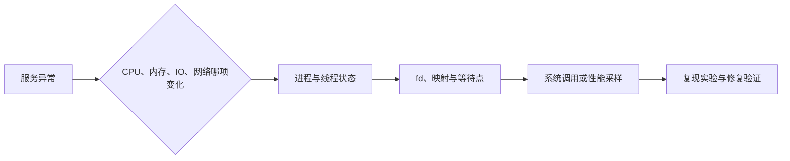
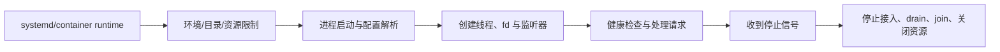
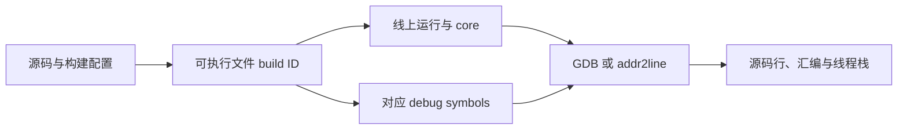
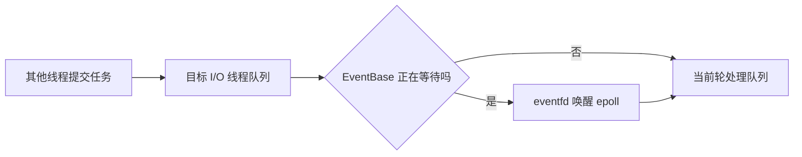
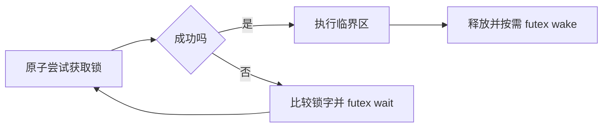
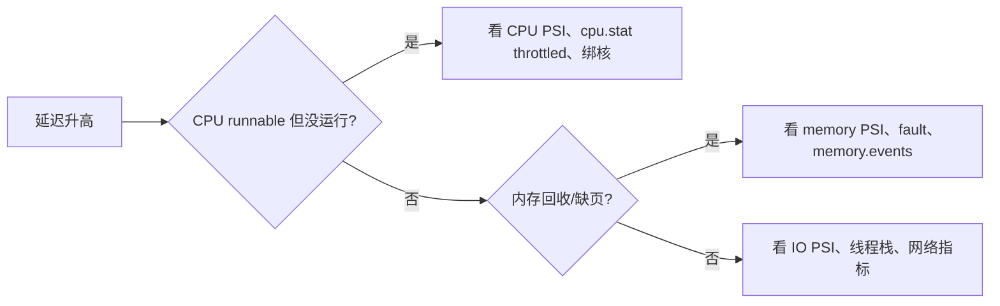
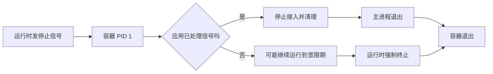
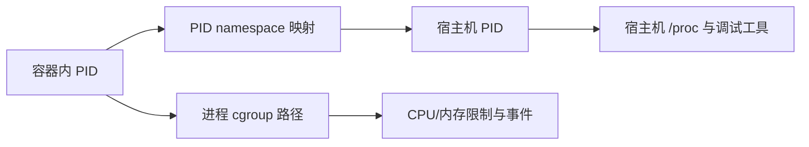
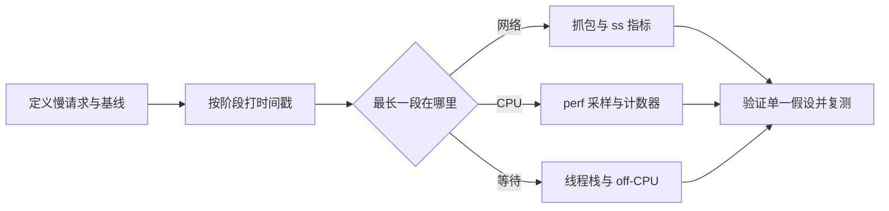
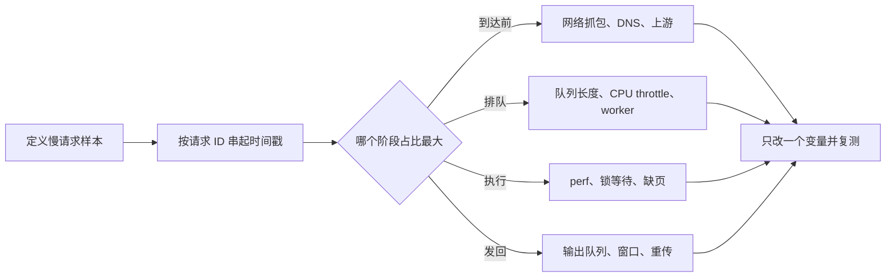

# Linux：C++ 开发中的使用、排障与性能定位

> 本文以 Linux 用户态开发为范围。命令示例要先替换 `<pid>` 等占位符；观察命令与会改动资源限制、容器状态的实验分开理解。具体权限、内核版本和发行版会影响结果。

## 本文目录

- [[#日常命令与进程状态|日常命令与进程状态]]
- [[#调试、构建与性能工具|调试、构建与性能工具]]
- [[#内核接口：futex、内存锁定与资源约束|内核接口：futex、内存锁定与资源约束]]
- [[#容器、PID 1 与 cgroup|容器、PID 1 与 cgroup]]
- [[#从现象到证据的排障流程|从现象到证据的排障流程]]

## 面试与项目阅读路线

从 `CMakeLists.txt` 找编译选项与目标依赖，从 `main` 找启动配置与信号处理，从线程创建处找 CPU 亲和性和退出协议，从系统调用处找错误处理，再用 `/proc`、`ss`、`perf`、`strace` 验证推断。每次排障先明确指标与时间窗口，再保存可复现的证据。

## 日常命令与进程状态

### 常用命令与观察点
#### top / htop：怎么看、看什么
- 第一行 load average：**含 runnable + D（不可中断）进程**，所以 IO 卡顿也会推高 load；判断要结合 CPU 使用率；
- CPU 行字段：`us`（用户态，含业务）、`sy`（内核态，系统调用/软中断重时有意义）、`wa`（IO 等待）、`hi/si`（硬/软中断，网络高压时会涨）、`st`（被虚拟化偷走）；
- `free` 的 `available` 是考虑可回收缓存后的估计，不是严格的“真实空闲”；结合内存压力、swap 和 cgroup 指标判断。
- `VIRT` 是虚拟地址空间，`RES` 是近似驻留内存，`SHR` 是其中可共享的部分估计；数值不一定满足简单大小链，分析内存需结合 `/proc/PID/smaps` 与 cgroup。
- 常用交互：`1`（每核分开显示）、`P`（按 CPU 排序）、`M`（按内存排序）、`H`（显示线程）、`e`（单位切换）、`c`（完整命令行）、`F` + 字段（自定义列）；
- 变体：`top -H -p <pid>` 只看某进程的线程；`htop` 树形显示、直接 kill。
#### "查看线程是否挂起"（面试练习问法）
"挂起"要分两种语义作答，面试官会满意：
**(a) 线程是否被"暂停"（T 状态）**
- `ps -eLf | grep <name>` / `ps -T -p <pid>`：看 STAT 列有没有 `T`（或 `t`，被调试器停）；
- 暂停由 `SIGSTOP`/`SIGTSTP` 造成（`kill -STOP <pid>` 会暂停整个进程）；恢复用 `kill -CONT`；
- `SIGSTOP` 不可被捕获/忽略。
**(b) 线程是否"阻塞/睡眠"在等什么（更常见）**
```bash
ps -eLf                       # 每线程一行，看 STAT
cat /proc/<pid>/status | grep Threads
cat /proc/<pid>/task/<tid>/status    # State: S(可中断睡眠) D(不可中断) R 等
cat /proc/<pid>/task/<tid>/wchan     # 睡在哪个内核函数（等待通道）
cat /proc/<pid>/task/<tid>/stack     # 内核栈（需 root/权限）直接看卡在哪
gdb -p <pid> -batch -ex "thread apply all bt"   # 终极武器：所有线程用户态栈
```
- `futex_wait` 表示等待某个 futex 条件，可能是锁、条件变量或其他同步；`epoll_wait` 是等事件，是否异常要结合业务阶段。
- 组合拳：State=`D` + 内核栈有 IO 路径 → 不可中断 IO 阻塞，SIGKILL 通常在等待点结束后才能使其退出，要去盘 IO 侧查原因。
#### lsof：查看进程打开的文件
- `lsof -p <pid>`：某进程打开的所有 fd（文件、socket、管道、共享内存……）；
- `lsof -i :8080` / `lsof -i -P -n`：谁占着端口（"端口被占用"排查第一命令）；
- `lsof -u user`、`lsof /path/file`（谁在用这个文件，卸载设备前的必查）；
- **文件被删但空间不释放**（df 满但 du 找不到）的经典排查：
```bash
lsof | grep deleted          # 找 deleted 条目
ls -l /proc/<pid>/fd/        # 或直接看 fd 软链，恢复数据: cp /proc/<pid>/fd/N /tmp/save
```
- 等价内核视角：`/proc/<pid>/fd/` 目录下每个 fd 一个软链；`ls -l` 还能看到 socket 的 inode（和 `ss -p` 对得上）。
#### 限制进程内存（面试常考"怎么给进程限内存"）
分层回答（从弱到强）：
1. **ulimit / setrlimit（进程级，粗）**：
   - `ulimit -v <KB>`：RLIMIT_AS，限制**虚拟地址空间**——注意它限制的是 malloc/mmap 的总量（申请就计入），不是实际物理占用；开 JVM/大 mmap 的程序容易"申请即超限"；
   - `ulimit -m`：RLIMIT_RSS，**Linux 实际不生效**（文档明确 ignored），别答这个；
   - `ulimit -s`：栈大小（默认值依环境而异）；`ulimit -l`：mlock 能锁的内存上限（RLIMIT_MEMLOCK，使用 mlock 前先检查限额）；`ulimit -c`：core dump 大小；
   - 对运行中进程：`prlimit --pid <pid> --as=... --memlock=...`（无需重启改限额）；
2. **cgroup v2（现代主流，容器同款）**：
   - `/sys/fs/cgroup/<group>/memory.max` 硬上限、`memory.high` 软限；超限先尝试回收，无法满足时可能触发组内 OOM；
   - 临时用法：`systemd-run --scope -p MemoryMax=1G ./app` 或 `systemd-run --user --scope -p MemoryMax=1G 命令`；
3. **编程级硬约束**：分配器自管（arena/池）+ 监控 RSS。
> 追问：ulimit -v 和 cgroup memory.max 有什么区别？——前者限虚拟地址（进程级、申请计数、可被 mmap 轻易触发），后者限实际物理+内核记账（组级、回收仍无法满足时可能 OOM）。
#### 文件权限位
- 三组 rwx（owner/group/other），八进制：`755`、`644`；修改 `chmod / chown / chgrp`；
- **目录权限的特殊含义**：`r` = 能列目录名，`w` = 能在目录里增删文件，**`x` = 能穿越/访问（没有 x 打不开里面的文件）**——经典考点："为什么有的目录 555 还能读文件"；
- 特殊位（sticky/setuid/setgid）：
  - **setuid（4xxx）**：执行时以文件属主身份运行（如 `passwd`）——提权风险点；
  - **setgid（2xxx）**：以上级组运行；对目录则"新建文件继承目录组"（共享目录常用）；
  - **sticky（1xxx）**：目录里的文件**只有属主能删**（`/tmp` 就是 `1777`）；
- `umask`：新建文件默认权限 = 基权限 ∧ ¬umask（umask 022 → 文件 644、目录 755）；
- 看权限：`ls -l`（rwx 串、属主属组、硬链接数）；特殊位在串里表现为 `s/S/t/T`；
- 扩展：ACL（`getfacl/setfacl`）做细粒度；`lsattr/chattr +i` 不可变文件。
#### 其他命令速查（按用途）
- 文本处理：`grep -rn`、`sed 's/old/new/g'`、`awk '{print $N}'`、`sort | uniq -c | sort -rn`（统计）、`find ... -exec/| xargs`、`cut/tr/wc`；
- 流与重定向：`> >> 2> 2>&1 &`、`<`、here-doc；**`cmd > log 2>&1` 的顺序有讲究**（后写的重定向覆盖前面效果——经典面试小题）；
- 进程：`ps aux/ef`、`pstree -p`、`kill -15/-9`（先 15 给清理机会，扛不住再 9）、`nohup`/`setsid`、`bg/fg/jobs`、`nice/renice`；
- 系统：`free -m`、`df -h`/`du -sh *`、`vmstat 1`、`iostat -x 1`、`sar`、`dmesg -T`（看 OOM、网卡错误）、`journalctl`、`systemctl status/restart`；
- 网络：`ss -lntp`（比 netstat 快，看监听/队列）、`ip a/route`、`tcpdump -i eth0 -nn port 80`、`curl -v`、`nc -zv host port`（探活）、`mtr`；
- 二进制与调试：`ldd`（动态库依赖）、`nm/objdump/readelf`、`strings`、`strace/ltrace`。

### 命令行实战：线程 / 死锁 / 高 CPU 排查实录
#### 场景一：进程"卡住不干活"了
```bash
# ① 先看整体: 进程在不在, CPU/内存什么状态
ps -o pid,stat,%cpu,%mem,etime,cmd -p <pid>

# ② 看它有几个线程、都在什么状态(S=睡眠 D=不可中断 T=暂停 R=运行)
ps -eLf | grep <pid>                  # 或: ps -T -p <pid>
cat /proc/<pid>/status | grep -i threads

# ③ 逐个线程看"睡在哪": State + wchan(等待通道) 是关键证据
for t in /proc/<pid>/task/*/; do
  echo "== $t"; cat $t/status | grep '^State'; cat $t/wchan; echo; 
done

# ④ 卡在 futex_wait → 等锁/条件变量; 卡在 epoll_wait → 等事件; 卡在 read → 等IO
```
```bash
# ⑤ 终极武器: attach 看所有线程的用户态调用栈(业务函数名一目了然)
gdb -p <pid> -batch -ex 'set pagination off' -ex 'thread apply all bt'
```
**判读口诀**：`State: S` + `wchan` 是 `futex_wait` → **锁竞争/条件变量**；`State: D` + 栈在 IO 路径 → **不可中断 IO**（store/网络文件系统，`kill -9` 都杀不掉，要去 IO 侧找原因）；`State: T` → 被 SIGSTOP/调试器暂停（`kill -CONT` 恢复）。
#### 场景二：死锁定位（gdb 现场模拟）
```text
$ gdb -p 12345 -batch -ex 'set pagination off' -ex 'thread apply all bt'
Thread 4 (LWP 12349):
#0  do_futex_wait (...)                      ← 全都在 futex 上睡觉, 说明在等锁
#5  pthread_mutex_lock (mtxA)
Thread 3 (LWP 12348):
#5  pthread_mutex_lock (mtxB)               ← 线程3 等 B
Thread 2 (LWP 12347):
#5  pthread_mutex_lock (mtxA)               ← 线程2 等 A
...
```
**读法**：每个 `pthread_mutex_lock` 的栈帧往下找 `__lll_lock_wait` 确认确实在等；再顺着栈找**谁持有**（持锁线程的栈里能看到 `pthread_mutex_lock` 之后还没 `unlock` 的位置）。出现 `2 等 A → 1 持 A 等 B → 3 持 B 等 A` 的环 = 死锁。
**修复套路**：所有代码路径**按同一顺序**获取锁（如按对象地址升序、或全局编号 A<B<C），破坏循环等待。
#### 场景三：CPU 100% 但不知道烧在哪
```bash
# ① 找嫌疑进程 → 找嫌疑线程
top               # 按 P 排序找进程
top -H -p <pid>   # 按 P 排序找线程, 记下高 CPU 的 TID
printf '%x\n' <tid>       # TID 转 16 进制(profiler/日志里的线程号常是 16 进制)

# ② 两条路直达热点函数:
gdb -p <pid> -batch -ex "thread apply all bt" | grep -A30 "0x<hex>"   # 看该线程栈(瞬时)
perf top -p <pid>                                                      # 采样统计(更可靠)
perf record -F 999 -g -p <pid> -- sleep 30 && perf report              # 30 秒采样后离线看
```
**判读**：业务函数自身宽 → 算法/计算问题；`memcpy/memmove` 多 → 拷贝冗余（想想零拷贝/传引用）；`futex` 相关多 → 锁竞争；`syscall` 多 → 减少系统调用。

### 从 `/proc` 到观测工具

`/proc/PID/status` 给出状态、线程数和内存的快速视图；`/proc/PID/task/TID/` 可看各线程；`/proc/PID/fd/` 对应打开的描述符。`VmRSS` 是近似的驻留页口径，内存分析要结合 `smaps`、共享映射、分配器缓存和 cgroup 记账。`top` 的 `VIRT`、`RES`、`SHR` 是不同口径，不应背固定大小关系；`free` 的 `available` 是估计可用于启动新应用的内存，而非严格“真实空闲”。



### `kill`、D 状态与退出

`SIGTERM` 是可处理的退出请求，`SIGKILL` 无法被捕获；进程若在不可中断睡眠 `D` 状态，`SIGKILL` 通常要等内核等待点结束才能完成退出。僵尸 `Z` 已经退出，给它再发信号不能代替父进程 `wait`。`gdb -p` 与 `strace -p` attach 会影响目标执行，也可能受 ptrace 权限限制；线上先用低干扰指标和日志，确需 attach 时记录时间窗口与影响。

### 服务进程从启动到退出

Linux 服务不是只会 `./app`。要弄清工作目录、环境变量、标准输出、打开文件数、core dump、信号和子进程。systemd 服务可以用 `systemctl status` 看主进程与退出状态，用 `journalctl -u` 找对应日志；`ExecStart`、`WorkingDirectory`、`Environment`、`LimitNOFILE` 等设置可能改变程序行为。运行命令前先确认是在宿主机、容器还是用户级 systemd。



```bash
systemctl status <service> --no-pager
journalctl -u <service> --since '1 hour ago' --no-pager
systemctl show <service> -p MainPID -p ExecStart -p WorkingDirectory -p LimitNOFILE
cat /proc/<pid>/limits
readlink -f /proc/<pid>/cwd
```

服务停止要回答：先停止 `accept` 还是先停止业务 worker？待发送回执是否 drain？谁负责关闭共享内存、日志、定时器？崩溃后是否靠幂等或重放恢复？这直接影响网络连接与进程生命周期。

### 文件描述符、端口与进程映射

打开文件是 fd，socket、管道、`eventfd`、`timerfd` 也占 fd。`EMFILE` 是单进程 fd 限制，`ENFILE` 是系统范围文件表压力；服务端需要监控使用量与上限，不能只在出错时盲目提高 `ulimit -n`。删除仍被进程打开的大文件不会立刻释放空间，`lsof +L1` 能找这类句柄；确认归属后由服务安全关闭或重启。

```bash
ls /proc/<pid>/fd | wc -l
cat /proc/<pid>/limits | grep -i 'open files'
lsof -p <pid> | head
lsof +L1                    # 已删除但仍被打开的文件
ss -lntp                    # TCP 监听者和队列
ss -xap                     # Unix domain socket
```

## 调试、构建与性能工具

### 工具链：gdb / perf / valgrind / sanitizers / cmake
#### gdb（调试实践——要能报出一串真实用过的命令）
**启动与基本控制**
- `gdb ./app`、`gdb ./app core`（读 core 文件）、`gdb -p <pid>`（attach 运行中进程，调试线上问题不重启）；
- `run` / `start`（停在 main）、`quit`、`set pagination off`（免得卡在分页）；
- 编译要带 `-g -O0`（或 `-g -O2` 但变量可能被优化掉）；`-gdwarf` 影响行号精度；Release 调优通常 `RelWithDebInfo`。
**断点类**
- `break file.cpp:123`、`b func`、`tbreak`（一次性断点）、`info breakpoints`、`disable/enable/delete`；
- 条件断点：`b loop if i == 999`（循环里第 1000 次才停）；
- 监视点：`watch var`（值变即停——**排查"谁改了我变量"的第一手段**）；`rwatch/awatch`；
- `catch throw`（C++ 异常）、`catch syscall open`（系统调用级断点）。
**执行控制**
- `next`（跨过调用）、`step`（进入）、`finish`（跑完当前函数）、`until 456`（跑到某行）、`continue`；
- 循环里 `ignore <bp> 100`（忽略前 100 次）。
**查看数据**
- `print/x var`、`p *ptr@10`（看数组 10 个元素）、`p sizeof(struct)`、`p (Type*)ptr` 强转；
- `x/16gx 0x7fff...`（按格式 dump 内存：16 个 8 字节十六进制）；`x/s`（字符串）、`x/i $pc`（当前指令）；
- `info locals`、`info args`、`info registers`（看 rax/rdi 等，对着系统调用号看）、`info threads`；
- `bt`（调用栈）、`bt full`（带局部变量）、`frame N` / `up` / `down` 切换栈帧。
**多线程 / 死锁（重点场景）**
- `info threads` 看所有线程当前停在哪；
- `thread apply all bt` —— attach 一个死锁进程，**所有线程栈一起看**：谁卡在 `futex_wait`、栈里显示在等哪个 mutex，再对照哪个线程栈里正持有它 → 定位死锁环；
- `thread <n>` 切线程；`set scheduler-locking on`（单步时钉住当前线程）。
**崩溃 / core dump 流程**
- 打开 core：`ulimit -c unlimited`（或系统 core_pattern），`gdb ./app core`；
- 段错误三步：`bt` 找崩溃帧 → `frame` 切过去看 `info locals` → `x/i $pc` / `disassemble` 看炸在什么指令（常见：空指针解引用、野指针、栈溢出）；
- `gcore <pid>` 不杀进程抓现场；线上排查"先 gcore 再离线分析"。
**修改变量与调用**
- `set var x = 10`（改内存验证假设）、`call func(args)`（在调试器里执行函数）、`return`（强制从当前函数返回）；
- `disassemble /m func`（源码+汇编混排）；`set disassembly-flavor intel`。
**其他实用**
- `follow-fork-mode child/parent`（跟子进程）、`set logging on`、Python 脚本扩展（自定义命令）。
> 面试话术示例（被问"怎么调死锁"）：attach 进程 → `thread apply all bt` 看所有线程 → 找到都在 futex_wait 的线程们 → 沿栈帧打印各自等待的 mutex 地址 → 找出"持有者同时等待下一个锁"的环 → 按锁顺序修复。
#### perf（采样型性能剖析）
- `perf stat ./app`：整体指标——IPC（insn/cycle，IPC 只是线索，需结合缓存、分支和等待指标）、cache-misses、branch-misses、context-switches、page-faults；**看"量化指标"的第一入口**；
- `perf record -g -F 999 ./app` + `perf report`：采样剖析，按调用栈热点排序（-g 采栈、-F 采样频率）；
- `perf top`：实时系统级热点（线上没条件重跑时看它）；
- 常用事件：`perf stat -e L1-dcache-load-misses,LLC-load-misses,cache-misses,instructions,cycles`；
- 火焰图标准管线：
```bash
perf record -F 999 -g -- ./app        # 采样
perf script | stackcollapse-perf.pl | flamegraph.pl > out.svg
```
- 原理：基于 PMU（CPU 硬件计数器）+ 定时采样，开销低——**适合找"热点在哪个函数"**；找"为什么慢"（cache、分支、伪共享）要配合 `perf c2c`、`perf mem`、`perf stat -e`；
- 与 gdb 的分工：gdb 看"单点正确性/现场"，perf 看"统计上哪里最耗时"，两个都必备。
#### valgrind（动态二进制插桩）
- `valgrind --tool=memcheck ./app`：内存错误全家桶——非法读写、**未初始化读**、泄漏（`--leak-check=full`）、重复 free；
- `--tool=callgrind`：函数级耗时与调用次数（配 kcachegrind 看图，不需要源码重编译）；
- `--tool=helgrind / drd`：数据竞争/锁序问题检测；
- 特点：**不需要重新编译**，但 运行时开销可能很高，具体需测量——适合跑单元测试/短用例，不适合压测；
- 泄漏定位实战：memcheck 报泄漏点 → 看 still reachable vs definitely lost；运行中看 `/proc/<pid>/status` 的 VmRSS 是否随时间爬升（区分"真泄漏"和"分配器缓存"）。
#### ASan / UBSan / TSan（编译期插桩，现代 CI 标配）
- `-fsanitize=address`（ASan）：越界、UAF、重复释放、泄漏（LSan）；开销比 valgrind 小得多，适合在开发与 CI 的专门构建中运行；
- `-fsanitize=undefined`（UBSan）：未定义行为（溢出、错对齐、非法移位、strict aliasing 相关的 UB 检测有限）；
- `-fsanitize=thread`（TSan）：数据竞争、锁序反转检测——**无锁代码的正确性守门员**；
- 注意：ASan 和 TSan 不能同时开；都要 `-O1/-O2 + -g + -fno-omit-frame-pointer`；
- 与 valgrind 对比：ASan = 重新编译 + 快；valgrind = 不重编 + 慢且环境敏感。
#### strace / ltrace（系统调用与库调用级观测）
- `strace -f -tt -T -p <pid>`：跟踪进程（含线程）的系统调用，`-tt` 绝对时间、`-T` 每次耗时——"卡在哪个 syscall"一目了然；
- `strace -c ./app`：汇总每个系统调用的次数与时间（发现"疯狂 read 1 字节"的经典手法）；
- `strace -e trace=network/file,openat`：按类别过滤；
- `ltrace`：库函数调用级（malloc/free 配对看）；
- 现代替代/补充：`eBPF/bpftrace`（`bpftrace -e 'tracepoint:syscalls:sys_enter_*{...}'`）、`execsnoop` 等 one-liner；开销比 strace 小，可线上用。

### CMake 目标与构建产物

先读顶层 `CMakeLists.txt` 的 `project`、`add_subdirectory`、目标定义，再追 `target_link_libraries`、`target_include_directories`、`target_compile_options`。`PRIVATE` 是仅当前目标，`PUBLIC` 同时传给依赖者，`INTERFACE` 只传给依赖者；C++ 标准需求最好表达在目标上。不要假设 `Release` 必然 `-O3`、`RelWithDebInfo` 必然 `-O2 -g`：工具链和项目可覆盖默认值，实际用 `compile_commands.json` 或构建日志确认。

```cmake
cmake_minimum_required(VERSION 3.16)
project(example LANGUAGES CXX)
add_executable(app main.cpp)
target_compile_features(app PRIVATE cxx_std_17)
find_package(Threads REQUIRED)
target_link_libraries(app PRIVATE Threads::Threads)
```

配置 `cmake -S . -B build -DCMAKE_EXPORT_COMPILE_COMMANDS=ON`，再用 `cmake --build build`。遇链接失败时区分“找不到符号定义”“目标未链接依赖”“ABI 或编译选项不一致”；用 `nm -C`、`readelf -d`、`ldd` 结合构建命令核对。`ldd` 运行对象的方式有安全注意事项，不要对来源不可信的二进制直接执行。

### Sanitizer、perf 与 GDB 怎么配合

ASan 检查很多越界和释放后使用，UBSan 检查部分未定义行为，TSan 检查数据竞争；覆盖范围、运行时开销和兼容性各不相同。ASan 与 TSan 通常分别构建运行。`-g -fno-omit-frame-pointer` 有利于栈分析，优化级别应按目标选择。没有一次成功运行就能“证明无 bug”。

`perf stat` 的 IPC = instructions/cycles，是受体系结构、工作负载、事件复用和计数窗口影响的指标；IPC 低可能是访存、分支、前端、同步、I/O 或测量口径，需结合 cache miss、branch miss、stall 和调用栈判断。`perf record` 是采样，不会自动告诉你所有等待时间；CPU 火焰图的横向宽度表示样本占比，纵向是栈深，水平位置本身不表示时间顺序。`perf` 可能受 `perf_event_paranoid` 和权限限制。

| 证据 | 工具 | 能回答的问题 |
|---|---|
| 崩溃现场 | core + GDB | 哪个线程在哪条指令和调用链失败 |
| 竞争/越界 | TSan、ASan、UBSan | 特定测试路径是否触发已覆盖的问题 |
| CPU 热点 | `perf record/report` | CPU 样本集中在哪些栈 |
| 系统调用等待 | `strace -f -tt -T` | 哪次调用耗时、错误码是什么 |
| 离 CPU 等待 | off-CPU 采样、线程栈 | 是锁、IO、调度还是业务队列 |

来源：[Clang ASan](https://clang.llvm.org/docs/AddressSanitizer.html)、[UBSan](https://clang.llvm.org/docs/UndefinedBehaviorSanitizer.html)、[TSan](https://clang.llvm.org/docs/ThreadSanitizer.html)、[CMake 目标编译特性](https://cmake.org/cmake/help/latest/command/target_compile_features.html)。

### Debug、Release 与线上符号

线上高性能构建仍应保留可定位的符号信息，可单独保存 debug symbols，并给二进制和符号文件建立 build ID 对应。`-O2/-O3` 会内联、消除变量和改变指令顺序，GDB 中某个源码变量“被优化掉”不是程序没有它。排查崩溃要确认 core 和可执行文件来自**同一构建**，动态库版本一致；否则栈可能误导。



```bash
file ./app
readelf -n ./app | grep -A3 'Build ID'
readelf -d ./app | grep NEEDED
nm -C ./app | grep <symbol>
gdb ./app <core-file> -batch -ex 'thread apply all bt full'
```

`addr2line`/GDB 的定位还受内联和优化影响，要结合寄存器、反汇编与复现。只读检查二进制时优先 `readelf`，对不可信产物不要直接运行。

### 压测与采样要对应同一工作负载

`perf stat` 可先看进程的 cycles、instructions、cache miss、上下文切换和 page fault；`perf record` 才能定位 CPU 热点栈。先做小范围采样，再按具体假设采事件，避免一次启动所有高开销工具。压测必须记录请求分布、并发度、消息大小、CPU 频率、内核/网卡、采样时间和错误率，才能比较前后版本。

```bash
perf stat -e cycles,instructions,cache-misses,context-switches,page-faults -- ./app
perf record -g --call-graph dwarf -p <pid> -- sleep 20
perf report --stdio
pidstat -t -u -w -p <pid> 1
```

`perf` 可能需要额外权限，`--call-graph dwarf` 有更高采样开销；是否使用 frame pointer、LBR 或 DWARF 应按环境测。CPU 样本少时先确认进程是否主要在睡眠，或热点只发生于短暂的尾延迟窗口。

### 从开源项目看线程池与 I/O 唤醒

[Folly 的 IOThreadPoolExecutor](https://github.com/facebook/folly/blob/main/folly/executors/IOThreadPoolExecutor.h)文档注释说明它每个 I/O 线程有自己的队列和事件循环，用 `eventfd` 通知等待中的循环。查源码时找 `add` 如何选线程、任务如何入队、何时发唤醒、`stop` 怎样处理剩余任务。CPU 线程池的共享队列与 I/O 线程池的每线程队列有不同竞争点；不能把它们都称作“线程池”就忽略运行机制。



## 内核接口：futex、内存锁定与资源约束

### futex 是睡眠协调原语

用户态先用原子操作改共享锁字；竞争时 `FUTEX_WAIT` 仅当锁字仍等于期望值才原子地入睡，释放方可用 `FUTEX_WAKE` 唤醒。醒来可能因为信号、伪唤醒或状态变化，必须重新检查条件。`FUTEX_PRIVATE_FLAG` 用于仅在同一进程内共享的 futex；跨进程共享内存的 futex 不能照搬 private 变体。普通 C++ 业务代码通常使用 `std::mutex` 或条件变量，把 futex 状态机留给库实现。



### `mlock` 和预热分别解决什么

`mlock`/`mlockall` 可防止锁住的页被换出；是否允许锁定受 `RLIMIT_MEMLOCK`、权限和配置影响，默认值因环境而异。预热可把某些首次缺页、初始化、动态链接或缓存建立工作提前，但无法保证运行后绝无缺页或尾延迟：COW、栈增长、未来映射、I/O 与其他资源竞争仍可能发生。`MCL_FUTURE` 还会影响后续映射/分配的可用性，失败必须检查返回值。

### 资源限制的三个层次

`ulimit` 是 shell 对当前进程及子进程设置的资源限制；`prlimit` 可检查或调整某进程的限制，但权限和硬上限约束仍有效；cgroup v2 对进程组的 CPU、内存等资源记账与控制。`RLIMIT_AS` 限虚拟地址空间，`memory.max` 约束 cgroup 的内存记账；达到 `memory.max` 后内核先尝试回收，无法缓解时可能在组内触发 OOM，不是每次写超限即刻杀进程。

```bash
prlimit --pid <pid>                  # 先只读检查当前限制
cat /sys/fs/cgroup/<group>/memory.current
cat /sys/fs/cgroup/<group>/memory.max
cat /sys/fs/cgroup/<group>/memory.events  # 看 max、oom、oom_kill 计数
```

来源：[futex(2)](https://man7.org/linux/man-pages/man2/futex.2.html)、[mlock(2)](https://man7.org/linux/man-pages/man2/mlock2.2.html)、[cgroup v2 文档](https://docs.kernel.org/admin-guide/cgroup-v2.html)。

### 用压力指标判断是否真的缺资源

内存占用高不必然是内存压力。cgroup 的 `memory.current` 告诉你记账量，`memory.events` 告诉你是否触及限制和 OOM；`/proc/pressure/memory` 的 PSI 反映一段时间里任务因内存而停顿的比例。CPU 限额会让任务明明可运行却被 throttle，查看 `cpu.max` 与 `cpu.stat`。这些值需要同一时间窗口取样。

```bash
cat /proc/pressure/cpu
cat /proc/pressure/memory
cat /proc/pressure/io
cat /sys/fs/cgroup/<group>/cpu.max
cat /sys/fs/cgroup/<group>/cpu.stat
cat /sys/fs/cgroup/<group>/memory.events
```



来源：[Linux cgroup v2](https://docs.kernel.org/admin-guide/cgroup-v2.html)、[PSI 内核文档](https://docs.kernel.org/accounting/psi.html)。PSI 可能未在某些内核/容器配置中启用；缺文件时先确认内核能力。

### 亲和性与 NUMA 是部署参数

`taskset` 可查/设进程 CPU 亲和性；`numactl --hardware` 查看节点拓扑，`numastat -p` 检查页分布。先确认目标进程是否在容器 cpuset 内，命令看到的 CPU 编号是否来自正确命名空间。绑核/绑内存可能改善局部性，也可能使某个核过载、让热页落远端，必须带压测与回退方案。

```bash
taskset -pc <pid>
numactl --hardware
numastat -p <pid>
cat /proc/<pid>/status | grep -E 'Cpus_allowed_list|Mems_allowed_list'
cat /sys/fs/cgroup/<group>/cpuset.cpus.effective
```

## 容器、PID 1 与 cgroup

### 容器的主进程与 namespace init

PID namespace 中的 PID 1 有特殊的信号和子进程收养语义。未经 handler 处理、默认动作为终止的信号可能不会让 namespace init 退出；应用若直接充当 PID 1，应显式处理 `SIGTERM` 或使用会转发信号与回收子进程的 init。`/proc/1/status` 的 `SigIgn` 只表示进程显式忽略的信号位，不能用“SIGTERM 位在其中”证明内核对 PID 1 的特殊规则。容器运行时发送停止信号、等待多久以及何时强制结束是运行时配置，不应写死为 10 秒。



PID namespace 的 init 退出后，内核会终止 namespace 内其他进程。孤儿进程被 init 或 subreaper 收养，已退出却未被 `wait` 回收的子进程成为僵尸。`docker run --init` 或等效小型 init 帮助信号转发和回收，但业务进程仍需设计自己的停止协议。`SIGTERM` handler 内只做 async-signal-safe 操作；在 C++ 中更稳妥的是 `sigwait` 专用线程、`signalfd` 事件循环或可安全通信的标志设计，不能在 handler 里直接执行复杂清理。

### cgroup 与 namespace 分工

namespace 提供 PID、网络、挂载等可见性隔离，cgroup 提供资源记账与限制；镜像、文件系统和安全配置又是其他层。排查“容器内存不足”时同时看容器内应用指标、`memory.current`、`memory.events`、宿主机日志；排查 CPU 限速看 `cpu.max` 和 `cpu.stat` 的 throttling。容器内的 PID 与宿主机 PID 映射不同，attach 工具要先确认命名空间视角。

来源：[pid_namespaces(7)](https://man7.org/linux/man-pages/man7/pid_namespaces.7.html)、[cgroup v2 文档](https://docs.kernel.org/admin-guide/cgroup-v2.html)。

### 容器中的三层 ID

应用日志里的 PID、容器内 `ps` 看到的 PID、宿主机工具看到的 PID 可能不同；`/proc/PID/status` 的 `NSpid` 能展示所在 PID namespace 层级。容器中服务仍可能受宿主机 cgroup 限制；“容器内 `free` 还有内存”不代表本容器没有达到 `memory.max`。排查前先确定命名空间、cgroup 路径与目标进程。



```bash
grep -E '^(Pid|PPid|NSpid):' /proc/<pid>/status
cat /proc/<pid>/cgroup
readlink /proc/<pid>/ns/pid
cat /proc/<pid>/mountinfo | head
```

### 停机与僵尸进程的可验证实验

在测试容器中比较应用直接当 PID 1 与使用 `--init`：发 `SIGTERM` 后观察 handler 是否执行、子进程是否被回收、主进程退出码是什么。`SigIgn` 只能说明进程显式忽略位；验证默认信号行为应观察实际退出路径和所装 handler。运行时宽限期按配置查询，不能预设 10 秒。

```bash
docker inspect --format '{{.State.Pid}} {{.HostConfig.StopTimeout}}' <container>
docker top <container>
docker exec <container> ps -eo pid,ppid,stat,comm
docker stop --time 5 <test-container>  # 只针对测试容器；显式指定本次宽限期
```

## 从现象到证据的排障流程

### 性能分析方法论（perf/gdb 调优 + 火焰图）
#### 方法论先行：别上来就 perf
- **USE 方法**（资源视角）：对每个资源问 Utilization（使用率）、Saturation（饱和/排队）、Errors（错误）——CPU、内存、磁盘、网络逐个过；
- **RED 方法**（服务视角）：Rate、Errors、Duration（尤其 p99/p999 尾延迟）——量化场景更关心**尾延迟与抖动**，不是平均值；
- 面试答题框架：先定"瓶颈类型"（CPU 密集 / IO 等待 / 锁竞争 / 网络 / 调度抖动）→ 选工具 → 验证假设 → 修 → 复测。
#### "60 秒排查"清单（实战常用，面试可背）
```bash
uptime              # load（含 D 态，IO 也会推高）
dmesg -T | tail     # OOM、网卡错误、磁盘错误等内核事件
vmstat 1            # r/b（可运行/阻塞队列）、si/so（swap）、cs（上下文切换）
mpstat -P ALL 1     # 每核使用率：单核 100% 而总体不高 = 单线程瓶颈
pidstat 1           # 每进程 CPU/major fault/上下文切换
iostat -xz 1        # 磁盘利用率、await（IO 延迟）
free -m             # available 才是可用的口径
sar -n DEV 1        # 网卡吞吐/丢包
top / perf top      # 谁是热点
```
#### 火焰图怎么读
- 生成：`perf record -g` → `perf script | stackcollapse-perf.pl | flamegraph.pl > f.svg`；
- 读法：**横轴不是时间**——横轴是采样占比（宽度越大 = CPU 时间越多）；纵轴是调用栈（自下而上），找"宽且平"的塔 = 热点函数；顶层宽 = 函数自身耗时（self time）；
- 变体：
  - **on-CPU 火焰图**：谁在烧 CPU（找热点）；
  - **off-CPU 火焰图**（bcc `offcputime`）：**谁在睡/等**（找阻塞源——锁、IO、调度），量化延迟问题大半要看这张；
- 常见"看图说话"：业务函数宽 = 算法问题；系统调用层宽 = IO/syscall 过多；`futex_wait` 宽 = 锁竞争；`epoll_wait` 宽 = 等事件正常或空转。
#### 常见现象 → 病因速查
| 现象 | 可能原因 | 手段 |
|---|---|---|
| load 高但 CPU 空闲 | D 态 IO 等待 / NFS 卡住 | vmstat 的 b 列、pidstat -d、/proc/PID/stack |
| CPU 高且 sy 占比高 | syscall/软中断过多 | strace -c、perf、/proc/softirqs |
| 延迟周期性尖刺 | 定时器、ACK 策略、重传、调度或后台任务；须用时间戳与抓包区分 | 抓包、perf sched、看 crontab |
| 吞吐上不去单核跑满 | 单线程热点 / 锁竞争 | perf 火焰图、perf lock |
| 内存缓慢上涨 | 泄漏 或 分配器缓存 | valgrind/ASan、/proc/PID/status VmRSS + smaps |
| 上下文切换暴涨 | 锁竞争、过多线程、频繁唤醒 | pidstat -w、perf sched |
#### 延迟测量（量化特别关注）
- 计时源：`clock_gettime(CLOCK_MONOTONIC)`（可能由 vDSO 实现，视平台与调用而定）或 `rdtsc`（注意：跨核/频率漂移要校准，先测 TSC 频率）；
- 度量方式：**直方图 + p50/p99/p999/max**，而不是平均值；生产中常写"延迟日志/直方图上报"；
- 微基准注意：编译器优化掉计时路径（用 `DoNotOptimize`/volatile 挡）、CPU 频率调节（拿 `perf stat` 看 cycles 稳定性）、预热、跑多轮取分布；
- 调优顺序口诀：**先消除尾延迟来源（缺页、锁、唤醒、系统调用、网络重传），再压平均延迟（访存布局、算法、指令数）**。

### 延迟尖刺不能从毫秒数直接推病因

原笔记把“40 ms = Nagle/延迟 ACK”“100 ms = 重传”“IPC 低 = 内存瓶颈”写成了判别规则，这些只可作待验证假设。应用延迟可分为排队、运行、锁等待、系统调用、网络传输和对端处理。先看 p50/p99、时间窗口、请求 ID 和各阶段时间戳；抓包核对线上行为，再用线程栈、off-CPU 采样和 `perf` 找本机等待。修复后用相同负载、同样统计窗口复测，报告副作用。



`CLOCK_MONOTONIC` 适于单机持续时间；vDSO 是否命中需测量，跨机器时间戳需同步/校准。p999 要求足够样本且明确窗口，单次最大值很受环境影响。CPU 火焰图看不到睡眠中的时间，不能因为热点不明显就断言一定 off-CPU。`dmesg -T` 换算的墙上时间可能受系统时钟变化影响，关键事件用日志、单调时钟和原始时间戳对齐。

### 一个可复用的慢请求排查模板

先确定慢的是“所有请求”还是“特定机器/特定连接/特定时间窗口”；请求日志记录接收、排队、开始处理、发回响应四个时间戳，网络抓包记录线上的首字节与 ACK；再与 CPU、内存、cgroup、NIC 事件按时间对齐。这样才能判断时间花在进程外、队列里还是计算里。



```bash
uptime; vmstat 1 3
pidstat -t -u -w -p <pid> 1 3
ss -tinp dst <peer-ip>
ip -s link show dev <iface>
journalctl -u <service> --since '<start-time>' --until '<end-time>'
```

这些命令是**证据入口**，不是“看到一个值就下结论”的规则。例如 `futex` 栈可能是正常等待条件，`epoll_wait` 通常是事件循环闲置，CPU 利用率低也可能只有一个核达到上限。

## 项目阅读与练习

1. 选一份 C++ 服务：从 CMake 目标到 `main`、信号、线程池、socket、日志与监控走一遍，记录每个资源的创建者与销毁者。
2. 在测试环境造一次“CPU 高”“锁等待”“半包”“内存上升”，分别选 `perf`、GDB/TSan、`strace`/抓包、ASan/`smaps`，写出证据如何支持或推翻假设。
3. 用 `systemd-run --scope` 启动受限测试进程，观察 `memory.events` 与 `cpu.stat`；只在测试环境调整限制并保留测试配置，避免实验影响正在运行的服务。

### 与岗位和开源项目对齐的学习路径

[IMC 的 C++ Execution 职位](https://www.imc.com/us/careers/jobs/4634204101)谈到交易所连接、行情解析、订单入口和生产可靠性；[Optiver 的 C++ 职位](https://www.optiver.com/join-us/jobs/technology/new-york/software-engineer-c-plus-plus/)提到行情摄取、订单路由、执行性能与仿真。这些岗位要求提示：Linux 工具能力要能支持**定位生产问题**，不只是背命令名称。

1. 读 [Redis 的事件循环 `ae.c`](https://github.com/redis/redis/blob/unstable/src/ae.c)：辨认文件事件、定时事件与后端选择；在 Linux 上对照 `epoll_wait` 和 `timerfd`/时间事件设计。
2. 读 [Folly IOThreadPoolExecutor](https://github.com/facebook/folly/blob/main/folly/executors/IOThreadPoolExecutor.h)：画出任务队列、`eventfd` 唤醒、事件循环和停机顺序。
3. 读 [Seastar 教程](https://github.com/scylladb/seastar/blob/master/doc/tutorial.md)：理解按核分片与用户态异步任务怎样减少共享状态；它当前版本使用高于 C++17 的特性，应先掌握架构，再按项目要求补语言特性。
4. 自己做一次故障演练：用有界队列、一个故意慢的客户端和一次 cgroup CPU 限流，分别写出 `ss`、`pidstat`、`perf`、cgroup 指标支持的证据链，并记录修复前后 p99 和错误率。
