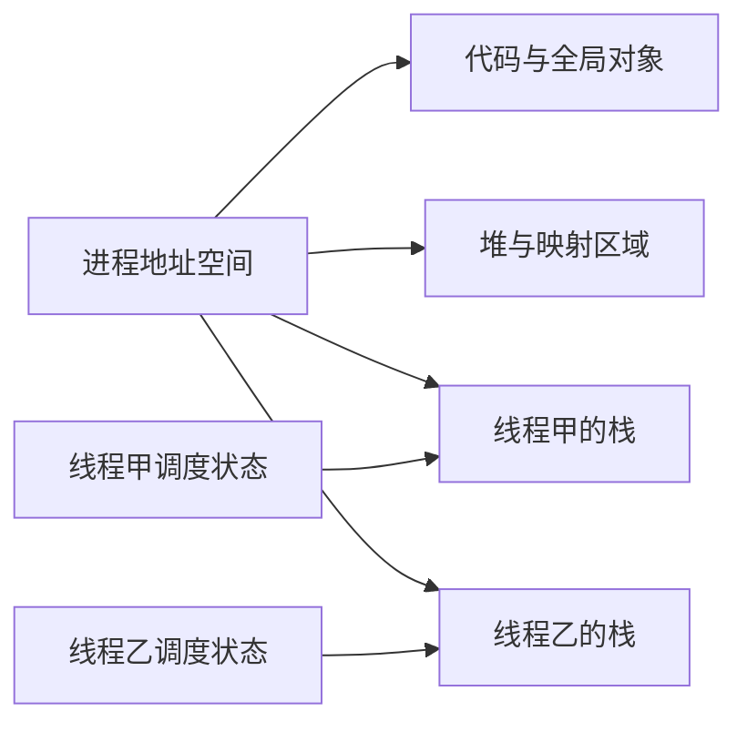
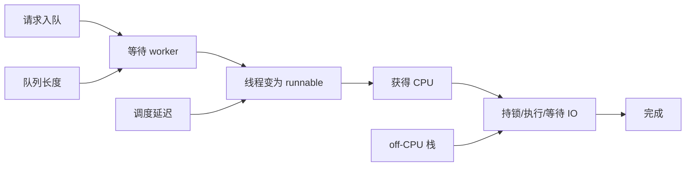
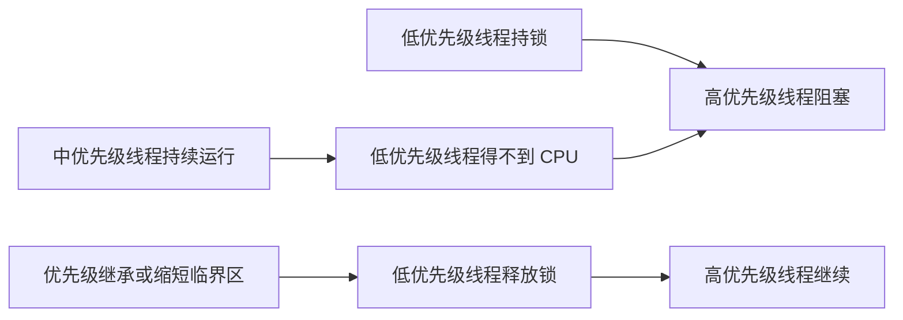
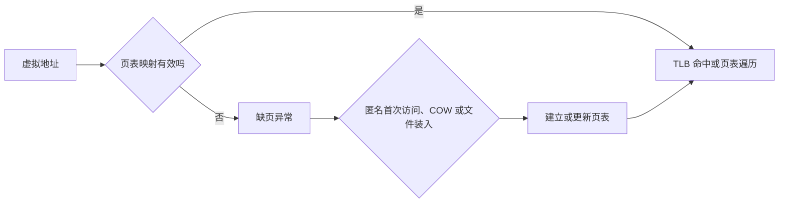
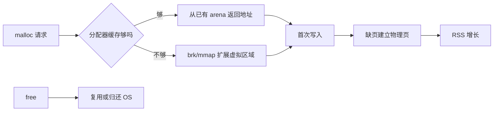
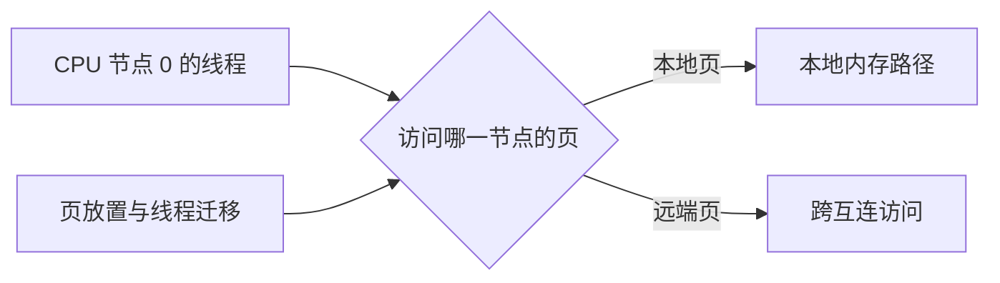
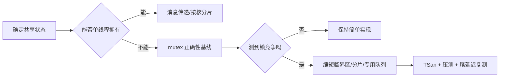
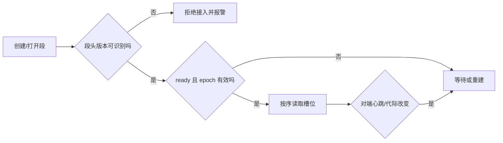
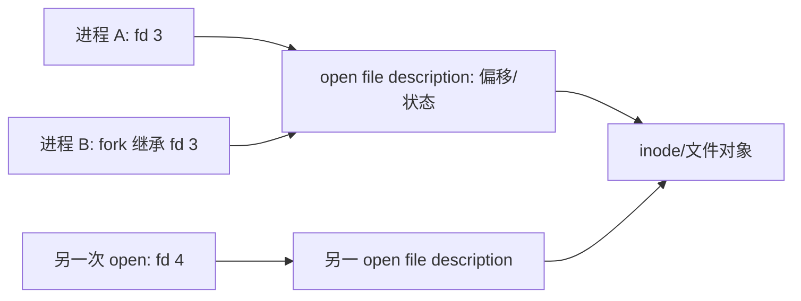
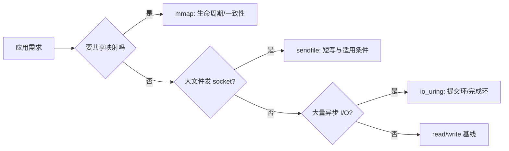

# 操作系统：从资源抽象到并发与性能

> 阅读顺序：先区分进程、线程和调度，再把虚拟内存、同步、IPC、内核路径连起来。示例默认 Linux 与 C++17；硬件事实、POSIX 语义和某一 Linux 版本的实现分别说明。原笔记中的面试公司、性能常数没有可核验来源，不能当成普遍结论。

## 本文目录

- [[#进程、线程、调度与生命周期|进程、线程、调度与生命周期]]
- [[#虚拟内存、分页与缺页|虚拟内存、分页与缺页]]
- [[#同步、锁与队列|同步、锁与队列]]
- [[#进程间通信与共享内存|进程间通信与共享内存]]
- [[#系统调用、中断与网络收包|系统调用、中断与网络收包]]
- [[#文件描述符、缓存与持久化|文件描述符、缓存与持久化]]
- [[#缓存、NUMA 与性能边界|缓存、NUMA 与性能边界]]
- [[#容器隔离基础|容器隔离基础]]

## 面试与项目阅读路线

| 看到的代码 | 先问什么 | 对应知识 |
|---|---|---|
| `std::thread`、线程池 | 谁创建、退出、取消、回收？ | 线程生命周期、调度 |
| `mmap`、预分配 | 页面何时实际建立、会不会缺页？ | 虚拟内存、COW、NUMA |
| `mutex`、`atomic`、队列 | 谁读写、锁保护什么、阻塞在哪里？ | 内存序、锁、条件变量 |
| 共享内存 | 布局、同步、版本与重启如何处理？ | IPC、进程间同步 |

回答面试题时用“定义 → 机制 → 代价 → 适用条件 → 如何验证”的顺序，避免只背名词或固定纳秒数。

## 进程、线程、调度与生命周期

### 进程与线程
#### 本质区别
- **进程**：通常拥有独立虚拟地址空间等资源视图；Linux 的调度对象是 task，资源共享由创建方式决定。
- **线程** = CPU 调度的基本单位：共享进程的资源，但有自己独立的执行上下文。
#### 线程共享哪些资源（练习："进程/线程共享堆栈"对不对？）
**准确说法**：同进程线程共享地址空间（堆、全局对象、映射等），各有独立的栈区域和寄存器上下文；其他线程仍可通过有效指针访问某线程的栈。
- **共享**：代码段、数据段、**堆**、mmap 区域、打开的文件描述符表、当前工作目录、信号处理函数（handler 是进程级配置）、进程的 PID/进程组；
- **每线程独立使用的执行状态**：
  - **栈**（每个线程一份，承载各自的调用帧/局部变量——执行流必须独立，否则互相踩）；
  - 寄存器上下文（含 PC、SP）；
  - 线程局部存储 TLS（`__thread`/`thread_local`）；
  - `errno`（线程局部）；
  - 信号掩码/挂起信号（`pthread_sigmask` 是线程级）；
  - 线程 ID（TID）。
- 追问：每个线程需要自己的活动调用栈；独立栈区域并不提供进程内的内存隔离。
#### Linux 的线程实现
- Linux 内核不区分"线程/进程"，统称 task（`task_struct`）；区别在于 `clone()` 时共享哪些：`CLONE_VM`（地址空间）、`CLONE_FILES`（fd 表）、`CLONE_SIGHAND`（信号处理）……
- 线程 = 共享以上资源的 LWP（轻量级进程）；1:1 模型（glibc NPTL）：一个 pthread ↔ 一个内核调度实体；
- `ps -eLf` 每线程一行（LWP 列），`ps -T -p PID`、`top -H -p PID` 同理；
- 用户态协程由运行时调度；阻塞调用若占住底层线程，会阻碍复用该线程的其他协程。是否可用取决于框架的非阻塞 I/O 与调度设计。
#### 上下文切换
- 切换内容：寄存器现场、栈指针、（进程切换还要换页表基址 CR3）；内核线程之间切换不换地址空间；
- 上下文切换有寄存器保存/恢复及缓存、TLB 等间接成本，取决于硬件与负载；先用 `perf sched`、`vmstat` 与业务指标测量。
- 触发时机：时间片耗尽、阻塞（IO/锁）、被更高优先级抢占、中断返回时重新调度；
- 观测：`vmstat 1` 的 `cs`（每秒上下文切换）、`in`（中断）；`perf sched` 分析调度详情。
#### 进程状态
- `R`（running/runnable，包括在运行队列里等 CPU 的）、`S`（可中断睡眠，等事件）、`D`（不可中断睡眠，等 IO/内核锁，SIGKILL 通常需等不可中断等待点结束才完成退出）、`T`（暂停：SIGSTOP / Ctrl+Z）、`Z`（僵尸，已死待父进程 wait）、`t`（被调试器停止）、`I`（idle 内核线程）；
- `D` 状态进程多 = IO/内核路径阻塞，负载均值（load average）把 runnable 和 D 都算进去，所以"load 高但 CPU 不忙"通常是 D 阻塞。
#### fork 语义与 COW
- `fork()`：复制父进程（含页表，但**写时复制**）；父进程得子 PID，子进程得 0，失败 -1；
- **COW（写时复制）**：fork 后父子页表都指向同一物理页，标记为只读；任一方写入触发"保护性缺页"，内核才复制该页——fork 瞬间便宜，之后按需付费；
- 因此"fork 很贵"的说法分场景：fork 不复制全部用户页面，但复制页表及建立进程状态仍有成本，副作用是首写缺页；`fork + exec` 模式收益大（exec 直接换掉整个地址空间）；
- `vfork`/`posix_spawn` 有不同的实现与约束；多线程进程创建子进程尤其要注意 `fork` 后到 `exec` 前的可调用函数限制。
#### 练习：for + fork 判断进程数
**方法：每次 fork 让"当前存活进程数"翻倍。**
```c
for (int i = 0; i < 3; i++) fork();
```
- i=0：1 → 2 个进程；这两个进程都会进入 i=1 → 4；再到 i=2 → **8 个**（含父进程）；
- 通式：循环执行 n 次、每次无条件 fork 且子进程继续循环 → **2^n 个进程**；
- 变体：
  - `fork(); fork(); fork();` 同理 = 8；
  - 若子进程 `break`/`exit` 退出，则只有父的"后代链"，需逐层画树；
  - **stdio 缓冲坑**：fork 前 `printf` 了不带换行的内容，缓冲区会被复制，退出时父子各打一遍（打印次数翻倍而不是多一行）——练习常考"输出了几次"。
#### 孤儿进程 vs 僵尸进程（练习）
- **孤儿进程**：父进程先退出，子进程还活着 → 被 init/systemd（或最近祖先里的 subreaper；容器里是 1 号进程）收养，**无害**；
  - 容器陷阱：应用作为 1 号进程必须承担"收养 + 收割"职责，否则孤儿退化出僵尸；
- **僵尸进程**：子进程先退出，父进程没有 `wait/waitpid` 回收 → 子进程的尸体（退出码、task 结构、**PID 不释放**）一直留着；
  - **已经死了，kill -9 无效**（那是杀活进程的信号）；`ps` 状态是 `Z`；
  - 危害：PID 表项泄漏、无法创建新进程（PID 耗尽）；
  - 解法：父进程 waitpid；安装 SIGCHLD 处理并循环 wait；或显式 `signal(SIGCHLD, SIG_IGN)`（内核自动收割，Linux 支持）；或双 fork 让孙进程由 init 收养；
- 一句话记法：**进程的回收是父进程的责任**；父不管、父先死，才轮到 init 兜底。

### fork 计数实验（练习"for 循环后有几个进程"）
```c
#include <stdio.h>
#include <unistd.h>
int main() {
    for (int i = 0; i < 3; i++) {
        pid_t pid = fork();
        // 不 break 也不 exit: 父子都继续循环 —— 每次 fork 让存活进程数翻倍
        (void)pid;
    }
    printf("pid=%d ppid=%d\n", getpid(), getppid());   // 会打印 2^3 = 8 行
    return 0;
}
```
```bash
$ gcc fork_demo.c -o fork_demo && ./fork_demo | wc -l
8
$ ./fork_demo | sort | head        # 观察 ppid 里出现 1(init 收养了孤儿)
```
**加点难度**：把 `printf` 挪到循环体外侧且去掉 `\n`（或先 `printf("x")` 再 fork）——由于 stdio 缓冲会被 fork 复制，输出份数会再翻倍。这就是"printf 打了多少次"类练习的陷阱来源。

### CPU 调度速览
- **普通任务公平调度**：早期 CFS 以 vruntime 为核心；Linux 6.6 起逐步转向 EEVDF。看当前内核版本和配置。
- **实时调度**：`SCHED_FIFO/SCHED_RR` 的优先级与抢占规则不同于普通公平调度。使用前要评估任务饿死、实时限流与权限，并在目标机器测量。
- `SCHED_DEADLINE`：EDF 语义、显式给运行时间/周期/截止；
- CPU 隔离、自旋和绑核可能减少迁移与唤醒，也可能浪费核或加剧竞争；先看指标与调度轨迹。

### 进程、线程和内核调度对象

进程提供虚拟地址空间、打开文件等资源的容器；同一进程的线程共享这些资源，每个线程有自己的寄存器上下文、调度状态和栈。这里“栈独立”是指各线程通常使用不同栈区域，**不是**说其他线程不能通过地址访问这段内存。Linux 的线程可由 `clone`/相关接口创建，共享哪些资源由标志决定；用户态通常经 `pthread` 或 `std::thread` 使用。



线程切换会保存/恢复执行上下文，进程切换还可能涉及地址空间切换，但成本受 CPU、TLB、缓存、调度路径影响，不能套一个固定微秒数。`fork` 对用户页面通常采用写时复制，但仍需建立进程元数据和页表，不能无条件说廉价。多线程进程 `fork` 后只有调用线程存活，若子进程在 `exec` 前操作继承的锁，可能死锁；工程中常用 `posix_spawn` 或谨慎的 `fork`/`exec` 路径。

### 调度器为什么要区分策略和版本

普通任务通常属于公平调度类别；Linux 6.6 起公平调度器逐步转向 EEVDF，不能把 CFS 红黑树的细节当作所有内核的现状。`SCHED_FIFO`、`SCHED_RR` 等实时策略可改变优先级规则，同时带来饿死其他任务的风险。绑核减少迁移但也可能让某个核过载。先看 `schedstat`、`perf sched`、线程运行队列和内核版本，再谈调参。

### 从任务队列推导调度与尾延迟

线程“在运行”与“可以运行”不同。请求已进入应用队列却迟迟没人取，可能是 worker 数不足、任务过长、锁阻塞或 CPU 被限额；线程已经 runnable 却迟迟没有 CPU，则看调度延迟、优先级、绑核及 cgroup throttle。平均 CPU 利用率低也可能存在**某个核**或某个队列长期饱和。



[Folly 的 Executors 文档](https://github.com/facebook/folly/blob/main/folly/docs/Executors.md)区分 I/O 线程池和 CPU 线程池：前者把任务送到各自事件循环，后者使用共享任务队列。读实际项目时要找**谁把任务放入队列、队列是否有界、谁唤醒 worker、worker 如何停机**。一个处理时间很长的回调放在 I/O 线程，会拖慢该线程上其他 fd；把每个请求都扔进线程池则可能引入排队与切换。

### 优先级反转与实时线程

低优先级线程持有锁，高优先级线程等锁，中优先级线程不断运行使持锁者无法释放，就形成优先级反转。优先级继承可临时提升持锁者，但并非每种锁都支持。实时调度还要求设计 CPU 预算、watchdog、停机和故障回退，否则某个死循环可能阻碍诊断进程运行。



## 虚拟内存、分页与缺页

### 内存管理（基础机制与性能）
#### 虚拟内存为什么存在
1. **隔离**：每个进程有自己的地址空间，互不可见；越界访问触发 SIGSEGV 只杀自己，不会踩别人；
2. **抽象**：程序总是"独占一大片连续地址"，链接/加载简单，不用关心物理布局；
3. **超售（overcommit）**：虚拟地址总和可以远超物理内存 + swap——页按需分配，"申请不等于占用"（malloc 大块不 touch 不落物理页）；
4. **共享**：共享库、COW、共享内存都靠"多个页表映射同一物理页"实现；
5. **换出支持**：不常用的页可以写到 swap，支撑比物理内存更大的工作集（低延迟程序通常反其道：锁内存）。
#### 地址翻译：MMU + 页表 + TLB
- 虚拟地址 = 虚拟页号 + 页内偏移（4KB 页 → 低 12 位是偏移）；
- **MMU** 硬件负责翻译：查页表找到物理页框号再拼偏移；
- x86-64：48 位虚拟地址用**四级页表**（PGD→PUD→PMD→PTE，每级 9 位索引 + 12 位偏移 = 48），
  另有一级 57 位扩展（五级）；每级查表都是一次内存访问——miss 时最多 4 次访存（page walk）；
- **TLB** 缓存地址翻译。miss 可能触发页表遍历，其代价取决于层级、缓存命中和架构，不能背固定纳秒数。
- **大页（2MB/1GB）**：一条 TLB 条目覆盖 512 倍/51.2 万倍地址范围，大幅减少 TLB miss——低延迟系统常用 hugetlbfs 显式分配；
- 进程切换换 CR3（页表根），TLB 需要失效；PCID 给 TLB 条目打上进程标签，减少切换时全刷；
- 页表项里藏权限：present、R/W、user/supervisor、accessed/dirty、NX（不可执行）——缺页与权限异常都由这些位触发。
#### Page Fault（缺页）
- 访问时 PTE 无效/权限不符 → CPU 触发 #PF 异常 → 内核缺页处理程序接管；
- **minor fault** 通常不需要从存储设备读取目标页面，但仍可能涉及分配、COW 或页表更新；耗时因场景而异。
  - 典型：fork 后首次写（COW）、malloc 后首次 touch（零页）、mmap 文件页已在缓存；
- **major fault（严重缺页）**：页不在内存，需要磁盘 IO（文件读入、swap 换入）——数十 μs 到 ms 级，实时系统的"事故来源"；
- 处理流程：陷入内核 → 找 vma 判断地址合法（非法则 SIGSEGV）→ 分配/定位物理页 → （需要时）发起 IO，可能睡眠 → 填 PTE、更新 TLB → 返回用户态**重试**那条指令；
- 统计：`/usr/bin/time -v`（minor/major）、`perf stat -e page-faults`、`/proc/PID/stat` 的 min_flt/maj_flt 字段。
#### 减少缺页的手段（练习：mlock、大页、局部性）
- **预热（pre-fault）**：启动阶段把所有热路径内存 touch 一遍，把 fault 一次性付清；交易系统预热行情缓冲、订单池是标准动作；
- **mlock/mlockall**：锁住页防止换出，杜绝后续 major fault（swap 引起）；配合 `RLIMIT_MEMLOCK`；`mlockall(MCL_CURRENT|MCL_FUTURE)` 一行搞定（谨慎：会锁住一切分配）；
- **大页**：一次 fault 覆盖 2MB，fault 次数与 TLB 压力都降一个量级；
- **局部性**：顺序访问让预读生效；减少随机跳转；结构体紧凑（cache line 感知布局，和 [[C++]] 呼应）；
- **避免 COW**：能用线程就别 fork 重进程；`mmap` 文件加 `MAP_POPULATE` 预读；`madvise(MADV_WILLNEED)`；对 page cache 用 `posix_fadvise`。
#### 分页 vs 分段
| | 分页 | 分段 |
|---|---|---|
| 划分依据 | 物理视角：固定大小页，大小依架构与配置 | 逻辑视角：代码段/数据段/栈等，可变长 |
| 碎片 | 有内部碎片、无外部碎片 | 有外部碎片 |
| 对程序 | 透明（不可见） | 部分可见（x86 段寄存器历史） |
| 现代现状 | 主流 | x86-64 基本"扁平化"（段基址=0），只剩 FS/GS 用于 TLS |
- 历史：x86 先分段（段:偏移 → 线性地址）再分页（线性 → 物理），"段错误 SIGSEGV"的名字由此而来；
- 分段+分页结合（段页式）曾是教科书架构，现代 OS 以页式为主。
#### 物理内存分配与管理（补充）
- **伙伴系统（buddy）**：按 2^n 个连续页框管理，分裂/合并放回——解决外部碎片，负责"页级"大块分配；
- **slab/slub**：面向内核小对象的缓存（task_struct、dentry、inode……）——对象复用、构造/析构一次、避免频繁走伙伴系统；
- `kmalloc`（物理连续小内存）vs `vmalloc`（虚拟连续，物理可不连续，多一次映射开销）；
- `malloc` 的 arena、`brk`/`mmap` 阈值随分配器与配置改变；`free` 不保证 RSS 立即下降。读项目时先确认实际分配器版本与参数。
  - `free` 不一定把内存还给 OS（可能留在进程堆里复用）——"RSS 不降"不一定是泄漏；
- **OOM killer**：overcommit 模式下内存耗尽时按 oom_score 杀进程；cgroup 环境在组内产生 OOM；
- **页回收**：LRU（active/inactive 双链）、kswapd 后台回收、分配受阻时直接回收；`free` 里的 buff/cache 是可回收的，`available` 列提供可用内存估计。
#### 虚拟内存 ↔ 共享内存 ↔ COW 的底层统一视角
以上三者本质都是"**同一物理页框映射进多个页表**"：COW 是先共享后分裂，共享内存是一开始就约定共享并用于通信，共享库是只读共享。看懂映射关系，这三个考点就是一个考点。

### 把“地址、映射、驻留”三个问题分开

虚拟地址存在、页表有映射、物理页当前驻留是不同状态。`mmap` 可以只建立虚拟内存区域，首次读写时才通过缺页建立/载入页面；缺页并不都需要磁盘 I/O：匿名页首次触碰或 COW 常是 minor fault，文件未驻留时可能发生 major fault。`mlock` 限制已锁页被换出，但不能消除首次访问、COW、栈增长、未锁映射或文件 I/O。观察 `/proc/PID/smaps`、minor/major faults 和工作集，先找真实的尾延迟来源。



大页减少 TLB 压力的前提是工作集和访问模式适合；透明大页可能带来分配/合并成本，显式 hugetlb 还需预留容量。NUMA 上，内存在哪个节点分配和线程在哪个 CPU 运行共同决定访问成本；先测远端访问和 page placement，再考虑绑定。

### `malloc` 成功为什么不代表 RSS 立即增长

分配器可能先从已有 arena 切块，也可能通过 `brk`/`mmap` 获得虚拟区域；匿名页通常在首次触碰时才建立物理页。`mmap` 文件则把文件映射到地址空间，页可能通过 page cache 进入内存。`VmSize`、`VmRSS`、`RssAnon`、`RssFile`、`RssShmem` 口径不同；释放后 RSS 不下降可能是分配器留作复用，也可能是仍有引用、碎片或映射。



```bash
grep -E 'VmSize|VmRSS|RssAnon|RssFile|RssShmem|VmSwap' /proc/<pid>/status
cat /proc/<pid>/smaps_rollup    # 汇总 PSS/RSS/匿名与文件映射；需权限
/usr/bin/time -v ./app          # 观察 minor/major fault，测试时才运行程序
```

`PSS` 将共享页按共享者分摊，比简单求各进程 RSS 更适合估算进程组占用，但仍不能替代 cgroup 的实际记账。缺页次数不等于存储 I/O 次数；需结合 `iostat`、page cache、文件访问模式分析。

### NUMA 和页放置

多路机器上，线程可能在节点 A 运行，却频繁访问节点 B 的页。`numactl --hardware`、`numastat -p`、`/proc/PID/numa_maps` 可以帮助定位页放置。先确认服务是否跨节点迁移、是否真正存在远端访问热点，再比较 first-touch、内存绑定或分片。绑核与绑内存要一起看；只固定 CPU 而把页留在远端可能更慢。



来源：[Linux `/proc/PID/status`](https://man7.org/linux/man-pages/man5/proc_pid_status.5.html)、[透明大页文档](https://docs.kernel.org/admin-guide/mm/transhuge.html)。

## 同步、锁与队列

### 锁、同步与并发
#### semaphore 的实现方式（练习）
- 概念：计数器 + 等待队列。`P/down/wait`：计数 >0 则减一通过，否则入队睡眠；`V/up/post`：唤醒一个等待者或计数加一；
- 实现要分层回答：
  1. **原子计数**：计数器本身用硬件原子指令（CAS/lock 前缀）保护；
  2. **快路径**：无竞争时纯用户态原子操作，**不进内核**；
  3. **慢路径**：需要睡眠/唤醒时借助内核原语 **futex**（`futex_wait` 把线程挂起在信号量内部的地址上，`futex_wake` 唤醒）——glibc POSIX 信号量正是"用户态原子 + futex 兜底"的混合结构；
  4. 纯内核实现参照系：内核信号量 = 原子计数 + 等待队列 + 调度器睡眠/唤醒。
- **semaphore vs mutex**：mutex 有"所有者"（谁加锁谁解锁，表达互斥语义）；信号量无所有者（任何线程可 V，表达"资源的计数/通行证"）。二进制信号量在功能上像 mutex，但语义与适用模式不同（跨线程传递通行证 vs 锁）。
#### spinlock vs mutex（常见对比）
| | 自旋锁 | 互斥锁（mutex） |
|---|---|---|
| 等待方式 | 忙等（循环原子操作） | 睡眠（让出 CPU） |
| 无竞争开销 | 一次原子 CAS，极低 | 一次原子 CAS + 快路径，依平台与竞争情况测量（[[C++]] 表） |
| 有竞争 | 忙等并消耗 CPU | 可能自旋后睡眠/唤醒，成本因实现和负载而异 |
| 适用 | 临界区极短、等待时间 < 切换成本 | 临界区较长、可能阻塞（含 IO） |
| 内核语境 | 不可睡眠上下文需避免睡眠锁，所用原语依上下文决定 | 可睡眠上下文可用互斥锁 |
- 选择自旋还是睡眠要看临界区、竞争概率、是否被抢占和 CPU 预算；mutex 的自旋策略依类型、libc 和版本变化。
- 单核或持锁者易被抢占时纯自旋可能浪费 CPU；内核自旋与抢占/中断规则取决于上下文和内核配置。
- **优先级反转**：低优先级持锁 → 中优先级抢占它 → 高优先级等锁。经典案例：火星探路者。解法：优先级继承（PI mutex / futex PI 让持锁者临时升到等待者的优先级）或优先级天花板。
#### 读写锁与 RCU
- 读写锁：多读共享、单写独占；适合读多写少；问题：写者饥饿（读者源源不断时写者排不上）；
- **RCU** 常用于读多写少场景：读侧开销可很低，但依然需要正确的读侧临界区、发布/观察顺序与宽限期后的内存回收；不能说读者零开销。
#### 条件变量
- 三件套：**mutex + 谓词（共享状态）+ condvar**；`wait` 的语义：原子地"解锁并入睡"，被唤醒后重新加锁返回；
- **必须 `while` 而不是 `if` 检查谓词**：存在虚假唤醒（允许无理由唤醒）且唤醒了不代表条件成立（可能被别的线程先消费）——写 `if` 是常见错误；
- **丢失唤醒**：谓词修改与等待检查必须在同一互斥协议下协调；通常先在锁内修改状态，之后通知，等待方始终循环检查谓词。
- `notify_one` vs `notify_all`：能用 one 就别 all（惊群）；被唤醒哪个线程不保证；
- 典型模板：
```cpp
lock;
while (!pred) cond.wait(lock);
// consume
```
#### 死锁（成因、处理、实战的定位）
- **四个必要条件**：互斥、持有并等待、不可剥夺、循环等待；
- 处理策略：
  - **预防**：破坏条件——最实用的是**锁顺序**（所有锁全局编号，按升序获取，循环等待就无法形成）；其次是"一次性申请全部分配"（破坏持有并等待）、`try_lock` 失败全释放重来（破坏不可剥夺）、无锁化/减少共享（破坏互斥）；
  - **避免**：银行家算法（理论题，实际不用）；C++ 的 `std::scoped_lock/std::lock` 内部就是 try-and-backoff 的避免算法；
  - **检测与恢复**：数据库死锁检测（等锁图找环 + 牺牲事务）是这类思路；
- 区分概念：**活锁**（都在动但没人有进展）、**饥饿**（一直排不上队）；
- **实战定位（gdb/pstack）**：attach 后 `thread apply all bt`，所有线程都卡在 futex_wait → 从栈帧里找各自在等哪个锁、再找谁持锁（互等环）；内核用 lockdep 静态检测锁序问题。
#### 多线程队列：加锁实现与"哨兵节点"技巧（练习）
- **有界阻塞队列**（生产者-消费者经典）：
  - 数据 + mutex + `not_full` + `not_empty` 两个条件变量 + 容量；
  - 入队：`while full` 等 `not_full`；放入后 notify `not_empty`；
  - 出队：`while empty` 等 `not_empty`；取出后 notify `not_full`；
- **哨兵节点**能简化空队列结构，但不能自动消除头尾锁之间的数据竞争与节点生命周期问题；下面以单锁队列作为可复用基线。
- **无锁队列**（见下节与 [[C++]] 的无锁编程）：
  - SPSC 环形缓冲：读写指针各由一方独占修改，`head/tail` 分别对齐 cache line 防伪共享，正确性靠 acquire/release（机器码依目标架构与编译器而定）；
  - MPMC：CAS 循环 + 序列号/哨兵（Vyukov 有界队列、Michael-Scott 链表队列）；**ABA 问题**用 tagged pointer（64 位不够就 128 位 CAS 打包指针+版本）或 hazard pointer/RCU 延迟回收解决。
#### 原子操作与内存序（速览，细节在 [[C++]]）
- 原子操作来自硬件：`lock cmpxchg`、`xchg`、`lock xadd`；LL/SC 架构上由加载链接/条件存储实现；
- C++11 内存序：relaxed / acquire / release / acq_rel / seq_cst；
- **x86 是 TSO（强内存序）**：普通 load 自带 acquire 语义、普通 store 自带 release 语义，所以 acquire/release 在 x86 上主要防**编译器重排**；具体指令由编译器与目标架构选择；
- 数据竞争 = UB：没有正确地建立 happens-before 的并发读写，编译器可以做任何"合法改写"（实践中就是随机爆炸）；
- 无锁性能最大的敌人之一仍是**伪共享与 cache line ping-pong**（见 相关章节）。

### 正确的条件变量循环

条件变量只负责在状态可能变化时唤醒等待者。等待前后必须在同一把锁保护下检查谓词；醒来不等于条件成立，因为可能有伪唤醒，也可能被另一个消费者抢先取走数据。

```cpp
std::mutex m;
std::condition_variable cv;
std::queue<int> q;
bool stopping = false;

// 消费者；生产者入队后调用 cv.notify_one()。
std::unique_lock<std::mutex> lk(m);
cv.wait(lk, [&] { return stopping || !q.empty(); });
if (!q.empty()) {
    int value = q.front(); q.pop();
    lk.unlock(); // 此后才处理 value，避免持锁执行慢业务
    // process(value);
}
```

示意代码省略了作用域封装；真正处理数据时应先取出并解锁，再做可能很慢的业务工作。停止协议须决定队列中残余任务是 drain 还是丢弃。

### 为什么原来的两锁队列有数据竞争

原稿中生产者仅持尾锁写 `tail_->next`，消费者仅持头锁读 `head_->next`；在空队列时二者是同一内存位置，属于未同步读写，C++ 数据竞争导致未定义行为。旧节点还可能被消费者释放，而生产者仍把它当尾节点使用。这里只保留可作为安全基线的单锁队列；确需并行队列时采用成熟实现并证明生命周期、空/满边界和内存回收。

```cpp
template<class T>
class SafeQueue {
    std::mutex mu_;
    std::queue<T> data_;
public:
    void push(T value) {
        std::lock_guard<std::mutex> lk(mu_);
        data_.push(std::move(value));
    }
    bool try_pop(T& out) {
        std::lock_guard<std::mutex> lk(mu_);
        if (data_.empty()) return false;
        out = std::move(data_.front());
        data_.pop();
        return true;
    }
};
```

`try_pop` 在赋值可能抛异常时需要更强的异常保证；项目代码可返回 `std::optional<T>`（考虑移动异常）、在锁内取指针/值，或限制 `T` 的移动语义。队列是否阻塞、如何通知、容量限制与关停属于接口契约。

### SPSC 环形队列的适用前提

单生产者只更新写索引，单消费者只更新读索引；写入槽位后 release 发布写索引，消费者 acquire 观察后才读槽位。消费者释放槽位后 release 发布读索引，生产者 acquire 确认后才覆盖。代码必须明确容量、回绕、对象构造析构、异常和关闭协议；把第二个生产者接入会破坏正确性。`alignas(64)` 仅是常见缓存行示意，不保证适合所有硬件；`std::hardware_destructive_interference_size` 可参考但平台/ABI 仍需确认。

```cpp
#include <array>
#include <atomic>
#include <cstdint>

class SpscIntRing {
    static constexpr std::uint64_t N = 1024; // 容量为 2 的幂
    std::array<int, N> data_{};
    std::atomic<std::uint64_t> head_{0}; // 仅消费者写
    std::atomic<std::uint64_t> tail_{0}; // 仅生产者写
public:
    bool push(int value) { // 只允许一个生产者调用
        const auto t = tail_.load(std::memory_order_relaxed);
        if (t - head_.load(std::memory_order_acquire) >= N) return false;
        data_[t & (N - 1)] = value;
        tail_.store(t + 1, std::memory_order_release); // 发布槽位数据
        return true;
    }
    bool pop(int& value) { // 只允许一个消费者调用
        const auto h = head_.load(std::memory_order_relaxed);
        if (h == tail_.load(std::memory_order_acquire)) return false;
        value = data_[h & (N - 1)];
        head_.store(h + 1, std::memory_order_release); // 发布空槽位
        return true;
    }
};
```

这里特意限定为 `int`，免去非平凡对象的构造、析构与抛异常问题。满时返回 `false`，由调用方定义丢弃、重试或背压；空时返回 `false`，由调用方决定忙等、等待通知或做其他工作。这个类没有关闭协议，作为项目组件时必须补上生命周期管理。

`futex` 的关键是对共享 32 位字进行“比较并睡眠”和唤醒；它本身不替应用实现完整的互斥、所有权、优先级继承与健壮恢复。学习时可读状态机，项目默认先用 `std::mutex`/`pthread_mutex`。原稿的手写 futex 与两锁队列不作为可复制的生产实现；性能常数需在目标平台实测。

### 选择锁、队列或分片：先看共享数据的所有权

一把锁保护一个共享状态是最容易证明正确性的基线。读写锁适合读多写少，但写者饥饿和读侧开销要测；无锁队列需要严格的单/多生产者契约及内存回收；按核分片可减少共享，却增加跨分片查询与合并成本。[Folly 的 `Synchronized` 文档](https://github.com/facebook/folly/blob/main/folly/docs/Synchronized.md)强调让锁和受保护数据绑定在一起，减少“拿错锁访问数据”的可能。



### 条件变量的停机协议

任务队列通常有 `running` 状态。停机线程在同一把锁下把它改为 false，并 `notify_all()`；worker 的等待谓词是“队列非空或不再运行”。醒来后若要 drain，就先消费残余任务；若要取消，就在停机分支退出。析构队列前必须确保所有 worker 已 join；否则 worker 还在访问已释放的状态。

```cpp
// 片段：mu、cv、jobs、running 由同一个队列对象持有。
for (;;) {
    std::unique_lock<std::mutex> lk(mu);
    cv.wait(lk, [&] { return !running || !jobs.empty(); });
    if (jobs.empty() && !running) break;
    Job job = std::move(jobs.front()); jobs.pop();
    lk.unlock();
    process(job); // 不持锁执行慢任务
}
```

异常若越出 worker 函数可能导致线程终止，项目需定义任务失败记录、重试、隔离和停机行为。任务队列应有容量上限；否则生产者持续快于消费者时内存会增长。

### bthread 与 OS 线程不是一回事

[bRPC 的 server 文档](https://github.com/apache/brpc/blob/master/docs/en/server.md)说明一个请求可在 bthread 中处理；它是用户态调度的执行单元，底层仍要靠 pthread worker。使用线程局部变量或阻塞第三方调用时，要看 bthread 能否让出 worker、恢复时是否还在同一 pthread。读 `thread_local` 的代码不能直接把“请求上下文”和“OS 线程上下文”混为一谈。

## 进程间通信与共享内存

### 进程间通信 IPC
#### 方式对比表
| 方式 | 方向/语义 | 性能 | 适用 |
|---|---|---|---|
| 匿名管道 pipe | 半双工、字节流 | 经过内核缓冲，代价因实现和负载而异 | 父子/相关进程简单流水线；内核缓冲容量可变 |
| 命名管道 FIFO | 同上，文件系统里有名字 | 中等 | 任意进程 |
| 消息队列 | 有消息边界、可选优先级 | 中等偏下 | 结构化小消息、解耦 |
| **共享内存 shm** | 一段物理内存映射进多进程 | 免去部分内核数据搬运，但需同步并测量 | 同机大数据量常见通信（HFT 核心） |
| 信号 signal | 异步通知，信息量极小 | 快 | 控制类通知（SIGTERM/SIGCHLD）；`sigqueue` 可带少量数据 |
| 信号量 | 同步原语（不传数据） | 快 | 配共享内存做互斥/计数 |
| socket | 全双工、可跨机 | 可跨主机或同机，成本依协议和负载而异 | 通用、网络、异构语言 |
- 补充：`eventfd`（轻量事件通知，配 epoll）、`timerfd`、Unix domain socket（同机 socket 的快速版）。
- 选择 IPC 要看拓扑、消息大小、隔离、恢复与运维；同机可比较共享内存、Unix socket、管道，跨机常用网络协议。
#### 共享内存 vs socket（练习：性能 / 易用性 / 扩展性）
- **性能**：
  - 共享映射可避免经 socket 复制某些数据，但读写仍受缓存、NUMA 与同步影响，不能套用固定延迟。
  - socket 的拷贝与系统调用路径由协议、内核和技术选型决定；Unix domain socket 也需评估吞吐、延迟和错误处理。
  - 同机通信应比较共享内存与 Unix socket 的数据量、同步开销和故障恢复；跨机仍需网络协议。
- **易用性**：
  - shm 只给"一块裸内存"：**没有同步、没有边界、没有生命周期管理**，双方必须自己约定布局、对齐、版本；指针不能直存（两个进程映射地址可能不同）要用偏移量；还要处理崩溃后的脏状态；
  - socket 是成熟抽象：连接、定界、错误处理、跨语言都有惯例，写起来快得多。
- **扩展性**：
  - socket 天然支持"多机 + 任意进程 + 语言无关"，N 个消费者直接加；shm 局限同机，进程数/拓扑变化要设计命名与发现（但同机多进程共享一块内存也可设计多消费者读取）；
  - 生产上常见混合架构：本机进程族用 shm 总线，跨机用网络。
#### 共享内存的使用方式（共享内存练习）
- 两类 API：
  - **POSIX**：`shm_open("/name") → ftruncate(size) → mmap()`；擦除 `shm_unlink`；文件系统里体现为 `/dev/shm/name`；
  - **System V**：`shmget → shmat → shmdt → shmctl`；`ipcs -m` 查看残留；
  - 另有 `memfd_create`（匿名、fd 传递）与 `mmap(MAP_SHARED|MAP_ANONYMOUS)`+fork 的父子用法；
- 必须自己解决的：
  1. **同步**：双方约定锁——常用共享内存内放 `pthread_mutex_t`（带 `PTHREAD_PROCESS_SHARED` 属性）、POSIX 无名信号量（pshared=1）或直接无锁 + 内存屏障；
  2. **布局稳定**：固定偏移表、不用裸指针、版本号/魔数防误接；
  3. **生命周期**：谁创建、谁 unlink、崩溃后如何清理（否则 `/dev/shm` 泄漏或拿到旧数据）；
  4. 性能细节：对齐/cache line padding（跨进程伪共享照样存在）。
- **总结**：共享内存提供共同映射；数据布局、同步、版本和故障恢复必须由应用定义。

### 共享内存需要一个完整的协议

`shm_open`/`ftruncate`/`mmap(MAP_SHARED)` 让不同进程映射同一对象，但映射基址可能不同，因此共享结构应使用固定布局、整数偏移或可重定位表示。创建者负责初始化并发布“已就绪”状态；消费者不能在 `shm_open` 成功后立即假设布局已初始化。要约定 magic、版本、长度、所有权、权限、锁/信号量、崩溃恢复与 `shm_unlink` 时机。


跨进程 `pthread_mutex_t` 必须存放在共享映射且用 `PTHREAD_PROCESS_SHARED` 初始化；进程共享信号量的 `sem_init(pshared=1)` 也要放共享段，并确认平台支持。进程意外退出后，普通互斥锁/信号量不一定自动恢复；需要 robust mutex、epoch/日志或重新建段策略。共享内存省去某些数据搬运，但同步和缓存一致性仍有成本，也不能无条件说比 Unix socket 快。C++ `std::atomic` 的跨进程互操作不由所有实现统一保证，应检查平台/ABI和对齐，优先使用有明确定义的进程共享原语。

### 共享通道的初始化和崩溃状态

共享内存最难的不是 `mmap`，而是两个进程何时相信彼此的数据。段头至少要有 magic、版本、容量、epoch/代际和 ready 状态；先完成初始化，再通过有明确定义的进程共享同步机制发布 ready。消费者先检查版本和大小，不能把旧段误当新协议。生产者崩溃时，普通信号量可能停在不一致计数，恢复方需要重新建段、恢复日志或明确丢弃策略。



`shm_unlink` 只是删除名字，已有映射不立即失效；何时回收取决于所有进程关闭与解除映射。安全上要考虑创建权限与恶意/旧进程占用同名对象；用 `O_CREAT|O_EXCL` 区分首次创建与接管现有对象，并检查每一步返回值。

## 系统调用、中断与网络收包

### 系统调用
#### 概念与意义
- 系统调用是用户态请求内核服务的受控入口之一：文件、网络、进程、内存、时间……
- 意义：权限隔离（用户态不能直接碰硬件/内核数据）+ 统一资源管理接口；代价是**模式切换**（用户态 ↔ 内核态）；
- 触发方式：`syscall` 指令（x86-64）、异常/中断（`int 0x80` 历史遗留、#PF 之类的异常也算"陷入内核"）。
#### x86-64 系统调用完整过程（练习）

- 要点清单：① 号在 **rax**；② 参数寄存器顺序 rdi/rsi/rdx/**r10**/r8/r9；③ `syscall` 会破坏 **rcx**（返回地址）与 **r11**（标志寄存器）；④ 返回路径可用 `sysret` 或其他内核选择；⑤ 内核入口由 `MSR_LSTAR` 指定（安全关键）。
- 系统调用成本随硬件、内核缓解措施和调用内容变化；需区分模式切换与真正调度到其他线程，批量 I/O 的收益应实测。
- **vDSO**：某些时间等调用在特定平台可由映射到用户态的代码完成，也可能回退系统调用。
- 观测工具：`strace` 看进程的系统调用序列（配 `-T` 看耗时、`-c` 统计），"程序卡在哪"第一现场。

### 中断：硬中断、软中断与网卡收包全路径（练习）
#### 硬中断（上半部）
- 来源：外部设备（网卡收包、磁盘 IO 完成、定时器 tick、键盘……）；
- 硬中断处理受架构、中断屏蔽与内核配置影响；中断上下文不能睡眠，上半部应尽量短。
- 设计哲学：**上半部要极短**（关中断期间其他中断被延迟），重活丢给下半部。
#### 软中断与下半部（bottom half）
- 下半部主要形式：
  - **softirq（软中断）**：编译期枚举的固定几种（HI/TIMER/NET_TX/**NET_RX**/BLOCK/RCU……），同一类型可在多核并行；跑在"中断返回点"或 `ksoftirqd/N` 内核线程上下文；
  - **tasklet**：基于 softirq，同类型串行，简单但被诟病（正在被淘汰）；
  - **workqueue（工作队列）**：跑在进程上下文，**可以睡眠**——需要阻塞操作的延迟工作用它；
- 为什么网卡收包用软中断：DMA 已经搬完数据，剩下的是协议栈处理，放软中断里批量化做完，避免长时间关中断；
- `/proc/softirqs` 看各类软中断计数；`ksoftirqd` 线程忙 = 软中断处理积压（常见于高包量场景，可用 RPS/多队列分摊）。
#### 网卡收包到用户态的完整内核路径（原笔记练习长链路）

- 一整条路径串起：中断 → NAPI → 软中断 → 协议栈 → socket → 等待队列 → epoll/wake_up——每个环节都有延迟考察点；
- 延迟优化对应表：
  | 环节 | 手段 |
  |---|---|
  | 硬中断排队 | 多队列 + 中断亲和（`/proc/irq/*/smp_affinity`） |
  | 软中断积压 | RPS/RFS 多核分摊、调 budget |
  | 唤醒延迟 | SO_BUSY_POLL、绑核、关闭 CPU 深睡眠 |
  | 协议栈本身 | XDP/AF_XDP、DPDK、RDMA |

### 裸系统调用与线程号（跨语言/跨库调试的小钥匙）
```cpp
#include <sys/syscall.h>
#include <unistd.h>
#include <cstdio>
int main() {
    pid_t tid = static_cast<pid_t>(::syscall(SYS_gettid));   // 内核眼里真正的线程号(LWP)
    printf("gettid=%d\n", tid);   // 与 ps -eLf 的 LWP 列、perf/profiler 里的线程号完全对应
}
```
**为什么有用**：调试多线程程序时，"业务日志里的线程身份"必须用 `gettid`（`pthread_self` 是库地址，对不上 `ps`/`perf`）；热路径里 `gettid` 可以缓存，不要每单都调。

### 用户态到内核态：接口与实现

系统调用提供受控的内核服务入口。以 Linux x86-64 为例，调用号放 `rax`，前几个参数依约定放在寄存器中，`syscall` 指令切入内核，返回值通常仍在 `rax`；这是一种平台 ABI，不是 C++ 标准。内核检查参数、权限和资源后执行服务；通过 vDSO 的少数调用可能在用户态完成，也可能回退内核。系统调用并不等于每次都发生线程上下文切换；从用户态进内核态和把 CPU 交给另一个线程是两件事。


网卡收包通常先 DMA 写入驱动管理的缓冲，驱动调度 NAPI 轮询，协议栈处理后排入 socket 接收队列，应用被唤醒并调用 `recv` 取数据。具体驱动、GRO、XDP、busy poll 和内核版本会改变路径。中断处理应短，批量收包能减少中断压力；但看到高 `softirq` 不能立即断言网络瓶颈，还要看丢包、NIC 队列、CPU 负载和应用是否及时读取。

### 从 `epoll_wait` 到线程真正运行

事件到达 socket 后，内核可以使睡眠的等待线程变为 runnable；这不等于它立刻拿到 CPU。之后还可能经过运行队列等待、CPU 迁移、锁竞争和业务队列。排查网络尾延迟应分别打点“内核收包”“事件返回”“回调开始”“消息处理结束”，并解释测量点的时钟基准。


`ksoftirqd` 很忙可能是包量、驱动队列、协议栈、CPU 竞争共同作用；先看网卡统计、`/proc/softirqs`、`ss` 队列和应用处理速度，再考虑 RPS、IRQ affinity 或忙轮询。

## 文件描述符、缓存与持久化

### fd、open file description 与 inode

`open` 返回的是进程 fd 表中的一个整数索引；它指向内核的 open file description，后者保存当前偏移和文件状态标志，再关联到文件对象。`dup` 和 `fork` 继承的 fd 可指向**同一个** open file description，因此共享文件偏移；两个独立 `open` 通常各有偏移。`O_CLOEXEC` 控制 `exec` 时 fd 是否继承，多线程程序应在创建 fd 时原子设置，以避免“创建后再 `fcntl`”的泄漏竞态。



```cpp
int fd = ::open(path, O_RDONLY | O_CLOEXEC);
if (fd < 0) { /* 记录 errno 并处理 */ }
// fd 属于当前进程的整数表项；close(fd) 后整数可被下次 open 复用。
```

实际代码要用 RAII 包装 fd，并检查 `close`、`read`、`write` 的错误与短读写。多线程里“fd 数值还相同”不等于连接对象仍是同一个：关闭后 fd 可能迅速复用，这也解释了事件循环为什么要管理连接生命周期。

### page cache、writeback 和 `fsync`

常规文件写入常先修改页缓存，`write` 成功不等于数据已经持久化；脏页随后由 writeback 写到设备。`fsync(fd)` 请求将文件数据与相关元数据同步到稳定存储并检查返回值；若新建文件名或 `rename` 的目录项也需崩溃后可靠存在，通常还要同步目录 fd。具体原子更新协议要结合文件系统、设备和故障模型设计；“写日志成功”与“落盘成功”是两个不同承诺。


```cpp
// 伪代码：完整写入后调用 fsync；重试与目录持久化由上层协议处理。
while (remaining != 0) {
    ssize_t n = ::write(fd, p, remaining);
    if (n > 0) { p += n; remaining -= static_cast<std::size_t>(n); continue; }
    if (n < 0 && errno == EINTR) continue;
    return WriteError{};
}
if (::fsync(fd) != 0) return SyncError{};
return Durable{};
```

这段伪代码刻意不定义 `WriteError` 等业务类型。真实系统还要处理磁盘满、配额、设备错误、进程崩溃和目录项原子替换。数据库的 WAL、交易系统的审计日志与“业务 ACK 何时发出”都依赖这种契约。

### `mmap`、`sendfile`、`io_uring` 的边界

文件 `MAP_SHARED` 修改可对其他映射者可见，`MAP_PRIVATE` 是写时复制视图；映射与持久化是两个问题，必要时用 `msync` 或合适的同步协议。`sendfile` 改变文件到 socket 的搬运路径；`io_uring` 用共享提交/完成环表达异步 I/O 请求。它们解决的问题分别是映射、数据传输和异步提交/完成，不能互相替代；项目实际是否采用还取决于内核、文件系统、TLS 和运维限制。



来源：[open(2)](https://man7.org/linux/man-pages/man2/open.2.html)、[fsync(2)](https://man7.org/linux/man-pages/man2/fsync.2.html)、[mmap(2)](https://man7.org/linux/man-pages/man2/mmap.2.html)、[io_uring(7)](https://man7.org/linux/man-pages/man7/io_uring.7.html)。

## 缓存、NUMA 与性能边界

### 缓存一致性与性能（伪共享练习）
#### 存储层次与 cache line
- CPU 缓存、TLB 与 DRAM 的相对代价值得理解，但精确延迟随处理器、访问模式和频率变化，必须在目标机器上测量。
- **cache line = 64B**（x86）：内存与缓存之间**以行为单位**交换数据，一个变量被拉进来时邻居也被拉进来；写一行数据时，要先把该行的所有权拿到本核。
#### MESI 协议与伪共享
- MESI 四态：**M**odified（脏、独占）、**E**xclusive（干净、独占）、**S**hared（多核共享只读）、**I**nvalid（失效）；
- 核 A 写一行 → 其他核该行失效（I）；核 B 再写 → 要重新取行 → 核 A 的行也失效——**同一行在两核之间来回迁移（ping-pong）**；
- **伪共享（false sharing）**：两个无关变量恰好落在同一 cache line，被不同核**分别频繁写**——明明无数据依赖，却在硬件层互斥地抢行，性能掉到内存延迟级；
- 练习场景分析（两线程各写相邻的 `int a, b`）：
```c
struct { int a; int b; } s;     // a、b 同一条 cache line
// 线程1 猛写 s.a，线程2 猛写 s.b → ping-pong，吞吐暴跌
struct alignas(64) Padded { int a; };  // 各占一条 cache line
```
  典型修复：`alignas(64)`/padding 隔离热变量；数组按线程分片时注意边界也共享行（尾部补 padding）；
- 判定与观测：`perf c2c`（cache-to-cache 分析）、`perf stat -e cache-misses`；无竞争时也要预防（大多是被"惊到"才发现）；
- 顺带：**原子变量的伪共享更贵**（CAS 失败重试放大）。
#### CPU 亲和性
- `taskset -c 2 ./app` / `sched_setaffinity` 把线程钉在一个核；
- 收益：L1/L2 常驻、TLB 预热、无迁移抖动；可选的低延迟调优手段（行情线程、策略线程、发送线程各占一核）；
- 更进一步：`isolcpus`（隔离核不让普通任务调度进来）、`nohz_full`（隔离核免 tick 打扰）、内核参数 `idle=poll`；
- 注意：钉核后要人工规划核间通信（共享内存/无锁 ring），避免钉错核引入 NUMA 跨节点（见下）。
#### NUMA
- 多路服务器：每个 CPU 插槽自带内存控制器，"本地内存"与"跨插槽远程内存"延迟差约 1.5–2 倍；
- NUMA 页放置常受 first-touch 影响，但还取决于内存策略、迁移、大页与容器配置。
- 对策：`numactl --cpunodebind/--membind`、把线程与其数据钉在同一节点、预热时让正确的核去 touch；
- 观测：`numastat`、`perf stat` 的 node-load-misses；HFT 双路机器上跨 socket 通信是典型抖动源。

### 伪共享对照实验（可复现实验）
```cpp
#include <atomic>
#include <thread>
#include <chrono>
#include <cstdio>
#include <functional>

struct Naive   { std::atomic<long> v{0}; };                    // 两个实例可能同行
struct alignas(64) Padded { std::atomic<long> v{0}; };         // 各占独占一行

template <typename T>
double bench() {
    T a, b;
    auto work = [](std::atomic<long>& x) {
        for (int i = 0; i < 50'000'000; ++i) x.fetch_add(1, std::memory_order_relaxed);
    };
    auto t0 = std::chrono::steady_clock::now();
    std::thread th1(work, std::ref(a.v)), th2(work, std::ref(b.v));
    th1.join(); th2.join();
    return std::chrono::duration<double>(std::chrono::steady_clock::now() - t0).count();
}

int main() {
    // 注意: Naive 的 a,b 是否同行取决于编译器布局, 用 gdb/offsetof 或 perf 验证
    printf("naive : %.3fs\n", bench<Naive>());
    printf("padded: %.3fs\n", bench<Padded>());
}
```
```bash
$ g++ -O2 false_sharing.cpp -pthread && ./false_sharing
# 先检查两对象地址是否共享缓存行，再比较多轮耗时分布；结果因硬件与调度而异
$ perf c2c record ./false_sharing && perf c2c report    # 看 HITM(跨核命中) 直方图定位
```

### 缓存一致性、伪共享与测量

两个线程改写不同变量，只要变量碰巧在同一缓存行，就可能反复争夺该行所有权。这是伪共享；与真正对同一变量的竞争不同。先用 `perf c2c` 等工具定位共享行，再考虑对齐、填充或改成单写者架构。填充会增大内存占用和工作集，未必总有收益。

编写微基准要锁定对象生命周期、输入规模、优化级别、线程亲和性与测量时间窗口。分别报告吞吐、p50/p99、CPU 利用率和正确性；不能用一组“快数倍”的示例输出推断所有硬件。对线上程序先找系统边界上的队列，再优化局部原子指令。

### 来源与进一步阅读

- [Linux EEVDF 调度设计](https://docs.kernel.org/scheduler/sched-eevdf.html)、[透明大页](https://docs.kernel.org/admin-guide/mm/transhuge.html)
- [Linux NAPI](https://docs.kernel.org/networking/napi.html)、[futex(2)](https://man7.org/linux/man-pages/man2/futex.2.html)、[mlock(2)](https://man7.org/linux/man-pages/man2/mlock2.2.html)
- [Clang ThreadSanitizer](https://clang.llvm.org/docs/ThreadSanitizer.html)

### 优化前的验证矩阵

| 假设 | 证据 | 反证或副作用 |
|---|---|---|
| 伪共享 | `perf c2c`、变量地址/缓存行 | 填充后工作集变大、无收益 |
| NUMA 远端访问 | `numastat -p`、`numa_maps` | 绑核后本地核拥塞 |
| 缺页致抖动 | minor/major fault 与慢请求对齐 | 预热后仍有 I/O/锁等待 |
| 调度延迟 | runnable 到 running 间隔 | CPU 隔离后其他任务饥饿 |

所有性能结论都应附硬件、内核、负载、样本量、分位数和基线。性能优化的目标是符合系统 SLO，而不是追求某个孤立指令或“最低平均值”。

## 容器隔离基础

### 容器隔离蓝图（与 [[Linux]] 的 1 号进程呼应）
- **namespace**：PID/NET/MNT/UTS/IPC/USER/Cgroup——决定"看得见什么"（隔离视图）；
- **cgroup**：cpu/memory/io 限额与统计——决定"能用多少"；
- 容器 = 一组 namespace + cgroup + 文件系统镜像；**不是**虚拟机（共享内核）；
- 联动考点：容器里 PID 1 的信号处理/收尸职责、`/dev/shm` 大小限制（shm 使用者要关注）、cgroup 内存上限触发的组内 OOM。

## 项目阅读与练习

1. 找一个 C++ 线程池：确认任务队列、条件变量的谓词、停止后如何 drain、worker 何时 join；再用 TSan 检查一个故意去掉锁的简化版本。
2. 给单进程队列和进程间共享内存通道分别画出所有权图；列出生产者崩溃、消费者重启、版本升级时会发生什么。
3. 用 `perf stat` 和 `/proc/PID/smaps` 对比随机访问与顺序访问，再分别尝试绑核、预热与大页；记录硬件、内核、输入和分布，避免把结果写成通用常数。

### 源码阅读顺序：Folly、bRPC、Seastar

1. [Folly Executors](https://github.com/facebook/folly/blob/main/folly/docs/Executors.md)：找 I/O 线程池与 CPU 线程池的队列和唤醒点，回答“慢回调会拖累谁”。
2. [bRPC server/bthread](https://github.com/apache/brpc/blob/master/docs/en/server.md)：找请求到 bthread 的路径与阻塞时对 pthread worker 的影响，回答“用户态任务和 OS 线程怎么映射”。
3. [Seastar 教程](https://github.com/scylladb/seastar/blob/master/doc/tutorial.md)：看按核拥有数据、消息传递和 future 的设计，回答“为什么减少共享状态”。该项目当前大量使用高于 C++17 的特性；读架构与版本要求时要分开。

[IMC 的公开职位](https://www.imc.com/us/careers/jobs/4634204101)强调可靠、高性能软件以及延迟、吞吐、简洁性、扩展性、可维护性的取舍。面试讨论锁或内存时，应说明这些取舍和验证方法，而不是只报“无锁更快”。
