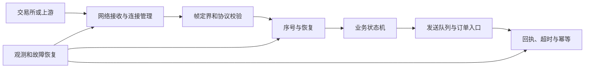
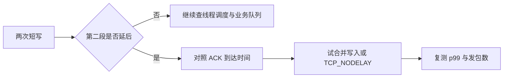
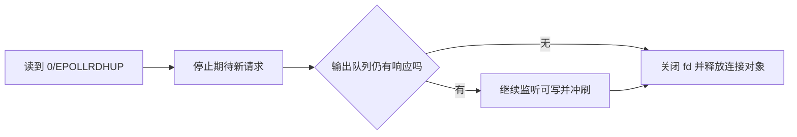
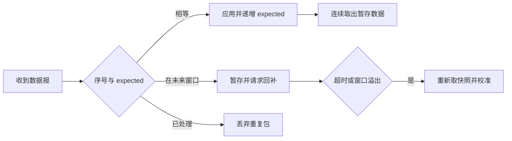
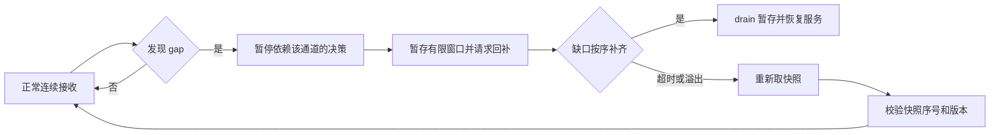
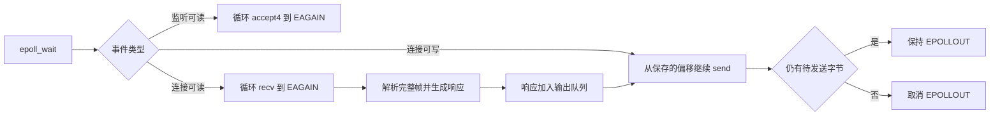
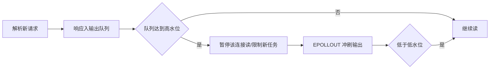
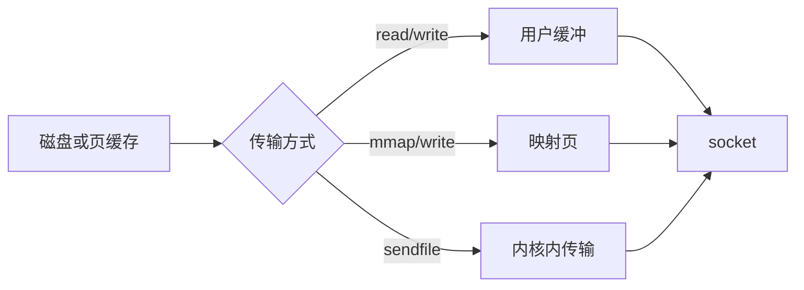

# 计算机网络：从协议到 C++ 网络服务

> 阅读顺序：先看一条请求怎样经过网卡、IP、TCP 和应用，再学习可靠性与事件循环，最后读代码与排障。示例以 Linux 和 C++17 为主；协议规范、Linux 实现、业务约定分别说明。本文保留原笔记的知识点，但旧笔记中的面试公司与固定延迟数字未独立核验，均不作为结论。

## 本文目录

- [[#从分层和数据路径理解网络|从分层和数据路径理解网络]]
- [[#TCP 连接、可靠性与延迟|TCP 连接、可靠性与延迟]]
- [[#UDP、组播与有序恢复|UDP、组播与有序恢复]]
- [[#Socket 字节流与应用协议|Socket 字节流与应用协议]]
- [[#I/O 多路复用与事件循环|I/O 多路复用与事件循环]]
- [[#数据搬运、网络性能与低延迟技术|数据搬运、网络性能与低延迟技术]]
- [[#HTTP、TLS、DNS 与故障排查|HTTP、TLS、DNS 与故障排查]]

## 面试与项目阅读路线

| 场景 | 要能讲清 | 在项目里寻找 |
|---|---|---|
| TCP 服务端 | 握手、字节流、短读写、关闭 | `accept`、连接状态、读写缓冲、超时 |
| Reactor | LT/ET、非阻塞、背压 | `epoll_ctl`、事件分发、`EPOLLOUT` |
| 行情或实时数据 | UDP 丢包、序号、快照/回放 | packet decoder、gap detector、recovery channel |
| 性能诊断 | RTT、重传、队列、用户态耗时 | `ss -ti`、抓包、指标、火焰图 |

读源码时先画出“监听器 → 连接对象 → 输入缓冲 → 协议解析 → 业务回调 → 输出缓冲 → 可写事件”的链条。每一步查三个问题：谁拥有缓冲区？遇到半包/短写怎么办？连接关闭时对象何时释放？

## 从分层和数据路径理解网络

### 一次请求究竟经过什么

应用负责定义“一个请求”及其成功条件；TCP 负责同一连接的有序字节传输；IP 负责按地址转发；链路层负责当前链路上的帧。服务端可能先在内核完成握手、排入 accept 队列，应用随后才得到连接 fd。`send` 成功表示本机内核接收了一部分字节，不代表对端应用处理成功；业务确认需要协议自己的响应。


排障要分清“连接建立慢、字节到达慢、排队等待慢、业务处理慢”。抓包能观察线上的序列号、ACK 和重传；应用时间戳能观察解析与处理；两者必须用同一时间基准或校准后才可比较。

### 地址、端口与路由的最小模型

IP 地址标识网络端点，端口标识主机上的服务入口。TCP 连接通常由源/目的 IP 和端口的四元组区分。`bind` 选本地地址与端口，`listen` 使 TCP socket 接受连接，`accept` 取出已建立连接；客户端 `connect` 可能阻塞，也可能在非阻塞模式返回 `EINPROGRESS`，随后用可写事件和 `SO_ERROR` 确认结果。`0.0.0.0` 监听所有本机 IPv4 地址，并非可供远端连接的目的地址。DNS 把名字解析为地址，ARP（IPv4 同链路）解析下一跳的链路地址；IPv6 使用邻居发现。

### 对照岗位要求建立能力地图

[IMC 的 C++ Execution 职位](https://www.imc.com/us/careers/jobs/4634204101)明确提到交易所连接、行情解析、订单入口，以及延迟、吞吐、可靠性、可维护性的取舍；[Optiver 的 C++ 职位](https://www.optiver.com/join-us/jobs/technology/new-york/software-engineer-c-plus-plus/)提到行情摄取、订单路由、执行性能和仿真。它们是公开职位描述，不代表每家公司或每个团队的统一要求。本章把这些工作拆成可检查的工程能力：



面试若问“做一个行情接收器”，要先问清**协议是 TCP 还是 UDP、序号属于连接/通道/品种哪一级、丢包如何回补、业务能否在缺口时继续、慢消费者怎么处理**。这些问题比背一个“高性能 API”更接近真实项目。

## TCP 连接、可靠性与延迟

### TCP 三次握手、四次挥手与状态机
#### 三次握手
1. 客户端 → 服务器：`SYN, seq=x`（客户端进入 SYN_SENT）
2. 服务器 → 客户端：`SYN+ACK, seq=y, ack=x+1`（服务器进入 SYN_RCVD）
3. 客户端 → 服务器：`ACK, ack=y+1`（双方 ESTABLISHED）
**为什么需要第三次确认**：双方需确认对方的初始序列号和自己发送方向的握手响应已到达；历史报文还需由序列号与状态机共同识别。把握手仅说成“证明双方收发能力”过于简化。
- 同步双方初始序列号（ISN）：TCP 的可靠性、去重、排序全依赖序列号，必须双向确认对方 ISN 已就绪；
- 确认"双方收发能力都正常"：两次握手时服务器无法确认客户端"能收"（ACK 是唯一证明）；
- 历史报文由序列号与连接状态机共同识别；第三次确认让服务端确认客户端收到了 SYN-ACK。
> 面试追问：ISN 为什么不是从 0 开始固定递增？——ISN 用"四元组 + 密钥哈希 + 时间"随机化（RFC 6528），防止攻击者预测序列号插入伪造报文（TCP 劫持/注入）。
**握手相关的队列与参数**：
- `listen(fd, backlog)` 指定待 `accept` 的已建立连接队列上限，Linux 还受 `somaxconn` 等配置影响；SYN 队列另有机制。具体溢出表现取决于内核设置，需结合 `ss -lnt` 和抓包判断。
- 队列满的后果：丢 SYN/ACK（客户端超时重传）或丢最终 ACK；`ss -lnt` 的 `Send-Q` 可以看到 accept 队列长度，服务端"连接超时但看不到日志"常先查这里；
- SYN cookies 可缓解特定 SYN 队列压力；启用条件和选项取决于内核实现。
- accept 发生在三次握手**之后**：连接先进内核的全连接队列，应用调用 accept 只是把它取出来。
#### 四次挥手与状态机

- **为什么 4 次**：TCP 全双工，FIN 只代表"我这个方向没数据要发了"（半关闭），对方的 ACK 和它自己的 FIN 是两件事，不能随便合并；
- **CLOSE_WAIT**：收到对端 FIN 后本方向尚未关闭。长期大量积压需检查应用清理与连接生命周期，不能仅凭状态断言代码错误。
- **TIME_WAIT（重要考点）**，两个存在理由：
  1. 可靠终止：最后的 ACK 丢了，对方会重传 FIN，还在 TIME_WAIT 的一方仍能重发 ACK；若直接 CLOSED 会回 RST，对端报错；
  2. 让本连接的迷途旧报文在网络中消散（旧报文寿命 < 2MSL），避免被复用的同四元组新连接误收。
- **TIME_WAIT**：持续时间由实现决定。先定位谁主动关闭、连接创建速率及端口压力，再考虑复用连接或针对性配置；不要把某个 Linux 常数当协议要求。
- **RST 的常见来源**：连不存在的端口、`SO_LINGER=0` 后 close、半开连接（对端已重启）收到数据、accept 队列溢出且 `tcp_abort_on_overflow=1`。
> 面试追问：同时关闭/同时打开？——同时关闭会出现 CLOSING 态再进 TIME_WAIT；同时打开会经历 SYN_SENT → SYN_RCVD 互换。

### TCP 可靠性：重传、拥塞控制、流量控制
#### 确认与重传
- ACK 是**累计确认**（`ack=n` 表示 n-1 及之前全部收到）+ 选择确认 SACK 补充；
- **超时重传 RTO**：由 RTT 估计、实现下限和退避策略共同决定；RFC 6298 给出规范算法，Linux 具体参数应按版本与连接状态确认，不能把 200 ms/1 s 当每次重传时刻。
- **快速重传**：重复 ACK、SACK 等反馈可触发较早重传；三个重复 ACK 是经典教材路径，现代实现还有其他丢包判定机制。
- **SACK**：接收方告知"缺了哪几段"，一次丢多个段时避免"重传一个、再丢一个"的低效循环。
#### 拥塞控制
- 发送窗口 = `min(cwnd, rwnd)`：cwnd 拥塞窗口管"网络能不能承受"，rwnd 接收窗口管"对方收不收得下"；
- 经典 Reno 四阶段：
  1. **慢启动**：窗口按 ACK 反馈较快增长；初始窗口取值由规范、配置和实现决定，不固定为 1 MSS；
  2. **拥塞避免**：每 RTT 线性 +1 MSS；
  3. **快重传 + 快恢复**：3 个重复 ACK → `ssthresh = cwnd/2`，cwnd 降回 ssthresh 附近（不回到 1）；
  4. **超时**：通常显著收缩发送窗口并退避，具体取决于拥塞控制算法与实现。
- **拥塞控制算法**：CUBIC、BBR、Reno 等各有路径探测与拥塞响应策略；某台 Linux 主机实际使用的算法应查询内核配置和连接信息。
- 与延迟的关系：带宽时延积影响在途数据量；具体系统仍需按业务可靠性、网络拓扑和运维约束选择 TCP、UDP 或其他传输，不能据行业标签推断协议。
#### 流量控制
- rwnd 由接收方动态通告；rwnd 为 0 时发送方定时发**窗口探测**（persist timer），防止窗口更新报文丢失死锁；
- 流量控制避免发送速度压垮接收方缓冲；拥塞控制避免网络路径过载。
#### MTU / MSS（顺带常考）
- **示例**：常见以太网 MTU 1500，IPv4/TCP 基本头各 20 字节时 MSS 可为 1460；隧道、IPv6、选项和实际路径 MTU 会改变数值。MSS 通过 SYN 选项通告。
- 为什么 TCP 要按 MSS 切段：避免 IP 层分片——任一分片丢失整包重传，代价高；
- 路径 MTU 发现（PMTUD）靠 DF 标志 + ICMP "fragmentation needed"，防火墙挡 ICMP 会造成"黑洞"（小包通、大包断）。

### 把 TCP 状态与应用生命周期对应起来

`FIN` 表示一个方向不再发送；收到 FIN 的进程仍可能有数据待发，因此 `CLOSE_WAIT` 本身合法。若大量连接长期停在该状态，应查应用何时调用 `close`，也要查是否有长时间清理逻辑。`TIME_WAIT` 通常在主动关闭的一侧，保留时间由实现决定；不要把“60 秒”写成协议要求，更不要靠全局调参掩盖连接频繁创建。`close` 后是否还有数据成功送达要看缓冲、错误与关闭方式；要求业务可靠完成时应有应用层确认。

拥塞窗口 `cwnd` 是发送端对路径可承受数据量的估计，接收窗口 `rwnd` 是接收端缓冲能力的通告；可发送数据还受已发送未确认字节、pacing 和实现约束。Reno 可用于解释慢启动、拥塞避免和丢包响应，却不能据此断言所有现代 Linux 连接都从 1 MSS 起步或恰在三个重复 ACK 时重传。`MSS=1460` 只是在以太网 MTU 1500、IPv4/TCP 基本头各 20 字节且无额外开销时的例子。

### Nagle 与延迟 ACK：先抓包再判断

Nagle 可能推迟新的小段，接收端也可能延迟 ACK。若应用分两次写很小的数据且必须等第二次写完才能响应，两种机制组合可能增加等待；具体时长取决于系统、连接状态和收包行为，没有通用的“40 ms 定律”。先用 `tcpdump` 或 Wireshark 比较两次写、线上数据段和 ACK 时间，再试一次合并写入、`writev` 或 `TCP_NODELAY`。`TCP_QUICKACK` 只影响接收端当前 ACK 策略，并非永久开关。`TCP_NODELAY` 可能增加小包数；应比较业务延迟分布与网络成本。



### 滑动窗口与三个常混淆的 ACK

TCP ACK 确认字节序列到达接收端 TCP 栈；SACK 提供已收到的非连续区间信息；应用响应确认业务已处理。三者解决的问题不同。发送方可在途数据受拥塞窗口、接收窗口和已发送未确认量约束。若接收进程处理慢，接收缓冲占用上升，通告窗口可能收缩；若路径拥塞，则看 RTT、重传和拥塞控制状态。


`send` 成功停在 B；TCP ACK 到 D；只有设计了业务回执才知道 F。断线重连后“旧请求是否执行”可能不确定，因此订单入口类协议需要请求 ID、重放窗口、去重和查询/对账机制。

### 连接关闭与半关闭的代码契约

服务端 `recv==0` 表示对端关闭**发送方向**，应用可以继续把已经排队的响应发完，再 `shutdown(fd, SHUT_WR)` 或关闭连接。`EPOLLRDHUP` 是 Linux 对半关闭的通知线索，不代替读到 EOF 和清理状态。`close` 是释放本地描述符；有未发完数据时怎样终止要考虑 `SO_LINGER`、错误和协议回执。



## UDP、组播与有序恢复

### TCP vs UDP 对照表
| 维度 | TCP | UDP |
|---|---|---|
| 连接 | 面向连接（握手/挥手/状态机） | 无连接 |
| 可靠性 | 确认+重传+去重+排序 | 尽力而为，可能丢/乱/重 |
| 报文边界 | 无（字节流，会粘包/拆包） | 有（数据报，一次收一个） |
| 流量/拥塞控制 | 有（rwnd/cwnd） | 无（可自建，如 QUIC） |
| 头开销 | 20B 起（含选项更大） | 8B |
| 广播/组播 | 不支持 | 支持（行情组播依赖它） |
| 典型场景 | HTTP/gRPC/远程登录/文件传输 | DNS、QUIC(HTTP/3)、游戏、行情组播、遥测 |
- **选型**：依据有序性、可靠性、单播/组播、延迟、拥塞控制和应用恢复协议选择；UDP 本身并不保证低延迟。
- 注意：UDP "保留边界"不等于"一定完整"——超出 MTU 会被 IP 分片，任一分片丢失整包即丢；接收缓冲区小于数据报会截断丢弃；
- 现代趋势：QUIC 把可靠、有序、拥塞控制、加密全部在 UDP 之上重造，避免 TCP 的队头阻塞与内核升级缓慢问题。

### UDP 行情：丢包检测与确定性回放
**背景**：一些行情源使用 UDP 组播做一对多分发；具体序号、快照与恢复通道必须以所接入的协议规范为准。
**核心机制**：
1. **单调递增 sequence ID**（每包携带）：本地维护 `expected_seq`；
   - `seq == expected`：正常应用，`expected++`；
   - `seq > expected`：出现 gap（丢包或乱序）→ 进入恢复/暂存流程；
   - `seq < expected`：重复或滞后的旧包，直接丢弃（注意处理回绕，用无符号差法比较）。
2. **缺口恢复（recovery）**：请求重传通道（交易所提供的有序回补服务/备份 TCP 流），或直接取新快照（snapshot）；
3. **乱序 Replay Buffer**：把 gap 之后先到的乱序包按 seq 暂存（环形缓冲/哈希索引），等缺口补齐后**按序 drain**，一次性顺序应用到订单簿；
4. **快照 + 增量模式**：先取 snapshot 对齐到某个 seq，再顺序应用增量消息，天然支持中途接入。
**为什么必须按序 drain（确定性）**：
- 订单簿是状态机：同一快照及消息序列按协议顺序应用才能维持一致状态；缺口未恢复时应暂停依赖该状态的决策。
- 复盘/回放要求 1:1 复现；测试与生产走同一条消息应用路径；
- 多品种并行处理仍须遵循行情源定义的序号域和跨品种依赖，不能一概假设只要各品种内部有序即可。
> 面试追问：为什么不干脆用 TCP？——行情是多播一对多（TCP 做不到组播），且 TCP 的拥塞控制/重传行为不可控，延迟方差大；行情协议宁可用 UDP + 显式 seq + 回补，把恢复逻辑掌握在自己手里。

### 序号、缺口与快照如何组成恢复协议

UDP 保留数据报边界，但数据报可能丢失、乱序、重复；接收缓冲太小还可能截断。用 `recvmsg` 检查 `MSG_TRUNC`，协议需校验长度和版本。组播的复制与网卡/交换机/操作系统配置有关，`SO_REUSEPORT` 只是同地址端口多个 socket 的绑定与分流机制，不能用来保证每个消费者都得到同一份组播包。

`expected` 必须从协议握手、快照标记或首包规则初始化。序号回绕比较仅在“任意两次比较的距离小于序号空间一半”时成立；若长期停机或超出窗口，应重新取快照。gap 发生后先暂存后续消息并请求恢复；缓冲容量、超时和快照重置都须有上限。

```cpp
#include <cstdint>
// 32 位序号的局部比较；仅在最大距离小于 2^31 时使用。
bool after32(std::uint32_t a, std::uint32_t b) {
    return a != b && std::uint32_t(a - b) < 0x80000000u;
}
```



这里的“确定性”成立前提是编码、消息排序、快照边界及应用逻辑一致；跨源或跨品种是否有全局顺序由协议定义，不能自行假设。

### 有界恢复状态机

实际接收器不能无限缓存“未来序号”。维护 `expected`、有限容量 `pending`、恢复请求的 in-flight 标志以及 deadline。gap 期间收到未来包可暂存；达到上限、超时或回补服务拒绝时清空不可靠状态并重新取快照。快照的序号与增量序号必须在同一协议版本/序号域对齐。



```cpp
// 伪代码只展示状态转移；解码和序号回绕须按行情协议实现。
void on_packet(Packet p) {
    if (p.seq == expected) {
        apply(p); ++expected;
        while (auto next = pending.take(expected)) { apply(*next); ++expected; }
    } else if (after32(p.seq, expected) && pending.within_window(p.seq)) {
        pending.insert_if_absent(p);
        request_missing_once(expected, p.seq); // 请求可重试且要去重
    } else if (after32(p.seq, expected)) {
        switch_to_snapshot_recovery(); // 缓冲窗口容纳不了这个缺口
    } // 旧包/重复包忽略，但统计计数器
}
```

这里故意把 `Packet`、`pending` 和 `apply` 留为协议接口，而没有伪装成可直接编译的通用代码。应为**序号相等、乱序、重复、回绕、超时、快照切换**分别准备回放用例。

## Socket 字节流与应用协议

### Socket 编程：send/recv 语义与同步/异步辨析
#### "send/recv 能保证收全信息吗？"（练习）
**结论**：一次 `send`/`recv` 不对应一条消息。TCP 在连接正常且数据被确认的条件下提供有序字节流；应用仍须处理短读写、断线与业务确认。
- **send 的语义**：返回"成功拷入**本机内核发送缓冲**的字节数"，不代表对端收到了任何东西；
  - 值可能小于请求长度（短写）：发送缓冲快满时部分接受；
  - 阻塞 socket 缓冲满时会阻塞；非阻塞返回 `EAGAIN/EWOULDBLOCK` 需重试；
  - 被信号打断可能返回 `EINTR`。→ 阻塞 fd 可循环直到全部发出；非阻塞 fd 必须保留已发偏移并等待可写事件。
- **recv 的语义**：返回"从内核接收缓冲取走的字节数"，**TCP 是字节流，没有消息边界**：
  - 一个 send 的数据可能被切给多次 recv（拆包）；多个 send 的数据可能被一次 recv 全读到（粘包）；
  - 返回 0 = 对端有序关闭（EOF）；返回 -1 且 `EAGAIN` = 暂无数据（非阻塞）。
- **正确姿势**：
  - 协议定界：长度前缀（最常见）、分隔符、定长；
  - `recv_n`：循环读直到读满 n 字节或出错/EOF；`send_n` 同理；
  - `MSG_WAITALL` 能让阻塞 recv "尽量等满"，但遇信号/对端关闭/错误仍会提前返回，不能只靠它；
  - 应用层确认：TCP 只保证"已确认数据会被内核交付到接收方缓冲"，对端**进程可能根本不读**——业务层要有自己的 ACK/序号（FIX 等协议如此）。
- **UDP 的语义**：数据报——`sendto` 要么整包发（或报错），`recvfrom` 要么拿到整包（缓冲不够会截断丢弃剩余）；但网络丢包它无能为力，仍要应用层 seq/重传。
> 面试追问：怎么判断对端已经"收到并处理"？——从 TCP 层做不到，只能靠应用层回执（请求-响应超时重试 + 幂等设计）。
#### 阻塞 / 非阻塞 vs 同步 / 异步（经典辨析）
- **阻塞/非阻塞**：描述"调用是否立刻返回"——阻塞 recv 无数据就睡；非阻塞返回 EAGAIN。
- **同步/异步（POSIX 语义）**：描述"谁是数据搬运的完成者、发起者要不要等"：
  - **同步 I/O**：真正的数据拷贝要么由用户线程亲自触发并等待（阻塞 I/O、非阻塞轮询、I/O 多路复用），要么在"事件通知后自己调用 read 完成拷贝"（信号驱动 I/O 也属于**同步**）；
  - **异步 I/O**：发起后立即返回，**内核把数据拷进用户缓冲后**再通知（Windows IOCP、POSIX aio、Linux io_uring）。完成通知与用户发起调用分离，具体 API 仍可能有等待点。
- 常见错误说法："非阻塞 = 异步"、"epoll 是异步 I/O"——都错。epoll 是同步 I/O 中的多路复用机制，最后仍要自己 read；"Reactor（同步）vs Proactor（异步）"就在这个定义上区分。
#### socket 生命周期与实战细节
- `socket → bind → listen(backlog) → accept`；客户端 `connect` 触发三次握手；
- 常用选项：
  - `SO_REUSEADDR`/`SO_REUSEPORT`：前者与地址复用有关；后者允许满足条件的多个 socket 绑定同一地址端口并对某些流量分流。组播复制须按组播成员关系和内核行为验证，不能靠它保证每个接收者得到同一包；
  - `TCP_NODELAY`：见 相关章节；`SO_SNDBUF/SO_RCVBUF`：显式设置需谨慎（关闭内核自动调优 `tcp_moderate_rcvbuf` 的影响）；
  - `SO_LINGER`：控制 close 行为（linger=0 + close → 直接 RST，会丢数据，仅特定场景用）；
  - `SO_KEEPALIVE`：TCP 保活探测（间隔以小时计，业务心跳通常自己做）。
- accept 返回的新 fd：**不继承 O_NONBLOCK 等文件状态标志**，但继承大部分 socket 选项；关闭新 fd 不影响监听 fd；
- accept 队列积压可能让连接阶段或首包响应异常；具体现象取决于系统配置和超时。用 `ss -lnt` 的队列值及抓包核实。

### 阻塞连接：收满、发满与长度校验

下面两个 helper 只用于**阻塞 socket**。非阻塞 socket 遇 `EAGAIN` 时必须把已经处理的偏移保存在连接对象里，等下次 `EPOLLIN/EPOLLOUT` 继续；不能简单返回 `-1` 后从头重发。`recv` 返回 0 代表 TCP 对端有序关闭发送方向，如果帧只收了一半就是协议截断。

```cpp
#include <cerrno>
#include <cstddef>
#include <cstdint>
#include <sys/socket.h>

bool send_exact_blocking(int fd, const void* data, std::size_t size) {
    auto* p = static_cast<const char*>(data);
    while (size != 0) {
        const ssize_t n = ::send(fd, p, size, MSG_NOSIGNAL); // Linux 特有标志
        if (n > 0) { p += n; size -= static_cast<std::size_t>(n); continue; }
        if (n < 0 && errno == EINTR) continue;
        return false; // 错误或意外的零进展，连接状态由调用者处理
    }
    return true;
}

bool recv_exact_blocking(int fd, void* data, std::size_t size) {
    auto* p = static_cast<char*>(data);
    while (size != 0) {
        const ssize_t n = ::recv(fd, p, size, 0);
        if (n > 0) { p += n; size -= static_cast<std::size_t>(n); continue; }
        if (n < 0 && errno == EINTR) continue;
        return false; // EOF/错误；部分帧不能交给业务
    }
    return true;
}
```

长度前缀协议先收固定 4 字节，以 `ntohl` 得到体长；读体之前检查最大允许长度、版本及剩余缓冲额度。空体应允许长度为 0。连接断开后重试一个已发送但未确认的业务请求时，要用请求 ID 和幂等规则避免重复执行。`writev` 可以减少系统调用次数，但它仍可能短写，必须按 iovec 偏移继续。项目中优先读成熟框架的缓冲和状态机；Boost.Asio 的 `read/async_read` 是专门为组合多次短读提供的接口。

### 增量解析器比 `recv_n` 更接近事件循环

阻塞 helper 便于理解，但生产事件循环通常每次把读到的字节追加进输入缓冲，解析出零条或多条完整帧，残留半帧保留到下一次 `EPOLLIN`。解析器不应该持有指向可扩容缓冲内部的长期指针；否则 `vector` 扩容后会悬空。

```cpp
#include <arpa/inet.h>
#include <cstdint>
#include <cstring>
#include <stdexcept>
#include <string>
#include <vector>

// true 表示取出一条完整帧；false 表示还需更多字节；非法长度抛出异常。
bool take_frame(std::vector<char>& in, std::string& body) {
    if (in.size() < 4) return false;
    std::uint32_t wire = 0;
    std::memcpy(&wire, in.data(), sizeof wire); // 避免未对齐强转
    const auto len = ntohl(wire);
    constexpr std::size_t MAX = 1u << 20;      // 仅示例上限，按协议配置
    if (len > MAX) throw std::runtime_error("frame too large");
    if (in.size() < 4 + std::size_t(len)) return false;
    body.assign(in.data() + 4, len);
    in.erase(in.begin(), in.begin() + 4 + len); // 简明示例；高吞吐实现改读偏移/环缓冲
    return true;
}
```

读取时循环 `while (take_frame(input, frame)) process(frame)`；遇长度超限关闭连接并记录可追踪的错误。`std::vector::erase` 搬移剩余字节，适合教学，不适合巨大吞吐的热路径。编码层还要处理版本、校验、字节序、未知字段和兼容策略。

## I/O 多路复用与事件循环

### I/O 多路复用（重要）
#### select：三宗罪 + 上限
- 接口：`FD_ZERO/FD_SET/FD_ISSET` 操作 read/write/except 三个 `fd_set`，传超时，返回就绪个数；
- 实现：`fd_set` 是**位图**（bitmask）。每次调用都发生：
  1. **全量拷贝**：整个集合从用户态拷进内核态；
  2. **内核 O(N) 轮询**：线性遍历所有监控 fd 逐个检查；
  3. **用户态 O(N) 再遍历**：返回后自己遍历哪个 fd 就绪；
- 附带坑：返回时内核会**修改**集合（只保留就绪位），每轮必须重建；常见 glibc `fd_set` 的 `FD_SETSIZE` 为 1024，具体接口与平台限制要查本机头文件。
#### poll：换数组，换汤不换药
- 接口：`poll(struct pollfd *fds, nfds, timeout)`，`pollfd = {fd, events, revents}`；
- `events` 是"我关心什么"（入参，如 `POLLIN|POLLOUT`），`revents` 是"实际发生了什么"（出参）；判断就绪用位与：`if (pfd.revents & POLLIN)`；
- `POLLERR/POLLHUP/POLLNVAL` **无需请求也总是上报**，必须处理；TCP 对端半关闭想提前感知要显式监听 `POLLRDHUP`（否则通常表现为 POLLIN + read 返回 0）；
- 改进：无 1024 上限（数组长度自定）。**未解决**：仍是全量拷贝 + 内核 O(N) 轮询 + 用户态遍历。
#### epoll：三步接口 + 内核机制（可追问到源码级）
- 接口三步：`epoll_create1(0)` → `epoll_ctl(ADD/MOD/DEL)` → `epoll_wait(events[], maxevents, timeout)` 返回事件数组；
- 内核结构（`fs/eventpoll.c`）：
  - `eventpoll` 里有一棵**红黑树**（管理所有注册的 fd 对应的 `epitem`）和一条**就绪链表**（`rdllist`）；
  - `epoll_ctl ADD`：创建 epitem 挂进红黑树，并把一个**回调**（`ep_poll_callback`）注册到该 fd 的等待队列上；
  - 事件到来：内核在该 fd 上触发回调 → epitem 被链入就绪链表；
  - `epoll_wait`：直接摘就绪链表里的 epitem，**只把就绪的事件拷给用户**（O(就绪数)），无就绪则睡到超时/被唤醒。
- 复杂度视角：`epoll` 避免每次完整扫描用户提供的 fd 集合；注册、回调、就绪队列处理和返回事件仍有成本，不能无条件概括为 O(1)。
- **"epoll 用 mmap 零拷贝"是误区**：Linux 正式版 epoll 实现里**没有 mmap**，就绪事件仍通过 `epoll_wait` 拷贝到用户空间，赢在"只拷就绪的"而不是"全拷"。这个说法的来源是更早的 `/dev/epoll` 设备方案（那时确实用 mmap 共享事件队列），被张冠李戴流传至今。面试写这个会加分。
- 补充：LT 模式靠 `epoll_wait` 内部对就绪 epitem 重新检查（还在就绪就**放回链表**）来实现"持续通知"。
#### LT vs ET
| | 水平触发 LT（默认） | 边缘触发 ET |
|---|---|---|
| 通知时机 | 条件仍成立就每次通知 | 只在状态变化边沿通知一次 |
| 编程要求 | 可以直接 read 一次就走 | 必须非阻塞 + `while read` 到 EAGAIN |
| 漏读后果 | 下轮 epoll_wait 还会报 | 数据滞留内核，可能永远不报 |
| 适用 | 简单稳健、一般场景 | 极致榨取 syscall 次数 |
- ET 必配非阻塞 fd：否则循环读到"没数据"那次会**阻塞整个线程**（经典事故）；
- 其他 flag：`EPOLLONESHOT`（一次后需重新 arm，多线程各领一个 fd）、`EPOLLEXCLUSIVE`（多进程共享 listen fd 时减少惊群）、`EPOLLRDHUP`；
- 实测提醒：LT 也可以很高效；ET 的收益主要是减少 epoll_wait 返回次数与重复事件处理。
#### select / poll / epoll 对比与选型
| | select | poll | epoll |
|---|---|---|---|
| 数据结构 | 位图 | 数组 | 红黑树 + 就绪链表 |
| 拷贝 | 每次全量 | 每次全量 | 注册一次，就绪才拷 |
| 内核检查 | O(N) 轮询 | O(N) 轮询 | 回调驱动，O(就绪) |
| fd 上限 | 1024 | 无硬限制 | 无硬限制 |
| 触发模式 | LT | LT | LT/ET |
- **反直觉考点**：连接数少且几乎全活跃时，`select/poll` 反而可能比 epoll 更快——epoll 每个事件要过回调、红黑树、事件结构，路径更长；epoll 的优势区间是"**大量连接、少量活跃**"（C10K/C100K）。
#### Reactor 模式
- 定义：**事件循环 + 回调**。`epoll_wait` 拿到就绪事件 → 按 (fd → handler) 分发 → 回调里做 read/业务/write。Reactor 对应"同步 I/O"（回调里自己读写）；
- 常见三种形态（Netty/muduo 面试必考）：
  1. 单 Reactor 单线程：一个线程收事件+处理（Redis 老版本、简单服务）；实现简单，无法利用多核；
  2. 单 Reactor 多线程：IO 仍单线程，业务塞线程池；回调里要小心共享状态与回写线程安全；
  3. 主从 Reactor：主 Reactor 只管 accept，把连接分给从 Reactor 组（各自 epoll），IO/业务在从 Reactor 线程；具体线程模型以项目版本与配置为准；
- Proactor：真正的异步 I/O（内核把数据拷好后通知；io_uring/IOCP），回调里直接处理已就绪数据，"先收后处理"与 Reactor 的"先通知后自己收"是本质区别；
- HFT 视角：极致方案常**不做池化**——一个核一个线程自旋收包（run-to-completion），跨核用无锁队列/共享内存传递，避免任何锁与唤醒。

### 从 `epoll` 事件到正确的读写状态机

`epoll` 只通知“现在可能可以读/写”，不替应用保存帧状态。监听 fd 自己要设 `O_NONBLOCK`；`accept4(..., SOCK_NONBLOCK)` 只让**新连接**非阻塞。读写都要保留连接级缓冲与偏移，`EINTR` 重试，`EAGAIN` 暂停，错误/EOF 释放连接。默认 LT 容易实现；ET 下应持续取到 `EAGAIN`，且所有相关 fd 非阻塞。`EPOLLOUT` 仅在输出缓冲非空时注册，否则空转。关闭 fd 还应考虑事件数组里已有旧事件和 fd 数值复用，可用连接对象、generation 或延迟销毁管理生命周期。



```cpp
#include <cerrno>
#include <cstddef>
#include <deque>
#include <string>
#include <sys/socket.h>

struct Output { std::string bytes; std::size_t sent = 0; };
// fd 已是非阻塞；调用方在错误时关闭连接，在队列非空时监听 EPOLLOUT。
bool flush(int fd, std::deque<Output>& pending) {
    while (!pending.empty()) {
        auto& item = pending.front();
        const auto left = item.bytes.size() - item.sent;
        if (left == 0) { pending.pop_front(); continue; }
        const ssize_t n = ::send(fd, item.bytes.data() + item.sent, left, MSG_NOSIGNAL);
        if (n > 0) { item.sent += std::size_t(n); if (item.sent == item.bytes.size()) pending.pop_front(); continue; }
        if (n < 0 && errno == EINTR) continue;
        if (n < 0 && (errno == EAGAIN || errno == EWOULDBLOCK)) return true;
        return false;
    }
    return true;
}
```

代码只展示输出侧核心不变量：**短写后偏移不归零**。实际服务还要设置最大输出队列、读暂停/背压、超时、半关闭、连接清理和系统调用返回值检查。`epoll` 的性能不是无条件 O(1)：注册、等待、唤醒、回调以及活跃 fd 数量都会影响成本；按场景测量。

### 监听 fd 和慢客户端的两个边界

`accept4` 为**返回的新 fd**设置 `SOCK_NONBLOCK`，监听 fd 仍要自己 `fcntl` 或创建时指定非阻塞。若输出积压超过高水位，停止从该连接继续读或拒绝后续请求；降到低水位再恢复。否则一个慢客户端能使服务的内存不断上涨。

```cpp
#include <cerrno>
#include <fcntl.h>
#include <sys/socket.h>

bool set_nonblocking(int fd) {
    int flags = ::fcntl(fd, F_GETFL, 0);
    return flags >= 0 && ::fcntl(fd, F_SETFL, flags | O_NONBLOCK) == 0;
}

// lfd 在加入 epoll 前先 set_nonblocking(lfd)。
void drain_accept(int lfd) {
    for (;;) {
        int cfd = ::accept4(lfd, nullptr, nullptr, SOCK_NONBLOCK | SOCK_CLOEXEC);
        if (cfd >= 0) { register_connection(cfd); continue; } // 项目提供的注册函数
        if (errno == EINTR) continue;
        if (errno == EAGAIN || errno == EWOULDBLOCK) break;
        report_accept_error(errno); // 记录并按错误类型决定退避/告警
        break;
    }
}
```



高/低水位不是固定字节数，应按内存预算、连接上限、请求大小和业务服务时间确定。`epoll_ctl` 与连接对象释放要处在同一个生命周期协议下。

## 数据搬运、网络性能与低延迟技术

### `read`/`write`、`mmap`、`sendfile` 分别改变什么

普通文件到 socket 的应用路径会经过用户缓冲；`mmap` 把文件页映射进地址空间；Linux `sendfile` 允许在内核中从文件 fd 向 socket fd 传输，减少用户态搬运。所谓“零拷贝”常指免去某类 CPU 内存复制，仍可能有 DMA、设备传输和实现相关的数据处理；不要背固定“几次拷贝、几次切换”。TLS 加密、文件系统、网卡能力和内核版本都可能改变路径。



`sendfile` 返回可能小于请求的字节数；偏移与剩余长度仍需跟踪。`epoll` 解决“何时有事件”，`sendfile` 解决“数据怎样搬运”，二者互补。小消息低延迟通常先看批量编码、队列与唤醒；大文件吞吐才更可能从 `sendfile` 获益。

### DPDK、忙轮询、RDMA 的选择边界

`SO_BUSY_POLL` 允许套接字相关操作短时间忙轮询，可能降低唤醒等待，但增加 CPU 消耗且依赖驱动/配置。DPDK 以用户态轮询与网卡队列管理替代常规 socket 收发路径，需处理绑核、hugepage、网卡独占/隔离和自有协议栈逻辑。RDMA 是远端内存访问语义与网络硬件/协议组合，有注册内存、队列对和完成事件等约束；远端内存既非本地内存，也不能用一条“更快”概括。先明确负载、吞吐/尾延迟目标、故障恢复和运维成本，再选技术。

### 用户态、内核态与排队位置

“零拷贝”优化前先用火焰图和计数器确认 CPU 真花在复制上。若 p99 主要是排队、重传或等待 ACK，减少一次 `memcpy` 可能几乎不改变尾延迟。多队列 NIC、RSS、RPS、网卡中断亲和与应用线程绑核可以影响包从硬件队列到应用线程的路径，但不同设置会互相作用，必须在目标机器和负载下测。


## HTTP、TLS、DNS 与故障排查

### 补充常考：HTTP / TLS / DNS / 排查场景
#### HTTP 演进
- **HTTP/1.1**：默认长连接（keep-alive）；管道化基本没人用；同一连接上串行处理请求 → 应用层队头阻塞；
- **HTTP/2**：二进制分帧、单连接多 stream 多路复用、HPACK 头压缩、服务器推送（实际已边缘化）；**TCP 层队头阻塞仍在**（丢包会卡住所有 stream）；
- **HTTP/3**：基于 QUIC（UDP）：1-RTT 握手（集成了 TLS 1.3）、0-RTT 恢复（有重放风险）、独立流减轻传输层跨流队头阻塞、连接迁移（用 Connection ID 而非四元组）；
- 顺带：HTTP 本身无状态（靠 Cookie/Session 维持状态）；GET/POST 的差异主要在语义；GET 定义为安全且幂等，POST 一般不保证幂等，实现上都可以带 body。
#### HTTPS / TLS
- TLS 1.3 握手一行版：ClientHello(+key_share) → ServerHello(+key_share)+证书+Finished，此后全加密，**1-RTT**；
- 密钥体系：ECDHE 交换会话密钥（前向保密）+ 证书签名验证身份 + 对称加密（AES-GCM/ChaCha20）传数据——非对称慢，只用于握手；
- 常见追问：为什么抓包看不到内容（全加密）；证书链怎么验证（根 CA → 中间 CA → 站点证书）。
#### DNS / ARP 速答
- DNS 可使用 UDP 或 TCP；EDNS 允许协商更大的 UDP 载荷，响应被截断时客户端可改用 TCP。记录类型、缓存 TTL 与解析链以具体解析器为准。
- ARP：同网段广播 "who-has IP" → 目标单播回 MAC；有缓存（`ip neigh`/`arp -a`）；跨网段目标 MAC 是网关；存在 ARP 欺骗风险。
#### 排查类场景速查
- **大量 TIME_WAIT/CLOSE_WAIT**：见 相关章节（改写主动关闭模型 / 查找不 close 的代码）；
- **延迟尖刺**：先按应用阶段计时，再用抓包确认 TCP 行为；时间数值本身不足以定位 Nagle、ACK、重传或调度问题。
- **丢包排查**：`ss -ti` 看重传计数、`netstat -s` 看全局重传/丢包、tcpdump 抓证据；
- **握手失败排查**：`ss -lnt` 看队列（Send-Q/Recv-Q）、backlog/somaxconn、SYN 半连接、syncookie。

### 从应用协议排查网络问题

HTTP/1.1 可复用 TCP 连接；HTTP/2 在同一连接上复用流，但底层 TCP 丢包仍可影响其他流；HTTP/3 基于 QUIC，独立流减少传输层的跨流队头阻塞，应用依赖和共享拥塞控制仍可能造成等待。TLS 提供身份认证与加密；定位延迟时区分 DNS、TCP/QUIC 建连、TLS 握手、服务端处理和响应传输。DNS 常用 UDP，也可用 TCP；EDNS 改变传统 UDP 载荷限制，不能说“大于 512 字节一定转 TCP”。

| 现象 | 先收集的证据 | 可能方向 |
|---|---|---|
| `connect` 超时 | 路由、SYN/SYN-ACK 抓包、监听队列 | 网络丢包、ACL、队列饱和 |
| 建连后无响应 | 应用读写日志、`ss` 队列、线程栈 | 未 accept、背压、协议半包 |
| 吞吐低 | RTT、重传、窗口、CPU 与 NIC 指标 | 路径瓶颈、接收慢、拥塞 |
| 尾延迟高 | 分段时间戳、重传、off-CPU | 锁/调度/缺页/网络共同作用 |

### 来源与进一步阅读

- [RFC 9293：TCP 核心规范](https://www.rfc-editor.org/rfc/rfc9293.html)
- [RFC 9114：HTTP/3](https://www.rfc-editor.org/rfc/rfc9114.html)、[RFC 8446：TLS 1.3](https://www.rfc-editor.org/rfc/rfc8446.html)、[RFC 6891：EDNS](https://www.rfc-editor.org/rfc/rfc6891.html)
- [Linux tcp(7)](https://man7.org/linux/man-pages/man7/tcp.7.html)、[send(2)](https://man7.org/linux/man-pages/man2/send.2.html)、[recv(2)](https://man7.org/linux/man-pages/man2/recv.2.html)
- [accept(2)](https://man7.org/linux/man-pages/man2/accept.2.html)、[epoll(7)](https://man7.org/linux/man-pages/man7/epoll.7.html)、[sendfile(2)](https://man7.org/linux/man-pages/man2/sendfile.2.html)
- [Boost.Asio 字节流与组合读写](https://www.boost.org/latest/doc/html/boost_asio/overview/core/streams.html)

## 项目阅读与练习

1. 读 [muduo 的 TcpServer](https://github.com/chenshuo/muduo/blob/master/muduo/net/TcpServer.cc) 和相邻的 `TcpConnection`、`Buffer`：画出 `accept`、连接回调、输入解析、待发送数据与 `EPOLLOUT` 的所有权关系。muduo 是 Linux C++ Reactor 的具体实现，不代表所有框架都完全相同。
2. 写一个长度前缀 echo client/server：分别测试 1 字节分批发送、一次发送多帧、对端发半帧后关闭、接收方停读造成短写，并记录状态机。
3. 对照 [Envoy listener 架构](https://www.envoyproxy.io/docs/envoy/latest/intro/arch_overview/listeners/listeners.html) 找监听器、连接、过滤器、超时的分工。读大型项目时先认清模块边界，再下钻源码。

### 三个开源项目提供的不同答案

| 项目与入口 | 重点读什么 | 值得追问 |
|---|---|---|
| [muduo TcpServer](https://github.com/chenshuo/muduo/blob/master/muduo/net/TcpServer.cc) | accept 后连接如何交给事件循环 | 连接对象何时销毁？输出缓冲谁负责？ |
| [bRPC I/O 设计](https://github.com/apache/brpc/blob/master/docs/en/io.md) | 事件分发、协议切分、并发写同一 fd | 为什么把读写与事件等待分开？怎样处理短写？ |
| [Redis 事件循环 ae.c](https://github.com/redis/redis/blob/unstable/src/ae.c) | 文件事件、时间事件、不同平台多路复用后端 | 一轮循环里读写回调的顺序会影响什么？ |

这三份源码的线程模型不同。阅读时不要先套“Reactor 一定是某种线程池”模板，而要沿着**fd → 事件 → 缓冲 → 解析 → 回调 → 发送/关闭**追踪所有权。

```bash
# 测试环境排查同一连接，先只读观察；抓包文件需按数据管理要求保存。
ss -lntp                         # 监听端口与队列
ss -tin dst <peer-ip>             # 连接 RTT、窗口、重传等线索
ip -s link show dev <iface>       # 网卡层错误/丢包
tcpdump -i <iface> -nn -tt 'host <peer-ip> and port <port>' -w capture.pcap
```
