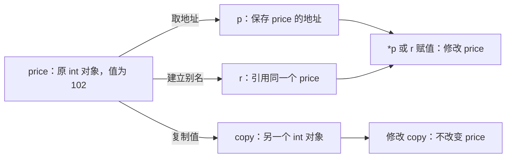

# 00 · 先读懂 C++ 代码与对象

← [[学习/学习导航/2026-10-20-学习导航|当天学习入口]] · 下一篇：[[学习/2026-10-20/01-存储期与生命周期|存储期与生命周期]]

> [!abstract] 这一篇先解决什么
> 能读懂 `int* p = &price;`、`const Quote& q`、`p->price`、`~Quote()`，并能说明“是在复制数据，还是换个入口访问同一个对象”。
> 暂时不要求背智能指针和内存模型。先把下面这几种普通语法读顺，后面讨论“谁负责销毁”才有落点。

## 1 从一个变量开始：类型、对象、值、名字

```cpp
int price = 100;
```

把它拆开读：

| 代码 | 这里的含义 |
| --- | --- |
| `int` | 类型，表示按整数规则存储和操作这个数据 |
| `price` | 变量的名字，后面可以用它访问这个整数对象 |
| `100` | 初始化时放进去的值 |
| `=` | 在这条声明中表示用右边的值初始化，不是已经存在对象的赋值 |
| `;` | 这条语句结束 |

**对象**是程序里具有类型、存储和生命周期的实体。这里有一个 `int` 对象，其值是 `100`，我们用名字 `price` 访问它。

别把“对象”只理解成 `class` / `struct` 创建的东西。普通整数、一个指针变量、一段 `std::string`、一个 `std::vector` 管理对象，也都是对象。函数与引用本身不按这套意义算对象。

**值可以改变，对象不一定变成另一个对象：**

```cpp
int price = 100; // 创建并初始化
price = 101;     // 给已有对象赋新值
```

**创建另一个变量则可能得到另一份对象：**

```cpp
int price = 100;
int copied = price;
copied = 200;
// price 仍是 100；copied 是另一份整数。
```

这是后面“复制”的最小原型。复杂类型复制时做什么，由类型定义的复制操作决定，不能永远想成逐字节照搬。

## 2 地址与指针：先记位置，再找到对象

### 2.1 一个指针变量和它指向的对象，是两回事

```cpp
int price = 100;
int* p = &price;
```

- `&price`：取得 `price` 的地址。
- `int*`：`p` 的类型是“指向 int 的指针”。
- `p`：指针变量本身，保存一个用于定位对象的指针值。
- `*p`：通过指针访问它指向的那个整数对象，称为**解引用**。

可以把地址暂时理解为门牌号：拿到门牌号，不代表复制了屋里的东西，也不代表取得房屋所有权。

```cpp
*p = 101;
// 修改的是 price，因为 p 指向 price。
```

常见机器上指针表现为内存地址，但 C++ 的指针还有类型与有效性规则。不要把任意整数当地址去访问。

**可编辑关系图（Mermaid）**



图里的地址只画关系，不代表实际内存位置；箭头表示指向，不表示谁负责删除。

### 2.2 指针可以重新指向，也可以为空

```cpp
int first = 100;
int second = 200;
int* p = &first;
p = &second;       // 改的是 p 保存的指针值
*p = 201;          // 改的是 second
p = nullptr;      // 明确表示当前不指向对象
```

`nullptr` 是空指针值。它可以用于表达“没有找到”“这个参数可省略”。**空指针不能解引用。**

还要区分“非空”和“有效”：指向已销毁对象的指针可能并不等于 `nullptr`，仍不能用它读写对象。

规则依据：[C++17 N4659 · 指针的类型与取值](https://timsong-cpp.github.io/cppwp/n4659/basic.compound)、[取地址与解引用](https://timsong-cpp.github.io/cppwp/n4659/expr.unary.op)。

## 3 引用：给同一个对象起一个访问用的别名

```cpp
int price = 100;
int& alias = price;
alias = 102;
// price 现在也为 102。
```

`int&` 表示“int 的左值引用”。在这里，先把**左值引用**理解为可以绑定到这个已有整数的引用；值类别在第 05 篇详细讲。

它不是复制出第二份整数。`alias` 是访问 `price` 的另一个名字。

### 3.1 引用不会在赋值时改绑

```cpp
int first = 100;
int second = 200;
int& r = first;
r = second;
// first 变成 200，r 仍然引用 first。
```

这和 `p = &second` 不同。前者给原对象赋值，后者让指针改为指向另一个对象。

### 3.2 指针与引用怎样选

| 需要表达的意思 | 普通写法 | 需要承担的约定 |
| --- | --- | --- |
| 必须有一个对象，调用期间只读 | `const T&` | 对象在使用期间存活 |
| 必须有一个对象，调用可能修改 | `T&` | 对象在使用期间存活，调用者接受修改 |
| 对象可以不存在 | `T*` / `const T*` | 检查空值，并保证非空时仍有效 |
| 函数负责接过对象、以后销毁 | 先别用这张表判断 | 到第 03 篇学习所有权与智能指针 |

普通引用没有“合法地绑定到空对象”这种状态，但也可能因为原对象结束生命周期而悬垂。**引用也不能自动保证对象一直活着。**

引用是否需要额外存储由实现决定，不要背成“引用肯定不占内存”。规则见 [N4659 · dcl.ref](https://timsong-cpp.github.io/cppwp/n4659/dcl.ref)。

## 4 相同符号，在不同位置有不同含义

### 4.1 `*` 与 `&` 不要只背一个解释

| 代码 | 在这里怎么读 |
| --- | --- |
| `int* p` | 声明一个指向 int 的指针 |
| `*p = 3` | 解引用 p，给它指向的对象赋值 |
| `3 * 4` | 乘法 |
| `int& r = price` | 声明引用，绑定到 price |
| `&price` | 取得 price 的地址 |
| `T&& r` | 另一种引用声明；第 05 篇解释 |
| `ready && valid` | 两个条件的逻辑“且”，与上行含义不同 |

看不懂一句代码时，先找“这是声明，还是表达式里的操作”，再判断符号。

### 4.2 `const` 限制哪条访问路径

```cpp
int price = 100;
const int& view = price;
// view = 200; // 编译错误：不能通过这个 const 引用赋值。
price = 101;   // 可以：原对象本身不是 const。
```

`const int&` 可以读作“通过这个引用，只读地访问整数”。它没有把原来可写的 `price` 变成全世界都不能修改的对象。

同理：

```cpp
const int* reader = &price; // 不能通过 *reader 修改 price
int* const fixed = &price; // fixed 本身不能改指向；*fixed 仍可修改 price
```

这也是后面 `shared_ptr<const T>` 的关键前置知识：一条只读访问路径，不会自动消除其他地方的可写别名。依据：[N4659 · const 访问路径](https://timsong-cpp.github.io/cppwp/n4659/dcl.type.cv)。

## 5 函数参数：是在复制，还是借用

**函数**是一段可调用的处理过程。调用时传入的东西叫实参，函数声明里接收它的名字叫形参。

下面是三个独立的函数定义片段：

```cpp
void change_copy(int value) {
    value = 200; // 改的是函数自己的那份 int
}

void change_original(int& value) {
    value = 200; // 改的是调用者提供的原 int
}

void inspect(const int& value) {
    // 可以读取 value，不允许通过它赋值。
    // 真正代码可以打印、比较或计算。
    (void)value;
}
```

`void` 表示这里不返回一个结果值。`(void)value` 只是明确表示暂不使用参数，避免无用参数警告，不是资源释放。

当你看到 `void inspect(const Quote& q)`，先读成：**这个函数借用一份已有 Quote，通过 q 只读访问，不在参数位置复制出完整 Quote，也不接管它的销毁责任。**

小整数通常直接按值传递更简单；较大的只读对象常用 `const T&`。这是接口设计建议，不是“引用一定比值快”的语言保证。[Core Guidelines F.16/F.17](https://isocpp.github.io/CppCoreGuidelines/CppCoreGuidelines#Rf-in)。

## 6 `struct`、成员、构造与析构

把一个“报价”简化成只有一个整数价格。这里采用整数只是教学，真实系统还需定义价格单位、精度与有效性。

```cpp
struct Quote {
    int price;
};

Quote q{100};
q.price = 101;
Quote* p = &q;
p->price = 102;
```

- `struct Quote`：定义一种自定义类型，把相关数据组织起来。
- `price`：每个 Quote 对象包含的成员。
- `q.price`：通过对象访问成员。
- `p->price`：通过指针访问它所指对象的成员，普通指针情况下相当于 `(*p).price`。
- `Quote q{100}`：创建一个 Quote 对象，在这个简单定义下用 `100` 初始化它的成员。

如果类型需要在建立和离开时做事，可以写构造函数与析构函数：

```cpp
struct Quote {
    int price;
    explicit Quote(int initial) : price(initial) {
        // 创建 Quote 时执行的初始化过程。
    }
    ~Quote() {
        // 对象销毁时执行的清理过程。
    }
};
```

| 写法 | 为什么需要它 |
| --- | --- |
| `Quote(int initial)` | 构造函数，用来建立对象的初始状态 |
| `: price(initial)` | 成员初始化列表，先用 initial 初始化成员 price |
| `explicit` | 限制某些自动类型转换，让创建对象的意图更明确 |
| `~Quote()` | 析构函数，用来完成销毁过程中的清理 |

构造/析构没有普通返回类型。**析构和归还内存不是同一个动作。** 本篇的局部 Quote 没有动态分配，析构函数仍然会执行；后面再讲动态对象与资源。

依据：[N4659 · 构造函数](https://timsong-cpp.github.io/cppwp/n4659/class.ctor)、[析构函数](https://timsong-cpp.github.io/cppwp/n4659/class.dtor)。

## 7 一份完整程序，把前面的符号连起来

配套源文件：[[学习/2026-10-20/示例代码/00_objects.cpp|00_objects.cpp]]。下面内容与文件对应，复制进一个 `.cpp` 文件即可编译。

Obsidian 阅读：[[学习/2026-10-20/示例代码/00_objects|00_objects.md（完整中文注释）]]。

```cpp
// 学习日期：2026-10-20；注释补充：2026-10-21；基线：C++17。
// 本文件先回答“读一行 C++ 时到底在操作谁”：
// 1. int 值、保存地址的指针、给已有对象起别名的引用，是三种不同入口。
// 2. struct 把成员数据和构造/析构行为放在同一种类型中。
// 3. const 引用借用对象来读取；普通引用借用对象来修改，都不接管销毁责任。
// 4. 花括号划出作用域；普通局部对象在离开作用域时自动析构。
// 程序不执行空指针或悬垂指针访问；不要为“看看会怎样”而添加这类访问。

#include <cassert>   // 提供 assert：条件不成立时报告问题并终止，用来检查本例的推导。
#include <iostream>  // 提供 std::cout：把文字和值输出到终端。

// struct 定义一种类型，定义类型本身还没有创建下面 main 中的 Quote 对象。
// struct 的成员默认是 public，因此外部可以写 quote.price。
struct Quote {
    // 每个 Quote 对象都有自己的一份 price，表示这条记录的价格。
    int price;

    // 构造函数与类型同名、没有返回类型，在对象开始使用前完成初始化。
    // explicit 要求明确地构造 Quote，避免把一个 int 默默当成 Quote 传入。
    // int initial 按值接收整数；冒号后的 price(initial) 直接初始化成员。
    explicit Quote(int initial) : price(initial) {
        // << 依次把内容交给 cout；'\n' 是换行字符，price 是本对象的成员。
        std::cout << "construct " << price << '\n';
    }

    // ~Quote 是析构函数：本对象生命周期结束时运行，没有参数和返回值。
    // 这里只打印，方便观察对象结束的时机；不是要自己调用它来清理局部对象。
    ~Quote() {
        std::cout << "destroy " << price << '\n';
    }
};

// void 表示函数不返回结果；const Quote& 表示“借用一个 Quote，只通过此入口读”。
// & 在类型中表示引用，不复制 Quote，也不让函数成为对象的拥有者。
// const 限制通过 quote 修改成员，并不表示其他入口永远不能修改原对象。
void show(const Quote& quote) {
    // 引用像对象名字一样用点号访问成员；此次读取不会触发构造或析构。
    std::cout << "read " << quote.price << '\n';
}

// 普通 Quote& 也借用原对象，但允许修改；函数返回后修改留在调用者的对象里。
void increase(Quote& quote) {
    // 前置 ++ 把原对象的 price 加 1；不是修改一份临时副本。
    ++quote.price;
}

// main 是程序入口；int 是返回状态的类型，走到函数末尾等价于返回 0。
int main() {
    // 步骤 1：创建一个整数对象，再用两种方式访问同一个整数。
    int price = 100;
    // 声明里的 * 表示 pointer 是“指向 int 的指针”；&price 表示取得 price 的地址。
    // pointer 自己也是一个对象，但它保存地址；这里没有复制 price 的整数值。
    int* pointer = &price;
    // 声明里的 & 表示 alias 是 price 的引用：别名必须在这里绑定到已有对象。
    int& alias = price;
    // 表达式里的 * 是解引用：沿 pointer 找到 price，再给 price 赋值为 101。
    *pointer = 101;
    // += 是“在原值上加”；alias 不改绑，修改的仍是 price，结果为 102。
    alias += 1;
    // == 是比较，= 才是赋值。assert 成功时不输出文字。
    // 若用 NDEBUG 关闭断言，这条运行时检查会被移除，不能依赖它实现业务逻辑。
    assert(price == 102);

    // 步骤 2：{100} 用列表初始化创建 Quote，调用其构造函数，先输出 construct 100。
    Quote quote{100};
    // 绑定到 const 引用，读取同一个 Quote，因此输出 read 100。
    show(quote);
    // 绑定到可修改引用，原 quote.price 变成 101；这个函数本身不打印。
    increase(quote);

    // observer 只是借来的观察指针；quote 由 main 的局部作用域管理，不能 delete observer。
    // 它的有效使用期不能超过 quote 的生命周期；非空也不自动等于永远有效。
    Quote* observer = &quote;
    // -> 用于通过指针访问成员；observer->price 与 (*observer).price 表达同一访问。
    assert(observer->price == 101);
    // 再读 quote 会看到修改后的 101，证明 increase 没有只修改一份副本。
    show(quote);

    // 步骤 3：内层花括号建立更短的作用域，temporary_record 只在这里活着。
    {
        Quote temporary_record{200};
        show(temporary_record);
        // 到右花括号自动析构 temporary_record，输出 destroy 200。
    }

    // 此时外层 quote 仍活着；先输出这行，再在 main 结束时输出 destroy 101。
    std::cout << "main ending\n";
}

// 正常运行的完整输出（断言通过时没有额外输出）：
// construct 100
// read 100
// read 101
// construct 200
// read 200
// destroy 200
// main ending
// destroy 101
```

### 7.1 先按顺序预测输出

```text
construct 100
read 100
read 101
construct 200
read 200
destroy 200
main ending
destroy 101
```

### 7.2 每一段分别做了什么

1. `price`、`pointer`、`alias` 都是局部声明；指针和引用访问的仍是同一个整数，所以最后变成 `102`。
2. `Quote quote{100}` 建立 Quote 对象，调用构造函数，打印 `construct 100`。
3. `show(quote)` 只读借用。不会因为这个参数声明而复制出新的 Quote，所以没有额外的构造/析构打印。
4. `increase(quote)` 使用可写引用，原对象的价格变成 `101`。
5. `observer->price` 是通过指针读取同一个 Quote 的成员。
6. 内层 `{ ... }` 创建一个新的作用域。`temporary_record` 是有名字的局部变量，这个名字里的 temporary 不代表 C++ 技术术语“临时对象”。
7. 离开内层作用域时先销毁 `temporary_record`；离开 main 时再销毁外层 `quote`。

### 7.3 这里还出现了哪些常用语法

| 语法 | 含义 |
| --- | --- |
| `#include <iostream>` | 引入标准输入输出接口的声明，供编译时使用 |
| `std::cout` | 标准库的输出流对象；`std::` 指明名字属于标准库命名空间 |
| `<<` | 在这里把内容写到输出流，不是位移计算 |
| `'\n'` | 换行字符 |
| `++quote.price` | 把这个整数增加 1 |
| `assert(condition)` | 检查条件；条件不满足会中止调试运行。定义 NDEBUG 后可能关闭，不能代替正式输入检查 |
| `main()` | 这个独立程序的入口函数 |

**作用域**主要回答“名字在代码的哪个区域能被使用”；**生命周期**回答“那个对象在执行过程中何时存在”。当前局部对象例子里二者经常一起结束，但并非永远等价。下一篇用动态对象把它们拆开。

## 8 这些写法在什么场景有用

### 8.1 只显示报价：借用只读对象

显示函数只需要看价格，不负责延长对象存活、不负责删除它，`const Quote&` 就能表达这种接口。

### 8.2 修改调用者给的数据：可写借用

校正报价、更新一个统计对象，可以使用 `Quote&`。这不表示函数成为所有者，只表示可以通过这条引用修改。

### 8.3 查找可能失败：允许空值的观察指针

某个查找接口返回 `Quote*` 时，`nullptr` 可表示没找到。调用者需要先判断是否为空，还要确认返回对象的有效期。第 06 篇解释：容器后来扩容时，“找到时有效”的指针也可能失效。

### 8.4 任务要跨越当前函数继续使用：仅借用可能不够

如果把 `&quote` 留给一个未来才执行的任务，当前函数可能早已结束。此时必须设计好谁让对象存活，再选择复制、转移所有权或共享所有权。第 03、04 篇分别讲工具和跨线程条件。

## 9 看不懂代码时，按四个问题读

> [!tip] 一次只追踪一件事
> **第一问：** 这里创建了新对象吗，还是仅得到指针 / 引用？
>
> **第二问：** 修改的是哪个对象？
>
> **第三问：** 访问时对象还存在吗？
>
> **第四问：** 谁负责最终清理资源？当前看到的指针是否只是借用？

以后遇到 `auto p = std::make_unique<Quote>(100)`，可以拆成：

- `auto`：由编译器根据初始化表达式推导变量类型，不是运行时随时改变类型。
- `std::make_unique<Quote>(100)`：标准库的创建工具，尖括号里指定被管理的类型；它返回什么、怎样清理，第 03 篇再解释。
- `p`：先当成一个管理对象读，别把它与被管理的 Quote 混成一个东西。

## 10 小练习：别急着背结论

```cpp
int a = 10;
int b = a;
int& r = a;
int* p = &a;
b = 20;
r = 30;
*p = 40;
```

问：最后 a、b 各是多少？这里有几份 int 数据对象？p 又是什么类型的对象？

> [!success]- 展开答案
> a 为 40，b 为 20。a 和 b 对应两份 int 对象；r 是 a 的引用，p 是另一个指针对象，保存指向 a 的指针值。
> b 的修改不影响 a；r 和 *p 的修改都作用于 a。

第二问：如果 `const int& view = a;`，还能用 `a = 50;` 修改 a 吗？

> [!success]- 展开答案
> 可以。原 a 不是 const，通过 a 这条可写路径仍可修改；不能通过 view 执行赋值。

## 11 过关标准

- [ ] 不看解释，能读懂 `int* p = &price`。
- [ ] 能说明 `p = &other` 和 `*p = other` 的区别。
- [ ] 能说明复制一个 int 和绑定一个引用的区别。
- [ ] 能读懂 `const Quote&`、`Quote&`、`Quote*`。
- [ ] 能根据完整程序判断构造与析构顺序。
- [ ] 能意识到“有地址”和“拥有对象”是两件事。

核对日期：2026-10-20。语法按 C++17 N4659；上述比喻帮助理解，精确的存储、生命周期与所有权边界分别在后续专题展开。
