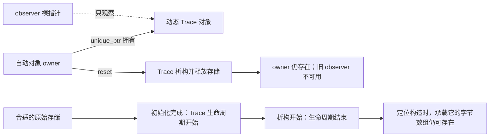

# 01 · 存储期与生命周期：先分清“地方”和“住在里面的对象”

← [[学习/学习导航/2026-10-20-学习导航|当天学习入口]]

前置：[[学习/2026-10-20/00-先读懂C++代码与对象|先读懂 C++ 代码与对象]]

下一篇：[[学习/2026-10-20/02-RAII与异常清理|RAII 与异常清理]]

对应自测：[[八股测试/2026-10-20#CPP-LIFE-001 · 栈、堆、存储期与生命周期|CPP-LIFE-001]]。

> [!abstract] 这篇先解决三个具体问题
> 函数返回后，哪些东西消失？局部指针消失，为什么它指向的东西可能还在？`vector` 在函数里面，为什么里面的元素还会涉及动态分配？
>
> 初读建议 20–30 分钟。先读到“工程场景怎么选”，再做变式。末尾扩展可以以后再看，不要求第一次背出标准措辞。

## 1. 从一张桌子开始理解

桌面是“地方”，放在桌上的水杯是“东西”。
把杯子拿走，并不等于桌子消失；桌子还在，也不说明原来的杯子还在那里。

映射到 C++：内存中的一段存储，是供对象占用的地方；对象是在这段存储中按照某种类型建立起来的东西。
这个比喻只用于区分两件事。实际代码是否能访问对象，必须按语言规则判断，不能靠“地址看起来没变”。

先记一个可用于排查问题的顺序：

1. 这里一共有几个对象？
2. 每个对象占用的存储从哪里来？
3. 哪个动作使它完成初始化？
4. 哪个动作使它结束生命周期？
5. 存储随后何时被释放或重用？

后面所有名词都在回答这五个问题。

## 2. 先把会用到的词讲清楚

### 对象：按类型存在的一份东西

`int price = 100;` 中，`price` 对应的那份整数就是一个对象。
对象不限于面向对象编程里的类实例；整数、指针变量、`std::vector` 实例都是对象。
函数不是对象，引用本身也不是对象。

**类型**说明怎样解释这份东西，以及允许进行哪些操作。
例如 `int` 表示整数类型，`std::vector<int>` 表示一个管理整数序列的类型。

**变量名**是代码中用于指代实体的名字。
对象可以没有名字，例如通过 `new` 创建的对象通常靠指针找到。
变量还可能声明引用，所以“变量”和“对象”在精确语境里不能完全互换。

### 存储：对象占用的字节空间

内存可以按字节理解。一个字节是存储信息的基本单位，具体位数由实现规定，常见机器上是 8 位。
对象需要足够大的存储，还需要满足**对齐**：起始位置符合该类型的地址排列要求。
初学时不用计算对齐值，只要知道“有一块够大的地方”还不是全部条件。

**分配存储**是取得可用空间；**释放存储**是把空间交回管理方。
**构造**是在合适的地方初始化类对象；**析构**是执行类的销毁步骤，常用于归还它管理的资源。
分配与构造有关联，但不是同一个动作；析构与释放存储也不是同一个动作。

### 生命周期：这一个对象何时存在

生命周期是运行时的属性，回答“这个特定对象从什么时候开始存在，到什么时候结束”。
本篇 `Trace` 类需要执行构造函数，所以取得合适存储并完成初始化后，才进入它的生命周期。
析构调用开始时，这个 `Trace` 对象的生命周期结束，之后仍会执行析构过程。
这听起来有点反直觉，第 6 节会把阶段拆开。

### 作用域：一个名字能在代码的哪里使用

作用域主要回答“这段源码里能不能直接写这个名字”。
它是代码中的可见范围，不是对象的计时器。
普通局部变量经常在退出作用域时销毁，因此两个概念很容易被混为一谈。

### 存储期：存储按哪种规则持续

标准用存储期分类，规定容纳对象的存储具有怎样的最短潜在存续时间。
入门时可以先问“这块存储随函数代码块、整个程序、线程，还是动态分配的管理规则持续”。
它描述存储层面的安排，不能替代对某个对象初始化与析构时点的分析。

核对定义：[N4659 官方源文件 basic.tex](https://raw.githubusercontent.com/cplusplus/draft/n4659/source/basic.tex)，对应可读条款 [basic.stc](https://timsong-cpp.github.io/cppwp/n4659/basic.stc)、[basic.life](https://timsong-cpp.github.io/cppwp/n4659/basic.life)。

## 3. 为什么需要这么多区分

假设行情接收函数读到一个价格，然后把“价格放在哪里”告诉另一个模块。
如果告诉对方的是局部对象的地址，而函数返回后对象已经销毁，对方拿到的地址就不能再用来访问原对象。
**悬垂指针**就是仍保存旧地址、目标对象却已经不再有效的指针。
**悬垂引用**是同类问题：引用所指的原对象已经结束生命周期。

这不是“读到旧值”这么简单。
对已经不存在的对象进行不允许的访问，可能产生**未定义行为**，即 C++ 标准不再约束程序应当怎样表现。
它可能暂时显示原数值，也可能崩溃或出现其他结果，不能靠一次正常运行证明安全。

另一个方向也有问题：对象该释放时没有释放，资源可能一直占着。
这称为**资源泄漏**，例如持续增加的动态内存占用。
悬垂是“东西已失效，还在用”；泄漏是“东西还占着，却丢了可靠的清理责任”。

## 4. 标准中的四类存储期

| 类别 | 生活语言 | 典型声明片段 | 关键边界 |
| --- | --- | --- | --- |
| 自动存储期 | 这次进入代码块用，离开时收尾 | `int price = 100;` | 普通局部对象按所在代码块退出规则销毁 |
| 静态存储期 | 存储贯穿程序 | `static int count = 0;` | 存储长久存在，不代表类对象从程序第一刻就已初始化 |
| 线程存储期 | 每个线程各自留一份 | `thread_local int count = 0;` | 每个线程是不同实体，已构造对象按正常线程退出规则销毁 |
| 动态存储期 | 运行中按需要取得并管理 | `new int(100)` | 需要正确的所有者负责结束对象生命周期和释放存储 |

**代码块**通常是 `{ ... }` 包住的一段语句。
**线程**可以先理解为同一个程序内的一条执行流程；并发细节以后再学。
`static` 放在函数内部时，名字仍局限于函数中的相应范围，存储却不会随这次调用结束。

表中都是声明或表达式片段，不是四个独立可运行程序。
动态对象通常交给智能指针或容器管理，不需要为记住这个分类而到处手写 `new`。

规则来源：[N4659 · basic.stc](https://timsong-cpp.github.io/cppwp/n4659/basic.stc)、[stmt.dcl 第 4–5 段：局部 static 的初始化和析构](https://timsong-cpp.github.io/cppwp/n4659/stmt.dcl#4)。

### “栈”和“堆”放在哪里理解

日常说“栈对象”，通常是在说普通的自动存储期局部对象。
日常说“堆对象”，通常是在说动态分配的对象。
**栈**是常见实现用来安排函数调用与部分局部存储的结构；**堆**通常指动态分配所使用的内存区域或管理机制。

但标准给出的是前面的四类存储期，没有要求每个自动对象必须实际摆在某种物理栈上。
编译器可能把值放在寄存器中，也可能在不改变可观察行为的前提下优化掉某些存储。
**寄存器**是处理器直接使用的少量高速存储位置。
因此面试可以先给常见实现，再说明标准保证到哪一层。

## 5. 用一份完整程序把对象数清楚

下面是本篇唯一的完整程序，基线为 C++17。
配套源码：[[学习/2026-10-20/示例代码/01_lifetime.cpp|01_lifetime.cpp]]。

Obsidian 阅读：[[学习/2026-10-20/示例代码/01_lifetime|01_lifetime.md（完整中文注释）]]。
其中后半段是为了观察“构造与存储分离”的演示，日常业务优先使用前半段的自动对象和标准资源管理类型。

```cpp
// 学习日期：2026-10-20；注释补充：2026-10-21；基线：C++17。
// 目标：分开看“存储还能放东西”与“某个对象现在能否被使用”。
// A/B：普通局部对象随作用域结束；vector 管理者还管理另一块元素存储。
// 中间：unique_ptr 结束动态对象后，观察指针不会自动改成空指针。
// C：在同一块对齐的字节存储中先后构造两个对象，每次都用 new 返回的新指针。
// D：函数内 static 局部变量跨调用保留值；outer 到 main 末尾才析构。
// 本例只访问活着的对象，不解引用对象析构后留下的旧指针。

#include <cassert>  // assert 检查容器大小、智能指针是否为空；成功时不打印。
#include <cstdio>   // printf/puts 输出对象名和执行阶段；%s/%d 对应字符串/整数。
#include <memory>   // unique_ptr、make_unique：用一个拥有者自动管理动态对象。
#include <new>      // placement new：在给定存储位置构造对象，不在这里另行分配该存储。
#include <vector>   // vector：局部管理对象与其元素存储并不是同一个概念。

// class 的成员默认私有；public 之后的构造、析构和 name 可由外部调用。
class Trace {
public:
    // const char* 是“指向只读字符的指针”，这里接收字符串字面量的首字符位置。
    // 只复制指针值，不复制文字；本例的字面量存活到程序结束，因此 name_ 不会悬垂。
    // explicit 阻止把字符串指针隐式转换成 Trace；noexcept 声明本函数不会抛出异常。
    // : name_(name) 在进入函数体前初始化成员，而不是在函数体里再赋值。
    explicit Trace(const char* name) noexcept : name_(name) {
        std::printf("construct %s\n", name_);
    }

    // 对象生命周期结束时打印；noexcept 表明析构不让异常向外传播。
    ~Trace() noexcept {
        std::printf("destroy %s\n", name_);
    }

    // 前面的 const char* 限制返回指针所指的字符；函数末尾的 const 则修饰成员函数：
    // 本函数不通过 this 修改 Trace 的普通成员，所以 const Trace 也能调用它。
    // 返回的是借来的字符指针，不转交任何释放责任。
    const char* name() const noexcept {
        return name_;
    }

private:
    // 下划线只是成员命名习惯。这里不拥有字符串，因此析构时不 delete name_。
    const char* name_;
};

// 返回 int 的无参函数；static 修饰局部变量，使它不会每次调用都重新从 0 开始。
int next_call() {
    static int calls = 0;
    // 先把保留的 calls 加 1，再返回新值；本例在同一线程里依次调用两次。
    return ++calls;
}

int main() {
    std::puts("A: ordinary local objects");
    // outer 是 main 内普通局部对象，当前构造，直到 main 离开作用域才析构。
    Trace outer("outer");
    {
        // inner 的作用域更短；离开这个块时析构，outer 还在外层继续活着。
        Trace inner("inner");
        // <> 是模板实参：把 vector 的元素类型指定为 int；{} 创建三个现有元素。
        // values 本身在本作用域内，元素存储由它管理，不因“局部变量”就要求元素在栈中。
        std::vector<int> values{10, 20, 30};
        assert(values.size() == 3);
        // 下标从 0 开始；这里 size 为 3，因此读取第一个元素是有效的，输出 10。
        std::printf("first value = %d\n", values[0]);
        // 按构造的逆序销毁 values、inner；vector 清理自身的元素和存储，但不打印。
    }
    std::puts("B: inner block has ended");

    // auto 让编译器从右侧推导类型，此处为 std::unique_ptr<Trace>，不是 Trace 本身。
    // make_unique 分配并构造 Trace，owner 独占它；owner 是局部管理者，被管理对象是动态对象。
    auto owner = std::make_unique<Trace>("dynamic");
    // get() 只借出裸指针，不转移所有权；owner 仍负责最后销毁对象。
    Trace* observer = owner.get();
    // -> 通过有效指针调用成员函数；name() 返回的文字用于 %s 输出。
    std::printf("observe %s\n", observer->name());
    // reset() 立即销毁被拥有的 Trace 并让 owner 变空；不是等到 main 末尾才销毁。
    owner.reset();
    // 原 observer 此时已不能再观察那个对象。手动置空，清楚表示不再使用它。
    // 置空只是改指针变量，不是“再次销毁”对象，也不会修复其他地方的旧指针。
    observer = nullptr;
    // unique_ptr 的布尔判断反映是否拥有对象，!owner 在空指针时为 true。
    assert(!owner);

    std::puts("C: storage and object are separate");
    // sizeof(Trace) 给出放下一个 Trace 所需的字节数；unsigned char 表示原始字节。
    // alignas(Trace) 保证起始地址满足 Trace 的对齐要求。这里只准备存储，还没构造 Trace。
    alignas(Trace) unsigned char storage[sizeof(Trace)];
    // new (storage) 是 placement new：在指定位置调用构造函数，返回新对象的 Trace*。
    // 与普通 new 的差别在于这块存储由外层字节数组提供，不能交给普通 delete。
    Trace* placed = new (storage) Trace("first in-place");
    std::printf("observe %s\n", placed->name());
    // 显式析构只结束这里的 Trace 生命周期；底层 storage 数组仍在 main 的作用域中。
    // 这种手动管理是本段的专门演示；普通局部对象和 unique_ptr 不应照着重复析构。
    placed->~Trace();
    placed = nullptr;

    // 同一存储可以再次构造对象；使用这次 new 返回的 replacement，不沿用旧对象指针。
    Trace* replacement = new (storage) Trace("second in-place");
    std::printf("observe %s\n", replacement->name());
    replacement->~Trace();
    replacement = nullptr;

    // 相同函数被调用两次，static calls 依次返回 1、2，而不是两次都返回 1。
    std::printf("calls: %d\n", next_call());
    std::printf("calls: %d\n", next_call());
    // 这行之后才离开 main：outer 析构，输出 destroy outer。
    std::puts("D: main is about to return");
}

// 观察顺序：construct outer -> construct inner -> first value = 10 -> destroy inner；
// B 后 dynamic 被构造、观察、reset 销毁；C 中两个 in-place 对象各自构造/观察/销毁；
// 最后 calls: 1、calls: 2、D 提示、destroy outer。
// 小规模分配假定成功；分配失败可能抛异常，本例不演示恢复该失败。
```

### 先看 `Trace` 是什么

`#include` 引入标准库中已经声明好的工具。
`<cassert>` 提供 `assert`，用于检查本例预期；条件为假时停止程序，不能拿它代替业务错误处理。
`<cstdio>` 提供 `std::puts` 与 `std::printf`，本例用它们打印观察信息。
`<memory>` 提供智能指针，`<new>` 提供下文的定位构造语法，`<vector>` 提供动态数组容器。

`class Trace` 声明一个类，表示“带名字、会报告构造和析构”的对象。
`public` 后的函数允许类外调用，`private` 后的成员由类内部管理。
`name_` 是成员变量，保存一个指向字符的指针；本例传入的都是字符串字面量，字符存储贯穿程序。

`Trace(...)` 与类同名，所以是构造函数。
`: name_(name)` 是**成员初始化列表**，表示用参数 `name` 初始化成员 `name_`。
`explicit` 防止这个构造函数被某些隐式转换悄悄调用，今天先认得它即可。
`~Trace()` 是析构函数，`~` 是析构函数名字的一部分。
这里的 `noexcept` 表示异常不能从这个函数向外传播，下一篇会解释后果。

`name()` 是成员函数，返回所保存的名字。
它末尾的 `const` 表示该函数不能通过这个对象修改其普通成员。
返回的不是新分配的字符串；它只是给调用者看本例中一直有效的字面量名字。

### A 到 B：先构造的局部对象后销毁

1. `Trace outer("outer")` 完成构造后，`outer` 存在。
2. 进入内层 `{ ... }`，构造 `inner`。
3. 创建 `values`，里面有三个整数元素。
4. `values[0]` 访问第一个元素；本例先检查 `size() == 3`，没有访问越界。
5. 离开内层代码块，先销毁后创建的 `values`，再销毁 `inner`。
6. 打印 B 时，`outer` 仍在，`inner` 已经不在。

`values` 的析构没有打印，是因为本例没有修改标准库类型。
看不到输出不代表没有析构，析构的作用是执行规定的清理工作。

### `owner` 与 `observer`：两个管理相关的对象，一个目标对象

`std::make_unique<Trace>("dynamic")` 创建动态 `Trace`，并返回负责管理它的 `std::unique_ptr<Trace>`。
这里**所有者**表示“承担销毁或转移清理责任的一方”；智能指针的完整分类放到第 03 篇。
`auto` 让编译器从右侧推导类型，不表示动态类型。

`owner` 本身是 `main` 中的自动对象。
`owner` 管理的 `Trace` 是另一个对象，其存储通过动态分配取得。
`observer` 又是一个独立的指针对象，只保存目标地址。
`.get()` 取出观察用的裸指针，不转移所有权。
`observer->name()` 表示通过指针调用目标对象的成员函数，此时目标仍有效。

`owner.reset()` 主动清理所管理的目标，使 `owner` 变为空。
目标 `Trace` 的析构和对应存储释放发生在这里，`owner` 自己仍然存在。
`observer` 不会自动收到通知。紧接着把它赋为 `nullptr`，即不指向对象的空指针值。
这里是覆盖指针变量，不读取已经失效的旧地址；此后本例不再访问旧目标。

### C：地方还在，第一个对象已经没有了

`sizeof(Trace)` 取得保存 `Trace` 所需的字节数。
`alignas(Trace)` 使 `storage` 的起始位置满足 `Trace` 的对齐要求。
`unsigned char storage[...]` 是一段自动存储期的字节数组，提供本例需要的空间。

`new (storage) Trace(...)` 叫**placement new**，这里译为“定位构造”。
它在给定的合适位置构造对象，这种标准形式不另外分配空间。
返回值是新建对象的指针，所以随后可以通过 `placed` 观察它。

`placed->~Trace()` 显式调用析构函数。
它结束这个 `Trace` 的生命周期并执行析构过程，没有把 `storage` 这块自动存储归还给动态分配器。
之后使用同一存储构造第二个 `Trace`，使用定位构造返回的新指针 `replacement`。
两个对象先后占用同一块地方，各自都只析构一次。

这里不用 `delete placed`：这块空间不是由普通分配式 `new` 取得的。
`placed = nullptr` 与 `replacement = nullptr` 是示意“不要再使用旧目标”；并不是释放操作。
内层对象结束后，承载它的字节数组仍在，直至 `main` 退出。

### D：函数结束不是所有名字都按同样规则消失

`next_call()` 里的 `static int calls = 0` 只保留同一个计数对象。
第一次调用增加到 1，第二次增加到 2，不会每次重新创建普通局部 `calls`。
名字 `calls` 只能在对应函数范围内使用，但它的存储跨越了两次调用。

`main` 走到末尾时，仍然存活的自动类对象按退出规则销毁。
`outer` 的销毁信息出现在 D 后面；`owner` 此时为空，析构时不会再次销毁原来的动态 `Trace`。

## 6. 把生命周期与析构过程画成两条线

**可编辑关系图（Mermaid）**



读图时先看上面的三层：`owner`、`observer`、动态对象分别是什么。
再看图中的生命周期路径：本例定位构造得到第一个 `Trace`，显式析构，然后在同一空间构造第二个。

对本例这种需要执行构造、且析构非平凡的类，可以这样拆：

1. 取得大小与对齐都合适的存储。
2. 执行初始化，期间属于构造阶段。
3. 初始化完成，进入通常所说的对象生命周期。
4. 析构函数调用开始，按 C++17 的这条规则，生命周期结束。
5. 继续执行析构函数体及相关子对象的析构过程。
6. 在该存储管理方式要求的时候释放或重用空间。

**非平凡析构函数**是语言的一个分类；本例手写的 `~Trace()` 属于这一类。
它并不简单等同于“析构函数代码很长”，也不能通过观察有没有打印来判断。

“生命周期结束”不表示析构函数体内连正常的成员访问都不能做。
构造和析构阶段有专门的规则，允许本例析构函数读取仍可按这些规则访问的 `name_`。
不要把普通外部访问失效对象的规则，机械套到正在执行的构造或析构函数上。
规则来源：[N4659 · basic.life 第 1、4 段](https://timsong-cpp.github.io/cppwp/n4659/basic.life#1)、[class.cdtor](https://timsong-cpp.github.io/cppwp/n4659/class.cdtor)。

另一个要点是“对象存在”和“值已经可以读”也有区别。
例如普通局部 `int n;` 没有给出可供正常读取的初始化值，不能因为对象的生命周期已经开始就去读取 `n`。
本教材示例会把整数初始化，避免把这个额外问题混进来。

## 7. `vector` 为什么要分成两层看

`std::vector<int> values{10, 20, 30};` 至少要分清管理对象与它管理的元素。
`vector` 管理对象保存管理元素所需的信息；具体内部成员布局不是标准承诺。
元素是另外的 `int` 对象。本例使用默认分配器，元素所在空间通过动态分配管理。

**分配器**可以先理解为“容器向谁申请和归还元素存储”的工具。
因此“局部 vector”并不表示所有元素的存储也属于普通局部自动存储。
退出代码块时销毁的是 `vector` 管理对象，它的析构再处理元素和元素存储。

这说明“自动对象可以管理动态资源”，它正是下一篇 RAII 能发挥作用的连接点。
还要注意，`vector` 仍存在时，扩容等操作也可能让已有元素地址失效；第 06 篇再分析。
不能把“管理对象还在”当作“之前拿到的每个元素指针还有效”。

后续学习：[[学习/2026-10-20/06-vector与综合练习|vector 与综合练习]]。

## 8. 工程场景怎么选

### 普通程序：读取配置并返回结果

配置结果很小、可以作为一个值处理时，优先按值返回结果对象。
“按值返回”表示调用方得到自己的结果对象，而不是依赖函数里已经销毁的局部对象。
不要因为怕复制，就返回局部对象的地址或引用；返回优化与移动在第 05 篇解释。

若某个对象必须跨越当前函数继续存在，就明确谁接手它。
可以交给一个更长寿命的上层对象保存，也可以转移一个拥有资源的智能指针。
“用动态分配”只解决可能活得更久的问题，还需要解决最终由谁清理。

### 行情程序：接收缓冲区中的一条消息

**缓冲区**是先放一段数据、供后续解析或处理的存储。
如果解析结果只是指向接收缓冲区内部，那么接收下一批数据并覆盖缓冲区后，旧解析结果可能已经不再表示原消息。
这是“地址可能还可访问，但内容和对象有效性已经不能照旧假定”的常见来源。

同步处理、且明确不会越过缓冲区有效期时，可以使用借用视图减少复制。
**借用视图**是只引用已有数据、自己不拥有底层存储的表示。
若把消息交给另一个稍后执行的任务，应保存独立副本或明确转交所有权，而不是只复制一个地址。

| 需求 | 起步选择 | 为什么 |
| --- | --- | --- |
| 只在当前函数使用一个小对象 | 普通局部对象 | 退出代码块的清理关系最清楚 |
| 返回一次计算结果 | 按值返回 | 调用方得到结果，不借用已消失的局部对象 |
| 同一份对象由下一层接手 | 独占所有者并转移 | 可以明确谁负责最终销毁 |
| 保存数量可变化的一组值 | `std::vector` | 管理元素、容量与释放工作 |
| 给多个线程各留一个计数器 | 按需求考虑 `thread_local` | 每线程一份，不等于共享统计已经完成 |

性能要看实际工作：分配频率、数据大小、缓存访问与线程关系。
不能仅凭“栈”或“堆”两个字断言整个程序哪个版本一定更快。
先保证对象有效，再测量需要优化的部分。

## 9. 三个典型错误，先会识别后再谈技巧

### 错误一：返回局部对象的地址

下面是错误片段，**不可运行或照抄调用**：

```cpp
int* bad_price() {
    int price = 100;
    return &price;  // 函数返回后，这个局部对象已经不存在
}
// 调用者不得通过返回值读取原 price。
```

改进方向是返回整数值，或者让调用方提供并拥有结果存储。
把 `int*` 改成 `int&` 不会自动延长那个局部对象的生命周期。

### 错误二：以为裸指针离开作用域会替我 delete

下面是有泄漏风险的教学片段，**不作为可运行示例**：

```cpp
void bad_owner() {
    int* p = new int(100);
    // 只有局部指针 p 会随代码块结束。
    // 没有 delete，也没有接手所有权的管理者。
}
```

`p` 是对象，`*p` 所指的整数是另一个对象。
销毁指针变量本身，不会触发对目标的 `delete`。
常规代码用 `std::make_unique<int>(100)` 把清理责任放进管理对象中。

### 错误三：手动析构普通局部对象，然后让它再次自动析构

不要把本篇定位构造的操作照搬成 `Trace t(...); t.~Trace();` 后直接退出代码块。
本例的定位构造对象与承载它的字节数组是分别管理的；普通局部 `Trace t` 原本就安排了自动析构。
若提前结束它的生命周期，又不满足退出时所需的重建条件，后续自动析构会出问题。
初学阶段直接让普通局部对象自然销毁，不手动调用析构函数。
边界来源：[N4659 · basic.life 第 9 段](https://timsong-cpp.github.io/cppwp/n4659/basic.life#9)。

## 10. 用变式检查是否真的能区分对象

### 变式 A：还剩谁活着

回到完整程序，执行 `owner.reset()` 后、`main` 还没有退出时：

1. `owner` 自己还存在吗？
2. 原来动态分配的 `Trace` 还存在吗？
3. `observer` 会自动变为空吗？

> [!tip]- 对照答案
> 1. 还存在，它是 `main` 的自动对象，只是现在没有管理目标。
> 2. 已经销毁，其存储也已按智能指针的默认删除规则释放。
> 3. 不会。裸指针不会被自动更新，示例显式覆盖为 `nullptr`，以后不再使用旧目标。
>
> 能说清楚三个对象分别是谁，比只背“栈自动、堆手动”更有用。

### 变式 B：只改变一个词

若把 `next_call()` 中的 `static int calls = 0;` 改为 `int calls = 0;`，两次调用分别打印多少？为什么？

> [!tip]- 对照答案
> 两次都返回 1。每次执行普通局部声明都重新初始化一个 `calls`，增加后返回；这次调用结束，该局部对象也结束。
> 原版使用同一静态存储期对象，所以两次返回 1、2。
> 名字的可见范围没有因此扩展到函数外部。

### 变式 C：同一地址意味着同一对象吗

定位构造前后两次都使用 `storage`，是否可以说“第一个对象一直存在，只是名字改了”？

> [!tip]- 对照答案
> 不可以。第一个对象被显式析构，第二次定位构造创建了第二个对象。
> 同一存储可以先后承载不同对象，所以判断生命周期不能只看地址是否相同。
> 示例使用每次构造返回的新指针，避免把旧指针重新指代对象的复杂规则塞进首日学习。

## 11. 30–90 秒口述

> C++ 标准区分自动、静态、线程和动态四类存储期。存储期描述容纳对象的存储按什么规则持续，生命周期描述某个对象何时存在，作用域描述名字在哪里可用。日常说的栈、堆通常对应常见实现，不能替代标准分类。普通局部指针本身和它指向的动态对象是两个对象，指针离开作用域不会自动 delete 目标。局部 vector 管理对象可以是自动存储期，而默认分配器管理的元素存储由动态分配取得。对象销毁与存储释放也要分开看，例如定位构造对象可以先析构，空间之后再重用。访问已经失效的对象可能是未定义行为，应该明确所有权或按值返回结果。

如果暂时讲不完，先讲清楚“管理对象、指针、目标不是同一个对象”，再加存储期和生命周期的区别。

> [!info]- 进阶边界：今天先知道存在，不要求记住所有规则
> - C++17 的 `[basic.life]` 对初始化起点使用 non-vacuous initialization 的条件，不能直接套用所有新版草案的措辞。联合体成员、基类子对象、临时对象另有规则。
> - 某些临时对象能因特定的引用绑定语法延长生命周期，但不是“任何引用都会延长目标生命周期”。返回局部对象引用仍然有问题。
> - 在同一空间重建对象后，旧指针能否自动指代新对象有条件；C++17 还涉及 `std::launder`。本例每次接收定位构造的返回值，不依赖这类技巧。
> - 原始字节存储不等于已经构造了任意类型的对象。不要把后来标准中的隐式对象创建规则，无版本说明地带入 C++17。
> - 存储已经释放后，不只解引用有风险。C++17 对失效指针值的其他使用也有实现相关规则，初学代码直接避免读取、比较和传播旧值。
>
> 来源：[N4659 · basic.life](https://timsong-cpp.github.io/cppwp/n4659/basic.life)、[basic.stc 第 4 段](https://timsong-cpp.github.io/cppwp/n4659/basic.stc#4)、[class.temporary](https://timsong-cpp.github.io/cppwp/n4659/class.temporary)。

## 12. 本篇资料与使用方式

本文按 2026-10-20 独立核验，使用 C++17 草案 N4659 的冻结版本。
官方源文件实际核对了存储期和生命周期条文；HTML 链接用于直接定位阅读。

- [WG21 官方 N4659 PDF](https://www.open-std.org/jtc1/sc22/wg21/docs/papers/2017/n4659.pdf)：原始草案发布入口；本次网页工具未能解析该 PDF，所以具体文本核对使用下面的官方源码。
- [标准官方仓库 n4659/source/basic.tex](https://raw.githubusercontent.com/cplusplus/draft/n4659/source/basic.tex)：`[basic.stc]`、`[basic.life]` 原始文本。
- [N4659 · stmt.dcl](https://timsong-cpp.github.io/cppwp/n4659/stmt.dcl)：普通局部对象与局部 `static` 的初始化、退出规则。
- [N4659 · class.cdtor](https://timsong-cpp.github.io/cppwp/n4659/class.cdtor)：构造与析构阶段的专门规则。
- [Core Guidelines R.5](https://isocpp.github.io/CppCoreGuidelines/CppCoreGuidelines#Rr-scoped)：优先考虑作用域内对象，是工程建议，不是新增语言限制。

学完后进入 [[学习/2026-10-20/02-RAII与异常清理|02 · RAII 与异常清理]]，再回到 [[八股测试/2026-10-20|当天测试]] 口述原题。掌握度由实际自测记录决定。
