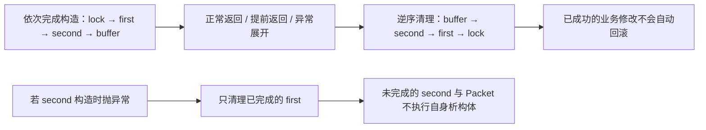

# 02 · RAII 与异常清理：让清理责任跟着对象走

← [[学习/学习导航/2026-10-20-学习导航|当天学习入口]]

前置：[[学习/2026-10-20/01-存储期与生命周期|存储期与生命周期]]

下一篇：[[学习/2026-10-20/03-所有权与智能指针|所有权与智能指针]]

对应自测：[[八股测试/2026-10-20#CPP-RAII-001 · RAII 为什么能防止资源泄漏|CPP-RAII-001]]。

> [!abstract] 这篇要解决的实际麻烦
> 函数里申请了内存、打开了文件或者锁住了共享数据，后面却有好几个 `return`，还有可能报错跳出去。怎样保证每条正常清理路径都归还资源，而不是靠人反复补 `delete`、`close`、`unlock`？
>
> 初读建议 25–35 分钟。先理解“资源交给谁、这个对象何时析构”，再看构造失败和程序终止的边界。

## 1. “借东西要归还”，困难在于出口会越来越多

借一把钥匙，使用完要归还。正常走到流程末尾时归还，很容易。
但现实程序还可能提前返回、调用另一个会失败的函数，或者后续代码被别人新增了一条退出路径。
把归还动作只写在函数最后一行，就可能根本走不到那一行。

资源管理容易出错，不是因为程序员不知道要归还，而是因为取得和归还的配对关系散落在很多路径上。
RAII 把这种配对关系固定到一个对象中，后续业务函数只需要遵守对象的生命周期。

## 2. 先把关键词变成人话

### 资源

资源是需要取得、占用，并按某种规则归还的东西。
常见的有动态内存、已经打开的文件、网络连接、已经取得的互斥锁。
“文件”和“打开的文件资源”不完全一样：清理文件句柄通常是关闭连接到文件的资源，不表示把磁盘文件删掉。

**句柄**可以先理解为操作系统或库给出的一个标识，后续用它操作那份资源。
资源不一定是一块内存，也不一定由 `new` 得到。

### 所有权

所有权在这里表示“谁负责在适当时机释放资源，或者把这份责任交给别人”。
它是一种设计约定和类型表达，不是“谁最后一次用过”的意思。
读到一个对象的地址，通常不表示已经接手它的清理责任。

### 构造函数与析构函数

构造函数负责把对象建立到可用状态。
**可用状态**表示对象内部满足自己的约定，例如“要么正确持有资源，要么明确为空”。
析构函数负责对象退出时所需的清理动作。
程序不需要手动调用普通局部对象的析构函数，离开它的作用域时语言会安排调用。

### 异常、throw、try 与 catch

**异常**是一种把失败信息向调用方传播的机制。
`throw` 抛出异常后，控制流离开当前正常执行路径，不再顺序执行紧接着的语句。
`try` 包住需要处理的执行区域，`catch` 是匹配异常并接手处理的位置。

**异常展开**也常叫**栈展开**，指异常传播到处理位置的过程中，销毁已经构造完成、需要退出的自动对象。
这里说“栈展开”是惯用机制名，不要求每个对象在硬件上都放在物理栈中。
本篇的异常都在外围安排了可匹配的 `catch`，终止边界会单独说。

### RAII

RAII 是 Resource Acquisition Is Initialization 的缩写，常译为“资源获取即初始化”。
更实用的理解是：**把资源交给一个管理对象，让它的析构负责释放。**
初始化时建立清楚的管理关系，正常作用域退出或异常展开触发析构时，清理动作就会执行。
管理对象也可以先为空，再通过成员函数接收资源；核心是责任始终清楚，不要求所有资源都必须在构造函数那一行才取得。

语言规则依据：[N4659 官方 exceptions.tex](https://raw.githubusercontent.com/cplusplus/draft/n4659/source/exceptions.tex) 中的 `[except.ctor]`。
设计建议：[Core Guidelines R.1](https://isocpp.github.io/CppCoreGuidelines/CppCoreGuidelines#Rr-raii)。RAII 这个建议依赖语言已有的构造与析构规则。

## 3. 不使用 RAII，为什么会漏掉路径

下面是用于识别问题的错误片段，**不可作为完整程序运行**：

```cpp
void bad_process(bool skip) {
    int* buffer = new int[100];
    if (skip) {
        return;               // 直接跳走，没有 delete[]
    }
    may_throw();              // 假设这个调用可能抛出异常
    delete[] buffer;           // 异常发生时也走不到这里
}
```

`new int[100]` 取得一组整数所需的空间，对应的归还形式是 `delete[]`。
本例特意不定义 `may_throw`，因为只用来展示出口；它不是本篇可编译示例。

补救方法可以是每个出口都写清理，但这会把配对责任撒到所有分支中。
以后新增分支，或在两行之间插入一个可能抛出异常的调用，又要重新检查。
RAII 让资源清理由管理类型负责，函数中的业务分支不必重复这份工作。

## 4. 标准库里已经有很多 RAII 管理对象

| 管理类型 | 取得或持有什么 | 析构负责什么 |
| --- | --- | --- |
| `std::vector<T>` | 元素与相应存储 | 销毁元素，归还管理的存储 |
| `std::string` | 字符序列所需的资源 | 清理自身管理的资源 |
| `std::unique_ptr<T>` | 独占管理一个目标 | 非空时调用删除器，通常销毁目标并释放存储 |
| `std::ifstream` | 输入文件相关资源 | 关闭它仍持有的打开文件资源 |
| `std::lock_guard<std::mutex>` | 已取得的互斥锁 | 释放这次锁的持有关系，即解锁 |

`T` 是类型占位符，`std::vector<int>` 就是把它换成 `int` 的实例。
**删除器**是智能指针用来清理目标的操作，默认情况下会采用相应的删除规则；自定义删除器以后再讲。

**互斥锁**允许多个线程按规则轮流进入一段不能同时执行的代码。
`std::mutex` 是锁对象，`lock_guard` 是一段作用域内的锁持有管理者。
销毁 `lock_guard` 是解锁，不是销毁那个 `mutex`。
本篇只用单线程观察其退出清理，完整并发规则在后续专题学习。

## 5. 完整 C++17 程序：三个出口与一次构造失败

配套源码：[[学习/2026-10-20/示例代码/02_raii.cpp|02_raii.cpp]]。

Obsidian 阅读：[[学习/2026-10-20/示例代码/02_raii|02_raii.md（完整中文注释）]]。
程序只在内存中处理小整数并打印信息，不打开真实交易连接，不发送订单。
它包含普通返回、提前返回、抛出异常、成员构造失败和成功构造的对照。

```cpp
// 学习日期：2026-10-20；注释补充：2026-10-21；基线：C++17。
// RAII 的读法：让一个对象负责一项资源，其析构函数负责归还资源。
// 本例用 lock_guard 管锁、unique_ptr 管数组，观察普通返回和异常离开时的清理。
// 还要区分：自动归还资源，并不等于自动撤销所有已经完成的业务修改。
// 三种 mode 都先把 101 存入 saved，所以 mode 2 抛异常后那次保存仍然存在。
// Packet 部分演示：构造失败时，已构造成功的成员会清理，整个 Packet 的析构体不运行。

#include <cassert>    // assert 检查保存数量；成功时没有输出，NDEBUG 可关闭检查。
#include <cstdio>     // printf/puts/fprintf 输出执行顺序；stderr 用于意外错误信息。
#include <exception>  // std::exception：最外层捕获标准异常时使用的基类。
#include <memory>     // make_unique、unique_ptr：为动态数组建立自动清理责任。
#include <mutex>      // mutex、lock_guard：互斥锁本体以及负责加锁/解锁的局部守卫。
#include <stdexcept>  // runtime_error：本例主动抛出并捕获的异常类型。
#include <vector>     // vector<int>：保存已完成的结果，观察异常不会自动回滚它。

// Part 只打印生命周期，用它看清“谁已经构造成功，谁需要被析构”。
class Part {
public:
    // const char* 借用字符串字面量；fail 的默认实参是 false，因此可只传 name。
    // explicit 禁止把一个 name 参数隐式变成 Part；name_(name) 先初始化成员指针。
    explicit Part(const char* name, bool fail = false) : name_(name) {
        std::printf("start %s\n", name_);
        // if 的条件为 true 时执行块；throw 构造并抛出异常，正常控制流在此中断。
        if (fail) {
            throw std::runtime_error("part construction failed");
        }
        // 只有未抛异常才能走到 ready：该 Part 的构造才能成功完成。
        std::printf("ready %s\n", name_);
    }

    // noexcept 声明析构不让异常向外传播；析构负责清理，不应在异常清理途中再抛异常。
    ~Part() noexcept {
        std::printf("destroy %s\n", name_);
    }

private:
    // 只保存名字的位置，不拥有字符存储；这里的字面量一直有效，不需要 delete。
    const char* name_;
};

struct Packet {
    // 成员按“声明顺序”初始化：先 first 后 second；成功后按逆序销毁。
    Part first;
    Part second;

    // bool fail 按值传入，转交给 second 的构造函数。
    // 冒号后的成员初始化发生在 Packet 构造函数体之前。
    explicit Packet(bool fail)
        : first("member-first"), second("member-second", fail) {
        // 若 second 抛异常，根本不会进入这里，也不会执行 ~Packet 的函数体。
        std::puts("Packet constructor body");
    }

    // 仅对成功构造出的 Packet 运行：先执行析构体，再自动析构 second、first。
    ~Packet() noexcept {
        std::puts("Packet destructor body");
    }
};

// int 是返回值类型；两个 & 参数都借用 main 的对象，不复制 mutex/vector。
// saved 是可修改引用，因此 push_back 的结果能被 main 看见；mode 只是整数副本。
int process(std::mutex& mutex, std::vector<int>& saved, int mode) {
    // <> 把 lock_guard 模板的锁类型指定为 std::mutex。
    // 构造 lock 时加锁；lock 活着就持锁，离开作用域析构时解锁。
    // 必须保证被引用的 mutex 比这个守卫活得更久，本例由 main 满足。
    std::lock_guard<std::mutex> lock(mutex);
    // 以下局部对象按顺序成功构造；清理时按相反顺序处理。
    Part first("scope-first");
    Part second("scope-second");
    // auto 推导为 unique_ptr<int[]>；int[] 是数组形式，拥有者析构时匹配数组删除。
    // make_unique<int[]>(3) 创建三个 int，buffer 用下标访问已存在的数组元素。
    auto buffer = std::make_unique<int[]>(3);
    buffer[0] = 101;
    // 复制这个整数到调用者的 vector；一旦成功，后面的异常不会自动删除这条记录。
    saved.push_back(buffer[0]);

    if (mode == 1) {
        // 提前 return 仍会清理 buffer、second、first、lock，然后把 -1 返回调用者。
        return -1;
    }
    if (mode == 2) {
        // 异常沿调用栈寻找 catch，途中清理本作用域已成功构造的对象，称为栈展开。
        // 这里仍会释放数组、销毁两个 Part、解锁，但 saved 不是本函数的局部副本。
        throw std::runtime_error("processing failed after saving");
    }
    // mode 0：back() 读取最后一个现有元素，先取得返回的整数，再清理局部对象。
    // 前面的 push_back 已成功，所以这里不是对空容器取 back。
    return saved.back();
}

int main() {
    // 外层 try 处理演示之外的标准异常，例如分配失败；不是承诺任何错误都可恢复。
    try {
        // mutex 本身与“当前持有它的 lock_guard”是两个对象。
        std::mutex mutex;
        std::vector<int> saved;

        // for 的三部分：mode 从 0 开始；不是 3 就继续；每轮结束 ++mode。
        // 因而依次运行 0、1、2 三种退出路径。
        for (int mode = 0; mode != 3; ++mode) {
            std::printf("mode %d\n", mode);
            try {
                // const 禁止随后修改这次得到的 result；异常时这条初始化不会完成。
                const int result = process(mutex, saved, mode);
                // mode 0 输出 result 101，mode 1 输出 result -1；mode 2 跳过此行。
                std::printf("result %d\n", result);
            } catch (const std::runtime_error& error) {
                // const & 只借用异常对象，不复制、不修改；what() 提供解释文字。
                std::printf("caught: %s\n", error.what());
            }
            // 再次取得同一把锁，检查 process 的退出路径确实没有把锁一直占住。
            // check 的作用域到本轮末尾；下一轮开始前它会析构解锁。
            std::lock_guard<std::mutex> check(mutex);
            // size() 是无符号大小类型；static_cast 明确把 mode + 1 转成该类型比较。
            // 这检查的是“已保存的修改没有被自动回滚”：每轮都多一条。
            assert(saved.size() == static_cast<std::size_t>(mode + 1));
        }

        // %zu 对应 size_t，三种 mode 运行后正常应输出 saved count = 3。
        std::printf("saved count = %zu\n", saved.size());
        std::puts("construction failure:");
        try {
            // first 成功，second 打印 start 后抛异常：只清理已完成构造的 first。
            // second 自己的 ~Part 和 failed 的 ~Packet 均不会在此运行。
            Packet failed(true);
        } catch (const std::runtime_error& error) {
            std::printf("caught: %s\n", error.what());
        }

        std::puts("successful construction:");
        {
            // 这次两个成员都 ready，进入构造体；到右括号按完整对象的规则析构。
            Packet complete(false);
        }
    } catch (const std::exception& error) {
        // 意外标准异常走这条路径，用错误输出报告并返回非零状态。
        std::fprintf(stderr, "unexpected failure: %s\n", error.what());
        return 1;
    }
}

// 观察重点：每个 mode 都有 destroy scope-second，再有 destroy scope-first。
// mode 2 的 caught 提示出现在这两次析构之后，保存数量最后仍为 3。
// 构造失败段没有 Packet destructor body，也没有 destroy member-second；
// 成功段则依次有 Packet destructor body、destroy member-second、destroy member-first。
// RAII 保证资源与对象作用域绑定；“业务要么全成功要么不改”的事务语义需另外设计。
```

## 6. 先读程序中的观察工具

`<memory>` 给出 `make_unique`，`<mutex>` 给出互斥锁与 `lock_guard`。
`<stdexcept>` 给出 `std::runtime_error`，用于表示本例主动模拟的运行错误。
`<exception>` 给出公共异常基类，供 `main` 最外层处理意料之外的标准异常。
`<vector>` 存一组已经保存的整数，其余输出与断言工具和上一篇一致。

### `Part`：让构造和析构看得见

`Part` 保存一个名字，构造时先打印 `start`。
参数 `fail` 是布尔值，只有真和假两种状态；默认值为 `false`，即不模拟失败。
若 `fail` 为真，就 `throw std::runtime_error(...)`。
这时没有走到打印 `ready` 的位置，也没有完成这个 `Part` 的构造。

`~Part() noexcept` 打印销毁名字。
它是教学用的观察工具，没有真正打开文件或持有网络连接。
本例实际的内存和锁资源分别由标准智能指针、容器和锁管理对象处理。
不要为了用 RAII 就给每个业务类手写一个打印析构函数。

### `Packet`：一个对象内部还有子对象

**成员子对象**就是一个对象内部的成员对象，例如 `Packet` 里面的 `first` 和 `second`。
`struct Packet` 声明一个结构体类型，本例成员默认对外可见。
它与 `class` 都可以包含成员和函数，这里不需要先背完整差异。

`Packet` 按成员在类内的声明顺序初始化：先 `first`，再 `second`。
成员初始化完成后，才进入打印 `Packet constructor body` 的构造函数体。
即使把初始化列表文字写成另一种顺序，也不能改变这个成员初始化顺序。
为减少误解，实际代码应当让初始化列表顺序与声明顺序一致。

## 7. `process` 每一行为什么放在这里

`std::mutex& mutex` 和 `std::vector<int>& saved` 是引用参数。
这里的 `&` 表示使用调用者已有的对象，不为这次调用复制一份锁或容器。
函数可以通过 `saved` 修改调用者的容器；函数返回不销毁调用者那份容器。

`std::lock_guard<std::mutex> lock(mutex);` 构造一个局部锁管理对象。
构造成功表示已经持有该互斥锁；离开作用域析构时，它会解锁。
变量名 `lock` 不是关键字，只是我们起的名字。

`Part first(...)` 与 `Part second(...)` 按先后顺序构造。
它们用来显示退出时的顺序，不承担锁管理。
`std::make_unique<int[]>(3)` 创建并管理三元素整数数组，`buffer` 是局部所有者。
`buffer[0] = 101` 写第一个元素，这个数组至少有一个元素，因此索引合法。

`saved.push_back(buffer[0])` 把这个整数追加到调用者的容器。
`push_back` 可以先理解为“放到序列末尾”。这一步完成后，调用者的状态已经改变。

然后出现三条路径：

- `mode == 0`：走到最后，返回已保存的最后一个整数。
- `mode == 1`：提前执行 `return -1`。
- `mode == 2`：抛出异常，离开当前正常执行路径。

`return` 返回的是 `int` 值，值会传递给调用者。
不能把这里随意改成“返回 `buffer` 内部某个元素的地址”：局部 `buffer` 清理之后，目标会失效。
关于返回值与清理顺序的语言规则可参看 [N4659 · stmt.return](https://timsong-cpp.github.io/cppwp/n4659/stmt.return)。

## 8. 三条路径为什么都能清理

**可编辑关系图（Mermaid）**



在本例 `process` 的构造都完成后，清理顺序为：

1. `buffer` 析构，释放它独占管理的数组。
2. `second` 析构，打印 `destroy scope-second`。
3. `first` 析构，打印 `destroy scope-first`。
4. `lock` 析构，解锁调用者的 `mutex`。

这是完成构造的相反顺序，可以记成“后来借到的东西先归还”。
本例把锁管理对象最先构造，所以它最后析构，清理这些局部对象时仍处于锁内。
真实工程要检查清理动作是否需要在锁内完成，锁住的范围也会影响其他线程等待时间。

提前 `return` 会离开函数中的代码块，普通局部对象仍要析构。
异常传播到 `main` 内的匹配 `catch` 时，也会按异常展开规则销毁这些对象。
不是运行时寻找并执行函数末尾的清理代码，而是每个完成构造的对象自带相应析构操作。

如果分配数组失败，`buffer` 自己尚未完成初始化；已经完成构造的 `second`、`first`、`lock` 仍会按退出路径清理。
所以“必须先把资源交给管理对象”比“以后会在最后一行释放”可靠。

核对规则：[N4659 · except.ctor 第 1–2 段](https://timsong-cpp.github.io/cppwp/n4659/except.ctor#1)、[stmt.dcl 第 2 段](https://timsong-cpp.github.io/cppwp/n4659/stmt.dcl#2)。

### `main` 怎么观察解锁

循环依次传入 0、1、2 三种模式。
`catch (const std::runtime_error& error)` 按引用接收匹配的异常，`error.what()` 取得它携带的说明文字。
随后创建另一个 `lock_guard`，再次取得同一把锁，检查容器大小。
本例只有一个线程；能继续执行这个检查，是用来观察前一次锁管理者已经正常解锁。

`static_cast<std::size_t>(...)` 是显式类型转换，使右侧计数与容器大小所用的无符号计数类型一致。
`assert` 检查学习示例的预期，不是给真实订单状态做故障恢复。
`main` 最外层的 `catch` 将其他标准异常报告为失败，并返回非零状态码。
正常结束返回 0，C++ 允许 `main` 走到末尾等价于返回 0。

## 9. 构造失败时，谁清理

`Packet failed(true)` 的执行过程：

1. `first` 构造成功，打印 `start member-first`、`ready member-first`。
2. 开始构造 `second`，打印 `start member-second`。
3. `second` 抛出异常，没有打印 `ready member-second`。
4. `second` 自身没有完成构造，所以不调用 `~Part()` 销毁这个失败的完整成员对象。
5. 已经完成构造的 `first` 被析构。
6. `Packet` 的构造未完成，所以不会调用这个 `Packet` 的析构函数体。
7. 异常到达外层匹配的 `catch`。

这并不表示“构造失败什么也不清理”。
失败对象中已经完成初始化、尚未开始析构的相应成员和基类子对象，会按规则被清理。
本例失败的 `second` 只有一个不拥有资源的字符指针成员；真实成员里如果还有 RAII 成员，已成功构造的那些成员同样需要清理。

再看 `Packet complete(false)`：两个成员都完成初始化，然后进入 `Packet` 构造函数体。
退出内层代码块时，先执行 `Packet` 的析构函数体，再按相反顺序析构 `second`、`first`。
“析构整个对象”和“执行它的析构函数体”也不是完全相同的范围，成员清理还在后面。

本例是普通的非委托构造函数。
**委托构造**指一个构造函数先调用同类的另一个构造函数，那个情况有专门规则，见末尾扩展。

依据：[N4659 官方 exceptions.tex](https://raw.githubusercontent.com/cplusplus/draft/n4659/source/exceptions.tex)、[except.ctor 第 3–5 段](https://timsong-cpp.github.io/cppwp/n4659/except.ctor#3)。

### 裸资源成员为什么容易栽在构造失败上

假设一个构造函数先用裸 `new` 取得内存，之后另一个成员构造失败。
整个对象没有构造成功，不能指望这个对象自己的析构函数体执行 `delete`。
裸指针成员即使被销毁，也不等于删除了它指向的内存。

让每份资源尽早进入一个已经能自行清理的 RAII 成员，是常见解决方式。
例如成员用 `std::vector` 或 `std::unique_ptr` 表达资源，不把“最后统一 delete”当作构造异常安全方案。
这也是为什么自己写构造和析构时，不能只检查成功路径。

## 10. 析构函数为什么通常不能把异常抛出去

析构经常发生在“已经有一个异常正在向外传播”的时候。
如果清理这个对象时，又有一个异常从析构函数逃出，异常处理机制无法按原计划继续，程序会调用 `std::terminate`。
`std::terminate` 表示终止正常的异常处理，进入终止处理流程。

`noexcept` 的含义不是“编译器已经证明这段代码不会失败”。
它规定异常不允许逃出该函数；若真的逃出，就触发终止处理。
不要写了 `noexcept`，再在函数体里调用可能失败的操作而不考虑如何收尾。

C++17 中，析构函数的隐式异常规范与成员、基类的析构情况有关，不能粗略说“所有析构函数天生都不抛”。
语言允许某些析构函数声明为可能抛异常，但工程上应当避免让析构向外抛异常。
这两句话分别是在描述语言能力和设计建议，不能混在一起。

若关闭文件、提交数据或刷新输出存在调用方必须处理的失败，应考虑提供显式操作返回结果或抛出异常。
析构作为最后的清理兜底，采用明确的不向外抛异常策略。
RAII 负责安排何时清理，不会把可能失败的底层操作自动变成永远成功。

来源：[N4659 · except.terminate](https://timsong-cpp.github.io/cppwp/n4659/except.terminate)、[Core Guidelines C.36](https://isocpp.github.io/CppCoreGuidelines/CppCoreGuidelines#Rc-dtor-fail)、[C.37](https://isocpp.github.io/CppCoreGuidelines/CppCoreGuidelines#Rc-dtor-noexcept)。

## 11. 资源清理不等于业务回滚

**回滚**表示把已经改变的业务状态恢复到操作前的状态。
完整程序中的三次调用，都先向调用者的 `saved` 追加了 101。
第三次虽然随后抛出异常，已经成功追加的这个整数仍然留在 `saved` 中。
因此在这些模拟路径都完成时，容器里有三个整数，而不是两个。

这时数组清理了，锁也解开了，说明 RAII 在工作。
但“保存过的记录自动撤销”从来没有被实现，RAII 不会凭空知道你想撤销什么。
关闭连接不会自动撤销已经发送到对端的消息；解锁也不会撤销已经修改的共享数据。

### 普通程序中的做法

例如修改一组配置时，可以先在临时对象中准备新配置，全部验证成功再替换正式配置。
若中途失败，临时对象自行清理，正式配置还没有被修改。
这种“准备成功再提交”的设计，需要你明确安排状态变更的时点。

### 行情与订单程序中的区别

解析一条行情时，临时缓冲区释放是资源管理，是否把半条消息写入正式数据结构是状态一致性问题。
可先检查消息完整性与字段有效性，再更新正式状态，避免留下只更新一半的记录。

发送订单后对端可能已经接收。即使本地后续处理报错、资源被 RAII 清理，也不能假定订单不存在。
需要按接口协议查询状态、记录请求标识和处理重复请求，而不是指望析构函数自动撤单。
这里是帮助区分问题类别，不需要今天实现完整交易协议。

## 12. Rule of Zero：常见业务类不必手写清理

**Rule of Zero** 常译为“零法则”：若成员类型已经正确管理资源，业务类尽量不自行定义析构、复制和移动操作。
复制是建立另一份对象状态，移动是按类型规则接收另一对象的资源；详细机制在第 05 篇。

例如一条消息用 `std::string` 保存文本、用 `std::vector<int>` 保存数据时，成员已经知道如何清理自己。
外层类通常不需要再手写析构去释放它们，也不应该调用它们的析构函数来“帮忙”。
由编译器按成员规则生成相应操作，更容易保持复制、移动和销毁之间的一致性。

零法则不是禁止所有自定义析构函数。
如果确实要封装底层文件句柄等原始资源，管理类型仍可能需要编写析构函数，并认真设计复制和移动语义。
优先重用成熟的资源管理类型，让多数业务类只表达数据和业务行为。

建议来源：[Core Guidelines C.20](https://isocpp.github.io/CppCoreGuidelines/CppCoreGuidelines#Rc-zero)。
继续学习：[[学习/2026-10-20/05-复制移动与值类别|复制移动与值类别]]。

## 13. RAII 的保证有边界

| 退出情况 | 能否依赖当前自动对象按正常规则析构 | 本篇该记住什么 |
| --- | --- | --- |
| 走到代码块末尾 | 可以 | 完成构造且尚未销毁的对象正常清理 |
| 普通提前 `return` | 可以 | 不会跳过局部对象的正常析构 |
| 异常传播到本例的匹配 `catch` | 可以 | 按异常展开规则清理沿途相应对象 |
| 异常没有任何匹配处理者 | 不能承诺完整清理 | 终止前是否展开由实现规定 |
| 异常逃出 `noexcept` 边界 | 不能承诺完整清理 | 可能不展开或只部分展开，然后终止 |
| 调用 `std::exit` | 当前自动对象不因此析构 | 它与从 `main` 正常返回不同 |
| 调用 `std::abort` 或 `std::_Exit` | 不执行这些正常析构流程 | 不要安排必须依靠析构完成的业务提交 |
| 断电、进程被外部强制结束 | 不能依赖 C++ 清理流程 | 属于进程恢复与持久化设计的范围 |

这张表不是要求你给每个局部变量补手工清理。
而是说 RAII 建立在语言会执行相应析构流程的前提上，不能被宣传成“任何退出方式都一定执行”。
本篇示例的主动异常有明确处理位置，不故意触发终止。
`std::thread` 在 C++17 中的析构也不是“自动等待线程完成”，后续学线程时需单独看它的规则。

依据：[N4659 · except.terminate 第 2 段](https://timsong-cpp.github.io/cppwp/n4659/except.terminate#2)、[support.start.term](https://timsong-cpp.github.io/cppwp/n4659/support.start.term)。

## 14. 变式：不要只背缩写

### 变式 A：为什么 `return -1` 没有漏解锁

请按完整程序中局部对象的构造顺序，反向说出清理顺序。

> [!tip]- 对照答案
> `buffer`、`second`、`first`、`lock` 依次析构，最后由 `lock` 解锁。
> `return` 会离开所在函数代码块，普通自动对象的析构仍按规则发生。
> 没有必要在这个分支再写一遍 `mutex.unlock()`；那反而会破坏“由 guard 独自负责解锁”的配对关系。

### 变式 B：看到构造失败，能说出两个“不调用”吗

`Packet failed(true)` 中，是否调用失败的 `second` 的析构函数？是否调用这个 `Packet` 的析构函数体？已经构造好的 `first` 呢？

> [!tip]- 对照答案
> 失败的 `second` 未完成构造，不调用它自身的析构函数。整个 `Packet` 也未完成构造，不调用它的析构函数体。
> 已完成构造的 `first` 会按构造失败清理规则析构。
> 若失败对象内部还有已构造的 RAII 子对象，那些已完成初始化的相应子对象仍会被清理，不能概括成“失败的那部分一概不清理”。

### 变式 C：异常被捕获，容器应该有几条记录

程序第三次调用在追加记录后抛出异常。三次调用结束，`saved` 中有几条记录？要得到“失败时不追加”的效果，设计上还缺什么？

> [!tip]- 对照答案
> 在示例主动模拟的三条路径都正常到达预定位置时，有三条记录。
> RAII 清理局部缓冲区和锁，不撤销已经成功完成的 `push_back`。
> 需要重新安排业务状态修改，例如先完成所有可能失败的准备和校验，再在明确的提交步骤更新正式数据。
> 若提交本身也可能失败，还要根据具体操作设计一致性保证，不能只加一个析构函数就宣称解决。

## 15. 30–90 秒口述

> RAII 是把资源的清理责任放进对象，让构造或初始化建立有效的管理状态，析构负责释放资源。普通局部管理对象在正常离开作用域、提前 return 和异常展开到匹配处理者时都会按规则析构，所以不用在每个出口重复 delete、close 或 unlock。异常展开按完成构造的相反顺序清理对象。若普通构造函数失败，整个失败对象的析构函数不执行，但已完成初始化的相应成员和基类子对象会清理，因此资源应尽早交给 RAII 成员。析构应避免向外抛异常，尤其展开中再抛会导致终止。RAII 也不自动实现业务回滚，且不能保证强制终止时完成清理。

> [!info]- 进阶边界：知道在哪里查即可
> - 本篇构造失败规则针对普通非委托构造。若委托目标已完成构造，委托构造函数体又抛出异常，`[except.ctor]` 对整个对象的析构有不同规定。
> - 普通分配式 `new T(...)` 在构造抛出异常时，会查找并在适用时调用匹配的释放函数，清理这次对象本体的分配。它不能自动修复 `T` 在构造函数体里另行取得却没交给管理者的裸资源。
> - 标准中的异常保证常区分“不泄漏且状态有效”和“失败时状态不变”。本篇先分别讨论资源与业务状态，不要求第一次学就背完整术语。
> - `lock_guard` 不负责死锁检测，也不保证锁的持有时间短。锁的范围、锁顺序与线程同步都需要另外设计。
> - RAII 不只适用于自动存储期对象。动态对象也可封装资源，但仍需要一个可靠的所有者最终触发其销毁。
>
> 来源：[N4659 · except.ctor](https://timsong-cpp.github.io/cppwp/n4659/except.ctor)、[expr.new](https://timsong-cpp.github.io/cppwp/n4659/expr.new)、[Core Guidelines R.1](https://isocpp.github.io/CppCoreGuidelines/CppCoreGuidelines#Rr-raii)。

## 16. 本篇资料与下一步

以下资料按 2026-10-20 核验，语言规则使用 C++17 草案 N4659。

- [标准官方仓库 n4659/source/exceptions.tex](https://raw.githubusercontent.com/cplusplus/draft/n4659/source/exceptions.tex)：实际核对构造失败、异常展开和终止规则的原始文本。
- [N4659 · except.ctor](https://timsong-cpp.github.io/cppwp/n4659/except.ctor)：异常传播时的自动对象清理、成员清理。
- [N4659 · except.terminate](https://timsong-cpp.github.io/cppwp/n4659/except.terminate)：析构抛出异常、无匹配处理者与 `noexcept` 边界。
- [N4659 · support.start.term](https://timsong-cpp.github.io/cppwp/n4659/support.start.term)：`exit`、`abort`、`_Exit` 的清理差异。
- [Core Guidelines R.1](https://isocpp.github.io/CppCoreGuidelines/CppCoreGuidelines#Rr-raii)、[C.20](https://isocpp.github.io/CppCoreGuidelines/CppCoreGuidelines#Rc-zero)、[C.36](https://isocpp.github.io/CppCoreGuidelines/CppCoreGuidelines#Rc-dtor-fail)、[C.37](https://isocpp.github.io/CppCoreGuidelines/CppCoreGuidelines#Rc-dtor-noexcept)：工程建议，与语言条文分开使用。

接下来读 [[学习/2026-10-20/03-所有权与智能指针|03 · 所有权与智能指针]]，把“谁负责最终析构”落实到具体类型。需要复测时回到 [[八股测试/2026-10-20|当天测试]]。
