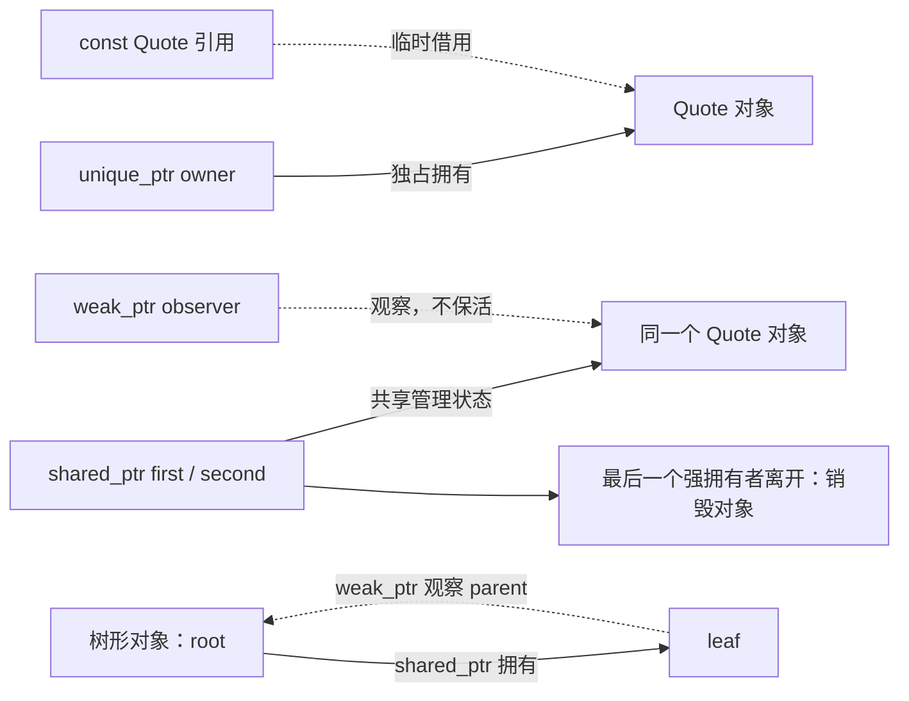

# 03 · 所有权与智能指针：谁负责让对象活着

[[学习/学习导航/2026-10-20-学习导航|当天学习入口]] · 前置：[[学习/2026-10-20/01-存储期与生命周期|存储期与生命周期]]、[[学习/2026-10-20/02-RAII与异常清理|RAII 与异常清理]]

这篇从“谁负责销毁”讲起。先顺着正文学习，最后再回到 [[八股测试/2026-10-20#CPP-OWN-001 · 三种智能指针如何选择|CPP-OWN-001 测试题]]。

如果 `T*`、`T&`、`->` 和 `std::` 还看不懂，先读 [[学习/2026-10-20/00-先读懂C++代码与对象|代码与对象预备篇]]。

本篇目标是看到一个场景后，能先说出生命周期责任，再选择值、引用、裸指针或智能指针。
正文是完整知识学习；折叠部分只有扩展和练习答案。
不必一次背下所有函数名，先掌握 `make_unique`、借用、移动和 `make_shared`。

## 1. 从一个真实问题开始

假设行情模块接收到一条报价：股票代码 `AAA`，价格 `100`。
我们用一个 `Quote` 对象保存这两个数据。
展示模块要读取这条报价，日志模块可能稍后再保存它。

这时有两个不同问题：

1. 谁可以读取或修改报价？这是访问权限。
2. 谁必须保证报价还活着，最后由谁销毁？这是所有权。

能读取对象，不等于负责销毁对象。
一个函数只打印报价，通常没必要接管报价的寿命。
一个异步任务在行情模块返回后还要使用报价，就必须另有办法保证它仍活着。

**所有权是一种生命周期责任，不是“谁知道地址”。**
它也不是 C++ 对所有对象都强制追踪的语法标签，需要由类型和接口表达。
Core Guidelines 建议用智能指针表达所有权，用普通指针或引用表达借用；这是工程约定。[Core Guidelines R.3](https://isocpp.github.io/CppCoreGuidelines/CppCoreGuidelines#rr-ptr)、[R.20](https://isocpp.github.io/CppCoreGuidelines/CppCoreGuidelines#rr-owner)

## 2. 先把六个词变成具体含义

| 词 | 本篇里的含义 | 对报价对象意味着什么 |
| --- | --- | --- |
| 对象 | 有类型、状态和生命周期的实体 | 一个 `Quote` 实例 |
| 地址 / 指针 | 用于定位对象的信息 | 知道报价放在哪里 |
| 所有者 | 承担维持生命周期和最终清理责任的管理者 | 决定报价何时可以销毁 |
| 借用 | 在约定的有效期内访问，不承担销毁责任 | 打印时临时读一下 |
| 独占所有权 | 同一资源只有一个负责管理它的所有者 | 行情模块独自管理报价 |
| 共享所有权 | 多个拥有者共同维持对象存活 | 行情与日志各保留一份拥有权 |

这里的“拥有者”可以是一个局部变量，也可以是一个类的成员。
例如类里直接放一个 `Quote quote;`，`Quote` 的生命周期便跟着这个类对象。
不需要动态分配时，先考虑这种值成员。

`unique_ptr<T>`、`shared_ptr<T>` 和 `weak_ptr<T>` 都是标准库里的类模板。
`<Quote>` 表示本次用它管理或观察的对象类型是 `Quote`。
它们自身也是对象，内部保存用于管理的信息。

**智能指针对象的生命周期，与它管理的业务对象的生命周期，是两件事。**
局部 `shared_ptr` 消失时，报价未必消失，因为别处可能还有拥有者。
`unique_ptr` 被移动后，原来的指针变量仍在作用域里，只是已经不再拥有那条报价。
这些规则分别由独占和共享指针的构造、析构操作定义。[N4659 · unique_ptr 移动构造](https://timsong-cpp.github.io/cppwp/n4659/unique.ptr.single.ctor)、[shared_ptr 析构](https://timsong-cpp.github.io/cppwp/n4659/util.smartptr.shared.dest)

## 3. 先选责任，再选工具

按下面顺序问，不要从“哪个指针高级”开始问。

1. 对象能否直接放在当前对象里，或直接作为函数结果返回？能，就先考虑值。
2. 需要动态创建，且只有一个管理者吗？考虑 `unique_ptr`。
3. 多个独立使用者都需要让同一对象继续活着吗？考虑 `shared_ptr`。
4. 已经有共享所有权，只想观察、允许对象先消失吗？考虑 `weak_ptr`。
5. 只在一次调用中临时使用吗？考虑引用；允许“没有对象”时考虑观察用裸指针。

| 表达方式 | 是否维持被访问对象存活 | 适合的场景 |
| --- | --- | --- |
| `Quote quote;` | 直接拥有该对象 | 报价随当前作用域或所属对象生活 |
| `const Quote&` | 不额外保活 | 调用期间必须有报价，只读 |
| `const Quote*` | 不额外保活 | 调用期间可以没有报价，用 `nullptr` 表示 |
| `unique_ptr<Quote>` | 独占保活 | 工厂产出对象，交给一个模块负责 |
| `shared_ptr<Quote>` | 共享保活 | 独立任务需要共同延长报价寿命 |
| `weak_ptr<Quote>` | 不保活 | 缓存观察、回调、树的父节点回指 |

“引用不额外保活”说的是这里的普通借用接口，不能据此推导所有临时量绑定规则；临时量延长寿命在生命周期篇解释。
裸指针也能被人为约定成拥有者，例如 `new` 的结果，但类型本身看不出责任，容易弄错。
本篇的借用接口会明确约定：不保存、不删除，调用期间由调用者保证对象活着。
优先值和独占管理、仅在确需共享时引入共享管理，是工程建议，不是禁止使用其他设计。[Core Guidelines R.21](https://isocpp.github.io/CppCoreGuidelines/CppCoreGuidelines#rr-unique)

## 4. 先看图，分清实线和虚线

**可编辑关系图（Mermaid）**



独占拥有这条关系中，`owner` 负责销毁，引用只借用。
无论有多少个借用者，都不会自动改变报价的销毁时机。
所以借用者不能偷偷把地址保存下来，等拥有者消失后再读。

共享拥有这条关系中，`first` 和 `second` 是两个不同的 `shared_ptr` 对象。
它们的共享管理状态关联着同一条报价。
只要还有强拥有者，对象就继续存活。
`observer` 是弱观察者，不增加强拥有者数量。

树形对象这条关系中，`root` 通过 `child` 拥有 `leaf`。
`leaf` 的 `parent` 只观察 `root`，因此不会把父子两端互相锁在存活状态。
图中的管理状态是概念示意，不代表标准规定了确切内存布局。

## 5. `unique_ptr`：一个管理者，可以把责任交给别人

先读这三行：

```cpp
auto owner = std::make_unique<Quote>("AAA", 100);
print_quote(*owner);
auto next = std::move(owner);
```

第一行创建 `Quote`，并返回管理它的 `unique_ptr<Quote>`。
`auto` 让编译器从右边推导变量类型，不是“没有类型”。
`make_unique` 是 C++14 起提供的创建工具，C++17 可用；它把构造参数传给 `Quote` 的构造函数。[N4659 · unique.ptr.create](https://timsong-cpp.github.io/cppwp/n4659/unique.ptr.create)

第二行里，表达式 `*owner` 取得被管理的 `Quote`，传给打印函数借用。
第三行调用 `unique_ptr` 的移动构造，把拥有权交给 `next`。
此后 `owner` 为空，`next` 管理原来的那条报价；报价自身没有因此换到另一个地址。

`std::move(owner)` 本身是允许采用移动操作的类型转换。
真正转移资源的是接收端执行的移动构造。
完整原理在 [[学习/2026-10-20/05-复制移动与值类别|复制、移动与值类别]]，这里先看清“谁接收了责任”。[N4659 · unique.ptr.single.ctor](https://timsong-cpp.github.io/cppwp/n4659/unique.ptr.single.ctor)

`auto second = owner;` 会尝试复制，`unique_ptr` 的复制操作被禁用，所以编译失败。
这不是运行时“两个人争抢对象”，而是类型在编译时阻止复制所有权。[N4659 · unique_ptr 声明](https://timsong-cpp.github.io/cppwp/n4659/unique.ptr.single)

## 6. 完整程序：独占、借用、共享、弱观察

下面是完整 C++17 源码，与 [[学习/2026-10-20/示例代码/03_ownership.cpp|03_ownership.cpp]] 同步。

Obsidian 阅读：[[学习/2026-10-20/示例代码/03_ownership|03_ownership.md（完整中文注释）]]。
英文输出只用来观察创建、销毁顺序；概念解释在代码后。
不要先背整段，按三个输出分组逐段读。

```cpp
// 学习日期：2026-10-20；注释补充：2026-10-21；基线：C++17。
// 沿着“谁负责最后销毁对象”读本例，而不只看谁保存了地址。
// 1. 引用和裸指针用于借用，不自动取得所有权。
// 2. unique_ptr 的移动转交独占所有权；release 放弃管理但不销毁；reset 释放并变空。
// 3. shared_ptr 允许多个强拥有者；weak_ptr 只观察，先 lock 成功才访问对象。
// 4. 树节点的父方向用 weak_ptr，避免父子用强拥有关系互相留住。
// 这是单线程示例：共享所有权本身不能推出被管理对象可被多线程随意读写。

#include <iostream>  // cout 输出生命周期；boolalpha 把布尔值显示为 true/false。
#include <memory>    // unique_ptr/shared_ptr/weak_ptr 及其 make_* 创建函数。
#include <string>    // string 拥有并管理 symbol/name 的字符内容。
#include <utility>   // std::move 把表达式转成可供移动操作选择的形式，本身不搬运资源。

struct Quote {
    // 每个 Quote 拥有自己的字符串成员和整数成员；字符串自己管理内部字符存储。
    std::string symbol;
    int price;

    // name 按值接收一个字符串；std::move(name) 让 symbol 的初始化可以使用移动构造。
    // 真正执行转移的是 string 的构造函数，不是 std::move 这次转换本身。
    // price(value) 初始化整数成员；成员按声明顺序初始化。
    Quote(std::string name, int value)
        : symbol(std::move(name)), price(value) {
        std::cout << "create " << symbol << '\n';
    }

    // 最后一个拥有者释放 Quote 时能看到此行；析构体之后还会自动析构 string 成员。
    ~Quote() {
        std::cout << "destroy " << symbol << '\n';
    }
};

// const Quote& 表示只读借用：必须有一个有效对象，不复制 Quote，也不接管销毁责任。
void print_quote(const Quote& quote) {
    // 点号通过对象或引用访问成员；<< 连续输出代码和值，'\n' 表示换行。
    std::cout << quote.symbol << " " << quote.price << '\n';
}

// const Quote* 是指向只读 Quote 的指针；允许调用者用 nullptr 表达“当前没有对象”。
// const 限制通过此参数改对象；指针变量本身按值传入，函数并不拥有该对象。
void print_if_present(const Quote* quote) {
    // != 表示不等于；先判断，再解引用。非空仍需调用者保证对象尚在生命周期中。
    if (quote != nullptr) {
        // * 在表达式中是解引用，得到所指对象，再绑定给 print_quote 的 const 引用。
        print_quote(*quote);
    }
}

// unique_ptr 按值接收：调用者必须转交独占所有权，不能复制 unique_ptr。
// 本例传入的 quote 非空；此函数没有处理空 unique_ptr，不能任意传空后仍解引用。
void consume(std::unique_ptr<Quote> quote) {
    print_quote(*quote);
} // 参数拥有的 Quote 在本次调用结束时由 unique_ptr 清理，输出 destroy AAA。

struct Node {
    std::string name;
    // child 是强拥有关系：父节点活着并保存此成员时，子节点被它拥有。
    // <Node> 是模板实参，把智能指针的被管理类型指定为 Node。
    std::shared_ptr<Node> child;
    // parent 是弱观察关系：知道父节点是谁，但不把父节点的强拥有计数加一。
    std::weak_ptr<Node> parent;

    // explicit 防止单个 string 隐式转成 Node；这里只把 text 的内容交给 name。
    explicit Node(std::string text) : name(std::move(text)) {}

    ~Node() {
        std::cout << "destroy node " << name << '\n';
        // 函数体结束后，parent/child/name 也按成员逆序析构；child 会释放它的强拥有份额。
    }
};

int main() {
    std::cout << "[unique ownership]\n";
    // auto 从右侧推导为 unique_ptr<Quote>；make_unique 分配并构造一个 Quote。
    auto owner = std::make_unique<Quote>("AAA", 100);
    print_quote(*owner);                  // 解引用后借给 const 引用，不新增拥有者。
    print_if_present(owner.get());        // get() 借出地址，owner 仍负责销毁。
    auto next = std::move(owner);         // 创建 next 时移动 unique_ptr，转交独占所有权。
    // owner 已变空；next 仍拥有原来的 Quote。boolalpha 让比较结果打印为 true。
    std::cout << "owner empty: " << std::boolalpha
              << (owner == nullptr) << '\n';
    consume(std::move(next));             // 参数接管所有权；返回后 next 为空，AAA 已销毁。

    std::cout << "[release and reset]\n";
    auto source = std::make_unique<Quote>("BBB", 200);
    // release() 返回原始指针，并让 source 变空；它没有 delete，BBB 此刻仍活着。
    // 放弃后必须安排新的清理责任，否则会泄漏。这里立刻交给另一个 unique_ptr。
    Quote* raw = source.release();
    std::unique_ptr<Quote> rescued(raw);   // 用裸指针接管同一对象，只能有一个这样的独占拥有者。
    rescued.reset();                      // 立即删除 BBB 并变空；raw 之后不能再解引用或删除。

    std::cout << "[shared ownership]\n";
    // 默认构造的 weak_ptr 为空；它在外层存活，稍后用来观察内层对象是否还活着。
    std::weak_ptr<Quote> observer;
    {
        auto first = std::make_shared<Quote>("CCC", 300);
        observer = first;                // 记录弱观察关系，不延长 Quote 的生命周期。
        {
            auto second = first;         // 复制 shared_ptr，新增一份强拥有关系，不复制 Quote。
            first.reset();               // 只释放 first 这份拥有关系；second 仍让对象活着。
            // if 中声明的 auto temporary 是 shared_ptr<Quote>；作用域只到这个 if 块结束。
            // lock() 尝试取得一份强拥有关系；成功时条件为真，期间对象不会被最后释放。
            if (auto temporary = observer.lock()) {
                print_quote(*temporary);
            }                            // temporary 释放自己的份额；此时 second 仍拥有对象。
        }                                // second 释放最后一份强拥有关系，CCC 在这里析构。
        // boolalpha 仍生效，输出 expired: true；弱观察者本身还在，不等于对象还在。
        std::cout << "expired: " << observer.expired() << '\n';
    }
    // 不要先 expired() 再假定以后一定有效；需要使用时直接检查 lock() 返回的拥有者。
    if (auto temporary = observer.lock()) {
        print_quote(*temporary);
    } else {
        std::cout << "Quote no longer alive\n";
    }
    // 解除弱观察关系；Quote 已经销毁，这不是在第二次删除 Quote。
    observer.reset();

    std::cout << "[weak back edge]\n";
    {
        auto root = std::make_shared<Node>("root");
        // -> 通过智能指针访问 Node 的成员；root 的 child 成员强拥有新 leaf。
        root->child = std::make_shared<Node>("leaf");
        root->child->parent = root;       // leaf 只弱观察 root，避免形成强拥有的环。
        if (auto parent = root->child->parent.lock()) {
            std::cout << "parent: " << parent->name << '\n';
        }
    }                                    // 最后先打印 destroy node root，再打印 destroy node leaf。
}

// 观察重点：AAA 在 consume 返回时销毁；BBB 在 reset 时销毁；CCC 在 second 离开时销毁。
// 空拥有者的后续析构不会重复删除；不要从 get() 再造一个独立的拥有者去管理同一对象。
// 本例假定分配成功；移动 unique_ptr 不会让已有的裸观察指针自动失效或自动延寿，
// 判断观察指针能否使用，仍要看它所指对象是否活着。
```

### 6.1 先读声明，别让语法挡住主线

- `<memory>` 提供智能指针，`<utility>` 提供 `std::move`。
- `struct Quote` 定义一种类型，`symbol` 和 `price` 是每个对象的数据成员。
- `Quote(...)` 是构造函数；冒号后是成员初始化列表，分别初始化两个成员。
- `~Quote()` 是析构函数，清理对象时会执行；严格的生命周期结束边界见生命周期篇。
- `const Quote& quote` 是给现有报价起一个只读别名，没有复制报价，也没有接管它。
- `const Quote* quote` 是指向报价的观察指针，可用 `nullptr` 表示没有报价。
- `owner->price` 访问所指对象的成员，等价于本例中的 `(*owner).price`。
- `explicit Node(...)` 限制某些隐式转换，这里只需知道创建节点时显式给名字即可。
- `std::boolalpha` 让布尔输出显示 `true/false`。

`consume` 的参数按值接收 `unique_ptr`。
函数内的 `quote` 是新的管理者，不是原变量的引用。
本例没有继续把它转交出去，所以参数离开函数时销毁报价。
调用前提是传入非空指针；若接口允许空指针，函数内要先判断再解引用。

### 6.2 对照独占拥有关系读第一组

1. `make_unique` 创建 `AAA`，`owner` 建立独占拥有关系。
2. `print_quote(*owner)` 临时借用，函数返回后借用结束，实线关系不变。
3. `owner.get()` 只取地址，供允许空值的接口临时借用。
4. `next = std::move(owner)` 把实线起点从 `owner` 改为 `next`。
5. `consume(std::move(next))` 再把实线交给函数参数。
6. `consume` 返回，参数析构，输出 `destroy AAA`。

这正是 RAII：让管理者对象的析构触发资源清理。
不需要每个借用者都调用一次 `delete`。
一个对象只能由正确的拥有关系负责清理；重复清理是错误。[N4659 · unique_ptr 析构](https://timsong-cpp.github.io/cppwp/n4659/unique.ptr.single.dtor)

## 7. `get()`、`reset()`、`release()` 名字像，职责完全不同

这里先限定为默认删除器管理单个 `Quote` 的 `unique_ptr<Quote>`。
删除器是“如何清理资源”的动作；默认删除器对对象执行 `delete`。

| 操作 | 返回什么 | 原管理者是否变空 | 是否立即销毁旧对象 |
| --- | --- | --- | --- |
| `p.get()` | 观察用地址 | 否 | 否 |
| `p.reset()` | 无返回值 | 是 | 原来非空时，是 |
| `p.release()` | 原来的地址 | 是 | 否 |
| `p.reset(new_pointer)` | 无返回值 | 改为管理新地址 | 原来非空时销毁旧对象 |

所以 `get()` 不是释放，也不是转移所有权。
调用 `get()` 后，原来的 `unique_ptr` 仍然负责对象。
对 `get()` 的结果手动 `delete`，会使管理者以后再次删除同一对象。
`reset(p.get())` 也不是无事发生：它会删除旧对象，留下指向已失效对象的地址。
这些错误片段不要执行。[N4659 · unique_ptr observers](https://timsong-cpp.github.io/cppwp/n4659/unique.ptr.single.observers)、[modifiers](https://timsong-cpp.github.io/cppwp/n4659/unique.ptr.single.modifiers)

完整程序第二组用 `release()` 把 `BBB` 的地址取出来，同时让 `source` 变空。
此时对象仍活着，但暂时没有智能指针负责它。
下一行立刻交给 `rescued` 接管，随后 `rescued.reset()` 销毁它。
这段只为了看清语义；正常转移优先用 `std::move`，不用手写这一圈。

`release()` 常见于把所有权交给明确要求接管原始地址的旧接口。
若没人接管、也没人清理，就发生资源泄漏。
`shared_ptr` 没有对应的 `release()`：共享关系不能靠一个拥有者把别人的责任一起取走。

## 8. `shared_ptr`：共享的是拥有权，不是复制业务对象

`auto second = first;` 会得到第二个智能指针，二者管理同一条 `CCC`。
它没有创建第二条报价，也没有复制 `symbol` 和 `price`。

**强引用**在本篇指一份由 `shared_ptr` 表达的共享拥有权。
**强引用计数**表示当前共有多少份这样的拥有权。
`use_count()` 能观察这个数量，但不能拿它当并发锁，下一篇会解释。
`first.reset()` 只放弃 `first` 这一份，`second` 仍在，对象就仍在。[N4659 · shared_ptr 复制构造](https://timsong-cpp.github.io/cppwp/n4659/util.smartptr.shared.const)、[shared_ptr observers](https://timsong-cpp.github.io/cppwp/n4659/util.smartptr.shared.obs)

对程序第三组，逐步数强拥有者：

| 时刻 | 强拥有者 | 对象是否存活 |
| --- | --- | --- |
| `make_shared` 后 | `first`，共 1 个 | 是 |
| `observer = first` 后 | 仍为 `first`，共 1 个 | 是 |
| `second = first` 后 | `first`、`second`，共 2 个 | 是 |
| `first.reset()` 后 | `second`，共 1 个 | 是 |
| `lock()` 成功的 if 块内 | `second`、`temporary`，共 2 个 | 是 |
| if 块结束后 | `second`，共 1 个 | 是 |
| 内层大括号结束后 | 0 个 | 已销毁 |

最后一个强拥有者放弃拥有权时，触发相应删除操作。
本例的默认创建方式会销毁 `Quote`，因此会看到 `destroy CCC`。
不能把“某个 shared_ptr 析构”和“业务对象立即析构”画等号。[N4659 · shared_ptr 析构](https://timsong-cpp.github.io/cppwp/n4659/util.smartptr.shared.dest)

## 9. `weak_ptr`：允许对象先消失的观察者

为什么不用一直保存 `shared_ptr`？
假设一个缓存只是想知道某报价还在不在，并不要求它一直留在内存里。
保存强拥有权会改变业务生命周期，保存弱观察关系则允许拥有者正常销毁对象。

`weak_ptr` 不能直接 `*w` 或 `w->price`。
先用 `w.lock()` 尝试取得临时 `shared_ptr`：

```cpp
if (auto alive = observer.lock()) {
    print_quote(*alive);
}
```

这是一条带变量声明的 `if` 条件：先创建 `alive`，再判断它是否非空。
成功说明这次取得了强拥有权，`alive` 存在期间对象不会因其他拥有者离开而销毁。
失败就得到空 `shared_ptr`，跳过 if 块。
“检查能否取得拥有权”和“取得拥有权”在 `lock()` 中作为原子步骤完成。[N4659 · weak_ptr observers](https://timsong-cpp.github.io/cppwp/n4659/util.smartptr.weak.obs)

`expired()` 只是问“此刻是否已无强拥有者”。
在多线程里，先判断 `!expired()`，再用以前保存的原始地址，不能保证使用时对象仍活着。
用 `lock()` 得到并保留临时强拥有权，才是这类观察者的正常用法。
它保证的是生命周期，仍不保护 `price` 的并发修改。

## 10. 控制块：共享拥有者如何联系在一起

实现通常用一份称为**控制块**的管理数据，保存强引用计数、弱引用相关状态和销毁动作等。
图中 `first / second` 的共享关系对应同一份管理状态。
`shared_ptr` 的复制连接到同一份状态，所以知道何时轮到最后一个拥有者。
控制块的具体字段、尺寸、计数编码属于实现细节。

弱观察者需要在对象销毁后仍能判断“已经失效”，所以管理状态可能比业务对象活得更久。
这解释了为什么“对象已析构”与“所有相关存储已归还”不一定同时发生。[微软 STL 实现说明](https://devblogs.microsoft.com/oldnewthing/20230815-00/?p=108602)

> [!info]- 扩展：make_shared 的一次分配，哪些是保证，哪些是常见实现
> **标准保证**：`make_shared<T>(...)` 创建并构造 `T`，返回拥有它的 `shared_ptr`；构造成功后的初始强计数为 1。[N4659 · shared_ptr creation](https://timsong-cpp.github.io/cppwp/n4659/util.smartptr.shared.create)
>
> C++17 草案说实现“应当”不超过一次分配。这是实现建议，不能改写成所有实现、所有条件下必须采用某个布局。
>
> **常见实现**：把控制块和对象放进同一块分配；相比分开分配，可能减少分配次数并改善局部性。最后一个强拥有者消失时执行对象析构；如果还有弱观察者，共用的整块存储可能仍要保留。[微软 STL 布局说明](https://devblogs.microsoft.com/oldnewthing/20230815-00/?p=108602)
>
> “大对象加长期弱缓存”可能使更多存储延迟归还，但不能因此推导 `make_shared` 总会浪费内存，或另一种写法总更快。依据对象大小、分配器、持有时间和实测选择。
>
> `make_shared` 本身不接受用户删除器参数；有专门清理动作时，需要选择合适的 `shared_ptr` 构造方式。不要把默认 `delete` 用于不匹配的资源。

## 11. 循环引用为什么会泄漏

假设 `A` 用 `shared_ptr` 拥有 `B`，`B` 也用 `shared_ptr` 拥有 `A`。
外面的拥有者都离开后，A 里面仍有一份 B 的强拥有权，B 里面仍有一份 A 的强拥有权。
两个对象都等不到强计数归零，析构也就不会发生。
这叫**强所有权循环**；引用计数不会自动识别“这两个对象其实已经没人用了”。

完整程序的 `Node` 用 `child` 强拥有子节点，用 `parent` 弱观察父节点，对照图中的树形对象关系。
外部 `root` 离开后，父节点可以析构；其 `child` 成员放弃拥有权，子节点也可以析构。
若需要从子节点临时访问父节点，就对 `parent` 调用 `lock()`。[Core Guidelines R.24：用 weak_ptr 打破 shared_ptr 循环](https://isocpp.github.io/CppCoreGuidelines/CppCoreGuidelines#rr-weak_ptr)

不是“所有双向关系都必须一强一弱”。
先决定谁应该拥有谁；如果双方都不应维持对方存活，可以由外部容器统一拥有节点，关系只借用。
若关系真的要求共同生存，就需要另行设计管理边界。

## 12. 函数参数：看签名就应该能看出责任

| 函数形状 | 接口表达什么 | 调用方做什么 |
| --- | --- | --- |
| `void show(const Quote& q)` | 必须有对象，只借用 | `show(*owner)` |
| `void show(const Quote* q)` | 允许无对象，只借用 | `show(owner.get())` |
| `void take(unique_ptr<Quote> q)` | 接管独占拥有权 | `take(std::move(owner))` |
| `void remember(shared_ptr<Quote> q)` | 函数拿到一份共享拥有权，可保存 | `remember(shared)` |
| `void replace(unique_ptr<Quote>& q)` | 可替换调用者的独占管理者 | `replace(owner)` |

`remember` 按值接收时，会取得自己的一份拥有权；需要保存时再放进成员或容器。
如果它只在函数里打印就返回，通常直接接收 `const Quote&` 更准确。
`const shared_ptr<Quote>&` 限制的是这个指针接口的改写，并不会把 `Quote` 变成只读，也不自动复制出一份长期拥有权。
接口选择建议参见 [Core Guidelines R.30](https://isocpp.github.io/CppCoreGuidelines/CppCoreGuidelines#rr-smartptrparam)、[R.32](https://isocpp.github.io/CppCoreGuidelines/CppCoreGuidelines#rr-uniqueptrparam)、[R.34](https://isocpp.github.io/CppCoreGuidelines/CppCoreGuidelines#rr-sharedptrparam-owner)。

对开头的行情场景，可以先做两个不同设计：

- 展示函数同步读完就返回：行情模块拥有，展示函数接收 `const Quote&`。
- 日志任务返回后仍需读取同一份对象：若确需共同保活，任务保存自己的 `shared_ptr<const Quote>`；任务传递本身还需要同步。

也可以让日志任务复制一份值数据，独立拥有副本，不必总是共享同一对象。
“代码里两个地方都要用”不足以证明需要共享所有权。

## 13. 四个反例，判断错误发生在哪一层

| 写法 / 想法 | 问题 |
| --- | --- |
| `auto b = unique_owner;` | 复制独占指针，编译失败 |
| 对 `owner.get()` 执行 `delete` | 所有权没转移，可能造成重复删除 |
| `shared_ptr<T> other(first.get());` | 对同一地址重新建立独立拥有关系，可能重复删除 |
| 把局部对象地址存到长期任务里 | 借用超过对象寿命，可能悬垂 |

要共享 `first` 的拥有权，复制 `first` 本身；不要从 `first.get()` 重新包装。
智能指针不能自动修复已经错误的生命周期契约。[N4659 · shared_ptr 原始指针构造要求与复制构造](https://timsong-cpp.github.io/cppwp/n4659/util.smartptr.shared.const)

> [!info]- 扩展：shared_ptr 也可能有“存储指针”和“拥有对象”不同的情况
> 共享指针支持别名构造：一份拥有权可以负责让整个对象存活，而 `get()` 指向其中的成员。
> 因此更精确的说法是“最后一个强拥有者触发共享拥有关系对应的删除动作”，不是“总对 get() 执行 delete”。
>
> 本篇所有核心示例都没有用别名构造，可以先按图中的共享拥有关系理解。
> 无论哪种方式，都不能用地址是否相同来替代所有权关系分析。[N4659 · shared_ptr aliasing constructor](https://timsong-cpp.github.io/cppwp/n4659/util.smartptr.shared.const)

## 14. 小练习：先说理由，再选类型

练习一：一个 `Engine` 长期持有一份配置，`print_config` 只在调用时读取。
没有动态多态，也没有可选状态。`Engine` 里的配置和打印参数分别选什么？

> [!tip]- 练习一答案
> 先考虑值成员 `Config config;`，打印接收 `const Config&`。
> 配置跟随 `Engine` 生命周期，打印只借用。没有必要为这个需求引入动态分配和共享计数。

练习二：`p` 是非空 `unique_ptr<Quote>`。依次执行 `auto raw = p.get();`、`p.reset();`，还能读取 `raw->price` 吗？

> [!tip]- 练习二答案
> 不能。`get()` 没有保活或转移责任；`reset()` 已销毁对象，`raw` 成为悬垂指针。
> 指针变量里还存着旧地址，不代表该地址上仍有活着的 `Quote`。

练习三：两个异步任务各自保存一个 `shared_ptr<Quote>`，原模块执行 `reset()`。报价是否立即销毁？

> [!tip]- 练习三答案
> 不会，只要两个任务中还有强拥有者，报价就仍然存活。
> 如果任务还要并发修改报价，必须另解决业务对象的数据同步；共享拥有权不替代这个步骤。

练习四：把 `Node::parent` 改成 `shared_ptr<Node>`，其余程序不变，为什么可能看不到两条节点析构输出？

> [!tip]- 练习四答案
> 父节点的 child 强拥有子节点，子节点的 parent 强拥有父节点。
> 外部 root 离开后，两者的强计数仍各被对方维持，形成强所有权循环。
> 本例 parent 应观察父节点，用 weak_ptr 并通过 lock 临时访问。

## 15. 面试口述：学完再压缩成这段

> 所有权回答谁负责维持对象存活和最终清理。能直接拥有值时先考虑值；需要动态独占管理时用 unique_ptr，它不能复制，但可以移动转交。只有多个独立使用者确实需要共同保活时才用 shared_ptr，最后一个强拥有者释放时触发对应清理。weak_ptr 只观察共享对象，不增加强拥有者数量，访问前用 lock 尝试取得临时 shared_ptr。同步函数只借用时，通常传引用，允许空值时可传观察指针。get 只取地址，reset 放弃当前拥有权，unique_ptr 的 release 脱离管理但不销毁对象。

回到 [[八股测试/2026-10-20#CPP-OWN-001 · 三种智能指针如何选择|原题]]，用自己的话解释一次“行情模块拥有，展示模块借用”。
如果还需要看表才能选择，不用急着背口述，先重做练习一和练习三。

## 来源与版本说明

核对日期：2026-10-20。示例基线是 C++17。
N4659 是 C++17 标准草案快照，本文用它核对语言和标准库约定；Tim Song 页面是该草案的可链接转录。
Core Guidelines 提供接口和所有权设计建议；微软文章解释具体实现思路，两者都不能替代标准保证。
关键链接已放在对应结论旁边，阅读时可以先学中文解释，再按需查原文。
本页源码与独立 `.cpp` 同步；编译运行结果由当天统一核验记录给出，不能从这里的预期解释推断已执行验证。

下一篇：[[学习/2026-10-20/04-shared_ptr与线程安全|shared_ptr 与线程安全]]。
