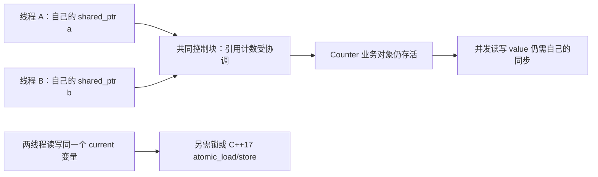

# 04 · shared_ptr 与线程安全：活着，不等于可以随便改

[[学习/学习导航/2026-10-20-学习导航|当天学习入口]] · 前置：[[学习/2026-10-20/03-所有权与智能指针|所有权与智能指针]]

这篇先解释线程、共享数据和锁，再讲 `shared_ptr` 的三层边界。
读完后回到 [[八股测试/2026-10-20#CPP-SHARED-001 · shared_ptr 的线程安全边界|CPP-SHARED-001 测试题]]。
不知道线程和锁是什么时，直接背“三层”很容易只记住词，遇到代码仍不会判断。
正文默认可见，扩展和练习答案才折叠。

## 1. 什么是线程，为什么会出现共享数据

把一个程序想成一组正在执行的步骤。
**线程**是程序的一条执行流程；多个线程可以各自推进步骤。
比如一个线程接收行情，另一个线程处理订单。
它们是否真的在同一瞬间占用不同 CPU 核，由操作系统调度和硬件决定。

**并发**强调多个流程可能交错推进。
**并行**强调多个流程在同一时间执行。
即使只有一个 CPU 核，步骤交错也足以产生并发问题，不能把“线程安全”理解成“多核才需要”。

不同线程可以访问同一个对象，这个对象就可能成为**共享数据**。
共享对象可以在动态存储中，也可以是仍活着的局部对象，不取决于有没有使用 `new`。
两个线程只操作各自互不关联的对象，与两个线程修改同一个计数器，是不同场景。

本篇的目标场景是：两个工作线程都给同一个 `Counter::value` 加一。
`Counter` 由共享拥有者保证存活，而加一操作由锁保证协调。
这两个责任要分别安排。[N4659 · 多线程执行与数据竞争](https://timsong-cpp.github.io/cppwp/n4659/intro.races)

## 2. 为什么一行 `++value` 也可能出问题

先在单线程里理解：`++value` 表示给 `value` 加一。
对普通 `int`，这不是一项由 C++ 保证的跨线程原子操作。
为了理解冲突，可以概念上拆成“读旧值 → 算新值 → 写回”。
这只是帮助理解的分解，不代表编译器必须生成三条机器指令。

假想两个线程都读到 5，都算出 6，再各写回 6。
从直觉上看，就可能丢掉一次加一。
但对 C++ 程序，问题比“偶尔少加一次”更严格：没有正确同步的普通 `int` 并发读写可能构成数据竞争。
一旦有数据竞争，不能再承诺只是少加、某个输出范围或某种固定结果。

**数据竞争，data race**：对本篇的常见场景，可按四点检查：

1. 不同线程访问同一个内存位置。
2. 至少一个访问会修改它。
3. 至少一个访问不是原子操作。
4. 两次访问之间没有标准所要求的先后关系，即 happens-before。

**happens-before** 可以先理解为“语言规则认可的先后关系”。
它由同一线程内的顺序以及特定跨线程同步操作等建立。
“我感觉 A 应该先运行”或“多睡一毫秒”都不是这种关系。
本篇只用线程启动、`join`、互斥锁和默认原子接口建立它，不展开完整内存模型。

发生数据竞争会导致**未定义行为，UB**：标准不再规定程序应怎样表现。
因此错误示例只做纸面分析，不运行来猜输出。[N4659 · intro.races，尤其第 20 段](https://timsong-cpp.github.io/cppwp/n4659/intro.races#20)

## 3. `mutex` 和 `lock_guard` 分别干什么

**互斥锁 `std::mutex`** 用于协调多个线程访问共享数据。
一个线程持有这把锁时，另一个试图锁住同一把锁的线程需要等待。
需要保护的那一段代码叫**临界区**。

```cpp
std::lock_guard<std::mutex> guard(state->mutex);
++state->value;
```

这里的 `guard` 是一个局部 RAII 对象。
构造它时锁住 `state->mutex`；它离开作用域、执行析构时解锁。
因此不必手写成容易漏掉 `unlock()` 的分支组合。
这与 [[学习/2026-10-20/02-RAII与异常清理|RAII]] 里“构造建立责任，析构清理”是同一个思路。[N4659 · lock_guard](https://timsong-cpp.github.io/cppwp/n4659/thread.lock.guard)

锁还帮助建立跨线程的可见性和先后关系。
前一个线程解锁同一把互斥锁，与随后成功取得它的锁操作建立同步关系。
后一个线程可以按同步规则观察到之前临界区里的修改。[N4659 · mutex requirements](https://timsong-cpp.github.io/cppwp/n4659/thread.mutex.requirements.mutex)

注意这三个条件：

- 两个线程必须使用**同一把锁**；各自新建一把锁，不能协调彼此。
- 所有可能冲突的并发读写都要遵守同一保护规则，不能只给写者加锁。
- 锁保护的是按约定放在临界区中的操作，不会自动包住所有通过指针发生的访问。

如果 A 加锁修改 `value`，B 在锁外读取普通 `value`，仍然有问题。
业务约束需要一起保护时，也应考虑临界区是否覆盖整个约束。
例如“检查余额后扣减”不能随意拆成两个互不协调的步骤。

## 4. 看懂 lambda，才看得懂线程程序

**lambda 表达式**可以临时定义一小段可被调用的代码。
把它近似看成“带着一些数据的小函数对象”。
这个对象也有自己的生命周期，里面保存被捕获的数据。

```cpp
auto task = [left] {
    increment_many(left);
};
```

- `task` 是保存这个函数对象的变量。
- `[left]` 是捕获列表：把外层的 `left` 按值复制进这个函数对象。
- 因为 `left` 是 `shared_ptr`，这里复制的是共享拥有权，不是复制整个 `Counter`。
- 大括号里是稍后执行的代码，定义 lambda 时不会立即执行它。
- `task()` 才是一次调用。

`[&current]` 则按引用捕获外面的变量，函数体访问的仍是同一个 `current`。
按引用捕获不延长那个外部变量的生命周期。
必须另行保证任务结束前，被引用变量仍活着。
两种捕获形式改变的是“函数对象保存副本还是保存引用”，不是自动加锁。[N4659 · lambda captures](https://timsong-cpp.github.io/cppwp/n4659/expr.prim.lambda.capture)

`std::thread worker(task);` 创建线程，让新线程调用保存的任务。
新线程何时被调度运行，不由下一行代码看起来的先后决定。
线程构造提供规定的启动同步，因此构造前已准备好的捕获数据可以传给工作线程。[N4659 · thread constructors](https://timsong-cpp.github.io/cppwp/n4659/thread.thread.constr)

`worker.join()` 等待这个线程结束。
线程完成与成功的 `join()` 返回建立同步关系，所以等待后再读工作结果有相应先后保证。
但 `join()` 不会倒过来修复两个工作线程运行期间已经发生的数据竞争。[N4659 · thread members](https://timsong-cpp.github.io/cppwp/n4659/thread.thread.member)

## 5. 现在再拆开 shared_ptr 的三层

**可编辑关系图（Mermaid）**



### 第 1 层：共享拥有关系的管理状态

假设主线程先准备 `auto a = state; auto b = state;`，再正确传给两个工作线程。
`a` 和 `b` 是不同的 `shared_ptr` 实例，但共享同一个 `Counter` 的拥有权。
线程 A 只操作自己的 `a`，线程 B 只操作自己的 `b`。
它们可以分别复制、销毁或 `reset` 自己的实例，库负责协调共享管理状态。

这里的安全保证，使两个拥有者同时放弃拥有权时不会因为计数协调错误而重复销毁对象。
它不等于“所有经过这些指针进行的操作都安全”。[N4659 · shared_ptr 第 4 段](https://timsong-cpp.github.io/cppwp/n4659/util.smartptr.shared#4)、[微软标准库线程安全说明](https://learn.microsoft.com/en-us/cpp/standard-library/thread-safety-in-the-cpp-standard-library?view=msvc-170)

### 第 2 层：某一个 shared_ptr 变量本身

`std::shared_ptr<Counter> current;` 是一个具体变量。
如果 A 对它执行 `current.reset()`，B 同时从同一个 `current` 复制或读取，访问的就是同一个指针对象。
普通 `shared_ptr` 成员接口没有自动为这种并发读写加锁。
需要同一把外部锁，或本篇后面介绍的原子接口。

只有多个线程读取同一实例、且没有线程并发修改它时，可以按读共享规则使用。
一旦可能有赋值、`reset` 等修改，就必须重新检查所有并发访问。[微软标准库线程安全规则](https://learn.microsoft.com/en-us/cpp/standard-library/thread-safety-in-the-cpp-standard-library?view=msvc-170)

特别注意：`auto local = current;` 中虽然 `local` 是新变量，但创建它需要读取 `current`。
如果这个读取与别人修改 `current` 冲突，不能以“后面各用各的 local”证明前面的复制安全。
应当在锁内复制，或通过 `atomic_load` 取副本。

### 第 3 层：指向的业务对象

两个线程分别持有 `a`、`b`，并不代表它们操作的是两份 `Counter`。
`++a->value` 和 `++b->value` 仍在修改同一个 `int`。
所以仍需互斥锁、原子成员或其他正确同步方案。

共享拥有权解决“对象还在不在”。
互斥锁等同步机制解决“多个访问如何协调”。
原子读取共享指针，也只解决那次指针访问和相应发布规则，不会自动把整个 `Counter` 变成原子对象。[N4659 · shared_ptr 数据竞争规定](https://timsong-cpp.github.io/cppwp/n4659/util.smartptr.shared#4)

## 6. 完整程序一：两个工作线程，安全地累计到 20000

这段确实创建两个 `std::thread`，各执行 10000 次加一。
它们是否同时在 CPU 上运行由调度决定；正确性不依赖某一种调度顺序。
源码与 [[学习/2026-10-20/示例代码/04_threads.cpp|04_threads.cpp]] 同步。

Obsidian 阅读：[[学习/2026-10-20/示例代码/04_threads|04_threads.md（完整中文注释）]]。

```cpp
// 学习日期：2026-10-20；注释补充：2026-10-21；基线：C++17。
// 这份例子把三件事分开：
// 1. 每个线程持有自己的 shared_ptr 管理者副本，共同保持一个 Counter 活着。
// 2. Counter::value 是普通 int，shared_ptr 不会替它加锁；读改写必须靠 mutex 协调。
// 3. main 在两个工作线程 join 后再读取 value，此时没有工作线程再修改它。
// 本例明确使用互斥锁，不是无锁算法；引用计数安全也不等于被指对象自动线程安全。
// 正常输出：value = 20000。只在创建线程、加锁等操作成功的演示路径下观察此输出。

#include <iostream>  // std::cout 输出两个线程完成后的最终计数。
#include <memory>    // shared_ptr/make_shared：多个拥有者共同管理一个 Counter 的生命周期。
#include <mutex>     // mutex 提供互斥；lock_guard 把解锁绑定到作用域结束。
#include <thread>    // thread 启动线程，join 等待线程完成，joinable 检查是否需要收尾。

struct Counter {
    // 这把锁与 value 放在一起，提醒调用者：访问这份共享计数时使用同一把锁。
    std::mutex mutex;
    // 成员默认初始化为 0。普通 int 的 ++ 不是因此自动成为原子操作。
    int value = 0;
};

// local 按值接收 shared_ptr：本函数拥有独立的管理者对象，但仍指向同一个 Counter。
// <> 指定被管理的类型为 Counter；复制管理者不复制 Counter 或其中的 mutex。
void increment_many(std::shared_ptr<Counter> local) {
    // i 是各线程栈帧各自的局部整数；两次调用不会共享同一个 i。
    for (int i = 0; i < 10000; ++i) {
        // -> 沿 local 访问共享 Counter 的 mutex。
        // guard 在本次循环内构造时加锁，另一个线程要等这次 guard 解锁才能进入。
        std::lock_guard<std::mutex> guard(local->mutex);
        // ++ 需要读取、加一、写回；放在同一把锁的保护范围内才不会相互覆盖。
        ++local->value;
        // 到循环体右括号，guard 析构解锁；锁不是整段 10000 次循环一直占着。
    }
    // 这里只把“本函数的 local 管理者”变空，不会把其他 shared_ptr 同时清空。
    // main 的 state、left、right 等拥有者仍在，因此 Counter 此时不会被过早销毁。
    local.reset();
}

int main() {
    // auto 从右侧推导为 shared_ptr<Counter>。make_shared 创建 Counter，value 初始为 0。
    auto state = std::make_shared<Counter>();
    // 三个独立管理者共同指向一个 Counter；复制管理者会新增强拥有关系。
    auto left = state;
    auto right = state;

    // [left] 是 lambda 的按值捕获：闭包保存一份 left 的 shared_ptr 副本。
    // { ... } 是线程要执行的函数体；构造 thread 时就开始安排运行，不是 join 时才启动。
    // 工作线程与 main 之后的语句可能交错，不能由源码书写顺序猜两线程谁先执行。
    std::thread first([left] {
        // 再按值传参复制一份管理者给 local；函数只 reset 它自己的这份。
        increment_many(left);
    });

    try {
        // 第二个线程按值捕获 right。两闭包中的管理者不同，但最终都访问同一份 value。
        std::thread second([right] {
            increment_many(right);
        });
        // join 等待线程完成并建立完成后的同步关系；它不会阻止另一个线程先运行。
        // 即使先 join first，second 也已经启动并可以同时工作。
        first.join();
        second.join();
    } catch (...) {
        // catch (...) 捕获这里传播出的任意异常类型。
        // 这里主要照顾“创建 second 失败，但 first 已启动”的路径：
        // 不能让一个仍 joinable 的 std::thread 对象直接析构，否则程序会 terminate。
        if (first.joinable()) {
            first.join();
        }
        // 收尾后重新抛出原异常，交给上层处理。本例不是通用的线程异常恢复框架；
        // 工作线程函数内部抛出的异常也不会自动传递到 main 的这个 catch。
        throw;
    }

    // 两个 join 已完成，两线程的写入先于此处读取完成；此时没有并发修改 value 的工作线程。
    // 因而这里无需再和已经结束的线程竞争同一把锁。
    std::cout << "value = " << state->value << '\n';
    // main 结束时，已 join 的 thread 可正常析构；管理者逐份销毁，最后释放 Counter。
}
```

### 6.1 逐段对应代码和图

1. `Counter` 包含同一把 `mutex` 和同一个普通 `int value`，对应图中第 3 层。
2. `make_shared<Counter>()` 创建对象，成员初始值使 `value` 从 0 开始。
3. `state`、`left`、`right` 是三个不同的共享指针实例，关联同一个 `Counter`。
4. `[left]`、`[right]` 各复制一份拥有权进入线程任务，线程内不会改主线程的这两个变量。
5. `increment_many` 按值接收，形参 `local` 也有自己的那一份拥有权。
6. 每次循环创建 `guard`，锁住同一个 `Counter::mutex`，再对 `value` 加一。
7. 循环体末尾 `guard` 析构、解锁；下一轮重新竞争锁。
8. 函数末尾 `local.reset()` 只改变各自的形参，属于图中第 1 层允许的独立操作。
9. 主线程成功等待两个线程结束后，读取最后的 `value`。

这里 `local.reset()` 只是演示彼此独立的指针实例可以各自释放拥有权。
正常代码让形参自然析构也能完成同样的责任释放。
不要把演示性的 `reset()` 误当成使用智能指针的必需步骤。

### 6.2 为什么这段没有数据竞争

先列出真正共享的东西：控制状态、`Counter::mutex`、`Counter::value`。

| 共享内容 | 如何协调 |
| --- | --- |
| shared_ptr 的共享管理状态 | 标准库为不同实例的拥有权操作提供保证 |
| 两个线程对普通 `value` 的修改 | 全部在同一把 `mutex` 的临界区里 |
| 主线程最后读取 `value` | 两次成功 `join` 之后，工作线程已结束 |
| 线程启动前初始化的 `Counter` | 创建线程时的启动同步 |

所以预期输出为 `value = 20000`，前提是程序正常创建线程并完成这些操作。
这个结论来自程序结构和同步规则，不是“试运行一次没崩”。
运行检查可以发现拼写、构建等错误，但不能用一次运行证明任意程序没有数据竞争。

### 6.3 try/catch 在这里解决什么

`std::thread` 创建失败可能抛出异常。
如果第一个线程已经创建成功，第二个创建失败，不能直接让仍可联结的 `first` 析构。
`joinable()` 表示这个线程对象是否仍关联着需要 join 或 detach 的线程，并不表示线程此刻一定还在运行。
这里的 catch 先等待已创建的第一个线程，再用 `throw;` 继续传播异常。

销毁仍 `joinable()` 的 `std::thread` 会调用 `std::terminate`，这是它与普通容器不同的重要约束。[N4659 · thread 析构](https://timsong-cpp.github.io/cppwp/n4659/thread.thread.destr)
完整工程可封装 C++17 的自动 join 守卫；C++20 的线程工具另学，本篇没有把 C++20 API 混进示例。
工作函数中的未捕获异常也会终止程序；异常传递需要另行设计，不能假设主线程的 catch 能捕获另一个线程抛出的任意异常。[N4659 · thread constructors](https://timsong-cpp.github.io/cppwp/n4659/thread.thread.constr)

## 7. 同一个 shared_ptr 需要被替换时，怎么读

行情配置常用“快照”设计：创建一份完整配置，发布后只读；更新时创建另一份，然后替换当前入口。
**快照**就是某一时刻的一组自洽数据，例如 `version=1, limit=200`。
读者持有旧快照也没关系，旧对象会在最后一个读者离开后销毁。

但入口 `current` 是多个线程共同访问的同一个 `shared_ptr` 变量，属于图中第 2 层。
可选办法之一是用同一把互斥锁保护每一次读取与替换：

```cpp
// 这只是接口片段，需要外部定义 current 和 entry_mutex。
std::shared_ptr<const Snapshot> local;
{
    std::lock_guard<std::mutex> guard(entry_mutex);
    local = current;
}
// 后面使用 local；发布后的 Snapshot 必须遵守只读约定。
```

写者替换 `current` 时也必须锁同一把 `entry_mutex`。
如果指向的对象确实不再被修改，读者取得自己的 `local` 后可在锁外读取快照。
这把入口锁保护 `current`，并不自动允许写者在锁外修改已经发布的快照。

## 8. C++17 的另一种办法：atomic_load / atomic_store

**原子操作**提供标准定义的不可分割访问及相应顺序规则。
“原子”不等于“实现一定没有内部锁”，也不等于“整个业务流程自动正确”。
C++17 为 `shared_ptr` 提供非成员重载 `std::atomic_load` 和 `std::atomic_store`，用于协调同一个共享指针入口。

```cpp
auto local = std::atomic_load(&current);
std::atomic_store(&current, next);
```

`&current` 取的是**智能指针变量本身的地址**。
它不是 `current.get()`，后者取的是业务对象的地址。
`atomic_load` 安全取得一份共享拥有权副本；`atomic_store` 安全替换共享入口。
无显式内存序参数的版本使用默认 `memory_order_seq_cst`，本篇先使用这个默认规则。[N4659 · shared_ptr atomic access](https://timsong-cpp.github.io/cppwp/n4659/util.smartptr.shared.atomic)

**同一入口发生并发访问时，不能一边用原子接口，另一边用普通赋值、复制、reset 或 get。**
要么所有相关访问使用这些原子接口，要么统一采用充分的锁等同步协议。
初始化在线程启动前完成、销毁在线程结束后完成不属于这种重叠访问，不能据此误认为并发期间可随意混用。
标准对这里的保证明确要求并发访问通过该组函数进行。[N4659 · shared_ptr atomic 第 1 段](https://timsong-cpp.github.io/cppwp/n4659/util.smartptr.shared.atomic#1)

## 9. 完整程序二：发布只读快照

这个程序有一个写线程和一个读线程。
读者可以读到旧版本或新版本，但不会读到被逐字段改了一半的共享快照。
源码与 [[学习/2026-10-20/示例代码/04_publish.cpp|04_publish.cpp]] 同步。

Obsidian 阅读：[[学习/2026-10-20/示例代码/04_publish|04_publish.md（完整中文注释）]]。

```cpp
// 学习日期：2026-10-20；注释补充：2026-10-21；基线：C++17。
// 场景：写线程做好一份新配置快照，再让读线程原子地取得一份完整的快照拥有者。
// 与 04_threads.cpp 的区别：那里保护“对象里的可变计数”，这里保护“共享指针槽位”。
// current 是两个线程共用的同一个 shared_ptr 对象；并发读写它统一用 C++17 的
// shared_ptr 专用 atomic_load/atomic_store 自由函数，不能混用普通赋值和普通读取。
// Snapshot 经 shared_ptr<const Snapshot> 发布，读者通过该接口只读，不再原地修改快照。
// 这些原子接口不承诺实现一定无锁；本例不做延迟或性能结论。

#include <atomic>    // 提供原子操作相关工具；本例采用 shared_ptr 的原子访问接口。
#include <iostream>  // cout 输出读线程看到的版本和值，以及最后发布完成的快照。
#include <memory>    // shared_ptr/make_shared 及 C++17 针对 shared_ptr 的 atomic_load/store 重载。
#include <thread>    // thread 启动线程；join 等待完成后再读取线程写下的普通整数结果。

// 快照把相关字段放进同一个对象，避免把两个字段分别发布后拼成不一致的一对。
struct Snapshot {
    int version;
    int limit;
};

int main() {
    // const 修饰 Snapshot：通过这个指针不能修改其字段；current 管理者本身仍可换指向。
    // Snapshot{0, 100} 按成员声明顺序初始化 version、limit。
    // main 在线程启动前建立初始快照，此时不与其他线程并发访问 current。
    std::shared_ptr<const Snapshot> current =
        std::make_shared<const Snapshot>(Snapshot{0, 100});
    // -1 是尚未记录的哨兵值；这两个普通 int 只有 reader 写，main 在 reader.join 后读。
    // 它们无需仅因“涉及线程”就变成 atomic，关键是实际读写有没有同步地安排好。
    int observed_version = -1;
    int observed_limit = -1;

    // [&current] 按引用捕获：闭包使用 main 中同一个 current 槽位，没有复制管理者。
    // 被引用的局部变量必须活到线程结束；后面的 join 使本例满足这个要求。
    // thread 构造时就启动工作，lambda 的大括号是工作线程执行的函数体。
    std::thread writer([&current] {
        // auto 推导为 shared_ptr<const Snapshot>；先完整构造新对象，此时只由写线程准备。
        auto next = std::make_shared<const Snapshot>(Snapshot{1, 200});
        // &current 在表达式中是取地址，让函数知道要原子更新哪个 shared_ptr 槽位。
        // store 发布 next 的一份共享拥有关系；next 稍后析构也不妨碍 current 继续拥有快照。
        // 默认的这组接口使用顺序一致原子操作；读者若取得新快照，也能看到发布前的初始化。
        std::atomic_store(&current, next);
    });

    try {
        // 三个 & 捕获都借用 main 的变量；不是把 -1 或初始 current 拷贝进线程。
        // 读写线程启动后谁先完成没有固定保证，reader 可能读到旧快照，也可能读到新快照。
        std::thread reader([&current, &observed_version, &observed_limit] {
            // load 原子地取得一个 shared_ptr 副本，local 是读线程自己的强拥有者。
            // 即便 current 随后换指向，local 仍保持它取得的那一份快照活着。
            auto local = std::atomic_load(&current);
            // -> 沿同一个 local 读取两字段，所以得到 0:100 或 1:200，不会混成 0:200。
            observed_version = local->version;
            observed_limit = local->limit;
            // local 在 lambda 末尾析构，释放自己的强拥有份额。
        });
        // join 是等待，不是启动。先等 writer 不代表 reader 一定在 writer 之后才读取。
        writer.join();
        reader.join();
    } catch (...) {
        // 主要覆盖 reader 的线程创建失败而 writer 已启动的路径，先收尾已有线程。
        // joinable 表示该 thread 还关联着需 join/detach 的线程，不等于它此刻一定仍在运行。
        if (writer.joinable()) {
            writer.join();
        }
        // 重新抛出原异常；不是把工作线程内部的任意异常都转发回 main。
        throw;
    }

    // reader 已 join，故 main 现在可以读取它记录的两个普通 int，不与 reader 并发。
    std::cout << "reader saw " << observed_version
              << ":" << observed_limit << '\n';
    // writer 已 join，最后的 store 已完成；继续统一使用 atomic_load 读取 current。
    auto final_snapshot = std::atomic_load(&current);
    std::cout << "final " << final_snapshot->version
              << ":" << final_snapshot->limit << '\n';
}

// 正常成功路径的两种允许输出：
// reader saw 0:100          或 reader saw 1:200
// final 1:200                  final 1:200
// 不要靠反复运行“总看见同一种结果”来推断线程一定按某个固定顺序执行。
// 这段代码没有用 C++20 的 atomic<shared_ptr<T>>，也没有演示可变快照内容的并发写入。
```

### 9.1 按三层检查这个程序

第 1 层：`atomic_load` 得到本地 `local`，它维护自己持有的快照寿命。
写者替换入口后，正在读取旧快照的读者仍有拥有权，旧快照不会提前销毁。

第 2 层：两个线程都通过原子接口操作 `current`。
`[&current]` 捕获同一个入口的引用，这次没有把入口复制成私有变量。
主线程在创建线程之前初始化它，在等待线程结束后才离开作用域，所以被引用的入口一直活着。

第 3 层：`Snapshot` 创建好后不再修改，发布的是 `shared_ptr<const Snapshot>`。
本例更进一步直接用 `make_shared<const Snapshot>` 创建 const 对象，两个成员都是普通只读数据。
没有保留一个可写的 `Snapshot` 别名去修改它，也没有 `mutable` 成员偷偷变化。

**发布，publication**，指把已准备好的对象交给其他线程使用，并满足所需可见性和先后规则。
若读者取得写者发布的新指针，默认原子存储、加载的同步规则使它能看到该快照已经完成的初始化。
若读到旧指针，则初始快照由线程启动同步提供必要保证。[N4659 · 原子顺序规则](https://timsong-cpp.github.io/cppwp/n4659/atomics.order)、[thread constructors](https://timsong-cpp.github.io/cppwp/n4659/thread.thread.constr)

### 9.2 输出为什么允许两种

`reader saw` 可以是 `0:100` 或 `1:200`，因为读取可能发生在替换入口之前或之后。
它不能因为这个更新设计而出现由两个不同快照拼成的 `0:200`。
读者只进行一次 `atomic_load`，随后始终通过同一个 `local` 读取两个字段。
如果每读一个字段都重新加载入口，就可能在业务上组合到不同版本，虽然每次访问本身都没有数据竞争。

`final` 在两个线程结束后读取，正常完成时应为 `1:200`。
`observed_version` 和 `observed_limit` 只有读线程写入，主线程在成功 `reader.join()` 后读取，所以不需要额外给这两个结果变量加锁。
这里说明“被另一个线程访问过”不自动等于数据竞争，要检查有没有冲突和正确先后关系。

## 10. `shared_ptr<const T>` 也有边界

`const` 放在哪里，约束就不同。

| 类型 | 不能通过这个表达式做什么 | 仍可能做什么 |
| --- | --- | --- |
| `const shared_ptr<T> p` | 不能对 p 调用 reset 或赋另一个拥有关系 | 可以通过 p 修改普通 T 的成员 |
| `shared_ptr<const T> p` | 不能通过 p 修改 T 的普通非 mutable 成员 | 可以让 p 改为指向另一个 const T |

`shared_ptr<const T>` 只约束通过这条访问路径进行的修改。
若对象最初由 `shared_ptr<T> writable` 创建，之后转成只读视图，`writable` 仍可能修改同一个对象。
这时读者在另一线程无锁读取，仍可能产生数据竞争。
`mutable` 成员、const 方法内部修改的共享缓存、对象间接指向的其他可变数据，也要各自分析。

所以“不可变快照”的安全来自完整约定：先构造完成、正确发布、发布后没有未经同步的修改。
它不是只在类型上增加一个 `const` 就自动成立。[N4659 · const 的限制](https://timsong-cpp.github.io/cppwp/n4659/dcl.type.cv)、[数据竞争定义](https://timsong-cpp.github.io/cppwp/n4659/intro.races)

## 11. 为什么 `use_count() == 1` 不是锁

`use_count()` 观察某一时刻的共享拥有者数量。
它不会阻止其他线程随后通过已有拥有者复制，或通过 `weak_ptr::lock()` 取得新的强拥有权。
它也不统计全部借用的原始指针和引用。

例如看到计数为 1 后，另一个线程马上 `lock()` 成功，情况就变了。
即使数值当下确实是 1，也不能推导“没有别的路径访问 T”，更不能推导已经建立了业务数据的同步。
因此不要写出“如果计数为 1，就在锁外修改对象”的并发协议。[N4659 · shared_ptr use_count 的近似性说明](https://timsong-cpp.github.io/cppwp/n4659/util.smartptr.shared.obs)、[weak_ptr lock](https://timsong-cpp.github.io/cppwp/n4659/util.smartptr.weak.obs)

`use_count()` 适合在单线程教学里帮助理解拥有者数量，也可用于诊断。
正确性依据应是锁、原子协议、线程结束等实际同步与生命周期约定。

> [!info]- 扩展：C++17 与 C++20 的原子共享指针写法
> 本篇的 C++17 写法：普通 `shared_ptr<T>` 作为入口，通过非成员 `atomic_load(&p)`、`atomic_store(&p, next)` 操作。[N4659 · shared_ptr atomic](https://timsong-cpp.github.io/cppwp/n4659/util.smartptr.shared.atomic)
>
> C++20 提供 `std::atomic<std::shared_ptr<T>>` 专门化，可以使用成员 `load()`、`store()`。这是 C++20 的版本差异，不要把它复制到标着 C++17 的代码里。[N4861 · atomic shared_ptr](https://timsong-cpp.github.io/cppwp/n4861/util.smartptr.atomic.shared)
>
> 两种接口都不自动保护 `T` 的并发修改，也不保证每个实现都无锁。C++17 提供 `atomic_is_lock_free` 查询；选方案时还要考虑目标平台、持有时长、分配与回收成本。
>
> 不显式设置内存序不是“没有内存序”，而是在使用接口规定的默认顺序。进一步优化顺序前应先学完整内存模型并给出正确性证明。

> [!info]- 扩展：性能先问成本来源，再测具体场景
> 复制 shared_ptr 需要协调共享拥有状态，可能产生原子操作与跨核缓存协调成本；最后一个拥有者离开还可能触发析构和内存释放。
> 对延迟敏感的路径，要关注这些动作发生在哪里，并通过测量判断是否需要调整设计。
>
> 互斥锁的竞争程度、临界区长度、分配器和读写比例都会影响结果。不能仅凭类型名断言“shared_ptr 一定慢”“无锁一定快”。
> 正确性优先于未经测量的替换；相关设计建议可看 [Core Guidelines CP.20](https://isocpp.github.io/CppCoreGuidelines/CppCoreGuidelines#rconc-raii)、[CP.31](https://isocpp.github.io/CppCoreGuidelines/CppCoreGuidelines#rconc-data-by-value)。

## 12. 四种常见错误，先定位到哪一层

| 情况 | 问题属于哪一层 | 修正方向 |
| --- | --- | --- |
| 各线程有自己的 shared_ptr，却都无锁 `++value` | 第 3 层业务对象 | 同一把锁或合适的原子计数器 |
| A reset 全局 p，B 普通复制同一个 p | 第 2 层指针变量 | 锁内复制或统一原子接口 |
| A atomic_store current，B 普通复制 current | 第 2 层访问协议混用 | 并发期间统一协议 |
| 使用 weak_ptr 时先 expired，再读旧裸地址 | 生命周期取得过程 | 用 lock 取得并保留临时强拥有权 |

这几种错误都不能靠“多跑几次看起来正常”判定为安全。
也不能仅在 `main` 末尾多加两个 `join()`，就把工作线程之间的并发修改变安全。

## 13. 小练习：每次都说出共享的是谁

练习一：把程序一里的 `lock_guard` 删除，两个线程结束后再 join。是否仍保证 20000？

> [!tip]- 练习一答案
> 不保证，而且不是简单的“可能少加几次”。两个线程无同步修改同一个普通 int，构成数据竞争，导致 UB。
> join 只让主线程等到工作结束，不能修复工作线程互相之间已经发生的冲突。

练习二：线程 A 对自己的 `a` 调用 `reset()`，线程 B 对自己的 `b` 调用 `reset()`；二者共享拥有同一个对象。仅看拥有权管理，是否必须外部加锁？

> [!tip]- 练习二答案
> 不同实例的拥有权操作由库协调，不必为了共享计数本身外部加锁，前提是这些实例已经被正确传递给各线程。
> 自定义析构或删除动作涉及的其他共享数据仍要遵守其同步规则；这个保证不覆盖任意业务代码。

练习三：`current` 由写线程 `atomic_store` 更新。读线程能否用 `auto local = current;`，然后仅访问 local？

> [!tip]- 练习三答案
> 不能以此作为并发协议。创建 local 本身就普通读取了 current，会与更新冲突。
> 使用 `auto local = std::atomic_load(&current);`，或让读写统一在同一把锁内进行。

练习四：给程序二的读线程加一个 `sleep_for`，是否就保证它读到版本 1？

> [!tip]- 练习四答案
> 不保证，睡眠和经验时长不是完成协议。
> 若业务必须等到某版本，应设计条件变量、状态同步或其他明确协议。本例允许读到旧快照，所以无需等待新版本。

练习五：我持有 `shared_ptr<const Config>`，另一个线程持有指向同一对象的可写 `shared_ptr<Config>`，并不停改普通字段。我的读取是否安全？

> [!tip]- 练习五答案
> 不安全。只读视图没有取消另一条可写路径，也没有建立同步。
> 要禁止发布后修改，或给这些读写安排正确同步；先检查第 3 层，不要只看指针类型。

## 14. 面试口述：最后再记三层

> 我会先区分共享管理状态、某个 shared_ptr 变量和业务对象。两个线程各自操作已正确传递的不同 shared_ptr 实例，可以安全复制或释放共享拥有权，库会协调共享状态。同一个 shared_ptr 实例如果有并发修改和读取，需要锁或原子接口。C++17 可以统一用 shared_ptr 的 atomic_load、atomic_store；C++20 才有 atomic<shared_ptr<T>> 专门化。它们都不保护 T 的业务数据，并发修改 T 仍要锁、原子成员或其他同步。共享拥有权保证存活；不可变快照还要保证正确发布、发布后没有未经同步的修改。

现在回到 [[八股测试/2026-10-20#CPP-SHARED-001 · shared_ptr 的线程安全边界|原测试题]]。
答题时先举 `a`、`b`、`current`、`value` 四个具体变量，再解释“不同实例”和“同一个对象”，比只背三层更稳。

## 来源与版本说明

核对日期：2026-10-20。正文程序基线 C++17；C++20 接口只放在版本扩展中。
N4659 用于核对 C++17 规则；N4861 只核对 C++20 的原子 shared_ptr 专门化。
微软标准库文档用于辅助解释实例边界，Core Guidelines 是工程建议。
核心结论旁已有对应来源，不需要先通读英文标准才能开始学习。
源码与独立文件同步；本页提供预期行为分析，不声称已在此处完成编译或并发检测，实际检查见当天统一核验记录。

后续：[[学习/2026-10-20/05-复制移动与值类别|复制、移动与值类别]]；综合运用见 [[学习/2026-10-20/06-vector与综合练习|vector 与综合练习]]。
