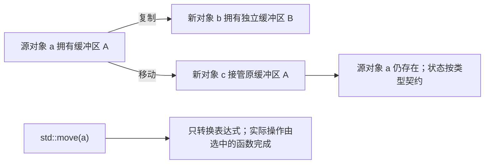

# 05 · 复制、移动与值类别：为什么写了 move 还没有移动

← [[学习/学习导航/2026-10-20-学习导航|当天学习入口]]

前置：[[学习/2026-10-20/00-先读懂C++代码与对象|先读懂代码与对象]]、[[学习/2026-10-20/03-所有权与智能指针|所有权与智能指针]]。

本篇对应 `CPP-MOVE-001`。你的本次自测是 **0 分**，所以从“为什么需要复制和移动”讲起。
这里是学习正文，可以直接阅读；自测题仍在 [[八股测试/2026-10-20#CPP-MOVE-001 · 移动语义与值类别|当天测试]]。
不要求一次背完所有名词。先学会区分三件事：**表达式是什么类别、能调用哪个函数、那个函数实际做了什么**。

> [!abstract] 读完要能做什么
> 看见 `T b = a`、`b = a`、`std::move(a)` 时，先判断有没有新对象，再判断复制还是移动。
> 能解释：`std::move` 不会自动搬资源；`const` 不会被它去掉；移动后对象并没有自动销毁。
> 建议分两轮：先读到第 8 节；第二轮再读 Rule of Zero、异常与返回值。

## 1. 为什么一个对象还需要“复制”和“移动”

假设你下载了一批行情，存进一个 `std::string`，里面有很多字符。
随后要把这批数据交给解析模块。这里可能有两种需求。

- **我还要保留自己这份内容。** 接收方需要另一份独立内容，适合复制。
- **我这份以后不用了。** 可以允许接收方接管资源，适合移动。

这里的“资源”可以是动态字符缓冲区、动态数组、文件句柄等。
对象本身与它管理的资源要分开，前置知识见 [[学习/2026-10-20/01-存储期与生命周期|存储期与生命周期]]。

复制像复印一份资料：两个对象各自负责自己的内容。
移动像交接一份资料的保管权：新对象可以接管原来的资源，原对象仍存在，但状态可能改变。
这个比喻只解释常见设计，**C++ 不强制所有移动函数都必须搬指针，也不保证移动一定更快**。

例如，一个只有 `int` 的小对象，复制和移动都可能只是传递一个整数。
有短字符串优化的 `string`，某些内容直接存在对象内部，移动也可能涉及字符复制。
实际成本要看类型、数据大小、分配器和实现。

**可编辑关系图（Mermaid）**



图中的缓冲区 A、B 代表独立资源。复制产生第二份资源；移动示意的是资源所有权转交。
“移动后源为空”是图中这个资源管理模型的契约，不能推广成所有类型都清空。

## 2. 先看有没有“出生”：构造和赋值不是一回事

**构造**：创建一个新对象，并给它初始状态。
**赋值**：对象已经存在，更新这个对象的状态，必要时处理它原来管理的资源。

下面是片段，不是完整程序：

```cpp
std::string a = "行情";    // a 出生
std::string b = a;         // b 出生，复制构造
std::string c = std::move(a); // c 出生，移动构造
b = c;                    // b 已存在，复制赋值
b = std::move(c);          // b 已存在，移动赋值
```

不要仅看有没有 `=`：`std::string b = a` 中的等号属于初始化语法。
它创建 `b`，不调用 `b` 的赋值运算符。
而最后两行没有声明新变量，才是对已有对象赋值。

| 动作 | 常见函数声明 | 中文意思 |
| --- | --- | --- |
| 复制构造 | `T(const T& other)` | 根据已有对象创建新对象，通常保留源内容 |
| 移动构造 | `T(T&& other)` | 根据允许被移动的源创建新对象 |
| 复制赋值 | `T& operator=(const T& other)` | 给已有对象复制状态 |
| 移动赋值 | `T& operator=(T&& other)` | 给已有对象转交状态或资源 |
| 析构 | `~T()` | 对象结束时做清理 |

表中的声明是最常见形式，不是标准允许的全部形式。
`operator=` 是“给赋值运算符起的函数名”，`T&` 返回值通常表示返回当前对象本身。
`const T&` 表示只读借用源；`T&&` 在这些非模板声明中是右值引用参数。
右值引用为什么与移动相关，下面逐步说明。

规则依据：[N4659 `[class.copy.ctor]`](https://timsong-cpp.github.io/cppwp/n4659/class.copy.ctor)、[N4659 `[class.copy.assign]`](https://timsong-cpp.github.io/cppwp/n4659/class.copy.assign)，C++17。

## 3. “左值”不是“写在等号左边的东西”

**表达式**就是代码中可以被求值的一段，例如 `a`、`a + b`、`std::move(a)`。
**类型**回答“它是什么”，例如 `std::string`。
**值类别**回答“这段表达式以什么方式表示对象或结果”，会影响引用绑定和函数选择。

C++17 的三个基本值类别先这样认识：

| 类别 | 初学时的理解 | 本篇例子 |
| --- | --- | --- |
| 左值 lvalue | 标识某个对象，可以继续按其身份使用 | 已声明变量的名字 `s` |
| 将亡值 xvalue | 仍标识某个对象，但允许把资源当作可复用资源 | `std::move(s)` |
| 纯右值 prvalue | 用来产生值或初始化结果对象 | `42`、`std::string("abc")` |

“将亡”是术语，不表示下一行自动销毁。`std::move(s)` 后，`s` 仍按原本的生命周期存活。
“右值”这个总称包括纯右值和将亡值。广义左值包括左值和将亡值。
今天不必先背分类树，先会判断表中常见表达式即可。

```cpp
int a = 1;
int b = a;       // a 写在右边，表达式 a 仍是左值
const int c = 2; // c 不能修改，但名字 c 仍是左值
```

因此，“能写在赋值左边”“可以修改”“左值”不能直接画等号。
尤其不要用“有没有名字”当成适用于所有表达式的完整定义；它只是这里判断普通变量名字的捷径。

标准定义针对的是表达式，而不是笼统地给某个对象贴永久标签。
同一个 `s` 对象，可以通过左值表达式 `s` 访问，也可以通过将亡值表达式 `std::move(s)` 表示。

依据：[N4659 `[basic.lval]`](https://timsong-cpp.github.io/cppwp/n4659/basic.lval)，C++17。

## 4. `std::move` 做的那一步比名字听起来少

可以把 `std::move(x)` 读成：**把这个表达式转成允许后续选择移动操作的形式**。
对本篇这些对象，它得到将亡值表达式。
它本身不分配缓冲区、不清空字符串、不调用某个对象的移动构造函数。

完整过程是：

```text
std::move(a)
  ↓ 转换表达式，仍指向原来的 a
用它初始化另一个对象，或传给某个函数
  ↓ 编译器选择可调用的函数，称为“重载决议”
选中的函数真正执行
  ↓ 可能移动，可能复制，也可能根本不能编译
```

**重载**就是同名函数有不同参数形式。
例如 `T(const T&)` 和 `T(T&&)` 都是构造函数，接收参数的方式不同。
当两个都合适时，普通非 `const` 对象的将亡值通常能优先选择 `T(T&&)`。
但没有合适移动函数时，不能凭 `std::move` 这几个字断言发生了移动。

下面仅绑定一个引用：

```cpp
auto p = std::make_unique<int>(42);
auto&& r = std::move(p); // r 是 p 的别名，没有新建 unique_ptr 管理者
```

`r` 绑定到原有 `p`，所以这时 `p` 仍拥有那个 `int`。
后面出现 `auto q = std::move(r);`，才创建另一个管理者 `q` 并调用移动构造。

来源：[N4659 `[forward]`](https://timsong-cpp.github.io/cppwp/n4659/forward) 给出 `move` 返回的转换形式；这里使用的是 C++17 规则。

## 5. 声明里写 `T&&`，为什么使用名字时还是左值

看这个片段：

```cpp
std::string source = "abc";
std::string&& ref = std::move(source);
std::string first = ref;            // 复制
std::string second = std::move(ref); // 移动
```

分开看两层：

- `ref` 的**声明类型**是 `std::string&&`，说明它是右值引用变量。
- 使用名字 `ref` 的**表达式类别**是左值，说明这次表达式按左值参与函数选择。

为什么这样设计有用？一个函数拿到右值引用参数后，可能要先检查、记录、使用几次，再决定何时交接资源。
如果每次写参数名字都自动移动，第一次读它就可能把内容意外交走。
所以需要真正交接时，再显式写 `std::move(ref)`。

这也适用于移动构造函数内部：

```cpp
Packet(Packet&& other)
    : text(std::move(other.text)) {} // other 是名字表达式，不能省略这里的 move
```

这是一段结构示意，完整 `Packet` 程序在第 8 节。
冒号后面是**成员初始化列表**，表示创建 `text` 成员时直接给它初始值。
如果写成 `text(other.text)`，成员 `text` 会从左值构造，通常选择复制。

核对：[N4659 `[expr]` 第 7 段](https://timsong-cpp.github.io/cppwp/n4659/expr#7)，命名右值引用表达式按左值处理。

## 6. `const` 不会因为 `move` 消失

`const` 表示通过这个对象不能修改它的普通状态。
资源交接通常需要修改源，例如把源内部指针改为空。
所以常见移动构造参数是 `T&&`，而不是 `const T&&`。

```cpp
const std::string source = "abc";
std::string target = std::move(source); // 选择复制构造
```

推理不要跳步：

1. `source` 是 `const std::string`。
2. `std::move(source)` 保留 `const`，得到 `const std::string` 的将亡值。
3. `std::string(std::string&&)` 不能接收它，因为不能丢掉 `const`。
4. `std::string(const std::string&)` 可以接收，所以这里复制。

不能由此推广成“对 const 调 move 永远复制”。类型的可用函数不同，结果也可能不同。
例如 `const std::unique_ptr<int>` 不能按常规方式移动，复制又被禁止，尝试用它构造另一个 `unique_ptr` 会编译失败。
自定义类型也可以专门声明 `T(const T&&)`，其具体行为还要读实现。

**工程场景**：如果一个局部对象需要把资源交出去，就不要仅为“看起来更安全”而先声明成 `const`。
如果它确实应当只读保留，就接受复制或使用只读借用接口，别强行去掉 `const`。

依据：[N4659 引用初始化规则](https://timsong-cpp.github.io/cppwp/n4659/dcl.init.ref)、[字符串构造函数](https://timsong-cpp.github.io/cppwp/n4659/string.cons)、[`move` 的转换规则](https://timsong-cpp.github.io/cppwp/n4659/forward)，C++17。

## 7. 移动后的源对象还能不能用

先分清：**移动了资源，不等于销毁源对象**。
源对象一般仍活到原来的作用域末尾，届时仍要正确析构。

标准库类型通常承诺“有效但状态未指定”，除非另有更强保证。
**有效**表示仍符合该类型的基本要求；**状态未指定**表示不保证你会观察到哪一种具体状态。
不能把这个词理解成“内存坏了”，也不能理解成“一定与原值相同”。

```cpp
std::string a = "abc";
std::string b = std::move(a);
// 不能要求 a.empty() 一定为 true
a = "重新使用"; // 可以重新赋值
```

你可以对移后的 `a` 析构、赋值，也可以查询 `size()`、`empty()`。
但调用需要满足条件的操作前，仍要检查条件，例如调用 `front()` 前确认非空。
“还能调用成员函数”不表示“任何成员函数在任何状态都合法”。

`unique_ptr` 有更强约定：向另一个管理者成功移动后，源为空。
但**为空的 unique_ptr 仍然不能解引用**。

```cpp
auto a = std::make_unique<int>(42);
auto b = std::move(a);
// 此后 a == nullptr，b 拥有原来的 int
```

自定义类型则看自己的契约。一个自定义句柄可以约定移动后句柄无效，只允许销毁、重新赋值和查询有效性。
如果类有“计数必须等于缓冲区长度”之类的约束，移动实现必须考虑这些成员能否保持一致。
不能把“所有标准库类型的一般约定”未经说明就套给所有自定义类。

来源：[N4659 `[lib.types.movedfrom]`](https://timsong-cpp.github.io/cppwp/n4659/lib.types.movedfrom)、[`unique_ptr` 第 4 段](https://timsong-cpp.github.io/cppwp/n4659/unique.ptr#4)，C++17。

## 8. 一份完整程序：把选择过程变成能观察的行为

代码文件：[[学习/2026-10-20/示例代码/05_move.cpp|05_move.cpp]]。

Obsidian 阅读：[[学习/2026-10-20/示例代码/05_move|05_move.md（完整中文注释）]]。
下面是完整 C++17 程序，不需要自行拼接前面的片段。
`Packet` 用计数器观察复制和移动操作；它不是生产环境必须手写的模板。

```cpp
// 学习日期：2026-10-20；注释补充：2026-10-21；基线：C++17。
// 用计数区分四件常被混在一起的事：复制构造、移动构造、复制赋值、移动赋值。
// std::move 只改变表达式可参与重载选择的形式；真正是否移动，要看随后调用哪个操作。
// 只绑定一个 && 引用不创建新 Packet；有名字的引用表达式仍是左值。
// const 不会被 std::move 去掉，所以从 const Packet 初始化这里的新对象会复制。
// 最后比较可选的命名返回值优化与 C++17 对返回同类型纯右值的保证。
// 正常输出 copies=4 moves=3；该输出在 make_packet 调用之前，后者不影响已经打印的数。

#include <cassert>      // assert 检查内容与次数；成功时不打印，NDEBUG 可关闭运行时断言。
#include <iostream>     // cout 输出复制、移动计数。
#include <memory>       // make_unique/unique_ptr：再用独占所有权验证“绑定”与“转交”的差别。
#include <string>       // string：作为 Packet 内实际拥有字符资源的成员。
#include <type_traits>  // is_lvalue_reference_v：在编译期检查表达式的引用类型。
#include <utility>      // std::move：转换表达式的值类别，不直接执行移动构造或赋值。

struct Packet {
    // 每个 Packet 各有一份 text；这里观察移动/复制对这一成员的操作。
    std::string text;
    // static 成员属于类型，所有 Packet 共用这两个计数，不是每个对象各有一份。
    // inline static 是 C++17 语法，允许在类内定义并初始化它们，无需另写类外定义。
    inline static int copies = 0;
    inline static int moves = 0;

    // explicit 禁止从一个 string 隐式转成 Packet。
    // value 按值接收，随后用 std::move(value) 初始化 text；这是普通构造，不计入下面四项。
    explicit Packet(std::string value) : text(std::move(value)) {}

    // 复制构造：从另一个已存在 Packet 创建“新的 Packet”。
    // const Packet& 只读借用源对象；text(other.text) 复制字符串内容，不改变源内容。
    Packet(const Packet& other) : text(other.text) {
        ++copies;
    }

    // 移动构造：Packet&& 是右值引用，可接收 std::move(非 const 对象) 产生的表达式。
    // other 虽然类型中带 &&，但它有名字，表达式 other.text 仍要再 move 才选择成员移动。
    // noexcept 声明不抛异常；它也是容器选择搬迁方式时会考虑的类型性质。
    Packet(Packet&& other) noexcept : text(std::move(other.text)) {
        ++moves;
    }

    // 复制赋值：左边的 Packet 早已存在，更新它的成员，不是再创建整个对象。
    // operator= 是赋值运算符函数；返回 Packet&，让赋值表达式仍引用左边对象。
    Packet& operator=(const Packet& other) {
        text = other.text;
        ++copies;
        // this 是指向当前对象的指针；*this 解引用得到当前对象，按引用返回而不复制它。
        return *this;
    }

    // 移动赋值：把源成员交给已有目标成员的移动赋值操作；与上面的移动构造区分。
    Packet& operator=(Packet&& other) noexcept {
        text = std::move(other.text);
        ++moves;
        return *this;
    }

    // = default 请求编译器生成正常析构行为；text 仍会自动析构，这不是“什么也不清理”。
    ~Packet() = default;
};

// 按值返回 Packet。local 是有名字的局部对象，这里可能进行 NRVO（命名返回值优化）。
// NRVO 不是该写法在 C++17 下每次必须发生的保证；未发生时可使用返回时的移动规则。
Packet make_packet() {
    Packet local("returned");
    // 直接 return local 表达返回局部值，不需要为了“加速”在这里主动写 std::move。
    return local;
}

struct Direct {
    // default 生成默认构造/析构；delete 明确禁止复制、移动构造。
    Direct() = default;
    Direct(const Direct&) = delete;
    Direct(Direct&&) = delete;
    ~Direct() = default;
};

Direct make_direct() {
    // Direct{} 是同类型纯右值。C++17 可直接构造最终结果，不需要先造临时再移动过去。
    // 所以即使 Direct 的复制和移动构造都被删除，这条返回路径仍可成立。
    return Direct{};
}

int main() {
    // a 创建时使用接收 string 的普通构造函数；copies/moves 仍是 0。
    Packet a("hello");
    Packet b = a;             // 声明新对象 b，a 是左值，调用复制构造，copies = 1。
    Packet c = std::move(a);  // 声明新对象 c，选移动构造，moves = 1。
    // b/c 内容都来自 hello；a 已被移动，不假定它此刻一定为空，也不靠读取它猜实现。
    assert(b.text == "hello");
    assert(c.text == "hello");

    Packet d("old");
    d = b;                   // d 已存在，因此是复制赋值，copies = 2。
    d = std::move(c);         // d 已存在，因此是移动赋值，moves = 2。
    assert(d.text == "hello");

    // && 声明右值引用；这里只让 ref 引用 b，并没有创建另一个 Packet 或调用移动函数。
    Packet&& ref = std::move(b);
    assert(b.text == "hello");
    // decltype((ref)) 检查带括号的表达式 ref 的类型；命名引用表达式是左值，结果为 Packet&。
    // _v 是类型特征的布尔值写法；static_assert 在编译期检查，不是运行时打印或判断。
    static_assert(std::is_lvalue_reference_v<decltype((ref))>);
    Packet e = ref;              // 名字 ref 是左值，选复制构造，copies = 3。
    Packet f = std::move(ref);   // 显式转换后选移动构造，moves = 3；源对象仍是 b。
    assert(e.text == "hello");
    assert(f.text == "hello");

    // const 表示不能通过 fixed 修改这个 Packet；std::move 不会去掉这种限制。
    const Packet fixed("const");
    // std::move(fixed) 是 const Packet&&，不能绑定到需要可修改源的 Packet&& 参数。
    // const Packet& 可以接收它，因此这里选择复制构造，copies = 4，而不是编译失败。
    Packet g = std::move(fixed);
    assert(g.text == "const");
    assert(Packet::copies == 4);
    assert(Packet::moves == 3);
    // :: 用于访问类型的静态成员，<< 依次输出：copies=4 moves=3。
    std::cout << "copies=" << Packet::copies
              << " moves=" << Packet::moves << '\n';

    // auto 推导为 unique_ptr<int>；p 独占一个值为 42 的动态 int。
    auto p = std::make_unique<int>(42);
    // 此处 auto&& 推导出右值引用，仍只是别名；没有第二个 unique_ptr 管理者对象。
    auto&& alias = std::move(p);
    assert(p != nullptr);
    // auto q 没带 &，确实创建新的 unique_ptr；其移动构造才把 p 的所有权转给 q。
    auto q = std::move(alias);
    assert(p == nullptr);
    // 表达式 *q 是解引用；只有在 q 持有有效 int 时才能这样读取。
    assert(*q == 42);

    // 被移动的 a 仍是活着的对象；本例的 string 成员可重新赋值后继续正常使用。
    a.text = "reused";
    assert(a.text == "reused");
    // 不再检查后续的 copies/moves 次数，因为 make_packet 的 NRVO 可影响额外移动次数。
    Packet result = make_packet();
    assert(result.text == "returned");
    // C++17 的同类型纯右值路径直接得到 direct，不调用已经删除的复制/移动构造。
    Direct direct = make_direct();
    // 显式转成 void，表示有意不使用这个对象的值；并没有提前析构 direct。
    (void)direct;
}
```

程序应该输出 `copies=4 moves=3`。这是在返回值实验之前打印的计数。
`make_packet()` 可能使用 NRVO，所以代码没有断言它必须发生几次移动。
程序没有断言移后的字符串内容，也没有访问空 `unique_ptr`。

按顺序走一遍：

| 语句 | 新对象还是已有对象 | 为什么选这个操作 |
| --- | --- | --- |
| `Packet b = a` | 新 `b` | `a` 是左值，复制构造 |
| `Packet c = std::move(a)` | 新 `c` | 非 const 将亡值，移动构造 |
| `d = b` | 已有 `d` | 复制赋值 |
| `d = std::move(c)` | 已有 `d` | 移动赋值 |
| `Packet&& ref = std::move(b)` | 只建立引用 | 不创建另一个 Packet |
| `Packet e = ref` | 新 `e` | 名字 ref 是左值 |
| `Packet f = std::move(ref)` | 新 `f` | 再次转换后选择移动 |
| `Packet g = std::move(fixed)` | 新 `g` | const 阻止普通移动重载，选复制 |

`inline static` 在这里让所有 `Packet` 共用一份计数，C++17 允许在类内定义这样的静态成员。
`++copies` 表示计数加一；`assert` 在条件不成立时报告失败。
`static_assert` 是编译期检查；`decltype((ref))` 用来检查表达式类别，本篇只需知道这个检查证明 `ref` 表达式是左值。
`this` 是当前对象的指针，`*this` 是当前对象，所以赋值函数最后返回当前对象的引用。

再读类定义里的几处语法：

- `explicit Packet(std::string value)` 是普通构造函数；explicit 防止某些意外的隐式类型转换，不是移动关键字。
- 参数 value 按值接收一个字符串，再把它交给 text 成员；这里统计的是 Packet 操作，不统计内部 string 操作。
- `: text(other.text)` 在创建成员时复制源字符串，而不是先创建 text 再赋值。
- `: text(std::move(other.text))` 在创建成员时移动源字符串，other 这个名字本身仍按左值使用。
- 赋值函数里的 text 已经存在，所以执行的是 string 的赋值操作。
- `~Packet() = default` 让默认析构清理 text，不需要手动 delete 字符缓冲区。

Packet 在本例中约定：移后 text 按 string 的有效但状态未指定规则使用，不能要求它为空。
计数器只帮助观察函数选择；实际业务不需要为了记录这几个数字而手写五个特殊成员。

## 9. 多数业务类先选 Rule of Zero

**Rule of Zero，零法则**：让成员自己管理资源，业务类尽量不手写复制、移动和析构。
例如，一个消息有字符串和若干价格：

```cpp
struct Message {
    std::string symbol;
    std::vector<int> prices;
}; // 片段；使用时需要 <string> 与 <vector>
```

`string` 和 `vector` 已经知道如何清理自己的资源。
编译器按成员组合生成相应操作，业务类就不必重复写资源管理。
如果某个成员是 `unique_ptr`，类的默认复制通常不可用，但默认移动可能可用，这也能自然表达独占所有权。

**Rule of Five，五法则**：如果你不得不定制或禁止复制、移动或析构，应一起审查这五项。
五项就是第 2 节表中的复制构造、移动构造、复制赋值、移动赋值、析构。
“一起审查”不表示五个函数都必须写长代码；可以合理使用 `= default` 或 `= delete`。

- `= default`：明确请求编译器使用默认行为。
- `= delete`：明确禁止这种操作，尝试调用会编译失败。

为什么不能只给拥有裸指针的类加一个 `delete` 析构就结束？
因为默认复制往往只复制指针值，两个对象会误以为各自拥有同一资源，最后可能重复释放。
这正是 [[学习/2026-10-20/02-RAII与异常清理|RAII 与异常清理]] 中“资源由谁负责”的问题。

另一个边界：用户声明析构函数，会抑制某些隐式移动操作的生成；即使写 `~T() = default` 也要注意。
因此，添加一个看似无害的析构声明后，不能想当然地认为原来所有移动能力都不变。

这里的工程建议来自 [Core Guidelines C.20/C.21](https://isocpp.github.io/CppCoreGuidelines/CppCoreGuidelines#Rc-zero)，访问 2026-10-20；语言生成规则仍按 [C++17 N4659 `[class.copy.ctor]`](https://timsong-cpp.github.io/cppwp/n4659/class.copy.ctor) 核对。

## 10. 为什么移动函数常写 `noexcept`

**异常**是操作无法完成时向外报告失败的一种机制。
`noexcept` 表示函数承诺不让异常逃出去。
如果写了 `noexcept`，内部却有异常逃出，程序会调用终止处理，不是自动变得不会失败。
所以不能为了“让 vector 更快”随便贴上这个关键字。

考虑 `vector<Packet>` 需要更大空间，要把旧元素搬到新空间。
如果搬到一半时移动抛异常，前面一些源对象可能已经被改变，回滚到原来状态就困难。
如果复制可用，复制旧元素通常可以保留旧内容直到搬迁成功。

因此，**可复制且移动可能抛异常**的类型，常见 `vector` 实现重新分配旧元素时会选择复制。
`std::move_if_noexcept` 就体现了一类这样的选择策略：在必要条件下给出 const 左值引用，否则给出右值引用。
但标准规定的是相关要求和异常保证，并不要求你把所有操作都理解成某一种固定实现算法。

还要记住两个边界：

- 类型只支持移动，复制不可用时，容器不能凭空复制，移动即使可能抛异常也可能要用。
- 某个非可复制类型的移动构造抛出时，相关操作的效果可能未指定，不能承诺始终完整回滚。

`push_back(std::move(x))` 还包含“构造新追加元素”和“搬迁旧元素”两个不同工作。
不要把“旧元素可能复制”误读成“新追加元素一定复制”。

工程建议：[Core Guidelines C.66](https://isocpp.github.io/CppCoreGuidelines/CppCoreGuidelines#Rc-move-noexcept)。
版本依据：[N4659 `[vector.modifiers]`](https://timsong-cpp.github.io/cppwp/n4659/vector.modifiers)、[`vector.capacity`](https://timsong-cpp.github.io/cppwp/n4659/vector.capacity)、[`forward`](https://timsong-cpp.github.io/cppwp/n4659/forward)，均按 C++17。

## 11. 返回局部对象时为什么通常不加 `std::move`

先认识 **返回值优化 RVO**：直接在最终结果位置构造对象，避免先做中间对象再复制或移动。
其中 **NRVO** 是“具名返回值优化”，例如返回一个有名字的局部变量。

```cpp
Packet make_packet() {
    Packet local("returned");
    return local; // 允许 NRVO；不做 NRVO 时按 C++17 相关规则尝试移动
}
```

这里的 `local` 符合常见 NRVO 条件，编译器可以直接把它构造到调用者的结果位置。
**NRVO 在 C++17 仍不是普遍强制。**
如果写成 `return std::move(local);`，返回表达式不再是用于 NRVO 的那个局部变量名字形式，可能阻止 NRVO。
所以通常写 `return local;`，让语言规则处理优化和必要的移动。

另一种形式不同：

```cpp
Direct make_direct() {
    return Direct{};
}
```

这是返回同类型纯右值。C++17 规定相应对象直接初始化结果，不要求先造一个中间对象再移动出去。
因此第 8 节的 `Direct` 即使禁止复制和移动，这种返回仍可以成立；析构函数仍须符合可访问等要求。
不要把它与“返回具名局部变量的 NRVO”混成一个保证。

来源：[N4659 `[class.copy.elision]`](https://timsong-cpp.github.io/cppwp/n4659/class.copy.elision)、[`[dcl.init]` 第 17.6.1 项](https://timsong-cpp.github.io/cppwp/n4659/dcl.init#17.6.1)，C++17。

## 12. 什么时候用，什么时候先别用

| 情况 | 合理思路 | 先检查什么 |
| --- | --- | --- |
| 把独占对象交给另一个模块 | 移动 `unique_ptr` 表达所有权转交 | 原拥有者以后不再解引用 |
| 向容器追加不再需要的字符串 | 可用 `push_back(std::move(s))` | 后续是否仍依赖 s 的原内容 |
| 两边都要保留独立内容 | 复制 | 大数据复制成本是否能接受 |
| 同步函数只读使用一次 | 传 `const T&` 借用 | 对象在整个调用期间存活 |
| 返回普通局部值 | 通常直接 `return local` | 返回类型、NRVO 条件与移动能力 |
| 对小整数反复加 `move` | 通常没有实际收益 | 先明确类型与实际成本 |

移动不解决并发访问问题，也不会延长被借用对象的生命周期。
把对象移进容器，也不表示你之前保存的所有裸指针都永远安全。
下一篇会继续解释：[[学习/2026-10-20/06-vector与综合练习|vector 与综合练习]]。

## 13. 自己推一次，再展开变式答案

先口述：一个对象什么时候是“仍然存在，但原有内容不能再假设”？
然后判断：声明右值引用，是否一定已经构造了另一个对象？

> [!question] 变式 1：为什么这行不能编译
> `auto p = std::make_unique<int>(7);`
> `auto&& r = std::move(p);`
> `auto q = r;`

> [!tip]- 变式 1 答案
> `r` 这个名字表达式是左值，`auto q = r` 尝试复制构造 unique_ptr。
> unique_ptr 禁止复制，所以编译失败。
> 若目的是转交所有权，应写 `auto q = std::move(r);`；成功后 p 为空。
> 注意 r 是 p 的别名，所以移动 r 的资源，就是移动 p 的资源。

> [!question] 变式 2：看到 move 就能删掉复制函数吗
> 类型只声明了 `T(const T&)`，没有声明移动构造函数。
> 用 `T b = std::move(a)` 初始化，能否保证调用移动构造？

> [!tip]- 变式 2 答案
> 不能。const 左值引用可以绑定这里的右值，仍可能调用复制构造。
> “没有移动构造函数”和“显式声明一个被 delete 的移动构造函数”也不总等价。
> 后者若参与选择并成为最佳匹配，会导致调用被删除函数的编译错误。
> 默认生成但被定义为 deleted 的移动构造另有忽略规则，进阶时再按完整声明分析。

> [!question] 变式 3：一次打印能证明所有 string 移后为空吗
> 在自己的机器上移动了 100 次字符串，源字符串的 size 每次都是 0。
> 这能否成为程序依赖的 C++17 保证？

> [!tip]- 变式 3 答案
> 不能。这只能描述当前实现和这些输入下的观察。
> 应依赖标准或接口契约；string 的一般移后状态不保证为空。
> 测试不能把“状态未指定”升级为“标准保证”。

> [!info]- 选学：转发引用与 std::forward
> 本篇的 `Packet&&` 是固定类型的右值引用参数。
> 在某些模板里，参与推导的 `T&&` 是“转发引用”，可以接收左值或右值；不是所有 `T&&` 都是转发引用。
> 它常配合 `std::forward<T>(x)` 保留调用方原来的类别，而不是一律当作可移动资源。
> 今天先不手写通用转发包装器。把这部分与普通移动混学，容易误以为所有引用参数都应 move。
> 以后学模板参数推导和引用折叠后，再读 [N4659 `[forward]`](https://timsong-cpp.github.io/cppwp/n4659/forward)。

## 14. 面试口述：先说明动作，再说边界

> `std::move` 本身是转换，通常把对象表达式转成将亡值，让后续函数选择有机会使用移动操作。
> 真正是否移动，要看构造或赋值的重载。创建新对象是构造，修改已有对象是赋值。
> 命名右值引用的名字仍是左值，想继续交接资源时还需要显式转换。
> move 保留 const，所以对 const string 构造普通 string 通常会复制；其他类型也可能无法编译。
> 标准库对象移后一般有效但状态未指定，unique_ptr 转交后源为空，string 不保证为空。
> 自定义类需要自己的移后契约。业务类优先让成员管理资源，采用 Rule of Zero；确需定制时审查五个特殊成员。

不用一次背得很快。能用第 8 节解释每一步为什么选择那个操作，比背完整段更重要。

## 15. 自查与资料边界

- [ ] 我能指出 `std::string b = a` 为什么不是赋值。
- [ ] 我能解释 `T&& ref` 的类型与表达式 `ref` 的类别为何不同。
- [ ] 我不会说“move 一执行，源就自动清空”。
- [ ] 我知道移后 string 与 unique_ptr 的保证不同。
- [ ] 我知道返回具名局部变量的 NRVO 与 C++17 同类型纯右值保证不同。

本篇语言和标准库规则以 **C++17 草案 N4659** 为版本基线，核对日期 **2026-10-20**。
条款链接使用该草案的 HTML 镜像，便于逐段阅读；Core Guidelines 属于工程建议，不替代标准。
程序里的计数是教学工具，不是性能测量。具体优化、短字符串布局和容量增长策略都不能从这些计数直接推出。
回到测试：[[八股测试/2026-10-20#CPP-MOVE-001 · 移动语义与值类别|CPP-MOVE-001]]；继续学习：[[学习/2026-10-20/06-vector与综合练习|06 · vector 与综合练习]]。
