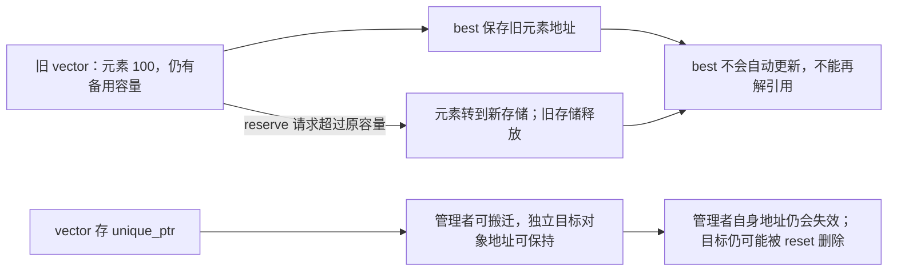

# 06 · vector 与综合练习：有空间，为什么还不能写进去

← [[学习/学习导航/2026-10-20-学习导航|当天学习入口]]

前置：[[学习/2026-10-20/00-先读懂C++代码与对象|读懂代码]]、[[学习/2026-10-20/01-存储期与生命周期|生命周期]]、[[学习/2026-10-20/05-复制移动与值类别|复制与移动]]。

本篇对应 `STL-VECTOR-001` 和 `EX-20261020-001`，你本次分别自测 **2 分**和 **1 分**。
你已经记得一部分结论，接下来把“容器里有什么对象”和“地址什么时候过期”连起来。
这里直接呈现学习解释；独立作答仍到 [[八股测试/2026-10-20|当天测试]]。

> [!abstract] 这篇最重要的两句话
> `capacity` 表示还能容纳多少，`size` 表示现在真正有多少个元素。能合法下标访问的范围只到 size。
> vector 为元素换一块存储时，旧的元素地址不能继续当成有效地址使用。
> 建议先读第 1 到 7 节，能解释 A/B 后，再看性能和完整程序。

## 1. 先把 STL、容器、元素翻译成人话

**标准库**是 C++ 提供的一组现成工具，例如字符串、容器、算法和智能指针。
**STL** 常用来指源自 Standard Template Library 思路的容器、迭代器和算法体系。
日常说“STL 的 vector”可以理解，但 STL 不是 C++ 标准库全部功能的精确同义词。

**容器**是帮你组织、保存一组对象的工具。
**元素**就是保存在里面的那些对象。
`std::vector<int>` 是“保存一串 int 的可变长容器”；`std::vector<Quote>` 则保存一串 Quote 对象。
尖括号里的类型告诉容器每个元素是什么类型，这属于模板的用法，今天先会读即可。

```cpp
std::vector<int> prices{100, 101, 102};
// prices 是容器对象；100、101、102 对应三个 int 元素
```

这是一段片段，使用时需要 `#include <vector>`。
不要把 `prices` 这个管理对象、元素对象、元素所用存储统称为“一个堆对象”。
管理对象可以是局部变量，元素存储通常由分配器动态取得。
两者的布局和责任已经在 [[学习/2026-10-20/01-存储期与生命周期|生命周期篇]] 中分开。

为什么需要 vector？你可以让它管理一批数量会变化的行情、订单或计算结果。
它处理元素构造、销毁和存储释放，使业务代码不必手写 `new[]` 与 `delete[]`。
它仍需要你正确处理边界、引用和地址的有效期。

## 2. 连续存储：同一排元素，按下标快速找到

对普通的 `vector<T>`，这里先排除 `T = bool` 的特殊化，元素连续存放。
若有三个 int 元素，可以先想成：

```text
下标          0        1        2
已存在元素   [100]    [101]    [102]
             ↑                 ↑
           第一个            第三个
```

“连续”说的是**元素之间没有额外的链表节点间隔**，相邻元素按对象大小排列。
它不保证整个 vector 管理对象也紧贴元素存储，更不保证任意对象指针永久不变。
如果元素是 `unique_ptr<Quote>`，连续的是这些智能指针管理者，不是它们分别指向的 Quote 对象。

**下标**是从 0 开始的位置编号。
`prices[0]` 是第一个元素，`prices[prices.size() - 1]` 是非空容器的最后一个元素。
前提是下标小于 `size()`，并且做 `size() - 1` 前已经确认非空。

`operator[]` 是下标操作的函数名。在 C++17 中，vector 的 `[]` 不替你做越界异常检查。
`at(i)` 会检查范围，越界时抛出 `std::out_of_range`，适合需要检查的访问。
换成 `at()` 能把一类越界变成可报告的异常，但不能修复已经保存的悬垂指针。

`data()` 给出元素存储的指针，通常用于需要连续数组接口的调用。
可访问的元素范围仍是前 `size()` 个，空容器不能因为 `data()` 得到了某个指针就解引用它。

依据：[N4659 `[vector.overview]`](https://timsong-cpp.github.io/cppwp/n4659/vector.overview)、[`[vector.data]`](https://timsong-cpp.github.io/cppwp/n4659/vector.data)、[序列容器访问要求](https://timsong-cpp.github.io/cppwp/n4659/sequence.reqmts)，C++17。

## 3. 迭代器、begin、end：把“走一遍”写成统一接口

**迭代器 iterator** 是用来指向、访问和逐步走过元素的一种位置工具。
普通 vector 的迭代器可以像指针一样使用，但不要依赖它必须就是裸指针类型。

| 写法 | 含义 |
| --- | --- |
| `v.begin()` | 第一个元素的位置；空容器时等于 end |
| `v.end()` | 最后一个元素后面的位置，称为尾后位置 |
| `*it` | 访问 it 所指向的元素，要求当前位置可解引用 |
| `++it` | 走到下一个位置 |
| `it != v.end()` | 还没到尾后位置，可以继续检查当前位置 |

为什么 end 不指向最后一个元素？
统一用“左闭右开范围” `[begin, end)`，就能让空容器自然满足 `begin == end`。
`end` 是停止标记，**它本身没有元素，不能解引用**。

```cpp
for (auto it = prices.begin(); it != prices.end(); ++it) {
    std::cout << *it << '\n';
}
```

片段中的 `auto` 让编译器推导迭代器类型。
第一次访问 begin；每轮结束向后走一步；到达 end 时停止。
如果循环内会添加、删除元素，就必须重新判断保存的迭代器是否还有效。
不是所有“看上去没改这个元素”的操作都会保留迭代器。

还会遇到两个相关词：

- **引用 `T&`**：一个已有元素的别名，例如 `int& r = v[0]`。
- **指针 `T*`**：保存元素地址，例如 `int* p = &v[0]`。

指针、引用、迭代器的写法不同，但都可能依赖某个元素对象仍在原位置存在。
vector 把元素换到新存储后，不能指望这些旧观察方式自动跟着更新。

依据：[N4659 容器通用要求](https://timsong-cpp.github.io/cppwp/n4659/container.requirements.general)、[迭代器要求](https://timsong-cpp.github.io/cppwp/n4659/iterator.requirements)，C++17。

## 4. size 和 capacity：已有元素与备用空间

**size，当前大小**：现在有多少个元素对象。
**capacity，容量**：利用当前存储，不重新分配时最多能容纳多少个元素。

```text
size = 2，capacity = 5

下标槽位    0       1       2       3       4
           [100]   [101]   [空位]  [空位]  [空位]
            已存在元素      备用存储，不是可下标访问的元素
```

“空位”只是辅助理解，不表示里面已经放了默认值为 0 的 int 对象。
对本篇 C++17 vector 的使用，不能直接用下标写进这些备用存储。

```cpp
std::vector<int> v;
v.reserve(8);
// v.size() == 0，v.capacity() >= 8
// v[0] = 7; // 错：第 0 个元素还不存在，保持注释，只分析
```

`reserve(8)` 是**请求预留容量**，不是“创建 8 个元素”。
标准只保证成功后容量至少满足请求，不保证容量恰好等于 8。
所以程序应检查 `capacity() >= 8`，不要写成对实现策略的错误断言。

“预留容量不创建新增元素”也不表示 reserve 永远不调用元素的构造函数。
如果原来已有元素，并且需要重新分配，容器可能要把已有元素复制或移动构造到新位置。

依据：[N4659 `[vector.capacity]`](https://timsong-cpp.github.io/cppwp/n4659/vector.capacity)，C++17。第 9 节将继续解释换存储的过程。

## 5. reserve 与 resize：一个准备空间，一个改变元素数

**reserve(n)** 的目的：告诉容器“我预计会容纳至少 n 个元素，请准备容量”。
**resize(n)** 的目的：让容器现在真的有 n 个元素。

下面仍是教学片段：

```cpp
std::vector<int> v;
v.reserve(8);     // size 仍是 0
v.resize(3);      // size 变成 3，新增三个 int 元素
v[0] = 100;      // 现在下标 0 合法
v.resize(1);      // 删除尾部两个元素，只保留 v[0]
```

本例采用默认分配器，`resize(3)` 新增的 int 值为 0。
但不要背成“resize 给任何类型清零”。
对自定义类，它按相应的默认插入构造方式创建对象；某些类型不具备操作要求，就不能这样调用。
也可以用 `resize(3, value)`，让新增元素从指定值复制构造。

缩小 size 时，尾部元素会被销毁，原容量不会因此要求缩小。
如果 vector 里是智能指针，删除这些元素还可能触发它们所拥有对象的清理。
“删一个元素”有时包含业务对象析构、释放内存等工作，不能只看一个整数减一。

| 操作 | size 的变化 | 容量与对象的变化 |
| --- | --- | --- |
| 空 v 执行 `reserve(8)` | 仍为 0 | 预留至少 8 的容量，不产生 8 个元素 |
| `resize(3)`，原来 size 为 0 | 变成 3 | 创建 3 个元素，必要时分配存储 |
| `resize(1)`，原来 size 为 3 | 变成 1 | 销毁最后 2 个元素，不要求缩容 |
| `push_back(100)` | 增加 1 | 尾部创建一个元素，容量不够时重新分配 |
| `clear()` | 变成 0 | 销毁全部元素，容量保留 |

`shrink_to_fit()` 是“尽量缩容量”的非强制请求。
它不保证执行后 `capacity() == size()`；如果发生重新分配，也要考虑引用失效。
不要靠它完成必须立即释放特定字节数的业务契约。

## 6. 原题 A：有存储，但没有那个元素

原题的一小段如下，错误行保持注释：

```cpp
std::vector<int> prices;
prices.reserve(2);
// A: prices[0] = 100;
```

按三步判断：

1. 默认创建的 prices 是空容器，所以 size 为 0。
2. reserve 只保证容量，不改变 size。
3. 合法下标需要小于 size，0 并不小于 0，所以 A 是越界访问。

取消 A 的注释会违反 C++17 的访问要求，属于未定义行为。
**未定义行为 UB** 的意思是标准不再规定程序必须表现成什么样。
它可能看起来写成功，也可能被工具报告问题；不能据此说“机器上能跑就合法”。
写法一：需要一个元素，就用 `prices.push_back(100)` 创建它。
写法二：本来就要一个确定长度的序列，可以先 `prices.resize(1)`，再写 `prices[0]`。

这两个修正都改变了 size，不是单纯换一种访问语法。
若只把 `prices[0]` 换成 `prices.at(0)`，会收到越界异常，仍没有创建元素。

访问要求可核对 [N4659 `[sequence.reqmts]`](https://timsong-cpp.github.io/cppwp/n4659/sequence.reqmts)，容量规则见 [C++17 `[vector.capacity]`](https://timsong-cpp.github.io/cppwp/n4659/vector.capacity)。

## 7. 原题 B：元素换了位置，旧地址不会自己更新

这是原练习的完整问题形式，A/B 都保持注释，只做静态分析：

```cpp
#include <iostream>
#include <vector>

int main() {
    std::vector<int> prices;
    prices.reserve(2);
    // A: prices[0] = 100;
    prices.push_back(100);
    int* best = &prices[0];
    const auto old_capacity = prices.capacity();
    prices.reserve(old_capacity + 1);
    // B: std::cout << *best << '\n';
}
```

先看 `best` 保存的是什么：它保存第一个元素当时的地址。
它没有保存“永远寻找 prices 第一个元素”的规则，也不会监听 vector 的变化。

第二次 reserve 请求值明确大于当前容量，成功时会重新分配。
假定分配成功，并且这个小例子中的 `old_capacity + 1` 是可表示且合法的容量请求。
容器在新存储中安置元素，结束旧位置元素的生命周期，释放旧存储。
原来的 `best` 因此失效；把它继续当成有效元素指针解引用，就是 B 的问题。

**悬垂指针 dangling pointer**：指针还保存着地址，但相应被观察对象已经不再有效存在。
悬垂并不意味着指针变量自己消失了。
把 best 声明成 `const int*` 也不会让旧元素继续存活，const 只限制通过它修改值。

**可编辑关系图（Mermaid）**



图中旧存储已释放，`best` 保存的旧地址不会自动改为新地址。
新元素的值可以仍然是 100，但“值相同”不表示“原对象在原地址继续有效”。
不要打印 B 来猜答案，不能承诺“打印 100”“随机值”或“一定崩溃”。

重新分配的规则：[N4659 `[vector.capacity]` 第 3、6 段](https://timsong-cpp.github.io/cppwp/n4659/vector.capacity)，C++17。

## 8. 两种安全修正，解决的是两种需求

### 8.1 我需要连续存值，只想重新找到同一个位置

保存**索引**，需要使用时通过当前容器重新取元素。
索引只是整数位置编号，不是旧地址，所以重新分配本身不会让这个整数变成悬垂指针。

```cpp
std::vector<int> prices;
prices.push_back(100);
const std::size_t best_index = 0;
prices.reserve(prices.capacity() + 1);
assert(prices[best_index] == 100);
```

这是片段，完整安全程序在第 12 节。
它依赖：容器仍存活、下标仍小于 size、逻辑上该位置仍代表所需元素。
仅仅重新分配，没有改变元素顺序，所以这里成立。

如果中间插入、删除、排序，原来的索引可能指向另一个元素。
即使下标还合法，业务身份也可能错了，这称为逻辑错误，不一定是 UB。
例如 `[100, 200]` 中索引 1 指向 200；在开头插入 50 后，索引 1 指向 100。
需要跨这些操作追踪同一笔订单，应设计稳定 ID 或带有效性管理的句柄，而不是只存位置。

### 8.2 我确实需要独立对象的稳定地址

让 vector 存 `unique_ptr<int>`，每个 int 单独由智能指针拥有。
vector 搬迁的是这些管理者，不是它们分别拥有的 int。

```cpp
std::vector<std::unique_ptr<int>> prices;
prices.push_back(std::make_unique<int>(100));
int* best = prices[0].get();
prices.reserve(prices.capacity() + 1);
assert(*best == 100);
```

这里 best 指向独立的 int，所以可以跨 vector 的这次重新分配继续使用。
若保存的是 `&prices[0]`，那指向 vector 内的 unique_ptr 管理者，其地址仍会因重新分配失效。
**管理者地址**与**被管理对象地址**必须分清。

只要某次 erase、reset、clear 或销毁最后的对应拥有者删除了那个 int，best 也会悬垂。
所以这个方法提供的是“跨管理者搬迁保持对象地址”，不是永久有效指针。

成本通常包括独立分配、额外一次间接访问，以及与连续存值不同的缓存局部性。
它是所有权设计示例，不是所有行情系统的默认最优方案。
来源：[N4659 `unique_ptr` 移动构造](https://timsong-cpp.github.io/cppwp/n4659/unique.ptr.single.ctor)，C++17。

## 9. 重新分配 reallocation 到底发生了什么

**重新分配**就是容器需要另一个足够大的元素存储区。
对这里的普通默认分配器场景，可以按这个过程理解：

```text
取得新存储
    ↓
在新存储中复制或移动构造原有元素
    ↓
成功后销毁旧位置的元素并归还旧存储
    ↓
容器改为管理新存储
```

具体实现要处理异常和构造顺序，这张流程图不规定某个库内部每一步的精确顺序。
对用户最重要的结果：**原元素的指针、引用、迭代器和旧 end 失效**。

“搬迁”不等于对任何类型做一遍 `memcpy`。
`string`、智能指针和自定义类可能要调用适当的复制或移动构造。
哪些旧元素用复制，哪些用移动，还要看异常保证和类型能力，见 [[学习/2026-10-20/05-复制移动与值类别|移动篇的 noexcept 解释]]。

不要根据一次输出猜容量增长倍数，标准没有规定统一按 1.5 倍或 2 倍增长。
`reserve(n)` 在 `n <= capacity()` 时不重新分配；在 `n > capacity()` 时成功就重新分配。
追加新元素使新 size 超过旧 capacity，也会重新分配。

## 10. 失效速查：没有重新分配，也不是所有位置都安全

**失效 invalidation**：某个旧引用或迭代器不能继续按原来的用途使用。
判断时先问“有没有重新分配”，再问“操作发生在什么位置”。

| 操作 | 已有元素的旧观察方式 | 旧 end |
| --- | --- | --- |
| reserve 不重新分配 | 保持有效 | 保持有效 |
| reserve 重新分配 | 全部失效 | 失效 |
| 尾部 push/emplace，不重新分配 | 原元素指针、引用、迭代器有效 | 失效 |
| 尾部 push/emplace，重新分配 | 全部失效 | 失效 |
| 中间 insert，不重新分配 | 插入位置之前有效，该位置及之后失效 | 失效 |
| erase | 删除位置之前有效，该位置及之后的迭代器/引用失效 | 失效 |
| resize 变大，不重新分配 | 原元素观察方式有效 | 失效 |
| resize 变小 | 保留元素有效，被删尾部失效 | 失效 |
| clear | 所有元素都被删除，观察方式失效 | 失效 |

这里的 resize 行描述实际变大或变小；`resize(size())` 不改变元素数量。
中间插入会把后续值向后挪，删除会把后续值向前挪。
即使数字地址看起来相同，也不能继续把失效观察方式当成原元素的稳定身份。

为什么未重新分配的 push_back 也使旧 end 失效？
因为原来的尾后位置现在可能变成新元素位置，容器边界已经改变。
规则明确让旧 end 失效，不能靠数值地址碰巧可比较来绕过规则。

遍历删除时，应接住 erase 返回的新迭代器，不要再对旧 it 直接自增。
完整程序中会展示：`it = v.erase(it)`，返回值指向被删元素后面接上来的位置。
标准依据：[N4659 `[vector.modifiers]`](https://timsong-cpp.github.io/cppwp/n4659/vector.modifiers)、[容器要求中的 erase 返回值](https://timsong-cpp.github.io/cppwp/n4659/sequence.reqmts)，C++17。

## 11. 性能词先解释，再说使用场景

**O(1)** 可以先理解为工作量不会随着当前元素个数成比例增长。
**O(n)** 表示工作量可能随着 n 个元素线性增长。
这描述增长趋势，不承诺具体纳秒数，也不表示每个操作真的只有一条机器指令。

**摊还 amortized**：把一串操作的总成本平均分摊给每次。
vector 尾部追加通常用“摊还常数复杂度”描述。
大部分追加可能直接在预留位置构造，偶尔一次追加需要重新分配并搬迁很多旧元素。
所以摊还 O(1) 不等于每一次都是 O(1)，也不等于每次延迟一样。

假设某个教学模型按 1、2、4、8 扩大容量，搬迁总量是 1+2+4+……。
这解释为什么按比例增长可以使长期平均成本较小；**这个数列不是标准规定的增长倍数**。
反过来，如果循环中每次都 `reserve(size()+1)`，可能不断主动触发重新分配，破坏正常的摊还增长效果。

**缓存局部性**：处理器一次搬入的数据附近，接下来很可能还会访问。
连续遍历 vector 常有较好的空间局部性，但性能还依赖元素大小、访问顺序、数据量和硬件。
不能由“连续”直接推出它在所有工作负载下最快。

工程场景：一批行情到达前，已知合理上限，可以提前 reserve，减少处理过程中分配和搬迁的机会。
还要设计超过上限怎么办：扩容、拒绝、分批、覆盖，分别有不同业务含义。
预留空间增加内存占用，也不自动保证无缺页、无调度干扰或单次低延迟。

### push_back 与 emplace_back 不按名字排性能

`push_back(value)` 接收一个已经形成的元素值，放到尾部，可能复制或移动。
`emplace_back(args...)` 用传入的构造参数直接在元素位置构造对象。
例如 `vector<string>` 的 `emplace_back(3, 'x')` 可以直接构造字符串 `"xxx"`。

如果已经有一个 string，`push_back(s)` 和 `emplace_back(s)` 都可能复制它。
传入 `std::move(s)` 时，两者都可能移动；emplace 也不能免掉原有元素重新分配的成本。
选择以表达意图和参数是否匹配为先，需要性能结论时再测量具体调用场景。

依据：[N4659 vector 总览中的复杂度](https://timsong-cpp.github.io/cppwp/n4659/vector.overview)、[序列容器的构造和追加要求](https://timsong-cpp.github.io/cppwp/n4659/sequence.reqmts)，C++17。

## 12. 一份完整安全程序，把两种修正都走通

代码文件：[[学习/2026-10-20/示例代码/06_vector.cpp|06_vector.cpp]]。

Obsidian 阅读：[[学习/2026-10-20/示例代码/06_vector|06_vector.md（完整中文注释）]]。
程序不执行 A/B 的错误语句，不读取任何失效的元素指针，也不比较旧 end。

```cpp
// 学习日期：2026-10-20；注释补充：2026-10-21；基线：C++17。
// 主线：size 表示现有元素数，capacity 表示不重新分配就能容纳的元素数。
// 1. reserve 只请求容量；resize 才按需要增减现有元素。
// 2. 重新分配会使 vector 元素的旧指针/引用/迭代器失效，旧地址不会自动跟随新元素。
// 3. 保存索引后重新取元素，或把独立对象交给 unique_ptr 管理，解决的是两种不同需求。
// 4. erase 后接住返回的迭代器；用 push_back/emplace_back 表达不同的构造参数形式。
// 所有访问都在有效对象和合法范围内；错误访问只在专题中静态分析，不在本程序执行。
// 正常输出 vector safe examples: ok；断言成功时不另行打印。

#include <cassert>    // assert 检查教学步骤的性质；NDEBUG 可关闭它，不能靠它执行业务操作。
#include <cstddef>    // std::size_t：表达容器下标/大小的无符号整数类型。
#include <iostream>   // cout 输出最后的正常完成标记。
#include <memory>     // unique_ptr/make_unique：把独立 int 的所有权与 vector 槽位分开。
#include <stdexcept>  // out_of_range：捕获 at() 在越界时规定抛出的异常。
#include <string>     // string：用它展示复制现成对象与按参数原地构造的区别。
#include <vector>     // vector：管理一段连续的元素序列以及其容量。

// void 函数不返回结果；这里先演示容量、元素个数和有效观察指针的关系。
void basic_operations() {
    // <> 指定模板元素类型为 int；默认构造时没有元素，size 为 0。
    std::vector<int> values;
    // 请求至少容纳 4 个元素的空间；不创建那 4 个 int，size 仍是 0。
    values.reserve(4);
    assert(values.empty());
    // >= 而不是 ==：标准保证至少满足请求，不要求容量恰好等于 4。
    assert(values.capacity() >= 4);

    // bool 只记录“是否捕获了预期异常”，初始 false。
    bool caught = false;
    try {
        // at(0) 检查范围；此时 size 为 0，所以会抛出 out_of_range。
        // (void) 表示忽略返回值。这是规定的异常路径，不是执行越界 [] 的 UB。
        (void)values.at(0);
    } catch (const std::out_of_range&) {
        // const & 借用异常对象；本例不需要读取它，因此参数没有写名字。
        caught = true;
    }
    assert(caught);

    // resize(2) 真正创建两个 int 元素，此处值初始化为 0；现在才可访问下标 0、1。
    values.resize(2);
    assert(values.size() == 2);
    // && 是逻辑“并且”，左右两个条件都为真，整条断言才成立。
    assert(values[0] == 0 && values[1] == 0);
    values[0] = 100;
    values[1] = 101;
    // 声明里的 * 表示指针类型；&values[0] 在表达式中取得首元素的当前地址。
    // first 只是观察，不拥有该 int，也不能自己 delete 它。
    int* first = &values[0];
    values.push_back(102); // 新 size 为 3，不超过 capacity，因此本次不重新分配。
    // 原元素指针仍有效；这里没有保存或使用已经失效的旧 end 迭代器。
    assert(*first == 100);

    int sum = 0;
    // begin() 给出首元素迭代器，end() 是尾后位置，不指向可读取的元素。
    // auto 推导迭代器的具体类型，不要求它一定是裸指针；++it 移向下一元素。
    // 条件确保 it != end 才进入循环，因而循环体内的 *it 可以读取当前元素。
    for (auto it = values.begin(); it != values.end(); ++it) {
        sum += *it;
    }
    assert(sum == 303);
    // 缩小到 1：保留首元素，销毁后两个；不是清空再新建首元素。
    values.resize(1);
    assert(values.size() == 1);
    assert(*first == 100); // 首元素仍被保留，所以 first 还可读；函数退出后就不能再用。
}

// 方法一：保存位置编号，而不保存 vector 旧元素的地址。
void fix_with_index() {
    std::vector<int> prices;
    prices.push_back(100);
    // const 表示不改这个下标变量；size_t 与 size/capacity 的类型配合。
    const std::size_t best_index = 0;
    // const auto 让编译器推导容量的返回类型，同时保存不可修改的旧容量副本。
    const auto old_capacity = prices.capacity();
    // 请求值大于当前容量，因此成功时必然重新分配；不再使用任何旧元素地址。
    // 本例容量很小，假定 +1 可表示、请求合法且分配成功，不是任意大容量的恢复示例。
    prices.reserve(old_capacity + 1);
    assert(prices.capacity() > old_capacity);
    // 有效下标必须小于 size；“索引是整数没悬垂”不代表可以越界。
    assert(best_index < prices.size());
    assert(prices[best_index] == 100); // 从当前容器取当前位置，不沿着旧地址找。

    // 但下标只追踪位置，不自动追踪业务身份。插入/删除/排序可能改变位置与值的对应。
    std::vector<int> shifted{100, 200};
    const std::size_t old_index = 1;
    // 在 begin() 指向的位置之前插入 50，序列变成 [50, 100, 200]。
    shifted.insert(shifted.begin(), 50);
    assert(shifted[old_index] == 100); // 下标 1 仍合法，但已经不是原先要找的 200。
    assert(shifted[2] == 200);
}

// 方法二：vector 存管理者，每个 int 独立存在。需要跨管理者搬迁保留的是 int 的地址。
void fix_with_owned_object() {
    // 嵌套 <>：元素类型是 unique_ptr<int>，不是 int；每个管理者独占一个动态 int。
    std::vector<std::unique_ptr<int>> prices;
    // make_unique 返回临时拥有者；push_back 用移动把这份所有权交给 vector 的元素。
    prices.push_back(std::make_unique<int>(100));
    // get() 只借出被拥有 int 的指针，不接管所有权；它不是 &prices[0] 那个管理者地址。
    int* best = prices[0].get();
    const auto old_capacity = prices.capacity();
    // 这里搬迁 vector 中的 unique_ptr 管理者，独立分配的 int 不因此换地址。
    prices.reserve(old_capacity + 1);
    assert(prices.capacity() > old_capacity);
    // 比较的两边都指向仍活着的独立 int，不是在比较已失效的 vector 旧元素指针。
    assert(best == prices[0].get());
    assert(*best == 100);
    // prices 析构时销毁 unique_ptr，进而删除 int；best 不会延寿，之后不能再访问。
    // 若提前 reset/erase/clear 删除这个拥有者，对 best 也要重新判断有效期。
}

// 安全删除与构造：观察迭代器由谁更新，以及追加接口接收的是什么。
void erase_and_construct() {
    std::vector<int> numbers{1, 2, 3, 4};
    // for 的第三部分故意留空：删除与保留两条路径分别决定怎样更新 it。
    for (auto it = numbers.begin(); it != numbers.end();) {
        // *it 读当前元素，% 是取余；除以 2 余数为 0 表示偶数。
        if (*it % 2 == 0) {
            // erase 使旧 it 失效，返回接下来的有效位置（可能是 end），立即接住它。
            // 这里不能再额外 ++it，否则会漏掉接上来的元素，甚至错误越过 end。
            it = numbers.erase(it);
        } else {
            // 没删除时原 it 有效，才正常前进一步。
            ++it;
        }
    }
    // 额外一层括号让 assert 宏把初始化列表里的逗号留在同一个表达式内。
    assert((numbers == std::vector<int>{1, 3}));

    std::vector<std::string> names;
    names.reserve(2);
    const std::string name = "ABC";
    names.push_back(name);       // 接收已有的 const string 左值，在尾部复制出新 string。
    names.emplace_back(3, 'x');  // 把“3 个字符 x”作为构造参数，在尾部直接构造 xxx。
    // 不是“emplace 总更快”：如果给它已有的 name，也仍可能复制，扩容成本也不会消失。
    assert(names[0] == "ABC");
    assert(names[1] == "xxx");
}

int main() {
    // 按这四个独立小实验顺序阅读，每个函数结束会自动清理自己的容器和拥有对象。
    basic_operations();
    fix_with_index();
    fix_with_owned_object();
    erase_and_construct();
    // 这行说明程序走到了末尾；若断言启用，前面的检查也没有使它终止。
    // 一次输出不等于对所有改写版本的无 UB 或性能证明。
    std::cout << "vector safe examples: ok\n";
}
```

预期输出 `vector safe examples: ok`，断言用于检查本程序依赖的性质。
假设这几个很小的容量请求合法且分配成功；分配失败可以抛异常，本程序未专门恢复该失败。

按函数读，不必一次看懂 100 行：

- `basic_operations`：先有容量，再创建元素；容量足够的尾部追加保留首元素地址；最后缩小只删尾部。
- `fix_with_index`：重新分配后重新按索引访问；随后用开头插入演示“索引合法但业务身份变了”。
- `fix_with_owned_object`：检查独立 int 的地址没有因 unique_ptr 管理者搬迁而改变。
- `erase_and_construct`：用 erase 的返回值继续遍历；最后比较两种追加接口的参数形式。

`try/catch` 表示尝试操作并处理匹配的异常。这里故意调用空容器的 `at(0)`，收到的是规定的越界异常。
`% 2` 计算除以 2 的余数，余数为 0 表示偶数。
`assert((numbers == std::vector<int>{1, 3}))` 外面多一层括号，是为了让 assert 宏正确处理初始化列表里的逗号。
这些断言验证教学步骤，不测性能，也不能把某次运行扩大为对所有程序的安全证明。

## 13. `vector<bool>`：名字相似，元素访问模型不同

标准库对 `vector<bool>` 做了特殊化，允许使用压缩位表示。
**位 bit** 是最小的二进制标记；把很多真假值压进位数组能节省空间。
代价是一个元素未必对应一个独立、可取地址的普通 bool 对象。

所以 `vector<bool>::reference` 可以是模拟引用行为的代理类，而不是普通 `bool&`。
“代理”意思是它记住某一位的位置，通过成员操作去读写那一位。
`auto x = bits[0]` 也可能得到代理对象，而非你以为的一份独立 bool 值。
需要独立真假值时可明确写 `bool x = bits[0]`。

不要假定能从 `bits[0]` 得到普通 `bool*`，也不要把普通 `vector<T>` 的连续 T 对象模型机械套上去。
同样，多个线程分别写不同的逻辑位，也不能只凭“索引不同”就忽略它们可能共享同一底层存储单元。
首日先记住特殊化边界，是否使用压缩位应看接口与空间需求。

依据：[N4659 `[vector.bool]`](https://timsong-cpp.github.io/cppwp/n4659/vector.bool)、[容器的数据竞争要求与 vector<bool> 例外](https://timsong-cpp.github.io/cppwp/n4659/container.requirements.dataraces)，C++17。

## 14. 变式：别只认出原题的写法

> [!question] 变式 1：预留后追加，能保留什么
> `v.reserve(10)` 后已有 3 个元素，保存首元素指针 p 和 `old_end = v.end()`。
> 再 push_back 一个元素，成功且没有其他操作。p 和 old_end 各怎样？

> [!tip]- 变式 1 答案
> 追加后 size 为 4，不超过已有 capacity，因此这次不会重新分配。
> 原元素的指针、引用、迭代器保持有效，所以 p 可以继续观察首元素。
> 旧 end 失效，不能因为没有重新分配就继续使用 old_end。

> [!question] 变式 2：不重新分配，中间插入就安全了吗
> vector 容量充足，保存下标 0 和下标 2 元素的引用。
> 在下标 1 处插入一个元素。两份引用各怎样？

> [!tip]- 变式 2 答案
> 下标 0 的元素在插入位置之前，其引用保持有效。
> 原下标 2 处在插入位置之后，相应引用失效。
> 判断条件包含位置，不能只检查容量。

> [!question] 变式 3：换成 unique_ptr 后，所有观察方式都稳定吗
> vector<unique_ptr<int>> 中同时保存 `auto* manager = &v[0]` 和 `int* value = v[0].get()`。
> reserve 导致重新分配后，哪一个可以继续按原用途使用？

> [!tip]- 变式 3 答案
> manager 指向 vector 内的 unique_ptr 管理者，重新分配后失效。
> value 指向独立拥有的 int，搬迁 unique_ptr 不会移动这个 int，所以在拥有者未删除或重置它时仍有效。
> 删除对应对象后 value 也会失效，智能指针不会替外部裸指针延长寿命。

> [!question] 变式 4：保存索引能解决任意容器变化吗
> 保存某笔订单所在索引，再对 vector 排序，随后用旧索引取订单。
> 不越界是否就一定取到原来的订单？

> [!tip]- 变式 4 答案
> 不一定。排序改变值与位置的对应关系，旧索引可能指向别的订单。
> 这里要区分内存有效性与业务身份正确性。
> 需要跨排序跟踪对象，应通过稳定订单 ID 重新查找，或设计能检查有效性的句柄。

> [!info]- 选学：大量删除时为什么不必每个元素都 erase
> 中间 erase 会把后面元素向前搬，逐个删除可能反复搬动相同元素。
> C++17 可用 remove/erase 惯用法，把保留元素集中后一次删除尾部。
> remove 算法本身不改变 vector 的 size，这个名字也需要单独理解。
> 本篇先掌握迭代器有效性；C++20 的 std::erase/std::erase_if 不放进本篇 C++17 主程序。

## 15. 面试口述：先对象数量，再地址有效性

> size 是现有元素数，capacity 是当前存储无需重新分配能容纳的元素数。
> reserve 请求容量，不创建额外元素；resize 改变元素数，增大时创建元素，缩小时销毁尾部元素。
> vector 重新分配会使原元素的指针、引用、迭代器和旧 end 失效。
> 尾部追加没重新分配时，原元素观察方式有效，但旧 end 仍失效；中间插入和删除还要看位置。
> 原题 A 在 size 为 0 时用下标，属于越界；B 在强制重新分配后解引用旧指针，属于悬垂访问，不能预测固定输出。
> 连续存值可以在条件满足时保存索引并重新取元素；要求独立对象地址稳定时可以搬迁拥有者而保留被拥有对象，但删除后地址仍失效。

如果面试官继续问性能，再补充：尾部追加是摊还常数复杂度，单次重新分配仍可能有线性搬迁成本。
emplace 是否省操作取决于传入的是构造参数还是现成对象，不能保证总比 push 快。

## 16. 自查与来源版本

- [ ] 我能画出 size 为 0、capacity 大于 0 的状态。
- [ ] 我不会把备用空间当成已经存在的元素。
- [ ] 我能说出未重新分配的 push_back 对旧 end 的影响。
- [ ] 我能解释“数值仍是 100”为什么不能证明旧指针有效。
- [ ] 我能区分稳定地址、稳定位置和稳定业务 ID。
- [ ] 我能说清 vector<unique_ptr<T>> 连续存放的到底是什么。

本篇按 **C++17 草案 N4659** 核对，访问日期 **2026-10-20**；条款链接为固定版本 HTML 镜像。
插图是概念模型，不是某个编译器的真实地址或内存布局；容量增长与性能示例没有冒充 benchmark。
下一次自测回到 [[八股测试/2026-10-20#STL-VECTOR-001 · reserve、resize 与引用失效|STL-VECTOR-001]] 和 [[八股测试/2026-10-20#EX-20261020-001 · 行情缓存中的悬垂指针|EX-20261020-001]]。
