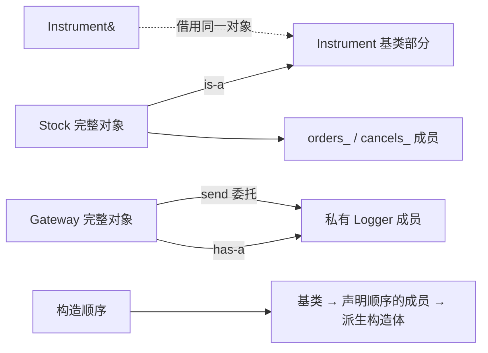

# 01 · 继承与组合：先判断“是一种”，还是“有一个”

[[学习/学习导航/2026-10-21-学习导航|当天学习入口]] · [[八股测试/2026-10-21#CPP-INHERIT-001 · 继承与组合分别表达什么|对应自测]]

上一篇基础：[[学习/2026-10-20/00-先读懂C++代码与对象|对象、成员、引用与构造函数]]。
本篇新增的是**类型之间的关系**，不重讲昨天的 RAII、移动与容器。

学完应能解释：为什么 `Stock` 可以公开继承 `Instrument`，但 `Gateway` 使用日志功能时通常选择一个 `Logger` 成员。

## 1. 从真实需求开始，别先背语法

假设系统管理股票、期货等交易品种，都需要读取品种编号。
我们希望“只读编号”的函数接收统一的 `Instrument` 视图。
如果某种股票满足这个品种接口约定，它可以作为一种 `Instrument` 使用。

另一边，网关发出订单时需要记录日志。
网关会用日志器，但用户不会把网关当成一种日志器。
把 `Logger` 放进 `Gateway`，已经能表达这层关系。

两者都能帮助复用代码，但它们给调用者的承诺不同。
写继承前先问：需要共同的类型接口，还是只需要调用一项功能？

## 2. 把五个词翻译成普通话

| 术语                      | 普通解释               | 本篇对应物                       |
| ----------------------- | ------------------ | --------------------------- |
| 基类 base class           | 提供共同类型部分的类         | `Instrument`                |
| 派生类 derived class       | 在基类关系上定义的新类型       | `Stock`                     |
| 公开继承 public inheritance | 调用者可以按公开基类接口使用派生对象 | `Stock : public Instrument` |
| 组合 composition          | 用成员对象表达“内部有一个”     | `Logger logger_;`           |
| 基类子对象                   | 一个派生对象内部属于基类的那部分对象 | `stock` 内部的 `Instrument` 部分 |

`is-a` 可读作“是一种”；`has-a` 可读作“有一个”。
这两个词是设计时的帮助，不是 C++ 新关键字。

“子对象”不是额外动态分配的独立对象。
本篇的 `stock` 内部直接包含基类部分与成员部分。
不要凭“继承”二字想象成运行时先创建一个外部基类，再用指针连过来。

标准依据：基类列表指定派生对象内的基类子对象，见 [N4659 [class.derived]](https://timsong-cpp.github.io/cppwp/n4659/class.derived)；核对日期 **2026-10-21**。

## 3. 先读懂一行继承声明

```cpp
class Stock : public Instrument {
    // Stock 自己新增的成员。
};
```

- `class Stock`：定义一个名叫 `Stock` 的类。
- `:`：此处引出基类列表，含义不是构造初始化列表。
- `public Instrument`：指定 `Instrument` 为公开基类。
- `{ ... }`：放当前类的成员声明。
- 最后的分号：结束类定义，不能省略。

公开且无歧义的继承允许在普通调用位置把 `Stock&` 绑定为 `Instrument&`。
这里“无歧义”指能确定该使用哪一份基类子对象；今天只使用单继承。
这一步常叫“向上转换”：从更具体的类型看向更一般的接口。

```cpp
const Instrument& base = stock;
```

这不是创建一个新的完整 `Instrument`。
`base` 借用 `stock` 内的基类部分，原来的 `Stock` 仍然存在。
`const` 表明这条引用访问路径不能用于修改普通成员状态。

依据：[N4659 [class.derived]](https://timsong-cpp.github.io/cppwp/n4659/class.derived) 与 [class.access.base](https://timsong-cpp.github.io/cppwp/n4659/class.access.base)，核对日期 **2026-10-21**。

## 4. 访问权限：两个不同问题要分开

第一个问题：**一个成员在原类里声明成什么权限？**
先忽略友元，只看普通外部代码与派生类成员。

| 基类成员权限 | 基类自己的成员函数 | 派生类成员函数 | 普通外部代码 |
| --- | --- | --- | --- |
| `public` | 可以使用 | 可以使用 | 可以使用 |
| `protected` | 可以使用 | 有条件可以使用 | 不可以使用 |
| `private` | 可以使用 | 不能直接按名字使用 | 不可以使用 |

表里“不能直接使用”不表示这份状态从对象里消失了。
`Instrument::id_` 仍存在，只是 `Stock` 不能直接写 `id_`。
它可以调用 `id()`，由基类自己的函数读取私有数据。

`protected` 也不是“只要写在派生类中，拿任何 Base 对象都能读”。
例如派生类成员不能仅凭自己是派生类，就通过一个任意 `Base&` 访问基类的 protected 数据。
本例通过自己的基类部分调用 `lot_size()`，属于清楚合法的用法。

第二个问题：**选择哪种继承方式，基类已有权限如何在派生接口上呈现？**

| 基类成员原权限 | `public` 继承 | `protected` 继承 | `private` 继承 |
| --- | --- | --- | --- |
| `public` | 对外仍按 public 访问 | 在派生类中按 protected 访问 | 在派生类中按 private 访问 |
| `protected` | 在派生类中按 protected 访问 | 在派生类中按 protected 访问 | 在派生类中按 private 访问 |
| `private` | 派生类不能直接访问 | 派生类不能直接访问 | 派生类不能直接访问 |

三种继承方式都不会自动给派生类打开基类私有成员的直接访问权限。
普通外部代码中的 `Derived* → Base*` 隐式转换，不能因为存在继承就一概认为可行。
`private/protected` 继承会限制这条转换的可访问位置。
成员函数内部与友元位置还受各自上下文影响，不能把“外部不允许”说成“所有位置都不允许”。

依据：[N4659 [class.access]](https://timsong-cpp.github.io/cppwp/n4659/class.access)、[class.access.base](https://timsong-cpp.github.io/cppwp/n4659/class.access.base)、[class.protected](https://timsong-cpp.github.io/cppwp/n4659/class.protected)，核对日期 **2026-10-21**。

### `class` 与 `struct` 有两项默认差异

| 写法 | 省略成员权限标签 | 省略继承权限 |
| --- | --- | --- |
| `class D : B { ... };` | 成员默认 private | 默认 private 继承 |
| `struct D : B { ... };` | 成员默认 public | 默认 public 继承 |

`struct` 也能有构造函数、私有成员和虚函数。
不要把“struct 默认 public”背成“struct 只能装数据”。
教程里把继承的 `public` 明写出来，可以少靠默认规则猜意图。

## 5. 完整 C++17 程序：继承和组合各做自己的事

源码：[[学习/2026-10-21/示例代码/01_inheritance.cpp|下载或打开 cpp]]。
阅读镜像：[[学习/2026-10-21/示例代码/01_inheritance|同代码 Markdown]]。
以下代码与这两个文件中的完整程序逐字一致。

```cpp
// C++17：public 继承、组合、访问权限与构造次序。
// <cassert> 提供 assert；条件为假时终止程序，便于核对观察结果。
#include <cassert>
// <iostream> 提供 std::cout，用于显示构造日志与最后的检查结果。
#include <iostream>

// 只给构造过程记序号；本例是单线程，不涉及并发共享。
int construction_step = 0;

class Instrument {
public:
    // explicit 防止一个 int 在普通隐式转换中变成 Instrument。
    explicit Instrument(int id) : id_(id) {
        ++construction_step;
        assert(construction_step == 1);
        std::cout << "1 Instrument base\n";
    }

    // 函数末尾的 const 表示通过该成员函数不修改普通成员状态。
    int id() const { return id_; }

protected:
    // 派生类可在符合 protected 访问规则的上下文使用这个函数。
    int lot_size() const { return 100; }

private:
    // id_ 存在于基类子对象中，派生类不能直接按名字访问它。
    int id_;
};

class OrderCounter {
public:
    // 每个 OrderCounter 对象记录自己被构造时的序号。
    OrderCounter() : step_(++construction_step) {
        std::cout << step_ << " OrderCounter member\n";
    }

    int step() const { return step_; }

private:
    int step_;
};

// Stock 是一种 Instrument：用 public 明确表达公开的基类关系。
class Stock : public Instrument {
public:
    // 先构造 Instrument 基类，再按成员声明顺序构造两只计数器。
    explicit Stock(int id)
        : Instrument(id), orders_(), cancels_() {
        ++construction_step;
        assert(construction_step == 4);
        std::cout << "4 Stock constructor body\n";
    }

    int minimum_order() const { return lot_size(); }
    int first_member_step() const { return orders_.step(); }
    int second_member_step() const { return cancels_.step(); }

    // 错误片段只留注释：int bad() const { return id_; }
    // private 没有变为派生类可见，应使用公开的 id()。

private:
    // 这两行声明的先后次序决定成员初始化次序。
    OrderCounter orders_;
    OrderCounter cancels_;
};

class Logger {
public:
    // 普通成员函数；Logger 只负责数一数发生了几次记录。
    void record() { ++count_; }
    int count() const { return count_; }

private:
    int count_ = 0;
};

class Gateway {
public:
    // 委托：Gateway 收到请求后调用自己拥有的 Logger 成员。
    void send() { logger_.record(); }
    int sent() const { return logger_.count(); }

private:
    // 组合：Gateway 有一个 Logger，但 Gateway 不是一种 Logger。
    Logger logger_;
};

// const Instrument& 是只读借用，不复制 Stock，也不接管销毁责任。
int read_id(const Instrument& instrument) {
    return instrument.id();
}

int main() {
    Stock stock{600000};
    assert(construction_step == 4);
    assert(stock.first_member_step() == 2);
    assert(stock.second_member_step() == 3);
    assert(stock.minimum_order() == 100);

    // public 且无歧义的继承允许这里的派生类到基类引用转换。
    const Instrument& base = stock;
    assert(base.id() == 600000);
    assert(read_id(stock) == 600000);

    Gateway gateway;
    gateway.send();
    gateway.send();
    assert(gateway.sent() == 2);
    // 编译错误示意：Logger& wrong = gateway; // 组合不提供此转换。

    std::cout << "inheritance and composition checks passed\n";
}
```

## 6. 对照关键行，一步一步追踪

### 6.1 两个头文件解决什么问题

`#include` 将所需库声明引入当前源文件。
`<cassert>` 提供 `assert`，本例用它检查预期是否成立。
`<iostream>` 提供输出流，`std::cout <<` 把文本送到标准输出。
`std::` 表示名字来自标准库的命名空间。

编译示例时不要定义 `NDEBUG`，这样断言才会执行。
断言是教学核对手段，不是业务输入校验或生产错误处理方案。

### 6.2 `Instrument` 先管好自己的状态

`Instrument(int id)` 是构造函数，名字与类相同，没有返回类型。
`: id_(id)` 在函数体运行前用参数 `id` 初始化成员 `id_`。
`id()` 是公开读取接口；调用者不需要知道编号具体怎样保存。
`lot_size()` 是受保护函数，演示派生类需要的有限辅助操作。

本篇用 `protected` 函数教学，没有把可随意修改的数据暴露给下层。
工程上如果大量派生类都直接改 protected 数据，基类维护状态约束会更难。
相关建议见 [Core Guidelines C.133](https://isocpp.github.io/CppCoreGuidelines/CppCoreGuidelines#rh-protected)，核对日期 **2026-10-21**；这是设计建议，不是编译器禁令。

### 6.3 `Stock` 内部有三块需要初始化的部分

创建 `Stock stock{600000};` 时，本例发生：

1. 构造 `Instrument` 基类子对象，编号变成 `600000`，步骤记为 1。
2. 构造先声明的 `orders_` 成员，步骤记为 2。
3. 构造后声明的 `cancels_` 成员，步骤记为 3。
4. 进入 `Stock` 构造函数体，步骤记为 4。

`orders_` 和 `cancels_` 都是 `OrderCounter`，但它们是两份不同成员对象。
`Stock` 的初始化列表给出初始化参数，不能随意改写规定的执行次序。
就算把列表里的 `cancels_()` 写到 `orders_()` 前面，成员仍按声明顺序初始化。
教学代码把列表顺序和真实顺序写一致，避免误导和编译器重排警告。

本篇没有虚继承；一般规则还需先处理虚基类，再处理直接基类、数据成员和函数体。
先掌握当前单继承情形，不必把“虚基类”和下一篇“虚函数”混成同一件事。

依据：[N4659 [class.base.init]/13](https://timsong-cpp.github.io/cppwp/n4659/class.base.init#13)，核对日期 **2026-10-21**。

### 6.4 `read_id` 为什么能接受 `stock`

函数只要求 `const Instrument&`，表示“借用一个可按品种接口读取的对象”。
`Stock` 的公开继承使调用点的引用转换合法。
函数调用 `id()`，本例无需虚函数，因为这里并不需要各派生类替换编号读取实现。

**继承关系本身不会自动把普通成员函数变成虚函数。**
公开继承与运行时多态相关，但不是同一个定义。
下一篇专门增加 `virtual`，比较调用选择的差别。

### 6.5 `Gateway` 为什么只保存一个 `Logger`

`Logger logger_;` 创建成员对象，表达“网关拥有一份日志器状态”。
`send()` 调用 `logger_.record()`，这叫把一部分工作委托给成员。
外部只能看到 `send()` 与 `sent()`，不必继承日志器所有公开操作。
例如以后日志器增加 `clear_log()`，网关不必自动把这个操作暴露给业务调用者。

`Logger& wrong = gateway;` 是编译错误示意。
组合没有承诺网关可当日志器用，因此不会产生这种隐式类型转换。

## 7. 把“对象里有什么”与“调用者能怎么用”画开

**可编辑关系图（Mermaid）**



左侧的外框是一个完整 `Stock`，内部框是基类和成员子对象。
向 `Instrument&` 的箭头表示访问同一对象里的基类部分，没有复制。
右侧 `Gateway` 的成员框表示组合，调用箭头表示 `send()` 委托记录。
图的框图关系不是字节布局承诺，不能从图推导 `sizeof` 或实际偏移。

## 8. 场景怎么选：先给调用者一条稳定承诺

### 场景 A：统一管理不同交易品种

如果每一种品种都满足编号读取等共同约定，公开继承可以表达这个共同类型关系。
之后如果需要品种各自计算规则，可在明确扩展点引入虚函数。
不要因为股票与期货某字段名字相同，就认定所有行为也适合共用一个基类接口。

### 场景 B：订单网关使用日志器、时钟、编码器

这些常是“网关有一个/使用一个部件”的关系。
组合让网关明确选择对外操作，部件变化不必变成网关公共接口变化。
成员可以直接保存对象，也可按实际所有权需要保存其他表示；所有权基础见昨天专题。

### 场景 C：为了省三行重复代码就继承一个工具类

先尝试成员函数、自由函数或组合。
公开继承会把类型转换与基类公开操作一起带给调用者，代价超过“少写几行”。
`private` 继承有特定用途，但并不是初学阶段“想复用就先继承”的默认选择。

设计参考：[Core Guidelines C.120](https://isocpp.github.io/CppCoreGuidelines/CppCoreGuidelines#rh-domain)；核对日期 **2026-10-21**。

## 9. 三种反例，各自错在不同层

**反例一：认为 private 成员不属于派生对象。**
错在对象模型：状态仍在基类子对象里，只是直接名字访问受限。

**反例二：把 `class D : B` 当作公开继承。**
错在默认规则：`class` 未写继承权限时采用 private。
普通外部代码的 `B& b = d;` 因访问条件可能编译失败。

**反例三：让 Gateway 公开继承 Logger，只因要调用 record。**
语言可能允许，设计仍可能不合适。
应解释“调用者为什么需要把 Gateway 当 Logger 使用”；没有这个需求时，组合更直接。

三者分别涉及对象内容、编译规则、设计选择，不能笼统都说成“未定义行为”。

## 10. 小练习：先自己推，再展开答案

1. 把 `Stock` 的 `public Instrument` 改为 `private Instrument`，`read_id(stock)` 在 `main` 中还能保持原样吗？
2. 只交换初始化列表中两只计数器的书写次序，实际构造次序是否改变？
3. 把 `OrderCounter orders_` 的声明移到 `cancels_` 后，哪个成员先构造？
4. 网关需要更换日志实现，就足以说明它应公开继承 Logger 吗？

> [!tip]- 练习答案：先区分规则与选择理由
> 1. 不能。`main` 位置的派生到私有基类隐式引用转换不可访问；`Stock` 自己的成员内部又是另一种上下文。
> 2. 不改变。成员初始化顺序由类中的声明顺序决定；书写倒序容易误导，应避免。
> 3. 改动声明后 `cancels_` 先构造，原断言应相应调整。不要只调整初始化列表来“修复”真实依赖。
> 4. 不足以。更换被使用的部件与表达“是一种部件”是不同需求，组合通常更自然。
>
> 核对：[N4659 [class.access.base]](https://timsong-cpp.github.io/cppwp/n4659/class.access.base)、[class.base.init](https://timsong-cpp.github.io/cppwp/n4659/class.base.init)，核对日期 **2026-10-21**。

## 11. 30–90 秒口述

“公开继承用来表达一种可以按基类接口使用的类型关系，组合表达内部拥有或使用一个部件。
派生对象内部包含基类子对象；通过可访问且无歧义的基类引用访问它，不会额外复制一个对象。
public、protected、private 控制名字和基类转换的访问条件，基类 private 成员不会因此消失，也不会自动向派生类开放。
class 默认 private，struct 默认 public，成员权限与继承权限都要分开检查。
本例先构造基类，再按成员声明次序初始化成员，最后执行派生构造函数体。
如果只是需要日志功能，我优先考虑组合；继承后是否发生动态分派，还要看函数是否 virtual。”

下一篇：[[学习/2026-10-21/02-虚函数与动态绑定|02 · 虚函数与动态绑定]]。
