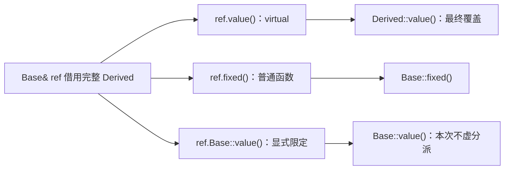

# 02 · 虚函数与动态绑定：同一条接口，按对象选择实现

[[学习/学习导航/2026-10-21-学习导航|当天学习入口]] · [[八股测试/2026-10-21#CPP-VIRTUAL-001 · 同一个对象，经不同类型调用时选哪个函数|对应自测]]

先读：[[学习/2026-10-21/01-继承与组合|继承、基类子对象与 public 转换]]。
指针、引用不熟时回看 [[学习/2026-10-20/00-先读懂C++代码与对象|昨天的读码基础]]。

本篇要解决的问题：函数接收 `Base&` 时，怎样使用调用者真正传来的具体对象的行为？

## 1. 为什么共同类型之外，还需要共同调用方式

假设回放系统可以读取本地文件，也可以读取网络数据。
上层只想表达“给我下一条消息”，不想每次调用都判断具体来源。

一种写法是在每个调用点堆分支：“如果文件就调这个，如果网络就调那个”。
当来源增加，多个调用点可能都要改，分支也容易忘记同步。
另一种写法是共同接口声明一个可替换行为，各来源分别实现它。

虚函数提供的就是后一种运行时选择机制。
调用者仍要知道共同接口，但不必在每次调用处写出具体派生类型名。

本篇先用返回整数的例子观察规则，避免业务细节遮住对象和调用关系。
整数 `10/20` 只是让不同函数的身份容易辨认，不代表性能或优先级。

## 2. 先分清静态类型、动态类型和动态绑定

```cpp
Derived derived;
Base& ref = derived;
Base* ptr = &derived;
```

| 词 | 普通解释 | 本例 |
| --- | --- | --- |
| 静态类型 | 编译器从表达式与声明中确定的类型 | `ref` 所访问的接口类型为 `Base`，`ptr` 的类型为 `Base*` |
| 动态类型 | 当前实际对象的类型，构造析构期间另有规则 | 完整构造后的对象是 `Derived` |
| 绑定 | 决定调用对应哪一个函数实现 | 选择 `Base::value` 还是 `Derived::value` |
| 动态绑定 | 普通虚调用按实际对象的最终覆盖实现选择 | `ref.value()` 选择 `Derived::value` |
| 多态类 | 声明或继承了虚函数的类 | 本例的 `Base` 与 `Derived` |

严格说，名字 `ref` 声明为引用；表达式用于成员访问时具有 `Base` 的静态类型。
“静态”不是说变量使用了 `static` 关键字，“动态”也不要求必须在堆上分配。
本例 `derived` 是局部对象，照样能通过基类引用进行虚调用。

“最终覆盖函数”表示沿继承关系走到当前对象时，为该虚函数提供最终行为的实现。
这里的“最终”不要求源代码写 `final`；`final` 是下一篇介绍的限制覆盖工具。

依据：[N4659 [class.virtual]](https://timsong-cpp.github.io/cppwp/n4659/class.virtual)、[N4659 expr.call /1](https://timsong-cpp.github.io/cppwp/n4659/expr.call#1)，核对日期 **2026-10-21**。

## 3. `virtual` 改变了什么，没改变什么

基类写 `virtual int value() const`，表示这个成员函数允许派生类提供覆盖实现。
派生类的 `int value() const override` 提供匹配的实现，并让编译器检查匹配关系。
只要已经覆盖基类虚函数，派生函数不重复写 `virtual` 仍然是虚函数。

普通非虚函数 `fixed()` 也可以在派生类写同名函数。
但从 `Base&` 选中 `Base::fixed` 后，不会因为对象其实是 `Derived` 就自动跳到派生版本。

**判断顺序应是：先按静态类型查名字和候选，再看选中的函数是否按虚规则分派。**
不是先扫描整个实际对象，把所有同名函数都放进来比较。
下一篇会用“名字隐藏”解释为什么这一步很重要。

`Base&` 也不能因此调用只在 `Derived` 中声明、基类接口完全没有的成员。
虚分派是在已选中的虚函数对应的覆盖链上选择实现，不会扩大调用者可见接口。

依据：[N4659 [expr.call]/1](https://timsong-cpp.github.io/cppwp/n4659/expr.call#1)，核对日期 **2026-10-21**。

## 4. 完整 C++17 程序：一次观察两种选择

源码：[[学习/2026-10-21/示例代码/02_virtual_dispatch.cpp|完整 cpp]]。
阅读镜像：[[学习/2026-10-21/示例代码/02_virtual_dispatch|同代码 Markdown]]。
下面代码与两份配套文件中的完整程序逐字一致。

```cpp
// C++17：用同一个对象观察静态选择、虚分派与构造析构阶段。
#include <cassert>  // assert 检查本例写出的语义预期。
#include <iostream> // std::cout 输出与断言对应的简短结果。

class Base {
public:
    // Base 构造期间，调用本对象虚函数会选 Base 层的实现。
    Base() { assert(value() == 10); }

    // virtual 使匹配的派生类实现可参与运行时选择。
    virtual int value() const { return 10; }

    // 没有 virtual：经 Base 访问时仍然选择 Base 的这个函数。
    int fixed() const { return 1; }

    // 本例有虚析构，销毁主题在第 05 篇独立展开。
    virtual ~Base() {
        // 此时 Derived 析构阶段已结束，调用选回 Base 层。
        assert(value() == 10);
        std::cout << "Base destructor: 10\n";
    }
};

class Derived : public Base {
public:
    // 进入 Derived 构造函数体时，本层实现已参与分派。
    Derived() { assert(value() == 20); }

    // override 要求编译器核对它确实覆盖了某个基类虚函数。
    int value() const override { return 20; }

    // 与 Base::fixed 同名，但 Base::fixed 不是虚函数。
    int fixed() const { return 2; }

    ~Derived() override {
        // 在 Derived 析构函数体内，仍选择 Derived 层的实现。
        assert(value() == 20);
        std::cout << "Derived destructor: 20\n";
    }
};

// 参数的静态类型是 const Base&，不决定对象必须是独立的 Base。
int read_virtual(const Base& object) {
    return object.value();
}

int read_nonvirtual(const Base& object) {
    return object.fixed();
}

int main() {
    // 内部块使析构时机出现在最终提示之前，方便阅读日志。
    {
        Derived derived;

        // ref 和 ptr 都借用 derived 内部的 Base 子对象，没有切片。
        Base& ref = derived;
        Base* ptr = &derived;

        assert(derived.value() == 20);
        assert(ref.value() == 20);
        assert(ptr->value() == 20);
        assert(read_virtual(derived) == 20);

        assert(derived.fixed() == 2);
        assert(ref.fixed() == 1);
        assert(ptr->fixed() == 1);
        assert(read_nonvirtual(derived) == 1);

        // 显式写出 Base::，这次调用抑制虚分派，直接选 Base 实现。
        assert(ref.Base::value() == 10);
        assert(ptr->Base::value() == 10);

        // 改变访问类型没有改变原对象；回到 derived 仍得到 20。
        assert(derived.value() == 20);
        std::cout << "virtual: 20, nonvirtual via Base: 1\n";
        std::cout << "qualified Base::value: 10\n";
    }
    std::cout << "virtual dispatch checks passed\n";
}
```

## 5. 按关键行解释，不靠记一串输出

### 5.1 `Base` 为什么能自己提供实现

虚函数不等于纯虚函数。
`virtual int value() const { return 10; }` 是有函数体的虚函数。
没有下层覆盖时可以使用这份实现；有下层覆盖时普通虚调用可选择下层行为。
纯虚函数如何表达接口，以及具体对象的实例化条件，留到 [[学习/2026-10-21/04-抽象类与接口|第 04 篇]]。

`fixed()` 返回 `1`，没有 `virtual`。
派生类另写一个返回 `2` 的 `fixed()`，并不能倒过来改变基类函数的类别。

### 5.2 `Base& ref` 与 `Base* ptr` 没有复制对象

二者都借用 `derived` 的基类部分。
`ref.value()` 用点号调用，`ptr->value()` 用箭头通过指针调用。
`->` 可先按“沿这个指针找到对象，再访问成员”理解。

这里没有 `new`，没有所有权转移，也没有把 `Derived` 按值复制成 `Base`。
别把“访问视角变为基类”误说成“原对象变成基类”。
按值复制的不同结果留到 [[学习/2026-10-21/06-对象切片与多态容器|第 06 篇]]。

### 5.3 四次 `value()` 都为什么得到 20

`derived.value()` 面对 `Derived` 对象，当前最终覆盖实现是派生版本。
`ref.value()` 和 `ptr->value()` 虽从基类接口访问，选中的仍是虚函数。
完整对象的派生版本因此参与选择。

`read_virtual(derived)` 把同一对象以 `const Base&` 借入函数。
函数体不需要知道 `Derived` 这个类型名，也能得到派生实现的结果。
这正是共同接口对调用代码的价值。

### 5.4 四次 `fixed()` 为什么不都一样

| 表达式 | 本例结果 | 理由 |
| --- | --- | --- |
| `derived.fixed()` | `2` | 从 `Derived` 查到派生普通函数 |
| `ref.fixed()` | `1` | 从 `Base` 选中基类普通函数 |
| `ptr->fixed()` | `1` | 指针提供的静态接口是 `Base` |
| `read_nonvirtual(derived)` | `1` | 函数参数按 `Base` 接口选中非虚函数 |

先说“从哪个接口查到了哪个函数”，再说“是否发生虚分派”。
这样才能应对函数名、参数或访问类型发生变化的题。

## 6. 限定调用：明确指定这一层

```cpp
ref.Base::value();
ptr->Base::value();
```

`Base::` 在这里是显式类名限定。
这次调用直接使用指定的基类实现，所以返回 `10`。
它没有删除派生对象，也没有永久关闭这份对象的虚分派。
下一条普通 `derived.value()` 仍然得到 `20`。

常见用途是在覆盖函数内先做公共基础工作，再做派生扩展。
但如果基类函数并不是一个可复用的“基础步骤”，强行调用它也可能违反设计意图。
应从接口约定判断能否复用，不能因为语法允许就固定写一遍基类调用。

依据：[N4659 [class.virtual]/15](https://timsong-cpp.github.io/cppwp/n4659/class.virtual#15)，核对日期 **2026-10-21**。

## 7. 图解：同一个对象，两条选择路径

**可编辑关系图（Mermaid）**



上方路径先经静态 `Base` 接口选到 `value()`，再按虚调用规则进入 `Derived` 的实现。
下方 `fixed()` 是非虚函数，因此停在静态选中的 `Base::fixed()`。
虚表示意放在独立区域，避免把语言规则与某个编译器的存储方式混成一条规定。

## 8. 虚表与 vptr：常见实现，不是标准布局承诺

为了快速从对象找到对应虚函数，一些常见 ABI 使用下面的组织方式：

- **虚表 vtable**：保存一组与虚函数调用相关入口的表。
- **虚表指针 vptr**：与对象相关、帮助找到相应表的信息；常见实现把它放在对象中。
- **间接调用**：先取出函数入口，再跳到该实现，而非直接写死一个函数地址。

ABI 是编译器与二进制组件之间关于布局、调用等细节的约定。
同一个语言标准下，不同 ABI 或不同继承结构可以采用不同安排。

**C++17 没规定“每个多态对象恰好一个 vptr，且它一定在首地址”。**
不要用 `reinterpret_cast` 假装标准保证了可按字节读取虚表。
本例验证函数调用结果，不窥探对象内部隐藏字段。

以上 vtable/vptr 是帮助理解的常见实现模型；语言保证来自 [N4659 [class.virtual]](https://timsong-cpp.github.io/cppwp/n4659/class.virtual) 与 [expr.call](https://timsong-cpp.github.io/cppwp/n4659/expr.call)，核对日期 **2026-10-21**。

## 9. 构造与析构期间：对象正在分阶段建立或拆除

普通完整对象上的规则，不能直接套到每个构造/析构阶段。
本程序专门在各层函数体中做了安全断言：

| 当前执行位置 | 本对象的 `value()` 选中哪层 | 本例值 |
| --- | --- | --- |
| `Base` 构造函数体 | `Base` 层 | `10` |
| `Derived` 构造函数体 | `Derived` 层 | `20` |
| 完整构造后，通过 `Base&` 调用 | 当前对象的最终覆盖实现 | `20` |
| `Derived` 析构函数体 | `Derived` 层 | `20` |
| `Base` 析构函数体 | `Base` 层 | `10` |

在基类构造阶段，派生层尚未建立完成，不能指望基类构造中的虚调用替派生对象完成定制工作。
在基类析构阶段，派生层已经完成拆除，不能让它继续依赖已拆除的派生状态。
即使把调用藏进另一层普通辅助函数，间接调用仍适用这项规则。

准确范围是：从构造/析构过程调用虚函数，而且调用目标是当前正在构造/析构的这个对象。
如果构造函数调用的是另一个已经完整构造的对象，不能机械套用“都只调基类”。

本例每一层虚函数都有普通函数体，没有调用纯虚函数。
对纯虚函数的危险调用不做“跑一下看输出”实验；相关接口规则在第 04 篇展开。

依据：[N4659 [class.cdtor]/3](https://timsong-cpp.github.io/cppwp/n4659/class.cdtor#3)，核对日期 **2026-10-21**。

## 10. 性能：解释成本来源，再决定是否适合

常见实现可能增加间接调用、对象相关信息以及优化困难。
间接调用可能影响分支预测；行为选择与数据分散还可能共同影响缓存。
这些因素需要结合调用频率、对象布局、编译优化和运行负载观察。

如果编译器证明实际目标唯一，可能进行“去虚拟化”：把语义上的虚调用优化成直接调用甚至内联。
这不改变程序应满足的语言规则，也不是每次都会发生的保证。

因此不能说“有 virtual 就一定慢很多”，也不能说“现代编译器会全部消掉，所以没成本”。
行情热路径应在正确实现上测量目标工作负载；配置、插件、低频控制路径可能更重视扩展与维护。
本篇没有 benchmark，不给固定纳秒数、内存字节数或性能倍数。

工程参考：[Core Guidelines C.132](https://isocpp.github.io/CppCoreGuidelines/CppCoreGuidelines#rh-virtual)，核对日期 **2026-10-21**；是否需要虚函数由设计需求决定。

## 11. 反例与边界自查

**“指针是 Base*，所以所有函数只能调用 Base 实现。”**
漏了 virtual：静态接口决定查找入口，普通虚调用再按覆盖关系选择实现。

**“真实对象是 Derived，所以任何同名函数都会调 Derived。”**
漏了查找和非虚函数：`ref.fixed()` 已经说明这个推论不成立。

**“有虚函数就一定在堆上。”**
把分配方式与调用选择混淆：局部 `derived` 已构成反例。

**“基类构造函数调用虚函数，就能提前使用派生逻辑。”**
漏了构造阶段规则：此时选当前构造层的实现，不选更深的派生覆盖版本。

## 12. 变式练习

1. 删掉 `Derived::value()`，保持基类实现，`ref.value()` 会怎样？
2. 只把 `ref.value()` 改成 `ref.Base::value()`，对象本身变了吗？
3. `read_virtual` 参数改成 `const Derived&` 后，还能接收独立的 `Base` 对象吗？
4. `Base` 构造里调用一个辅助函数，再由它调用 `value()`，能绕开阶段规则吗？

> [!tip]- 练习答案：顺着查找与对象阶段回答
> 1. 继承基类实现，调用结果是 `10`。virtual 不强迫派生类一定重写。
> 2. 没变。只对这次调用抑制虚分派，随后普通调用仍可到派生实现。
> 3. 不能一般地这样传入。更具体的参数类型缩小了可接受对象范围，不能把独立 Base 自动当 Derived。
> 4. 不能。规则涵盖从构造/析构直接或间接发起、作用于当前对象的虚调用。
>
> 核对：[N4659 [expr.call]](https://timsong-cpp.github.io/cppwp/n4659/expr.call)、[class.cdtor](https://timsong-cpp.github.io/cppwp/n4659/class.cdtor)，核对日期 **2026-10-21**。

## 13. 30–90 秒口述

“静态类型是编译期看到的接口类型，动态类型是实际对象类型。
调用先完成名字查找与函数选择；如果选中的是非虚函数，就调用静态选中的实现。
普通虚调用则选择当前对象的最终覆盖函数，因此 Base& 或 Base* 也能使用 Derived 的行为。
显式写 Base:: 可以只对本次调用抑制虚分派。
构造析构期间作用于当前对象的虚调用限于当前层，不进入更深派生层。
虚表和 vptr 是常见实现，C++17 不规定固定布局；性能要解释潜在成本并结合实际负载测量。”

下一篇：[[学习/2026-10-21/03-override与名字隐藏|03 · override 与名字隐藏]]。
