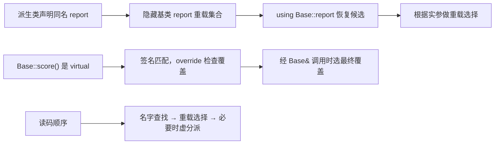

# 03 · override 与名字隐藏：同名，不一定是同一条调用链

[[学习/学习导航/2026-10-21-学习导航|当天学习入口]] · [[八股测试/2026-10-21#CPP-OVERRIDE-001 · 同名函数为什么没有覆盖成功|对应自测]]

先读 [[学习/2026-10-21/02-虚函数与动态绑定|虚函数与静态/动态类型]]。
不熟悉函数末尾的 `const` 时，补看 [[学习/2026-10-20/00-先读懂C++代码与对象|const 与成员函数基础]]。

本篇解决一个很常见的困惑：我明明在派生类写了同名函数，为什么通过基类接口调用的还是原实现？

## 1. 一处不起眼的 const，为什么会改变结果

基类声明 `virtual int score() const`。
派生类写成 `int score()`，看起来只是少了一个单词。
但末尾 `const` 是成员函数匹配时的重要条件，两份声明没有形成期待中的覆盖关系。

派生对象直接调用可能得到新函数的结果，基类引用调用却仍使用基类虚函数。
这很容易让开发者误以为编译器“有时候多态失效”。
真实原因是：两次调用选中的不是同一条虚函数覆盖链。

`override` 让我们把意图写给编译器：“这里必须覆盖一个已有基类虚函数”。
匹配不成立时，编译器应当报错，避免错误悄悄留到运行时才表现出来。

依据：[N4659 [class.virtual]/2、/5](https://timsong-cpp.github.io/cppwp/n4659/class.virtual)，核对日期 **2026-10-21**。

## 2. 三个容易混淆的词，各回答不同问题

| 概念 | 普通解释 | 主要判断什么 |
| --- | --- | --- |
| 重载 overload | 可见候选中，同名但参数等条件不同，按调用选合适版本 | 这组候选中哪个最匹配本次实参 |
| 覆盖 override | 派生函数替代基类某虚函数的行为 | 是否属于同一条虚函数覆盖链 |
| 隐藏 hiding | 内层出现同名声明，查找时挡住外层名字 | 调用点最先能找到哪些声明 |

“重载在编译期选择，覆盖支持运行时多态”是有用的入门区分。
但还要补上名字查找这一层，否则解释不了为什么基类的好几个重载一起消失。

重载不要求一定在单个类定义里声明；通过 `using` 等方式也可以形成可见候选集合。
本篇用同类的两个函数开始，再演示基类与派生类之间怎样恢复这组候选。

**隐藏和覆盖可以同时出现，它们不是互斥分类。**
一个正确覆盖的派生函数，也可能使其他同名的基类重载在派生类普通查找中被隐藏。

依据：[N4659 [class.member.lookup]](https://timsong-cpp.github.io/cppwp/n4659/class.member.lookup)、[N4659 class.virtual /3](https://timsong-cpp.github.io/cppwp/n4659/class.virtual#3)，核对日期 **2026-10-21**。

## 3. 覆盖匹配要检查哪些地方

先限制在今天的普通非静态成员函数，按这份清单看：

1. 基类中是否已经存在相应的虚函数？
2. 函数名是否相同？
3. 参数类型列表是否匹配，例如 `int` 和 `long` 不能混为一谈？
4. 成员函数末尾的 `const/volatile` 是否匹配？
5. 如果使用了成员函数引用限定符 `&/&&`，是否匹配？
6. 返回类型、异常说明等是否合法？

第 5 项的 `&/&&` 写在成员函数声明末尾，用来限制怎样的对象表达式能调用它。
它与参数里 `T&` 的位置不同，今天只知道存在这项匹配要求，不展开另一条知识链。

返回类型不是“想改成什么都行”。
普通 `int` 返回不能为了派生版本改成 `double`；某些类指针/引用返回允许协变，有额外条件。
协变是“派生覆盖返回更具体的类指针/引用”等特定规则，本日不拿它替代普通匹配清单。

异常说明也受约束，例如不能用更宽松的抛出承诺覆盖不抛异常的基类虚函数。
这里的检查清单用于防漏，不表示所有项目都按同一种“函数签名”术语归类。

依据：[N4659 [class.virtual]](https://timsong-cpp.github.io/cppwp/n4659/class.virtual)、[except.spec](https://timsong-cpp.github.io/cppwp/n4659/except.spec)，核对日期 **2026-10-21**。

## 4. 完整 C++17 程序：把三种现象分开观察

源码：[[学习/2026-10-21/示例代码/03_override.cpp|完整 cpp]]。
阅读镜像：[[学习/2026-10-21/示例代码/03_override|同代码 Markdown]]。
以下完整程序与配套 `.cpp` 和阅读镜像逐字一致。

```cpp
// C++17：覆盖、重载、名字隐藏以及 using / final 的不同职责。
// 阅读步骤：先比较 Almost 的少 const，再看 Fixed 的正确覆盖，最后看 using / final。
// 编译观察：本机 GCC 13.1 在当前 -Wall 配置下预期给出 -Woverloaded-virtual 警告。
// 这是 Almost::score() 合法隐藏 Base::score() const 的教学例子，不抑制该诊断。
// warning 帮助发现可疑代码，当前构建仍可生成程序；注释里的 override 错配才是 error。
// 运行步骤：依次执行各组 assert；条件全部成立后输出下面一行并正常退出。
// 预期标准输出：override, hiding, using and final checks passed
#include <cassert>  // assert 用具体返回值核对究竟选中了哪个函数。
#include <iostream> // std::cout 输出最终检查结果。

class Base {
public:
    // score 的函数末尾有 const，它也是覆盖匹配条件的一部分。
    virtual int score() const { return 10; }

    // 两个 report 同名、参数不同，在 Base 内形成重载。
    int report(int) const { return 100; }
    int report(double) const { return 200; }

    virtual ~Base() = default;
};

class Almost : public Base {
public:
    // 故意少写 const：它隐藏 score 名字，但没有覆盖 Base::score。
    // 本机编译器的隐藏警告正帮助发现这个差别；这里保留它，供比较两种调用结果。
    // 这段是合法 C++；后面的 Fixed 用 const override 展示应采用的修正形式。
    int score() { return 99; }

    // 只留纸面编译错误：int score() override { return 99; }
    // 加上 override 会因无法覆盖 Base::score() const 而拒绝编译。
};

class Hidden : public Base {
public:
    // 名字 report 在当前类找到了，普通查找不会再合并基类重载。
    int report(int) const { return 300; }
};

class Fixed : public Base {
public:
    // 名字、参数、const 匹配，返回类型也合法，确实覆盖。
    int score() const override { return 20; }

    // 将基类的 report 声明带入本类的重载候选集合。
    using Base::report;
    int report(int) const { return 300; }
};

// 类名后写 final：禁止继续从 Frozen 派生。
class Frozen final : public Fixed {
public:
    int score() const override { return 30; }
};

class Locked : public Base {
public:
    // 函数后写 final：禁止下层再次覆盖这个虚函数。
    int score() const override final { return 40; }
};

// Locked 自己仍可作为基类；禁止覆盖某个函数不等于禁止派生。
class ChildOfLocked : public Locked {};

// 编译错误示意，只作注释：class BadClass : public Frozen {};
// 编译错误示意：class BadMethod : public Locked {
//     int score() const override { return 50; }
// };

int main() {
    Almost almost;
    const Base& almost_base = almost;
    assert(almost.score() == 99);
    assert(almost_base.score() == 10);
    // const Almost& ca = almost; ca.score(); // 被非 const 同名函数隐藏。

    Hidden hidden;
    // 只有 Hidden::report(int) 成为候选，3.5 隐式转换为 int。
    assert(hidden.report(3.5) == 300);
    assert(hidden.Base::report(3.5) == 200);

    Fixed fixed;
    const Base& fixed_base = fixed;
    assert(fixed.score() == 20);
    assert(fixed_base.score() == 20);
    assert(fixed.report(3) == 300);
    assert(fixed.report(3.5) == 200);

    Frozen frozen;
    const Base& frozen_base = frozen;
    assert(frozen_base.score() == 30);

    ChildOfLocked child;
    const Base& locked_base = child;
    assert(locked_base.score() == 40);
    std::cout << "override, hiding, using and final checks passed\n";
}
```

### 编译警告与运行观察

本机 **GCC 13.1** 在当前 `-Wall` 编译配置下，会对本例给出 `-Woverloaded-virtual` 警告：
`Base::score() const` 被 `Almost::score()` 隐藏。
这条警告正帮助我们发现“少写 const，未形成覆盖”的问题；本例有意保留这段合法代码供比较，`Fixed` 展示正确写法。

**warning（警告）** 提醒代码可能违背意图；在本次构建选项下，它没有阻止生成可执行程序。
**error（错误）** 表示当前代码不能按要求通过编译，例如把 `override` 加到仍然少 const 的版本上。
警告开关由编译器及选项决定，不是所有编译器都必须报告同一条警告；若启用把警告视为错误的选项，构建结果也会不同。
不要为获得“零警告”而删掉本例用于比较的错配，或关闭诊断后假装它与正确覆盖相同。

运行时各组 `assert` 核对函数选择结果，成功后标准输出是：

```text
override, hiding, using and final checks passed
```

编译诊断出现在构建过程，以上一行出现在运行过程，两者应分开读。

## 5. 第一组：Almost 演示“同名但没覆盖”

### 5.1 基类承诺的是只读成员调用

`virtual int score() const` 末尾的 `const`，使它可以通过 `const Base&` 调用。
它限制该成员函数对普通成员状态的修改，也影响它与派生函数的匹配。
不要把这里的 `const` 理解成“返回的 int 是常量”。

### 5.2 `Almost::score()` 少了 const

`almost.score()` 从 `Almost` 查到当前类的非 const 函数，所以得到 `99`。
`almost_base.score()` 从 `Base` 接口选中 `Base::score() const`。
`Almost` 没有对应的覆盖函数，因此仍得到 `10`。

它们是两条不同的函数选择结果，程序没有发生随机行为。
这类错误通常是合法但不合设计意图的代码，不能误说成未定义行为。

### 5.3 为什么给错误版本加 override 反而编译不过

纸面反例：

```cpp
class Broken : public Base {
public:
    int score() override { return 99; } // 编译错误：没有覆盖 const 版本。
};
```

`override` 没有自动补上缺少的 `const`。
它只要求编译器检查“必须覆盖”这个意图，条件不满足就拒绝编译。
正确修复是让声明符合所需契约，例如 `int score() const override`。

`override` 也不负责证明返回值有业务意义。
即使 `const` 匹配，函数体错误地计算分数仍需正常测试和审查。

工程建议：[Core Guidelines C.128](https://isocpp.github.io/CppCoreGuidelines/CppCoreGuidelines#rh-override)，核对日期 **2026-10-21**；示例采用新虚函数写 `virtual`，覆盖函数写 `override`。

## 6. 第二组：Hidden 演示“名字挡住一整组重载”

基类中有 `report(int)` 与 `report(double)`，两个都是普通非虚函数。
在基类接口上，`3` 更匹配 int 版本，`3.5` 更匹配 double 版本。

但 `Hidden` 声明了自己的 `report(int)`。
普通 `hidden.report(...)` 查找先在 `Hidden` 里找到 `report`，不再自动合并基类那组同名声明。

所以 `hidden.report(3.5)` 并没有选择基类 double 版本。
它先只有当前类的 int 版本成为候选，再把 `3.5` 转换成 `int`，结果返回 `300`。
`3.5` 在 int 范围内，这个例子不是越界浮点转换或 UB 实验。

如果启用更严格的转换警告，编译器可能提醒这次 double 到 int 的转换。
警告帮助发现意外转换，但不要把“可能警告”写成“标准要求编译失败”。

`hidden.Base::report(3.5)` 明确从基类那层查找，选到 double 版本，返回 `200`。
这里是在解释非虚重载；不要把它与上一篇“限定虚调用抑制分派”的原因混成一件事。

依据：[N4659 [class.member.lookup]/4](https://timsong-cpp.github.io/cppwp/n4659/class.member.lookup#4)，核对日期 **2026-10-21**。

## 7. 第三组：using 恢复基类重载的可见候选

```cpp
using Base::report;
int report(int) const { return 300; }
```

`using Base::report;` 是 using 声明，在派生类作用域中引入基类相应声明。
它不是 `using namespace std;`，也不是创建类型别名的 `using Name = Type;`。
相同关键字出现在不同语法位置时，需要按完整写法判断。

在本例中，派生 int 版本保留自己的行为，基类 double 版本也重新成为候选。
调用时先看实参，分别选到更匹配的版本：

| 表达式 | 选中实现 | 返回值 |
| --- | --- | --- |
| `fixed.report(3)` | `Fixed::report(int)` | `300` |
| `fixed.report(3.5)` | `Base::report(double)` | `200` |
| `fixed_base.score()` | `Fixed::score() const` | `20` |

最后一行是覆盖和动态绑定，前两行是候选集合上的重载选择。
`using` 并不会把一个非虚函数变成虚函数。
它也不会修复 `score()` 少写 const 这样的覆盖匹配问题。

依据：[N4659 [namespace.udecl]/15、/16](https://timsong-cpp.github.io/cppwp/n4659/namespace.udecl#15)，工程参考 [Core Guidelines C.138](https://isocpp.github.io/CppCoreGuidelines/CppCoreGuidelines#rh-using)，核对日期 **2026-10-21**。

## 8. 图解：先查名字，再选参数，再看是否虚分派

**可编辑关系图（Mermaid）**



隐藏路径中，`Hidden` 的同名声明让查找在派生类停下，基类 double 版本未进入候选。
`using` 可把基类 double 版本恢复到候选集合。
另一路 `score() const` 覆盖链说明它与非虚 `report` 的重载不是同一种关系。

可以把本篇的调用判断写成三步：

1. 当前静态接口从哪里查到这个名字？
2. 已找到的候选中，哪个符合这次参数与对象限定？
3. 选中的函数若是虚函数，普通调用最终进入哪一层覆盖实现？

三步是帮助理解本例的读码顺序，真实 C++ 规则还包括访问、可行性等更完整检查。
当编译报错时，先问是哪一步失败，比笼统说“多态问题”更容易定位。

## 9. final 有两个位置，两种不同限制

### 9.1 类名后的 final：不允许继续派生

```cpp
class Frozen final : public Fixed { /* ... */ };
```

`Frozen` 仍可以被实例化，也仍可通过 `Base&` 调用已有虚函数。
禁止的是后续定义一个以 `Frozen` 为基类的新派生类。
例如 `class More : public Frozen {};` 是编译错误。

### 9.2 虚函数后的 final：不允许下层再次覆盖这一个函数

```cpp
int score() const override final { return 40; }
```

`Locked` 本身没有标为 final，因此 `ChildOfLocked : public Locked` 合法。
子类只是不能再次覆盖这个 `score() const`。
它仍可增加其他成员，也可能覆盖其他未封闭的虚函数。

`override final` 组合在 C++17 语言中合法，本例同时写出两个词以帮助观察两项意图。
Core Guidelines C.128 的风格建议通常写一个说明词；对已经 final 的虚函数可只写 `final`。
工程风格建议与语言是否允许必须分别表述。

函数 `final` 不是删除函数，调用者照样可以调用它。
它也不是“可无条件内联”的指令。
编译器可能因此更容易证明调用目标唯一，但不保证总能优化，更不保证测得固定加速。

依据：[N4659 [class]/3](https://timsong-cpp.github.io/cppwp/n4659/class#3)、[N4659 class.virtual /4](https://timsong-cpp.github.io/cppwp/n4659/class.virtual#4)，核对日期 **2026-10-21**。
设计与性能主张另参考 [Core Guidelines C.139](https://isocpp.github.io/CppCoreGuidelines/CppCoreGuidelines#rh-final)；应以实际证据支持加速判断，核对日期 **2026-10-21**。

## 10. 实际开发里怎样使用这几个工具

**扩展交易规则接口时：** 在派生行为上写 `override`，让签名漂移尽早成为编译错误。
例如基类后来把查询函数改成 const，编译器能帮助发现旧派生实现没跟上。

**给派生类增加同名便利函数时：** 检查是否隐藏了调用者还需要的基类重载。
如果希望保留整组接口，可以使用 `using Base::name`，再确认重载选择是否符合预期。

**封闭某条业务行为时：** 只有设计上确实禁止扩展，才考虑函数或类的 final。
不要为了猜测会“更快”就把所有类封死，也不要为了未来可能扩展而拒绝所有 final。

**阅读报错时：** `does not override` 先检查名字、参数和末尾 const，而非先怀疑虚表。
`no matching function` 也可能是名字隐藏造成候选丢失，不一定是实参本身写错。

## 11. 边界：访问权限与覆盖不是同一个判断

基类虚函数即使是 private，派生类也可能合法覆盖它。
覆盖关系不要求派生代码能直接按名字调用那份 private 基类实现。
能否从某个调用点访问某个成员，是另一项访问检查。

本日先掌握 public 接口的常见形式；这种边界用来防止把“private 不能直接访问”误背成“private 虚函数不能覆盖”。
依据：[N4659 [class.virtual] 注 111](https://timsong-cpp.github.io/cppwp/n4659/class.virtual#footnote-111)，核对日期 **2026-10-21**。

## 12. 练习：给每次调用说出判断过程

1. 只在 `Almost` 中加 `using Base::score;`，能把 `int score()` 变成覆盖吗？
2. 若删除 `Fixed` 的 `using Base::report;`，`fixed.report(3.5)` 会选择谁？
3. `Locked::score` 标 final 后，是否完全禁止 `ChildOfLocked` 存在？
4. 基类 `report` 没有 virtual，派生版本加 override 会怎样？

> [!tip]- 练习答案：每个工具只承担自己的职责
> 1. 不能。using 影响名字候选，不改变函数末尾 const 的匹配关系。
> 2. 查到派生 report 后，基类 double 版本被隐藏；本例选择 int 版本并转换实参，得到 300。
> 3. 没有。函数 final 限制再次覆盖该函数，类 final 才限制继续派生。
> 4. 编译错误。基类相应函数不是虚函数时，不能满足这个覆盖要求。
>
> 核对：[N4659 [class.virtual]](https://timsong-cpp.github.io/cppwp/n4659/class.virtual)、[namespace.udecl](https://timsong-cpp.github.io/cppwp/n4659/namespace.udecl)，核对日期 **2026-10-21**。

## 13. 30–90 秒口述

“重载是候选集合里按参数等条件选函数，覆盖是派生实现替代匹配的基类虚函数，隐藏决定普通名字查找能看到哪些声明。
基类 score() const 与派生 score() 不匹配，写 override 能让编译器发现这个意图错误。
派生类声明同名函数还可能隐藏整组基类重载，用 using Base::name 可以把需要的基类声明引入候选。
using 不会把非虚函数变成虚函数，也不会修复覆盖签名。
类 final 禁止继续派生，虚函数 final 禁止再次覆盖该函数，两者都不是性能保证。”

下一篇：[[学习/2026-10-21/04-抽象类与接口|04 · 抽象类与接口]]。
