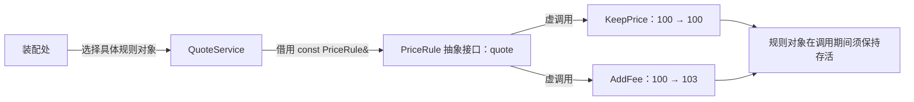

# 04 · 抽象类与接口

入口：[[学习/学习导航/2026-10-21-学习导航|当天学习入口]]  
前置：[[学习/2026-10-21/03-override与名字隐藏|03 · override 与名字隐藏]]  
自测：[[八股测试/2026-10-21|当天测试页]] · 永久题号 **CPP-ABSTRACT-001**

这一篇解决一个问题：业务代码如何只知道“能做什么”，却能换用不同实现？
先读名词和完整程序，再按对象关系看代码。
这里的价格规则是训练场景，不是已核实的某公司原题。
正文基线是 C++17；来源核验日期为 **2026-10-21**。

## 1. 先把四个名词分开

**虚函数**是允许派生类覆盖、并能通过基类指针或引用进行动态调用的成员函数。
上一题已经解释了动态绑定；这里用它组织一组可替换的规则。

**纯虚函数**是在声明末尾使用 `= 0` 的虚函数。
它表示这个位置尚需由具体派生类完成，不代表“返回零”。
例如 `virtual int quote(int price) const = 0;` 是函数声明。

**抽象类**是仍有纯虚最终覆盖函数的类。
初学时可以理解为：至少一个必须实现的虚函数还没有被具体实现。
不能创建独立的抽象类对象，但它可以作为派生对象里的基类子对象。
如果派生类遗漏某个纯虚函数，它通常仍然是抽象类。

**接口**在这里表示一组供使用方依赖的操作约定。
C++17 没有专门用来声明这类接口的 `interface` 关键字。
工程上常用“只有操作声明、带合适析构契约”的抽象基类表达接口。
这是设计习惯，不是所有抽象类必须遵守的语法限制。

| 名词 | 关注什么 | 是否等价 |
|---|---|---|
| 纯虚函数 | 一个虚函数是否仍要求具体实现 | 不是一个类 |
| 抽象类 | 是否允许创建该类的独立对象 | 是语言分类 |
| 接口 | 使用者应依赖哪些能力与契约 | 是设计角色 |
| 具体类 | 能创建对象并执行完整行为 | 可以继承抽象类 |

抽象类可以有数据、构造函数以及普通成员函数。
“抽象”不等于“没有内容”，也不等于“没有构造过程”。
抽象类指针与引用可以声明，这正是使用接口的入口。
语言依据：[N4659 §13.4，class.abstract](https://www.ece.uvic.ca/~frodo/cppdraft/n4659/html/class.abstract)。

## 2. 为什么要隔着接口调用

假设一个报价服务有两种运行方式：

- 回放历史数据时，价格保持不变。
- 演示收费规则时，在原价上加一笔固定费用。

一种写法是在服务内部不断判断“现在是哪种规则”。
增加第三种规则时，服务里的分支也要跟着修改。
另一种写法是：服务只要求外界提供一个能 `quote` 的对象。

这里的**依赖**就是“服务完成工作必须使用的东西”。
把依赖从外部传给服务，叫**依赖注入**。
它不要求框架；一个接收引用的构造函数就能完成。

设计分工是：

1. 接口描述使用方需要的能力。
2. 具体规则实现计算。
3. 服务保存接口引用并发起调用。
4. 外部装配代码决定本次用哪种实现。

这让“选择具体类型”集中在装配处。
服务和规则之间的关系是“使用一个规则”，不需要让服务继承规则。
接口减少具体实现耦合，也会增加类型、跳转与设计复杂度。
只有确实需要替换、测试替身或多个实现时，才值得引入。

## 3. 完整可读程序：同一个服务，注入两种规则

源码：[[学习/2026-10-21/示例代码/04_interface.cpp|04_interface.cpp]]  
代码阅读页：[[学习/2026-10-21/示例代码/04_interface|完整代码与练习]]

下面与独立源文件保持一致；每个文件单独编译。
程序没有网络请求、文件写入或手工删除对象。

```cpp
// C++17：用抽象接口连接业务与可替换的价格规则。
// 本程序只演示正常执行；不包含未定义行为或故意编译失败的语句。

#include <cassert>   // 提供 assert：检查示例的价格结果。
#include <iostream>  // 提供 std::cout：把结果写到标准输出。

// PriceRule 表示“能根据输入价格给出报价”的统一约定。
// class 声明类；成员默认 private，因此在下面显式写 public。
class PriceRule {
public:
    // ~PriceRule 是析构函数；没有返回类型，也没有参数。
    // virtual 允许经 PriceRule* 销毁真实派生对象；= default 使用默认实现。
    virtual ~PriceRule() = default;

    // virtual 允许派生类提供实现；int 是返回的整数价格类型。
    // int price 是按值传入的原价格，函数内部拿到一份整数副本。
    // 末尾 const 表示本次调用不修改对象的普通成员。
    // = 0 是纯虚说明符，不是“让返回值等于零”，也不是变量赋值。
    virtual int quote(int price) const = 0;
};  // 类定义结束后必须有分号。

// public PriceRule 表示 KeepPrice 可以作为 PriceRule 使用。
// final 只表示本示例不允许继续继承 KeepPrice，不负责开启多态。
class KeepPrice final : public PriceRule {
public:
    // override 要求编译器确认签名确实覆盖了基类的虚函数。
    // 即使省略 virtual，正确的覆盖函数仍然是虚函数。
    int quote(int price) const override {
        return price;  // 不加任何费用，原样返回。
    }
};

// AddFee 也是一种 PriceRule；它需要额外保存“加多少”这个状态。
class AddFee final : public PriceRule {
public:
    // 构造函数没有返回类型；explicit 避免整数隐式变成 AddFee 对象。
    // 冒号后的 fee_(fee) 是成员初始化列表，初始化成员 fee_。
    explicit AddFee(int fee) : fee_(fee) {}

    // const 与基类声明一致，避免不小心变成另一个函数。
    int quote(int price) const override {
        return price + fee_;  // 用派生对象自身保存的费用计算结果。
    }

private:
    int fee_;  // 每个 AddFee 对象独立持有的加价金额。
};

// QuoteService 是使用规则的业务类，不是“某一种价格规则”。
// 它通过一个引用成员使用规则：这是组合关系中的非拥有借用。
class QuoteService {
public:
    // const PriceRule& 是对已有规则的只读引用，不复制抽象对象。
    // 调用者在构造服务时提供规则，这个动作叫“注入依赖”。
    explicit QuoteService(const PriceRule& rule) : rule_(rule) {}

    // int price 是业务输入；const 说明服务本身也不修改普通成员。
    int run(int price) const {
        // rule_ 的声明类型统一，真实对象决定 quote 的最终实现。
        return rule_.quote(price);
    }

private:
    // 引用不是所有者；被引用规则必须在本服务使用期间持续存活。
    const PriceRule& rule_;
};

// main 是程序入口；返回 int，0 表示正常结束。
int main() {
    // 先创建规则、再创建引用它们的服务，确保服务使用时规则仍存活。
    KeepPrice keep;
    AddFee fee{3};  // 花括号把整数 3 交给 explicit 构造函数。

    // 两个服务的代码一样，区别仅在注入的真实规则对象。
    QuoteService plain_service{keep};
    QuoteService fee_service{fee};

    const int plain = plain_service.run(100);  // 调用 KeepPrice::quote。
    const int charged = fee_service.run(100);  // 调用 AddFee::quote。

    // assert 用于学习示例的结果核对，不代替正式业务的输入校验。
    assert(plain == 100);
    assert(charged == 103);

    // '\n' 表示换行；输出文字是结果，不是类名的自动识别。
    std::cout << plain << '\n';
    std::cout << charged << '\n';
    return 0;  // 局部对象离开作用域时由语言规则自动销毁。
}
```

## 4. 按“声明—绑定—调用”读这段代码

### 4.1 接口声明约定，而不是制造一个规则对象

`class PriceRule` 声明统一类型。
`public:` 后的操作允许服务访问。
`quote` 的返回类型为 `int`，形参为按值传入的整数。
末尾 `const` 属于函数签名的重要部分，覆盖时不能随意省略。

`= 0` 使这个操作成为纯虚函数。
它没有让函数“默认返回 0”，也没有为所有规则提供一个空结果。
接口的 `virtual ~PriceRule() = default;` 则单独约定销毁行为。
业务函数纯虚与析构函数虚拟，是两件要分别表达的事。

### 4.2 具体类补齐约定

`KeepPrice` 的 `quote` 返回原价。
`AddFee` 的 `quote` 读取自身的 `fee_` 并加到输入上。
`override` 让编译器帮忙检查“实现的是不是要求的那个操作”。

这两个具体类都能创建对象，因为本例唯一的纯虚操作已经实现。
`AddFee fee{3};` 中的 `3` 初始化派生对象自己的状态。
不同规则对象可以保存不同参数；接口不要求所有实现完全无状态。

### 4.3 服务保存借用，不复制规则

`const PriceRule&` 中的 `&` 表示引用。
这里的引用绑定到已经创建的 `keep` 或 `fee`。
不会执行“创建一个 PriceRule 值”的操作，因此不受抽象类禁止实例化的限制。

`QuoteService` 的成员仍然写统一接口类型。
调用 `rule_.quote(price)` 时，真实对象决定执行哪个覆盖实现。
服务不需要询问“你是不是 AddFee”，也不需要向下转换。

### 4.4 注入没有自动解决生命周期

`rule_` 不是拥有者。
服务不会销毁规则，也不能延长任意局部规则的生命。
本例中规则先创建，服务后创建，服务使用时规则一直存在。
若把引用服务返回到外层，却让被引用的局部规则先销毁，引用就会悬垂。
这属于借用契约问题；不是抽象接口自动带来的安全保障。

## 5. 图解：替换的是具体规则，服务依赖的形状不变

**可编辑关系图（Mermaid）**



从左到右读：

1. 外部先创建具体规则对象。
2. 业务类持有一个接口引用。
3. 引用指向真实规则中的基类部分。
4. 通过虚函数调用，进入真实规则的覆盖实现。

图中的箭头表示“使用/借用”，不表示拥有权转移。
两种服务对应两个原对象，没有复制一个抽象基类。
对于调用者来说，输入和输出约定一致，内部算法可以不同。

## 6. 抽象类为什么仍然可以有构造函数和数据

“不能直接创建独立对象”不等于“不需要初始化基类部分”。
创建派生对象时，先要把它里面的基类子对象构造出来。
如果基类保存公共配置，就可能需要构造函数初始化配置。

下面是独立的语法片段，不属于上面的完整程序：

```cpp
class VersionedRule {
public:
    // 抽象类也能有普通成员函数，用来读取自己的状态。
    int version() const { return version_; }
    virtual ~VersionedRule() = default;
    virtual int quote(int price) const = 0;

protected:
    // protected 允许派生类构造基类部分，阻止外部随意调用此构造。
    explicit VersionedRule(int version) : version_(version) {}

private:
    int version_;  // 抽象类可以有数据；这不是纯接口的常见最小写法。
};
```

这里 `version_` 和构造函数都合法。
一个具体派生类可以在初始化列表中写 `VersionedRule(1)`。
但 `VersionedRule rule{1};` 仍不能作为普通独立对象创建。
“允许存在基类子对象”和“允许创建完整的基类对象”要分开理解。

纯接口通常尽量只保留契约，便于多个实现各自管理状态。
是否把共享实现放在基类里，是工程取舍，而不是抽象类的定义。
语言依据仍是 [N4659 class.abstract](https://www.ece.uvic.ca/~frodo/cppdraft/n4659/html/class.abstract)。

## 7. 哪些写法是编译错误，哪些是设计风险

### 7.1 直接实例化抽象类：编译错误

```cpp
// 错误片段，仅用于分析，不加入可运行程序。
PriceRule rule;  // quote 仍是纯虚函数，不能创建独立对象。
```

不能通过“先 new 出来再用指针接住”绕过：
`new PriceRule` 同样试图创建抽象类对象。

### 7.2 只改成指针或引用：声明可以，但仍需真实对象

```cpp
// keep 已经是存活的 KeepPrice 对象。
PriceRule* pointer = &keep;       // 允许：指向具体对象的基类部分。
const PriceRule& reference = keep;  // 允许：借用具体对象。
```

指针变量自身不是规则对象。
空指针虽能声明，却不能解引用调用成员。
引用必须在初始化时绑定；不能只写一个未初始化引用变量。

### 7.3 派生类少实现一个纯虚函数：通常仍是抽象类

不是写了 `public PriceRule` 就自动变成可实例化的具体类。
必须让每个仍为纯虚的操作获得具体最终覆盖。
如果覆盖时忘记 `const`，写 `override` 会尽早暴露问题。
可回看 [[学习/2026-10-21/03-override与名字隐藏|03 · override 与名字隐藏]]。

### 7.4 抽象类不自动拥有虚析构

普通业务函数是虚函数，不会自动把另一个函数也变虚。
把 `quote` 写成纯虚，不能代替 `virtual ~PriceRule()`。
若设计允许经基类拥有并删除真实派生对象，必须提供正确销毁契约。
下一篇专门解释：[N4659 expr.delete/3](https://www.ece.uvic.ca/~frodo/cppdraft/n4659/html/expr.delete#3)。

### 7.5 构造函数不能是 virtual

构造时必须已经知道要创建哪一种具体类型。
C++17 的构造函数声明不允许 `virtual`。
工厂函数可以“根据条件返回某个具体实现”，但工厂不是虚构造函数。
语言依据：[N4659 class.ctor/1](https://www.ece.uvic.ca/~frodo/cppdraft/n4659/html/class.ctor)。

> [!info]- 选学：纯虚函数、纯虚析构也可以有定义吗
> 普通纯虚函数可以在类外给定义，但它仍保持“纯”，不会因此让类变成具体类。
> 不要同时在同一条类内声明中既写 `= 0` 又接函数体。
>
> 纯虚析构尤其需要注意：派生对象销毁时仍会经过基类析构。
> 如果程序创建该类或派生类的对象，纯虚析构必须有定义。
>
> ```cpp
> class Root {
> public:
>     virtual ~Root() = 0;  // 声明为纯虚：Root 保持抽象。
> };
> Root::~Root() = default;  // 类外仍给出定义，供析构链调用。
> ```
>
> 初学接口常直接写 `virtual ~Root() = default;`，让业务操作负责纯虚即可。
> 依据：[N4659 class.dtor/10](https://www.ece.uvic.ca/~frodo/cppdraft/n4659/html/class.dtor#10)。

## 8. 工程上什么时候适合接口

适合的例子是实盘行情源与回放行情源共享读取约定。
业务依赖“给下一条行情”，装配时选择具体数据源。
单元测试也能提供可控的替身实现，避免业务测试依赖真实外部服务。

但替换不仅要签名相同，还要满足含义相同。
例如接口承诺“返回含费用报价”，某实现却偷偷返回数量，就破坏了业务契约。
需要在接口旁写清输入单位、错误表示、是否修改状态、谁拥有对象。
编译器能检查类型关系，不能替你检查全部业务含义。

低延迟代码是否适合虚接口，要结合调用频率、内联机会、数据布局和测量判断。
不能只因接口“看起来优雅”就给每个小整数操作都建立继承层级。
也不能只因有间接调用就断言它一定是当前瓶颈。

## 9. 练习：真正缺的是哪一层

先遮住答案回答：

1. 为什么 `PriceRule rule;` 不行，`PriceRule& rule = keep;` 却可以？
2. 把 `QuoteService` 改成保存 `PriceRule rule_;`，会发生什么？
3. 新增一个减价规则，服务类是否必须修改？
4. 用一句话说清“注入规则”和“拥有规则”的区别。

> [!tip]- 展开练习答案
> 1. 前者要创建独立抽象对象；后者只是给已有具体对象建立基类引用。
> 2. 成员本身就是一个抽象类对象，类定义无法合法使用这种成员。
> 3. 新规则实现相同接口即可，装配处选择它；服务的调用逻辑无需修改。
> 4. 注入说明依赖如何交给使用者；拥有说明谁负责对象最终销毁。
>
> 本例是“从外部注入一个借用引用”，并未转移所有权。
> 若服务需要独立控制规则寿命，可以另行设计接收 `unique_ptr<PriceRule>` 的拥有接口。
> 不应只把 `&` 删除就当成同等设计。
>
> 核对：[N4659 class.abstract](https://www.ece.uvic.ca/~frodo/cppdraft/n4659/html/class.abstract)。

## 10. 30–90 秒口述总结

纯虚函数用 `= 0` 声明，表示具体派生类要完成的虚操作。
仍有纯虚最终覆盖函数的类是抽象类，不能创建独立对象，但能通过指针或引用使用。
C++17 常用抽象基类表达接口；抽象类本身仍可有数据、构造和普通函数。
业务组合一个接口引用，就能在外部注入不同具体实现。
覆盖要检查签名，借用要检查寿命，销毁还要单独约定虚析构。
构造函数不能是 virtual，抽象类也不会自动得到虚析构函数。

- [ ] 能解释 `= 0`，并区分它与返回零。
- [ ] 能从装配处一路追踪到真实覆盖函数。
- [ ] 能说清本例谁拥有规则、谁只借用。
- [ ] 能说明抽象类可以有状态和构造函数。

接着读：[[学习/2026-10-21/05-虚析构与基类销毁|05 · 虚析构与基类销毁]]。
