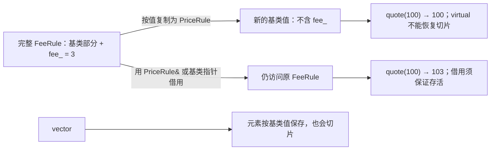

# 06 · 对象切片与多态容器

入口：[[学习/学习导航/2026-10-21-学习导航|当天学习入口]]  
前置：[[学习/2026-10-21/05-虚析构与基类销毁|05 · 虚析构与基类销毁]]  
自测：[[八股测试/2026-10-21|当天测试页]] · 永久题号 **CPP-SLICE-001**

今天最后一题把“值、引用、拥有者”与多态连接起来。
问题是：既然函数已经 virtual，为什么某些代码仍然调用基类实现？
正文基线为 C++17，来源核验日期为 **2026-10-21**。
本篇切片例子是可以定义清楚结果的正常程序，不能把它笼统叫作未定义行为。

## 1. 先弄清“值”和“切片”

**按值**表示创建一个指定类型的新对象，里面保存自己的值。
`Base copy = derived;` 的目标类型写成 Base，新对象就是 Base。
它不会根据初始化表达式偷偷改成 Derived。

**对象切片**是把派生对象按值复制为基类对象时，
目标只保存基类部分，而没有保存派生类增加的状态和类型身份。
“切片”是描述这个结果的常用术语，不是 C++ 的某个关键字。

原来的派生对象不会真的被刀切掉一部分。
变化发生在新对象：它从一开始就只被创建为一个基类对象。
原对象依然是原来的派生类型，也仍然持有原来的派生成员。

**保留动态类型**表示被调用的那个完整对象仍是原来的派生对象。
基类引用或指针可以访问同一派生对象，不需要重新复制一个基类值。
拥有者负责它的寿命，借用者负责在有效期内使用它。

本题先用一个**非抽象**基类说明切片。
因为抽象基类根本不能创建独立值，不能用它运行“复制成基类后输出原价”的例子。
这是理解错误代码时最先检查的条件。

## 2. virtual 为什么救不回被丢掉的派生类型

虚函数根据本次调用对象的真实动态类型选实现。
它不会根据“这个对象最初从哪里复制而来”选实现。
复制成 Base 后，新对象的动态类型就是 Base。

可以分四步推理：

1. 找到正在创建的目标对象声明。
2. 看目标到底是基类值，还是指针/引用。
3. 如果是基类值，确定它只创建了基类完整对象。
4. 再根据这个新对象的真实类型判断虚调用。

因此，`Base copied = derived;` 之后调用 `copied.f()` 走 Base 的最终实现，
并不是虚函数突然失效，而是它正确处理一个真实的 Base 对象。
标准依据：[N4659 class.copy.ctor/14，按目标类的基类与成员进行复制](https://www.ece.uvic.ca/~frodo/cppdraft/n4659/html/class.copy.ctor#14)。
虚函数选择依据：[N4659 class.virtual](https://www.ece.uvic.ca/~frodo/cppdraft/n4659/html/class.virtual)。

## 3. 完整程序：四种位置都检查目标类型

源码：[[学习/2026-10-21/示例代码/06_slicing.cpp|06_slicing.cpp]]  
代码阅读页：[[学习/2026-10-21/示例代码/06_slicing|完整代码与练习]]

本程序与 04 使用不同的独立类定义。
此处的 PriceRule 有默认行为，**不是抽象类**。
公开复制也是为了展示切片而明确保留的教学选择。

```cpp
// C++17：比较基类值、基类引用和拥有基类指针时的对象切片。
// 本文件故意允许基类复制来展示合法但常常不符合业务意图的切片。

#include <cassert>   // 提供 assert：分别核对四条路径的结果。
#include <iostream>  // 提供 std::cout：输出结果供手动对照。
#include <memory>    // 提供 unique_ptr、make_unique：保存真实派生对象。
#include <vector>    // 提供 vector：分别存放基类值和拥有型指针。

// 这里的 PriceRule 是具体类，便于演示“确实能复制出一个基类对象”。
// 它与 04 的同名类位于不同独立程序，不要把两个 cpp 拼成一个文件。
class PriceRule {
public:
    PriceRule() = default;  // 明确提供无参构造，创建普通基类对象。
    // 教学目的显式允许复制；真实多态接口常会禁止公开复制来防切片。
    PriceRule(const PriceRule&) = default;
    virtual ~PriceRule() = default;  // 支持 unique_ptr<PriceRule> 的多态销毁。

    // 有函数体，因此本类不是抽象类；默认策略就是原价返回。
    virtual int quote(int price) const {
        return price;
    }
};

// FeeRule 的额外状态 fee_ 不属于一个独立 PriceRule 对象。
class FeeRule final : public PriceRule {
public:
    // explicit 避免整数自动转成规则；初始化列表直接设置费用成员。
    explicit FeeRule(int fee) : fee_(fee) {}

    int quote(int price) const override {
        return price + fee_;  // 只有真实 FeeRule 对象才使用此覆盖实现。
    }

private:
    int fee_;  // 派生类新增状态，按值复制成基类时不会被保存。
};

// 形参写成 PriceRule：调用前先创建一个独立的基类形参对象。
int by_value(PriceRule rule, int price) {
    return rule.quote(price);  // rule 的真实类型已经是 PriceRule。
}

// const PriceRule&：借用原对象，没有创建新的基类对象，也不取得所有权。
int by_reference(const PriceRule& rule, int price) {
    return rule.quote(price);  // 原对象若为 FeeRule，就进入其覆盖实现。
}

int main() {  // 每个独立 cpp 都各自有一个 main。
    FeeRule original{3};  // 真实类型为 FeeRule，费用状态为 3。

    // 目标变量声明为 PriceRule，只复制 original 中的基类部分。
    PriceRule sliced = original;
    const int value_result = sliced.quote(100);
    const int parameter_result = by_value(original, 100);
    const int reference_result = by_reference(original, 100);

    // vector 的元素是 PriceRule 本体；push_back 同样会创建基类值。
    std::vector<PriceRule> values;
    values.push_back(original);
    const int vector_value_result = values.front().quote(100);

    // 元素换成拥有型指针：容器保存指针，对象本身仍是完整 FeeRule。
    std::vector<std::unique_ptr<PriceRule>> owners;
    owners.push_back(std::make_unique<FeeRule>(3));

    // front() 取第一个 unique_ptr；-> 通过基类指针虚调用真实实现。
    const int vector_owner_result = owners.front()->quote(100);

    // 切片路径不会自动报错；断言用于明确这里的可预期语言行为。
    assert(value_result == 100);
    assert(parameter_result == 100);
    assert(reference_result == 103);
    assert(vector_value_result == 100);
    assert(vector_owner_result == 103);

    std::cout << "value: " << value_result << '\n';
    std::cout << "parameter: " << parameter_result << '\n';
    std::cout << "reference: " << reference_result << '\n';
    std::cout << "vector-value: " << vector_value_result << '\n';
    std::cout << "vector-owner: " << vector_owner_result << '\n';
    return 0;  // owners 自动销毁真实 FeeRule，随后销毁其基类部分。
}
```

## 4. 从输出追溯究竟调用了谁

预期输出如下；这表示语言规则推导，实际运行记录由当天统一验证补充。

```text
value: 100
parameter: 100
reference: 103
vector-value: 100
vector-owner: 103
```

`value` 路径创建了一个独立 PriceRule，当然只保留基类默认行为。
`parameter` 路径同理：函数形参写成基类值，调用前就发生了复制。
函数内部即使再换成 `PriceRule& alias = rule;`，也只是借用已切片的对象。

`reference` 路径没有创建新规则，仍在访问原来的 FeeRule。
`vector-value` 的元素类型就是 PriceRule，插入时创建相应类型的元素。
容器并不神奇，它也要遵守每个元素声明的实际类型。

`vector-owner` 保存的是拥有者，真实对象在独立的存储中保持为 FeeRule。
通过拥有者里的基类指针调用 virtual，才能进入加价实现。
并且基类已经有虚析构，最终销毁也符合上一题的契约。

## 5. 图解：复制基类值，与指向完整对象是两条路

**可编辑关系图（Mermaid）**



图的起点是一个完整派生对象：里面有基类部分，也有派生状态。
沿“按值复制”箭头得到基类值，目标对象只有基类部分。
沿“借用”箭头建立基类指针或引用，箭头仍指向完整派生对象里的基类部分。

两者都会让源码“通过 Base 看对象”，但含义不同：

- 基类值：一个新的、真实的 Base 对象。
- 基类引用：给同一个派生对象建立另一种访问视角。
- 基类智能指针：以统一接口管理一个仍保持具体类型的对象。

类型名字相同，并不意味着对象关系相同。

## 6. 只读操作优先考虑 const Base&，但要管寿命

如果一个函数只需要临时检查规则、不持有规则，可以接收引用。
本例中的 `by_reference(const PriceRule& rule, int price)` 就是这种接口。

`const` 说明不能通过这个引用调用非 const 成员函数，
也不能直接修改对象的普通成员。
`&` 说明不按值复制规则，不发生这条复制路径的切片。
它仍不保证其他地方绝不会修改对象，更不代表对象永远存在。

按用途区分参数：

| 形式 | 是否复制规则 | 是否拥有 | 主要约定 |
|---|---|---|---|
| Base | 创建基类值 | 自己拥有这个值 | 可能切片；抽象类值不行 |
| Base& | 不复制 | 不拥有 | 可借用修改，原对象必须存活 |
| const Base& | 不复制 | 不拥有 | 只读借用，原对象必须存活 |
| Base* | 不复制 | 类型本身不表达拥有 | 可为空；寿命由外部约定 |
| unique_ptr<Base> | 不复制规则对象 | 独占拥有 | 基类删除契约正确 |

普通同步调用期间，`const Base&` 也能临时绑定适当的临时派生对象。
但如果函数把这个引用存到长期对象里，不能假定临时对象会一直存活。
“本次调用可借用”和“今后一直保存借用”是两种寿命要求。

不应该用 `shared_ptr` 去掩盖自己没想清楚的所有权。
先确定谁需要拥有、谁只需在调用期间访问，再选表达方式。
这里复用昨天的所有权知识，不把 vector 扩容失效当成今天的新题。

## 7. 多态容器保存什么，决定你留下什么

`vector<Base>` 的每个元素都是 Base 本体。
只要 Base 能复制、能实例化，插入 Derived 就可能合法地创建 Base 值。
这是常见的业务逻辑错误，不必然是语言层面的未定义行为。

`vector<unique_ptr<Base>>` 的每个元素是一个独占拥有者。
不同拥有者可以分别拥有不同派生类对象。
遍历时统一调用接口，容器销毁时统一回收拥有者。

不要从中推出“所有集合都应该装指针”。
如果对象本来就是同一个普通值类型，按值存储通常更直接。
只有需要异构多态、独立对象身份或其他具体理由时，才为指针间接访问付出复杂度。

这里还有成本取舍：独立对象分配、间接访问、可能较弱的数据局部性。
是否构成瓶颈需要测量；不能把“保留多态”直接等同于“性能最优”。
今天先保证对象关系和销毁契约正确。

## 8. 不只形参和 vector 会切片

### 8.1 成员按值保存也会切片

```cpp
// 语法片段：此处 Base 必须是可实例化、可复制的具体基类。
struct Holder {
    Base value;  // 成员类型固定为 Base，不会自动保存某个 Derived 本体。
    explicit Holder(const Base& input) : value(input) {}
};
```

即使构造函数形参是引用，最后仍要看成员的目标类型。
`value(input)` 创建 Base 成员，所以不能保存完整派生类型。
“入口用了引用”不等于后续所有存储都会保留多态。

### 8.2 返回基类值也可能切片

函数返回类型写成 Base，返回 Derived 表达式也只会得到 Base 结果对象。
是否进行某次中间复制，不改变最终结果对象的声明类型。
复制消除不能把一个 Base 返回值变成 Derived 返回值。

### 8.3 给基类子对象赋值要另作分析

`Base& ref = derived;` 本身不切片。
之后若经 ref 给基类部分赋值，通常只改变派生对象内部的基类部分。
完整对象仍是 Derived，但其基类与派生成员可能出现业务状态不一致。
这与“创建独立 Base 值”的切片有关联，却不是完全相同的对象过程。

> [!info]- 选学：既要多态，又要“复制一份”怎么办
> 多态复制通常显式设计 `clone()`，让各派生类知道怎样复制自己。
> 典型返回类型是 `unique_ptr<Base>`，调用者得到新的独占拥有者。
> 每个实现负责创建对应的派生副本。
>
> 不能仅把普通复制构造函数写成 virtual；构造函数本来就不能 virtual。
> 今天不要求手写完整 clone 层级，先掌握“值复制目标类型固定”的原因。
> 对普通多态类，可考虑抑制公开复制以减少意外切片。
> 这是工程建议：[Core Guidelines C.67](https://isocpp.github.io/CppCoreGuidelines/CppCoreGuidelines#c67-a-polymorphic-class-should-suppress-public-copymove)。

## 9. 练习：先分类，再讨论结果

1. 把 by_reference 的形参改成 PriceRule，结果为什么变化？
2. 给 PriceRule::quote 加 virtual，能让 sliced 再变成 FeeRule 吗？
3. 如果把基类 quote 改为纯虚，原来的按值程序还能运行吗？
4. 函数接收 const Base&，成员却声明 Base，是否保留多态？

> [!tip]- 展开练习答案
> 1. 改成基类值形参会创建新 Base 对象，原派生状态不进入这个新对象。
> 2. 不能；本例原本就有 virtual。新对象真实类型已是基类。
> 3. 不能创建独立抽象对象；按值变量、参数定义和实际插入等会被拒绝。
>    不能继续声称它会运行并输出 100。
> 4. 不保留；引用只解决参数借用，成员初始化仍创建 Base 值。
>
> 先分清三种后果：编译错误、合法但不合业务意图的切片、其他真正的 UB。
> 本题的具体基类切片示例属于第二类。
> 依据：[N4659 class.abstract](https://www.ece.uvic.ca/~frodo/cppdraft/n4659/html/class.abstract)、
> [class.copy.ctor](https://www.ece.uvic.ca/~frodo/cppdraft/n4659/html/class.copy.ctor)。

## 10. 30–90 秒口述总结

对象切片发生在派生对象按值变成基类对象时，目标只保留基类部分。
新对象真实类型已经是 Base，虚函数不会恢复被丢掉的派生身份。
这通常是合法但不合业务意图的复制，不应一概叫 UB。
只需访问时用 Base& 或 const Base& 借用，并确保原对象存活。
需要统一拥有不同实现时，可以用 vector<unique_ptr<Base>>。
这还要求基类具有正确的多态销毁契约；抽象基类不能拿来存独立值。

- [ ] 找到复制目标，而不只盯着 virtual 关键字。
- [ ] 能区分具体基类切片与抽象基类无法实例化。
- [ ] 能说清借用和拥有两种保留类型的方式。

## 11. 当天综合程序：统一拥有两种价格处理器

先到 [[八股测试/2026-10-21|当天测试页]] 尝试修复错误设计，再读下面完整正确解。
综合题要求一个处理器加一，另一个处理器乘二。
每个处理器都独立处理原始输入 100，所以结果是 101 和 200。
它不是顺序流水线，不能把上一结果 101 再交给第二个处理器。

正确契约固定为：

```cpp
class PriceHandler {
public:
    virtual ~PriceHandler() = default;
    virtual int handle(int price) const = 0;
};
```

因为这是抽象类，`vector<PriceHandler>` 不能合法保存 PriceHandler 本体。
若错误版本以具体基类默认返回原价，那么存值切片才可能得到 100、100。
不要把这两个版本的前提混在一起。
正确解改用拥有基类指针的容器，同时保留纯虚接口。

源码：[[学习/2026-10-21/示例代码/07_dispatcher.cpp|07_dispatcher.cpp]]  
代码阅读页：[[学习/2026-10-21/示例代码/07_dispatcher|完整代码、输出与变式]]

```cpp
// C++17 综合练习正确解：同一容器拥有不同处理器，各自处理原始价格 100。
// 输出 101、200；两个规则彼此独立，不是把 101 再交给 DoublePrice。

#include <cassert>   // 提供 assert：核对数量和业务结果。
#include <iostream>  // 提供 std::cout：逐行打印整数结果。
#include <memory>    // 提供 unique_ptr 和 make_unique：明确独占所有权。
#include <vector>    // 提供 vector：保存处理器拥有者和检查结果。

// PriceHandler 定义完整契约：允许多态销毁，并要求提供 const 处理函数。
class PriceHandler {
public:
    // public 允许默认删除器删除；virtual 确保真实派生对象完整销毁。
    // = default 让编译器生成适用的析构实现，不表示“非虚”。
    virtual ~PriceHandler() = default;

    // = 0 表示纯虚函数；PriceHandler 不能作为独立对象被实例化。
    // int price 是输入整数副本；const 表示不修改处理器的普通成员。
    virtual int handle(int price) const = 0;
};

// public 继承承诺 AddOne 可用作 PriceHandler；final 阻止继续派生。
class AddOne final : public PriceHandler {
public:
    // override 要求编译器检查签名；不能漏掉末尾 const。
    int handle(int price) const override {
        return price + 1;  // 契约要求：输入 100 时得到 101。
    }
};

// 第二种具体实现与第一种共享接口，但各自完成自己的计算。
class DoublePrice final : public PriceHandler {
public:
    int handle(int price) const override {
        return price * 2;  // 契约要求：输入 100 时得到 200。
    }
};

int main() {  // 程序入口；全部对象都由局部拥有者自动管理。
    // 外层 vector 管理指针元素；每个 unique_ptr 管理一个真实处理器。
    std::vector<std::unique_ptr<PriceHandler>> handlers;

    // 创建具体类型后把所有权转入基类智能指针，没有复制基类对象。
    handlers.push_back(std::make_unique<AddOne>());
    handlers.push_back(std::make_unique<DoublePrice>());

    std::vector<int> results;  // 保存结果，便于在打印之外进行断言。
    const int input = 100;     // 每个处理器都获得同一个原始价格。

    // const auto& 表示只读借用每个 unique_ptr，避免复制独占拥有者。
    // 注意：const unique_ptr 本身不等于“它指向的对象必为 const”。
    for (const auto& handler : handlers) {
        // -> 调用基类虚函数；真实对象分别选中 AddOne、DoublePrice。
        const int result = handler->handle(input);
        results.push_back(result);  // 保存整数值，不涉及多态对象复制。
        std::cout << result << '\n';
    }

    // 先核对元素数量，再用下标访问；避免验证代码自己越界。
    assert(results.size() == 2);
    assert(results[0] == 101);
    assert(results[1] == 200);
    return 0;  // 容器释放拥有者；虚析构保证每个真实处理器正确销毁。
}
```

### 把今天六个新知识连起来

1. AddOne 与 DoublePrice 公开继承，满足“是一种处理器”的接口关系。
2. handle 是虚函数，经基类指针调用仍能选中真实实现。
3. override 检查覆盖关系，尤其检查末尾 const。
4. 纯虚 handle 让接口抽象，防止误把默认基类行为当成完整策略。
5. public virtual 析构让 unique_ptr<PriceHandler> 的默认删除路径正确。
6. 容器保存拥有者而非基类值，避免复制出失去派生类型的对象。

`const auto& handler` 借用容器中的智能指针元素，不复制 unique_ptr。
const 约束的是这个智能指针变量，并不会自动把所指对象变成 const。
这里的 handle 自身声明了 const，说明这个业务操作不修改普通成员。

### 输出和自检

```text
101
200
```

`results.size()` 先检查数量，再检查下标，是为了让校验本身也有清晰前提。
assert 在定义 NDEBUG 的构建中会被关闭；这里用来支持学习验证。
演示输入固定为 100，整数计算处于 int 可表示范围。
实际处理任意价格时，还应由业务契约规定单位、范围和溢出处理。

### 再做一个小变式

> [!question] 自己动手
> 新增 SubtractTwo，让它返回 price - 2。
> 保持接口和遍历代码不变，把第三个处理器装入容器。
> 先写出三行预期输出，再补数量和结果断言。

> [!tip]- 展开变式答案
> 新类公开继承 PriceHandler，提供 `int handle(int price) const override`。
> 函数体返回 `price - 2`，再 push_back 一个 `make_unique<SubtractTwo>()`。
> 预期为 101、200、98；结果数量应为 3。
> 遍历仍对每个对象传入 input，而不是把前一个结果带入下一个计算。
> 既不需要改 PriceHandler，也不需要在循环里增加识别类型的 if。
> 销毁仍沿基类虚析构契约完成。

回到 [[学习/学习导航/2026-10-21-学习导航|当天学习入口]]，完成自测后再记录分数。
