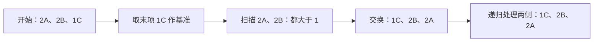

# 01 · 快速排序：怎样分区，为什么会退化

← [[学习/学习导航/2026-10-22-学习导航|今天学习入口]] · [[八股测试/2026-10-22#ALG-QUICKSORT-001 · 快速排序的复杂度与稳定性|对应测试题]] · [[学习/2026-10-22/示例代码/01_quicksort|注释代码阅读版]]

> [!abstract] 从真实问法开始
> 候选人复盘中记录过面试官追问“快排的时间复杂度、最坏情况、空间复杂度、是否稳定”；另一份 C++ 开发面经也记有快排复杂度和稳定性的问法。[牛客候选人复盘 A](https://www.nowcoder.com/discuss/353156212986421248)、[牛客候选人复盘 B](https://www.nowcoder.com/discuss/410581749674098688)。本文用自己的数据和代码讲原理。

## 1 先把四个词变成人话

- **排序**：按一个明确的规则，把一组元素排成顺序。本例只按 `key` 的数字大小排序。
- **基准 pivot**：本轮用来区分左右两边的那一个值。基准不是“全局平均值”。
- **分区 partition**：把当前区间调整为“左侧符合条件、基准在中间、右侧不符合条件”的状态。
- **递归**：处理一段数据的函数再处理它的更小部分。每次必须使问题变小，并在 0 或 1 项时停下。

面试里的 `O(n log n)` 和 `O(n²)` 描述输入变大时工作量如何增长，不是固定的毫秒数。本篇代码用“比较了几次 key”给你一个可以数的量。

## 2 用三条记录手动走一遍

输入：`[(2,A), (2,B), (1,C)]`。`A`、`B` 是两条不同记录，但它们的排序关键字都是 `2`。

本例选择**末元素 `C` 的 key=1** 为基准。扫描前面两条记录，发现都大于 `1`，暂时留在右侧。最后把基准与区间最前面的 `A` 交换，得到 `[(1,C),(2,B),(2,A)]`。随后对剩余两个 `key=2` 的元素继续分区，最终仍是 `C,B,A`。



本例是为了展示规则。其他基准选择和分区写法可能产生不同的相等元素次序；我们只说快速排序**通常不提供稳定性保证**，不拿这一次输出推断所有实现的每个输入。

## 3 看懂完整 C++17 示例

源码在 [[学习/2026-10-22/示例代码/01_quicksort.cpp|01_quicksort.cpp]]，下面嵌入同一份完整注释代码。

```cpp
// C++17 学习示例：自己写一版“末元素为基准”的快速排序。
// 看点：分区、递归、最坏比较次数，以及相同关键字的先后顺序。
// 这段代码用于理解算法，不把它当作 std::sort 的内部实现。

#include <algorithm> // std::is_sorted：检查最终是否按关键字有序。
#include <cassert>   // assert：验证例子的结果；正式输入校验不能只靠它。
#include <iostream>  // std::cout：打印观察结果。
#include <utility>   // std::swap：交换两个完整记录。
#include <vector>    // std::vector：保存一组连续的记录。

struct Record {
    int key; // 排序只比较 key，例如报价的价格或任务的优先级。
    char id; // 用 A/B/C 标识原始记录，方便观察稳定性。
};

// [left,right] 是包含两端的下标区间；返回基准最终所在下标。
int partition(std::vector<Record>& items, int left, int right,
              int& comparisons) {
    const int pivot = items[right].key; // 固定选最后一项的 key 作基准。
    int boundary = left;                // 下一项“小于等于基准”的安放位置。

    // scan 逐个查看基准之前的项；right 自己暂时留在末尾。
    for (int scan = left; scan < right; ++scan) {
        ++comparisons; // 统计一次 key 与基准的比较，不统计交换成本。
        if (items[scan].key <= pivot) {
            std::swap(items[boundary], items[scan]);
            ++boundary;
        }
    }
    std::swap(items[boundary], items[right]); // 基准落到左右两区中间。
    return boundary;
}

void quick_sort(std::vector<Record>& items, int left, int right,
                int& comparisons) {
    if (left >= right) return; // 0 或 1 项已经有序，也是递归停止条件。
    const int middle = partition(items, left, right, comparisons);
    quick_sort(items, left, middle - 1, comparisons);  // 左边继续分区。
    quick_sort(items, middle + 1, right, comparisons); // 右边继续分区。
}

int main() {
    // A、B 的 key 都是 2，排序前 A 在 B 前面。
    std::vector<Record> items{{2, 'A'}, {2, 'B'}, {1, 'C'}};
    int comparisons = 0;
    quick_sort(items, 0, static_cast<int>(items.size()) - 1, comparisons);

    // 比较器只看 key；id 是记录身份，不参与本次排序标准。
    assert(std::is_sorted(items.begin(), items.end(),
                          [](const Record& a, const Record& b) {
                              return a.key < b.key;
                          }));
    // 这版实现把原顺序 A、B 变成 B、A：它不保证稳定。
    assert(items[0].id == 'C' && items[1].id == 'B' && items[2].id == 'A');
    std::cout << "sorted ids: ";
    for (const Record& item : items) std::cout << item.id << ' ';
    std::cout << "\ncomparisons on 3 records: " << comparisons << '\n';

    // 最后元素总被选为基准时，已经有序的 5 项让分区极不均衡。
    std::vector<Record> sorted{{1, 'a'}, {2, 'b'}, {3, 'c'},
                               {4, 'd'}, {5, 'e'}};
    int worst_case_comparisons = 0;
    quick_sort(sorted, 0, static_cast<int>(sorted.size()) - 1,
               worst_case_comparisons);
    assert(worst_case_comparisons == 4 + 3 + 2 + 1);
    std::cout << "sorted-input comparisons: "
              << worst_case_comparisons << '\n';
}
```

### 把函数按执行顺序拆开

1. `Record` 有两个成员：用于比较的 `key`，以及只用来区分原始记录的 `id`。如果不保留身份，就看不出相同关键字被换过顺序。
2. `partition` 的 `pivot` 是末项的 key；`boundary` 是下一个“放入左侧”的位置，`scan` 是当前查看的位置。
3. 当 `items[scan].key <= pivot`，交换后扩大左区；这个 `<=` 是**本例的分区条件**，与后面的稳定性示例有关。
4. 扫完后把末项基准放到 `boundary`，它左边满足条件，右边不满足条件。
5. `quick_sort` 对基准两侧分别递归，不再处理已经到位的基准。`left >= right` 保证区间不会无限缩小下去。
6. `comparisons` 用引用参数累计数量；`std::swap` 交换两条完整记录。这个计数不包括交换、分配、函数调用等成本。

`std::is_sorted` 的 lambda 只比较 `key`。不要把 `id` 同时放进比较条件，否则 A、B 就不再是相同关键字，无法检验稳定性。

## 4 为什么通常说平均 O(n log n)，最坏 O(n²)

每做一轮分区，大致需要看完当前区间中的其他元素，所以一层的比较量与当前元素数成正比。

| 分区结果 | 直观过程 | 比较次数的数量级 | 递归深度的数量级 |
| --- | --- | --- | --- |
| 每次较均衡 | 一层处理 n 项，下一层分成约两半 | O(n log n) | O(log n) |
| 每次极不均衡 | 依次处理 n、n−1、n−2…… | O(n²) | O(n) |

本例**总取最后一项为基准**。已按升序排列的 5 项，比较数是 `4+3+2+1=10`；输入规模继续增大，和 `1+2+...+(n−1)` 同阶。大量相等关键字也可能让这种朴素的二路分区很不均衡。

“平均”需要说明输入或基准选择的模型；对固定末元素基准不能承诺每组真实行情数据都是平均情况。递归空间主要由调用层数决定，不把 `std::vector` 原本存输入的空间重复记成新算法额外空间。

## 5 “稳定”是什么意思

若两个记录的比较关键字相等，排序后还保留它们原来的相对先后，才叫**稳定**。本例中原来 `A` 在 `B` 前面，结果变成 `B` 在 `A` 前面，所以**这份实现不稳定**。

什么时候在乎？比如多条相同价格的记录若还要保留原有到达顺序，只按价格排序时便不能随意改变同价记录的先后。这个例子只解释排序要求，不代表任何交易系统都应直接按价格排序执行订单。

标准库另有 [`std::stable_sort` 的稳定性保证](https://timsong-cpp.github.io/cppwp/n4659/stable.sort)。它与手写快排、`std::sort` 是不同工具，别把“快速排序最坏 O(n²)”误说成“C++17 的 `std::sort` 最坏也必然 O(n²)”；[C++17 `std::sort` 对比较次数规定 O(n log n)](https://timsong-cpp.github.io/cppwp/n4659/alg.sort)。标准没有要求它一定使用哪种具体内部排序组合。

## 6 什么时候选，什么时候追问

- 学算法或面试手写时，能说明 pivot、分区不变量、递归结束条件，比只报三个复杂度更重要。
- 业务代码一般先明确排序要求，再选标准库工具；需要稳定顺序时检查 `stable_sort`，一般排序先考虑 `sort`。
- 若面试官追问“已经有序为什么慢”，回到**本例的末元素基准**解释每轮只排除一项，不是说所有经过改进的快排策略对有序输入都同样退化。
- 若面试官问“原地排序的空间是不是 O(1)”，指出分区可以在原数组中交换，但递归调用栈还会占用空间。

> [!question]- 变式：如果一组记录的 key 全都相同呢？
> 想一想本例的 `<= pivot` 会把它们放到哪一边，递归深度如何变化。

> [!success]- 变式答案
> 扫描到的每项都符合 `<= pivot`，本轮基准落在区间末端，下一轮仍有 n−1 项；这是极不均衡情况，比较次数可到 O(n²)、递归深度可到 O(n)。工程实现可考虑更合适的基准与三路分区，但不能只靠口头说“选择中间值”就保证所有输入无最坏情况。

**30–90 秒口述：** 快排反复选择基准，将区间分成两边，再递归处理。分区均衡时通常是 O(n log n) 比较、O(log n) 递归层数；本例末元素基准在已有序输入上每次只缩小一项，最坏 O(n²) 与 O(n) 栈深。普通快排通常不保证相等关键字的原顺序。C++17 `std::sort` 有自己的最坏比较次数要求，不能把这份手写实现的退化直接套到它身上。

规则来源：[C++17 N4659 排序算法条款](https://timsong-cpp.github.io/cppwp/n4659/alg.sort)。复杂度推导针对本页明示的分区程序，属于对代码流程的分析。
