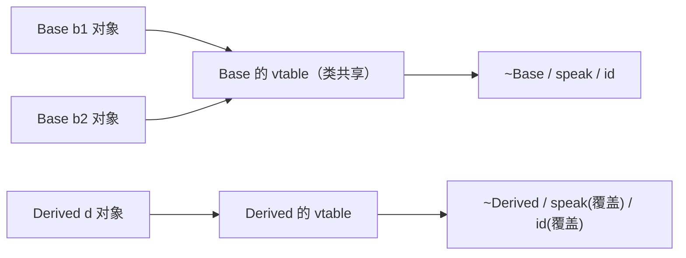

# 虚表是类的还是对象的：一个对象里到底存了什么

← [[学习/学习导航/2026-10-22-学习导航|今日导航]] · [[八股测试/2026-10-22#CPP-VTABLE-001|回到测试题]] · 代码：[[学习/2026-10-22/示例代码/01_vtable_layout|01_vtable_layout 阅读版]]

## 先把词说清楚

**多态（polymorphism）**：同一个调用写法，根据对象的真实类型执行不同代码。C++ 里常说的“动态多态”，指通过基类指针或引用调用虚函数时，运行时才知道该进哪个函数。

**虚函数（virtual function）**：在类里用 `virtual` 声明、允许派生类“覆盖”（override）的成员函数。

**虚函数表（vtable）**：编译器为每个“多态类”准备的一张函数地址表。标准里**没有**“vtable”这个词，它是实现手段；GCC/Clang（Itanium C++ ABI）和 MSVC 各有自己的排布。

**虚表指针（vptr）**：对象内部保存的一个指针，指向自己所属类的那张表。常见实现把它放在对象起始处。

一句话结论：**表属于类（每个多态类一份），指针属于对象（每个对象一个）**。这正好对应滴滴一面那道“虚表是类的还是对象的”。

## 它解决什么问题

如果每次调用都要用 `if/else` 判断对象是哪个子类，加一个新类型就要改所有调用点，这就是“开关语句越写越长”的经典问题。

虚函数把“选哪个函数”这件事从**调用点**搬到**对象自己身上**：调用点只写 `shape->area()`，对象通过自己的 vptr 找到本类版本的 `area`。新增子类不需要改调用点，只需要新类自己实现虚函数。

## 常见实现长什么样

x86-64 + Itanium ABI（GCC/Clang）下的典型形状：

```text
对象 Base b;                     只读数据段里的表
+------------------+             Base 的 vtable:
| vptr  -----------|---------->  [0] &Base::~Base
| int base_value_  |             [1] &Base::speak
+------------------+             [2] &Base::id
                                 （真实条目前面还有 offset-to-top 和 typeinfo 指针）
```

- 同一个类的所有对象，vptr 指向**同一张表**；本机实测两个 `Base` 对象的头 8 字节完全相同。
- 派生类对象里有**自己的** vptr，指向派生类的表；本机实测 `Derived` 与 `Base` 的头字不同。
- 单继承时通常只有一个 vptr；多继承时每个“多态基类子对象”各需要一个，因为把它转成不同基类指针时要能找到对应的表。



## 关键代码

完整可编译版本见 [[学习/2026-10-22/示例代码/01_vtable_layout|01_vtable_layout]]，下面只摘三段。

```cpp
class Base {
public:
    virtual ~Base() = default;
    virtual void speak() const { std::cout << "Base::speak\n"; }
private:
    int base_value_ = 0;
};
```

`virtual` 一旦出现，`Base` 就是多态类型：对象需要 vptr，`sizeof(Base)` 从 4 变成 16（8 字节指针 + 4 字节成员 + 4 字节补齐）。

```cpp
Base* pointer = &d1;   // 静态类型 Base*，动态类型 Derived
pointer->speak();      // 通过 vptr 找到 Derived::speak
```

这一行是“动态绑定”的核心：编译期只知道要走“Base 里 speak 的槽位”，运行期靠对象自己的 vptr 决定具体地址。

```cpp
class C : public A, public B { ... };
C object;
A* as_a = &object;
B* as_b = &object;   // 本机实测：比 as_a 大 16 字节
```

多继承时，`B*` 指向的是对象内部的 `B` 子对象，不是对象起点。所以**不能**用 `reinterpret_cast` 在基类和派生类之间乱转——它不会做这个偏移调整。

## 本机实测（GCC 13.1，x86-64，-O0）

| 类型 | sizeof | 说明 |
| --- | --- | --- |
| `Plain`（1 个 int，无虚函数） | 4 | 没有 vptr |
| `Base`（1 个 int + 虚函数） | 16 | 8 字节 vptr + 4 字节成员 + 4 字节补齐 |
| `Derived : Base`（再加 1 个 int） | 16 | 基类 8+4，派生 4，刚好填满 |
| `A` / `B`（各 1 个 int + 虚函数） | 16 | 各自一个 vptr |
| `C : A, B`（再加 1 个 int） | 32 | 两个 vptr + 三个 int + 补齐 |
| `Diamond`（虚继承菱形） | 48 | 虚基类偏移等额外数据 |

这些数字**不是标准保证**，换编译器、换平台、换优化选项都可能不同。面试时说“通常”“在 GCC/Itanium ABI 下”比背死数字安全。

## 边界与常见误解

**误解一：虚表是对象的一部分。** 不是。对象里只有指向表的指针；表本身在只读数据段，同类对象共享。

**误解二：有虚函数就一定多 8 字节。** 空的多态类大小通常是 8（只有一个 vptr）；但继承、对齐、虚继承都会改变结果，要按实际类型算。

**误解三：虚表在运行期才创建。** 常见实现里它在编译期就确定好了，运行期只是“读取”。

**误解四：所有虚调用都一样快。** 虚调用多一次间接寻址，且常常阻碍内联；构造函数/析构函数内部调用虚函数时，编译器知道确切类型，往往直接静态绑定。

**标准边界：** 标准只说“调用哪个函数”，不说表怎么排。所以“vtable 第 0 项是析构函数”这类说法只能算某套 ABI 的观察，不能当语言规则。

## 使用场景

- **接口设计**：`Shape`、`IHandler` 这类抽象基类，用虚函数让调用方只依赖接口。
- **交易系统**：策略/风控/行情适配器常做成接口，配置决定装配哪个实现；热路径上则更倾向模板或函数指针，避免虚调用与内联受阻。
- **排查问题**：崩溃栈里出现 `vtable for X+16`，说明是在虚调用里跳到了坏地址，通常意味着对象已被销毁（悬垂指针）或内存被踩。

## 变式与口述总结

**30–90 秒口述模板：**

> 虚函数表是编译器给每个多态类生成的一张函数地址表，对象里存一个指向它的指针。所以“表属于类，指针属于对象”。调用虚函数时，编译器生成一次间接跳转：先取对象的 vptr，再取表里对应槽位。标准只规定行为，不规定表的结构，具体排布看 ABI。代价是一次间接寻址和内联受阻；如果对象被销毁后还通过基类指针调用，就会跳到非法地址。

**变式：**

1. 把一个类加一个虚函数，`sizeof` 会怎么变？如果它已经有虚函数了呢？
2. 多继承下 `B*` 和 `A*` 指向同一对象，地址为什么不同？
3. 为什么 `reinterpret_cast<Derived*>(base_ptr)` 在多继承下会出错，而 `static_cast` 不会？

## 来源

- 题型来源：[滴滴 C++ 岗 sp 专场面经（牛客原帖镜像）](https://www.iamshuaidi.com/4432.html)，候选人记有一面“多态怎么实现的”“虚表是类的还是对象的”；[美团 C++ 面试复盘](https://www.iamshuaidi.com/4321.html) 记有“单继承/菱形继承虚函数表内存分布”。镜像页未标注发布日期，本次访问 2026-10-30。
- 标准依据：[N4659 class.virtual](https://timsong-cpp.github.io/cppwp/n4659/class.virtual)。标准不定义 vtable，布局描述属于常见实现。
- 观察数据：本页表格与本机程序输出一致，见 [[学习/2026-10-22/示例验证]]。
