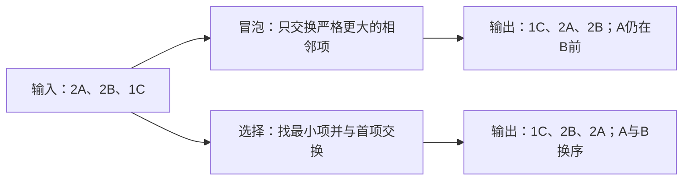

# 02 · 冒泡与选择：都能排序，代价和稳定性不同

← [[学习/学习导航/2026-10-22-学习导航|今天学习入口]] · [[八股测试/2026-10-22#ALG-SIMPLE-SORT-001 · 冒泡与选择排序怎样比较|对应测试题]] · [[学习/2026-10-22/示例代码/02_bubble_selection|注释代码阅读版]]

> [!abstract] 原帖常见的朴素问法
> 一份量化相关 C++ 开发候选人自述面经记有“冒泡排序和选择排序的复杂度是多少，实际情况差异如何”的问法。本文把它改成可手动验证的三元素例子。[原帖：宽德投资 C++ 开发一面](https://www.nowcoder.com/discuss/410581749674098688)，MangataTS，2022-10-14。

## 1 两个算法分别做什么

**冒泡排序**一轮轮比较相邻的两个元素。如果左边的关键字更大，就把它们交换；这一轮结束时，一个较大的值会来到右端。本篇加了“整轮无交换就提前结束”的优化。

**选择排序**把待排序区分成“前面已经放好”和“后面还要找”。每一轮扫描后半部分，找出最小的记录，再与待排序区的开头交换。它依然要扫描后半部分才能知道谁最小。

这里的**比较**是检查两个 key 的大小；**交换**是改变记录在序列中的位置。两者成本不同，不能只凭比较次数一项断言整段程序哪种一定更快。

## 2 用相同数据检查“稳定”

原始顺序：`2A、2B、1C`。我们只按数字排序，A 与 B 的 key 都是 2。



本篇的冒泡条件写的是 `>`，所以相同 key 不互换，它是稳定的。若把条件随手写成 `>=`，等值项也会交换，稳定性结论就变了。基础选择排序把远处最小项拿来与当前位置交换，可能打乱两个相同 key 的先后，本页代码给出实际反例。

**“稳定”是对算法与比较规则的保证，不是“运行几次看上去没变化”。**

## 3 完整 C++17 示例

源码：[[学习/2026-10-22/示例代码/02_bubble_selection.cpp|02_bubble_selection.cpp]]。

```cpp
// C++17 学习示例：用同一组带身份的记录对照冒泡、选择与稳定排序。
// 重点看“比较次数”和“相同 key 的 A/B 是否仍按原先顺序出现”。

#include <algorithm> // std::stable_sort：标准库提供的稳定排序。
#include <cassert>   // assert：对照这组小样本的预期结果。
#include <iostream>  // std::cout：打印记录身份顺序。
#include <utility>   // std::swap：交换两条记录。
#include <vector>    // std::vector：保存待排序的记录。

struct Record {
    int key; // 只按这个整数排序。
    char id; // 原始身份；A、B 都为 key=2。
};

// 冒泡：发现左项更大才交换，等值时不交换，因此此实现保持稳定。
int bubble_sort(std::vector<Record>& data) {
    int comparisons = 0;
    for (std::size_t pass = 0; pass + 1 < data.size(); ++pass) {
        bool swapped = false; // 一整趟都没有交换，说明已经有序。
        for (std::size_t i = 0; i + 1 < data.size() - pass; ++i) {
            ++comparisons;
            if (data[i].key > data[i + 1].key) {
                std::swap(data[i], data[i + 1]);
                swapped = true;
            }
        }
        if (!swapped) break; // 已有序时，优化版冒泡可以提前停止。
    }
    return comparisons;
}

// 选择：每轮找剩余项中最小者，再与本轮开头交换。
int selection_sort(std::vector<Record>& data) {
    int comparisons = 0;
    for (std::size_t start = 0; start < data.size(); ++start) {
        std::size_t minimum = start;
        for (std::size_t i = start + 1; i < data.size(); ++i) {
            ++comparisons;
            if (data[i].key < data[minimum].key) minimum = i;
        }
        if (minimum != start) std::swap(data[start], data[minimum]);
    }
    return comparisons;
}

int main() {
    const std::vector<Record> input{{2, 'A'}, {2, 'B'}, {1, 'C'}};
    auto bubble = input;    // 各算法都从相同原始数据开始。
    auto selection = input; // auto 在这里推导出 std::vector<Record>。
    auto stable = input;

    const int bubble_checks = bubble_sort(bubble);
    const int selection_checks = selection_sort(selection);
    std::stable_sort(stable.begin(), stable.end(),
                     [](const Record& a, const Record& b) {
                         return a.key < b.key; // 只比较 key。
                     });

    assert(bubble[0].id == 'C' && bubble[1].id == 'A' && bubble[2].id == 'B');
    assert(selection[0].id == 'C' && selection[1].id == 'B'
           && selection[2].id == 'A');
    assert(stable[1].id == 'A' && stable[2].id == 'B');

    std::cout << "bubble: ";
    for (const auto& item : bubble) std::cout << item.id << ' ';
    std::cout << "checks=" << bubble_checks << '\n';
    std::cout << "selection: ";
    for (const auto& item : selection) std::cout << item.id << ' ';
    std::cout << "checks=" << selection_checks << '\n';
}
```

### 看三个容易混淆的地方

1. `bubble_sort` 外层是“第几趟”，内层是“比较到哪一对相邻项”；已经送到右端的最大项不必再比较。
2. `swapped=false` 开始一趟，如果一趟完全没有交换，可提早停止。这就是**优化版冒泡的最好情况**为什么可以是 O(n)。
3. `selection_sort` 每趟先找 `minimum` 的下标，然后最多进行一次有效交换。它仍然需要比较剩余候选者，即使输入一开始就有序。

`std::stable_sort` 这行只作为标准库稳定排序的对照。源码中的两个手写算法定义了自己的行为；标准库没有规定“必须用冒泡来实现 stable_sort”。稳定性的标准保证见 [N4659 stable.sort](https://timsong-cpp.github.io/cppwp/n4659/stable.sort)。

## 4 时间与空间的回答要带条件

| 本篇版本 | 最好比较量级 | 平均 / 最坏比较量级 | 交换特点 | 对相等 key 的处理 |
| --- | --- | --- | --- | --- |
| 带提前停止的冒泡 | O(n) | O(n²) | 相邻元素可能交换很多次 | 条件是 `>`，稳定 |
| 基础选择 | O(n²) | O(n²) | 最多约 n−1 次有效交换 | 远处最小项换到前面，通常不稳定 |

这两段手写代码只有几个局部变量，除了输入容器本身，辅助空间为 O(1)。`std::stable_sort` 的实现与临时空间策略是另外的问题，本表不替它做复杂度断言。

**“选择一定更快，因为交换少”是过度推断。** 真实耗时还涉及比较、元素大小、移动成本、缓存、分支等；要比较具体实现就用实际数据测量。练习算法时，先给出可证明的比较次数和相对顺序。

## 5 和今天其它题怎样连接

- 明天若碰到“有序结果还必须保留先来后到”，稳定性变成接口需求，不能只看时间复杂度。
- 排序前要先知道元素放在哪里。`vector` 提供连续存储和按下标访问，`list` 没有按下标操作；第 03 篇比较容器。
- 今天后面的 map 会按键排序，而 unordered_map 不提供这样的迭代顺序。**容器有序**和**排序算法稳定**是不同问题：前者说键如何排列，后者说相等项原顺序是否保留。

> [!question]- 小变式：把冒泡条件从 `>` 改为 `>=`
> 数字上还能排好序吗？相同 key 的顺序会怎样？

> [!success]- 答案
> 数字仍可能排成非递减，但 A/B 这样的等值项也会被交换，不能再保证稳定。这说明判断稳定性要检查比较与交换规则，不能只背算法名字。

**30–90 秒口述：** 冒泡比较相邻项，优化版可在整轮无交换时提前结束，最好 O(n)，平均和最坏 O(n²)；严格大于才交换时保持相等元素顺序。基础选择每轮扫描剩余项找最小，再换到开头，比较量一直 O(n²)，有效交换不超过 n−1 次，但这类直接交换可能改变等值项顺序。常数成本与具体元素类型有关，不能说某一个一定快。

规则依据：[N4659 stable.sort](https://timsong-cpp.github.io/cppwp/n4659/stable.sort)用于标准库的稳定性；冒泡和选择的计数、稳定性来自本篇给出的完整算法与逐轮推导。
