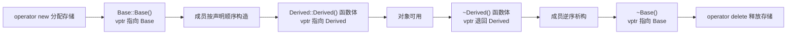

# 构造与析构：为什么构造函数不能是虚函数

← [[学习/学习导航/2026-10-22-学习导航|今日导航]] · [[八股测试/2026-10-22#CPP-CTOR-001|回到测试题]] · 代码：[[学习/2026-10-22/示例代码/02_ctor_dtor|02_ctor_dtor 阅读版]]

## 先把词说清楚

**构造（construction）**：为一个对象建立初始状态的过程。对类类型，包括：分配存储 → 调用基类构造函数 → 按成员声明顺序调用成员构造函数 → 执行构造函数体。

**析构（destruction）**：撤销对象及其成员，顺序与构造相反。

**虚析构函数**：基类把析构函数声明为 `virtual`，这样通过基类指针 `delete` 时，能先运行派生类析构再运行基类析构。

**两阶段构造**：本库不采用，但面试常见混淆点——`operator new` 只分配内存，构造函数才建立对象；两者是不同步骤。

## 它解决什么问题

一个对象在“构造完成前”和“开始析构后”都处于半成品状态：派生类部分可能还没建立，或已经被销毁。如果此时允许虚调用进入派生类，派生类可能访问尚未初始化或不复存在的成员。

所以语言规定：**构造/析构期间调用虚函数，只按“当前正在构造/析构的那个类”派发**。这不是性能优化，是安全规则。

## 顺序与规则

```text
构造：基类 → 成员（按声明顺序，不是初始化列表顺序）→ 构造函数体
析构：析构函数体 → 成员（逆序）→ 基类
```

对应标准条款：[class.base.init] 与 [class.cdtor]。

**三条常被问的规则：**

1. **构造函数不能是虚函数。** 虚调用要求对象已经存在、动态类型已知；而构造函数的工作正是“创建这个对象”。调用构造函数时还不知道对象是什么类型，若让它虚，就出现了“对象还没有才能用对象”的循环。派生类构造时，基类构造函数里 vptr 指向的也是基类。
2. **基类析构函数应当是虚函数。** 通过基类指针 `delete p;` 时，如果基类析构不是虚函数，标准规定行为未定义（[expr.delete]），实践中通常只执行基类析构，派生类资源泄漏。
3. **析构函数默认是 `noexcept(true)`。** 成员或基类析构可能抛出时，隐式析构的异常说明才会变成可能抛出。若析构在栈展开（另一个异常正在传播）时抛出，程序调用 `std::terminate`（[except.ctor]）。

## 最小代码

```cpp
struct Base {
    Base()  { std::cout << "Base()\n";  virtual_hook(); }   // 这里只会调到 Base 自己的版本
    virtual ~Base() { std::cout << "~Base()\n"; }
    virtual void virtual_hook() { std::cout << "Base::hook\n"; }
    int base_member = 0;
};

struct Derived : Base {
    Derived() : Base() { std::cout << "Derived()\n"; }
    ~Derived() override { std::cout << "~Derived()\n"; }
    void virtual_hook() override { std::cout << "Derived::hook\n"; }
    std::string name = "derived";   // 成员：在 Derived 构造函数体之前才构造
};
```

构造 `Derived d;` 的输出顺序是：`Base()` → `Base::hook`（不是 `Derived::hook`）→ `Derived()`；析构时反过来，而且析构期间同样只派发到当前层。

**为什么这很重要：** 如果在 `Base` 构造函数里调用一个在 `Derived` 中被覆盖的虚函数，而那个函数访问了 `Derived` 的成员，那些成员此刻还没构造——读到的是未初始化状态。

## 图示



## 构造函数抛异常会怎样

```cpp
struct Resource { Resource() { throw std::runtime_error("fail"); } };
struct Holder {
    Resource resource;   // 成员构造抛异常
    Holder() { /* 不会执行到这里 */ }
};
```

规则：已经完全构造好的基类和成员会被析构；对象本身不算构造完成，不会调用 `Holder` 的析构；分配的内存由匹配的 `operator delete` 回收。这就是为什么“构造函数里手工申请的资源要用 RAII 成员持有”——否则抛异常时没人替你释放。

## 边界与常见误解

**“构造函数可以是虚函数吗？”** 不能。语言层面不允许；想要“按名字创建不同子类”，用工厂函数 + 虚函数 `clone()` 之类手段。

**“析构函数一定要虚吗？”** 只有当你要通过基类指针删除派生对象时才必须。如果一个基类从不用作多态删除（例如没有虚函数、只作私有继承或组合），虚析构反而增加 vptr 成本。

**“在构造函数里注册回调安全吗？”** 危险。`this` 此刻还是半成品，回调若立刻执行或跨线程使用，会访问未构造成员；若对象后来构造失败，回调还持有悬垂指针。常见做法是构造完成后显式 `start()`，或用两阶段初始化 + 明确的失败返回值。

**“析构里能抛异常吗？”** 能编译，但默认异常说明是 `noexcept`，抛出会直接 `terminate`。工程上析构函数不抛异常，把可能失败的清理写成显式 `close()` 并记录错误。

## 使用场景

- **资源所有权**：日志文件、socket、共享内存句柄放进成员，析构自动释放。
- **接口设计**：多态基类一律 `virtual ~Base() = default;`，并用 `override` 让派生类析构也参与覆盖。
- **低延迟系统**：构造/析构常被移到启动阶段，避免在热路径里做分配与释放；对象池里的对象用 `reset()` 而不是反复析构重建。

## 变式与口述总结

> 构造顺序是基类、成员、函数体，析构反过来。构造和析构期间调用虚函数，只会派发到当前这一层，因为派生部分还没建立或已经销毁。构造函数不能是虚的，因为虚调用要求对象已存在；基类析构要做成虚的，否则通过基类指针 delete 是未定义行为。析构函数默认不抛异常，真抛了通常直接 terminate。

**变式：**

1. 基类析构不是虚的，`delete base_ptr;` 会发生什么？
2. 在 `Base` 构造函数里调用被 `Derived` 覆盖的虚函数，为什么进的是 `Base` 版本？
3. 构造函数抛异常时，哪些析构函数会被调用？

## 来源

- 题型来源：[拼多多 C++ 岗面经](https://www.iamshuaidi.com/30924.html) 记有“构造函数能否是虚函数”；[字节跳动 C++ 实习面经](https://www.iamshuaidi.com/3488.html) 记有“虚析构函数”。两个镜像页均未标发布日期，本次访问 2026-10-30。
- 标准依据：[N4659 class.cdtor](https://timsong-cpp.github.io/cppwp/n4659/class.cdtor)、[expr.delete](https://timsong-cpp.github.io/cppwp/n4659/expr.delete)、[except.ctor](https://timsong-cpp.github.io/cppwp/n4659/except.ctor)、[class.base.init](https://timsong-cpp.github.io/cppwp/n4659/class.base.init)。
