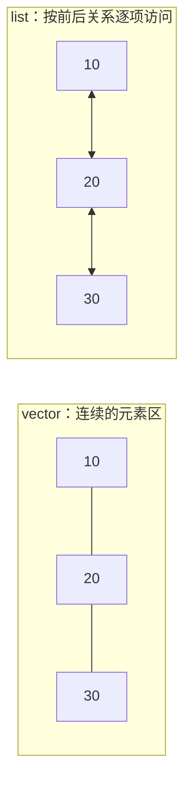

# 03 · vector 与 list：按下标访问，还是在已知位置插入

← [[学习/学习导航/2026-10-22-学习导航|今天学习入口]] · [[八股测试/2026-10-22#STL-LIST-001 · vector 和 list 怎么选|对应测试题]] · [[学习/2026-10-22/示例代码/03_vector_list|注释代码阅读版]]

> [!abstract] 来源与今天的新知识
> 一位候选人在腾讯 C++ 面试复盘中记下了“熟悉 vector 和 list 吗，内存分配策略、插入复杂度怎样”的问法。另一位 C++ 开发候选人也列出两者差异。[牛客 KetchupZ 的候选人自述](https://www.nowcoder.com/discuss/353156212986421248)、[Reddit cv_geek 的自述](https://www.reddit.com/r/cpp/comments/17r95li/questions_from_one_job_interview_on_c_developer/)。昨天已讲 vector 的 size/capacity/扩容；今天新增 list 的访问、插入及选型。

## 1 先把“序列容器”读明白

`vector<int>` 与 `list<int>` 都能按逻辑顺序保存整数。调用方可以从 `begin()` 开始遍历，走到 `end()` 表示已越过末元素；`end()` 自己不能解引用。

`vector` 的普通元素（`vector<bool>` 是特殊化）连续存放，可用 `v[i]` 按下标访问。`list` 支持双向迭代器，提供顺着前后走的接口，不提供 `list[i]` 或 `at(i)`。[N4659 vector.overview](https://timsong-cpp.github.io/cppwp/n4659/vector.overview)、[list.overview](https://timsong-cpp.github.io/cppwp/n4659/list.overview)。

常见 `list` 实现会用分散分配的双向链式节点；这是有助于理解的常见实现模型。标准保证的是容器操作、复杂度和迭代器语义，不要求你画出某个库的精确节点字段。



## 2 为什么“list 插入 O(1)”不能只背一半

面试官问“在中间插入哪个快”，你需要先问：**插入位置已经给了迭代器吗？**

- 有一个已经指向目标位置的 `list` 迭代器：插入单项是 O(1)，且不使其它元素的迭代器、引用失效。[N4659 list.modifiers](https://timsong-cpp.github.io/cppwp/n4659/list.modifiers)。
- 只给“第 k 个位置”而没有迭代器：`list` 先要从已知位置一步步走过去，找位置本身一般是 O(k)。插入动作仍 O(1)，**从头找到位置再插入**却不是整体 O(1)。
- `vector` 可通过下标/随机访问迭代器很快定位位置，但在中间插入需要给元素腾地方，复杂度一般 O(n)，扩容时还要换元素存储。[N4659 vector.overview](https://timsong-cpp.github.io/cppwp/n4659/vector.overview)。

删除也要说明位置是否已经知道；不能用一个孤立的 O(1) 比较两段需求不一样的代码。

## 3 完整 C++17 代码

源码：[[学习/2026-10-22/示例代码/03_vector_list.cpp|03_vector_list.cpp]]。

```cpp
// C++17 学习示例：vector 与 list 都能保存一串整数，访问和插入代价不同。
// 关键条件：list 的常数时间插入，必须已经拿到目标位置的迭代器。

#include <algorithm> // std::equal：比较两种容器最终存的值。
#include <cassert>   // assert：检查元素和保留的 list 迭代器。
#include <iostream>  // std::cout：打印示范结果。
#include <iterator>  // std::next：从首项向前走一步。
#include <list>      // std::list：支持前后移动的序列容器。
#include <vector>    // std::vector：支持按下标快速访问的连续容器。

int main() {
    std::vector<int> contiguous{10, 20, 30};
    std::list<int> linked{10, 20, 30};

    // vector 的第 1 号下标直接访问第二个元素，复杂度为常数。
    assert(contiguous[1] == 20);
    // list 没有 operator[]，这里从 begin 向前走一步取得插入位置。
    auto second = std::next(linked.begin());
    auto first = linked.begin(); // 保留一个指向 10 的迭代器。
    assert(*second == 20);

    // 已知插入位置时，list 插入单个元素不搬动原有元素。
    linked.insert(second, 15);
    assert(*first == 10 && *second == 20); // 旧迭代器仍可指向原节点。

    // vector 在中间插入，需要为新元素腾出位置；可能需要重新分配。
    contiguous.insert(contiguous.begin() + 1, 15);
    // 从此重新获取位置；不要继续使用插入前缓存的 vector 迭代器。
    assert(contiguous[2] == 20);
    assert(std::equal(contiguous.begin(), contiguous.end(),
                      linked.begin(), linked.end()));

    std::cout << "both contain: ";
    for (int value : contiguous) std::cout << value << ' ';
    std::cout << '\n';
    // 查找 list 的第 k 个位置需要从已知位置逐步走过去；
    // 因此“插入动作 O(1)”不代表“按下标找位置再插入总是 O(1)”。
}
```

### 逐步看执行过程

1. 两个容器从 `10,20,30` 开始。`contiguous[1]` 直接得到 `20`。
2. `std::next(linked.begin())` 从第一个节点走一步，得到指向 `20` 的迭代器。这个例子只走一步，但找很远的位置需要更多步。
3. 在它之前插入 `15`。保存的 `first`、`second` 仍指向原来的 `10`、`20`，没有因为另插一项而变成其他元素。
4. 对 vector 在 `begin()+1` 插入 `15` 后，从容器重新取得相应位置，不继续用插入前缓存的旧 vector 迭代器。
5. 两个容器最终都表示 `10,15,20,30`。相同结果并不说明内部存储、性能与失效规则相同。

昨天 [[学习/2026-10-20/06-vector与综合练习|vector 详解]] 已列出扩容与旧 `end()` 失效；今天重点是**list 的稳定访问和找位置的代价**，不把旧规则重记为一题。

## 4 选型对照

| 要问的事情 | vector | list |
| --- | --- | --- |
| 获取第 k 项 | 支持 `v[k]`，常数时间 | 无下标接口，需顺序走 |
| 尾部追加 | 摊还常数；有时会扩容 | 常数时间插入单项 |
| 已知迭代器处插入 / 删除 | 中间一般线性，可能影响后续位置 | 单项常数时间，其他元素引用保持有效 |
| 元素存储 | 普通 `T` 连续 | 常见实现为分散节点，具体布局不由此文承诺 |
| 遍历性能 | 连续布局可能有较好局部性 | 需逐步访问，常见节点模型有额外间接访问 |

**不要只看大 O。** 如果主要顺序扫描和按下标访问，vector 往往是合理起点；如果业务已经持有节点位置并频繁在中间插删，list 的接口可能更合适。真实效果还取决于元素大小、分配方式、数据量与访问模式，最终用对应工作负载测量。

## 5 迭代器与引用的边界

`list` 插入其它元素不会使原有元素的迭代器与引用失效；删除一个元素后，**指向被删元素**的迭代器与引用仍然失效。不能把“list 迭代器稳定”说成“永久有效”。[N4659 list.modifiers](https://timsong-cpp.github.io/cppwp/n4659/list.modifiers)。

`vector` 中间插入与删除会影响相应位置及其后的迭代器、引用；若重新分配，影响所有原元素地址。条件与代码可回看昨天的 [[学习/2026-10-20/06-vector与综合练习|失效表]]。

> [!question]- 变式：知道一个记录的值，不知道它的位置
> 你要在它前面插入另一项。“list 在已知位置 O(1)”是否直接说明整个操作 O(1)？

> [!success]- 答案
> 不能。先找目标位置可能需要线性遍历。若另有外部索引提前提供一个仍有效的 list 迭代器，后续插入动作才是常数时间；外部索引本身也有维护成本。

**30–90 秒口述：** vector 元素连续，支持快速下标访问和良好的顺序遍历特征，中间插删通常需要搬移。list 支持双向迭代，单项在已知迭代器位置插删为常数时间，插入不使其它元素的迭代器失效；但它没有下标访问，找到第 k 项需要顺序走。不能只凭插入的 O(1) 就默认 list 更快，先把“位置是否已知”和实际操作频率说清楚。
