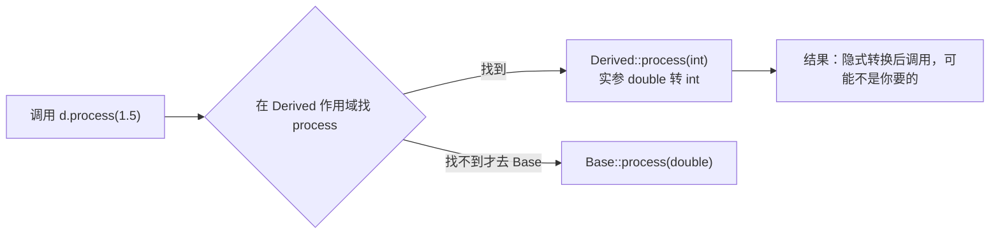

# 重载、重写、隐藏：三个词最容易混

← [[学习/学习导航/2026-10-22-学习导航|今日导航]] · [[八股测试/2026-10-22#CPP-HIDE-001|回到测试题]]

## 先把词说清楚

**重载（overload）**：同一个作用域里，同名但参数列表不同的多个函数。编译器按实参挑一个。返回类型不参与区分。

**重写（override，也叫覆盖）**：派生类重新定义基类的**虚函数**，名字、参数列表、cv 限定都相同。调用时按对象动态类型派发。

**隐藏（hide / name hiding）**：派生类只要声明了与基类同名的成员，基类里**所有**同名成员在派生类作用域里就被遮住了，跟参数列表是否相同无关。

这三个词对应三种完全不同的机制：重载在**同一层**选函数，重写在**跨层**换实现，隐藏在**跨层**挡名字。

## 它解决什么问题

- 重载让接口有统一的写法：`print(int)`、`print(const std::string&)`。
- 重写实现运行时多态：`Shape::area()` 由 `Circle`、`Square` 各自实现。
- 隐藏是作用域查找的自然结果：派生类作用域里先找到同名成员，就不再往基类找。它不是设计目标，却经常制造 bug。

## 最小代码

```cpp
struct Base {
    virtual void process(int value) { std::cout << "Base::process(int)\n"; }
    void process(double value)      { std::cout << "Base::process(double)\n"; }  // 重载
};

struct Derived : Base {
    void process(int value) override { std::cout << "Derived::process(int)\n"; }
    // 这里没有 using Base::process;
};
```

```cpp
Derived d;
d.process(1);      // Derived::process(int)
d.process(1.5);    // 编译失败：基类的 double 版本被“隐藏”了
Base& b = d;
b.process(1.5);    // Base::process(double)：经基类引用看，名字没被隐藏
```

想让基类重载重新可见，写一句 `using Base::process;`。

## 三种情况对照

| 维度 | 重载 | 重写 | 隐藏 |
| --- | --- | --- | --- |
| 作用域 | 同一作用域 | 基类与派生类 | 基类与派生类 |
| 名字 | 相同 | 相同 | 相同 |
| 参数列表 | 必须不同 | 必须相同 | 可以相同也可以不同 |
| 是否要求 virtual | 不要求 | 必须 | 不要求 |
| 调用绑定时机 | 编译期 | 运行期（经指针/引用） | 编译期 |
| 典型后果 | 选错重载 | 多态生效 | 基类同名函数“消失” |

## 图示



C++ 的名字查找是“先找到名字集合，再做重载决议”，一旦在派生类作用域找到 `process`，就不会把基类的 `process` 加进候选集。

## 覆盖失败的几种典型写法

```cpp
struct Base {
    virtual void run(int value) const;   // 注意 const
};

struct Bad : Base {
    void run(int value);                 // 少了 const：这是“隐藏”，不是“重写”
};

struct Worse : Base {
    void run(int value) const;           // 正确重写
};
```

**加上 `override` 就能让这类错误变成编译错误：**

```cpp
struct Good : Base {
    void run(int value) override;        // 编译失败：签名不匹配，立刻发现
};
```

C++11 起标准提供 `override` 与 `final`（[class.virtual]），面试里被问“怎么避免覆盖失败”，答案就是这两个关键字 + `-Wsuggest-override` 之类的编译告警。

## 另一个高频陷阱：默认参数

```cpp
struct Base {
    virtual void send(int timeout_ms = 1000);
};
struct Derived : Base {
    void send(int timeout_ms = 10) override;
};

Derived d;
Base& b = d;
b.send();      // 用 Base 的默认值 1000
d.send();      // 用 Derived 的默认值 10
```

默认参数是**静态绑定**的，虚函数是动态绑定，两者混用时结果按“静态类型取默认值、动态类型取函数体”决定。工程建议：虚函数不要写默认参数。

## 边界与常见误解

**“重载看返回值？”** 不看。`int f();` 与 `double f();` 不能共存。

**“派生类同名函数会覆盖基类所有重载吗？”** 会隐藏（不是覆盖）。要恢复用 `using`。

**“重写要求 virtual 吗？”** 要求基类版本是虚函数；派生类写不写 `virtual` 都仍是虚函数，但建议写 `override` 表达意图。

**“`final` 有什么用？”** 禁止继续重写或禁止继承，能帮编译器去虚化（devirtualization），在低延迟代码里是常见优化手段。

## 使用场景

- **接口 + 实现分离**：抽象基类声明纯虚函数，派生类 `override`。
- **插件/适配器**：同一接口不同实现，运行时装配。
- **性能敏感处**：知道确切类型时用 `final` 或直接调用（`object.Base::f()` 可显式静态调用），避免虚调用开销。

## 变式与口述总结

> 重载是同一作用域里同名不同参数，编译期选；重写是派生类重新实现基类虚函数，签名必须一致，运行期按对象真实类型派发；隐藏是派生类声明了同名成员，把基类所有同名成员挡住，跟参数无关。写 `override` 能让签名不一致直接编译报错，写 `using Base::f;` 能恢复被隐藏的重载。

**变式：**

1. 基类有 `virtual void f(int) const`，派生类写 `void f(int)`，会发生什么？
2. 为什么虚函数不适合带默认参数？
3. `final` 除了限制继承，还能带来什么？

## 来源

- 题型来源：[顺丰 C++ 后端一二面面经](https://www.iamshuaidi.com/31482.html) 二面明确记有“函数重写、覆盖、隐藏区别”。镜像页未标发布日期，本次访问 2026-10-30。
- 标准依据：[N4659 class.member.lookup](https://timsong-cpp.github.io/cppwp/n4659/class.member.lookup)、[class.virtual](https://timsong-cpp.github.io/cppwp/n4659/class.virtual)、[dcl.fct.default](https://timsong-cpp.github.io/cppwp/n4659/dcl.fct.default)。
