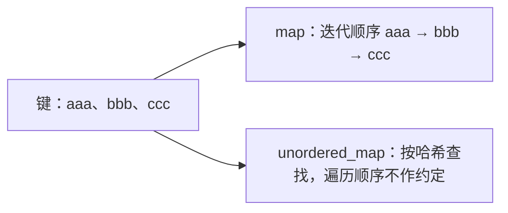

# 04 · map 和 unordered_map：都按键找值，顺序与代价不同

← [[学习/学习导航/2026-10-22-学习导航|今天学习入口]] · [[八股测试/2026-10-22#STL-MAP-001 · map 和 unordered_map 有什么区别|对应测试题]] · [[学习/2026-10-22/示例代码/04_map_unordered|注释代码阅读版]]

> [!abstract] 来源
> 一位 C++ 开发候选人公布的面试提问清单里直接列有“map 与 unordered_map 的区别”；另一位候选人在百度 C++ 复盘中记过 unordered_map 实现及冲突的追问。[Reddit cv_geek 候选人自述](https://www.reddit.com/r/cpp/comments/17r95li/questions_from_one_job_interview_on_c_developer/)、[牛客 KetchupZ 候选人自述](https://www.nowcoder.com/discuss/353156212986421248)。本页的数值、代码与解释自行编写。

## 1 从“键 → 值”开始

若希望用字符串 `"order-17"` 快速查到价格，可以保存一条**键值对**：键是订单标识，值是价格。`map<std::string,int>` 与 `unordered_map<std::string,int>` 都能表达“一个键对应一个值”。

- **键 key**：查找时给出的标识，本例是字符串。
- **值 mapped value**：找到键后要用的数据，本例是整数。
- **唯一键**：一个容器中同一个键不会同时有两条不同项。需要重复键时是其它容器设计。
- **迭代**：从 `begin()` 顺序走过容器里的元素。两种容器都能遍历，但顺序承诺不同。

`map` 的键按比较器规定的顺序排列；默认字符串比较让 `"aaa"` 出现在 `"bbb"` 前。它支持依顺序遍历、`lower_bound` 等边界查询。`unordered_map` 使用哈希和键相等规则组织查找，**不保证某个固定遍历顺序**。[N4659 associative.reqmts](https://timsong-cpp.github.io/cppwp/n4659/associative.reqmts)、[unord.req](https://timsong-cpp.github.io/cppwp/n4659/unord.req)。



## 2 两句常见面试回答，分别补齐条件

“map 是红黑树、unordered_map 是哈希表”是常见实现层面的概括。标准要求 map 有相应有序行为和对数复杂度，要求无序关联容器有桶、哈希、相等关系和复杂度；**没有要求所有标准库固定使用同一具体红黑树节点布局或同一种冲突链结构**。

“unordered_map 查找 O(1)”少了“**平均情况**”条件。哈希分布很差或键大量冲突时，最坏复杂度可退化；有序 map 的查找是对数复杂度。[N4659 associative.reqmts](https://timsong-cpp.github.io/cppwp/n4659/associative.reqmts)、[unord.req](https://timsong-cpp.github.io/cppwp/n4659/unord.req)。

| 需求与规则 | map | unordered_map |
| --- | --- | --- |
| 依据什么定位键 | 比较器给出的顺序 | 哈希函数 + 键相等判断 |
| 迭代能否依键排序 | 可以，按比较器顺序 | 不保证 |
| 普通单键查找复杂度 | O(log n) | 平均 O(1)，最坏可能 O(n) |
| 查第一个不小于某键的元素 | 提供 `lower_bound` | 不能用同样的有序边界语义 |
| 元素内存占用 | 与节点和实现有关 | 桶及实现管理会产生额外成本 |

**不要从表中推断“unordered_map 一定更快、一定更占内存”。** 常数成本、哈希计算、分配与实际查询方式会改变实测结果。

## 3 运行一份能看出顺序保证的程序

源码：[[学习/2026-10-22/示例代码/04_map_unordered.cpp|04_map_unordered.cpp]]。

```cpp
// C++17 学习示例：对照 map 的有序键与 unordered_map 的单点查找。
// 这里只观察标准可保证的顺序与查找，不猜 unordered_map 的遍历顺序。

#include <cassert>       // assert：验证顺序与找到的值。
#include <iostream>      // std::cout：显示可观察结果。
#include <map>           // std::map：按比较器排列唯一键。
#include <string>        // std::string：使用文字作为键。
#include <unordered_map> // std::unordered_map：以哈希和相等关系查找键。

int main() {
    // 两个容器都保存“键 -> 值”；这里只需查找，不需要自定义键类型。
    std::map<std::string, int> ordered{{"ccc", 3}, {"aaa", 1}, {"bbb", 2}};
    std::unordered_map<std::string, int> hashed{
        {"ccc", 3}, {"aaa", 1}, {"bbb", 2}};

    // 默认比较器按字符串顺序排键，因此 map 的首项是 aaa。
    assert(ordered.begin()->first == "aaa");
    // find 返回迭代器；没找到时返回 end，先比较再访问 second。
    const auto ordered_hit = ordered.find("bbb");
    const auto hash_hit = hashed.find("bbb");
    assert(ordered_hit != ordered.end() && ordered_hit->second == 2);
    assert(hash_hit != hashed.end() && hash_hit->second == 2);
    assert(hashed.find("missing") == hashed.end());

    std::cout << "map first key: " << ordered.begin()->first << '\n';
    std::cout << "both find bbb: " << ordered_hit->second << ' '
              << hash_hit->second << '\n';
    // 不打印或断言 hashed.begin() 是某个固定键：其遍历顺序未规定。
}
```

### 按步骤读

1. 两个容器都保存 `"aaa" → 1`、`"bbb" → 2`、`"ccc" → 3`。声明里把 `"ccc"` 写在前面，不会改变 map 依键排序的承诺。
2. `ordered.begin()->first` 是有序容器首项的键，在默认比较器下是 `"aaa"`。`->first` 通过迭代器访问一对数据中的键，`->second` 取得值。
3. `find("bbb")` 查找。使用返回的迭代器前先与 `end()` 比较，否则没找到时会错误解引用。
4. 示例特意**不**断言 `hashed.begin()` 等于哪个键，因为 unordered_map 没有那个顺序保证。

这里使用 `find` 是为了“只查，不新建”。对非 const map 使用 `operator[]`，若键不存在会插入一个具有默认初值的值；把它用作单纯查找可能无意修改容器。两种 map 都要留意这个区别。[N4659 map.elem](https://timsong-cpp.github.io/cppwp/n4659/map.access)、[unord.map.elem](https://timsong-cpp.github.io/cppwp/n4659/unord.map.elem)。

## 4 什么时候选哪种

- **需要按键排序、范围查询、上界 / 下界**：先考虑 map。例如之后要按编号顺序输出记录。
- **频繁按完整键单点查找，不关心键顺序**：可考虑 unordered_map。例如通过订单 ID 查一份当前状态。
- **键类型不同**：map 需要可用的比较关系；unordered_map 需要协调的哈希与相等规则。自定义键另开专题，不必为了今天这题临时写一整套模板。
- **延迟敏感**：先量工作负载；平均查找复杂度不能直接推导每一次查找的尾延迟。哈希差、分配和重新散列也会产生成本。

昨天的 `vector` 重点是按下标和连续元素；map 和 unordered_map 的重点是**凭键定位一个值**。不需要先给订单编号转换成 vector 下标才能查找。

> [!question]- 变式：按订单号从小到大遍历全部结果
> 如果只知道一个 unordered_map，能不能承诺它本身的迭代就按号排序？

> [!success]- 答案
> 不能。可直接用有序 map，也可另取出键排序或建立其它有序索引，成本和维护方式不同。不要把这次环境输出的碰巧有序当成接口保证。

**30–90 秒口述：** map 依比较器保持键序，支持顺序遍历与有序边界查询，单键查找为对数复杂度；unordered_map 用哈希和键相等规则按桶管理，单键查找平均常数，最坏可线性，不保证迭代顺序。红黑树与具体哈希冲突结构是常见实现说明，不能当成标准规定的固定内存布局。实际选择看是否需要顺序、键分布、内存和测量结果。

标准依据：[N4659 associative.reqmts](https://timsong-cpp.github.io/cppwp/n4659/associative.reqmts)、[unord.req](https://timsong-cpp.github.io/cppwp/n4659/unord.req)。
