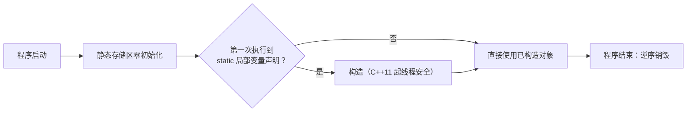

# static 到底有几种身份

← [[学习/学习导航/2026-10-22-学习导航|今日导航]] · [[八股测试/2026-10-22#CPP-STATIC-001|回到测试题]]

## 先把词说清楚

`static` 在 C++ 里不是“一种东西”，它在四个位置出现，含义各不相同：

| 出现位置 | 含义 | 生命周期 | 作用范围 |
| --- | --- | --- | --- |
| 函数内的局部变量 | 静态存储期，只初始化一次 | 程序全程 | 该函数内可见 |
| 类的数据成员 | 全类共享一份，不属于某个对象 | 程序全程 | 类作用域 |
| 类的成员函数 | 没有 `this`，不能直接访问非静态成员 | — | 类作用域 |
| 命名空间作用域的变量/函数 | 内部链接（只在本翻译单元可见） | 程序全程 | 当前 .cpp |

**静态存储期（static storage duration）**：对象在程序启动时就有了存储（零初始化），直到程序结束才销毁；与自动变量（栈上、离开作用域就没了）相对。

## 它解决什么问题

- **要“全局只有一份”的状态**：配置、计数器、连接池。
- **要“第一次用到才初始化”**：避免启动阶段做重活，也避免跨翻译单元初始化顺序问题。
- **要“类级别的工具函数”**：不依赖具体对象。

## 四种用法与代码

### 1. 函数内 static：懒初始化 + 线程安全

```cpp
Config& global_config() {
    static Config instance;   // 第一次执行到这里才构造
    return instance;
}
```

C++11 起，函数内静态局部变量的初始化是**线程安全**的：多个线程同时第一次进入，只有一个线程执行初始化，其他线程等待（[stmt.dcl]/4，常被称为 magic statics）。这一点和“自己写 `if (!inited) inited = true;`”完全不同。

### 2. 类的静态数据成员：全类一份

```cpp
class Counter {
public:
    static int total;          // 声明
};
int Counter::total = 0;        // C++17 之前：必须在某个 .cpp 里定义一次
```

C++17 可以写成 `inline static int total = 0;`，定义直接放在类里，多个翻译单元包含头文件也不会重复定义（[class.static.data]）。

### 3. 静态成员函数：没有 this

```cpp
class Factory {
public:
    static std::unique_ptr<Handler> create(Kind kind);
private:
    static int created_count_;   // 静态函数只能直接访问静态成员
};
```

调用写 `Factory::create(kind)`，不需要对象。

### 4. 命名空间作用域的 static：内部链接

```cpp
static int helper_counter = 0;   // 只在本翻译单元可见
namespace { int other_counter = 0; }  // 推荐写法：匿名命名空间
```

它的作用是“别让这个符号跑到别的 .cpp 里去”，和“静态存储期”是两码事。C++11 起不推荐再用 `static` 表达内部链接。

## 跨翻译单元初始化顺序问题（SIOF）

```cpp
// a.cpp
Logger g_logger;              // 全局对象，构造时机不确定
// b.cpp
extern Logger g_logger;
Config g_config(g_logger);    // 若 g_logger 还没构造，这里就用到了半成品
```

不同翻译单元之间的动态初始化顺序**未指定**，这就是 static initialization order fiasco。工程上的标准解法是把全局对象改成“函数内 static”：

```cpp
Logger& logger() { static Logger instance; return instance; }
```

这样构造发生在第一次调用时，顺序由使用顺序决定，不再依赖链接顺序。

## 图示



## 边界与常见误解

**“函数内 static 一定线程安全？”** 初始化是线程安全的；**对象本身的操作不是**。两个线程同时调用 `global_config().set(...)` 仍然要自己加锁。

**“静态成员变量可以直接在类里初始化？”** 非 `const` 的非 `inline` 静态成员在 C++17 前必须在类外定义；`constexpr static` 有例外。C++17 的 `inline static` 最省事。

**“静态局部变量在什么时候销毁？”** 程序结束时，按构造的逆序；跨翻译单元的相对顺序同样未指定。

**“static 函数能访问普通成员吗？”** 不能，它没有 `this`。

**“多线程下用局部 static 做单例有什么坑？”** 如果单例的析构发生在程序退出阶段，别的线程可能还在用；要么不析构（有意泄漏），要么明确管理生命周期。

## 使用场景

- **单例/全局服务**：日志、配置、指标注册表，用函数内 static。
- **每类共享的计数/缓存**：静态数据成员。
- **工具函数**：不依赖对象状态的转换、校验。
- **头文件里的辅助函数**：用匿名命名空间或 `inline`，而不是 `static`。

## 变式与口述总结

> static 有四种身份：函数内局部变量（懒初始化、C++11 起线程安全）、类的静态数据成员（全类一份）、静态成员函数（没有 this）、命名空间作用域的 static（内部链接）。最常考的是函数内 static 的线程安全初始化，以及它如何解决跨翻译单元初始化顺序问题。

**变式：**

1. 两个线程同时第一次调用 `static Config c;`，会发生什么？
2. `inline static int count = 0;` 相比类外定义解决了什么问题？
3. 为什么全局对象初始化顺序是坑，函数内 static 能避开？

## 来源

- 题型来源：[顺丰 C++ 后端一二面面经](https://www.iamshuaidi.com/31482.html) 一面记有“多态、虚函数、static、内存分部”等基础八股。镜像页未标发布日期，本次访问 2026-10-30。
- 标准依据：[N4659 basic.stc.static](https://timsong-cpp.github.io/cppwp/n4659/basic.stc.static)、[stmt.dcl](https://timsong-cpp.github.io/cppwp/n4659/stmt.dcl)、[class.static.data](https://timsong-cpp.github.io/cppwp/n4659/class.static.data)、[basic.start.dynamic](https://timsong-cpp.github.io/cppwp/n4659/basic.start.dynamic)。
