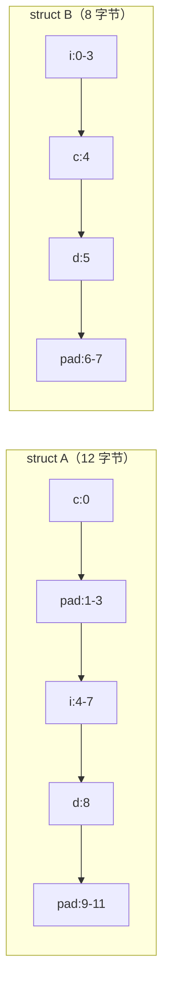

# 空类为什么是 1，结构体为什么会被“撑大”

← [[学习/学习导航/2026-10-22-学习导航|今日导航]] · [[八股测试/2026-10-22#CPP-ALIGN-001|回到测试题]]

## 先把词说清楚

**对齐（alignment）**：对象在内存中的起始地址必须是某个值的整数倍。例如 4 字节的 `int` 通常要求地址能被 4 整除。

**对齐要求（alignment requirement）**：每个类型都有一个，`alignof(T)` 可以查。基本类型一般等于自身大小，但这只是常见约定，不是语言规定。

**填充（padding）**：为了满足对齐，编译器在成员之间或对象末尾插入不使用的字节。

**sizeof**：一个类型或对象占用的字节数，**包含尾部填充**。

## 它解决什么问题

CPU 访问对齐数据通常一次就能读到；未对齐访问可能要拆成两次，甚至在部分架构上直接触发异常。编译器用填充换访问效率，代价是内存变多。

对量化/低延迟代码，这个代价是双向的：数组元素之间多出来的填充会减少一次缓存行能装下的有效数据量。

## 三条规则

1. 每个成员的偏移量必须是它自身对齐要求的整数倍，不够就填充。
2. 结构体的对齐要求等于**最大成员**的对齐要求。
3. 结构体总大小必须是自身对齐要求的整数倍，不够就在尾部填充。

空类（没有非静态数据成员、没有虚函数）`sizeof` 为 **1**：标准要求同类型的两个不同对象地址不同（[intro.object]），大小至少 1 字节。作为基类时，空基类可以优化掉（EBO），不占空间。

## 最小代码与手算

```cpp
struct A { char c; int i; char d; };
```

- `c` 在偏移 0，占 1 字节；
- `i` 要求 4 对齐，偏移 1 不行，补 3 字节，`i` 在偏移 4；
- `d` 在偏移 8；
- 总大小 9，但结构体对齐是 4，尾部补到 12。

结果：`sizeof(A) == 12`。

```cpp
struct B { int i; char c; char d; };
```

- `i` 偏移 0（4 字节），`c` 偏移 4，`d` 偏移 5；
- 尾部补 2 字节到 8。

结果：`sizeof(B) == 8`。**同样的成员，只是换了顺序，少了 4 字节。**



## 含虚函数、继承时的 sizeof

```cpp
struct Empty {};
struct Poly { virtual void f(); };          // 常见实现：8 字节（vptr）
struct WithInt { int x; virtual void f(); }; // 8 + 4 + 4 = 16
struct D : WithInt { int y; };               // 8 + 4 + 4 = 16，恰好填满
```

规则本身没变，只是多了一个“隐藏成员” vptr（见 [[学习/2026-10-22/01-虚表与对象内存布局|虚表与对象布局]]）。

空基类优化：

```cpp
struct E {};
struct Holder : E { int value; };   // sizeof 常见为 4，而不是 1+4 补到 8
```

## 控制对齐

```cpp
struct alignas(64) Row { double price; };   // 强制 64 字节对齐：一个缓存行放一条
alignof(Row);                               // 64
```

- `alignas` 提高对齐要求，不能降低。
- `#pragma pack(1)` 是编译器扩展，能取消填充，但会造成未对齐访问：x86 上通常能跑但慢，部分 ARM 上可能直接出错；结构体也可能不再满足某些 ABI 要求。
- C++17 的 `operator new(std::align_val_t)` 支持过对齐类型；普通 `malloc` 只保证 `max_align_t` 级别的对齐。

## 边界与常见误解

**“空类大小是 0？”** 不是，是 1。作为基类时可能被优化到“不额外占空间”。

**“结构体大小等于成员大小之和？”** 不等于，要加填充。

**“sizeof 是运行期算的？”** 除变长数组等特殊情况（非标准 C++）外，`sizeof` 是编译期常量。

**“把成员按大小降序排一定最省？”** 大多数情况下是好的启发式，但不是法则；`alignas`、位域、继承都会改变结果，实际用 `sizeof` 验证。

**“位域能随便用吗？”** 位域的布局是实现相关的，跨编译器或跨网络传输时不能假定字节序和打包方式。

## 使用场景

- **行情/订单结构体**：字段顺序影响内存占用与缓存行命中；热路径只读字段可以考虑拆成 SoA。
- **共享内存与协议结构**：必须明确对齐、字节序、编译器打包，不能直接 `memcpy` 一个含 `std::string` 的结构体。
- **跨语言/跨进程 ABI**：`extern "C"` 接口里用固定宽度整数（`int32_t`）并显式对齐。

## 变式与口述总结

> 对齐是为了让 CPU 高效访问。规则是成员偏移按自身对齐、结构体对齐取最大成员、总大小补齐到对齐的倍数。空类大小是 1，作为基类时可被优化掉。调整成员顺序能减少填充；`alignas` 能提高对齐，`#pragma pack` 能取消填充但会带来未对齐访问风险。

**变式：**

1. `struct { char a; double b; char c; }` 在 x86-64 上多大？换顺序后多大？
2. 空类继承后 `sizeof` 为什么可能不变？
3. 为什么网络协议结构体不能直接依赖编译器默认对齐？

## 来源

- 题型来源：[顺丰 C++ 后端一二面面经](https://www.iamshuaidi.com/31482.html) 记有“内存分部”；[携程 C++ 后端面经](https://www.iamshuaidi.com/31681.html) 记有 float 占几字节、浮点如何在内存中存储。镜像页均未标发布日期，本次访问 2026-10-30。
- 标准依据：[N4659 basic.align](https://timsong-cpp.github.io/cppwp/n4659/basic.align)、[intro.object](https://timsong-cpp.github.io/cppwp/n4659/intro.object)、[class.mem](https://timsong-cpp.github.io/cppwp/n4659/class.mem)、[expr.new](https://timsong-cpp.github.io/cppwp/n4659/expr.new)（过对齐分配）。
