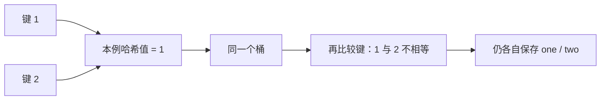

# 05 · 哈希冲突与 rehash：同桶仍能区分不同键

← [[学习/学习导航/2026-10-22-学习导航|今天学习入口]] · [[八股测试/2026-10-22#STL-HASH-001 · 哈希冲突是什么，rehash 做什么|对应测试题]] · [[学习/2026-10-22/示例代码/05_hash_collision|注释代码阅读版]]

> [!abstract] 这个追问真的出现过
> 牛客候选人 KetchupZ 在百度 C++ 一面与二面复盘里都记到“hash 是什么、如何解决冲突 / unordered_map 大概如何实现”的追问。[候选人原帖，2020-05-26 编辑](https://www.nowcoder.com/discuss/353156212986421248)。本文用人工制造冲突的代码帮助理解，答案以 C++17 无序容器条款核对。

## 1 从“映射到桶”讲起

**哈希函数**接收键，计算一个可用于定位的哈希值。容器用它安排键进入某个**桶 bucket**；一个桶可以关联不止一条元素。真正确认是不是目标键，还要用**相等判断**。

**冲突**是不同键的哈希值相同，或它们最终落进同一桶。冲突不等于“一个键把另一个键覆盖了”：`unordered_map` 中不同且不相等的两个键可以并存。



C++17 规定同哈希码的键会在同一桶、提供桶接口和哈希/相等规则；**不强制每一家标准库以完全一样的链表节点或探测方式布局**。[N4659 unord.req](https://timsong-cpp.github.io/cppwp/n4659/unord.req)。不要只背“拉链法”，把某种具体实现误当成语言保证。

## 2 平均快与最坏慢怎样同时成立

若哈希能把键较均匀地分散到很多桶，查一个键只需检查少量候选者，常见平均情况接近 O(1)。若很多键都挤在同一桶，容器仍需识别其中正确的键，最坏工作量可到 O(n)。这正是上一页性能表里的两个条件。[N4659 unord.req](https://timsong-cpp.github.io/cppwp/n4659/unord.req)。

**负载因子 load factor** = 元素数 ÷ 桶数。容器可以增加桶数量来控制平均每桶元素数；`rehash(n)` 请求至少满足某个桶数和负载要求。实际桶数、桶编号和输出的浮点小数可能随标准库实现变化。

重要边界：**增加桶数不会修好坏哈希函数**。如果哈希器对每个键都返回同一个值，这些键仍可能挤在同一个桶。必须分别考虑哈希分布和桶数量。

## 3 完整 C++17 代码：故意制造冲突

源码：[[学习/2026-10-22/示例代码/05_hash_collision.cpp|05_hash_collision.cpp]]。

```cpp
// C++17 学习示例：让不同键故意得到同一个哈希值，观察桶与 rehash。
// 这只是冲突演示；生产代码不应故意把全部键散列到同一值。

#include <cassert>       // assert：验证两个键共桶、值仍可找到。
#include <cstddef>       // std::size_t：桶数量使用的无符号计数类型。
#include <iostream>      // std::cout：显示冲突与负载因子。
#include <string>        // std::string：映射值的类型。
#include <unordered_map> // std::unordered_map：提供 bucket、rehash、find。

struct ConstantHash {
    // 容器调用函数对象的 operator() 来取得键的哈希值。
    // const：不修改哈希器；noexcept：不从这里抛异常；返回类型 size_t。
    std::size_t operator()(int) const noexcept { return 1; }
};

int main() {
    std::unordered_map<int, std::string, ConstantHash> table;
    table.emplace(1, "one"); // 建立“键 1 -> one”。
    table.emplace(2, "two"); // 键不同，但哈希器仍返回相同的 1。

    const bool collide = table.bucket(1) == table.bucket(2);
    assert(collide); // 同哈希值的两个键会归入同一桶。
    assert(table.find(1)->second == "one");
    assert(table.find(2)->second == "two");

    const std::size_t before = table.bucket_count();
    auto before_rehash = table.find(1); // 这份迭代器在 rehash 后不可继续用。
    std::string& kept_value = before_rehash->second; // 元素引用在 rehash 后仍有效。
    table.rehash(before * 2 + 1); // 请求更多桶；具体桶数由实现选择。
    assert(table.bucket_count() > before);
    assert(kept_value == "one");
    // 不再使用 before_rehash；重新查找后取得新的有效迭代器。
    assert(table.find(1)->second == "one");

    std::cout << "same bucket: " << std::boolalpha << collide << '\n';
    std::cout << "load factor: " << table.load_factor() << '\n';
    // 负载因子约为 size / bucket_count；数值受库选择的桶数影响。
}
```

### 按步骤观察

1. `ConstantHash::operator()` 是函数调用运算符：容器拿一个 int 键调用它。它始终返回 `1`，故意让 `1` 与 `2` 的哈希码相同。
2. `emplace(1,"one")`、`emplace(2,"two")` 建立两条不同的键值对。`bucket(1)==bucket(2)` 检查同桶；`find` 仍能分别找到正确值。
3. `before_rehash` 保存一个迭代器。`rehash` 后它失效，源码没有再解引用它，而是重新 `find`。
4. `kept_value` 是指向已有**元素的引用**，不是指向桶位置的迭代器；仅 rehash 不使这样的元素引用失效。若以后删除该元素，引用仍会失效。
5. 输出的负载因子不写死。代码只断言可由标准保证的“新桶数至少大于旧桶数”和元素可找到。

来源：[N4659 unord.req 对桶、rehash、迭代器与引用的规定](https://timsong-cpp.github.io/cppwp/n4659/unord.req)。

## 4 迭代器失效最容易说错

| 操作 | 旧迭代器 | 指向未被删除元素的指针 / 引用 |
| --- | --- | --- |
| `rehash` | 失效，重新 find | 保持有效 |
| 删除某个元素 | 指向被删元素的迭代器失效 | 指向被删元素的指针 / 引用也失效 |
| 普通插入且没有触发 rehash | 需满足标准的负载条件，相关旧迭代器可保持有效 | 未被删除元素的指针 / 引用保持有效 |

这与昨天 **vector 重新分配使旧元素指针失效** 的情形不同。容器名称相似、都出现“重新安排存储”，不表示失效规则相同。使用前按容器和操作分别查规则。

## 5 面试追问怎么回答才不过头

- “怎么解决冲突？”可以先说容器需要保留多个不同键，并在同桶候选中使用键相等规则识别；常见实现用链接节点等结构处理，具体布局需看所用标准库。
- “rehash 有什么作用？”增加或调整桶数，重新安排元素与桶的关系，有助于在合理哈希分布下控制负载；它会使旧迭代器失效。
- “哈希越快越好吗？”哈希计算本身也有成本，分布差会增加冲突；不能只测一次成功查询就评价整体性能。
- “哈希相同意味着键相等吗？”不意味着。相等键必须有一致哈希，反过来不成立。

> [!question]- 变式：两个键的哈希都恒为 1，桶翻倍后能否承诺不碰撞？
> 先写出 hash(1)、hash(2)，再判断桶数增加改变了哪一部分。

> [!success]- 答案
> 不能。两个键的哈希值仍相同；按 C++17 无序容器规则，它们仍应映到同一个桶。增加桶改善不了所有键哈希结果相同的问题。

**30–90 秒口述：** 哈希把键映射到桶，不同键可能冲突；容器仍会用键相等规则找对元素。unordered_map 的单键操作平均较快，但大量冲突时最坏可线性。负载因子是元素数除以桶数；rehash 调整桶数和分布，会让旧迭代器失效，却不使未删除元素的指针/引用失效。若哈希函数本身总返回相同值，只增加桶也不能消除冲突。
