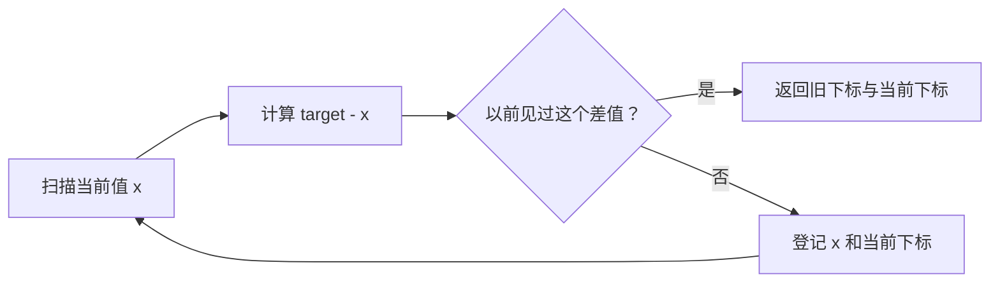

# 06 · 两数之和：用“差多少”替代反复两两尝试

← [[学习/学习导航/2026-10-22-学习导航|今天学习入口]] · [[八股测试/2026-10-22#ALG-TWO-SUM-001 · 两数之和怎样从平方级降到平均线性|对应测试题]] · [[学习/2026-10-22/示例代码/06_two_sum|注释代码阅读版]]

> [!abstract] 源于一场真实的编码题
> 牛客候选人 KetchupZ 在百度 C++ 面试自述中记到“给一个数组，找两数之和等于指定值的下标”；他的复盘说当时用了 map，希望找到 O(n) 方法。[原帖](https://www.nowcoder.com/discuss/353156212986421248)。本篇固定为 C++17、输入为整数、返回两个不同位置；具体样本与实现是重新编写的训练版本。

## 1 把问题说准确

例如 `[2,7,11,15]` 与目标 `9`，返回两个下标 `0,1`，因为 `2+7=9`。下标从 0 开始；要返回的是**位置**，不是数字本身。

若输入 `[3,3]`、目标 `6`，两份 `3` 分别位于位置 0 与 1，可返回 `0,1`。**不能把同一个下标使用两次。** 无解时，接口也要有明确表示，本例用 C++17 的 `std::optional`：装着一对下标表示找到，空值表示找不到。

多个合法答案并存时，题目应先问面试官是否任选一对、是否要最早下标。本训练程序找到扫描过程中首先遇到的一对，不宣称它满足所有未说明的特殊选择规则。

## 2 三种思路的工作量

1. **暴力两层循环**：每个位置尝试后面的位置，可到 O(n²) 次成对检查；不需要额外的查找容器。
2. **边扫描边用 map 记旧值**：每一步查目标还差多少，并把当前值加入有序映射。查找与插入对数级，总工作量 O(n log n)，额外空间 O(n)。这对应原帖提及的 map 做法。
3. **边扫描边用 unordered_map 记旧值**：同一算法换成哈希映射，在通常的平均查找假设下总工作量 O(n)，额外空间 O(n)。大量冲突时，不能承诺最坏仍为 O(n)。

映射关系是 `已见过的数值 → 它出现过的下标`。查询时需要的不是“当前位置”，而是 **`target - 当前数值`**。这些复杂度分别来自两层循环次数，以及 [N4659 对有序关联容器](https://timsong-cpp.github.io/cppwp/n4659/associative.reqmts)与[无序关联容器](https://timsong-cpp.github.io/cppwp/n4659/unord.req)的操作复杂度。



## 3 为什么必须“先查，再存”

如果目标是 6，当前位置是唯一的一个 3：先把自己的 3 存进去，再查“还差 3”，可能找到的就是它自己，错误地把一个位置用两遍。

正确顺序：只在**先前经过的元素**里查询需要的另一半；查不到才登记当前元素。输入 `[3,3]` 时，第二个 3 会找到第一个 3，两个下标自然不同。

## 4 完整 C++17 代码

源码：[[学习/2026-10-22/示例代码/06_two_sum.cpp|06_two_sum.cpp]]。

```cpp
// C++17 学习示例：数组里找两个不同下标，其元素之和等于 target。
// 从左到右扫描；先查“差多少”，再把当前元素登记，避免同一位置重复使用。

#include <cassert>       // assert：核对找到的下标与无解情况。
#include <cstddef>       // std::size_t：安全表示 vector 的下标。
#include <iostream>      // std::cout：打印示范答案。
#include <optional>      // std::optional：有答案时含一对下标，无解时为空。
#include <unordered_map> // std::unordered_map：记录以前见过的值与下标。
#include <utility>       // std::pair、std::make_pair：把两个下标作为结果。
#include <vector>        // std::vector：保存输入数组。

using Answer = std::optional<std::pair<std::size_t, std::size_t>>;

Answer two_sum(const std::vector<int>& values, int target) {
    // long long 保存值，避免做 target - 当前值时在 int 范围两端溢出。
    std::unordered_map<long long, std::size_t> seen;
    for (std::size_t i = 0; i < values.size(); ++i) {
        const long long needed = static_cast<long long>(target) - values[i];
        const auto hit = seen.find(needed); // 只在已经扫描过的下标中找。
        if (hit != seen.end()) {
            return std::make_pair(hit->second, i); // 下标必然不同。
        }
        // 未找到才登记当前项；emplace 对同一值保留较早的下标。
        seen.emplace(static_cast<long long>(values[i]), i);
    }
    return std::nullopt; // 没有任何一对符合要求。
}

int main() {
    const auto first = two_sum({2, 7, 11, 15}, 9);
    assert(first && first->first == 0 && first->second == 1);
    const auto repeated = two_sum({3, 3}, 6);
    assert(repeated && repeated->first == 0 && repeated->second == 1);
    const auto missing = two_sum({1, 2}, 10);
    assert(!missing);

    std::cout << "two-sum indexes: " << first->first << ' '
              << first->second << '\n';
    std::cout << "duplicates use two positions: " << repeated->first
              << ' ' << repeated->second << '\n';
}
```

### 按步骤读语法

- `const std::vector<int>&` 只读借用整组输入，不先复制一整个数组。
- `std::size_t` 是可表示容器下标的无符号类型；`std::pair` 装两个下标。
- `std::optional<...>` 可以装结果，也可以为空；`if (result)` 检查是否有值，`result->first` 读第一个下标。
- `long long needed` 与显式转换用于避免极端 int 值相减时溢出。输入仍是 int，映射的键改用较大的整数类型。
- `seen.find(needed)` 不会插入缺失键；`seen.emplace` 在未找到后加入当前值。若同值重复出现，保留较早的位置仍能找到一对合法答案。
- 无解返回 `std::nullopt`，调用者先检查再读取下标。

这段没有要求用户手写哈希表。程序使用标准库容器，重点是**选择保存什么信息、何时查、何时存**。

## 5 具体场景与边界

- 面试编码题考查能否从重复比较中找出“查缺的值”这个关系，并清楚说明平均与最坏复杂度。
- 在实际数据处理里，查找某个互补值也常需要索引；是否用哈希仍取决于键类型、内存和顺序要求。
- 如果需要**所有**合法配对，而不只一对，本程序返回后就停止，不能直接说完成了新需求。
- 如果某个业务要求“同一数字只能出现一次”，把它当作题目约束检查；代码支持重复值位于不同位置。

> [!question]- 变式：只有一项 `[3]`，target 为 `6`
> “先查后存”和“先存后查”各可能发生什么？

> [!success]- 答案
> 先查时旧表为空，之后只存下标 0，循环结束返回无解。先存后查若没有额外限制，就可能取回下标 0 自己，错误地拼成两个相同位置。输入 `[3,3]` 才有两个合法位置。

**30–90 秒口述：** 最直接的两层循环是 O(n²)。边遍历边存“旧数值→下标”，当前值 x 只查 `target-x`；找到便返回两个不同下标，找不到再存 x。用 map 是 O(n log n)，用 unordered_map 在通常平均查找条件下是 O(n)、空间 O(n)，最坏不能保证同样时间。还要讲清无解、重复值、多个解时的接口约定。
