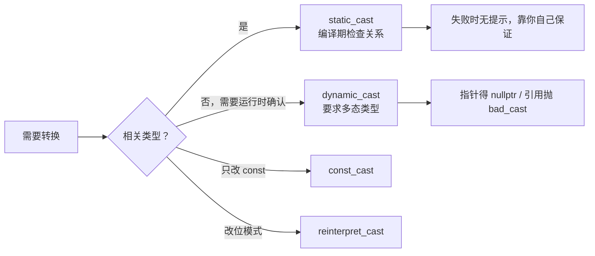

# 四种 cast：为什么 C++ 要把类型转换拆开

← [[学习/学习导航/2026-10-22-学习导航|今日导航]] · [[八股测试/2026-10-22#CPP-CAST-001|回到测试题]] · 代码：[[学习/2026-10-22/示例代码/06_cast_rtti|06_cast_rtti 阅读版]]

## 先把词说清楚

**隐式转换**：编译器自动做的转换，比如 `int` → `double`、派生类指针 → 基类指针。

**显式转换**：你写出来的转换。C 风格写法是 `(T)value`，C++ 提供四种带名字的：

| 转换 | 用途 | 运行期检查 |
| --- | --- | --- |
| `static_cast<T>(v)` | 相关类型之间：数值、`void*`、基类/派生类、显式构造 | 无 |
| `dynamic_cast<T>(v)` | 多态类型的向下/交叉转换 | 有 |
| `const_cast<T>(v)` | 增删 `const` / `volatile` | 无 |
| `reinterpret_cast<T>(v)` | 指针与整数、无关指针类型之间，按位重新解释 | 无 |

**RTTI（Run-Time Type Information）**：运行期类型信息，`typeid` 与 `dynamic_cast` 依赖它。

## 它解决什么问题

C 风格转换的问题是“看不出你在干什么”：`(Circle*)shape` 既可能是安全的向上转换，也可能是危险的按位重解释，读代码的人无法区分，搜索时也搜不到。

四种命名转换把**意图**写进代码：

- 我只想改数值类型 → `static_cast`
- 我不确定实际类型，请帮我查 → `dynamic_cast`
- 我只想去掉 const 这一层 → `const_cast`
- 我知道自己在动位模式 → `reinterpret_cast`

## 逐个说明

### static_cast

```cpp
double ratio = 3.9;
int truncated = static_cast<int>(ratio);        // 3：截断

Circle* circle = static_cast<Circle*>(shape);   // 基类→派生：编译器相信你
```

第二行**没有运行时检查**。如果 `shape` 实际指向 `Square`，这次转换得到的是一个指向错误类型的指针，后续使用是未定义行为。

### dynamic_cast

```cpp
if (auto* circle = dynamic_cast<Circle*>(shape)) {
    circle->radius();
} else {
    // 实际不是 Circle
}
```

规则：

- 源类型必须是**多态类型**（含至少一个虚函数），否则编译失败；
- 指针转换失败返回 `nullptr`；
- 引用转换失败抛 `std::bad_cast`；
- 从基类到派生类、或交叉转换（兄弟类之间）可用；到 `void*` 也行。

代价：一次运行期类型比对，比 `static_cast` 慢；在热路径上频繁用通常说明设计有问题。

### const_cast

```cpp
void legacy_api(char* text);          // 老接口不是 const
const char* view = buffer;            // buffer 本身不是 const
legacy_api(const_cast<char*>(view));  // 只去掉“视图”上的 const
```

**边界**：如果对象本身定义成 `const`，去掉 const 后写它属于未定义行为。`const_cast` 只能改 cv 限定，不能改类型。

### reinterpret_cast

```cpp
std::uintptr_t address = reinterpret_cast<std::uintptr_t>(pointer);
```

它不改变位，只改变解释方式。常见用途：把指针转成整数打印、与硬件寄存器地址打交道、序列化时按字节访问。

**危险点**：它**不做继承偏移调整**。多继承下 `reinterpret_cast<Derived*>(base_ptr)` 得到的地址可能指向子对象而非对象起点，解引用即错。基类/派生类转换要用 `static_cast` 或 `dynamic_cast`。

## 图示



## RTTI 是什么

`dynamic_cast` 与 `typeid` 都需要知道对象的真实类型。常见实现把 `type_info` 的指针放进虚表里，`dynamic_cast` 通过它做类型比对；这就是为什么源类型必须是多态类型。

```cpp
std::cout << typeid(*shape).name();   // 多态类型：取动态类型
```

编译器可以用 `-fno-rtti` 关掉 RTTI（嵌入式与部分游戏引擎会这么做），此时 `dynamic_cast` 和 `typeid` 都无法使用。

## 边界与常见误解

**“dynamic_cast 什么都能转？”** 不能。非多态类型（比如普通 struct）不能作为源；它也不能替代 `reinterpret_cast`。

**“static_cast 向下转是安全的？”** 只有在你确知对象真实类型时才安全。否则应该用 `dynamic_cast`，或者更好的做法是重新设计接口，根本不要求 caller 知道具体类型。

**“const_cast 能改类型？”** 不能，只改 cv。

**“reinterpret_cast 能转函数指针？”** 标准对函数指针与数据指针互转没有可移植保证。

**“C 风格转换有什么问题？”** 它按顺序尝试 `const_cast`、`static_cast`、`reinterpret_cast` 的组合，可能悄悄做出你没想到的转换；而且无法用 `cast` 关键字搜索。

## 使用场景

- **插件/反射式分发**：`dynamic_cast` 做可选能力探测（`if (auto* p = dynamic_cast<IPausable*>(obj))`）。
- **接口边界**：向上转换用隐式转换或 `static_cast`，写清楚意图。
- **协议/内存**：`reinterpret_cast` + `std::byte` 处理字节序列，但必须自己保证对齐与生命周期。
- **低延迟系统**：热路径避免 `dynamic_cast`；用虚函数、`std::variant` + `visit`、或类型标签 + `static_cast` 代替。

## 变式与口述总结

> 四种 cast 分别表达四种意图：static_cast 是编译期相关类型转换，不做运行时检查；dynamic_cast 要求多态类型，运行期核对，指针失败得 nullptr、引用失败抛 bad_cast；const_cast 只改 cv；reinterpret_cast 改位模式，不做继承偏移。C 风格转换会隐式组合这几种，难搜索也难看出意图，工程里不用。

**变式：**

1. 多继承下为什么不能用 `reinterpret_cast` 做向下转换？
2. `dynamic_cast` 对引用失败时怎么表现？
3. 关掉 RTTI 后哪些代码会编译失败？

## 来源

- 题型来源：本日原帖未直接出现该问法，属于 C++ 开发岗通用八股（对象模型方向的相邻考点），本库明确标为**扩展题**；[美团 C++ 面试复盘](https://www.iamshuaidi.com/4321.html) 的“虚函数表内存分布”是相关背景。
- 标准依据：[N4659 expr.static.cast](https://timsong-cpp.github.io/cppwp/n4659/expr.static.cast)、[expr.dynamic.cast](https://timsong-cpp.github.io/cppwp/n4659/expr.dynamic.cast)、[expr.const.cast](https://timsong-cpp.github.io/cppwp/n4659/expr.const.cast)、[expr.reinterpret.cast](https://timsong-cpp.github.io/cppwp/n4659/expr.reinterpret.cast)。
