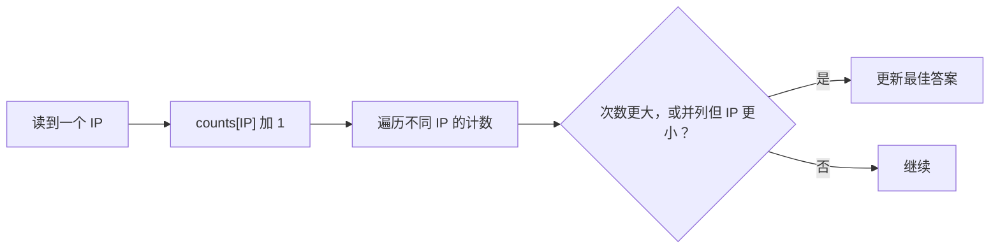

# 07 · 综合练习：出现次数最多的 IP

← [[学习/学习导航/2026-10-22-学习导航|今天学习入口]] · [[八股测试/2026-10-22#EX-20261022-001 · 找出出现次数最多的 IP|先做测试题]] · [[学习/2026-10-22/示例代码/07_ip_frequency|注释答案阅读版]]

> [!warning] 建议先尝试题目
> 本页有完整答案。先看测试页的输入、输出和并列条件，独立写出算法，再回来比对。

## 1 原题背景与训练版条件

牛客候选人 KetchupZ 记录过百度面试里的“给一堆 IP 地址，找出现次数最多的 IP”编码题。[候选人自述，2020-05-26 编辑](https://www.nowcoder.com/discuss/353156212986421248)。原帖没有给出完整的并列和空输入协议；本文为了能检查结果，自行约定：空输入返回“没有结果”，最高次数并列取**字典序较小**的 IP。

这里把 IP 当作字符串键，尚未做 IP 地址格式校验。任务是练习“按键计数 → 按确定规则选答案”，不是实现网络协议解析器。

## 2 从手动表开始

输入：`10.0.0.1, 10.0.0.2, 10.0.0.1, 10.0.0.3, 10.0.0.2`。

| IP | 出现次数 |
| --- | ---: |
| 10.0.0.1 | 2 |
| 10.0.0.2 | 2 |
| 10.0.0.3 | 1 |

前两项并列 2 次；根据训练版的字典序规则，选 `10.0.0.1`。如果只写“遍历 unordered_map 取看到的第一个最大值”，结果依赖未规定的遍历顺序，不能满足并列约定。



## 3 完整 C++17 程序

源码：[[学习/2026-10-22/示例代码/07_ip_frequency.cpp|07_ip_frequency.cpp]]。

```cpp
// C++17 综合小练习：找出出现次数最多的 IP 字符串。
// 若最高次数并列，取字典序较小的 IP；这样不依赖哈希表遍历顺序。

#include <cassert>       // assert：验证次数与并列处理。
#include <iostream>      // std::cout：打印答案。
#include <optional>      // std::optional：空输入时没有获胜项。
#include <string>        // std::string：保存 IP 的文本形式。
#include <unordered_map> // std::unordered_map：按 IP 累计次数。
#include <utility>       // std::pair：保存结果的 IP 和出现次数。
#include <vector>        // std::vector：输入的一串 IP。

using Result = std::optional<std::pair<std::string, int>>;

Result most_frequent(const std::vector<std::string>& ips) {
    if (ips.empty()) return std::nullopt; // 不凭空造一个 IP。

    std::unordered_map<std::string, int> counts;
    for (const std::string& ip : ips) {
        ++counts[ip]; // 首次访问缺失键时先插入 0，再自增。
    }

    std::string best_ip;
    int best_count = 0;
    for (const auto& item : counts) {
        const std::string& ip = item.first; // 键：IP 字符串。
        const int count = item.second;      // 值：出现次数。
        if (count > best_count ||
            (count == best_count && ip < best_ip)) {
            best_ip = ip;
            best_count = count;
        }
    }
    return std::make_pair(best_ip, best_count);
}

int main() {
    const std::vector<std::string> ips{
        "10.0.0.1", "10.0.0.2", "10.0.0.1", "10.0.0.3", "10.0.0.2"};
    const Result answer = most_frequent(ips);
    assert(answer && answer->first == "10.0.0.1" && answer->second == 2);
    assert(!most_frequent({}));
    std::cout << answer->first << " appears " << answer->second
              << " times\n";
}
```

### 关键行解释

- `++counts[ip]`：如果 ip 第一次出现，`operator[]` 先建立一个值初始化的 int（0），然后把它加 1。这一行会改变容器，不适合“只查不新增”的场景。[N4659 unordered_map 元素访问](https://timsong-cpp.github.io/cppwp/n4659/unord.map.elem)。
- `const auto& item`：只读地遍历已有键值对，`item.first` 是 IP，`item.second` 是次数。
- 先比较次数；若相等，再按字典序比较 IP。这样不需要假设哈希表本身有序。
- `std::optional` 让空输入有明确返回值，而不是编造一个不存在的获胜 IP。

处理每个字符串都要付出与其长度有关的哈希、比较成本。若把 IP 长度视为有界的小常数，平均可近似讨论为随输入条数线性；若输入字符串任意长、哈希很差或受到对抗输入，不能无条件承诺所有情况 O(n)。空间与不同 IP 的数量有关。[N4659 unord.req](https://timsong-cpp.github.io/cppwp/n4659/unord.req)。

> [!question]- 变式：空输入或三个 IP 并列
> 空输入该返回什么？若三个 IP 出现次数相同，程序为什么仍能给确定答案？

> [!success]- 答案
> 空输入返回 `std::nullopt`；并列时按明确的字符串字典序比较键。unordered_map 的遍历顺序即使变化，最终也会选出同一个最小的并列 IP。

**口述练习：** 先用 unordered_map 统计每个 IP 的次数，再遍历不同 IP，按“次数更大优先，次数相同取字典序较小”更新答案。处理空输入。一般情况下时间随记录数增长，但长字符串与冲突会改变成本，不能笼统说任何输入都严格 O(n)。
