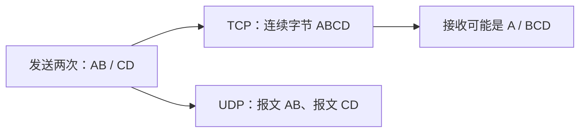

# 01 · TCP 与 UDP：先弄清应用到底收到什么

← [[学习/学习导航/2026-10-23-学习导航|今日导航]] · [[八股测试/2026-10-23#NET-TCPUDP-001 · TCP 和 UDP 有什么区别|对应自测]] · [[学习/2026-10-23/示例代码/01_tcp_udp|源码阅读版]]

> [!abstract] 面经来源
> [网易 C++ 一面候选人曹先森_的复盘](https://www.nowcoder.com/discuss/353155841270423552/)明确列了 TCP/UDP 区别；[某量化公司实习候选人复盘](https://www.nowcoder.com/discuss/473626483991281664)记录“交易走 TCP、接收数据走 UDP”的项目追问。本页的场景和代码由我自拟，不能称为原题逐字题面。

## 名词先说人话

**协议**是通信双方共同遵循的规则。**端点**可以理解成一台机器上的 IP 地址与端口；端口帮操作系统把数据交给对应程序。TCP 与 UDP 都在传输层，应用常通过 **socket**（操作系统给程序的网络通信入口）使用它们。

TCP 先建立连接，再提供有序、可靠的**字节流**：接收端看到连续字节，但看不到发送端每次 `send` 的边界。UDP 提供一条条**数据报**：一次接收取得一条报文；它本身不承诺到达、顺序或只到达一次。Linux 的 UDP 接收缓冲区若比报文小，超出的部分可能被截断；所以“UDP 保留报文边界”不等于“应用一定拿到完整业务消息”。[Linux tcp(7)](https://man7.org/linux/man-pages/man7/tcp.7.html)、[udp(7)](https://man7.org/linux/man-pages/man7/udp.7.html)、[RFC 768](https://www.rfc-editor.org/rfc/rfc768.html)。



## 看一个真正的接收过程

假设发送程序先调用一次 `send` 交给 TCP 三个字节 `ABC`，再调用一次交给它两个字节 `DE`。接收程序需要的是五个字节，但它第一次 `recv` 可能只拿到 `AB`，第二次拿到 `CDE`，也可能一次拿到 `ABCDE`。发送次数和接收次数没有一一对应关系。TCP 负责让接收方看到按序排列的字节，**“哪三个字节组成一条订单”仍是应用协议的问题**。如果收到 `AB` 就立刻按完整订单处理，错误发生在应用解析层。[[学习/2026-10-23/04-TCP消息边界|消息边界专题]]会继续解决它。

UDP 的思考单位换成“这一条数据报”。发送两条报文 `ABC`、`DE`，接收端不会把它们当成一个连续流来任意切开；但可能只收到第二条，也可能先收到第二条，甚至收到重复数据。行情源通常会在业务消息中安排**序号**：应用用序号发现缺口，并决定等迟到消息、请求补发或加载快照。UDP 自身不会替业务恢复。另一方面，TCP 的“可靠”是传输字节的性质，不保证交易所已经接收、校验或成交订单；这些结果需要业务回执和订单状态管理。

选协议前先问三个问题：数据源规定使用什么；应用需要的是连续字节还是独立报文；丢失、迟到或重复时业务要怎样恢复。然后才考虑测量延迟、吞吐和资源开销。把“UDP 更快”当成无条件结论，既忽略业务补救的成本，也无法解释在什么网络与负载下成立。

## 用在哪里，怎么选

| 问业务问题 | 倾向选择 | 还需要自己处理什么 |
| --- | --- | --- |
| 单笔交易指令必须按应用协议确认与追踪状态 | TCP 常是合理基础 | TCP 送达字节不等于交易所接受订单；仍要业务 ACK、超时、去重 |
| 高频行情可容忍一条晚到，且数据源本来就用 UDP/组播 | UDP 常见 | 序号缺口、乱序、快照恢复、缓冲区容量 |
| 网络条件差，但仍要可靠交付 | 先分析需求 | UDP 上可自建可靠机制；不能因“UDP 快”就默认更适合 |

“TCP 一定慢、UDP 一定快”是没有测量条件的口号；协议开销、网络、消息大小及可靠性需求都影响结果。**UDP 的 `connect` 调用也不意味着建立 TCP 式握手**：Linux UDP 上它可设默认目的地址。[udp(7)](https://man7.org/linux/man-pages/man7/udp.7.html)。

## 读一遍代码

下面是内存里的**教学模型**，不模拟真实网络。注意 `substr(0,1)` 与 `substr(1,3)` 是应用自选的读取片段，不是 TCP 承诺的固定拆法；`vector<string>` 每个元素代表一条独立数据报。

```cpp
// C++17 教学模型：观察 TCP 字节流与 UDP 数据报的应用可见边界。
// 这是内存中的模型，不发送网络数据，也不模拟丢包、重传或操作系统缓冲区。
#include <cassert>  // assert：检查程序理解是否符合预期。
#include <iostream> // cout：把观察结果打印出来。
#include <string>   // string：用文字代表一串字节。
#include <vector>   // vector：保存多条独立数据报。

int main() {
    // 一次发送调用传入 "AB"，另一次传入 "CD"；TCP 接收方只看到连续字节。
    // 真实 recv 每次返回多少字节由当时可读数据和缓冲区大小等决定，
    // 不能根据发送调用次数推断 recv 调用次数。
    const std::string tcp_bytes = std::string("AB") + "CD";
    const std::string first_read = tcp_bytes.substr(0, 1);
    const std::string second_read = tcp_bytes.substr(1, 3);
    assert(first_read == "A" && second_read == "BCD");

    // UDP 则把每次发送的内容作为一条数据报；这里用两个元素表示两条报文。
    // 真实 UDP 可能丢失、乱序；本例只展示“每条报文有边界”。
    const std::vector<std::string> udp_datagrams{"AB", "CD"};
    assert(udp_datagrams.size() == 2);
    std::cout << "TCP reads: [" << first_read << "] [" << second_read << "]\n";
    std::cout << "UDP datagrams: [" << udp_datagrams[0] << "] ["
              << udp_datagrams[1] << "]\n";
}

```

先找 `tcp_bytes`：两次“写入”的结果只是一串 `ABCD`。再看两个 `substr`，一次取 1 字节、一次取 3 字节，应用仍可拼出相同内容。最后看 `udp_datagrams`：它保存两条独立消息。`const` 表示这些样例值在本函数中不再修改，`assert` 是学习时的检查，生产程序不能依赖它处理输入错误。

## 容易答错的边界与口述

**易错**：把 `send("AB")`、`send("CD")` 推成两次 `recv`；把 UDP “无连接”解释成“不能调用 `connect`”；把 TCP “可靠”解释成业务绝不丢单。

**30 秒口述**：TCP 提供有序可靠字节流，要自己划业务消息边界；UDP 以数据报交付，不保证到达/顺序，需要业务按序号检测和恢复。交易指令通常需要可靠链路加业务确认；行情若使用 UDP，要设计缺口与快照恢复。选择取决于业务语义和数据源协议。

> [!question]- 小变式：一个 UDP 报文比接收缓冲区大呢？
> Linux 上可能被截断，不能把两个 `recvfrom` 的结果当作同一报文的前后两段。应根据协议最大报文长度配足缓冲，并检测截断。见 [udp(7)](https://man7.org/linux/man-pages/man7/udp.7.html)。
