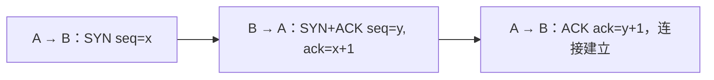
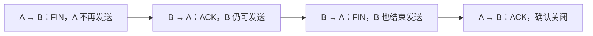

# 02 · 三次握手与正常关闭：两端各确认什么

← [[学习/学习导航/2026-10-23-学习导航|今日导航]] · [[八股测试/2026-10-23#NET-CONNECTION-001 · TCP 为什么要三次握手，关闭又如何进行|对应自测]] · [[学习/2026-10-23/示例代码/02_handshake_close|源码阅读版]]

> [!abstract] 面经来源
> [网易 C++ 一面候选人自述](https://www.nowcoder.com/discuss/353155841270423552/)明确记录三次握手；[腾讯后台候选人 GrannndIvan 的自述](https://www.nowcoder.com/discuss/353157398028296192)明确记录三次握手、四次挥手和 TIME_WAIT。本页自己加入序号数字与关闭图。

## 先认识 SYN、ACK、FIN 和序号

**序号 seq**标识 TCP 字节序列的位置，**确认号 ack**表示“下一个期望收到的序号”。SYN 用于建立时同步初始序号，FIN 表示“我的发送方向没有更多数据”；两者各占用一个序号。ACK 表示确认。双方都有自己的初始序号，所以建立连接时要互相交换并确认。[RFC 9293 §3.5](https://www.rfc-editor.org/rfc/rfc9293.html#section-3.5)。



第三次 ACK 让服务端知道客户端已经收到服务端的初始序号与回应。说“只是为了证明双方收发能力”过于粗略；正常路径还有初始序号同步和连接状态确认。程序调用 `connect`/`accept` 时，TCP 状态由内核协议栈管理，业务代码通常不用自己发送 SYN。

## 用数字走完建立过程

把客户端的初始序号暂记为 100、服务端的初始序号记为 900。客户端先发 `SYN(seq=100)`；服务端回 `SYN(seq=900, ACK=101)`，其中 101 表示已经看见客户端的 SYN，下一步期望 101。客户端最后回 `ACK=901`，确认服务端的 SYN。这里的 100、900 只是讲解数字，真实连接的初始序号不能照抄固定值。**SYN 占一个序号**，所以确认号加 1；ACK 本身通常不额外消耗序号。

为什么客户端最后还要发一次确认？服务端发出第二步时，只知道自己收到了客户端的请求，却不知道自己的 SYN 是否到达客户端。收到第三步后，服务端才有证据推进相应连接状态。这不是说“三步就能保证此后网络永远可靠”；之后仍要靠确认、重传、窗口等机制持续处理传输。对业务程序而言，`connect` 和 `accept` 是系统调用接口；SYN/ACK 的处理主要由内核协议栈完成。

同一连接由源 IP、源端口、目的 IP、目的端口等信息区分。讨论 TIME-WAIT 时说“旧包可能干扰新连接”，指的是这些标识重新使用时的风险，不能理解成所有新连接都会收到旧包。建立、关闭与应用协议是不同层次：TCP 连接建立后，订单网关仍要做登录、鉴权和业务握手。

## 为什么正常关闭常画成四步



TCP 是双向的：A 结束发送时，B 仍可能把剩余数据发给 A。B 对 A 的 FIN 先回 ACK，等自己也完成发送再发 FIN；A 再确认。**ACK 与 FIN 有时可合并**；“四次挥手”描述常见正常关闭过程，不意味着所有异常重置、同时关闭或合并报文场景固定恰好四个物理包。[RFC 9293 §3.6](https://www.rfc-editor.org/rfc/rfc9293.html#section-3.6)、[§3.6.1](https://www.rfc-editor.org/rfc/rfc9293.html#section-3.6.1)。

主动关闭方通常进入 **TIME-WAIT**：为最后 ACK 的可能重传提供时间，也降低旧连接报文与后续同四元组连接混淆的风险。不能把 `2MSL` 背成所有 Linux 系统固定秒数。[RFC 9293 §3.3.2](https://www.rfc-editor.org/rfc/rfc9293.html#section-3.3.2)、[§3.4.2](https://www.rfc-editor.org/rfc/rfc9293.html#section-3.4.2)。

## 读代码：用具体数字把 ACK 算出来

这是按正常路径打印的**教学模型**，不是完整 TCP 实现。`client_isn=100`，服务端确认 `101`；服务端自己的 `900` 被客户端确认成 `901`。代码最后展示双方发送方向各自结束。

```cpp
// C++17 教学模型：按 RFC 9293 的普通主动打开与正常关闭画出消息顺序。
// 仅展示常见路径；不是 TCP 协议栈，未模拟重传、同时打开/关闭和 RST。
#include <cassert>  // assert：核对 ACK 与序号的关系。
#include <iostream> // cout：输出可口述的过程。

int main() {
    // SYN 表示同步初始序号；它会占用一个序号，所以确认号是 x+1。
    const int client_isn = 100; // 客户端初始序号，数字仅供举例。
    const int server_isn = 900; // 服务端自己的初始序号。
    const int server_ack = client_isn + 1;
    const int client_ack = server_isn + 1;
    assert(server_ack == 101 && client_ack == 901);

    std::cout << "1 client -> server: SYN seq=" << client_isn << '\n';
    std::cout << "2 server -> client: SYN+ACK seq=" << server_isn
              << " ack=" << server_ack << '\n';
    std::cout << "3 client -> server: ACK ack=" << client_ack << '\n';

    // 双向连接可分别关闭发送方向。A 的 FIN 被确认后，B 仍可发送数据。
    // 这里列出常见的四个报文；ACK 与 FIN 在某些情况下可合并，
    // 因此“四次挥手”不是所有连接结束路径都固定出现四个物理报文。
    std::cout << "4 A -> B: FIN (A stops sending)\n";
    std::cout << "5 B -> A: ACK (B may still send)\n";
    std::cout << "6 B -> A: FIN (B stops sending)\n";
    std::cout << "7 A -> B: ACK (A enters TIME-WAIT)\n";
}

```

逐行追踪四个整数：`client_isn` 与 `server_isn` 来自不同端点，`server_ack` 确认的是客户端 SYN，`client_ack` 确认的是服务端 SYN。`assert` 只检查演示数字。生产系统中的真实序号不会像本例这样固定。

**口述模板**：SYN(x) → SYN(y)+ACK(x+1) → ACK(y+1) 同步双方初始序号；关闭时两条发送方向分别 FIN 与 ACK，因此常见路径画四步。主动关闭方可能等待 TIME-WAIT；同时关闭或复合报文有不同路径。

> [!question]- 小变式：收到对方 FIN 后，本端还能发数据吗？
> 正常半关闭中可以：收到的 FIN 只表示对方不再发送，本端仍可把自己未发完的数据送出去，直到本端也关闭发送方向。见 [RFC 9293 §3.6.1](https://www.rfc-editor.org/rfc/rfc9293.html#section-3.6.1)。
