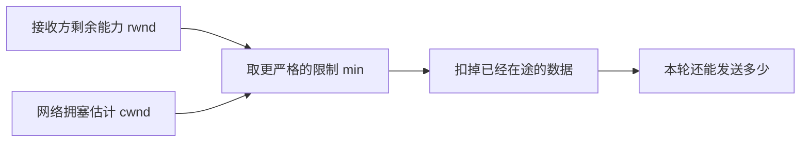

# 03 · 流量控制与拥塞控制：别把接收方和网络混成一个人

← [[学习/学习导航/2026-10-23-学习导航|今日导航]] · [[八股测试/2026-10-23#NET-FLOW-001 · TCP 流量控制和拥塞控制分别解决什么|对应自测]] · [[学习/2026-10-23/示例代码/03_flow_control|源码阅读版]]

> [!abstract] 面经来源
> [网易 C++ 一面自述](https://www.nowcoder.com/discuss/353155841270423552/)明确列出 TCP 流量控制；[腾讯后台候选人复盘](https://www.nowcoder.com/discuss/353157398028296192)明确把流量控制、拥塞控制一起列为追问。本页数值模型自行设计。

## 从两种“来不及”开始

接收方的程序处理慢，接收缓冲快满了，这是**接收端承受能力**问题；中途网络链路和路由器太拥挤，这是**网络承受能力**问题。前者由流量控制处理，后者由拥塞控制处理。两个机制同时存在，并非二选一。

**rwnd** 是接收方通告的接收窗口，可以把它理解为接收端当前允许在途的额度；**cwnd** 是发送方拥塞控制维护的窗口，用来限制其认为网络能承受的在途数据。**在途**指已发出、尚未得到确认的数据；**ACK** 到来会推进确认位置。入门可记为 `可继续发送量 ≈ max(0, min(rwnd, cwnd) - 在途量)`。这是一张教学简图，真实 TCP 还受发送缓存、窗口更新、序号等条件影响。[RFC 5681 §2–3](https://www.rfc-editor.org/rfc/rfc5681.html)、[RFC 9293 §3.8](https://www.rfc-editor.org/rfc/rfc9293.html#section-3.8)。



例子：`rwnd=8, cwnd=5, 已在途=2` 时还能发 3；收到确认后，如果接收方只通告 `rwnd=1`，即使网络窗口仍是 5，也只按更紧的接收端限制发送。**窗口不是一次 `send` 只能写多少的简单上限**；API 返回值、内核缓冲与实际在途量是不同层面的概念。

## 把窗口想成“还允许多少字节在路上”

假设接收程序暂时只能再接收 8 个字节，于是通告 `rwnd=8`；发送方依据网络状况维护 `cwnd=5`。两者中更紧的是 5。如果已有 2 个字节发出但尚未确认，简化模型里就剩 3 个字节额度。**在途**不是“还排在应用队列里没调用 `send` 的数据”，而是已经发出、仍占着窗口的字节。收到 ACK 后，一部分在途数据变成已确认，额度才可能重新开放。

再把场景拆开看：如果接收方程序处理慢、缓冲区快满，`rwnd` 可变小，哪怕网络很空也要减慢发送；如果接收方空闲但中间路径拥挤，`cwnd` 可限制发送，哪怕 `rwnd` 很大也不能猛发。二者都是发送方要遵守的约束，维护依据不同。窗口数值会随 ACK、接收缓冲使用和拥塞算法变化，不是程序启动时固定的一张表。

本页公式只是帮助初学者找对“谁限制谁”。实际 TCP 还考虑发送窗口边界、接收方的窗口通告、重传、应用供数和内核缓冲。用户态调用 `send` 成功，通常表示内核接受了相应数据，并不表示它已经越过网络、被对端应用处理。交易系统还要把用户态任务队列、TCP 发送缓存和对端处理能力分别监控，不能把三者都叫“队列满”。

## 代码把限制分开算

代码纯数值演示，没有协议栈，也没有声称使用真实拥塞控制算法。

```cpp
// C++17 教学模型：接收窗口 rwnd 与拥塞窗口 cwnd 一起限制未确认数据。
// 数字单位简化为“字节”；真实 TCP 还会处理序号回绕、重传和窗口更新。
#include <algorithm> // min：取多个限制中的最小值。
#include <cassert>   // assert：验证不会超过可发送额度。
#include <iostream>  // cout：打印每一步的额度。

int available(int rwnd, int cwnd, int in_flight) {
    // rwnd 表示接收端告知的空间；cwnd 表示发送端估计网络可承受的量。
    // in_flight 是已经发出、仍未被确认的字节数。
    return std::max(0, std::min(rwnd, cwnd) - in_flight);
}

int main() {
    int rwnd = 8;      // 接收方广告：目前可容纳 8 字节。
    int cwnd = 5;      // 拥塞控制：目前最多容许 5 字节在途。
    int in_flight = 2; // 已发出的 2 字节还没收到 ACK。
    assert(available(rwnd, cwnd, in_flight) == 3);
    std::cout << "before ACK: " << available(rwnd, cwnd, in_flight) << '\n';

    in_flight -= 2; // 收到这 2 字节的确认，才释放在途额度。
    rwnd = 1;       // 接收方应用处理慢，新通知的可用窗口只剩 1。
    assert(available(rwnd, cwnd, in_flight) == 1);
    std::cout << "receiver slow: " << available(rwnd, cwnd, in_flight) << '\n';

    rwnd = 8;      // 接收方处理完毕，允许的在途额度再次增大。
    cwnd = 1;      // 网络侧窗口收紧，此时只允许 1 字节在途。
    in_flight = 1; // 已有 1 字节在途，所以没有新增发送额度。
    assert(available(rwnd, cwnd, in_flight) == 0);
    std::cout << "network limit: " << available(rwnd, cwnd, in_flight) << '\n';
}

```

先看 `available` 的三个参数：`rwnd` 来自接收端，`cwnd` 反映发送端对网络的估计，`in_flight` 是已经占用的额度。`std::min` 选更紧的限制，`std::max(0, ...)` 防止返回负数。第三步让接收窗口恢复到 8，拥塞窗口缩到 1，同时已有 1 字节在途，所以暂时不能再发；这仍是简化额度模型，不模拟真实拥塞算法。

## 场景、误区与口述

行情消费者处理不过来时，TCP 流量控制可能限制上游继续送入内核接收缓冲，但不会让业务自动追上；仍要评估应用队列和处理速度。链路拥塞时，即使接收方有空间，发送方也不能忽视网络约束。UDP 自身没有 TCP 这些机制；若业务需要速率控制或可靠恢复，要在应用或其它协议层设计。

**口述**：流量控制保护接收端，拥塞控制保护网络；发送方受两者较小的窗口约束，还要扣掉已在途但未确认的数据。`rwnd` 与 `cwnd` 不是同一个变量，也不能把它们和用户态队列容量画等号。

> [!question]- 小变式：接收方窗口很大，就一定能猛发吗？
> 不一定，网络拥塞窗口可能更小，发送端也可能受自身缓冲、应用供数与其它实现条件限制。
