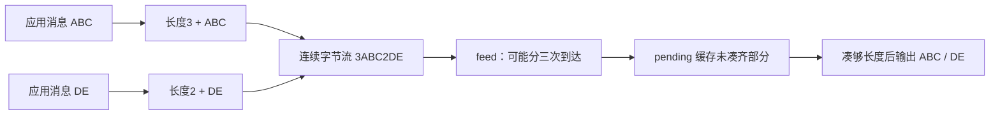

# 04 · TCP“粘包/半包”：不是坏包，是应用要自己定义消息边界

← [[学习/学习导航/2026-10-23-学习导航|今日导航]] · [[八股测试/2026-10-23#NET-FRAMING-001 · TCP 粘包和半包怎么处理|对应自测]] · [[学习/2026-10-23/示例代码/04_framing|源码阅读版]]

> [!abstract] 面经来源
> [网易 C++ 一面](https://www.nowcoder.com/discuss/353155841270423552/)与[七牛云 C++ 后台候选人 SEULL 的一面复盘](https://www.nowcoder.com/discuss/359091166204239872)都明确记录 TCP 粘包问题。下面的“1 字节长度 + 正文”协议是自拟练习，不是原帖代码。

## 先把现象说准

应用发送 `ABC`、再发送 `DE`，TCP 提供的是连续的 `ABCDE`。接收程序的某次 `recv` 可能拿到 `A`、`BCDE`，也可能一次拿到全部；它没有“每次发送对应一次接收”的保证。口语所说的**半包**是一次读入还不够一条应用消息；**粘包**是一次读入包含多条或多条的一部分。通常不是 TCP 损坏了数据，而是应用没有正确解析字节流。[Linux tcp(7)](https://man7.org/linux/man-pages/man7/tcp.7.html)、[recv(2)](https://man7.org/linux/man-pages/man2/recv.2.html)。

常见**应用层定界**方式有定长、分隔符、长度前缀。定长浪费空间但简单；分隔符要处理正文中转义；长度前缀先读固定长度头，再等够正文，必须限制最大长度。生产协议还需字节序、版本、校验/鉴权和异常连接处理。关闭 Nagle 不能给 TCP “补出消息边界”。



## 接收缓冲怎样长成完整消息

先约定本页的小协议：第一个字节表示正文长度，后面紧跟这么多个字节作为正文。比如 `\x03ABC` 是一条正文为 `ABC` 的消息；再接 `\x02DE`，完整字节流就是 `\x03ABC\x02DE`。`recv` 如果先给出 `\x03A`，解析器已经知道目标总长度为 4 字节，却只有 2 字节，此时要**保留**这 2 字节，等下次补足。若下一次给出 `BC\x02DE`，合并后先取 `ABC`，再取 `DE`；一次读取因此可以产出两条消息。

解析器每次都按同一顺序判断：缓冲里连长度头都没有，就等待；有头但正文不够，仍等待；够一条时，先检查长度上限，再取出正文、移走已消费字节，继续检查剩余部分。这个循环同时处理“半包”和“粘包”。如果长度头声称一个不允许的大值，必须拒绝；不能为了它无上限地扩容。定长或分隔符协议也可以，但要解决空消息、分隔符出现在正文中的转义等问题。

**收到了完整字节**和**收到了合法业务消息**仍是两步。取出正文后还要检查版本、字段长度、整数范围和校验；订单 ID 与价格不能仅凭几段字节就直接用于下单。若 TCP 正常关闭而缓冲里还留半条消息，这是一条未完成的业务记录，不应补零假装完成。[recv(2)](https://man7.org/linux/man-pages/man2/recv.2.html) 描述读取接口；消息格式是应用自己的约定。

## 代码：一段读入可产出零条、两条或更多完整消息

本例故意把第一条拆成两次输入，第二次输入还附上第二条完整消息。长度只用 1 字节、正文上限 4 字节，是为了把解析算法看清；这不是推荐的生产协议格式。

```cpp
// C++17 教学模型：为字节流规定“1 字节长度 + 消息正文”的应用层格式。
// feed 的参数是一块“这次读到的字节”，可能包含半条、一条或多条消息。
#include <cassert>     // assert：验证三次读入后得到的完整消息。
#include <iostream>    // cout：打印已解析的消息。
#include <stdexcept>   // runtime_error：遇到超长消息时报告协议错误。
#include <string>      // string：既保存缓冲，也保存消息正文。
#include <string_view> // string_view：只借用本次输入，不复制整块输入。
#include <vector>      // vector：返回一次 feed 解析出的多条完整消息。

class FrameDecoder {
    std::string pending_; // 保存上次还不足一条完整消息的字节。

public:
    std::vector<std::string> feed(std::string_view chunk) {
        if (!chunk.empty()) pending_.append(chunk.data(), chunk.size()); // 有输入才追加。
        std::vector<std::string> ready;               // 本次完成的消息。
        while (!pending_.empty()) {
            // unsigned char 防止高位字节被有符号 char 解释成负数。
            const auto length = static_cast<unsigned char>(pending_[0]);
            if (length > 4) { // 本例自定最长正文 4 字节，防止无限等待/扩容。
                throw std::runtime_error("frame too long");
            }
            if (pending_.size() < 1u + length) {
                break; // 只有半条：保留 pending_，等待下一次 feed。
            }
            ready.push_back(pending_.substr(1, length)); // 去掉长度字节。
            pending_.erase(0, 1u + length); // 消费这一条，循环处理粘在后面的消息。
        }
        return ready;
    }
};

int main() {
    FrameDecoder decoder; // 同一连接的多次读取必须共用一个解码器。
    const std::string frame1 = std::string(1, static_cast<char>(3)) + "ABC";
    const std::string frame2 = std::string(1, static_cast<char>(2)) + "DE";
    assert(decoder.feed(frame1.substr(0, 2)).empty()); // 长度 + 正文 A。
    auto messages = decoder.feed(frame1.substr(2) + frame2); // BC + 完整第二条。
    assert(messages.size() == 2 && messages[0] == "ABC" && messages[1] == "DE");
    for (const auto& message : messages) { // const 引用只读取，不复制每条消息。
        std::cout << "message: " << message << '\n';
    }
}

```

`pending_` 是跨多次 `feed` 保留的私有缓冲，不能每次进函数就清空。`append` 接上新字节；`pending_[0]` 才是本例的长度头。`static_cast<unsigned char>` 避免把高位长度字节解释成负数。当前字节不足 `1 + length` 时 `break`，保留半条；足够时 `substr(1,length)` 取正文，再 `erase` 已消费部分。`while` 使同一批数据里的下一条也被解析。

这段示例为初学者使用 `std::string::erase`，大量高吞吐数据下应测量复制/移动成本，考虑带读写位置的缓冲；优化不能省掉最大长度和边界检查。

## 使用场景与错误处理

订单网关收到一串 TCP 字节时，先按协议解出**完整业务消息**，再解释订单 ID 和价格；只解到半条时不要提前下单。收到宣称超长的长度头，应该拒绝该连接或按协议报错，不能无限等待或无上限分配。`recv` 返回 0 且 `pending_` 非空时，说明对端结束发送但留下不完整消息，应用要记录协议错误，不能把它当成一条完整记录。

**口述**：TCP 是字节流，不保留 `send` 的调用边界；半包与粘包要用应用协议定界。接收端维护跨读取的缓冲，一条完整才处理，剩余字节继续解析，长度头做上限校验。

> [!question]- 小变式：一次 `recv` 恰好收到两条半消息？
> 循环先取出完整的第一条，第二条不足则留在 `pending_` 等下次输入；不要把剩余字节丢掉。
