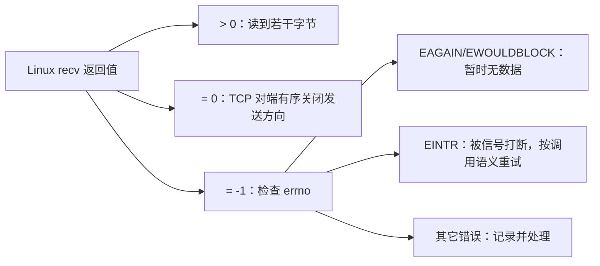

# 05 · 阻塞、非阻塞：先说清是哪个调用在等

← [[学习/学习导航/2026-10-23-学习导航|今日导航]] · [[八股测试/2026-10-23#NET-NONBLOCK-001 · 非阻塞 read 没数据时返回什么|对应自测]] · [[学习/2026-10-23/示例代码/05_nonblocking|源码阅读版]]

> [!abstract] 面经来源
> [后台 C++ 十五面候选人复盘](https://www.nowcoder.com/discuss/353157613774905344)明确记过发送方 `write`、接收方 `read` 和 `select` 是否阻塞；[《实习小结（C++开发）》候选人自述](https://www.nowcoder.com/discuss/353157789033897984)记过非阻塞读返回值与 `errno` 的追问。本页代码模拟处理分支，没有假装在 Windows 上调用 Linux `recv`。

## 先区分“等待”和“失败”

**阻塞 I/O**：当前调用在条件不满足时可等待，例如默认阻塞 socket 没数据时 `recv` 可能等待。**非阻塞 I/O**：若眼下不能完成读取，调用立即以 `-1` 返回，`errno` 为 `EAGAIN` 或 `EWOULDBLOCK`；这表示暂时读不到，通常稍后再等就绪，不等同连接损坏。[recv(2)](https://man7.org/linux/man-pages/man2/recv.2.html)。



`errno` 只在调用报告失败时及时检查；成功后读到的旧 `errno` 没有诊断意义。`EAGAIN` 与 `EWOULDBLOCK` 在 POSIX 上可以不同，代码应都检查。TCP `recv` 返回 0 通常是对端有序关闭发送方向；**UDP 零长度数据报是合法情况**，不能把“0 就代表对端断开”无条件套到 UDP。[recv(2)](https://man7.org/linux/man-pages/man2/recv.2.html)。

## 把返回值当成决策树

调用 `recv` 后，第一步看返回值。**正数**表示这次实际读到的字节数，可能少于你请求的数量；要把这段字节交给跨读取的消息解析器。对 TCP 流，返回 **0** 通常表示对端完成了有序关闭发送方向，这时还要检查本地是否残留半条业务消息。返回 **-1** 才查看当时的 `errno`：`EAGAIN/EWOULDBLOCK` 是当前没有可读数据，`EINTR` 是被信号打断，需要按接口和应用策略重试；其它错误再记录与关闭。`errno` 不是每次调用后都要看的“状态灯”，成功时可能保留旧值。

“非阻塞”也不意味着一次调用永远完成整条消息。缓冲区只有 20 字节而消息需要 100 字节，第一次成功读到 20 字节后，下一次可能得到 `EAGAIN`；解析器保留这 20 字节，等待后续数据。写入也是类似：非阻塞 `send` 可能只接受一部分，应用需要记录尚未发送的余量，等可写时继续。不能把一次成功返回直接理解为业务请求已全部送达。

等待函数和 I/O 函数要分开说。`epoll_wait` 可以让线程睡眠，等某些 fd 可能可读；随后在非阻塞 fd 上循环 `recv`，直到 `EAGAIN`。这样既避免空转，又不会让一个暂时没数据的连接长期堵住整个事件循环。UDP 的零长度数据报合法，所以“返回 0 就是断线”只适用于此处讨论的 TCP 流语境。

## 源码把四类结果分开

这份跨平台程序用 `ReadKind` 模拟 Linux 读结果，目的是先学会决策树；真实系统调用示意在下面另列。

```cpp
// C++17 教学模型：区分读到数据、暂时无数据、对端关闭与真正错误。
// 本程序不调用 recv；Linux 实际返回值与 errno 的映射见专题页和 recv(2)。
#include <cassert>  // assert：验证处理结果。
#include <iostream> // cout：展示分支走向。
#include <string>   // string：模拟读到的字节。

enum class ReadKind { data, would_block, peer_closed, failed };

struct ReadResult {
    ReadKind kind;    // 本次读取属于哪种情况。
    std::string bytes; // 只有 data 分支才使用这里的内容。
};

std::string next_action(const ReadResult& result) {
    // const & 表示借用且不修改 result，避免复制 string。
    switch (result.kind) {
    case ReadKind::data:
        return "parse " + result.bytes; // 正数字节：送入协议解析器。
    case ReadKind::would_block:
        return "wait for readiness"; // EAGAIN：不是永久错误；等待新就绪。
    case ReadKind::peer_closed:
        return "close connection"; // TCP recv 返回 0：对端有序关闭发送方向。
    case ReadKind::failed:
        return "report error"; // 其它失败应记录 errno 和具体上下文。
    }
    return "unreachable";
}

int main() {
    assert(next_action({ReadKind::would_block, ""}) == "wait for readiness");
    std::cout << next_action({ReadKind::data, "ABC"}) << '\n';
    std::cout << next_action({ReadKind::would_block, ""}) << '\n';
    std::cout << next_action({ReadKind::peer_closed, ""}) << '\n';
}

```

`enum class` 定义四种不会误混的标签；`ReadResult` 携带标签与可能的字节。`switch` 逐一给动作：有数据交给解析器；暂时无数据等待就绪；对端关闭则处理剩余缓冲并关闭连接；其它错误记录上下文。`const ReadResult&` 是只读借用。真实代码应把错误类型、连接状态和解析器状态传下去，不能只返回字符串。

Linux 的实际分支形状是：

```cpp
// 示意片段：假定 fd 已设置 O_NONBLOCK，buffer 有有效空间。
const ssize_t n = recv(fd, buffer, capacity, 0);
if (n > 0) { /* 将 n 字节追加到协议解析器 */ }
else if (n == 0) { /* TCP 半关闭；处理尾部，再按协议关闭 */ }
else if (errno == EAGAIN || errno == EWOULDBLOCK) { /* 等下一次就绪 */ }
else if (errno == EINTR) { /* 依当前循环设计重试 */ }
else { /* 其它错误 */ }
```

**不要忙轮询**：非阻塞只说明操作本身不等待；如果 `while(true)` 一直重试 `EAGAIN`，CPU 仍可能空转。通常用 `select/poll/epoll` 等等待“可能可读”的通知。等待函数本身可以阻塞；这不矛盾，因为主语不同。[epoll(7)](https://man7.org/linux/man-pages/man7/epoll.7.html)。

**口述**：阻塞与否描述具体 I/O 调用在不能立刻完成时是否等待。Linux 非阻塞 `recv` 无数据时返回 `-1` 并置 `EAGAIN/EWOULDBLOCK`，要等就绪；`>0` 解析数据，TCP 的 `0` 处理关闭，其它 `-1` 错误另行处理。

> [!question]- 小变式：`epoll_wait` 可以阻塞，但被监控的 socket 是非阻塞的吗？
> 可以。前者等待一批描述符的事件，后者决定单个 `read/recv` 在数据暂时没有时会不会挂住线程，两个选择作用在不同调用上。
