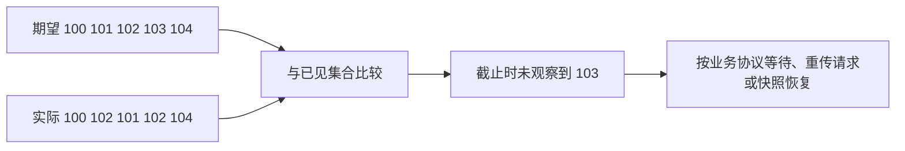

# 07 · 练习：行情 UDP 序号缺口与乱序

← [[学习/学习导航/2026-10-23-学习导航|今日导航]] · [[八股测试/2026-10-23#EX-20261023-001 · 行情序号缺口检查|对应练习]] · [[学习/2026-10-23/示例代码/07_udp_sequence|源码阅读版]]

> [!abstract] 来源边界
> [某量化公司实习候选人自述](https://www.nowcoder.com/discuss/473626483991281664)确实写到“UDP 接收多条买卖数据及丢包影响”的追问。**序号 100～104、截止窗口和具体函数完全是我自行设计的练习条件**，不能把它说成该公司的原题。

## 题意翻成普通话

**行情序号**是业务数据源给消息的编号。本练习约定理论上应该收到 `100,101,102,103,104`。实际观察到 `100,102,101,102,104`：第二个 `102` 是重复；`101` 只是晚于 `102` 到，属于乱序；`103` 到观察截止仍没出现，因此报告“窗口内未观察到 103”。这并不能证明网络永久丢失，也可能消息还在路上。



## 先手算这一批数据

按到达顺序在纸上登记：第一条 `100`，已见集合是 `{100}`；第二条 `102`，集合变成 `{100,102}`，此时 `101` 只是**暂未观察到**；第三条 `101` 到达后集合变成 `{100,101,102}`，说明它乱序但并未在这个窗口内缺失。第四条 `102` 再次出现，集合不变，属于重复。最后收到 `104` 后集合是 `{100,101,102,104}`。到约定的观察截止，再逐个检查 100 到 104，只有 103 不在集合里。

为什么不用“当前序号减上一条序号”直接找缺口？`102 → 101` 会被误解为倒退，重复 `102` 又会让计数错乱。集合方式先把到达顺序与“是否见过某个编号”分开，适合这个离线练习。但真实行情的序号可能回绕、分频道或在重连后重置；哪些消息可比较、什么时候截止，必须遵守具体数据源协议。

缺口报告只说明在这个观察窗口中未见 103。下游若要构建订单簿，不能在缺口状态下默默把后续增量当作连续正确的数据；可能需要标记不可信、请求重传或重新加载快照。这个恢复动作不在本练习代码里，不能从 `missing={103}` 推断它已恢复。

## 为什么不能看到 102 就立刻宣布 101 丢了

UDP 不保证顺序。`102` 先到只能说明**此刻**没看到 `101`，下一次就可能收到 `101`。工程中需要一个**等待窗口/截止条件**：例如时间、后续序号跨度，或者数据源协议指定的恢复规则。窗口太短会误报乱序，太长会增加发现缺口的延迟。没有供应商协议和测量，不应拍一个固定毫秒数。

## 读代码

这段程序只实现题目给出的离线窗口检查，不负责网络收包、计时、请求重传或维护订单簿。

```cpp
// C++17 小练习答案：在观察窗口结束后找 UDP 行情序号的缺口。
// 没看到某个序号只表示“在本观察窗口内未收到”；可能延迟、乱序或确实丢失。
#include <cassert>  // assert：验证样例。
#include <iostream> // cout：打印缺口。
#include <set>      // set：自动去重，允许重复到达的序号只算一次。
#include <vector>   // vector：保存样例到达顺序和结果。

std::vector<int> missing_after_window(const std::vector<int>& arrivals,
                                      int first, int last) {
    // first..last 是业务方期望的闭区间；本题自定 first<=last。
    std::set<int> seen; // set 可查某个序号是否在观察期内出现。
    for (int sequence : arrivals) {
        if (sequence >= first && sequence <= last) seen.insert(sequence);
    }
    std::vector<int> missing;
    for (int sequence = first;; ++sequence) {
        if (seen.count(sequence) == 0) missing.push_back(sequence);
        if (sequence == last) break; // 到闭区间终点就停，避免 int 再加一溢出。
    }
    return missing;
}

int main() {
    // 102 先于 101 到达；102 重复一次；103 到窗口结束仍未出现。
    const std::vector<int> arrivals{100, 102, 101, 102, 104};
    const auto missing = missing_after_window(arrivals, 100, 104);
    assert(missing.size() == 1 && missing[0] == 103);
    std::cout << "not observed by deadline: " << missing[0] << '\n';
}

```

`arrivals` 保留到达先后，`std::set<int> seen` 把重复的 `102` 自动去重。第一个 `for` 只登记期望范围内的编号；第二个 `for` 按期望范围逐个查 `seen.count`，没出现就写进 `missing`。到达 `last` 后先 `break`，避免 `last` 为最大整数时再递增。`const std::vector<int>&` 避免复制输入且保证函数不修改它。边界 `first<=last` 是本题事先约定；生产代码还需处理非法区间、超大区间、会话重置和序号回绕。

## 给不同到达顺序做预测

把到达序列改为 `100,101,102,103,104`，截止时 `missing` 应为空；改为 `100,104`，则 101、102、103 都未在窗口内观察到。若 `101` 在 `102` 后到，只有**到达顺序**改变，截止时的缺口集合不应因此增加。重复收到 102 也不应产生一条新消息。手推这些变式后再运行代码，才能确认自己理解了“乱序、重复、缺口”三个不同现象。

这份离线算法先把有效序号放入集合，再扫期望范围。它适合范围已知且不大的练习；如果序号跨度巨大，却只收到几条消息，逐个扫描跨度会做很多无用工作。在线行情系统还要限定缓冲窗口、分频道维护序号、处理序号回绕，并为缺口期间的下游状态设置“不可信”标记。恢复方案应由数据源协议决定：有的支持按序号补发，有的要求重新取快照；单纯检测出缺口还不能安全地继续使用后续增量。

**口述**：UDP 可能丢失、乱序和重复；业务序号用于检测缺口。先缓存/登记观察到的序号，经过明确的等待窗口再报缺口；之后按数据源协议做重传请求、快照补齐或停用不可信状态。只看到高序号不能立即断言低序号永久丢失。

> [!question]- 小变式：如果 103 在报告缺口后到达呢？
> 这叫迟到数据。应用需要定义是否接纳、是否撤销缺口告警、是否重建状态；具体行为取决于行情协议和下游状态机，不能仅凭 `std::set` 决定。
