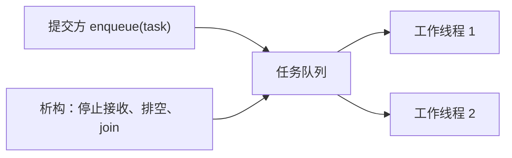

# 06 · 为什么把任务交给已有线程

← [[学习/学习导航/2026-10-24-学习导航|学习导航]] · [[八股测试/2026-10-24#CON-POOL-001 · 线程池的原理与边界|自测题]] · [[学习/2026-10-24/示例代码/06_thread_pool|代码阅读版]]

服务器若来一个短任务就创建一条线程，创建/销毁以及线程过多时的调度可能很贵。**线程池**先准备若干工作线程，让它们从**任务队列**取工作。它是一种工程设计；**C++17 标准库没有统一的 `std::thread_pool` 类型**。这页用 `std::thread`、`mutex`、`condition_variable` 拼入门版。



`std::function<void()>` 表示能像“无参数、无返回值函数”一样调用的任务对象；lambda 是常见任务。`[&]` 借用外部变量，引用对象必须活到任务完成。工作线程在队列为空时用条件变量等待；醒来后若停止标记已设且队列也空，才退出。本例**析构排空已有任务**，不是取消任务。

## 把“提交一项工作”和“执行这项工作”拆开

没有线程池时，每来一个小任务就创建线程、做完再销毁，会反复支付创建与调度的成本。线程池先建立一组长期存在的**工作线程**；调用方把任务放进队列，一个空闲工作者取走任务并执行。任务是“待做的一件事”，线程是“执行它的资源”，两者不是同一个对象。读图时按“提交 → 排队 → 唤醒 → 取任务 → 执行”走一遍，理解为什么提交成功通常只表示任务被接收，不表示结果已经完成。

本例使用 `std::function<void()>` 保存不同的无参数任务，`queue` 按先来先服务保存任务；锁保护队列和 `stopping_` 标志。工作者在队列为空时通过条件变量等待，醒来后检查“有任务或已停机”。关闭时先禁止新提交，再通知所有等待者，让工作者把队列中已接受的任务取完后退出，最后 `join` 等线程结束。若正在执行的任务抛异常，生产级实现必须决定如何记录或把异常交给调用方；不能让未处理异常随便终止工作线程。

还必须问“生产者比消费者快怎么办”。无限队列会积压内存并拉长等待时间；**有界队列**规定容量，满时可以阻塞提交者、立即拒绝、丢弃或采用业务降级，每种都影响调用方。下面的教学池展示基本结构，未完整实现这些策略；下一篇练习把满、空、关闭的队列条件写清楚。线程数多也不必然更快：任务若都争同一把锁，或工作本身很短，线程切换与协调成本可能盖过收益。

## 完整代码

```cpp
// C++17 最小线程池：两条工作线程复用、一个任务队列、条件变量唤醒、析构时收尾。
// 教学版不支持返回值、取消、队列上限或任务异常；不要直接当作生产级实现。
#include <cassert>            // assert：检查任务都完成。
#include <condition_variable> // condition_variable：队列空时让工作线程睡眠。
#include <functional>         // function<void()>：保存不同类型的无参数任务。
#include <iostream>           // cout：展示完成数。
#include <mutex>              // mutex/锁：保护队列、停机标志和结果。
#include <queue>              // queue：先进先出保存待处理任务。
#include <stdexcept>          // runtime_error：拒绝停机后的提交。
#include <thread>             // thread：长期存在的工作线程。
#include <utility>            // move：把任务移进/移出队列。
#include <vector>             // vector：保存工作线程对象。

class ThreadPool {
    std::mutex mutex_;                 // 保护 jobs_ 与 stopping_。
    std::condition_variable changed_; // 新任务或停机时通知工作线程。
    std::queue<std::function<void()>> jobs_;
    bool stopping_ = false;
    std::vector<std::thread> workers_; // 析构时逐条 join。

    void run() {
        for (;;) {
            std::function<void()> job;
            {
                std::unique_lock<std::mutex> lock(mutex_);
                changed_.wait(lock, [&] { return stopping_ || !jobs_.empty(); });
                if (stopping_ && jobs_.empty()) return; // 已关且任务做完才退出。
                job = std::move(jobs_.front()); // 取得队头的所有权。
                jobs_.pop();                    // 从等待队列移除。
            } // 先放开队列锁，再执行任务，避免其它工作线程都被堵住。
            job(); // 本教学版任务不得抛异常，否则工作线程会终止程序。
        }
    }

public:
    explicit ThreadPool(std::size_t count) {
        for (std::size_t i = 0; i < count; ++i) workers_.emplace_back([this] { run(); });
    }
    ThreadPool(const ThreadPool&) = delete; // 线程和互斥锁不能安全地按值复制。
    ThreadPool& operator=(const ThreadPool&) = delete;
    ~ThreadPool() {
        {
            std::lock_guard<std::mutex> lock(mutex_);
            stopping_ = true; // 以后不接受新任务，已排队任务仍会做完。
        }
        changed_.notify_all(); // 空队列上的工作线程也要醒来检查停机。
        for (auto& worker : workers_) worker.join(); // 等所有任务和线程结束。
    }
    void submit(std::function<void()> job) {
        {
            std::lock_guard<std::mutex> lock(mutex_);
            if (stopping_) throw std::runtime_error("pool is stopping");
            jobs_.push(std::move(job));
        }
        changed_.notify_one(); // 一条新任务通常只需唤醒一个工作线程。
    }
};

int main() {
    std::mutex result_mutex; // 两个任务修改同一个计数时需要保护。
    int completed = 0;
    {
        ThreadPool pool(2); // 提前创建两条工作线程。
        for (int i = 0; i < 3; ++i) {
            pool.submit([&] {
                std::lock_guard<std::mutex> lock(result_mutex);
                ++completed;
            });
        }
    } // 析构 pool：先做完队列中的三条任务，再 join 工作者。
    assert(completed == 3);
    std::cout << "completed tasks: " << completed << '\n';
}
```

**投产前还要问**：队列是否有上限？提交速度长期超过消费速度怎样背压？任务抛异常时谁保存/报告？析构与提交并发是什么契约？工作线程数如何根据 CPU 密集、阻塞 I/O 与测量来选？本例假定工作者数量大于 0、提交的任务可调用且不抛异常；队列无界、任务无返回值，未提供异常传递和构造失败恢复，只用于认识结构。`count=0` 会导致队列无人消费，不能把它当有效配置。运行成功不能证明通用线程池安全。需要有界队列时看 [[学习/2026-10-24/07-练习-有界队列|练习]]。

**场景**：独立的服务端请求、后台处理。若池中所有任务都等待尚排在同一池里的新任务，也可能无法推进。低延迟场景要测排队时间和尾延迟，不能凭“复用”断言更快。

## 跟踪三项任务怎样完成

`ThreadPool pool(2)` 创建两条长期存活的工作线程；它们进入 `run()`，看到队列空，就在 `changed_.wait` 上睡。主线程提交三个任务时，`submit` 持锁放入队列，解锁后通知一个工作者。最多两条任务可同时执行，第三条先等在队列里。工作者取走任务后立刻释放**队列锁**，然后才执行 `job()`；如果抱着锁执行任务，第二个工作者无法从队列取任务，池就失去并行意义。

主线程离开 `pool` 的作用域触发析构。析构设置 `stopping_=true`，通知所有工作者；工作者看到队列中仍有任务就继续取，只有“已停机且队列为空”才返回，析构再 `join`。因此最终检查 `completed==3` 有依据。示例中 `completed` 由任务在 `result_mutex` 下累加；不同任务可能同时运行，不能以“入队顺序”为由省去这把锁。

教学代码有明确边界：池对象析构时若外部线程还在调用 `submit`，需要另设生命周期契约；任务抛出未捕获异常会终止程序；若一个工作任务在等待同池里尚未执行的子任务，而所有工作者都这样等，也会无进展。实际服务还要为无界队列设置容量、拒绝或等待策略，并把“排队耗时”纳入延迟统计。

**面试口述**：线程池由工作线程、任务队列、提交接口和关闭协议构成；工作者等待、取任务执行。它减少每任务建线程并限制并行执行数；还要说明排队上限、满队列策略、异常/结果与关闭方式。

**核对来源**：原语见 [C++17 thread](https://timsong-cpp.github.io/cppwp/n4659/thread.threads) 与 [condition_variable](https://timsong-cpp.github.io/cppwp/n4659/thread.condition.condvar)。池的队列与关闭策略为本页自行设计。
