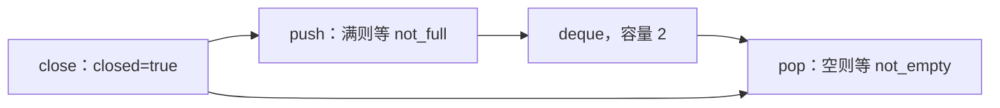

# 07 · 手写一个可关闭的有界任务队列

← [[学习/学习导航/2026-10-24-学习导航|学习导航]] · [[八股测试/2026-10-24#EX-20261024-001 · 实现有界生产者消费者队列|先做练习]] · [[学习/2026-10-24/示例代码/07_bounded_queue|代码阅读版]]

**有界**指队列最多存 `capacity` 个元素；**背压**指满时让生产者等待、拒绝或降速，避免无限堆积。**生产者**放任务，**消费者**取任务。今日采用“满则等待、空则等待、关闭后拒绝新任务但先取完旧任务”的自拟规则；别的系统也可丢弃、限时或取消。



保护 `items_` 和 `closed_` 两个事实，用同一把 `mutex_`。两种条件变量分别等待“非空/关闭”和“未满/关闭”，但条件变量不替代状态；`close()` 要 `notify_all`，否则空队列或满队列上的等待者可能一直睡着。`std::optional<int>` 有值表示取到任务，`std::nullopt` 表示已关闭且排空。

## 先用容量为 2 的队列演练

假设队列最多放两个整数。生产者先放 10、20，队列变满；第三次放 30 时，不能在没有空位的情况下继续塞进去。它在 `not_full_` 上等待，同时释放 mutex。消费者取走 10 后有一个空位，通知等待生产者，30 才能进入。反过来，消费者遇到空队列时也不该反复空转，它等 `not_empty_`，直到生产者放入数据或队列关闭。两个条件变量名字不同，真正被判断的仍是同一把锁保护的队列状态。

关闭是第三种状态，不能只把队列当作“满/空”二选一。关闭后生产者即使看到空位也不得再接受任务；消费者可以按本题约定取完已经入队的任务，之后返回 `std::nullopt` 表示不会再有值。`push` 的等待谓词因此是“有空位**或**已关闭”，`pop` 是“有数据**或**已关闭”。如果只等空位或只等数据，关闭时有线程可能一直睡下去。关闭操作要在持锁下改变 `closed_`，再通知两组等待者。

读代码时先找 `items_`、`closed_` 和 `mutex_`，确认每次检查、修改都在锁内；再找两个 `wait` 的谓词，最后看每次入队/出队后通知哪一侧。`std::optional<int>` 的空值是正常的“已关闭且取尽”结果，不是整数 0。这个练习的单次输出不能证明所有线程交错都正确；还要用多生产者、多消费者、关闭时两边都在等待等场景测试。

## 完整答案代码

```cpp
// C++17 小练习答案：容量为 2 的整数任务队列，满时生产者等待，空时消费者等待。
// close 后拒绝新任务，消费者先取完已入队任务，再收到结束信号。
#include <cassert>            // assert：核对接收顺序。
#include <condition_variable> // 两个条件变量分别等待“有数据”和“有空位”。
#include <deque>              // deque：从队头取、队尾放。
#include <iostream>           // cout：展示已消费的任务。
#include <mutex>              // mutex/unique_lock：保护队列和关闭状态。
#include <optional>           // optional：无任务且已关闭时明确返回“没有值”。
#include <stdexcept>          // runtime_error：关闭后拒绝入队。
#include <thread>             // thread：运行消费者。
#include <vector>             // vector：记录最终处理顺序。

class BoundedQueue {
    const std::size_t capacity_;      // 队列上限，构造时保证大于 0。
    std::deque<int> items_;           // 等待处理的整数任务。
    bool closed_ = false;             // 关闭后不再接收新任务。
    std::mutex mutex_;                // items_ 和 closed_ 只能在持锁时访问。
    std::condition_variable not_empty_; // 队列有数据或被关闭时唤醒消费者。
    std::condition_variable not_full_;  // 队列有空位或被关闭时唤醒生产者。
public:
    explicit BoundedQueue(std::size_t capacity) : capacity_(capacity) {
        if (capacity == 0) throw std::invalid_argument("capacity must be positive");
    }
    void push(int item) {
        std::unique_lock<std::mutex> lock(mutex_);
        not_full_.wait(lock, [&] { return closed_ || items_.size() < capacity_; });
        if (closed_) throw std::runtime_error("queue closed");
        items_.push_back(item); // 只在有空位且未关闭时放入。
        lock.unlock();          // 通知前放开锁，让消费者立刻有机会取得它。
        not_empty_.notify_one();
    }
    std::optional<int> pop() {
        std::unique_lock<std::mutex> lock(mutex_);
        not_empty_.wait(lock, [&] { return closed_ || !items_.empty(); });
        if (items_.empty()) return std::nullopt; // 已关闭且已取完。
        const int item = items_.front();
        items_.pop_front();
        lock.unlock();
        not_full_.notify_one(); // 刚腾出一个空位，生产者可以继续。
        return item;
    }
    void close() {
        {
            std::lock_guard<std::mutex> lock(mutex_);
            closed_ = true;
        }
        not_empty_.notify_all(); // 唤醒空队列上的消费者。
        not_full_.notify_all();  // 唤醒满队列上的生产者以便它们退出。
    }
};

int main() {
    BoundedQueue queue(2);
    std::vector<int> consumed; // 只有消费者写，join 后主线程才读。
    std::thread consumer([&] {
        while (const auto item = queue.pop()) consumed.push_back(*item);
    });
    queue.push(1);
    queue.push(2);
    queue.push(3); // 满了就等待，不能无限增长。
    queue.close();
    consumer.join();
    assert((consumed == std::vector<int>{1, 2, 3}));
    for (int item : consumed) std::cout << item << ' ';
    std::cout << '\n';
}
```

**跟踪 main**：容量 2；放 1、2 后队列满，放 3 时如果消费者还未取走元素就等；消费者每次 `pop` 后通知生产者。`close` 后不再接受新元素，消费者仍取完旧任务。`join` 后主线程才读 `consumed`，因此这份向量无需另加 mutex。本次运行可能没有实际发生“满时等待”，因为调度不可预知；一次输出不能覆盖所有并发交错。

**语法拆解**：`[&]` 借用外围 `queue`、`consumed`；`const auto item = queue.pop()` 推断为 `optional<int>`，`*item` 在有值时取整数；`unique_lock<mutex>` 是可手动解锁/被 `wait` 解锁的锁对象。`close` 用 `lock_guard`，因那段不需中途解锁。

**追问**：多个生产者与 `close` 竞争时，谁先持锁并满足条件决定谁成功；已排队元素仍排空。若元素复制/移动可能抛异常，生产级实现还需设计异常安全与取消策略。这里用 `int` 专注同步。

## 按状态表检查每个返回路径

| 调用时的状态 | `push` 应怎样做 | `pop` 应怎样做 |
| --- | --- | --- |
| 未关闭、空队列 | 可以放；放完通知消费者 | 等待新元素或关闭 |
| 未关闭、已满 | 等待空位或关闭 | 可以取；取完通知生产者 |
| 已关闭、仍有元素 | 拒绝新元素 | 继续取完旧元素 |
| 已关闭、已排空 | 拒绝新元素 | 返回 `nullopt` 结束 |

这张表也是测试设计：不能只跑 `main` 的一种时序。要专门安排“生产者卡在满队列时关闭”和“消费者卡在空队列时关闭”，确认两边都会醒；还要安排关闭与入队竞争，确认只有在取得锁时仍满足规则的操作才能成功。`notify_one` 的作用是提示可能有一个新机会，谓词仍是最终判断依据。`close` 用 `notify_all`，因为所有等待者都需要知道不会再有新任务。

比较 `push` 和 `pop` 可看出对称性：前者在有空位时放入、通知“非空”；后者在有数据时取走、通知“未满”。但关闭后的行为并不对称：本题选择拒绝放入、允许排空。这个契约必须写在接口文档里，否则调用者无法判断 `nullopt` 是“暂时没数据”还是“永远不会有数据”。

**核对来源**：[C++17 condition_variable](https://timsong-cpp.github.io/cppwp/n4659/thread.condition.condvar)、[C++17 mutex](https://timsong-cpp.github.io/cppwp/n4659/thread.mutex.requirements)。容量与关闭语义由本库设计。
