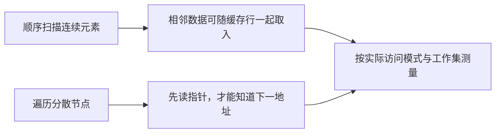

# 01 · 缓存命中与访问局部性

← [[学习/学习导航/2026-10-25-学习导航|学习导航]] · [[八股测试/2026-10-25#PERF-LOCALITY-001 · 缓存命中与访问局部性|自测题]] · [[学习/2026-10-25/示例代码/01_locality|代码阅读版]] · [[学习/2026-10-25/02-AoS与SoA|下一专题]]

**缓存行**是处理器缓存与内存交互时常见的数据块单位，不等于一个 C++ 对象。**局部性**是短时间内重复访问同一块数据，或访问附近的数据。比如依次处理一批行情价格，连续存放有利于把相邻价格一起带入缓存；链表节点可位于分散地址，访问下一节点前常要先读取指针。



## 机制与边界

先看算法是否正确，再看工作集和访问顺序。`vector` 保证元素连续（`vector<bool>` 是特例），但“连续”不承诺比所有结构都快。记录对象很大、循环只读一个字段时，下一页的布局选择比仅把容器换成 `vector` 更关键。

**什么时候有用**：批量扫描行情价格、回放日志时先用连续数据建立基线，再以真实输入测量。

**不要误判**：缓存命中、TLB 命中和算法复杂度是不同层次；小数据或随机访问可能得出不同结果。

## 从 CPU 读一个价格开始

程序要算一批价格的总和，最直观的写法是循环依次读 `prices[0]、prices[1]、prices[2]`。CPU 不一定为每个 `int` 单独向较慢的内存取一次；常见处理器把相邻字节按**缓存行**取入。假设某机器一行能容纳多个 `int`，读第一个价格时，后面的价格可能也已经到了缓存里。下一次访问附近元素就有机会命中。这里的缓存行大小只是硬件和环境属性，不由 C++ 的 `sizeof(int)` 决定，也不能统一背成固定 64 字节。

**空间局部性**说的是短时间内访问相邻地址；**时间局部性**说的是短时间内再次访问刚用过的数据。连续数组的顺序扫描容易利用空间局部性。链表的逻辑顺序虽然也是 101、102、103，节点却可分配在分散位置；必须先读当前节点里的“下一项”指针，才知道接下来访问哪里，这叫指针追逐。链表的算法复杂度有时看起来不错，但一次节点查找的真实成本可能受内存等待影响。反过来，如果数据量很小、刚好在缓存里，或者操作需要频繁在已知位置插入，结论又可能变化。

看下面代码先不要跑计时：两个容器装同样的三个值，两个循环得到同一个和，说明我们比较的是同一项计算。`&prices[1] - &prices[0]` 得到相邻元素相差 1 个元素位置，这是 `vector<int>` 连续性的语义检查，不是缓存命中率测试。程序没有测量缓存事件，也没有证明 `vector` 在你的机器上快多少。想做性能比较，需固定输入规模和访问方式、预热、多次运行，再结合硬件计数器看缓存未命中；后面的[[学习/2026-10-25/06-吞吐与尾延迟测量|测量专题]]会说明为什么单次时长不可信。

## 完整代码

```cpp
// 目的：观察连续 vector 与链式 list 的元素地址和遍历结果；不是性能跑分。
// 前置：理解引用、迭代器和 range-for；编译标准 C++17。
#include <cassert>  // assert：检查两种容器计算出同一结果。
#include <iostream> // cout：打印结果。
#include <list>     // list：节点式序列，节点地址不保证连续。
#include <vector>   // vector：普通元素连续存放。

int main() {
    std::vector<int> prices{101, 102, 103}; // 三个相邻的 int 元素。
    std::list<int> nodes{101, 102, 103};   // 逻辑顺序相同，节点布局未指定。
    int vector_sum = 0;
    int list_sum = 0;
    for (int price : prices) vector_sum += price; // 顺序读取连续元素。
    for (int price : nodes) list_sum += price;    // 每一步经迭代器前进。
    assert(vector_sum == list_sum); // 功能等价不表示性能等价。
    std::cout << vector_sum << '\n';
    std::cout << "vector element gap: "
              << (&prices[1] - &prices[0]) << '\n'; // 同一 vector 内相邻元素相差一个元素位置。
    // 不对 list 节点地址做性能推断：一次打印地址不能代表缓存行为。
}
```

## 观察与自检

`prices` 和 `nodes` 的值相同，两个求和循环都应得 306；`assert(vector_sum == list_sum)` 只核对结果一致。`&prices[1] - &prices[0]` 以 `int` 元素为单位，结果应为 1，不能误读为“相差 1 字节”。`list` 遍历器每次前进也能取到下一个值，但程序没有给出节点是否同处缓存行的信息。

试着口述：CPU 常按缓存行取入数据；顺序访问连续元素更可能复用已取入的邻近字节，而链表可能要先读指针再找分散节点。再补边界：这是可能的成本来源，不是这段 `assert` 已证明的速度结论。若问如何验证，回答固定工作负载并重复测量，同时观察缓存事件。

## 再用两种访问模式检验直觉

假设有一万个 `int`。第一种任务是从头到尾求和：读取地址按顺序前进，刚取入的缓存行中后续元素可能马上被使用。第二种任务是每次由当前元素决定下一个随机索引：即使底层仍是 `vector`，下一地址也难预测，局部性可能明显变差。所以“用了 vector”并不是充分条件，**访问顺序**与数据总量同样重要。工作集小到能留在缓存里时，差别也可能不显著。

时间局部性可用另一例子理解：某个合约的配置在一小段时间里被反复查找，第一次读取后，之后访问可能受益；若每次查的都是从未访问的合约，则主要面对新数据加载。算法选择仍要放在前面：不能为了一点局部性，把原本线性复杂度的任务改成平方复杂度的全量扫描。

若要验证“缓存问题”而非凭感觉猜，先固定程序输出、输入分布与编译选项，分别测小工作集和大工作集；再观察缓存未命中等硬件事件，同时记录总耗时。计时变快只说明结果，硬件事件和访问模式才帮助解释原因。链表并非一律坏：已知节点处频繁插删、无需随机定位时，它有自己的适用场景。

## 来源

原帖明确提及“缓存命中问题场景分析”：[九坤投资量化实现工程师凉经，zqkb／牛客，2025-09-18，候选人自述](https://www.nowcoder.com/discuss/798223058384191488)。技术核对：[ Intel Optimization Reference Manual ](https://cdrdv2-public.intel.com/821612/248966-Optimization-Reference-Manual-V1-050.pdf)。访问日期 2026-10-25。官方资料说明机制与约束，不代表本示例在你的机器上的性能结果。
