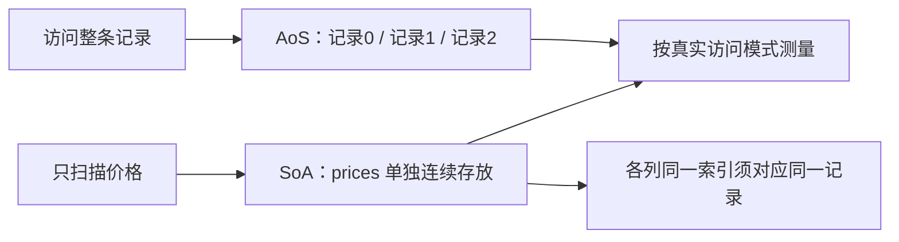

# 02 · AoS 与 SoA 怎样选

← [[学习/学习导航/2026-10-25-学习导航|学习导航]] · [[八股测试/2026-10-25#PERF-LAYOUT-001 · AoS 与 SoA 怎样选|自测题]] · [[学习/2026-10-25/01-缓存命中与局部性|上一专题]] · [[学习/2026-10-25/示例代码/02_layout|代码阅读版]] · [[学习/2026-10-25/03-伪共享|下一专题]]

**AoS**（结构体数组）把一条记录的 `id/price/volume` 放在一起；**SoA**（数组的结构体）把所有 `price` 放一列、所有 `volume` 放另一列。关键不是名字，而是循环每次实际要读哪些字段。



## 机制与边界

只计算价格总和时，SoA 的 `prices` 是密集的；AoS 每条还带着当前计算不需要的字段。若逐条校验 id、价格、数量，AoS 把共同使用的数据放在一起更自然。SoA 的各列必须维护相同索引对应同一条记录，否则会出现语义错误。

**什么时候有用**：行情回放的按列统计可考虑 SoA；订单生命周期中经常整条操作可先采用 AoS。

**不要误判**：SoA 并非普遍更快；字段关联、更新频率、对齐、索引一致性和实际机器都影响结果。

## 把同一组行情摆成两种样子

假设每条行情记录有 `id、price、volume` 三个字段。AoS（Array of Structures，结构体数组）像一排档案袋：第 0 个袋子里放 1、101、5，第 1 个放 2、103、8。`vector<Tick>` 的每个元素是完整的 `Tick`。SoA（Structure of Arrays，数组的结构体）像三列账本：`ids={1,2}`，`prices={101,103}`，`volumes={5,8}`。第 `i` 个位置的三个值合起来才是一条记录，所以三列的长度和顺序必须始终一致。

若循环只求所有价格之和，SoA 只顺序读取 `prices` 列；AoS 逐条经过 `Tick`，每个价格附近还放着本次不用的字段。SoA 在这种访问模式下可能更省缓存带宽，也可能让编译器更容易做向量化。若每次都要按记录检查 `id` 和 `volume`，AoS 将同一记录的字段放在一起，代码和访问模式可能更合适。实际结构体还有对齐、填充和字段类型差异，不能用示意图替代目标编译器上的 `sizeof` 与测量。[Intel 的数据布局说明](https://www.intel.com/content/www/us/en/developer/articles/technical/memory-layout-transformations.html)也强调选择取决于访问模式。

读代码时看 `rows` 和 `cols` 如何表达相同两条数据，再看两个循环都算出 `204`。`assert` 检查列长，防止新增一个价格却忘了新增对应 ID；它还不能证明列内容一一对应，生产代码要把“同时追加一条完整记录”封成受控操作。不要为了追求 SoA 在每次处理前后反复从 AoS 复制转换，转换成本也属于总耗时。选布局时先写出热路径究竟读哪几列、是否常更新整条，再测量。

## 完整代码

```cpp
// 目的：同一组行情数据分别以 AoS 与 SoA 表示，验证按价格求和一致。
// 前置：vector、结构体和下标；编译标准 C++17。
#include <cassert>  // assert：验证结果与列长。
#include <iostream> // cout：显示求和。
#include <vector>   // vector：保存连续元素。

struct Tick { int id; int price; int volume; }; // AoS 的一条完整记录。
struct TickColumns {                         // SoA：每个字段单独一列。
    std::vector<int> ids;
    std::vector<int> prices;
    std::vector<int> volumes;
};

int main() {
    std::vector<Tick> rows{{1, 101, 5}, {2, 103, 8}};
    TickColumns cols{{1, 2}, {101, 103}, {5, 8}};
    assert(cols.ids.size() == cols.prices.size()); // 第 i 项必须对应同一条。
    assert(cols.prices.size() == cols.volumes.size());
    int aos_sum = 0;
    for (const Tick& t : rows) aos_sum += t.price; // 只用 price 字段。
    int soa_sum = 0;
    for (int price : cols.prices) soa_sum += price; // 只遍历价格列。
    assert(aos_sum == soa_sum);
    std::cout << "price sum: " << soa_sum << '\n';
    // 此程序只验证语义，不能据一次运行证明某种布局更快。
}
```

## 观察与自检

先手算第 0 条：AoS 的 `rows[0]` 是 `{1,101,5}`；SoA 的 `ids[0]、prices[0]、volumes[0]` 合起来也是这条记录。第 1 条同理。两个循环分别只加价格，都得到 204。`assert` 只检查列长和求和一致，若把第二条的 ID 写错，它仍可能通过；这提示我们“测试了哪些不变量”和“还没测试什么”要说清楚。

口述时先讲存放方式，再讲访问模式：整条记录常一起使用时 AoS 自然；批量只扫一列时 SoA 可能减少无关字段带宽。最后说明列索引一致性、转换成本与实测条件。不能只看到“连续”两个字就宣布 SoA 必胜。

## 选择前把热循环写出来

若任务是 `for each tick: sum += tick.price`，真正用到的只有价格列。AoS 的每条记录里还摆着 ID、数量及可能的填充字节；SoA 的价格列能更密集地相邻存放。若任务变为 `for each tick: 检查 id、price、volume 后更新整条`，三个字段一起被用，AoS 可能更省索引管理。这里说的是可能的内存访问收益；编译器向量化、缓存大小、预取和对象大小都会影响实测。

SoA 最容易出错的是“列仍能对齐吗”。假设只删除了 `ids[1]`，却没有删 `prices[1]` 与 `volumes[1]`，从此相同索引不再代表同一条行情。真实实现可以把新增、删除、重排封装成统一操作，并在边界做长度与身份核对。若业务经常按 ID 查单条记录，可能还需要额外索引；单纯把字段改成数组并没有自动解决查找问题。

从 AoS 改成 SoA 是一次数据结构变更，最好先证明某个按列扫描是热点，记录基线，再用真实数据测收益与额外内存、转换成本。对于只有两条记录的示例，两个 `assert` 只证明值相同，完全不能给出性能结论。

## 来源

原帖明确提及“AoS 和 SoA 的区别”：[九坤投资量化实现工程师凉经，zqkb／牛客，2025-09-18，候选人自述](https://www.nowcoder.com/discuss/798223058384191488)。技术核对：[ Intel Memory Layout Transformations ](https://www.intel.com/content/www/us/en/developer/articles/technical/memory-layout-transformations.html)。访问日期 2026-10-25。官方资料说明机制与约束，不代表本示例在你的机器上的性能结果。
