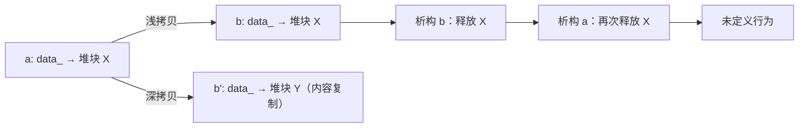

# 深拷贝、浅拷贝与三法则

← [[学习/学习导航/2026-10-25-学习导航|今日导航]] · [[八股测试/2026-10-25#CPP-COPYCTRL-001|回到测试题]]

## 先把词说清楚

**拷贝构造（copy constructor）**：用同类型对象初始化新对象，`T(const T&)`。

**拷贝赋值（copy assignment）**：给已存在的对象赋值，`T& operator=(const T&)`。

**浅拷贝**：编译器默认生成的版本，逐个成员复制。成员是指针时，只复制指针值，两个对象指向同一块内存。

**深拷贝**：自己申请一块新内存，把内容复制过去，两个对象互不影响。

**三法则**：如果你需要自己写析构、拷贝构造、拷贝赋值中的任何一个，通常三个都要写。

**五法则**：C++11 起再加上移动构造与移动赋值。

**零法则**：用能自己管理资源的成员（`std::string`、`std::vector`、`std::unique_ptr`），一个都不用写。

## 它解决什么问题

默认拷贝是“逐成员复制”，对值类型成员正好；对持有资源的成员（裸指针、文件描述符）就是灾难：两个对象都以为自己拥有同一份资源，析构两次 → 重复释放；修改一个 → 另一个莫名其妙变了。

## 一个会崩的例子

```cpp
class Buffer {
public:
    explicit Buffer(std::size_t size) : data_(new char[size]), size_(size) {}
    ~Buffer() { delete[] data_; }          // 只写了析构
private:
    char* data_;
    std::size_t size_;
};

Buffer a(16);
Buffer b = a;   // 浅拷贝：b.data_ == a.data_
                // 作用域结束：a 和 b 各 delete[] 一次同一块内存 → 未定义行为
```

编译器生成的拷贝构造只做 `data_ = a.data_`，没有分配新内存。修复方式有三种：

1. 自己写深拷贝（三法则）；
2. 删掉拷贝，只允许移动（`= delete`）；
3. 把成员换成 `std::vector<char>` 或 `std::unique_ptr<char[]>`，走零法则。

## 三法则的写法

```cpp
class Buffer {
public:
    explicit Buffer(std::size_t size) : data_(new char[size]), size_(size) {}

    ~Buffer() { delete[] data_; }

    Buffer(const Buffer& other)                       // 深拷贝
        : data_(new char[other.size_]), size_(other.size_) {
        std::copy(other.data_, other.data_ + size_, data_);
    }

    Buffer& operator=(const Buffer& other) {
        if (this == &other) return *this;              // 自赋值保护
        char* fresh = new char[other.size_];           // 先分配成功，再释放旧的
        std::copy(other.data_, other.data_ + other.size_, fresh);
        delete[] data_;
        data_ = fresh;
        size_ = other.size_;
        return *this;
    }

private:
    char* data_;
    std::size_t size_;
};
```

赋值运算符的三个要点：**处理自赋值**、**先分配后释放**（分配失败时对象仍有效）、**返回 `*this`** 以支持链式赋值。

更省心的写法是 copy-and-swap：

```cpp
Buffer& operator=(Buffer other) {   // 按值传参：拷贝在这一步完成
    swap(*this, other);             // 交换后，other 析构时释放旧资源
    return *this;
}
```

## 图示



## 移动语义与“五法则”

如果类型持有资源，除了拷贝还要考虑移动：移动构造/移动赋值把资源“偷”过来，把源对象置为可析构状态。规则细节：**声明了析构、拷贝构造或拷贝赋值中的任何一个，编译器就不会再隐式生成移动操作**（C++17 规则），此时“移动”会退化成拷贝。

```cpp
Buffer(Buffer&& other) noexcept
    : data_(other.data_), size_(other.size_) {
    other.data_ = nullptr;   // 源对象不再拥有资源，析构时 delete[] nullptr 是安全的
    other.size_ = 0;
}
```

移动构造标 `noexcept` 很重要：`std::vector` 扩容时，只有在移动构造不抛异常时才会用移动，否则为保证强异常安全而退回复制。

## 边界与常见误解

**“编译器生成的拷贝一定是浅拷贝？”** 对指针成员是；对 `std::string` 这类成员是“调用它自己的拷贝构造”，行为正确。所谓深浅，取决于成员类型。

**“写了析构就不用写拷贝？”** 恰恰相反：写了析构说明你在管理资源，通常也要管拷贝。

**“拷贝赋值能省略自赋值检查吗？”** 如果实现是“先释放旧资源再拷贝新内容”，`a = a` 会先释放自己的数据，再读已释放内存。

**“移动后源对象还能用吗？”** 只能做“有效但未指定”的操作：可以析构、可以重新赋值，不要读它的值。

## 使用场景

- **自己管理资源的类**：文件、socket、共享内存、裸缓冲。
- **容器元素**：元素要被复制/移动，拷贝语义必须正确，否则扩容时就出错。
- **接口边界**：不打算支持拷贝的类型显式 `= delete`，让错误在编译期暴露。

## 变式与口述总结

> 默认拷贝是逐成员复制，指针成员会变成浅拷贝，导致重复释放或互相影响。三法则说：需要析构、拷贝构造、拷贝赋值中的一个，通常三个都要。C++11 加上移动构造和移动赋值就是五法则；更好的做法是零法则——用会自己管理资源的成员，一个都不写。

**变式：**

1. 为什么拷贝赋值要先分配新内存再释放旧内存？
2. 声明了析构函数，移动构造还会自动生成吗？
3. copy-and-swap 如何处理自赋值？

## 来源

- 题型来源：本日原帖未直接出现“深浅拷贝”问法，本库标为**扩展题**；[京东 C++ 面经](https://www.iamshuaidi.com/31040.html) 一面问“C++11 新特性、右值引用”，二面追问“move 语义”，与本主题同属资源与对象复制这条线。
- 标准依据：[N4659 class.copy.ctor](https://timsong-cpp.github.io/cppwp/n4659/class.copy.ctor)、[class.copy.assign](https://timsong-cpp.github.io/cppwp/n4659/class.copy.assign)、[dcl.fct.def.default](https://timsong-cpp.github.io/cppwp/n4659/dcl.fct.def.default)。
