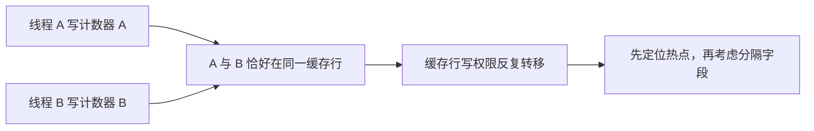

# 03 · 伪共享为什么会变慢

← [[学习/学习导航/2026-10-25-学习导航|学习导航]] · [[八股测试/2026-10-25#PERF-FALSESHARE-001 · 伪共享为什么会变慢|自测题]] · [[学习/2026-10-25/02-AoS与SoA|上一专题]] · [[学习/2026-10-25/示例代码/03_false_sharing|代码阅读版]] · [[学习/2026-10-25/04-分配器与预留容量|下一专题]]

**伪共享**指两个线程访问不同变量，但这些变量恰好处于同一缓存行。每个线程只写自己的计数器，在语言层面可以没有数据竞争；硬件仍可能为了缓存一致性反复传递这行数据。



## 机制与边界

C++17 的 `std::hardware_destructive_interference_size` 可用于表达避免干扰的间距，但具体数值由实现给出，不能假设所有 CPU 都是 64 字节。给字段加间距会增加内存占用，可能又伤害缓存容量；只有确定是热点后才值得改。Linux 可借 `perf c2c` 定位有问题的缓存行。

**什么时候有用**：工作线程分别更新自己的统计计数，吞吐不升反降时检查是否共用缓存行。

**不要误判**：这是性能问题，不等同于 C++ 数据竞争；实际是否同一缓存行、是否跨核心、写入频率都需测量。

## 为什么“各写各的”仍可能相互拖慢

设线程 A 只更新计数器 `a`，线程 B 只更新 `b`。若它们是两个独立的 `std::atomic<int>`，语言层面没有对同一个普通变量的无同步并发读写；但若 `a` 和 `b` 恰好在同一缓存行，硬件维护缓存一致性时，A 为写 `a` 取得这行的写权限，B 写 `b` 又需要取得**同一行**。两端可能反复让对方缓存里的这一行失效，尽管从业务看两个计数器互不相关。这就是“伪”共享：共享的是硬件搬运和一致性处理的单位，不是两线程故意共享同一个计数器。[Linux 内核文档](https://docs.kernel.org/next/kernel-hacking/false-sharing.html)用类似例子解释了这一点。

下面的 `Adjacent` 把两个原子成员挨着声明，`Separated` 用 C++17 的 `alignas(std::hardware_destructive_interference_size)` 要求成员按实现提供的避免干扰间距对齐。示例打印 `sizeof`，让你看到分隔字段会增大对象。**对齐不是同步**：如果把两个线程都改成写同一个普通 `int`，加再多空格也不能修复数据竞争。这里用 `memory_order_relaxed` 是因为各原子只做独立计数，不用计数值发布其他业务数据；正式的跨线程消息交接需要另外设计顺序关系。

代码启动两个线程，各循环加 1000，再 `join` 检查最终两个值都为 1000。它没有同时对 `Adjacent` 做相同工作，也没有控制线程落在哪些核心，因此只演示布局和正确性，**不能从打印的字节数推断提速倍数**。若线上怀疑伪共享，先看是否有跨核心频繁写入、定位具体缓存行（Linux 可用 `perf c2c`），再比较分隔前后吞吐、尾延迟和内存占用。字段分开会占用更多空间，可能影响别处的缓存容量。

## 完整代码

```cpp
// 目的：展示两个独立原子计数器与对齐隔离的布局；不把时长当性能结论。
// 前置：atomic 的 relaxed 只保证这里的原子计数，不发布其他业务状态。
#include <atomic>   // atomic：各线程独立更新各自计数器。
#include <cassert>  // assert：校验最终数值。
#include <iostream> // cout：输出布局信息。
#include <functional> // ref：把原子对象按引用传给线程。
#include <new>      // hardware_destructive_interference_size：C++17 实现提供的间距。
#include <thread>   // thread：两个工作者。

struct Adjacent { std::atomic<int> a{0}; std::atomic<int> b{0}; };
// alignas 让两个成员的起点至少按实现给出的间距对齐。
struct Separated {
    alignas(std::hardware_destructive_interference_size) std::atomic<int> a{0};
    alignas(std::hardware_destructive_interference_size) std::atomic<int> b{0};
};

int main() {
    Adjacent near;
    Separated far;
    auto count = [](std::atomic<int>& x) { // 引用明确指向各自的原子对象。
        for (int i = 0; i < 1000; ++i) x.fetch_add(1, std::memory_order_relaxed);
    };
    std::thread first(count, std::ref(far.a)); // 两线程改不同变量。
    std::thread second(count, std::ref(far.b));
    first.join(); second.join(); // 读取前等待写入完成。
    assert(far.a.load() == 1000 && far.b.load() == 1000);
    std::cout << "near bytes: " << sizeof(near) << ", far bytes: " << sizeof(far) << '\n';
}
```

## 观察与自检

`Adjacent` 中两个成员紧邻，`Separated` 中两个成员要求更大的对齐间距。先比较程序打印的两种 `sizeof`，理解为分隔空间的**代价**，不要理解为速度。`std::ref(far.a)` 让线程函数收到原子对象的引用；若按值传 `std::atomic`，复制本身就不成立。两个 `join` 之后才检查各自加到 1000，避免在写入尚未结束时把结果当最终值。

口述重点是两层：语言层面没有对同一个普通变量无同步写入，但硬件按缓存行维护一致性，两个独立变量同处一行时可能互相干扰。追问“加 `alignas` 就好了？”应回答：要先定位热点，且分隔会增大内存占用；它也不替代正确同步。

## 先排除真正的数据竞争

若两条线程都写同一个普通 `int counter`，且没有锁或原子操作，这是 C++ 数据竞争，结果没有可靠语义；把变量放到更大的对齐边界也无济于事。若线程 A 只写 `atomic_a`、线程 B 只写 `atomic_b`，并且读取也按原子规则进行，语言层面的共享访问可正确，但两个原子对象恰在一行时仍可能有性能干扰。**正确性问题先修正确性，性能问题再测性能**，两者不能互相替代。

下方示例的 `memory_order_relaxed` 只保证各计数器自身的原子更新，不用它来宣布“数据已经准备好”；若计数器承担跨线程发布其他字段的信号，就要重新设计内存顺序。`alignas` 给对象施加对齐要求，配合实现给出的破坏性干扰大小表达分隔意图；但对象排列、实现常量和实际硬件都可能变化，不能只看源码就断言某两次写确实竞争同一物理缓存行。

一个可操作的排查顺序是：先发现随线程数增加吞吐反降；确认线程主要更新各自计数器；在目标机器上用缓存行相关性能工具定位；改布局后重复同样工作负载，同时看吞吐和内存占用。若分隔后吞吐没变，就不应保留没有收益的膨胀布局。

## 来源

原帖明确提及“伪共享问题场景分析”：[九坤投资量化实现工程师凉经，zqkb／牛客，2025-09-18，候选人自述](https://www.nowcoder.com/discuss/798223058384191488)。技术核对：[ Linux Kernel false sharing ](https://docs.kernel.org/next/kernel-hacking/false-sharing.html)。访问日期 2026-10-25。官方资料说明机制与约束，不代表本示例在你的机器上的性能结果。
