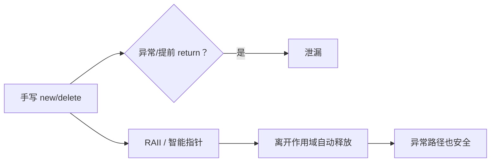

# 内存问题怎么查：泄漏、悬垂、重复释放

← [[学习/学习导航/2026-10-25-学习导航|今日导航]] · [[八股测试/2026-10-25#CPP-LEAK-001|回到测试题]]

## 先把词说清楚

**内存泄漏（memory leak）**：申请了内存再也没释放，程序运行越久占用越高。

**悬垂指针（dangling pointer）**：指针指向的对象已经销毁，指针本身还留着。

**重复释放（double free）**：同一块内存被释放两次。

**释放后使用（use-after-free）**：对象销毁后仍通过旧指针访问。

**RAII**：把资源绑定到对象生命周期上，构造获取、析构释放，异常路径也能回收。

这四种问题都跟“谁拥有这块内存、什么时候该还”有关，面试常把它们放在一起问“你怎么排查内存问题”。

## 它解决什么问题

C++ 没有垃圾回收，正确性靠所有权约定。面试官问这个问题，通常想看三件事：你会不会用工具定位、你知不知道为什么默认写法会出错、你会不会用语言机制从源头避免。

## 常见成因

| 现象 | 典型代码 | 后果 |
| --- | --- | --- |
| 忘记释放 | `auto* p = new T;` 函数结束没 `delete` | 泄漏 |
| 指针被覆盖 | `p = new T;` 再次赋值，旧地址丢失 | 泄漏且找不回来 |
| 异常路径跳过释放 | 手写 `new` 后中间抛异常 | 泄漏 |
| `shared_ptr` 循环引用 | 两个对象互相持有 `shared_ptr` | 引用计数永不归零 |
| 容器存裸指针 | `vector<T*>` 析构不删元素 | 批量泄漏 |
| 提前销毁 | `return &local;`、容器扩容使引用失效 | 悬垂 |
| 所有权不清 | 两个对象都 `delete` 同一指针 | 重复释放 |

## 工具怎么用

**AddressSanitizer（推荐，编译期插桩）**

```bash
g++ -std=c++17 -g -fsanitize=address,undefined -fno-omit-frame-pointer leak.cpp -o leak
./leak
```

它能报出越界、use-after-free、double-free、以及程序退出时的泄漏（LeakSanitizer），并给调用栈。

**Valgrind（不需要重新编译，但慢很多）**

```bash
valgrind --leak-check=full --show-leak-kinds=all ./program
```

**注意：** 一次正常运行没有报错，不等于没有内存错误。未定义行为可能碰巧不崩；压力测试、长时间运行、ASan 才有机会暴露。

## 从源头避免

### 1. 用 RAII 包装资源

```cpp
class FileHandle {
public:
    explicit FileHandle(const char* path) : fd_(::open(path, O_RDONLY)) {
        if (fd_ < 0) throw std::runtime_error("open failed");
    }
    ~FileHandle() { if (fd_ >= 0) ::close(fd_); }
    FileHandle(const FileHandle&) = delete;             // 不允许复制同一份所有权的资源
    FileHandle& operator=(const FileHandle&) = delete;
    int get() const { return fd_; }
private:
    int fd_;
};
```

构造函数抛异常时对象不存在，但已经打开的部分要在构造函数内部处理好；析构负责正常路径。

### 2. 用智能指针表达所有权

- `std::unique_ptr<T>`：独占，默认选择；
- `std::shared_ptr<T>`：共享所有权，有引用计数成本；
- `std::weak_ptr<T>`：只观察，不续命，用来打断循环。

```cpp
struct Node {
    std::shared_ptr<Node> next;
    std::weak_ptr<Node> prev;   // 反向边用 weak_ptr，避免循环
};
```

### 3. 优先“零法则”

成员用 `std::string`、`std::vector`、`std::unique_ptr`，自己不写析构、拷贝、移动——编译器生成的版本就是对的。

## 图示



## 边界与常见误解

**“用了智能指针就不会泄漏？”** `shared_ptr` 循环引用会泄漏；智能指针管理的是内存，不是所有资源（比如需要成对调用的 API）。

**“进程退出时泄漏无所谓？”** 短生命周期工具常这么讲；长期运行的服务、交易系统不行——泄漏会累积成 OOM，也会打乱延迟。

**“valgrind 没报就安全？”** Valgrind 只跑得到你测到的路径；未覆盖的分支、只在生产数据下出现的越界都查不到。

**“delete 之后置空就安全？”** 只对“这一个指针”安全；其他副本仍然悬垂。

**“内存泄漏一定是 new 没 delete？”** 也可能是容器只增不减、缓存无上限、事件订阅没取消——这类“逻辑泄漏”工具查不出来。

## 使用场景

- **服务端/交易系统**：长时间运行，必须靠 RAII + 有界容器 + 定期压测。
- **排查线上问题**：ASan 用于测试环境，`heaptrack`/`perf` 看增长趋势，core dump 看崩溃点。
- **代码评审**：看到裸 `new`、看到 `vector<T*>`、看到 `shared_ptr` 双向引用，都是要追问所有权的信号。

## 变式与口述总结

> 内存问题分四类：泄漏、悬垂、重复释放、释放后使用。定位靠 ASan 和 Valgrind，但工具只覆盖跑到的路径。根治靠所有权：RAII 包装资源，unique_ptr 表达独占，shared_ptr 表达共享，需要反向引用时用 weak_ptr，能走零法则就不自己写析构。

**变式：**

1. 两个对象互相持有 `shared_ptr`，为什么泄漏？怎么改？
2. 构造函数里 `new` 之后抛异常，内存会不会泄漏？为什么？
3. ASan 和 Valgrind 各适合什么场景？

## 来源

- 题型来源：本日原帖未直接出现“内存泄漏排查”，本库标为**扩展题**；它属于“内存与资源”方向的通用工程问法，代码与工具用法按官方文档核对。
- 技术依据：[AddressSanitizer 官方文档](https://clang.llvm.org/docs/AddressSanitizer.html)、[Valgrind 手册](https://valgrind.org/docs/manual/mc-manual.html)、[N4659 basic.stc.dynamic](https://timsong-cpp.github.io/cppwp/n4659/basic.stc.dynamic)。
