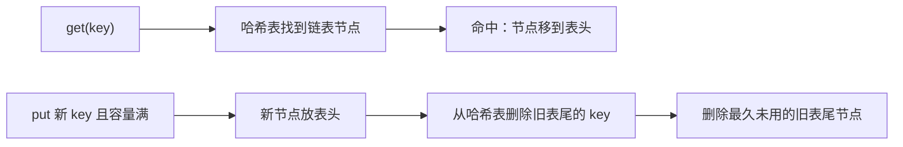

# 05 · LRU 缓存为何常用链表加哈希表

← [[学习/学习导航/2026-10-25-学习导航|学习导航]] · [[八股测试/2026-10-25#PERF-LRU-001 · LRU 缓存为何常用链表加哈希表|自测题]] · [[学习/2026-10-25/04-分配器与预留容量|上一专题]] · [[学习/2026-10-25/示例代码/05_lru|代码阅读版]] · [[学习/2026-10-25/06-吞吐与尾延迟测量|下一专题]]

**LRU** 是 Least Recently Used：容量满时淘汰最久未访问的条目。把最近使用的项放链表前端，最久未访问的放尾部。哈希表保存 `key → 链表迭代器`，避免每次从链表头线性查找。



## 机制与边界

命中时使用同一链表内的 `splice` 将原节点移到前端；这样迭代器仍指向该元素。淘汰时先从哈希表删除对应 key，再删除链表尾项。教学实现只存 int，生产中还要明确容量、并发、异常与失效策略；“缓存”本身也增加内存和维护开销。

**什么时候有用**：热点配置、合约元数据等重复访问项可能适合缓存；行情每条只读一次则未必适合。

**不要误判**：迭代器、哈希表与链表生命周期必须一致；容量 0、重复 key、更新、淘汰和异常都要测试。

## 用容量为 2 的缓存手推一遍

刚开始缓存为空。`put(1,10)` 后从最近到最久是 `[1]`；`put(2,20)` 后是 `[2,1]`。此时调用 `get(1)`，除了返回 10，还表示 1 刚被使用，所以顺序变为 `[1,2]`。再 `put(3,30)`，容量只能放两项，旧的尾部 2 被淘汰，顺序是 `[3,1]`，以后 `get(2)` 未命中。这个顺序变化是 LRU 的核心，先能手推状态，再去看代码里的 `splice`。

为什么同时需要两种容器？链表让已知节点可以移到表头，尾部也容易表示最久未用；但只给 key=1，若从头找链表节点会线性扫描。哈希表保存 `key → 链表迭代器`，平均情况下能快速找到节点。两者必须维护同一套状态：链表里每个 key 都有对应表项，表项的迭代器也要指向仍存在的节点。淘汰时若只删链表不删哈希表，下次查找可能解引用失效迭代器；若只删表不删链表，容量和顺序又错了。`std::list::splice` 在同一链表内搬动节点，而非复制整个值；仍要遵守链表操作的前提。[C++ list 操作条款](https://eel.is/c++draft/list.ops)给出语义。

下面代码的 `get` 先查表，未命中返回 `std::nullopt`，这和缓存合法值为 0 不会混淆；命中则把节点移到表头。`put` 要分别处理容量 0、已存在的 key、全新 key。新建表项时先加链表节点，若哈希表插入抛异常，`catch` 撤回新节点，避免两种容器不一致。哈希表的平均常数查找不是最坏时间保证；生产缓存还要说明并发、内存上限、过期时间和失败策略。小练习会让你自己设计能抓出顺序错误的测试。

## 完整代码

```cpp
// 目的：实现容量固定的最小 LRU，演示查找、刷新和淘汰。
// 前置：list 迭代器与 unordered_map；本例只在单线程使用。
#include <cassert>       // assert：检查淘汰顺序。
#include <iostream>      // cout：打印结果。
#include <list>          // list：维护最近使用次序。
#include <optional>      // optional：区分未命中与合法的整数值。
#include <unordered_map> // unordered_map：按 key 找链表节点。
#include <utility>       // pair：存 key/value。

class LRU {
    using Entry = std::pair<int, int>;
    std::size_t limit_; // 最大条目数。
    std::list<Entry> order_; // 前端最近使用，尾端最久未使用。
    std::unordered_map<int, std::list<Entry>::iterator> index_; // key 到节点位置。
public:
    explicit LRU(std::size_t limit) : limit_(limit) {}
    std::optional<int> get(int key) {
        auto found = index_.find(key); // 平均常数时间查找；最坏不保证。
        if (found == index_.end()) return std::nullopt;
        order_.splice(order_.begin(), order_, found->second); // 原节点移到前端。
        return found->second->second; // 迭代器仍指向原节点，返回 value。
    }
    void put(int key, int value) {
        if (limit_ == 0) return; // 零容量永远不保存。
        auto found = index_.find(key);
        if (found != index_.end()) { // 更新已有项而不增加 size。
            found->second->second = value;
            order_.splice(order_.begin(), order_, found->second);
            return;
        }
        order_.emplace_front(key, value); // 新节点成为最近使用。
        try { index_.emplace(key, order_.begin()); }
        catch (...) { order_.pop_front(); throw; } // 表插入失败时撤销新链表节点。
        if (index_.size() > limit_) { // 只有成功插入后才可能超容量。
            index_.erase(order_.back().first);
            order_.pop_back();
        }
    }
};

int main() {
    LRU cache(2);
    cache.put(1, 10); cache.put(2, 20);
    assert(cache.get(1) == 10); // 1 变成最近使用。
    cache.put(3, 30); // 淘汰 2。
    assert(!cache.get(2));
    std::cout << "latest 1: " << *cache.get(1) << '\n';
}
```

## 观察与自检

先遮住代码里的 `assert`，自己写状态：`put(1)` 后 `[1]`，`put(2)` 后 `[2,1]`，`get(1)` 后 `[1,2]`，`put(3)` 后 `[3,1]`。代码的 `order_.begin()` 是最近端，`order_.back()` 是最久端；`index_` 负责从 key 找到那个链表节点。`found->second` 是表中保存的链表迭代器，而 `found->second->second` 才是该节点里的 value，两个 `second` 属于不同层次。

自检时再试容量 0、重复 `put(1,99)`、未命中和合法值 0。口述核心是“一张表定位，一条链表维护次序”；补上平均复杂度与最坏情况，并说清两容器必须同步增删。下方一次成功运行只验证给出的序列，尚不能证明所有异常和并发路径正确。

## 逐个分支检查两份状态

`get` 未命中时不能创建节点，也不能改变最近顺序；命中后才把对应节点移到表头。`put` 遇到已有 key 时应更新 value 并刷新它，而不是再插入一个同名节点；否则哈希表只能指向其中一个，链表里却多出重复项。`put` 遇到新 key 且未满，可以直接添节点和索引；已满时要移除旧尾部在两种容器里的记录。容量为 0 时任何写入都应被明确拒绝或忽略，本页代码选择忽略。

可以把**不变量**写成一句话：链表里每个 key 恰好出现一次，哈希表恰好有同一组 key，表中迭代器指向对应链表节点，链表长度不超过容量。每个操作结束后都应保持它。异常尤其容易打断两容器的同步更新：新节点加进去后，哈希表分配内存失败怎么办？示例撤销新节点；实际系统还需仔细检查更新和淘汰的异常契约。

复杂度也有前提：哈希表的查找在通常分布下平均接近常数，链表在已知迭代器时可快速移动节点；若每次仍从链表头按 key 查找，就退化为线性扫描。LRU 还不是“最优缓存”的同义词：一次性顺序扫描大量冷数据可能挤掉热点，是否缓存、容量多大都要看真实命中率与内存预算。

## 来源

原帖明确提及“手撕 LRUCache、设计测试用例”：[九坤投资量化实现工程师凉经，zqkb／牛客，2025-09-18，候选人自述](https://www.nowcoder.com/discuss/798223058384191488)。技术核对：[ C++ draft [list.ops] ](https://eel.is/c++draft/list.ops)。访问日期 2026-10-25。官方资料说明机制与约束，不代表本示例在你的机器上的性能结果。
