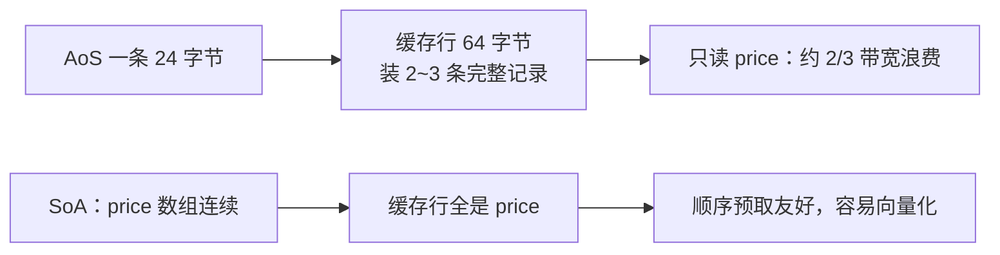

# 为什么“顺序扫一遍”比“跳着取”快

← [[学习/学习导航/2026-10-25-学习导航|今日导航]] · [[八股测试/2026-10-25#PERF-CACHE-001|回到测试题]] · 代码：[[学习/2026-10-25/示例代码/03_cache_false_sharing|03_cache_false_sharing 阅读版]]

## 先把词说清楚

**缓存行（cache line）**：CPU 与内存之间搬运数据的最小单位，x86-64 上通常是 64 字节。哪怕只读 1 个字节，也会把整行搬进缓存。

**时间局部性**：刚访问过的数据，很可能马上再被访问。

**空间局部性**：访问了某个地址，附近的地址很可能接着被访问。

**命中（hit）/ 未命中（miss）**：要的数据已在缓存里 / 需要去下一级取。未命中的代价比命中高一个到两个数量级（具体倍数随层级与平台变化）。

**AoS（Array of Structs）**：`struct { x, y, z } items[N]`，一条记录的所有字段连着放。

**SoA（Struct of Arrays）**：`x[N], y[N], z[N]`，同一字段的所有记录连着放。

## 它解决什么问题

现代 CPU 算得比内存快得多，性能瓶颈常常不是指令数，而是“数据到没到手边”。理解缓存行为，才能解释为什么：

- 链表遍历比数组慢（每次跳转都可能未命中）；
- 给结构体加一个字段，整体性能掉了；
- 同样一百万条数据，只读一个字段时 SoA 快得多。

## 一个可测的对比

```cpp
struct QuoteAoS { double price; double qty; double ts; };   // 24 字节
```

- `std::vector<QuoteAoS>` 顺序遍历 100 万条，每次读 24 字节，一条 64 字节缓存行只装 2~3 条；
- 只读 `price` 时，仍然要把 `qty`、`ts` 一起搬进缓存——有效带宽只有 1/3。

改成 SoA：

```cpp
struct QuoteSoA {
    std::vector<double> price;
    std::vector<double> qty;
    std::vector<double> ts;
};
```

只读 `price` 时，缓存行里全是要用的数据，也更容易被编译器向量化。

**本机实测**（GCC 13.1，`-O2`，100 万条，5 轮取最小）：

| 结构 | 只累加 price 用时 |
| --- | --- |
| AoS | 约 952 µs |
| SoA | 约 447 µs |

比值约 2.1 倍。这个数字只代表本机、本次编译选项与数据规模；换机器、换优化级别、换数据量都会变，**不要背固定倍数**。

## 图示



## 选择 AoS 还是 SoA

| 维度 | AoS | SoA |
| --- | --- | --- |
| 单条记录全字段访问 | 好，一次搬进来 | 差，要跳多个数组 |
| 批量只读某字段 | 差 | 好 |
| 代码可读性 | 好 | 一般 |
| 与外部接口对接 | 好 | 需要转换 |
| SIMD 向量化 | 较难 | 容易 |

工程上的常见做法：**对外接口用 AoS，内部热循环用 SoA**；或者在一个结构体里按“热字段 / 冷字段”拆开，避免冷字段挤占缓存行。

## 其他影响缓存的因素

- **指针追逐**：链表、树的每次 `next` 都可能未命中；能改成索引数组 + 连续存储就改。
- **步长**：按列遍历二维数组（大步长）远慢于按行遍历。
- **伪共享**：多线程写同一缓存行的不同变量，见 [[学习/2026-10-25/06-伪共享]]。
- **预取**：顺序访问硬件能预测；随机访问可以考虑软件预取，但收益要看具体负载。

## 边界与常见误解

**“数组一定比链表快？”** 顺序遍历时通常是；但如果在头部频繁插入删除，数组的搬移成本可能更大。要看访问模式和操作组合。

**“缓存行一定是 64 字节？”** x86-64 上常见是 64；这不是语言标准。写代码时用 `std::hardware_destructive_interference_size`（C++17）或平台常量。

**“SoA 一定更快？”** 只在“批量访问少量字段”时成立。逐条处理完整记录时，SoA 反而要多次未命中。

**“优化了缓存就一定更快？”** 先测量再优化。编译器优化、数据规模、分支预测都可能盖过缓存效应。

## 使用场景

- **行情/订单簿**：价格、数量、时间戳按列存，撮合与统计只扫需要的列。
- **回测**：对历史数据做批量计算，SoA + 连续内存是常态。
- **通用业务**：保持 AoS，可读性优先，热点路径再单独优化。

## 变式与口述总结

> 缓存行是 CPU 搬数据的最小单位，通常 64 字节。顺序访问能利用空间局部性，随机跳转容易未命中。AoS 把一条记录放一起，适合整体处理；SoA 把同一字段放一起，适合批量只读某列，也更容易向量化。选哪种取决于访问模式，并且要实测。

**变式：**

1. 遍历 `vector<struct{...}>` 只读一个字段，为什么可能浪费带宽？
2. 链表遍历慢在哪里？如果一定要用链表，能怎么缓解？
3. `std::hardware_destructive_interference_size` 有什么用？

## 来源

- 题型来源：[九坤投资量化实现工程师凉经](https://www.nowcoder.com/discuss/798223058384191488)（2025-09-18，候选人自述）记录了缓存命中、AoS/SoA 相关问答；本次仅能读取搜索索引与摘要，未加载全文。数据集与测量方法由本库设计。
- 技术依据：Intel 64 and IA-32 Architectures Optimization Reference Manual（缓存与预取章节）；`hardware_destructive_interference_size` 见 [N4659 support.types.layout](https://timsong-cpp.github.io/cppwp/n4659/support.types.layout)。
