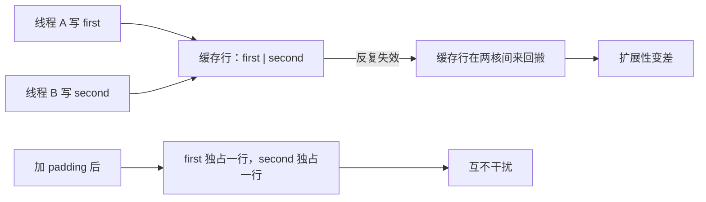

# 伪共享：两个线程明明没共享数据，却互相拖慢

← [[学习/学习导航/2026-10-25-学习导航|今日导航]] · [[八股测试/2026-10-25#PERF-FALSESHARE-001|回到测试题]] · 代码：[[学习/2026-10-25/示例代码/03_cache_false_sharing|03_cache_false_sharing 阅读版]]

## 先把词说清楚

**伪共享（false sharing）**：多个核上的线程分别写**不同变量**，但这些变量落在**同一条缓存行**里。缓存一致性协议以“行”为单位维护所有权，于是每个线程的写入都让对方的那份副本失效，缓存行在两核之间来回搬。

**真共享（true sharing）**：线程确实读写同一个变量，这时同步是必须的。

**缓存一致性（cache coherence）**：多核之间保证“同一地址的写入最终一致”的机制（x86 用 MESI 一类协议），代价以缓存行为单位。

关键点：**伪共享只影响性能，不影响正确性**。代码没错，就是慢。

## 它解决什么问题

无。它是问题本身。需要解决的是“为什么多线程扩展性差”这个现象。

## 一个典型例子

```cpp
struct Counters {
    std::atomic<long> first{0};    // 两条计数逻辑毫无关系
    std::atomic<long> second{0};
};

Counters counters;
// 线程 A 反复 ++counters.first
// 线程 B 反复 ++counters.second
```

两个变量紧挨着，很可能在同一条 64 字节缓存行里。线程 A 写 `first` 会让 B 缓存里的那一行失效，B 写 `second` 又让 A 失效——两个线程运行得越“同步”，互相拖累越明显。

修复：让它们分别独占缓存行。

```cpp
struct alignas(64) PaddedCounter {
    std::atomic<long> value{0};
};

struct Counters {
    PaddedCounter first;
    PaddedCounter second;
};
```

**本机实测**（GCC 13.1，`-O2`，两线程各做 200 万次 `fetch_add(relaxed)`，5 轮取最小）：

| 布局 | 用时 |
| --- | --- |
| 两计数器同一缓存行 | 约 48.7 ms |
| 各占一条缓存行 | 约 8.6 ms |

比值约 5.7 倍。这是本机一次观察，换 CPU、换核数、换负载都会变；重点是**量级差异确实存在**，而不是记住 5.7。

## 更现代的写法

C++17 提供常量：

```cpp
#include <new>
struct alignas(std::hardware_destructive_interference_size) PaddedCounter {
    std::atomic<long> value{0};
};
```

`hardware_destructive_interference_size` 表示“会互相干扰的缓存行粒度”，用它可以避免硬编码 64，但它不保证在所有平台都等于 64。

## 图示



## 怎么发现它

- **测量**：单线程版本与双线程版本的吞吐对比；线程数增加但吞吐不增甚至下降，就要怀疑。
- **工具**：`perf c2c`（Linux）能直接报告缓存行竞争；`perf stat` 看 cache-miss 与失效计数。
- **代码审查**：多个线程各自写的计数器/标志位挨在一起，是典型信号。

## 边界与常见误解

**“加 padding 就一定能提升？”** 只有竞争确实发生、且确实是缓存行冲突时才有用。单线程或低频写入没有收益，反而浪费内存。

**“用原子变量就不会有伪共享？”** 原子解决“数据竞争”，不解决“缓存行打架”。原子操作在伪共享下更慢。

**“每个线程一个计数器就没问题？”** 要注意它们别紧挨着放在同一个数组里——`std::atomic<long> counters[8]`，每项 8 字节，8 个就在同一行里。

**“伪共享会导致结果错误？”** 不会。它是性能问题；结果错误通常来自缺同步。

## 使用场景

- **交易系统**：每个线程的统计计数、序列号、状态标志，按缓存行隔离。
- **线程池**：每个 worker 的任务计数、本地队列指针。
- **性能测试**：做基准测试时，多个线程写同一个结果结构体，会得到误导性的结论。

## 变式与口述总结

> 伪共享是多核线程写同一缓存行里的不同变量，缓存一致性协议反复让整行失效，导致性能下降但不影响正确性。发现靠 `perf c2c` 和多线程扩展性测试；解决靠 padding 或 `alignas(hardware_destructive_interference_size)` 让变量独占缓存行，或者改成每线程本地累加、最后合并。

**变式：**

1. 为什么 `std::atomic<long> a, b;` 挨着放可能变慢？
2. 伪共享和真共享的区别是什么？
3. 除了 padding，还有什么消除伪共享的办法？

## 来源

- 题型来源：[九坤投资量化实现工程师凉经](https://www.nowcoder.com/discuss/798223058384191488)（2025-09-18，候选人自述）记录了伪共享相关问答；本次仅能读取搜索索引与摘要，未加载全文。示例与测量由本库设计。
- 技术依据：[N4659 support.types.layout](https://timsong-cpp.github.io/cppwp/n4659/support.types.layout)（`hardware_destructive_interference_size`）；`perf c2c` 见 [perf-c2c(1)](https://man7.org/linux/man-pages/man1/perf-c2c.1.html)。
