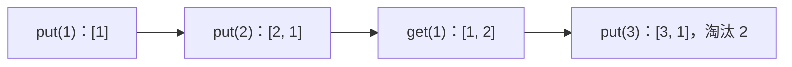

# 07 · 练习：设计 LRU 测试序列

← [[学习/学习导航/2026-10-25-学习导航|学习导航]] · [[八股测试/2026-10-25#EX-20261025-001 · 练习：设计 LRU 测试序列|测试题]] · [[学习/2026-10-25/05-LRU缓存|LRU 机制]]

先写下 `put(1)、put(2)、get(1)、put(3)` 每一步从最近到最久的顺序：`[1] → [2,1] → [1,2] → [3,1]`，所以被淘汰的是 2。再加容量 0、重复 key、更新 value 和未命中等边界。代码只演示确定性顺序检查，查找使用线性 `find`；完整的平均常数查找版本在 [[学习/2026-10-25/示例代码/05_lru|05_lru]]。



## 为什么测试不能只看最后一次返回值

容量为 2 的 LRU 要同时检查**值**与**次序**。`put(1,10)、put(2,20)` 后，2 比 1 新；`get(1)` 应返回 10，还要把 1 刷新为最近使用。若实现忘记刷新，紧接着 `put(3,30)` 就会错淘汰 1。测试因此不能只断言 `get(1)==10`，还应继续断言 `get(2)` 未命中、`get(1)` 仍命中，这才能暴露错误的淘汰顺序。

再列三类边界：容量 0 时任何 `put` 都不应留下数据；对已存在的 key 调 `put(1,99)` 应更新值并刷新次序，条目数不增加；未命中要能与合法值 0 区分。若实现允许异常，还要检查某步失败后“哈希表和链表仍一致”。下方小程序只是**顺序模型**：`recent` 保存 key，用 `std::find` 线性找旧节点，所以它没有实现正式 LRU 的平均常数查找；它的价值是给你一条容易核对的期望轨迹。完整缓存实现见[[学习/2026-10-25/05-LRU缓存|上一专题]]。

读 `touch` 时按三步走：找到旧 key 就先移除，再把 key 放到表头；若容量超过 2，就删除尾部。`[&]` 表示 lambda 引用捕获外部的 `recent`，所以每次调用都在改同一张表。最后 `assert` 检查头是 3、尾是 1，且 2 已消失。若想把练习变成更强的测试，可逐步记录每次操作后的完整序列，并加入重复 key、容量 0 和不同插入顺序。

## 完整代码

```cpp
// 目的：用确定性测试序列检查 LRU 的容量、命中刷新、更新与淘汰。
// 前置：此练习用 list 保存键，模拟顺序；实现完整缓存参见 05_lru.cpp。
#include <algorithm> // find：教学版线性查找。
#include <cassert>   // assert：逐步核对期望。
#include <iostream>  // cout：报告测试结果。
#include <list>      // list：前端为最近使用。

int main() {
    std::list<int> recent; // 这里只演示状态转移，不把线性查找称为 O(1)。
    auto touch = [&](int key) { // 引用捕获，操作 main 中的同一条链表。
        auto found = std::find(recent.begin(), recent.end(), key);
        if (found != recent.end()) recent.erase(found); // 旧位置删除。
        recent.push_front(key); // 新位置为最近使用。
        if (recent.size() > 2) recent.pop_back(); // 超容量淘汰最久未用。
    };
    touch(1); touch(2);       // 顺序：2,1。
    touch(1);                 // 顺序：1,2；命中刷新。
    touch(3);                 // 顺序：3,1；应淘汰 2。
    assert(recent.front() == 3 && recent.back() == 1);
    assert(std::find(recent.begin(), recent.end(), 2) == recent.end());
    std::cout << "LRU sequence checked\n";
}
```

**逐步核对代码**：`recent` 的表头表示最近使用；`touch(1)、touch(2)` 得到 `[2,1]`，再次 `touch(1)` 会先找到并删掉旧 1，再放回表头，得到 `[1,2]`。`touch(3)` 使链表暂时有三项，`pop_back` 删除最久的 2，剩 `[3,1]`。三个 `assert` 分别检查头、尾和 2 已不存在。

这里的 `find` 是线性扫描，所以这只是正确性参照模型。要测试正式 LRU 实现，还应将每步 `get/put` 的返回值和内部次序与模型逐步比对，覆盖容量 0、重复更新和未命中。一次运行通过只说明这些输入满足期望，不能替代其它序列和异常路径测试。

## 把练习变成一张测试清单

先固定容量 2，按操作逐步记录 `[最近,…,最久]` 和每次 `get` 的返回值，而不是只看程序最后输出。测试“读会刷新”：`put(1,10), put(2,20), get(1), put(3,30)` 后应保留 1、3，淘汰 2。测试“写已有 key 会刷新且更新值”：继续 `put(1,99)`，此时 1 应成为最近，再读 1 得到 99，条目总数不变。测试合法值 0 时，未命中不能也返回普通整数 0，应使用 `optional` 或明确的命中标志区分。

还应单独测容量 0、容量 1、连续多次读取同一 key、连续插入超过容量以及淘汰后重新插入原 key。每条用例不仅断言返回值，也应在调试接口可用时核对顺序与数量。若正式实现不暴露内部顺序，可继续插入新 key，再用“谁被淘汰”反推顺序是否正确。测试模型的线性查找虽慢，但逻辑简单，适合对照优化版逐操作比较；不要把模型误当成生产缓存。
