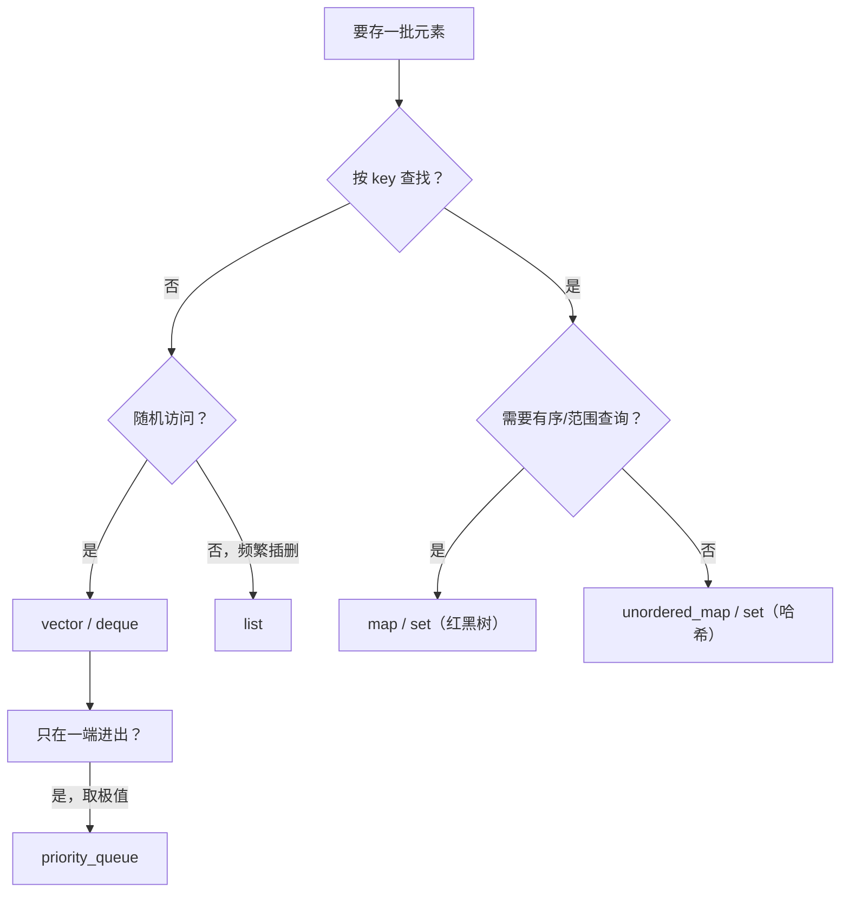

# STL 容器怎么选：先问访问模式

← [[学习/学习导航/2026-10-26-学习导航|今日导航]] · [[八股测试/2026-10-26#STL-CONTAINER-001|回到测试题]]

## 先把词说清楚

**序列容器**：元素按插入位置线性存放——`vector`、`deque`、`list`、`array`、`string`。

**关联容器**：按 key 有序组织——`set`、`map`、`multiset`、`multimap`，常见实现是红黑树。

**无序关联容器**：按哈希组织——`unordered_set`、`unordered_map`，不保证遍历顺序。

**容器适配器**：借用别的容器提供受限接口——`stack`（默认 `deque`）、`queue`（默认 `deque`）、`priority_queue`（默认 `vector` + 堆算法）。

**迭代器稳定性**：插入/删除后，之前拿到的迭代器、指针、引用还能不能用。

## 它解决什么问题

不同容器在“随机访问、插入删除、有序遍历、内存开销”上各有取舍。选错容器不会让程序错，但会让复杂度差一个数量级。

## 一张表先建立直觉

| 容器 | 底层（常见实现） | 随机访问 | 头部插入 | 中间插入 | 查找 | 遍历顺序 |
| --- | --- | --- | --- | --- | --- | --- |
| `vector` | 连续数组 | O(1) | O(n) | O(n) | O(n) 线性 | 插入序 |
| `deque` | 分段连续 + 索引表 | O(1) | O(1) 摊还 | O(n) | O(n) | 插入序 |
| `list` | 双向链表 | 无 | O(1) | O(1)* | O(n) | 插入序 |
| `map` / `set` | 红黑树 | 无 | — | O(log n) | O(log n) | 按 key 有序 |
| `unordered_map` / `set` | 哈希桶 | 无 | — | 平均 O(1) | 平均 O(1)，最坏 O(n) | 无序 |
| `priority_queue` | 堆（默认 `vector`） | 只读堆顶 | — | O(log n) 插入 | O(1) 取最大 | 堆序 |

\* `list` 中间插入 O(1) 的前提是**你已经拿到了那个位置的迭代器**；只知道“第 k 个”，找过去要 O(k)。

## 选择的四个问题

1. **主要是按下标访问，还是按 key 查找？** 下标 → `vector`；按 key → `map`/`unordered_map`。
2. **需要有序遍历或范围查询吗？** 需要 → `map`/`set`（`lower_bound`、区间遍历）；不需要 → `unordered_*`。
3. **插入删除发生在哪里？** 尾部为主 → `vector`；头尾都要 → `deque`；已有迭代器位置的频繁插删 → `list`。
4. **在乎内存与缓存吗？** `vector` 连续、缓存友好；`list` 每节点一次分配 + 两个指针，遍历慢。

## 图示

## 常见追问：vector 和 list 怎么选

- `vector`：尾部追加摊还 O(1)，随机访问 O(1)，连续内存；扩容会搬元素，使迭代器/引用失效。
- `list`：任意位置 O(1) 插删（已有迭代器），插删不影响其他元素；但无随机访问，节点分散，遍历慢。

多数场景 `vector` 更好，因为它对缓存友好；只有在“确实频繁在中间插删且有稳定迭代器”时 `list` 才占优。

## 边界与常见误解

**“list 插入是 O(1)，所以哪都比 vector 快？”** 找位置的成本常常被忽略；而且链表遍历的缓存劣势在数据量大时非常明显。

**“unordered_map 查找永远 O(1)？”** 平均如此，最坏是 O(n)——大量哈希冲突时退化成链表遍历。

**“map 的迭代器删除一个元素后全失效？”** 不会。删除只让指向被删元素的迭代器失效；`vector` 扩容则让全部失效。

**“deque 是连续内存？”** 不是。它是分段连续 + 中控索引，所以支持 O(1) 随机访问，但不像 `vector` 那样整块连续。

## 使用场景

- **行情快照列表**：`vector`，顺序遍历 + 偶尔尾部追加。
- **订单号索引**：`unordered_map<OrderId, Order>`，单点查找。
- **按价格排序的订单簿**：`map<Price, Level>` 或 `map` + 自定义比较，支持相邻价位遍历。
- **TopK 维护**：`priority_queue`。

## 变式与口述总结

> 选容器先看访问模式：按下标用 vector，按 key 用关联容器；要顺序或范围查询用 map/set，不要有序就用 unordered；插删位置固定且有迭代器才考虑 list；只取极值用 priority_queue。复杂度要连着“找位置的成本”和“迭代器失效规则”一起说。

**变式：**

1. 需要频繁在头部插入、也随机访问，选什么？
2. `map` 和 `unordered_map` 各自的最坏复杂度？
3. 只给“第 k 个元素”，`list` 插入还是 O(1) 吗？

## 来源

- 题型来源：[滴滴 C++ 岗面经](https://www.iamshuaidi.com/4432.html) 一面原问“C++ 有很多容器，介绍几个，map 和 unordered_map 的底层数据结构，各自优缺点，你会如何选择”；[Reddit r/cpp 候选人自述](https://www.reddit.com/r/cpp/comments/17r95li/questions_from_one_job_interview_on_c_developer/) 也列出了容器比较。镜像页未标发布日期，本次访问 2026-10-30。
- 标准依据：[N4659 container.requirements](https://timsong-cpp.github.io/cppwp/n4659/container.requirements)（复杂度与失效规则按各容器条款）。
