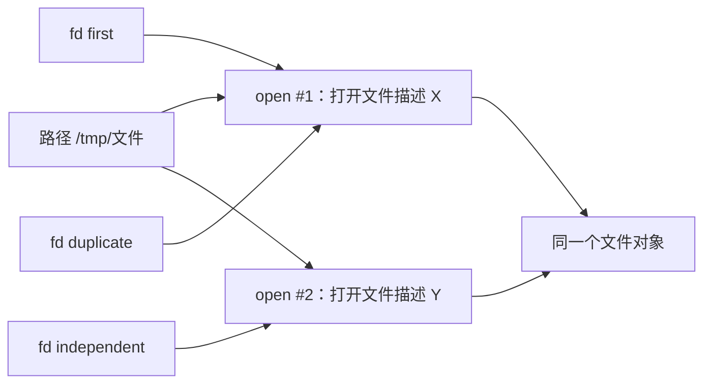

# 文件描述符、打开文件描述与共享偏移

← [[学习/学习导航/2026-10-26-学习导航|今日导航]] · [[八股测试/2026-10-26|今日自测]]

> [!abstract] 今天要弄懂什么
> 同一个文件被打开两次，和对一次打开结果调用 dup，有什么区别？两个 fd 的偏移量会怎样变化？

## 先把名词说清楚

文件描述符（fd）先看成进程拿到的一张‘取件号’。操作系统要知道这张号对应哪个打开的对象，真正记录读写位置的是‘打开文件描述’。文件名只是找对象的路径；inode 是文件系统层面的对象标识，三者不能混为一谈。

## 为什么会遇到这个问题

日志轮转、父子进程、库函数接收 fd 时，若误以为每个整数都独立维护位置，读取可能跳过数据。要判断共享什么，先找 fd 是否指向同一个打开文件描述。

## 用一个具体过程理解

把文件想成一本书：路径是书架位置，文件对象是那本书，打开文件描述是‘这次借书的书签’，fd 是借书柜台给你的取件号。`open` 两次是领两枚书签；`dup` 是给同一枚书签再发一个取件号。因此共享偏移的不是‘相同路径’，而是‘同一次打开’。`fork` 后父子 fd 的整数可能相同，但是否共享偏移取决于它们是否继承同一个打开文件描述。若父进程先读 2 字节，子进程再从该继承 fd 读，子进程通常从更新后的偏移继续；若两边独立 open，则各有位置。`pread(fd, buf, n, offset)` 明确指定本次读取的偏移，且不改变打开文件描述的当前偏移，适合多个读者各自读取固定区间。文件路径被替换后，已经打开的 fd 仍可读旧对象，这正是日志轮转和快照切换时必须考虑的生命周期。

## 从代码看执行顺序

完整源码如下；同一份代码也在阅读版和 `.cpp` 中，改动时须三处同步。

```cpp
// 目的：观察两次 open 与 dup 在文件偏移上的差异（Linux/POSIX，C++17）。
// 步骤：创建临时文件 → 写入 ABCDEFGH → 复制/重新打开 → 顺序读取。
// 观察：first 读 AB 后，duplicate 读 CD；independent 仍从头读 AB。
#include <fcntl.h>      // open、O_RDONLY
#include <unistd.h>     // read、write、lseek、dup、close、unlink
#include <cstdlib>      // mkstemp
#include <iostream>     // cout
#include <stdexcept>    // runtime_error
#include <string>       // string

int main() {
    char path[] = "/tmp/bagu_fd_XXXXXX"; // mkstemp 会把 X 替换为唯一后缀。
    const int first = ::mkstemp(path);    // 返回可读写 fd，失败为 -1。
    if (first == -1) throw std::runtime_error("mkstemp failed");
    const char data[] = "ABCDEFGH";
    if (::write(first, data, 8) != 8 || ::lseek(first, 0, SEEK_SET) == -1)
        throw std::runtime_error("prepare failed");
    const int duplicate = ::dup(first);   // 新 fd 指向 first 的同一打开文件描述。
    const int independent = ::open(path, O_RDONLY); // 另一次 open：独立偏移。
    if (duplicate == -1 || independent == -1)
        throw std::runtime_error("open or dup failed");
    ::unlink(path); // 只移除目录名；已打开的 fd 仍可访问此文件。
    auto read_two = [](int fd) {
        char bytes[3]{}; // 多留一字节给 C 字符串终止符 0。
        if (::read(fd, bytes, 2) != 2) throw std::runtime_error("read failed");
        return std::string(bytes, 2); // 指定长度，避免依赖隐式终止符。
    };
    std::cout << read_two(first) << ' ' << read_two(duplicate) << ' '
              << read_two(independent) << '\n';
    ::close(independent);
    ::close(duplicate);
    ::close(first);
}
```

逐步追踪：

1. `open(path, O_RDWR)`：创建第一个打开文件描述，初始偏移为 0。
2. `dup(first)`：只增加一张 fd 表入口，和 first 共享偏移。
3. `open(path, O_RDONLY)`：第二次打开同一个文件，新建独立打开文件描述。
4. 从 first 读 2 字节后，duplicate 从第 3 字节继续读；independent 从第 1 字节读。

**输出与保证：**示例的预期输出是 `AB CD AB`；这里用普通文件，长度固定且逐次读取。真实接口仍要检查短读写、错误和关闭失败。

## 把关系画出来



图中箭头表示本节讨论的状态或依赖；它不是硬件时序图。

## 在项目里什么时候用

在交易系统读回放文件时，不同消费者要各自定位，分别 open 或使用显式偏移的 pread；同一串行读流程可复用一个 fd。`O_CLOEXEC` 可防止意外把 fd 带入 exec 后的新程序。

## 易错边界与反例

- fd 号可能被 close 后立即复用；保存旧整数并继续使用会误操作别的对象。
- 同一文件被两次 open 不代表底层数据有两份，只是打开状态不同。
- 共享偏移的访问仍需设计并发协议；这里的顺序示例没有并发。

## 换一个条件自己试

把 `dup` 改为第二次 `open`，预测第二次读取的内容；再解释 `fork` 继承时哪些 fd 共享偏移。

## 30 秒口述

> fd 是进程内索引；open 新建打开文件描述，dup/fork 复制引用并共享偏移；需要独立位置时不要只复制 fd。

## 来源与适用范围

**题型来源：**[滴滴面经一二三面9.26求offer](https://www.nowcoder.com/discuss/353155589951922176)明确记录了‘文件描述符讲一下’及跨进程共享 fd 的追问；本题把问法具体化为 open/dup 偏移实验。

**技术核对（2026-10-26 访问）：**
- [Linux open(2)](https://man7.org/linux/man-pages/man2/open.2.html)
- [Linux dup(2)](https://man7.org/linux/man-pages/man2/dup.2.html)

本节代码面向 Linux/POSIX，语言基线为 C++17；涉及文件系统与设备的结论需以运行环境为准。
