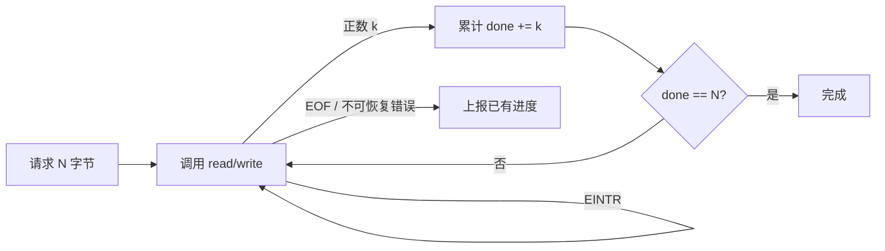

# read/write 为什么要处理短读写

← [[学习/学习导航/2026-10-26-学习导航|今日导航]] · [[八股测试/2026-10-26|今日自测]]

> [!abstract] 今天要弄懂什么
> 一次 write 要写 100 字节，只返回 37；下一步应该怎么做？read 返回 0、-1 又分别表示什么？

## 先把名词说清楚

‘短写’就是请求写 N 字节，调用只完成其中 k 字节（0 < k < N）；‘短读’同理。`errno` 是这次失败时的错误原因。`EINTR` 表示调用被信号打断，`EAGAIN` 表示此刻在非阻塞接口上无法继续。

## 为什么会遇到这个问题

日志记录若只调用一次 write 就把返回当成功，可能只存下半条前缀。文件回放若只 read 一次就当作整条消息，也会把尚未读到的字节误判成坏数据。

## 用一个具体过程理解

举例：要写 100 字节，第一轮返回 37，只能说明前 37 字节成功；第二轮应传入 `data + 37`、长度 63。若第二轮又返回 20，累计变成 57，继续处理剩余 43。这个‘累计进度’模式与 10/23 的 TCP 分帧相通：底层一次传输的边界不等于一条业务记录的边界。对读操作，要分清三种结局：正数是取得若干字节；零是当前读端到达 EOF；负数才去查看 `errno`。被信号打断的 `EINTR` 可在没有进度时重试；非阻塞 socket 的 `EAGAIN` 要返回事件循环等待就绪，不能写成无限重试的忙循环。普通文件读到 EOF 后，后续别的进程仍可能追加内容，所以‘当前结尾’也不是业务协议的永久结束标志。

## 从代码看执行顺序

完整源码如下；同一份代码也在阅读版和 `.cpp` 中，改动时须三处同步。

```cpp
// 目的：用统一的进度变量正确处理短读写（Linux/POSIX，C++17）。
// 步骤：创建临时文件 → 写完整 6 字节 → 定位开头 → 读完整 6 字节。
// 观察：普通文件本次可能每次都返回足量；循环是为其他合法返回情况准备。
#include <cerrno>       // errno、EINTR
#include <cstdlib>      // mkstemp
#include <iostream>     // cout
#include <stdexcept>    // runtime_error
#include <unistd.h>     // read、write、lseek、close、unlink

void write_all(int fd, const char* data, std::size_t size) {
    std::size_t done = 0; // 只记录已经成功写入的字节。
    while (done < size) {
        const ssize_t n = ::write(fd, data + done, size - done);
        if (n > 0) { done += static_cast<std::size_t>(n); continue; }
        if (n == -1 && errno == EINTR) continue; // 没有进度，重试剩余部分。
        throw std::runtime_error("write did not finish"); // 包含 0/其他错误。
    }
}

bool read_exact(int fd, char* data, std::size_t size) {
    std::size_t done = 0;
    while (done < size) {
        const ssize_t n = ::read(fd, data + done, size - done);
        if (n > 0) { done += static_cast<std::size_t>(n); continue; }
        if (n == 0) return false; // EOF：上层知道记录不完整。
        if (errno == EINTR) continue;
        throw std::runtime_error("read failed");
    }
    return true;
}

int main() {
    char path[] = "/tmp/bagu_exact_XXXXXX";
    const int fd = ::mkstemp(path);
    if (fd == -1) throw std::runtime_error("mkstemp failed");
    ::unlink(path);
    const char message[] = "ABCDEF"; // 不写末尾的字符串终止符。
    write_all(fd, message, 6);
    if (::lseek(fd, 0, SEEK_SET) == -1) throw std::runtime_error("seek failed");
    char result[6]{};
    if (!read_exact(fd, result, 6)) throw std::runtime_error("unexpected EOF");
    std::cout.write(result, 6); // 指定长度，不要求 result 是 C 字符串。
    std::cout << '\n';
    ::close(fd);
}
```

逐步追踪：

1. `done` 初始为 0，始终表示已处理的字节数。
2. `data + done` 从尚未处理的首字节开始；`size - done` 是剩余量。
3. 正数返回后只增加 `done`；`EINTR` 重新尝试同一剩余区间。
4. 读到 EOF 时若 `done < size`，返回不足，交给上层判定截断记录。

**输出与保证：**预期打印 `ABCDEF`。这次运行不强制制造短写；函数正确性依赖逐次检查返回值的控制流。

## 把关系画出来



图中箭头表示本节讨论的状态或依赖；它不是硬件时序图。

## 在项目里什么时候用

本地日志、管道和 socket 都应该按接口返回值处理。对 socket 的 EAGAIN，接回 10/23 的 epoll 等待；对普通文件，示例只覆盖同步调用。

## 易错边界与反例

- `read == 0` 对常规文件表示到达当前文件结尾；不能据此保证今后追加永远不会到来。
- `write == 0` 且仍有剩余时不应无限自旋；示例作为异常返回。
- 多线程同时写同一记录时还要单独设计记录原子性与顺序；循环只保证本线程把字节提交给内核。

## 换一个条件自己试

让写入函数在第 37 字节后模拟一次短写，写出第二轮传入的指针和长度；不要假设运行普通文件必定触发短写。

## 30 秒口述

> 系统调用返回实际字节数；正数推进进度，EINTR 重试，EOF 或错误上报；业务记录完整性由上层协议判断。

## 来源与适用范围

**题型来源：**[滴滴面经一二三面9.26求offer](https://www.nowcoder.com/discuss/353155589951922176)明确追问 fd 与读位置；短读写返回值情境和循环代码是本库自行设计的训练变式，原帖未问此题。

**技术核对（2026-10-26 访问）：**
- [Linux read(2)](https://man7.org/linux/man-pages/man2/read.2.html)
- [Linux write(2)](https://man7.org/linux/man-pages/man2/write.2.html)

本节代码面向 Linux/POSIX，语言基线为 C++17；涉及文件系统与设备的结论需以运行环境为准。
