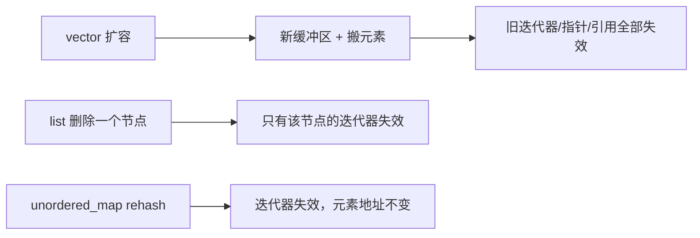

# 迭代器：算法依赖它，容器的修改又会弄坏它

← [[学习/学习导航/2026-10-26-学习导航|今日导航]] · [[八股测试/2026-10-26#STL-ITERATOR-001|回到测试题]] · 代码：[[学习/2026-10-26/示例代码/01_topk|01_topk 阅读版]]

## 先把词说清楚

**迭代器（iterator）**：指向容器元素的“泛化指针”，算法通过它遍历容器。

**迭代器分类（C++17）**：输入、输出、前向、双向、随机访问，五类能力逐级增强。

| 分类 | 能力 | 典型容器 |
| --- | --- | --- |
| 输入 | 单遍读 | `istream_iterator` |
| 输出 | 单遍写 | `ostream_iterator` |
| 前向 | 多遍、单向 ++ | `forward_list` |
| 双向 | 可 -- | `list`、`map`、`set` |
| 随机访问 | `+n`、下标、比较大小 | `vector`、`deque`、`array` |

C++20 又加了“连续迭代器”概念，用于 `vector` / `array` / `string`。

**失效（invalidation）**：容器发生插入、删除、扩容后，之前拿到的迭代器、指针、引用是否还能用。

## 它解决什么问题

算法只写一遍（`std::find`、`std::sort`），靠迭代器分类声明自己需要什么能力：`std::sort` 要求随机访问，所以不能排序 `list`；`list` 有成员函数 `sort()`，因为它只能做结点重排。

失效规则则决定了“遍历时能不能改容器”——这是面试里最常见的实操追问。

## 各容器的失效规则（C++17）

| 操作 | `vector` | `deque` | `list` / `map` / `set` | `unordered_*` |
| --- | --- | --- | --- | --- |
| 尾部插入 | 未扩容：末尾迭代器失效；扩容：全部失效 | 全部迭代器失效，引用仍有效 | 不影响其他元素 | 触发 rehash 时迭代器失效 |
| 头部插入 | 同尾部（都要搬） | 同上 | 不影响 | 同上 |
| 中间插入 | 插入点及之后失效 | 位置及之后失效 | 不影响 | 同上 |
| 删除 | 删除点及之后失效 | 同上 | 只失效被删的 | 只失效被删的 |
| `rehash` | — | — | — | 迭代器失效，引用/指针仍有效 |

**记忆方法**：连续存储的容器一搬就全废；链式/树式容器只废被删的那一个；哈希容器只在 rehash 时废迭代器但不动元素地址。

## 一个安全的观察程序

```cpp
std::vector<int> values = {1, 2, 3};
const int* before = values.data();
values.reserve(1024);                 // 主动扩容，避免后续反复搬家
const int* after = values.data();
std::cout << (before == after ? "未搬家" : "已搬家") << '\n';
```

`reserve` 之后 `data()` 可能变化——这就是“扩容让引用失效”的直接体现。**注意：** 不要为了观察而保留旧指针去解引用，那已经是悬垂。

## 遍历时删除的正确写法

```cpp
for (auto it = values.begin(); it != values.end(); ) {
    if (*it % 2 == 0) {
        it = values.erase(it);   // erase 返回下一个有效位置
    } else {
        ++it;
    }
}
```

错误写法 `for (auto it : values) { if (...) values.erase(it); }` 会在删除后继续用失效迭代器，是典型的未定义行为。

## 图示



## 边界与常见误解

**“迭代器就是指针？”** 对 `vector` 常常是，但对 `list`/`map` 是类对象；不要把 `vector` 的直觉套到所有容器。

**“`reserve` 之后引用一定有效？”** `reserve` 本身可能触发搬家；正确说法是“预留足够容量后，在容量范围内追加不会搬家”。

**“`erase` 之后 `end()` 还有效吗？”** 失效。遍历时要用 `erase` 的返回值继续。

**“`unordered_map` rehash 后元素地址会变？”** 标准保证引用和指针不失效，变的是迭代器。

## 使用场景

- **行情缓存**：用 `vector` + 索引而不是迭代器长期保存位置，扩容后重新取。
- **回调注册表**：`unordered_map` 删除时只失效被删项，但遍历中删除仍要用返回的迭代器。
- **算法选择**：需要随机访问的算法不能用于 `list`，改用成员函数或先拷到 `vector`。

## 变式与口述总结

> 迭代器按能力分五类，算法用分类声明需求，所以 `sort` 不能排 `list`。失效规则：连续存储的容器扩容全废、中间插删从该点起废；链式/树式只废被删的；哈希容器 rehash 废迭代器但不废元素地址。工程上遍历删除用 `erase` 的返回值，长期保存位置用索引。

**变式：**

1. `vector::push_back` 什么时候会让迭代器全部失效？
2. `unordered_map` rehash 后引用还安全吗？
3. 为什么 `std::sort` 不能用于 `list`？

## 来源

- 题型来源：[滴滴 C++ 岗面经](https://www.iamshuaidi.com/4432.html) 的容器比较题自然延伸到迭代器失效；本库把失效规则单独成题，属**扩展**。
- 标准依据：[N4659 vector](https://timsong-cpp.github.io/cppwp/n4659/vector)、[deque](https://timsong-cpp.github.io/cppwp/n4659/deque)、[list](https://timsong-cpp.github.io/cppwp/n4659/list)、[unord.req](https://timsong-cpp.github.io/cppwp/n4659/unord.req) 中的失效条款。
